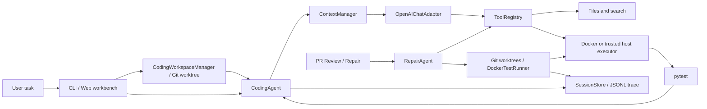

# selfForge Agent

**A Python Coding Agent with Reliable Execution and Self-Testing**

A Python coding agent with a complete foundational harness, focused on autonomous coding and test-backed verification.

[简体中文](./README.md) · [English](./README.en.md) · [Architecture](./docs/architecture.md) · [Product scope](./docs/product-scope.en.md) · [Roadmap](./docs/roadmap.md) · [Development guide (中文)](./docs/development.md)

```text
User task → native tool calling → search/read code → exact edits → pytest → JUnit evidence and trace
```

Run an end-to-end demo without an API key:

```sh
uv sync
uv run python examples/coding_demo.py
# Two generated fixtures: search_code → read_file → edit_file → run_tests → objective assertions
```

This demo checks the protocol and execution path; live model results are below. `selfforge-agent code` runs general coding tasks. PR review and Base/Head/Repaired repair remain specialized workflows.

## Capabilities and status

| Capability | Status | Current boundary |
| --- | --- | --- |
| Coding Agent Runtime | Implemented | OpenAI-compatible native tool calling, multiple turns, step/time limits, dynamic budget and verification feedback, provider fallback |
| Tools and sessions | Implemented | read/edit/search/bash/run_tests; bounded line-range reads of large files, pytest `-k` selection, workspace path checks, resumable JSONL sessions and traces |
| Context management & controls | Implemented | Truncated tool output, syntax- and CJK-aware token estimation, structured action compaction preserving recent turns, and interactive action approval hook |
| Docker executor | Implemented | Verified with a live Docker container; no network, resource limits, temporary workspace copied into tmpfs, separate artifact retrieval |
| Self-testing | Implemented | Nonempty JUnit success plus matching workspace fingerprints; external changes revoke evidence, and unbound legacy evidence needs retesting |
| Web Coding workbench | Implemented | Local Git repository tasks, live status and traces, cross-process cancellation, job history, and session resume; interrupted work needs an explicit resume |
| Coding workspaces | Implemented | New tasks default to a persistent branch and worktree from committed HEAD; resume, inspect bounded diffs, commit, create PRs, and explicitly clean up |
| PR Review / Repair | Implemented | Web review and checkout; repair edits use the constrained shared Tool Registry, Docker execution, JUnit evidence, and JSONL traces, while its proposal loop remains separate |
| Targeted test generation | Implemented (up to three candidates) | Optionally target a review risk on an added line; feed failed outcomes into another attempt and stop at the first Base-pass/Head-assertion-fail result |
| Repeatable Coding evaluation | Implemented (harness) | Pinned Git commits, independent visible/unseen tests, image IDs and failure categories; optional external reference fixes are checked before model calls. Five tasks passed reference qualification; a separate three-task, three-repeat DeepSeek run scored 9/9; formal 20-task acceptance remains open |

Bounded JUnit diagnostics feed test failures back into the same Coding Agent for inspection, repair and retesting. Run the live-model demo with a configured provider and Docker image:

```sh
uv run python examples/test_recovery_demo.py --provider deepseek
# Failed tests → read code/tests → source edit → retest → independent Docker verification
```

One DeepSeek run completed in 5 turns, kept the original tests unchanged, and passed all 4 independent checks. This is a generated-fixture demonstration, separate from formal task evaluation. See [test diagnostics](./docs/test-diagnostics.md) for private snapshots, bounds and reproduction.

The PR #30 combined version passed **257 local tests** at that time; this is historical. After PR #32, the latest local full suite reported **274 passed / 11 skipped** (the skipped tests require local Docker). The corresponding GitHub main-branch CI ran **274 unit tests and 11 Docker integration tests, all passing**. The current local non-integration suite passes **307 passed / 11 skipped**. This is not a model success rate; see the [workspace-evidence contract](./docs/workspace-evidence.md).

## Quick Start

Install Python 3.11+ and [uv](https://docs.astral.sh/uv/). PR workflows also need Git and [GitHub CLI](https://cli.github.com/). From this repository:

```sh
uv sync
export DEEPSEEK_API_KEY='your-key'  # or OPENROUTER_API_KEY
# Enable Docker first to use the default isolated executor
docker build -t selfforge-agent-sandbox:latest -f docker/Dockerfile .
uv run selfforge-agent code --repo ./your-project --task 'Fix the failing test and verify it'
```

`code` now creates a `selfforge/SESSION_ID` branch and separate worktree from the repository's committed HEAD by default. Uncommitted changes in the source checkout are excluded; file tools edit only the new worktree. Worktrees live under `${XDG_DATA_HOME:-~/.local/share}/selfforge-agent/worktrees/` and remain for review and commit after the task. The repository needs an initial commit. Use `--workspace direct` only when you explicitly want source-checkout edits.

Commands and tests run in Docker by default. The container has no network and bounded CPU/memory/processes. A temporary workspace copy excluding `.env`, local keys, and sessions is transferred into container tmpfs. Container command edits do not propagate back; `edit_file` makes persistent edits. The sample image includes pytest only. Use `selfforge-agent sandbox detect --repo ./your-project` to inspect repository layout, dependency specifications, and test setup. Use `selfforge-agent sandbox build` with a hash-locked requirements file and local wheelhouse, then select the result with `--image` or the Web Docker image field. Coding sessions save the immutable image ID; omitting the image on resume reuses it even after a tag changes. A pinned ItsDangerous checkout passed all 297 tests in the prepared image; see [dependency images](./docs/dependency-images.md). If Docker is unavailable, use `--sandbox host --trust-local` only for a trusted repository. The model receives files it reads and tool output.

DeepSeek and OpenRouter have default URLs and models. The web workbench can save a local key, URL, and automatically sync model lists. For another OpenAI-compatible endpoint, use `--model ID --base-url URL` and set `SELFFORGE_API_KEY` or `OPENAI_API_KEY`. `--provider openrouter` pins a provider; the default route falls back on request failure.

You can also start the local web workbench and enter a repository path and natural-language task in the browser:

```sh
uv run uvicorn selfforge_agent.api.app:app --host 127.0.0.1 --port 8000
# Open http://127.0.0.1:8000, select Docker, and start the Coding Agent
```

The page shows job status, the worktree path, a bounded diff against the base commit, and recent JSONL trace events. “Load history” restores jobs by repository; jobs can be cancelled or resumed by session ID. It can remove a worktree once there are no uncommitted or untracked files; the branch remains. New sessions live under `selfforge-agent/sessions/` and job metadata under `selfforge-agent/jobs/` in the user data directory, outside the target repository. To resume an older direct-edit session, select direct mode and enter its ID. After a server crash, a saved session is marked `interrupted` and can be resumed manually; a task that never saved a session must be started again. Cross-process file locks prevent concurrent Web edits or cleanup of one workspace. Cancellation takes effect between model and tool calls. Direct source-checkout edits require per-request confirmation. Web host execution also requires `SELFFORGE_ENABLE_HOST_TESTS=1` and explicit trust on each request.

## CLI

```sh
# General coding task
uv run selfforge-agent code --repo ./your-project --task 'Fix the add regression' \
  --max-steps 12 --time-budget 300

# Resume and inspect a session stored in the user data directory
uv run selfforge-agent code --repo ./your-project --resume SESSION_ID --task 'Continue and verify'
uv run selfforge-agent trace --repo ./your-project SESSION_ID

# Review diffs, commit changes, and create a GitHub PR; cleanup preserves the branch
uv run selfforge-agent workspaces list --repo ./your-project
uv run selfforge-agent workspaces diff SESSION_ID --repo ./your-project
uv run selfforge-agent workspaces commit SESSION_ID -m 'Fix add regression' --repo ./your-project
uv run selfforge-agent workspaces pr SESSION_ID --title 'Fix add regression' --repo ./your-project
uv run selfforge-agent workspaces remove SESSION_ID --repo ./your-project

# Explicitly edit the source checkout when needed
uv run selfforge-agent code --repo ./your-project --workspace direct --task 'Fix add'
# Also use --workspace direct to resume an older direct-edit session

# Inspect repository dependencies and environment setup (layout, pyproject/requirements, tests)
uv run selfforge-agent sandbox detect --repo ./your-project

# Run tests; Docker is the default
uv run selfforge-agent test --repo ./your-project --path tests

# Live Docker repair demo without an API key (build the image first)
uv run python examples/repair_demo.py

# Trusted host tests with JUnit counts
uv run selfforge-agent test --repo ./your-project --sandbox host --trust-local

# Specialized local PR comparison and Base/Head/Repaired repair
uv run selfforge-agent review --repo ./your-project --base BASE --head HEAD
uv run selfforge-agent repair --repo ./your-project --base BASE --head HEAD \
  --task 'Repair the regression shown by existing tests' --patch-output repair.patch

# Generate a regression test and check its Base/Head behavior; one attempt by default
uv run selfforge-agent generate-test --repo ./your-project --base BASE --head HEAD \
  --task 'add(2, 3) should return 5' --output test-evidence.json --test-output test_regression.py

# Inspect zero-based rule finding numbers, then target one with up to three attempts
uv run selfforge-agent review --repo ./your-project --base BASE --head HEAD
uv run selfforge-agent generate-test --repo ./your-project --base BASE --head HEAD \
  --task 'Check the behavior related to this risk' --finding-index 0 --max-candidates 3 \
  --output test-batch.json --test-output test_regression.py

# Or automatically prioritize added-line risks from diff and test the highest-priority target
uv run selfforge-agent generate-test --repo ./your-project --base BASE --head HEAD \
  --task 'Check behavior of top prioritized risk' --auto-target --max-candidates 3 \
  --output test-batch.json --test-output test_regression.py

# Explicit host execution for a trusted PR only
uv run selfforge-agent repair --repo ./your-project --base BASE --head HEAD \
  --task 'Repair the regression' --sandbox host --trust-local-tests
```

Agent statuses are `completed` (nonempty JUnit success, matching workspace fingerprint and final answer), `unverified` (finished without test evidence), `failed`, `max_steps`, `timed_out`, and `cancelled`. New sessions and traces live under `${XDG_DATA_HOME:-~/.local/share}/selfforge-agent/sessions/`, outside the target repository; older sessions remain resumable by ID. `workspaces remove` never forces deletion and refuses a dirty worktree. Ctrl-C interrupts a run. Provider fallback shares one model-call timeout budget, and cancellation is checked between provider attempts. An in-flight HTTP request relies on its transport timeout before cancellation is observed.

Each turn gives the model its remaining turns/time and current `run_tests` verification state; near the cap, it prioritizes verification and a final answer. Notices count toward the approximate context budget and are regenerated on resume. The cap includes the final answer. Feedback adds no model calls, does not run tests automatically, and does not promote unfinished tasks to success. See [budget feedback](./docs/runtime-budget.md).

## Architecture



The Runtime separates the loop, model adapter, tools, executor, context, and session modules. See the [architecture document](./docs/architecture.md). PR Repair now uses the same Tool Registry for exact edits with a stricter edit policy. Its model proposal and bounded repair loop remain separate from the general tool-calling agent.

## Verification and Evaluation

General Coding reuses the JUnit runners: `run_tests` needs exit code 0, at least one passing test, and no failures or errors. All-skipped suites, empty selections, and missing or malformed reports cannot establish completion. The tool returns counts and error details. General completion also requires equal pre/post-test and current workspace fingerprints. External changes or incomplete scans prevent completion and require retesting. Legacy evidence without workspace binding also needs retesting; see [content binding](./docs/workspace-evidence.md); see the [test evidence rules](./docs/test-evidence.md). `eval` independently reruns fixture tests and checks for a real source change; it does not trust the model's claim. PR Repair only emits a verified patch when Base tests pass, Head fails with an assertion, and Repaired passes. That establishes repair of an existing-suite regression, not causality for an individual review finding.

`generate-test` creates one pytest candidate by default. `--max-candidates 2/3` lets it use prior Base/Head results for further attempts, stops early on a differential result, and skips duplicate code. Multi-candidate generation has a 300-second total budget by default; `--time-budget` can raise it to at most 600 seconds. `--finding-index` selects a local rule finding; `--auto-target` (and Web API `auto_target`) automatically prioritizes added-line hypotheses by severity and category profiles to test the top-ranked risk. The server checks that the risk points to an actual added diff line. It writes `--test-output` only if Base passes and Head has an assertion failure with no collection errors. Other outcomes are `inconclusive` or `error`. Tests run only in temporary worktrees until explicitly exported. Reports now include causal link investigation (`causal_investigation`: whether Head failure tracebacks pass directly through the targeted file and line) and calibrated monetary cost estimation (`cost` / `total_cost`) for known model rates.

```sh
uv run selfforge-agent eval --offline       # Deterministic protocol check, not model skill
uv run selfforge-agent eval --provider deepseek  # Live model on generated fixtures
uv run python examples/benchmark_demo.py    # Repeated-evaluation protocol, synthetic fixture
# Prepare three local checkouts using the pilot guide, then run
uv run selfforge-agent eval-suite --manifest benchmark/real-pilot/suite-four-tasks.json \
  --repeats 1 --max-steps 18 --provider deepseek --no-fallback \
  --output .local/benchmark/four-tasks-report.json
uv run pytest
uv run ruff check .
```

`eval-suite` runs in Docker by default. It requires an assertion failure on the original commit, starts every attempt from a clean checkout, and only counts a run when allowed files change, the Agent verifies its edits, the evaluator independently reruns the specified visible tests, and an unseen test passes. `agent_test_keyword` can select relevant pytest tests explicitly. Cases can select their own Docker image; its ID is pinned before evaluation. Reports contain per-case rates, failure reasons, duration, and provider-reported token usage; they do not infer monetary cost. See the [benchmark guide](./docs/benchmark.md) and [three-repository pilot](./benchmark/real-pilot/README.md) for reproduction steps.

GitHub Actions runs locked dependency installation, Ruff, unit tests, and Docker integration tests on pushes to `main` and pull requests. The [PR #32 exact-head run](https://github.com/liuzhouquan/selfforge-agent/actions/runs/41031573755) and the [post-merge main run](https://github.com/liuzhouquan/selfforge-agent/actions/runs/41032250484) both passed; the latter ran 274 unit tests and 11 Docker integration tests. The earlier first-run result remains in the [evaluation history](./docs/evaluation.md).

On 2026-10-17, one local run produced **2/2** for offline protocol fixtures and **2/2** for DeepSeek's live tool-calling run. On 2026-10-27, three project-authored tasks across PocketFlow, boltons, and more-itertools scored **8/9** with three repeats each under the earlier gate; one attempt hit the step cap despite passing its holdout. After adding independent visible-test reruns and a large-file chunking task, four tasks scored **4/4** in one run each, with selected visible and unseen tests passing. On 2026-10-29, all nine cases in a candidate manifest passed the baseline-validity and visible-test checks; at that time its five new cases had not been run with a model. These observations use different gates and repeat counts and cannot be combined into a success rate. The 18-step limit came from earlier trials. The formal 20-task, three-repeat set remains open. See [evaluation notes](./docs/evaluation.md).

`selfforge-agent eval-validate --manifest MANIFEST` checks the negative baseline, allowed paths and positive reference fix without a model. Legacy manifests stay compatible. See [task validation](./docs/benchmark.md) and the [reference controls](./benchmark/validated-candidates/README.md). Qualification proves the reference passes these tests; coverage still needs human review.

On 2026-10-30, the two reference-qualified tasks with Runtime budget feedback scored **5/6** on DeepSeek with three repeats and unchanged limits. One attempt reached the step cap and failed its independent visible tests. All six called the official test tool; this small sample does not establish a success-rate improvement or increase the acceptance task count. See the [budget-feedback follow-up](./docs/runtime-budget.md) for per-run results and limitations.

The reference-qualified set now covers **5 tasks / 3 repositories**, all with passing Docker negative/positive controls. A separate fixed-policy run of depth pruning, zero chunks and replacement callback short-circuiting scored **9/9** on DeepSeek `deepseek-flash` (three repeats each), with all independent visible/holdout tests passing. These small project-authored tasks are reported separately from the historical 5/6 runs and do not complete the twenty-task acceptance set. See [iterator/traversal evaluation](./benchmark/validated-candidates/iterator-traversal.md) for contracts, per-attempt results and limitations.

## Specialized Workflows: PR Review

The web workbench can also import your own or someone else's accessible GitHub PR, inspect diffs and heuristic/model findings, check out an editable branch, generate a differential test, and optionally run verified repair. Findings remain `suspected`; import and review never execute PR code. Web test generation and repair run in Docker by default. Explicit host execution still requires `SELFFORGE_ENABLE_HOST_TESTS=1` and per-request trust. The app does not push, comment on, or merge PRs. Repair traces are stored in the checkout's `.selfforge/sessions/`; inspect them with `selfforge-agent trace --repo CHECKOUT RUN_ID`.

## Roadmap

Next, expand and freeze the reference-qualified 20-task acceptance set, then complete the product delivery flow from worktree diff through commit and PR creation. Automatic dependency detection and broader environment profiles also remain open. See the [development guide](./docs/development.md) for acceptance order.
