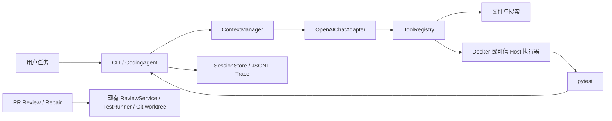

# selfForge Agent

**A Python Coding Agent with Reliable Execution and Self-Testing**

具备完整基础 Harness、以自主编程与测试验证为特色的 Python Coding Agent。

[简体中文](./README.md) · [English](./README.en.md) · [架构](./docs/architecture.md) · [路线图](./docs/roadmap.md)

```text
用户任务 → 原生 Tool Calling → 搜索与阅读代码 → 精确修改 → 运行 pytest → 检查退出码与轨迹
```

先运行一个无需 API Key 的端到端演示：

```sh
uv sync
uv run python examples/coding_demo.py
# 两道生成夹具：search_code → read_file → edit_file → run_tests → 客观断言
```

这是协议与执行链路演示；真实模型评测见下文。通用 Coding 任务由 `selfforge-agent code` 执行。PR Review、Base/Head/Repaired 测试修复是保留的专项工作流。

## 核心能力与状态

| 能力 | 状态 | 当前边界 |
| --- | --- | --- |
| Coding Agent Runtime | Implemented | OpenAI-compatible 原生工具调用，多轮执行，步数/时间限制，供应商回退 |
| 工具与会话 | Implemented | read/edit/search/bash/run_tests；JSON Schema、工作区路径校验、JSONL 恢复与轨迹 |
| Context 管理 | Implemented | 工具输出截断、近似 token 预算、保留任务约束的确定性摘要压缩 |
| Docker 执行器 | In Progress | 已实现无网络、资源限制、只挂载工作区的命令路径；当前开发环境没有可用 Docker daemon，容器实跑待验证 |
| Self-Testing | Implemented | 通过真实 pytest 退出码判断；未运行测试的任务标记 `unverified` |
| PR Review / Repair | Implemented | 原有 Web 审查、可编辑 checkout、Base/Head/Repaired 验证仍可用；逐步接入共享 Runtime |
| 自动生成针对性测试 | Planned | 现阶段依赖仓库已有测试 |

## Quick Start

需要 Python 3.11+、[uv](https://docs.astral.sh/uv/)；PR 工作流还需要 Git 和 [GitHub CLI](https://cli.github.com/)。在仓库目录执行：

```sh
uv sync
export DEEPSEEK_API_KEY='你的密钥'  # 或 OPENROUTER_API_KEY
# 为默认隔离执行构建镜像；需先启用 Docker
docker build -t selfforge-agent-sandbox:latest -f docker/Dockerfile .
uv run selfforge-agent code --repo ./your-project --task '修复失败的测试，并运行测试验证'
```

`code` 默认通过 Docker 运行命令，容器禁用网络、限制 CPU/内存/进程数，只挂载排除了 `.env`、本地密钥和会话目录的临时工作区副本；容器命令造成的文件修改不会回写，正式编辑由 `edit_file` 完成。示例镜像只预装 pytest；项目有额外依赖时需要扩展镜像。Docker 不可用时，对**可信仓库**可显式使用 `--sandbox host --trust-local`。Agent 的文件工具始终限制在 `--repo` 内；执行仓库代码仍需审慎选择运行环境。模型会收到读取的代码和工具输出。

DeepSeek 与 OpenRouter 默认 URL 和模型已配置；Web 工作台还支持本机保存密钥、URL 与模型列表自动同步。自定义 OpenAI-compatible 端点可用 `--model ID --base-url URL`，密钥从 `SELFFORGE_API_KEY` 或 `OPENAI_API_KEY` 读取。`--provider openrouter` 可指定供应商，默认自动路由并在调用失败时切换备用供应商。

## CLI

```sh
# 通用 Coding：自主检查、修改并运行测试
uv run selfforge-agent code --repo ./your-project --task '修复 add 的回归' \
  --max-steps 12 --time-budget 300

# 继续一个已有会话；会话保存在项目的 .selfforge/sessions/
uv run selfforge-agent code --repo ./your-project --resume SESSION_ID --task '继续并验证'
uv run selfforge-agent trace --repo ./your-project SESSION_ID

# 单独运行测试，默认使用 Docker
uv run selfforge-agent test --repo ./your-project --path tests

# 已信任的本机测试，可保留 JUnit 计数
uv run selfforge-agent test --repo ./your-project --sandbox host --trust-local

# 专项：本地 PR 比较审查与 Base/Head/Repaired 修复
uv run selfforge-agent review --repo ./your-project --base BASE --head HEAD
uv run selfforge-agent repair --repo ./your-project --base BASE --head HEAD \
  --task '修复现有测试证明的回归' --trust-local-tests --patch-output repair.patch
```

Agent 状态有 `completed`（最后修改后 pytest 成功）、`unverified`（结束但缺少测试证据）、`failed`、`max_steps`、`timed_out`、`cancelled`。会话与轨迹写入项目内被 Git 忽略的 `.selfforge/`，不会自动提交。运行中可用 Ctrl-C 中断；当前取消检查发生在模型调用和工具调用之间，单个调用仍受自身超时限制。

## 架构



Runtime 分为 Agent Loop、模型适配器、工具注册、执行器、上下文与会话模块，详见[架构文档](./docs/architecture.md)。通用 Coding 任务与旧 PR 工作流共用供应商配置；PR Repair 仍使用原有有界修复循环，迁移到统一 Runtime 是后续工作。

## Verification 与 Evaluation

通用 Coding Agent 的完成判断以 `run_tests` 的实际退出码为证据；若最后一次编辑之后没有成功测试，则返回 `unverified`。`eval` 还会独立重新运行夹具测试，并检查源文件确实发生变化，不采信模型口头结论。PR Repair 则要求 Base 测试通过、Head 出现断言失败、Repaired 测试通过，才输出已验证补丁；这证明现有测试的回归已修复，尚不证明某条审查发现的因果关系。

```sh
uv run selfforge-agent eval --offline       # 确定性工具协议回归，不代表模型能力
uv run selfforge-agent eval --provider deepseek  # 真正调用模型，运行生成夹具
uv run pytest
uv run ruff check .
```

2026-10-17 的一次本地运行：离线协议夹具 **2/2**；DeepSeek 真实工具调用 **2/2**。两道夹具分别修复加法和姓名规范化，成功条件是文件已修改且独立 pytest 退出码为 0。样本很小，不构成通用 Coding Agent 基准；详情和复现限制见[评测记录](./docs/evaluation.md)。

## Specialized Workflows：PR Review

`uv run uvicorn selfforge_agent.api.app:app --host 127.0.0.1 --port 8000` 启动 Web 工作台。可以导入自己或他人的可访问 GitHub PR，查看 Diff 与启发式/模型发现、下载可编辑分支，并按需运行受信任的修复工作流。审查发现始终标为 `suspected`；导入与审查不会执行 PR 代码。Web 修复运行主机 pytest，需要 `SELFFORGE_ENABLE_HOST_TESTS=1` 和单次明确勾选信任。现阶段 Web 修复没有 Docker 隔离；不要对不可信 PR 启用主机测试。工具不会自动推送、评论或合并 PR。

## Roadmap

优先把 PR Repair 与通用 Runtime 的工具、执行器和会话轨迹合并，并在可用 Docker daemon 上做真实隔离验证。之后开发针对性测试生成、PR 风险驱动测试和更广的客观评测。见[路线图](./docs/roadmap.md)。
