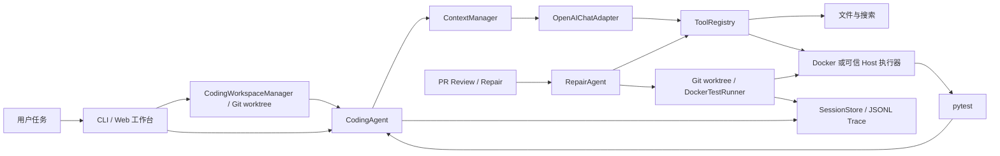

# selfForge Agent

**A Python Coding Agent with Reliable Execution and Self-Testing**

具备完整基础 Harness、以自主编程与测试验证为特色的 Python Coding Agent。

[简体中文](./README.md) · [English](./README.en.md) · [架构](./docs/architecture.md) · [产品边界](./docs/product-scope.md) · [路线图](./docs/roadmap.md) · [开发指南](./docs/development.md)

```text
用户任务 → 原生 Tool Calling → 搜索与阅读代码 → 精确修改 → 运行 pytest → 检查 JUnit 证据与轨迹
```

先运行一个无需 API Key 的端到端演示：

```sh
uv sync
uv run python examples/coding_demo.py
# 两道生成夹具：search_code → read_file → edit_file → run_tests → 客观断言
```

这是协议与执行链路演示；真实模型评测见下文。通用 Coding 任务由 `selfforge-agent code` 执行。PR Review、Base/Head/Repaired 测试修复是保留的专项工作流。

## 核心能力与状态

| 能力 | 状态 | 当前边界 |
| --- | --- | --- |
| Coding Agent Runtime | Implemented | OpenAI-compatible 原生工具调用，多轮执行，步数/时间限制、动态预算与验证状态提示，供应商回退 |
| 工具与会话 | Implemented | read/edit/search/bash/run_tests；大文件有界分段读取、pytest `-k` 选择、工作区路径校验、JSONL 恢复与轨迹 |
| Context 管理 | Implemented | 工具输出截断、近似 token 预算、保留任务约束的确定性摘要压缩 |
| Docker 执行器 | Implemented | 真实 Docker 容器测试通过；无网络、资源限制，临时工作区通过 tar 送入 tmpfs，产物单独取回 |
| Self-Testing | Implemented | 非空 JUnit 成功与工作区内容指纹共同验证；外部改动撤销证据，旧证据需重测 |
| Web Coding 工作台 | Implemented | 本机 Git 仓库任务、实时状态与轨迹、跨进程取消、历史任务查询和会话续跑；服务中断的任务需手动续跑 |
| Coding 工作区 | Implemented | 默认从已提交的 HEAD 创建独立分支与持久 worktree；可续跑、在网页查看有界 Diff、手动清理 |
| PR Review / Repair | Implemented | Web 审查与 checkout；修复编辑复用受限 Tool Registry、Docker 执行器、JUnit 证据与 JSONL 轨迹，模型提案循环仍独立 |
| 针对性测试生成 | Implemented（最多 3 个候选） | 可关联 PR 新增行上的审查风险；失败结果回填后重试，首个 Base 通过且 Head 断言失败的候选给出差异证据 |
| 可重复 Coding 评测 | Implemented（评测工具） | 固定 Git commit、独立可见/隐藏测试、锁定镜像与失败分类；支持模型调用前验证外部参考补丁。5 题通过参考预检；三题各 3 次 DeepSeek 运行 9/9，正式 20 题 × 3 次模型验收尚未完成 |

失败测试会通过有界 JUnit 诊断回填给同一个 Coding Agent，它可读取相关代码、修复并重测。可运行真实模型演示（需配置供应商和 Docker 镜像）：

```sh
uv run python examples/test_recovery_demo.py --provider deepseek
# 测试失败 → 读取代码与测试 → 修改源码 → 重测 → 独立 Docker 验证
```

一次 DeepSeek 运行以 5 轮完成，原测试未改，独立验证 4 项通过。这是生成夹具演示，不计入正式任务评测。失败快照、边界与复现条件见[测试诊断](./docs/test-diagnostics.md)。

PR #30 组合版本当时的本地全量验证为 **257 项通过**，这是历史结果。PR #32 合并后的本地全量验证为 **274 passed / 11 skipped**（跳过项依赖本机 Docker）；对应的 GitHub 主分支 CI 已运行 **274 项单元测试和 11 项 Docker 集成测试，全部通过**。这不是正式模型成功率；工作区证据的验证边界见[说明](./docs/workspace-evidence.md)。

## Quick Start

需要 Python 3.11+、[uv](https://docs.astral.sh/uv/)；PR 工作流还需要 Git 和 [GitHub CLI](https://cli.github.com/)。在仓库目录执行：

```sh
uv sync
export DEEPSEEK_API_KEY='你的密钥'  # 或 OPENROUTER_API_KEY
# 为默认隔离执行构建镜像；需先启用 Docker
docker build -t selfforge-agent-sandbox:latest -f docker/Dockerfile .
uv run selfforge-agent code --repo ./your-project --task '修复失败的测试，并运行测试验证'
```

`code` 默认从 Git 仓库已提交的 HEAD 创建 `selfforge/SESSION_ID` 分支和独立 worktree。原仓库的未提交改动不会带入；Agent 的文件工具只修改新 worktree。工作区保存在 `${XDG_DATA_HOME:-~/.local/share}/selfforge-agent/worktrees/`，任务结束后保留供检查与提交。需要已有的首次 Git commit。确需直接修改原仓库时，显式传 `--workspace direct`。

命令与测试默认通过 Docker 执行，容器禁用网络、限制 CPU/内存/进程数。工具把排除了 `.env`、本地密钥和会话目录的临时工作区副本送入容器 tmpfs；容器命令造成的文件修改不会回写，正式编辑由 `edit_file` 完成。示例镜像只预装 pytest；项目有额外依赖时，可用 `selfforge-agent sandbox build` 从带哈希的锁文件和本地 wheelhouse 离线准备镜像，再通过 `--image` 或 Web 的“Docker 镜像”选择。Coding 会话会保存实际镜像 ID，续跑留空即可复用；标签变化不会改变原会话环境。固定 SHA 的 ItsDangerous 完整测试已在依赖镜像中通过 297 项，见[依赖镜像指南](./docs/dependency-images.md)。Docker 不可用时，对**可信仓库**可显式使用 `--sandbox host --trust-local`。模型会收到读取的代码和工具输出。

DeepSeek 与 OpenRouter 默认 URL 和模型已配置；Web 工作台还支持本机保存密钥、URL 与模型列表自动同步。自定义 OpenAI-compatible 端点可用 `--model ID --base-url URL`，密钥从 `SELFFORGE_API_KEY` 或 `OPENAI_API_KEY` 读取。`--provider openrouter` 可指定供应商，默认自动路由并在调用失败时切换备用供应商。

也可启动本地 Web 工作台，在浏览器中输入仓库路径和自然语言任务：

```sh
uv run uvicorn selfforge_agent.api.app:app --host 127.0.0.1 --port 8000
# 打开 http://127.0.0.1:8000，选择 Docker，启动 Coding Agent
```

页面显示任务状态、独立工作区路径、相对基线 commit 的有界 Diff 与最近的 JSONL 轨迹，可取消或用会话 ID 继续。“读取历史”可按仓库找回旧任务。工作区无未提交或未跟踪文件时可在页面清理；分支仍保留。新会话写入用户数据目录的 `selfforge-agent/sessions/`；任务元数据写入 `selfforge-agent/jobs/`，均不进入目标仓库。旧版直写会话需选择“直接修改原仓库”后按 ID 续跑。服务异常退出后，历史任务会标为 `interrupted`；已有会话可手动续跑，退出前尚未保存会话的任务需重新开始。跨进程文件锁阻止多个 Web 进程同时编辑或清理同一工作区；取消在模型和工具调用之间生效。选择直写需单次确认；Web 的本机命令执行还需要 `SELFFORGE_ENABLE_HOST_TESTS=1` 和单次勾选信任。

## CLI

```sh
# 通用 Coding：自主检查、修改并运行测试
uv run selfforge-agent code --repo ./your-project --task '修复 add 的回归' \
  --max-steps 12 --time-budget 300

# 继续一个已有会话；新会话保存在用户数据目录
uv run selfforge-agent code --repo ./your-project --resume SESSION_ID --task '继续并验证'
uv run selfforge-agent trace --repo ./your-project SESSION_ID

# 检查工作区中的 Git diff；提交后清理 worktree，保留分支
uv run selfforge-agent workspaces list --repo ./your-project
git -C /path/from/workspaces/list diff
uv run selfforge-agent workspaces remove SESSION_ID --repo ./your-project

# 只有明确需要时才直接修改原仓库
uv run selfforge-agent code --repo ./your-project --workspace direct --task '修复 add'
# 续跑旧版直接修改仓库的会话也需 --workspace direct

# 单独运行测试，默认使用 Docker
uv run selfforge-agent test --repo ./your-project --path tests

# 无 API Key 的真实 Docker 修复演示（先构建镜像）
uv run python examples/repair_demo.py

# 已信任的本机测试，可保留 JUnit 计数
uv run selfforge-agent test --repo ./your-project --sandbox host --trust-local

# 专项：本地 PR 比较审查与 Base/Head/Repaired 修复
uv run selfforge-agent review --repo ./your-project --base BASE --head HEAD
uv run selfforge-agent repair --repo ./your-project --base BASE --head HEAD \
  --task '修复现有测试证明的回归' --patch-output repair.patch

# 专项：生成回归测试并在 Base/Head 差异验证；默认只尝试 1 个
uv run selfforge-agent generate-test --repo ./your-project --base BASE --head HEAD \
  --task 'add(2, 3) 应返回 5' --output test-evidence.json --test-output test_regression.py

# 先查看规则审查输出的 0 起始风险编号，再关联风险并最多尝试 3 个候选
uv run selfforge-agent review --repo ./your-project --base BASE --head HEAD
uv run selfforge-agent generate-test --repo ./your-project --base BASE --head HEAD \
  --task '验证这个风险关联的行为回归' --finding-index 0 --max-candidates 3 \
  --output test-batch.json --test-output test_regression.py

# 仅对可信 PR 显式选择主机执行
uv run selfforge-agent repair --repo ./your-project --base BASE --head HEAD \
  --task '修复回归' --sandbox host --trust-local-tests
```

Agent 状态有 `completed`（非空 JUnit 成功、工作区指纹匹配且有最终答复）、`unverified`（结束但缺少测试证据）、`failed`、`max_steps`、`timed_out`、`cancelled`。新会话与轨迹保存在 `${XDG_DATA_HOME:-~/.local/share}/selfforge-agent/sessions/`，不会进入目标仓库；旧会话仍可通过 ID 恢复。`workspaces remove` 不使用强制删除；工作区有改动时会拒绝清理。运行中可用 Ctrl-C 中断；供应商回退共享一次模型调用的超时预算，取消会在供应商调用之间检查。正在进行的 HTTP 请求依赖传输层超时，返回后才会响应取消。

Runtime 每轮向模型提示剩余轮数、时间和当前 `run_tests` 验证状态；接近上限时提醒优先验证与收尾。提示会计入近似上下文预算，续跑时重新生成。轮数上限包含最终答复；提示不会增加调用次数、自动执行测试或把未完成任务改判为成功。见[预算反馈说明](./docs/runtime-budget.md)。

## 架构



Runtime 分为 Agent Loop、模型适配器、工具注册、执行器、上下文与会话模块，详见[架构文档](./docs/architecture.md)。PR Repair 的精确替换已使用同一个工具注册器及受限编辑策略；它的模型提案与有界修复循环仍独立于通用 Tool Calling Agent。

## Verification 与 Evaluation

通用 Coding 的 `run_tests` 复用 JUnit Runner：只有退出码为 0、至少一项测试通过且没有失败/错误时才建立证据；全部跳过、空选择、缺失或损坏的报告都不会使任务完成。工具会返回测试计数和错误原因。测试前后与完成时的工作区内容指纹必须一致；外部改动或无法完整扫描时不能建立完成证据，需重新测试。旧版未绑定工作区的会话证据也需重测，见[内容绑定规则](./docs/workspace-evidence.md)；详情见[测试证据规则](./docs/test-evidence.md)。`eval` 还会独立重新运行夹具测试，并检查源文件确实发生变化，不采信模型口头结论。PR Repair 则要求 Base 测试通过、Head 出现断言失败、Repaired 测试通过，才输出已验证补丁；这证明现有测试的回归已修复，尚不证明某条审查发现的因果关系。

`generate-test` 默认生成一个 pytest 候选；`--max-candidates 2/3` 可根据上次 Base/Head 结果继续尝试，发现差异后提前停止，并跳过重复代码。多候选流程默认总时间预算为 300 秒，可用 `--time-budget` 调整，最高 600 秒。`--finding-index` 选取本地规则审查中的风险；Web 页面可选择已显示的规则或模型风险。服务端要求风险位置与实际 diff 的新增行一致。仅当 Base 通过、Head 有断言失败且没有收集错误时，`--test-output` 才写出被选中的测试。其他结果为 `inconclusive` 或 `error`。测试只在临时 worktree 中运行，显式导出前不会进入项目。风险描述仍是假设，差异结果不能单独证明该风险的因果关系。

```sh
uv run selfforge-agent eval --offline       # 确定性工具协议回归，不代表模型能力
uv run selfforge-agent eval --provider deepseek  # 真正调用模型，运行生成夹具
uv run python examples/benchmark_demo.py    # 重复评测协议演示；合成夹具
# 按真实仓库试点说明准备三个本地 checkout 后运行
uv run selfforge-agent eval-suite --manifest benchmark/real-pilot/suite-four-tasks.json \
  --repeats 1 --max-steps 18 --provider deepseek --no-fallback \
  --output .local/benchmark/four-tasks-report.json
uv run pytest
uv run ruff check .
```

`eval-suite` 默认在 Docker 中运行，要求隐藏测试在原始 commit 上先出现断言失败；每次运行从干净副本开始，只有允许的文件发生修改、Agent 自身测试成功、评测器独立重跑清单指定的可见测试成功，且隐藏测试通过才计成功。可用清单中的 `agent_test_keyword` 明确选择相关 pytest 测试。任务可指定 Docker 镜像，评测开始时锁定镜像 ID。报告包含逐题成功率、失败原因、耗时和供应商上报的 token 用量；不会推测费用。格式、安全边界和[三仓库试点](./benchmark/real-pilot/README.md)见[重复评测说明](./docs/benchmark.md)。

GitHub Actions 在推送 `main` 和提交 PR 时运行锁定依赖安装、Ruff、单元测试及 Docker 集成测试。[PR #32 的精确提交检查](https://github.com/liuzhouquan/selfforge-agent/actions/runs/41031573755)和[合并后的 main 检查](https://github.com/liuzhouquan/selfforge-agent/actions/runs/41032250484)均通过；后者运行 274 项单元测试和 11 项 Docker 集成测试。较早的首次运行记录保留在[评测历史](./docs/evaluation.md)。

2026-10-17 的一次本地运行：离线协议夹具 **2/2**；DeepSeek 真实工具调用 **2/2**。2026-10-27 旧门槛下三仓库三题各重复 3 次得到 **8/9**；唯一失败达到步数上限，虽然隐藏测试通过。加入独立可见测试门槛与大文件分块任务后，四题各运行 1 次得到 **4/4**，指定可见测试与隐藏测试均通过。2026-10-29 的 9 题候选清单通过了固定基线 holdout 与可见测试校验，但当时新增 5 题尚未运行模型，不能当作成功率。不同门槛和重复次数不能合并；正式 20 任务、每题 3 次验收仍未完成，详情见[评测记录](./docs/evaluation.md)。

新增 `selfforge-agent eval-validate --manifest MANIFEST` 可在不配置模型的情况下检查任务的负例基线、允许修改范围与参考修复正例；已有清单可保持原格式。详见[任务预检](./docs/benchmark.md)与[参考控制集](./benchmark/validated-candidates/README.md)。预检通过表示参考补丁能通过这些测试，任务覆盖仍需人工审核。

2026-10-30，两题参考控制集在相同预算下增加 Runtime 预算反馈后，DeepSeek 三次重复仍为 **5/6**，一次达到轮数上限且独立可见测试有失败。六次均调用了正式测试工具，但该小样本不能证明成功率提升，且不增加验收任务数。逐次数据与限制见[预算反馈复测](./docs/runtime-budget.md)。

现有参考控制扩展到 **3 仓库 / 5 题**，五题均通过 Docker 负例与参考正例。另用固定预算对深度剪枝、零分块与替换回调停止三题各运行 3 次，DeepSeek `deepseek-flash` 得到 **9/9**，独立可见/隐藏测试全部通过。这是小规模项目自编任务结果，与历史 5/6 分开记录；不代表正式 20 题验收完成。契约、逐次结果与限制见[迭代器/遍历评测](./benchmark/validated-candidates/iterator-traversal.md)。

## Specialized Workflows：PR Review

Web 工作台也可以导入自己或他人的可访问 GitHub PR，查看 Diff 与启发式/模型发现、下载可编辑分支、生成差异验证测试，并运行验证修复。审查发现始终标为 `suspected`；导入与审查不会执行 PR 代码。Web 测试生成与修复默认在 Docker 中执行；选择主机执行时，仍需 `SELFFORGE_ENABLE_HOST_TESTS=1` 和单次明确勾选信任。工具不会自动推送、评论或合并 PR。修复轨迹保存在 checkout 的 `.selfforge/sessions/`，可用 `selfforge-agent trace --repo CHECKOUT RUN_ID` 查看。

## Roadmap

下一步优先扩展并冻结带参考验证的 20 题正式评测集，随后补全从 worktree Diff 到提交并创建 PR 的产品交付流程；自动依赖识别与更广的环境配置也仍待实现。具体验收顺序见[开发指南](./docs/development.md)。
