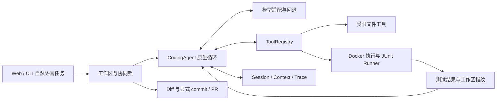

# selfForge Agent：开发规格与交付协议（SDD）

本文件是新 Agent 的**首读文档和当前任务状态的唯一维护入口**。读完即可选择下面的 Ready 任务并开始；仅在涉及具体模块时查阅链接的详细契约，不要求先遍历全部历史文档。

- 文档版本：1；更新：2026-11-13。
- 已核验产品基线：`04452154addaeff3375fcd15996585c2d5e374e3`；开工必须重新 fetch 并记录实际基线，不把这里的 SHA 当作永远最新。
- 前轮 SF-DEV-01 / SF-DOC-01 / SF-TEST-01 的已验证快照：源码 `9bc111cb07cb3b6b6dd8e44a7483c49e34960220`，完整 pytest 653 passed、无跳过。合并状态以第 4 节及审查记录为准；SF-EVAL-08 的新策略与无模型预检已交付；该策略下的真实模型测量尚未运行。
- 当前用户指令优先。SDD 不增加外部服务、付费模型调用、推送或合并授权，也不增加重复确认程序；沿用会话已有授权和仓库保护。

## 1. 产品目标与范围

**selfForge Agent — A Python Coding Agent with Reliable Execution and Self-Testing**。

面向 Python Git 仓库，从 Web/CLI 接收自然语言任务，在独立 worktree 中自主读、搜索、修改代码，在 Docker 中执行测试，交付可检查的 Diff、测试证据与执行轨迹；支持取消和显式恢复。PR Review、差异测试与 Repair 是专项工作流。

产品主线：**任务 → 受限工具调用 → 修改代码 → 隔离测试 → 证据验证 → 用户检查 → 显式 commit/PR**。

本阶段不增加产品 Multi-Agent、通用 MCP、额外 RAG、大型前端、跨语言 IDE 或另一套 Agent Runtime。开发者之间并行协作与产品 Multi-Agent 是两件事；是否使用子 Agent 服从当前工具/用户规则。

### 已实现与仍有边界

| 能力 | 已有实现 | 不应推断的能力 |
| --- | --- | --- |
| Runtime | 原生 tool calling、结果回填、步数/时间预算、只读/编辑失败/上下文提示 | 提示改善不等于已证明模型成功率提高 |
| 模型与界面 | OpenAI-compatible、多供应商预设/回退、模型发现、Web 工作台 | 预设不保证供应商任意账号/产品协议均兼容 |
| Harness | 持久会话/轨迹、启发式上下文压缩、取消、恢复、非空 JUnit 与工作区指纹 | 非精确 tokenizer；非断电事务；阻塞 HTTP 不保证即时取消 |
| 隔离与工作区 | Docker 默认、Host 显式信任、持久 worktree、共享协同锁、dirty guard、审计/prune | 文件指纹非原子快照；外部编辑器/Git/不同 XDG 不参与锁 |
| 环境 | 只读发现、有限锁导出、离线准备计划、wheelhouse 审计、显式镜像构建/会话绑定、声明诊断 | 不自动安装；哈希可用不等于可安装；Host markers 不等于目标容器解析 |
| 测试与交付 | Review/差异测试/Repair、worktree Diff、显式提交/PR、重试恢复、CI | 通过既有测试不代表全部需求充分验证；不自动合并 PR |
| Eval | 冻结 v2 20 题、两道独立多文件候选、无模型参考正负控、来源元数据/报告比较 | 两道新题未加入历史正式成绩；不能把旧分数当作当前 Runtime 成绩 |

已核验基线的本地完整 pytest 为 568 passed，无跳过；[基线 main CI](https://github.com/liuzhouquan/selfforge-agent/actions/runs/43135807788) 为 555 单元 + 13 Docker，无跳过。此数字仅属于上述基线，不是后续任务验收配额。历史 53/60 模型成绩及来源限制见[评测记录](./evaluation.md)。

## 2. 开工与选择任务

```sh
git status --short --branch
git worktree list
git fetch origin
git rev-parse origin/main
gh pr list --state open
```

1. 核对当前项目，不因 IDE 标签切换到其他仓库。未提交内容先确认归属；不 reset、clean 或覆盖未知文件。
2. 查开放 PR 与本表 Owner，已有工作先接手/审查，不重复实现。各 Agent 使用自己拥有的分支和 worktree。
3. 用户指定任务时执行该任务；仅说“继续开发”时，选**优先级最高、前提已满足且未被认领的一项 Ready**。完成一项后交接，不自行遍历整份路线图。
4. 领取时在本文件该任务的执行记录填 Owner、完整实际 base SHA、分支/worktree 标识、依赖与状态。不要新建一份重复规格。
5. 没有 Ready 时，先把最接近的 Waiting/Needs Design 任务补足前提/规格；不得把历史已完成项当作新任务。只有确实缺少用户决策才提问，独立工作继续推进。

创建独立工作区的例子（名称换成自己拥有且未占用的名称）：

```sh
git worktree add ../selfforge-sf-dev-01 -b feat/sf-dev-01 origin/main
```

### 状态与文档权威

当前任务状态仅在本文件维护：`Ready → In Progress → In Review → Merged`；依赖缺失为 `Waiting`，行为尚未定清为 `Needs Design`。`In Review` 不代表合并；`Merged` 必须有合并 SHA 和 PR，远端不可用时保持真实状态。

- 本文件维护产品主线、当前优先级、规格、验收及当前交接。范围变化先更新这里的原因、依赖和验收，再实施。
- [AGENTS.md](../AGENTS.md) 是自动加载的约束入口；[工程不变量](./engineering-invariants.md)是具体权限/状态/证据契约，本文件不放宽它们。发现冲突用源码/复现确认，不能自行选更宽松的一条。
- [开发指南](./development.md)保留安装与模块索引；[架构](./architecture.md)保留实现细节。只读涉及模块的部分。
- [Backlog](./backlog.md)、`docs/tasks/` 和旧审计是历史证据，不是另一个实时任务队列。历史验证保留，不能把旧结果改成新结果。
- 新任务直接增加本文件中的规格和执行记录；[旧模板](./task-template.md)只供历史记录/外部 Issue 兼容使用，不要求再复制文件。
- PR 描述引用任务 ID/验收 ID，并承载准确提交与 CI 证据；不复制整份 SDD。合并时同步本文件当前状态，避免在多个文件追加竞争的“最新状态”。

## 3. 实际架构与必须保持的约束



| 改动领域 | 先读的实现（相对 `src/selfforge_agent/`） | 关键回归入口（相对 `tests/`） |
| --- | --- | --- |
| Runtime/Context | `runtime/agent.py`、`control.py`、`context.py`、`model.py` | `test_runtime_budget.py`、`test_runtime_recovery.py`、`test_context*.py` |
| 工具/隔离/证据 | `runtime/tools.py`、`execution.py`、`fingerprint.py`；`verification/` | `test_coding_evidence.py`、`test_docker_staging.py`、`test_workspace_fingerprint.py` |
| 工作区/交付 | `runtime/workspace.py`、`workspace_diff.py`、`delivery.py` | `test_workspace_prune.py`、`test_delivery_safety.py`、`test_workspace_dirty_guard.py` |
| Web/模型 | `api/app.py`、`api/coding_jobs.py`、`providers.py` | `test_coding_web.py`、`test_web_origin.py`、`test_providers.py` |
| 环境 | `runtime/environment.py`、`images.py`、`lockfiles.py` | `test_dependency_freshness.py`、`test_wheelhouse_audit.py`、`test_session_environment.py` |
| 测试生成/Repair | `coding/test_generation.py`、`coding/agent.py`、`coding/worktree.py` | `test_test_generation.py`、`test_repair_agent.py`、`test_docker_repair.py` |
| 独立 Eval | `runtime/benchmark.py`、`benchmark_diff.py` | `test_reference_validation.py`、`test_benchmark_isolation.py`、`test_benchmark_diff.py` |

不可回退的约束：

1. 保持一个通用 `CodingAgent`、共享 ToolRegistry/JUnit Runner；Repair 的独立 proposer 是现有边界，不新增竞争 Runtime。
2. Docker 是默认执行方式；Host 必须显式信任。文件保护、路径/链接校验、网络/资源限制、输出/输入/超时上限继续生效；不默认运行仓库 hooks、setup.py 或自动安装脚本。
3. `completed` 必须有非空 JUnit 成功、测试前后及当前指纹一致、非空最终答复。bash 退出 0、旧测试布尔值、LLM 自评均不能替代证据。
4. 新任务、写入/编辑尝试、持久 Host 命令或新测试之前先持久化撤销旧证据；取消、超时、异常、恢复均不能复活失效证据。
5. 保持 assistant/tool 消息成组与 user 约束；预算提示瞬态生成，不能持久化成旧预算；token 估算明确标为启发式。
6. CLI/Web 对同一工作区使用共享锁。持久 worktree 不强制删除；dirty/ignored 用户输入保留；prune 在锁内重查；commit/PR 证据只绑定实际推送 SHA。
7. 私有会话/密钥保持受限权限；trace 仅元数据，不泄漏模型正文、推理、原始错误、工具参数或私有路径。日志、密钥、依赖缓存、课程源码不提交。
8. Eval 固定源 SHA/清单/镜像，外部 holdout 与 reference 不进 Agent；基线负控与独立 visible/holdout 正控、允许修改范围、非空 JUnit 缺一不可。冻结资产/历史成绩不得覆写。
9. 缺失输入、扫描不完整和环境不可用要显式表示，不当作通过；费用未知不能编造；堆栈关联不能写成因果证明。

## 4. 下一阶段里程碑与任务队列

当前阶段目标：**使新环境可复现开发与验证，让规格能追溯到测试，并把自主编程后的回归测试验证补成可复用流程。** 不按功能数量或测试数量宣称产品完成。

| 顺序 | 任务 ID | 状态 | Owner | 前提 | 交付结果 |
| --- | --- | --- | --- | --- | --- |
| 1 | [SF-DEV-01](#sf-dev-01) | Merged | Codex（审查整合） | 无 | [PR #57](https://github.com/liuzhouquan/selfforge-agent/pull/57)：新 checkout 与 CI 复用同一个固定评测源准备入口 |
| 2 | [SF-DOC-01](#sf-doc-01) | Merged | Codex（审查整合） | 本 SDD | 有界 SDD 一致性检查，阻止失配状态与虚假验收引用（[PR #58](https://github.com/liuzhouquan/selfforge-agent/pull/58)） |
| 3 | [SF-TEST-01](#sf-test-01) | Merged | Codex（审查整合） | 既有 Runner/worktree/指纹 | 对 Coding 修复提供独立的旧失败/新通过回归证据 |
| 4 | [SF-EVAL-08](#sf-eval-08) | Merged | Codex（审查整合） | SF-DEV-01；策略已冻结 | [PR #61](https://github.com/liuzhouquan/selfforge-agent/pull/61)：新 Runtime 22 题 v3 评测规格、冻结输入与无模型 Docker 预检 |
| 5 | [SF-TEST-02](#sf-test-02) | Merged | Codex（审查整合） | SF-TEST-01（Merged） | [PR #62](https://github.com/liuzhouquan/selfforge-agent/pull/62)：Web Coding 工作台接入独立回归验证面板、状态门槛与结构化证据展示 |
| 6 | [SF-WS-05](#sf-ws-05) | Merged | Codex（审查整合） | SF-WS-04 / SF-TEST-01（Merged） | [PR #63](https://github.com/liuzhouquan/selfforge-agent/pull/63)：修复 `/api/workspaces/storage` 管理器复用不一致并补齐 CLI `trace` / `test-regression` 安全结构化导出 |
| 7 | [SF-WS-06](#sf-ws-06) | Merged | Codex（审查整合） | SF-WS-04 / SF-WS-05 / SF-ENV-06（Merged） | [PR #64](https://github.com/liuzhouquan/selfforge-agent/pull/64)：Web Coding 工作台接入工作区审计/存储/安全清理（`audit`/`storage`/`prune`）与依赖新鲜度诊断（`/api/sandbox/freshness`） |
| 8 | [SF-EVAL-09](#sf-eval-09) | Merged | Codex（审查整合） | SF-EVAL-08 / SF-WS-05（Merged） | [PR #65](https://github.com/liuzhouquan/selfforge-agent/pull/65)：CLI `eval-suite` / `eval-validate` 接入 `--policy` 冻结策略强校验、预算门禁与安全导出（`_write_cli_output`） |
| 9 | [SF-ENV-07](#sf-env-07) | Merged | Codex（审查整合） | SF-WS-05 / SF-ENV-06（Merged） | [PR #66](https://github.com/liuzhouquan/selfforge-agent/pull/66)：CLI `sandbox` 诊断与规划命令补齐结构化安全导出（`--json` / `--output`）与 `export-lock` 安全写盘 |
| 10 | [SF-TEST-03](#sf-test-03) | Merged | Codex（审查整合） | SF-TEST-02 / SF-WS-05（Merged） | [PR #67](https://github.com/liuzhouquan/selfforge-agent/pull/67)：SessionStore 补齐回归验证记录追溯与 GET /api/code/workspaces/{session_id}/regression 只读接口，并在 PR 交付中绑定回归验证证据 |
| 11 | [SF-VERIF-01](#sf-verif-01) | In Review | Antigravity | 无 | [PR #73](https://github.com/liuzhouquan/selfforge-agent/pull/73)：验证执行器与 JUnit 解析安全加固：有限正超时校验、非普通文件（FIFO/设备）与受保护路径防御、深层递归容错与无符链穿透测试工件读取 |

阶段完成条件：前三项验收全部闭合且已合并；新环境完整验证可复现；通用修复验证具备独立旧失败/新通过的 Docker 证据；当前规格能追溯到测试与准确提交。SF-EVAL-08 是后续测量准备，仍不代表产品的真实任务可靠性已经达标。

上表同时记录当前交付状态与未来任务。需要并行认领时先核对开放 PR；状态/Owner 回填到同一行。多个分支基于最新 main 开发，合并前更新基线并复查公共入口，不机械拼接表尾。

### SF-DEV-01

**目标：** 新 checkout 不依赖开发者 `.local` 缓存即可按明确命令准备两道候选的固定源；CI 复用同一准备入口。只显式获取 Git 对象，不执行外部代码。

**范围/入口：** 新建 `scripts/prepare_eval_sources.py`，参数 `--root PATH`、`--timeout SECONDS`（总预算，默认 120，合法范围 1–300）、`--offline`。固定登记 jmespath/boltons 的现有 URL 与清单修订；复用 `.github/workflows/ci.yml` 的策略、`tests/conftest.py` 的 `SELFFORGE_EVAL_SOURCE_ROOT`。不开发任意 URL 下载器/新缓存平台，不安装项目依赖、不调用模型。

**行为：** 显式在线模式仅 fetch 固定 URL/SHA，并创建可被独立 clone 获取的 named ref；已有完整缓存离线可用且不变更其 HEAD。缺失缓存离线失败。拒绝 symlink 根/目标、非本任务拥有的已有非仓库目录和缺少预期来源的缓存；不删除/重置已有文件。用 argv subprocess、总 deadline 和有界输出；失败退出非零，不伪报 ready。首次创建需标记本入口拥有的目录；失败留下可诊断但不执行的状态。

| 验收 ID | Given / When / Then | 最少证明方式 | 初始证据 |
| --- | --- | --- | --- |
| SF-DEV-01-A1 | 空临时根显式在线准备后，两固定提交能从生成仓库独立 clone/checkout | `tests/test_eval_source_preparation.py`；本地 Git remote 替身测控制流，CI 实际固定 URL | E5（本轮组合复验） |
| SF-DEV-01-A2 | 已有合格缓存使用 `--offline`，成功且不联网、不改变用户 HEAD/文件 | 同文件 CLI 回归 + 前后状态；替身阻断 fetch | E6（本轮组合复验） |
| SF-DEV-01-A3 | 超时、坏源、缺提交、离线缺缓存、symlink/未知目录输入均失败，保留已有内容 | 同文件错误注入；可观察退出码与磁盘内容 | E7（本轮组合复验） |
| SF-DEV-01-A4 | 新 checkout 按文档先准备再运行全部测试；CI 不再复制 fetch 命令 | 真实 CI + Docker 两候选控制；不需要模型密钥 | E8（本轮组合复验） |

| 记录 | 验收 ID | 测试节点 / 实际入口 | 命令与环境 | 验证 SHA / 结果 / CI |
| --- | --- | --- | --- | --- |
| E1 | SF-DEV-01-A1 | `tests/test_eval_source_preparation.py::test_online_preparation_creates_cloneable_repos_and_ownership_marker`、`tests/test_eval_source_preparation.py::test_pinned_sources_match_candidate_manifests_and_policy`、`tests/test_eval_source_preparation.py::test_default_root_uses_env_var_and_cli_subprocess`、`tests/test_eval_source_preparation.py::test_online_fetch_into_existing_repo_preserves_head_and_candidate_branch`；GitHub Actions `Provision pinned multi-file candidate sources` | Host 本地 Git remote 替身 + `git clone --no-local`；GitHub `ubuntu-latest` CI 真实拉取 pinned GitHub URL；[PR #57](https://github.com/liuzhouquan/selfforge-agent/pull/57) | 源码 SHA `57117238f34c9082b5ce3b3b9e6b1931f2b0549d`；本地专项 18 passed / 非集成 573 passed, 13 deselected / Ruff passed；CI [Run #43150979908](https://github.com/liuzhouquan/selfforge-agent/actions/runs/43150979908) 真实固定 URL 准备成功（jmespath `2812594e69d43098ef60f81f4efc404c071b0418`、boltons `d31d821d56c8f7756af9c30a864077f2e5855321`） |
| E2 | SF-DEV-01-A2 | `tests/test_eval_source_preparation.py::test_offline_mode_succeeds_without_fetch_and_preserves_user_head_and_files` | Host 本地缓存 + git wrapper 阻断 mutating/fetch 命令 + 前后 HEAD 与文件比对；[PR #57](https://github.com/liuzhouquan/selfforge-agent/pull/57) | `57117238f34c9082b5ce3b3b9e6b1931f2b0549d`；本地与 CI [Run #43150979908](https://github.com/liuzhouquan/selfforge-agent/actions/runs/43150979908) passed（573 passed, 13 deselected） |
| E3 | SF-DEV-01-A3 | `tests/test_eval_source_preparation.py::test_invalid_timeout_cli_rejected`、`tests/test_eval_source_preparation.py::test_timeout_kills_slow_git_and_leaves_diagnosable_unready_state`、`tests/test_eval_source_preparation.py::test_online_bad_remote_and_missing_commit_fail_and_recover_on_retry`、`tests/test_eval_source_preparation.py::test_run_git_stdout_overflow_fails_closed`、`tests/test_eval_source_preparation.py::test_offline_rejects_missing_cache_bad_origin_and_orphan_commit`、`tests/test_eval_source_preparation.py::test_rejects_symlinks_unknown_dirs_and_nested_parent_repo_without_modification`、`tests/test_eval_source_preparation.py::test_bounded_output_and_corrupt_state_file_fail_closed` | Host CLI 子进程退出码、超时期限进程组终止、错误注入与磁盘内容保留检查；[PR #57](https://github.com/liuzhouquan/selfforge-agent/pull/57) | `57117238f34c9082b5ce3b3b9e6b1931f2b0549d`；本地与 CI [Run #43150979908](https://github.com/liuzhouquan/selfforge-agent/actions/runs/43150979908) passed（573 passed, 13 deselected） |
| E4 | SF-DEV-01-A4 | `tests/test_eval_source_preparation.py::test_ci_workflow_uses_shared_prepare_eval_sources_script`；`.github/workflows/ci.yml`（`Lint` / `Unit tests` / `Build sandbox image` / `Provision pinned multi-file candidate sources` / `Docker integration tests`） | 本地 Ruff + 非集成全量 + CI 真实 Docker 集成测试（`uv run --no-sync pytest -q -m integration`）；本机 WSL2 未安装 `docker`，Docker 集成由 CI 完成；[PR #57](https://github.com/liuzhouquan/selfforge-agent/pull/57) | `57117238f34c9082b5ce3b3b9e6b1931f2b0549d`；CI [Run #43150979908](https://github.com/liuzhouquan/selfforge-agent/actions/runs/43150979908) 全绿：Lint passed、Unit tests `573 passed, 13 deselected`、Docker integration tests `13 passed, 573 deselected`（含 jmespath 与 boltons 候选控制） |
| E5 | SF-DEV-01-A1 | `tests/test_eval_source_preparation.py::test_online_preparation_creates_cloneable_repos_and_ownership_marker` | `SELFFORGE_EVAL_IMAGE=selfforge-agent-sandbox:latest uv run --no-sync pytest -q`；本机 Linux 真 Docker + CLI/API；Git 替身/故障注入只证明相应边界 | `9bc111cb07cb3b6b6dd8e44a7483c49e34960220`；passed；完整组合 653 passed、无跳过；[组合 head CI](https://github.com/liuzhouquan/selfforge-agent/actions/runs/43189888813) 639 单元 + 14 Docker 全部通过；详见[审查记录](./review-pr57-59.md) |
| E6 | SF-DEV-01-A2 | `tests/test_eval_source_preparation.py::test_offline_mode_succeeds_without_fetch_and_preserves_user_head_and_files` | `SELFFORGE_EVAL_IMAGE=selfforge-agent-sandbox:latest uv run --no-sync pytest -q`；本机 Linux 真 Docker + CLI/API；Git 替身/故障注入只证明相应边界 | `9bc111cb07cb3b6b6dd8e44a7483c49e34960220`；passed；完整组合 653 passed、无跳过；[组合 head CI](https://github.com/liuzhouquan/selfforge-agent/actions/runs/43189888813) 639 单元 + 14 Docker 全部通过；详见[审查记录](./review-pr57-59.md) |
| E7 | SF-DEV-01-A3 | `tests/test_eval_source_preparation.py::test_cli_rejects_fifo_state_without_blocking`、`tests/test_eval_source_preparation.py::test_preparation_does_not_execute_checkout_filters` | `SELFFORGE_EVAL_IMAGE=selfforge-agent-sandbox:latest uv run --no-sync pytest -q`；本机 Linux 真 Docker + CLI/API；Git 替身/故障注入只证明相应边界 | `9bc111cb07cb3b6b6dd8e44a7483c49e34960220`；passed；完整组合 653 passed、无跳过；[组合 head CI](https://github.com/liuzhouquan/selfforge-agent/actions/runs/43189888813) 639 单元 + 14 Docker 全部通过；详见[审查记录](./review-pr57-59.md) |
| E8 | SF-DEV-01-A4 | `tests/test_eval_source_preparation.py::test_ci_workflow_uses_shared_prepare_eval_sources_script` | `SELFFORGE_EVAL_IMAGE=selfforge-agent-sandbox:latest uv run --no-sync pytest -q`；本机 Linux 真 Docker + CLI/API；Git 替身/故障注入只证明相应边界 | `9bc111cb07cb3b6b6dd8e44a7483c49e34960220`；passed；完整组合 653 passed、无跳过；[组合 head CI](https://github.com/liuzhouquan/selfforge-agent/actions/runs/43189888813) 639 单元 + 14 Docker 全部通过；详见[审查记录](./review-pr57-59.md) |

执行记录（Owner/状态以上表为准）：Base=`e07153e092150ab2d1f86aa98545a676836b6e14`；Branch=`feat/sf-dev-01`；Worktree=`selfforge-sf-dev-01`；PR=[#57](https://github.com/liuzhouquan/selfforge-agent/pull/57)。先核对两项固定 SHA 与 `--no-local` clone 行为并先红后绿实现共享脚本；首次推送 `8d91cc5a848b50d9296c6494d1e3c10824f0d98f` 在 CI `Run #43150067989` 因冗余 shebang 触发 Ruff `EXE001` 失败，移除后在源码提交 `57117238f34c9082b5ce3b3b9e6b1931f2b0549d` 通过本地回归与 CI `Run #43150979908` 全套验证（仅保留一份共享实现与一份准备文档）。

E5–E8 为本轮组合复验；E1–E4 保留为原分支历史结果，不充当当前源码的执行证明。

审查整合记录：Base=`e07153e092150ab2d1f86aa98545a676836b6e14`；Branch=`review/pr57-59`；PR=#57；Merge=`fa387bc4e427d9a682a00932802a7e4c8920bee7`。用户已授权修改与合并；新增回归保留原缺陷的实际失败结果，修复后完整组合验证通过；后续状态提交仅修改文档。

```text
Owner / 状态：Codex（审查整合） / Merged
实际 base SHA / 分支及 worktree 标识 / 当前 HEAD：e07153e092150ab2d1f86aa98545a676836b6e14 / review/pr57-59 (worktree: selfforge-review-pr57-59) / 已验证源码 9bc111cb07cb3b6b6dd8e44a7483c49e34960220；本次状态提交仅文档
已完成验收与证据 ID：SF-DEV-01-A1..A4（E5、E6、E7、E8）；历史 E1–E4 保留
未完成 / 环境限制 / 未提交内容归属：源码无未提交内容；本次状态与审查记录归 Codex；本机真 Docker 已完成完整组合验证；不调用模型
PR / 准确 head CI / merge SHA（有则填）：PR #57 / https://github.com/liuzhouquan/selfforge-agent/actions/runs/43189888813（组合源码 head；各源 PR head CI 见审查记录） / fa387bc4e427d9a682a00932802a7e4c8920bee7
仍在运行的本任务进程或 CI（无则写无）：本地进程无；最终 main CI 的准确运行及结论记录到 PR #59 交付描述
下一步：核对最终 main CI；SF-EVAL-08 仍需先冻结策略，未满足 Ready 前提。
```

### SF-DOC-01

**目标：** 将本文件的状态和验收约定变成可执行门禁，而非靠审查者记忆。

**范围/入口：** 新建标准库脚本 `scripts/check_sdd.py --root PATH`（默认仓库根），只检查本文件明确规定的表格/锚点/证据格式和本地引用；新建 `tests/test_sdd_contract.py`，在既有 CI 调用。限制文档读取总量 4 MiB；不执行文档命令、不请求 GitHub、不调用模型、不做通用 Markdown 平台。扫描仓库内路径，不跟随越界链接。

**最低规则：** 队列 ID 唯一；状态属于本节枚举；每个排队任务有同名规格节；验收 ID 唯一；In Progress/In Review 有 Owner 与实际 base；Merged 有 PR/完整 merge SHA；声明通过的验收有真实 `file.py::test_name`（参数化基名可用）、命令、验证 SHA 与结果/CI 引用。文件和测试节点存在仅表示可追溯，**不能证明测试执行或语义充分**。`待实现/未验证` 可留在 Ready/Waiting，不能当作通过证据；历史快照不按实时任务误报。

| 验收 ID | Given / When / Then | 最少证明方式 | 初始证据 |
| --- | --- | --- | --- |
| SF-DOC-01-A1 | 当前合法 SDD 通过；重复 ID、坏状态、缺规格/验收引用均非零 | `tests/test_sdd_contract.py` 临时规格夹具，逐项反例 | E5（本轮组合复验） |
| SF-DOC-01-A2 | 标为通过却引用不存在测试/缺验证 SHA，或 Merged 缺 PR/SHA，被拒绝 | 同文件错误夹具；不能为通过而弱化规则 | E6（本轮组合复验） |
| SF-DOC-01-A3 | 有界读取、越界/symlink 输入失败；不运行任何文档命令 | 同文件权限/限额/副作用回归 | E7（本轮组合复验） |
| SF-DOC-01-A4 | CI 实际运行该检查；文档明确其只检查一致性、不证明测试语义 | 实际 CI 与输出摘要 | E8（本轮组合复验） |

| 记录 | 验收 ID | 测试节点 / 实际入口 | 命令与环境 | 验证 SHA / 结果 / CI |
| --- | --- | --- | --- | --- |
| E1 | SF-DOC-01-A1 | `tests/test_sdd_contract.py::test_current_repo_sdd_passes_and_states_consistency_only_scope`、`tests/test_sdd_contract.py::test_valid_sdd_across_statuses_tables_and_historical_snapshot_passes`、`tests/test_sdd_contract.py::test_rejects_queue_status_spec_and_link_violations`、`tests/test_sdd_contract.py::test_rejects_acceptance_id_or_table_violations`；入口 `scripts/check_sdd.py` | 本地 Linux `uv run python scripts/check_sdd.py` 与 `uv run pytest -vv tests/test_sdd_contract.py`；GitHub Actions `ubuntu-latest` `uv run --no-sync python scripts/check_sdd.py` 与 `uv run --no-sync pytest -q -m "not integration"` | 验证源码 SHA `a0739c26ca2d3fcc01dd44e9c15632b706a80235`，passed（本地 `check_sdd.py` 通过且 `tests/test_sdd_contract.py` 39 passed，全量非集成 `594 passed, 13 deselected`；CI [Run #43157245377](https://github.com/liuzhouquan/selfforge-agent/actions/runs/43157245377) `SDD contract check` 通过、`Unit tests` `594 passed, 13 deselected`、`Docker integration tests` `13 passed, 594 deselected`） |
| E2 | SF-DOC-01-A2 | `tests/test_sdd_contract.py::test_rejects_status_metadata_and_merge_requirements`、`tests/test_sdd_contract.py::test_rejects_fake_or_incomplete_acceptance_evidence`；入口 `scripts/check_sdd.py` | 本地 Linux `uv run pytest -vv tests/test_sdd_contract.py` 与 `uv run ruff check .`；GitHub Actions `ubuntu-latest` `uv run --no-sync ruff check .`、`uv run --no-sync python scripts/check_sdd.py`、`uv run --no-sync pytest -q -m "not integration"` | 验证源码 SHA `a0739c26ca2d3fcc01dd44e9c15632b706a80235`，passed（状态/owner/base SHA/Merged 与虚假验收反例均准确拒绝并退出码 1，`ruff check .` `All checks passed!`，`39 passed` 且 CI [Run #43157245377](https://github.com/liuzhouquan/selfforge-agent/actions/runs/43157245377) 全绿通过） |
| E3 | SF-DOC-01-A3 | `tests/test_sdd_contract.py::test_rejects_read_budget_exceeded_over_4mib`、`tests/test_sdd_contract.py::test_rejects_symlinks_non_regular_files_and_out_of_bounds_paths`、`tests/test_sdd_contract.py::test_does_not_execute_documented_commands_or_import_exec_network`；入口 `scripts/check_sdd.py` | 本地 Linux `uv run pytest -vv tests/test_sdd_contract.py`；GitHub Actions `ubuntu-latest` `uv run --no-sync pytest -q -m "not integration"` 与 `uv run --no-sync pytest -q -m integration` | 验证源码 SHA `a0739c26ca2d3fcc01dd44e9c15632b706a80235`，passed（4 MiB 读限额、symlink 与越界拒绝、零执行/零 exec 与网络模块导入全部 passed，CI [Run #43157245377](https://github.com/liuzhouquan/selfforge-agent/actions/runs/43157245377) 594 单元测试 + 13 Docker 集成测试全部通过） |
| E4 | SF-DOC-01-A4 | `tests/test_sdd_contract.py::test_ci_workflow_and_docs_declare_sdd_consistency_scope`、`tests/test_sdd_contract.py::test_current_repo_sdd_passes_and_states_consistency_only_scope`；入口 `.github/workflows/ci.yml` 与 `docs/development.md` | GitHub Actions `ubuntu-latest` 实际工作流 `.github/workflows/ci.yml`（步骤 `SDD contract check`: `uv run --no-sync python scripts/check_sdd.py`）与本地 `uv run pytest -vv tests/test_sdd_contract.py` | 验证源码 SHA `a0739c26ca2d3fcc01dd44e9c15632b706a80235`，passed（[Run #43157245377](https://github.com/liuzhouquan/selfforge-agent/actions/runs/43157245377) 实测输出 `OK: verified 4 SDD task(s) and 15 acceptance item(s)` 且明确仅校结构、状态与本地引用一致性，不证明测试执行或语义充分） |
| E5 | SF-DOC-01-A1 | `tests/test_sdd_contract.py::test_valid_sdd_across_statuses_tables_and_historical_snapshot_passes` | `SELFFORGE_EVAL_IMAGE=selfforge-agent-sandbox:latest uv run --no-sync pytest -q`；本机 Linux 真 Docker + CLI/API；Git 替身/故障注入只证明相应边界 | `9bc111cb07cb3b6b6dd8e44a7483c49e34960220`；passed；完整组合 653 passed、无跳过；[组合 head CI](https://github.com/liuzhouquan/selfforge-agent/actions/runs/43189888813) 639 单元 + 14 Docker 全部通过；详见[审查记录](./review-pr57-59.md) |
| E6 | SF-DOC-01-A2 | `tests/test_sdd_contract.py::test_cli_rejects_uncollectable_test_references` | `SELFFORGE_EVAL_IMAGE=selfforge-agent-sandbox:latest uv run --no-sync pytest -q`；本机 Linux 真 Docker + CLI/API；Git 替身/故障注入只证明相应边界 | `9bc111cb07cb3b6b6dd8e44a7483c49e34960220`；passed；完整组合 653 passed、无跳过；[组合 head CI](https://github.com/liuzhouquan/selfforge-agent/actions/runs/43189888813) 639 单元 + 14 Docker 全部通过；详见[审查记录](./review-pr57-59.md) |
| E7 | SF-DOC-01-A3 | `tests/test_sdd_contract.py::test_rejects_symlinks_non_regular_files_and_out_of_bounds_paths` | `SELFFORGE_EVAL_IMAGE=selfforge-agent-sandbox:latest uv run --no-sync pytest -q`；本机 Linux 真 Docker + CLI/API；Git 替身/故障注入只证明相应边界 | `9bc111cb07cb3b6b6dd8e44a7483c49e34960220`；passed；完整组合 653 passed、无跳过；[组合 head CI](https://github.com/liuzhouquan/selfforge-agent/actions/runs/43189888813) 639 单元 + 14 Docker 全部通过；详见[审查记录](./review-pr57-59.md) |
| E8 | SF-DOC-01-A4 | `tests/test_sdd_contract.py::test_ci_workflow_and_docs_declare_sdd_consistency_scope` | `SELFFORGE_EVAL_IMAGE=selfforge-agent-sandbox:latest uv run --no-sync pytest -q`；本机 Linux 真 Docker + CLI/API；Git 替身/故障注入只证明相应边界 | `9bc111cb07cb3b6b6dd8e44a7483c49e34960220`；passed；完整组合 653 passed、无跳过；[组合 head CI](https://github.com/liuzhouquan/selfforge-agent/actions/runs/43189888813) 639 单元 + 14 Docker 全部通过；详见[审查记录](./review-pr57-59.md) |

执行记录（Owner/状态以上表为准）：Base=`e07153e092150ab2d1f86aa98545a676836b6e14`；Branch=`feat/sf-doc-01`；Worktree=`selfforge-sf-doc-01`；PR=[#58](https://github.com/liuzhouquan/selfforge-agent/pull/58)。源码、测试与 CI 门禁提交 `a0739c26ca2d3fcc01dd44e9c15632b706a80235` 已通过本地检查与 GitHub Actions [Run #43157245377](https://github.com/liuzhouquan/selfforge-agent/actions/runs/43157245377)（`Lint`、`SDD contract check`、`Unit tests` 594 passed / 13 deselected、`Docker integration tests` 13 passed / 594 deselected）。

E5–E8 为本轮组合复验；E1–E4 保留为原分支历史结果，不充当当前源码的执行证明。

审查整合记录：Base=`e07153e092150ab2d1f86aa98545a676836b6e14`；Branch=`review/pr57-59`；PR=#58；Merge=`06787d8a04cfa8d3b38c16e2b49ce7071f12c129`。用户已授权修改与合并；新增回归保留原缺陷的实际失败结果，修复后完整组合验证通过；后续状态提交仅修改文档。

```text
Owner / 状态：Codex（审查整合） / Merged
实际 base SHA / 分支及 worktree 标识 / 当前 HEAD：e07153e092150ab2d1f86aa98545a676836b6e14 / review/pr57-59 (worktree: selfforge-review-pr57-59) / 已验证源码 9bc111cb07cb3b6b6dd8e44a7483c49e34960220；本次状态提交仅文档
已完成验收与证据 ID：SF-DOC-01-A1..A4（E5、E6、E7、E8）；历史 E1–E4 保留
未完成 / 环境限制 / 未提交内容归属：源码无未提交内容；本次状态与审查记录归 Codex；本机真 Docker 已完成完整组合验证；不调用模型
PR / 准确 head CI / merge SHA（有则填）：PR #58 / https://github.com/liuzhouquan/selfforge-agent/actions/runs/43189888813（组合源码 head；各源 PR head CI 见审查记录） / 06787d8a04cfa8d3b38c16e2b49ce7071f12c129
仍在运行的本任务进程或 CI（无则写无）：本地进程无；最终 main CI 的准确运行及结论记录到 PR #59 交付描述
下一步：核对最终 main CI；SF-EVAL-08 仍需先冻结策略，未满足 Ready 前提。
```

### SF-TEST-01

**目标：** 为通用 Coding 修复验证一个显式提供的 pytest 回归用例，得到“原代码断言失败、修复后通过”的独立证据。它不同于现有 PR 风险流程的“Base 通过、Head 失败”，不能反转/破坏原流程。

**公开契约：** CLI `test-regression --repo PATH --session ID --test-file PATH --timeout SECONDS`；API `POST /api/code/workspaces/{session_id}/validate-regression`，JSON 为 `repository`、`test_file`、`timeout`（默认 60，范围 1–180，总预算）。二者共享一个服务，返回 `status`（`confirmed/inconclusive/error`）、`base_sha`、`workspace_sha256`、`test_sha256`、`base_result`、`repaired_result`、固定分类 `reason`。CLI 对应退出码 0/1/2。JSON 不回显测试源码/私有错误正文；该 API 仍仅本机可用。

**范围/入口：** 从 `CodingWorkspaceManager` 取得持久工作区及初始 base，持共享锁；显式读取一个有界、非 symlink 的 Python 候选文件（最多 8 KiB），保留 protected-path 边界。在两份独立快照运行相同测试：原 committed base 与当前修复内容。复用 `coding/test_generation.py`、`coding/worktree.py`、`runtime/fingerprint.py`、`verification/runner.py` 和既有 Docker staging；不得新建 Runner/Agent。只用当前会话绑定镜像，默认 Docker，不新增 Host 分支。

**证据：** 仅 base 非空运行且有断言失败、无收集错误，修复副本非空 JUnit 全通过，且快照/当前工作区指纹一致时 `confirmed`。空测试、全 skip、收集失败、超时、内容变化均不能确认。候选只进入临时副本，不落入用户 worktree；结果单独记录，不自动授予 Runtime `completed` 或 commit/PR 资格。保持旧证据/状态不被此只读验证错误覆盖。

| 验收 ID | Given / When / Then | 最少证明方式 | 初始证据 |
| --- | --- | --- | --- |
| SF-TEST-01-A1 | 临时真实 Git bug + 未提交修复 + 同一回归测试，旧断言失败/新非空通过，confirmed | `tests/test_coding_regression_validation.py` + Docker 集成；CLI/API 响应均断言字段 | E5（本轮组合复验） |
| SF-TEST-01-A2 | 旧也通过、新失败、空/all-skip/收集错误均不可确认；超时明确 error | 同文件独立反例，保留 Runner 真实状态 | E6（本轮组合复验） |
| SF-TEST-01-A3 | 忙碌工作区、越界/受保护/symlink/超限候选、镜像缺失或会话不匹配被拒绝 | CLI 非零/API 4xx；发生在模型/外部测试执行前 | E7（本轮组合复验） |
| SF-TEST-01-A4 | 两份测试互不污染；执行期间内容变化撤销确认；结束/失败后临时资源释放且用户文件不变 | 故障注入/指纹/磁盘对比；现有 Review/Repair 回归 | E8（本轮组合复验） |

| 记录 | 验收 ID | 测试节点 / 实际入口 | 命令与环境 | 验证 SHA / 结果 / CI |
| --- | --- | --- | --- | --- |
| E1 | SF-TEST-01-A1 | `tests/test_coding_regression_validation.py::test_confirmed_regression_via_service_cli_and_api`、`tests/test_coding_regression_validation.py::test_confirmed_regression_from_workspace_candidate_and_exact_size_limit`、`tests/test_coding_regression_validation.py::test_real_docker_regression_validation_confirmed_and_counterexample` | 本地 `pytest -v -m "not integration"`（临时 Git worktree + `TestRunner`）及真实 CLI/API；GitHub CI `uv run --no-sync pytest -q -m integration`（`selfforge-agent-sandbox:latest` 真 Docker `--network=none`） | `44f7382ef005a1ac9610f344a640e9c104cf258c`；passed；CI [R1 43173574675](https://github.com/liuzhouquan/selfforge-agent/actions/runs/43173574675) 集成 `14 passed, 570 deselected` |
| E2 | SF-TEST-01-A2 | `tests/test_coding_regression_validation.py::test_non_confirming_outcomes_preserve_runner_status_and_exit_codes`、`tests/test_coding_regression_validation.py::test_base_import_error_only_cannot_confirm`、`tests/test_coding_regression_validation.py::test_timeout_yields_error_status_and_cli_exit_2` | 本地 `pytest -v -m "not integration" tests/test_coding_regression_validation.py`（9 组参数化反例 + 仅 base import error + 真实超时）；GitHub CI `Unit tests` | `44f7382ef005a1ac9610f344a640e9c104cf258c`；15 passed（超时 `status="error"`、`reason="timeout"`、CLI exit `2`）；CI [R1 43173574675](https://github.com/liuzhouquan/selfforge-agent/actions/runs/43173574675) `570 passed, 14 deselected` |
| E3 | SF-TEST-01-A3 | `tests/test_coding_regression_validation.py::test_preflight_rejections_before_runner_execution` | 本地 `pytest` + CLI `selfforge-agent test-regression`（exit `2`）+ FastAPI `TestClient`（400/403/404/409/422），断言 Runner `calls == []` | `44f7382ef005a1ac9610f344a640e9c104cf258c`；passed；CI [R1 43173574675](https://github.com/liuzhouquan/selfforge-agent/actions/runs/43173574675) `passed` |
| E4 | SF-TEST-01-A4 | `tests/test_coding_regression_validation.py::test_isolation_tampering_cleanup_and_session_evidence_preservation`、`tests/test_test_generation.py`、`tests/test_repair_agent.py`、`tests/test_workspace_concurrency.py`、`tests/test_coding_web.py`、`tests/test_session_environment.py` | 本地 `ruff check .`、`pytest -v -m "not integration"`（定向 6 套件 `79 passed, 5 deselected`）及全量 `pytest -q -m "not integration"`（隔离/篡改撤销/worktree 释放/原会话证据零覆盖） | `44f7382ef005a1ac9610f344a640e9c104cf258c`；Ruff 全绿；全量非集成 `570 passed, 14 deselected`；CI [R1 43173574675](https://github.com/liuzhouquan/selfforge-agent/actions/runs/43173574675) `570 passed, 14 deselected` |
| E5 | SF-TEST-01-A1 | `tests/test_coding_regression_validation.py::test_real_docker_regression_validation_confirmed_and_counterexample` | `SELFFORGE_EVAL_IMAGE=selfforge-agent-sandbox:latest uv run --no-sync pytest -q`；本机 Linux 真 Docker + CLI/API；Git 替身/故障注入只证明相应边界 | `9bc111cb07cb3b6b6dd8e44a7483c49e34960220`；passed；完整组合 653 passed、无跳过；[组合 head CI](https://github.com/liuzhouquan/selfforge-agent/actions/runs/43189888813) 639 单元 + 14 Docker 全部通过；详见[审查记录](./review-pr57-59.md) |
| E6 | SF-TEST-01-A2 | `tests/test_coding_regression_validation.py::test_runtime_exception_is_not_assertion_regression` | `SELFFORGE_EVAL_IMAGE=selfforge-agent-sandbox:latest uv run --no-sync pytest -q`；本机 Linux 真 Docker + CLI/API；Git 替身/故障注入只证明相应边界 | `9bc111cb07cb3b6b6dd8e44a7483c49e34960220`；passed；完整组合 653 passed、无跳过；[组合 head CI](https://github.com/liuzhouquan/selfforge-agent/actions/runs/43189888813) 639 单元 + 14 Docker 全部通过；详见[审查记录](./review-pr57-59.md) |
| E7 | SF-TEST-01-A3 | `tests/test_coding_regression_validation.py::test_cli_workspace_git_preflight_obeys_total_budget` | `SELFFORGE_EVAL_IMAGE=selfforge-agent-sandbox:latest uv run --no-sync pytest -q`；本机 Linux 真 Docker + CLI/API；Git 替身/故障注入只证明相应边界 | `9bc111cb07cb3b6b6dd8e44a7483c49e34960220`；passed；完整组合 653 passed、无跳过；[组合 head CI](https://github.com/liuzhouquan/selfforge-agent/actions/runs/43189888813) 639 单元 + 14 Docker 全部通过；详见[审查记录](./review-pr57-59.md) |
| E8 | SF-TEST-01-A4 | `tests/test_coding_regression_validation.py::test_unreadable_final_fingerprint_cannot_confirm`、`tests/test_coding_regression_validation.py::test_final_fingerprint_uses_validation_deadline`、`tests/test_coding_regression_validation.py::test_isolation_tampering_cleanup_and_session_evidence_preservation` | `SELFFORGE_EVAL_IMAGE=selfforge-agent-sandbox:latest uv run --no-sync pytest -q`；本机 Linux 真 Docker + CLI/API；Git 替身/故障注入只证明相应边界 | `9bc111cb07cb3b6b6dd8e44a7483c49e34960220`；passed；完整组合 653 passed、无跳过；[组合 head CI](https://github.com/liuzhouquan/selfforge-agent/actions/runs/43189888813) 639 单元 + 14 Docker 全部通过；详见[审查记录](./review-pr57-59.md) |
| E9 | SF-TEST-01-A3 | `tests/test_coding_regression_validation.py::test_api_sanitizes_unclassified_validation_errors` | `uv run --no-sync pytest -q tests/test_coding_regression_validation.py::test_api_sanitizes_unclassified_validation_errors`；FastAPI TestClient，注入 OSError/ValueError | `3612563fb8876917670c45ee238128454d4c5ae1`；2 passed；修复前的实际结果见审查记录；完整组合与准确 head CI 的最终结果记录到 [PR #59 交付](https://github.com/liuzhouquan/selfforge-agent/pull/59) |

执行记录（Owner/状态以上表为准）：Base=`e07153e092150ab2d1f86aa98545a676836b6e14`；Branch=`feat/sf-test-01`；PR=`#59` (`https://github.com/liuzhouquan/selfforge-agent/pull/59`)；Worktree=`selfforge-sf-test-01`；Source=`44f7382ef005a1ac9610f344a640e9c104cf258c`。共享服务 `src/selfforge_agent/coding/regression_validation.py` 已接入 CLI `selfforge-agent test-regression` 与 API `POST /api/code/workspaces/{session_id}/validate-regression`，严格绑定 Docker 会话镜像与临时隔离快照；不在本任务增加测试自动生成模型循环、覆盖率平台或新前端。UI 接入、自动候选生成另立规格；保留现有 Web Coding 主入口。

E5–E8 为本轮组合复验；E1–E4 保留为原分支历史结果，不充当当前源码的执行证明。

审查整合记录：Base=`e07153e092150ab2d1f86aa98545a676836b6e14`；Branch=`review/pr57-59`；PR=#59；Merge=`b3ad75dfdfedefcd3218f790ae26f04b086b9fc1`。用户已授权修改与合并；新增回归保留原缺陷的实际失败结果，修复后完整组合验证通过；后续状态提交仅修改文档。

```text
Owner / 状态：Codex（审查整合） / Merged
实际 base SHA / 分支及 worktree 标识 / 当前 HEAD：e07153e092150ab2d1f86aa98545a676836b6e14 / review/pr57-59 (worktree: selfforge-review-pr57-59) / API 脱敏源码 3612563fb8876917670c45ee238128454d4c5ae1；此前完整组合源码 9bc111cb07cb3b6b6dd8e44a7483c49e34960220；当前补充仅文档
已完成验收与证据 ID：SF-TEST-01-A1..A4（E5、E6、E7、E8），API 脱敏补充 E9；历史 E1–E4 保留
未完成 / 环境限制 / 未提交内容归属：源码无未提交内容；本次状态与审查记录归 Codex；本机真 Docker 已完成完整组合验证；不调用模型
PR / 准确 head CI / merge SHA（有则填）：PR #59 / https://github.com/liuzhouquan/selfforge-agent/actions/runs/43189888813（组合源码 head；各源 PR head CI 见审查记录） / b3ad75dfdfedefcd3218f790ae26f04b086b9fc1
仍在运行的本任务进程或 CI（无则写无）：本地进程无；最终 main CI 的准确运行及结论记录到 PR #59 交付描述
下一步：核对最终 main CI；SF-EVAL-08 仍需先冻结策略，未满足 Ready 前提。
```

### SF-EVAL-08

**目标：** 为新 Runtime 准备下一轮可复现评测；本任务只冻结新规格、来源和无模型参考资格，不运行整套付费模型测量。

前提：SF-DEV-01 合并；已与用户确认并冻结新策略：
- **任务集**：22 题扩展集 v3（保留原 v2 20 题 + `jmespath_unknown_function_suggestions` + `boltons_remap_mappings`，共 5 个公开仓库），历史 `suite-twenty-tasks.json` / `suite-twenty-tasks-v2.json` / `suite-twenty-tasks-v2.assets.json` 字节与 `53/60` 成绩完全不变。
- **镜像策略**：默认 20 题使用当前 `docker/Dockerfile` 构建的 `selfforge-agent-sandbox:latest`，2 题 `itsdangerous` 使用锁定 `docker/profiles/itsdangerous.lock` 离线构建的 `selfforge-itsdangerous:locked`；预检与后续运行统一解析并记录实际不可变 `sha256:...` 镜像 ID，不复用历史 `abad14d3...` / `205fa9f6...` 宣称同镜像。
- **供应商 / 模型 / 回退**：`deepseek`、`deepseek-flash`、`https://api.deepseek.com`、`--no-fallback`（与 v2 主口径一致）；正式运行前必须显式核对生效配置。
- **预算与重复**：3 次重复（22 × 3 = 66 次独立运行）、`--max-steps 18`、`--time-budget 180`、`--test-timeout 30`、`8000` 启发式上下文 token，并明确列后续真实运行的调用/时间/费用上限与全部分类口径（`runtime/benchmark.py` 全部失败原因及脱敏 `agent_error_code`），未执行前不填任何模型成绩。

| 验收 ID | Given / When / Then | 最少证明方式 | 初始证据 |
| --- | --- | --- | --- |
| SF-EVAL-08-A1 | 新策略有明确任务/允许路径/预算/重复/失败口径与资产哈希；与历史可区分 | 新 manifest/资产索引结构回归 + 旧资产哈希保持 | E4（本轮复验） |
| SF-EVAL-08-A2 | 所选任务都通过独立 Docker 参考正负控，报告来源明确且无模型构造 | 既有 `eval-validate`；记录实际镜像、源 SHA、报告哈希 | E5（本轮复验） |
| SF-EVAL-08-A3 | 后续真实模型运行单独列执行计划、有效供应商及调用/时间/费用上限；没有结果不填成绩 | 策略审查；本任务不得写成已完成模型评测 | E6（本轮复验） |

| 记录 | 验收 ID | 测试节点 / 实际入口 | 命令与环境 | 验证 SHA / 结果 / CI |
| --- | --- | --- | --- | --- |
| E1 | SF-EVAL-08-A1 | `tests/test_eval_v3_policy.py::test_v3_policy_bundle_integrity_and_historical_v2_preservation`、`tests/test_eval_v3_policy.py::test_v3_policy_normalization_and_fail_closed_rejections` | `pytest -q -m "not integration"`（校验 v3 22 题清单 `b8351e62...`、资产索引 `21a11779...`、策略 `c7f20757...` 及历史 v1/v2 哈希不变；覆盖 symlink/篡改/残缺分类反例） | `ada36e2824b89dc1ff73900af5210163966561c1`；645 passed, 15 deselected；CI [R1 43200650684](https://github.com/liuzhouquan/selfforge-agent/actions/runs/43200650684) `Unit tests` 645 passed |
| E2 | SF-EVAL-08-A2 | `tests/test_eval_v3_policy.py::test_v3_suite_docker_reference_validation`、`tests/test_eval_v3_policy.py::test_eval_validate_v3_model_free_cli_and_source_shas`、`tests/test_eval_v3_policy.py::test_prepare_eval_sources_v3_profile_covers_all_five_repos` | 本地 Host 真实 `selfforge-agent eval-validate` CLI（禁用 provider/HTTP 构造）+ GitHub Actions `ubuntu-latest` 真 Docker (`--network=none`) 对 22 题运行 `validate_suite`，解析镜像 `selfforge-agent-sandbox:latest` (`sha256:db4ad5110e4edb4dae4ad7e7771b4c3707cf64dc2a23f15f4e1f23ec2335c115`) 与 `selfforge-itsdangerous:locked` (`sha256:bcbb09a24c9b6aadd8536fe4ff46e040037205e22052a417c5e283f826fab2b1`)，报告 SHA-256 `f68e74054a1412e06bdf1a9508fc1ec83f18e00dd310f5a538ece9ad89c8737b` | `ada36e2824b89dc1ff73900af5210163966561c1`；passed；CI [R1 43200650684](https://github.com/liuzhouquan/selfforge-agent/actions/runs/43200650684) `Docker integration tests` 15 passed, 645 deselected |
| E3 | SF-EVAL-08-A3 | `tests/test_eval_v3_policy.py::test_v3_policy_bundle_integrity_and_historical_v2_preservation`、[v3 规格文档](../benchmark/validated-candidates/twenty-two-tasks-v3.md) | 审查策略与约束门禁：`deepseek` / `deepseek-flash` / `--no-fallback`、`repeats=3`（66 次尝试）、上限 1188 次调用 / 90 分钟 / 25.00 USD、`model_benchmark_executed=false`、`success_rate=null`，未执行付费模型 | `ada36e2824b89dc1ff73900af5210163966561c1`；passed；CI [R1 43200650684](https://github.com/liuzhouquan/selfforge-agent/actions/runs/43200650684) `passed` |
| E4 | SF-EVAL-08-A1 | `tests/test_eval_v3_policy.py::test_v3_policy_bundle_integrity_and_historical_v2_preservation`、`tests/test_eval_v3_policy.py::test_policy_rejects_symlink_ancestor_before_resolution`、`tests/test_eval_v3_policy.py::test_policy_rejects_infinite_budgets`、`tests/test_eval_v3_policy.py::test_policy_checks_image_profile_lockfile_digest`、`tests/test_eval_v3_policy.py::test_policy_rejects_inconsistent_executed_scores` | `SELFFORGE_EVAL_IMAGE=selfforge-agent-sandbox:latest uv run --no-sync pytest -q`；Linux 真 Docker；22 题无模型参考正负控；无付费模型调用 | `f88c2b95355869834e9c4f8bb406dfc6f97baea9`；passed；完整组合 691 passed、无跳过；[准确组合 head CI](https://github.com/liuzhouquan/selfforge-agent/actions/runs/43231456227)；见[审查记录](./review-pr61-63.md) |
| E5 | SF-EVAL-08-A2 | `tests/test_eval_v3_policy.py::test_v3_suite_docker_reference_validation`、`tests/test_eval_v3_policy.py::test_prepare_eval_sources_v3_profile_covers_all_five_repos` | `SELFFORGE_EVAL_IMAGE=selfforge-agent-sandbox:latest uv run --no-sync pytest -q`；Linux 真 Docker；22 题无模型参考正负控；无付费模型调用 | `f88c2b95355869834e9c4f8bb406dfc6f97baea9`；passed；完整组合 691 passed、无跳过；[准确组合 head CI](https://github.com/liuzhouquan/selfforge-agent/actions/runs/43231456227)；见[审查记录](./review-pr61-63.md) |
| E6 | SF-EVAL-08-A3 | `tests/test_eval_v3_policy.py::test_v3_policy_bundle_integrity_and_historical_v2_preservation` | `SELFFORGE_EVAL_IMAGE=selfforge-agent-sandbox:latest uv run --no-sync pytest -q`；Linux 真 Docker；22 题无模型参考正负控；无付费模型调用 | `f88c2b95355869834e9c4f8bb406dfc6f97baea9`；passed；完整组合 691 passed、无跳过；[准确组合 head CI](https://github.com/liuzhouquan/selfforge-agent/actions/runs/43231456227)；见[审查记录](./review-pr61-63.md) |

执行记录（Owner/状态以上表为准）：Base=`19882cc1cf7d6c29309e677c1449b5154c6f8e1c`；Branch=`feat/sf-eval-08`；PR=`#61` (`https://github.com/liuzhouquan/selfforge-agent/pull/61`)；Worktree=`selfforge-sf-eval-08`；Source=`ada36e2824b89dc1ff73900af5210163966561c1`。已交付 22 题 v3 清单 `suite-twenty-two-tasks-v3.json`（`b8351e62...`）、资产索引 `suite-twenty-two-tasks-v3.assets.json`（`21a11779...`）、机器校验策略 `suite-twenty-two-tasks-v3.policy.json`（`c7f20757...`）、规格说明 `twenty-two-tasks-v3.md`、`src/selfforge_agent/runtime/eval_policy.py` 与 `scripts/prepare_eval_sources.py --profile v3`；未运行付费整套模型评测。

本轮记录 E4–E6 取代当前验收引用；原 E1–E3 是历史来源，不把旧计数相加。

审查整合记录：Base=`19882cc1cf7d6c29309e677c1449b5154c6f8e1c`；Branch=`review/pr61-63`；PR=#61；Merge=`9db8fc42bf60d25c4826cee1b918de3c6a4aa845`；Source=`f88c2b95355869834e9c4f8bb406dfc6f97baea9`。

```text
Owner / 状态：Codex（审查整合） / Merged
实际 base SHA / 分支及 worktree 标识 / 当前 HEAD：19882cc1cf7d6c29309e677c1449b5154c6f8e1c / review/pr61-63 (worktree: selfforge-review-pr61-63) / 已验证源码 f88c2b95355869834e9c4f8bb406dfc6f97baea9；后续对账仅文档
已完成验收与证据 ID：SF-EVAL-08-A1..A3（E4–E6）
未完成 / 环境限制 / 未提交内容归属：源码无未提交内容；本次文档对账归 Codex；完整组合含真 Docker 无跳过；UI 浏览器 smoke 使用 API 替身，不能冒充真实端到端模型运行
PR / 准确 head CI / merge SHA（有则填）：PR #61 / https://github.com/liuzhouquan/selfforge-agent/actions/runs/43231456227（组合 head；各源 PR head CI 见审查记录） / 9db8fc42bf60d25c4826cee1b918de3c6a4aa845
仍在运行的本任务进程或 CI（无则写无）：本地进程无；最终 main CI 的准确结果回填 PR #63 交付描述
下一步：后续真实模型测量需另行明确执行任务并遵守 v3 冻结策略与预算，当前未运行该测量。
```

### SF-TEST-02

**目标：** 将 `SF-TEST-01` 已合入的独立回归验证能力（`POST /api/code/workspaces/{session_id}/validate-regression`）接入 Web Coding 工作台 UI（`src/selfforge_agent/api/static/index.html`、`src/selfforge_agent/api/static/app.js`、`src/selfforge_agent/api/static/style.css`），使用户在 Docker 隔离工作区完成或暂停编程任务后，可直接指定候选测试文件与有界超时，查看 Base 与当前工作区的独立运行对照结果及 SHA 指纹，同时严格遵守只读展示、失败闭合与状态同步边界。

**范围/入口：** 仅在 `#coding-job` 内增加回归验证面板（不改动 PR 审查/修复/TestGen 主流程，不新建自动化测试生成循环，不修改后端 `validate-regression` 的安全校验、脱敏与只读边界）。

| 验收 ID | Given / When / Then | 最少证明方式 | 初始证据 |
| --- | --- | --- | --- |
| SF-TEST-02-A1 | 当 Coding 会话绑定在 Docker 独立工作区（`branch` 存在、`sandbox === "docker"`）且非运行态时，提交 `test_file` 与 `timeout`（默认 60，范围 1–180）调用 `POST /api/code/workspaces/{session_id}/validate-regression`，正确渲染结构化 `RegressionValidationReport`（`status`：`confirmed`/`inconclusive`/`error`、`reason`、`base_sha`、`workspace_sha256`、`test_sha256` 与 `base_result`/`repaired_result` 明细），且不篡改 `#metric-verification` | Web UI/API 回归测试（Node DOM 运行时行为验证 + FastAPI TestClient 序列化验证） | E5（本轮复验） |
| SF-TEST-02-A2 | 本机执行（`sandbox === "host"`）、直接修改原仓库或已清理工作区（`!branch`）、未记录隔离环境、任务运行中（`codingJobRunning`）、空 `test_file` 或越界 `timeout`（<1 或 >180 或非整数）均被严格拦截或禁用并给出清晰原因；后端 HTTP 400/404/409/422 错误展示清晰且不破坏既有 Diff 与交付表单 | 前端状态门槛测试 + HTTP 错误路径与不变量断言 | E6（本轮复验） |
| SF-TEST-02-A3 | 切换历史任务、发起新任务、恢复会话或清理工作区时自动重置上一会话的回归结果、错误与提交态；全部服务端字符串经 `textContent` / DOM API 安全渲染，禁止 `innerHTML` 拼接 | 会话切换/清理/XSS 转义自动化断言 | E7（本轮复验） |
| SF-TEST-02-A4 | JS 语法检查、Web 回归测试、Ruff、SDD 一致性检查与全量非集成测试通过；本地若无可用浏览器则明确记录验证层级边界 | `node --check` + `pytest` + `ruff check .` + `check_sdd.py` + CI | E8（本轮复验） |

| 记录 | 验收 ID | 测试节点 / 实际入口 | 命令与环境 | 验证 SHA / 结果 / CI |
| --- | --- | --- | --- | --- |
| E1 | SF-TEST-02-A1 | `tests/test_coding_web_regression_ui.py::test_coding_workbench_html_contains_regression_panel_inside_coding_job`、`tests/test_coding_web_regression_ui.py::test_web_ui_submits_regression_validation_and_renders_report_safely`、`tests/test_coding_web_regression_ui.py::test_web_ui_roundtrips_fastapi_validate_regression_endpoint` | `pytest -q tests/test_coding_web_regression_ui.py`；FastAPI `TestClient` 真实 HTML/资产与 `RegressionValidationReport` 序列化 + Node VM 执行实际 `app.js` 与解析自 `index.html` 的 DOM 清单；[PR #62](https://github.com/liuzhouquan/selfforge-agent/pull/62) | 源码 SHA `f4e392239b81ecfe5388528de6b48dd275fe94b5`（含 `inconclusive` 状态对齐修正）；本地 6 passed；CI [Run #43214170049](https://github.com/liuzhouquan/selfforge-agent/actions/runs/43214170049) success |
| E2 | SF-TEST-02-A2 | `tests/test_coding_web_regression_ui.py::test_web_ui_enforces_sandbox_worktree_timeout_and_error_guards`、`tests/test_coding_web_regression_ui.py::test_web_ui_revert_invalidates_stale_report_and_unrecorded_sandbox_disables_submit` | 同文件 Node VM 执行实际 `app.js` 状态门槛、`validate-regression` 请求拦截与 HTTP 409 错误处理检查；既有 API/CLI 验证节点 `tests/test_coding_regression_validation.py` 保持通过 | `f4e392239b81ecfe5388528de6b48dd275fe94b5`；本地 6 passed（`test_coding_web_regression_ui.py`）；CI [Run #43214170049](https://github.com/liuzhouquan/selfforge-agent/actions/runs/43214170049) success |
| E3 | SF-TEST-02-A3 | `tests/test_coding_web_regression_ui.py::test_web_ui_resets_regression_state_on_job_switch_and_workspace_removal`、`tests/test_coding_web_regression_ui.py::test_web_ui_revert_invalidates_stale_report_and_unrecorded_sandbox_disables_submit` | Node VM 严格禁止 `innerHTML` 读写（`innerHTML` 写入即抛错）并验证 `inconclusive` 中文渲染、会话切换、工作区还原、工作区清理的不变量 | `f4e392239b81ecfe5388528de6b48dd275fe94b5`；本地 6 passed；CI [Run #43214170049](https://github.com/liuzhouquan/selfforge-agent/actions/runs/43214170049) success |
| E4 | SF-TEST-02-A4 | `tests/test_coding_web_regression_ui.py::test_coding_workbench_html_contains_regression_panel_inside_coding_job`、`tests/test_coding_web_regression_ui.py::test_web_ui_roundtrips_fastapi_validate_regression_endpoint`；`node --check src/selfforge_agent/api/static/app.js`、`ruff check .`、`python scripts/check_sdd.py` 与 GitHub Actions CI | 本地 Host + Node v24.18.0；本 WSL2 环境未安装 Chromium/Playwright，未执行桌面真实浏览器点击（以真实 DOM 清单 + Node VM + TestClient 替代并如实标注）；CI `ubuntu-latest` 运行完整单元与 Docker 集成 | 基线 `87997ed` 本地全量 `647 passed, 14 deselected` + CI [Run #43209267239](https://github.com/liuzhouquan/selfforge-agent/actions/runs/43209267239) 全绿；修复提交 `f4e392239b81ecfe5388528de6b48dd275fe94b5` 本地 Ruff/Node/SDD/专项 6 passed + CI [Run #43214170049](https://github.com/liuzhouquan/selfforge-agent/actions/runs/43214170049) success |
| E5 | SF-TEST-02-A1 | `tests/test_coding_web_regression_ui.py::test_web_ui_submits_regression_validation_and_renders_report_safely` | `SELFFORGE_EVAL_IMAGE=selfforge-agent-sandbox:latest uv run --no-sync pytest -q`；FastAPI TestClient + Node VM；另有真实 Chromium 桌面/390px smoke（API 替身） | `f88c2b95355869834e9c4f8bb406dfc6f97baea9`；passed；完整组合 691 passed、无跳过；[准确组合 head CI](https://github.com/liuzhouquan/selfforge-agent/actions/runs/43231456227)；见[审查记录](./review-pr61-63.md) |
| E6 | SF-TEST-02-A2 | `tests/test_coding_web_regression_ui.py::test_web_ui_enforces_sandbox_worktree_timeout_and_error_guards` | `SELFFORGE_EVAL_IMAGE=selfforge-agent-sandbox:latest uv run --no-sync pytest -q`；FastAPI TestClient + Node VM；另有真实 Chromium 桌面/390px smoke（API 替身） | `f88c2b95355869834e9c4f8bb406dfc6f97baea9`；passed；完整组合 691 passed、无跳过；[准确组合 head CI](https://github.com/liuzhouquan/selfforge-agent/actions/runs/43231456227)；见[审查记录](./review-pr61-63.md) |
| E7 | SF-TEST-02-A3 | `tests/test_coding_web_regression_ui.py::test_regression_responses_cannot_survive_invalidation` | `SELFFORGE_EVAL_IMAGE=selfforge-agent-sandbox:latest uv run --no-sync pytest -q`；FastAPI TestClient + Node VM；另有真实 Chromium 桌面/390px smoke（API 替身） | `f88c2b95355869834e9c4f8bb406dfc6f97baea9`；passed；完整组合 691 passed、无跳过；[准确组合 head CI](https://github.com/liuzhouquan/selfforge-agent/actions/runs/43231456227)；见[审查记录](./review-pr61-63.md) |
| E8 | SF-TEST-02-A4 | `tests/test_coding_web_regression_ui.py::test_web_ui_roundtrips_fastapi_validate_regression_endpoint` | `SELFFORGE_EVAL_IMAGE=selfforge-agent-sandbox:latest uv run --no-sync pytest -q`；FastAPI TestClient + Node VM；另有真实 Chromium 桌面/390px smoke（API 替身） | `f88c2b95355869834e9c4f8bb406dfc6f97baea9`；passed；完整组合 691 passed、无跳过；[准确组合 head CI](https://github.com/liuzhouquan/selfforge-agent/actions/runs/43231456227)；见[审查记录](./review-pr61-63.md) |

执行记录（Owner/状态以上表为准）：Base=`19882cc1cf7d6c29309e677c1449b5154c6f8e1c`；Branch=`feat/sf-test-02`；Worktree=`selfforge-sf-test-02`；PR=[#62](https://github.com/liuzhouquan/selfforge-agent/pull/62)。先运行 `tests/test_coding_web_regression_ui.py` 确认 TDD 红灯（4 failed），随后完成 Web Coding UI 面板与状态约束（`87997ed`，CI `Run #43209267239` 全绿），并补充修正 `inconclusive` 状态键对齐（`f4e3922`，CI `Run #43214170049` success）；本状态提交仅修改文档。

本轮记录 E5–E8 取代当前验收引用；原 E1–E4 是历史来源，不把旧计数相加。

审查整合记录：Base=`19882cc1cf7d6c29309e677c1449b5154c6f8e1c`；Branch=`review/pr61-63`；PR=#62；Merge=`22d7b4dc3c110b7a21016f83ace184143707ce13`；Source=`f88c2b95355869834e9c4f8bb406dfc6f97baea9`。

```text
Owner / 状态：Codex（审查整合） / Merged
实际 base SHA / 分支及 worktree 标识 / 当前 HEAD：19882cc1cf7d6c29309e677c1449b5154c6f8e1c / review/pr61-63 (worktree: selfforge-review-pr61-63) / 已验证源码 f88c2b95355869834e9c4f8bb406dfc6f97baea9；后续对账仅文档
已完成验收与证据 ID：SF-TEST-02-A1..A4（E5–E8）
未完成 / 环境限制 / 未提交内容归属：源码无未提交内容；本次文档对账归 Codex；完整组合含真 Docker 无跳过；UI 浏览器 smoke 使用 API 替身，不能冒充真实端到端模型运行
PR / 准确 head CI / merge SHA（有则填）：PR #62 / https://github.com/liuzhouquan/selfforge-agent/actions/runs/43231456227（组合 head；各源 PR head CI 见审查记录） / 22d7b4dc3c110b7a21016f83ace184143707ce13
仍在运行的本任务进程或 CI（无则写无）：本地进程无；最终 main CI 的准确结果回填 PR #63 交付描述
下一步：后续真实模型测量需另行明确执行任务并遵守 v3 冻结策略与预算，当前未运行该测量。
```

### SF-WS-05

**目标：** 修复 `GET /api/workspaces/storage`（及 `/api/code/workspaces/storage`）忽略模块级 `_CODING_WORKSPACES` 注入而与 `/audit`/`/prune` 视图脱节的问题，并补齐 CLI `trace` 与 `test-regression` 的安全结构化导出能力（`--json` / `--output`，共用 fail-closed 写盘检查）。

**范围/入口：** 仅改动 `src/selfforge_agent/api/app.py`（`_storage_workspace_manager()` 与 `audit_workspaces_storage`）、`src/selfforge_agent/cli.py`（`_write_cli_output`、`trace`、`test-regression`、`workspaces storage` `--output`）及专项测试 `tests/test_ws_cli_export_and_storage_parity.py`；不改动 `benchmark/`、`api/static/` 或 `validate-regression` 安全脱敏规则。

| 验收 ID | Given / When / Then | 最少证明方式 | 初始证据 |
| --- | --- | --- | --- |
| SF-WS-05-A1 | 当服务端覆写模块级 `_CODING_WORKSPACES` 时，`GET /api/workspaces/storage` 与 `/api/code/workspaces/storage` 均复用该管理器与 `/audit`、`/prune` 保持一致；同时保留 `SELFFORGE_WORKSPACES_ROOT` 运行时环境变量覆写与非法 `quota_bytes` / 仓库路径 HTTP 400 拒绝 | FastAPI `TestClient` 正反对照与兼容性控制 | E5（本轮复验） |
| SF-WS-05-A2 | `selfforge-agent test-regression --output PATH` 在 `confirmed`（exit 0）、`inconclusive`（exit 1）与 `error`（exit 2）报告下均将标准 JSON 写入 `PATH` 并保留 stdout 输出；`trace --json` 与 `trace --summary --json` 均支持结构化 JSON 输出及 `--output PATH`，同时保留既有 `--summary` / NDJSON 默认输出 | CLI `main()` 与真实 `SessionStore` / 回归报告导出回归 | E6（本轮复验） |
| SF-WS-05-A3 | `test-regression`、`trace`、`workspaces storage` 共用同一 `_write_cli_output`：对符号链接目标、目录/FIFO 非常规文件、缺失父目录均提前 fail-closed 拒绝（非零退出且不破坏已有目标或跟随软链接写入） | 负路径（symlink/directory/missing-parent）回归断言 | E7（本轮复验） |
| SF-WS-05-A4 | Ruff、SDD 一致性检查、`git diff --check`、专项及既有回归与全量非集成单测通过，CI 全绿 | `ruff check .` + `check_sdd.py` + `pytest` + CI | E8（本轮复验） |

| 记录 | 验收 ID | 测试节点 / 实际入口 | 命令与环境 | 验证 SHA / 结果 / CI |
| --- | --- | --- | --- | --- |
| E1 | SF-WS-05-A1 | `tests/test_ws_cli_export_and_storage_parity.py::test_storage_api_uses_configured_coding_workspaces_manager_consistently`、`tests/test_ws_cli_export_and_storage_parity.py::test_storage_api_preserves_env_override_compatibility` | FastAPI `TestClient` + 真实 Git worktree；验证 `_CODING_WORKSPACES` 覆写一致、`SELFFORGE_WORKSPACES_ROOT` 兼容及 `quota_bytes=-1` HTTP 400 拒绝；[PR #63](https://github.com/liuzhouquan/selfforge-agent/pull/63) | 源码 SHA `4805e05e2cd4d00d1086de0f7e38165fdfe164e3`；本地专项 `53 passed, 1 skipped`；CI [Run #43216637277](https://github.com/liuzhouquan/selfforge-agent/actions/runs/43216637277) success |
| E2 | SF-WS-05-A2 | `tests/test_ws_cli_export_and_storage_parity.py::test_cli_test_regression_writes_output_report_across_statuses`、`tests/test_ws_cli_export_and_storage_parity.py::test_cli_trace_supports_json_and_output_while_keeping_legacy_modes` | `CLI main()` + 真实 `SessionStore` trace/metrics 及 `test-regression` exit 0/1/2 三态报告导出；兼容既有 `tests/test_session_metrics.py::test_cli_trace_summary_output` | `4805e05e2cd4d00d1086de0f7e38165fdfe164e3`；passed；CI [Run #43216637277](https://github.com/liuzhouquan/selfforge-agent/actions/runs/43216637277) success |
| E3 | SF-WS-05-A3 | `tests/test_ws_cli_export_and_storage_parity.py::test_cli_outputs_fail_closed_for_symlinks_directories_and_missing_parents` | `trace` / `test-regression` / `workspaces storage` 三入口共测 symlink、目录、缺失父目录及 FIFO fail-closed（含 `O_NOFOLLOW`/`lstat`/`fstat` 防护，不覆写目标文件） | `4805e05e2cd4d00d1086de0f7e38165fdfe164e3`；passed；CI [Run #43216637277](https://github.com/liuzhouquan/selfforge-agent/actions/runs/43216637277) success |
| E4 | SF-WS-05-A4 | `tests/test_ws_cli_export_and_storage_parity.py::test_storage_api_uses_configured_coding_workspaces_manager_consistently`、`tests/test_incoming_storage_regressions.py::test_api_preserves_incomplete_scan_and_unknown_quota`、`tests/test_session_metrics.py::test_cli_trace_summary_output` | `ruff check .`、`python scripts/check_sdd.py`、`git diff --check`、`pytest -q -m "not integration"` 与 GitHub Actions CI（含全套 Docker 集成） | `4805e05e2cd4d00d1086de0f7e38165fdfe164e3`；本地 `648 passed, 14 deselected`；CI [Run #43216637277](https://github.com/liuzhouquan/selfforge-agent/actions/runs/43216637277) success |
| E5 | SF-WS-05-A1 | `tests/test_ws_cli_export_and_storage_parity.py::test_storage_api_uses_configured_coding_workspaces_manager_consistently`、`tests/test_ws_cli_export_and_storage_parity.py::test_storage_api_preserves_env_override_compatibility` | `SELFFORGE_EVAL_IMAGE=selfforge-agent-sandbox:latest uv run --no-sync pytest -q`；CLI 子进程/真实 Git/存储 API；FIFO 替换与磁盘内容对比 | `f88c2b95355869834e9c4f8bb406dfc6f97baea9`；passed；完整组合 691 passed、无跳过；[准确组合 head CI](https://github.com/liuzhouquan/selfforge-agent/actions/runs/43231456227)；见[审查记录](./review-pr61-63.md) |
| E6 | SF-WS-05-A2 | `tests/test_ws_cli_export_and_storage_parity.py::test_cli_test_regression_writes_output_report_across_statuses`、`tests/test_ws_cli_export_and_storage_parity.py::test_cli_trace_supports_json_and_output_while_keeping_legacy_modes` | `SELFFORGE_EVAL_IMAGE=selfforge-agent-sandbox:latest uv run --no-sync pytest -q`；CLI 子进程/真实 Git/存储 API；FIFO 替换与磁盘内容对比 | `f88c2b95355869834e9c4f8bb406dfc6f97baea9`；passed；完整组合 691 passed、无跳过；[准确组合 head CI](https://github.com/liuzhouquan/selfforge-agent/actions/runs/43231456227)；见[审查记录](./review-pr61-63.md) |
| E7 | SF-WS-05-A3 | `tests/test_ws_cli_export_and_storage_parity.py::test_trace_export_rejects_fifo_replacement_without_blocking`、`tests/test_ws_cli_export_and_storage_parity.py::test_export_checks_descriptor_before_truncation`、`tests/test_ws_cli_export_and_storage_parity.py::test_cli_outputs_fail_closed_for_symlinks_directories_and_missing_parents` | `SELFFORGE_EVAL_IMAGE=selfforge-agent-sandbox:latest uv run --no-sync pytest -q`；CLI 子进程/真实 Git/存储 API；FIFO 替换与磁盘内容对比 | `f88c2b95355869834e9c4f8bb406dfc6f97baea9`；passed；完整组合 691 passed、无跳过；[准确组合 head CI](https://github.com/liuzhouquan/selfforge-agent/actions/runs/43231456227)；见[审查记录](./review-pr61-63.md) |
| E8 | SF-WS-05-A4 | `tests/test_ws_cli_export_and_storage_parity.py::test_storage_api_uses_configured_coding_workspaces_manager_consistently` | `SELFFORGE_EVAL_IMAGE=selfforge-agent-sandbox:latest uv run --no-sync pytest -q`；CLI 子进程/真实 Git/存储 API；FIFO 替换与磁盘内容对比 | `f88c2b95355869834e9c4f8bb406dfc6f97baea9`；passed；完整组合 691 passed、无跳过；[准确组合 head CI](https://github.com/liuzhouquan/selfforge-agent/actions/runs/43231456227)；见[审查记录](./review-pr61-63.md) |

执行记录（Owner/状态以上表为准）：Base=`19882cc1cf7d6c29309e677c1449b5154c6f8e1c`；Branch=`feat/sf-ws-05`；Worktree=`selfforge-sf-ws-05`；PR=[#63](https://github.com/liuzhouquan/selfforge-agent/pull/63)。先运行 TDD 红灯复现（6 failed，包括复现 `workspaces storage --output` 跟随符号链接覆盖目标文件以及 `/api/workspaces/storage` 忽略 `_CODING_WORKSPACES`），随后实现修复与导出一致性，并在源码提交 `4805e05e2cd4d00d1086de0f7e38165fdfe164e3` 通过本地全套非集成验证与 CI `Run #43216637277`；本状态提交仅修改文档。

本轮记录 E5–E8 取代当前验收引用；原 E1–E4 是历史来源，不把旧计数相加。

审查整合记录：Base=`19882cc1cf7d6c29309e677c1449b5154c6f8e1c`；Branch=`review/pr61-63`；PR=#63；Merge=`473f04d9f8d8b394801b86a6f9f6e9a386821274`；Source=`f88c2b95355869834e9c4f8bb406dfc6f97baea9`。

```text
Owner / 状态：Codex（审查整合） / Merged
实际 base SHA / 分支及 worktree 标识 / 当前 HEAD：19882cc1cf7d6c29309e677c1449b5154c6f8e1c / review/pr61-63 (worktree: selfforge-review-pr61-63) / 已验证源码 f88c2b95355869834e9c4f8bb406dfc6f97baea9；后续对账仅文档
已完成验收与证据 ID：SF-WS-05-A1..A4（E5–E8）
未完成 / 环境限制 / 未提交内容归属：源码无未提交内容；本次文档对账归 Codex；完整组合含真 Docker 无跳过；UI 浏览器 smoke 使用 API 替身，不能冒充真实端到端模型运行
PR / 准确 head CI / merge SHA（有则填）：PR #63 / https://github.com/liuzhouquan/selfforge-agent/actions/runs/43231456227（组合 head；各源 PR head CI 见审查记录） / 473f04d9f8d8b394801b86a6f9f6e9a386821274
仍在运行的本任务进程或 CI（无则写无）：本地进程无；最终 main 的准确结果回填 PR #63 交付描述
下一步：后续真实模型测量需另行明确执行任务并遵守 v3 冻结策略与预算，当前未运行该测量。
```

### SF-WS-06

**目标：** 将既有工作区治理接口（`GET /api/code/workspaces/audit`、`GET /api/code/workspaces/storage`、`POST /api/code/workspaces/prune`）与依赖新鲜度诊断接口（`POST /api/sandbox/freshness`）接入 Web Coding 工作台 UI（`src/selfforge_agent/api/static/index.html`、`src/selfforge_agent/api/static/app.js`、`src/selfforge_agent/api/static/style.css`），使开发者可在界面中按仓库只读审计过期 worktree、查看磁盘占用/不完整扫描预警、预演并显式确认安全清理工作区，以及只读检查依赖声明与 lockfile 一致性。

**范围/入口：** 仅改动 `src/selfforge_agent/api/static/` 与专项测试 `tests/test_coding_web_governance_ui.py`；不修改后端 `/workspaces/*` 与 `/sandbox/freshness` 语义和安全边界，不引入自动依赖安装或后台无确认删除，不改动 PR 审查/Repair/TestGen 主流程。

| 验收 ID | Given / When / Then | 最少证明方式 | 初始证据 |
| --- | --- | --- | --- |
| SF-WS-06-A1 | 输入有效 Git 仓库后，支持快速审计（`GET /api/code/workspaces/audit`）与存储/配额审计（`GET /api/code/workspaces/storage`，可选非负整数 `quota_bytes` 与 `head_ref`）；正确安全渲染汇总统计、建议、每工作区锁定/脏区/合并/可清理标志与不完整扫描（`complete: false` / `quota_exceeded: null` / `scan_error`）告警；非法 `quota_bytes`（负数/小数/非数字）在前端 fail-closed 拦截且 HTTP 错误展示清晰 | Node DOM 运行时契约测试 + FastAPI TestClient 真实仓库端到端验证 | E5（本轮复验） |
| SF-WS-06-A2 | `prune` 面板默认勾选 `merged_only`、未勾选清理确认时禁用物理执行按钮仅允许 Dry Run 预演；勾选确认后调用 `POST /api/code/workspaces/prune` 并清晰渲染 `pruned`/`skipped_locked`/`skipped_dirty`/`skipped_unmerged` 明细，随后重置确认复选框并刷新工作区状态；若当前打开的工作区被清理，同步更新交付/回归可用态 | Prune 门禁状态机与会话联动回归断言 | E6（本轮复验） |
| SF-WS-06-A3 | `POST /api/sandbox/freshness`（支持可选 `lock_file` / `requirements_file`）正确渲染 `fresh`/`no_declarations`/`missing_dependencies`/`incompatible_versions`/`stale_mtime`、缺失/冲突包明细与只读提示；所有服务端字符串与错误信息仅经 DOM API / `textContent` 渲染（禁用 `innerHTML`），仓库切换（含并发 `A -> B -> A` 竞态）严格作废过期响应 | Freshness 诊断契约测试 + 竞态与 XSS 安全断言 | E7（本轮复验） |
| SF-WS-06-A4 | `node --check`、Web 治理诊断专项与既有回归测试、`ruff check .`、`python scripts/check_sdd.py`、`git diff --check` 与全量非集成测试通过，CI 全绿 | 本地验证命令矩阵 + CI | E8（本轮复验） |

| 记录 | 验收 ID | 测试节点 / 实际入口 | 命令与环境 | 验证 SHA / 结果 / CI |
| --- | --- | --- | --- | --- |
| E1 | SF-WS-06-A1 | `tests/test_coding_web_governance_ui.py::test_coding_workbench_html_contains_governance_and_freshness_panels`、`tests/test_coding_web_governance_ui.py::test_web_ui_workspace_audit_and_storage_render_and_quota_guards`、`tests/test_coding_web_governance_ui.py::test_web_ui_governance_and_freshness_roundtrip_real_fastapi_repo` | Node v24.18.0 VM DOM 运行时 + FastAPI `TestClient` + 真实临时 Git 仓库；`pytest -q tests/test_coding_web_governance_ui.py` | 源码 SHA `28a1a037044667e23f9c2e928cef8dfa396c6e7a`；5 passed；[PR #64 R1 CI](https://github.com/liuzhouquan/selfforge-agent/actions/runs/43260693106) passed |
| E2 | SF-WS-06-A2 | `tests/test_coding_web_governance_ui.py::test_web_ui_workspace_prune_dry_run_confirmation_and_session_sync`、`tests/test_coding_web_governance_ui.py::test_web_ui_governance_and_freshness_roundtrip_real_fastapi_repo` | Node v24.18.0 VM DOM + FastAPI `TestClient`（真实合并/脏区 worktree 干跑校验） | 源码 SHA `28a1a037044667e23f9c2e928cef8dfa396c6e7a`；5 passed；[PR #64 R1 CI](https://github.com/liuzhouquan/selfforge-agent/actions/runs/43260693106) passed |
| E3 | SF-WS-06-A3 | `tests/test_coding_web_governance_ui.py::test_web_ui_freshness_diagnostics_and_repo_switch_race_invalidation`、`tests/test_coding_web_governance_ui.py::test_web_ui_governance_and_freshness_roundtrip_real_fastapi_repo` | Node VM 严格禁用 `innerHTML` 读写 + `A -> B -> A` 竞态延后返回对照 + FastAPI `TestClient` | 源码 SHA `28a1a037044667e23f9c2e928cef8dfa396c6e7a`；5 passed；[PR #64 R1 CI](https://github.com/liuzhouquan/selfforge-agent/actions/runs/43260693106) passed |
| E4 | SF-WS-06-A4 | `tests/test_coding_web_governance_ui.py::test_web_ui_governance_and_freshness_roundtrip_real_fastapi_repo`；`node --check src/selfforge_agent/api/static/app.js`、`ruff check .`、`python scripts/check_sdd.py`、`git diff --check` | 本地 `pytest -q tests/test_coding_web_governance_ui.py`（5 passed）与 `pytest -q -m "not integration"`（681 passed, 15 deselected）+ GitHub Actions CI | 源码 SHA `28a1a037044667e23f9c2e928cef8dfa396c6e7a`；681 passed；[PR #64 R1 CI](https://github.com/liuzhouquan/selfforge-agent/actions/runs/43260693106) passed |
| E5 | SF-WS-06-A1 | `tests/test_coding_web_governance_ui.py::test_web_ui_workspace_audit_and_storage_render_and_quota_guards` | `SELFFORGE_EVAL_IMAGE=selfforge-agent-sandbox:latest uv run --no-sync pytest -q`；`SELFFORGE_EVAL_SOURCE_ROOT` 指向已预检的五源缓存；固定 v3 缓存通过 --offline；真 Docker；UI 另做 Chromium/API 替身 smoke；策略模型测试只用脚本模型/替身 | `c3b311ff674c6912218122967fee27f4d471deb0`；passed；完整组合 741 passed、无跳过；[准确组合 head CI](https://github.com/liuzhouquan/selfforge-agent/actions/runs/43372329570)；[审查记录](./review-pr64-67.md) |
| E6 | SF-WS-06-A2 | `tests/test_coding_web_governance_ui.py::test_web_ui_workspace_prune_dry_run_confirmation_and_session_sync`、`tests/test_coding_web_governance_ui.py::test_prune_only_invalidates_active_session_in_same_repository` | `SELFFORGE_EVAL_IMAGE=selfforge-agent-sandbox:latest uv run --no-sync pytest -q`；`SELFFORGE_EVAL_SOURCE_ROOT` 指向已预检的五源缓存；固定 v3 缓存通过 --offline；真 Docker；UI 另做 Chromium/API 替身 smoke；策略模型测试只用脚本模型/替身 | `c3b311ff674c6912218122967fee27f4d471deb0`；passed；完整组合 741 passed、无跳过；[准确组合 head CI](https://github.com/liuzhouquan/selfforge-agent/actions/runs/43372329570)；[审查记录](./review-pr64-67.md) |
| E7 | SF-WS-06-A3 | `tests/test_coding_web_governance_ui.py::test_web_ui_freshness_diagnostics_and_repo_switch_race_invalidation` | `SELFFORGE_EVAL_IMAGE=selfforge-agent-sandbox:latest uv run --no-sync pytest -q`；`SELFFORGE_EVAL_SOURCE_ROOT` 指向已预检的五源缓存；固定 v3 缓存通过 --offline；真 Docker；UI 另做 Chromium/API 替身 smoke；策略模型测试只用脚本模型/替身 | `c3b311ff674c6912218122967fee27f4d471deb0`；passed；完整组合 741 passed、无跳过；[准确组合 head CI](https://github.com/liuzhouquan/selfforge-agent/actions/runs/43372329570)；[审查记录](./review-pr64-67.md) |
| E8 | SF-WS-06-A4 | `tests/test_coding_web_governance_ui.py::test_web_ui_governance_and_freshness_roundtrip_real_fastapi_repo` | `SELFFORGE_EVAL_IMAGE=selfforge-agent-sandbox:latest uv run --no-sync pytest -q`；`SELFFORGE_EVAL_SOURCE_ROOT` 指向已预检的五源缓存；固定 v3 缓存通过 --offline；真 Docker；UI 另做 Chromium/API 替身 smoke；策略模型测试只用脚本模型/替身 | `c3b311ff674c6912218122967fee27f4d471deb0`；passed；完整组合 741 passed、无跳过；[准确组合 head CI](https://github.com/liuzhouquan/selfforge-agent/actions/runs/43372329570)；[审查记录](./review-pr64-67.md) |

执行记录（Owner/状态以上表为准）：Base=`60a1b386cda8f811be1edb5b7baf9e433a894c58`；Branch=`feat/sf-ws-06`；Worktree=`selfforge-sf-ws-06`；PR=[#64](https://github.com/liuzhouquan/selfforge-agent/pull/64)。先运行 `tests/test_coding_web_governance_ui.py` 确认 TDD 红灯（5 failed），随后完成 Web 治理与新鲜度诊断 UI 接入（源码提交 `28a1a037044667e23f9c2e928cef8dfa396c6e7a`，[R1 CI](https://github.com/liuzhouquan/selfforge-agent/actions/runs/43260693106) 全绿）；本状态提交仅更新文档，最终 head `H` CI 待回填。

原 E1–E4 保留历史来源，当前验收使用 E5–E8；不同版本的计数不相加。

审查整合记录：Base=`60a1b386cda8f811be1edb5b7baf9e433a894c58`；Branch=`review/pr64-67`；PR=#64；Merge=`c7229c9dec1a923a01fb50d777ed53036c2a4c65`；Source=`c3b311ff674c6912218122967fee27f4d471deb0`。

```text
Owner / 状态：Codex（审查整合） / Merged
实际 base SHA / 分支及 worktree 标识 / 当前 HEAD：60a1b386cda8f811be1edb5b7baf9e433a894c58 / review/pr64-67 (worktree: selfforge-review-pr64-67) / 已验证源码 c3b311ff674c6912218122967fee27f4d471deb0；后续对账仅文档
已完成验收与证据 ID：SF-WS-06-A1..A4（E5–E8）
未完成 / 环境限制 / 未提交内容归属：源码无未提交内容；对账文档归 Codex；真 Docker 完整测试无跳过；浏览器 smoke 使用 API 替身，不冒充外部模型端到端运行
PR / 准确 head CI / merge SHA（有则填）：PR #64 / https://github.com/liuzhouquan/selfforge-agent/actions/runs/43372329570（组合 head；各源 PR 见审查记录） / c7229c9dec1a923a01fb50d777ed53036c2a4c65
仍在运行的本任务进程或 CI（无则写无）：本地进程无；最终 main CI 准确结论回填 PR #67 交付描述
下一步：后续真实模型测量需另行明确执行任务并遵守已冻结策略与预算，当前未运行该测量。
```

### SF-EVAL-09

**目标：** 为 CLI `eval-suite` 与 `eval-validate` 接入 `--policy PATH` 参数（与 `--manifest` 互斥），在预检与评测启动前调用 `verify_eval_policy_bundle` 执行 fail-closed 强校验，并严格约束 CLI 参数不得与策略冲突（包括 `provider`、`model`、`base_url`、`fallback`、`repeats`、`max_steps`、`time_budget`、`test_timeout`、`sandbox`）；在报告中注入策略与资产 Provenance 元数据；并将 `eval-suite`、`eval-validate`、`eval-diff` 的 `--output` 写入统一接入 `_write_cli_output` 安全校验（防御符号链接、目录、FIFO 特殊文件与缺失父目录）。

**范围/入口：** 仅改动 `src/selfforge_agent/cli.py`（参数定义与 `eval-suite`、`eval-validate`、`eval-diff` 处理逻辑）、`src/selfforge_agent/runtime/eval_policy.py`（如增加策略 CLI 校验与元数据注入 helper）及专项测试 `tests/test_eval_policy_cli.py`；不执行付费模型调用（纯离线 / mock / 本地 Docker 预检），不改动 Web 工作台或通用 Coding 循环。

| 验收 ID | Given / When / Then | 最少证明方式 | 初始证据 |
| --- | --- | --- | --- |
| SF-EVAL-09-A1 | `selfforge-agent eval-validate --policy PATH`：调用 `verify_eval_policy_bundle`，若策略损坏/哈希篡改/资产缺失则 fail-closed 退出且不启动执行；有效策略自动提取 manifest 与 image profile 运行 `validate_suite`，输出报告中包含 `policy_path`、`policy_sha256`、`suite_id`、`manifest_sha256` 与 `assets_inventory_sha256` | CLI 子进程与真实 policy bundle 测试（正反例） | E5（本轮复验） |
| SF-EVAL-09-A2 | `selfforge-agent eval-suite --policy PATH`：自动对齐策略环境（`sandbox="docker"`）、预算（`repeats`、`max_steps`、`time_budget`、`test_timeout`）及供应商配置；若传入冲突参数（如 `--sandbox host`、越界 `--repeats`、冲突 `--provider` 等）则在构造模型前 fail-closed 拦截并给出明确原因；报告中包含完整策略 provenance | CLI 参数门禁单元测试与错误路径断言 | E6（本轮复验） |
| SF-EVAL-09-A3 | `eval-suite`、`eval-validate`、`eval-diff` 的 `--output PATH` 统一复用 `_write_cli_output`：对符号链接目标、目录/FIFO 非常规文件、缺失父目录均提前 fail-closed 拒绝且不破坏既有文件；常规合法目标正常导出 UTF-8 JSON / 文本 | 三入口 symlink/FIFO/directory fail-closed 测试 | E7（本轮复验） |
| SF-EVAL-09-A4 | `ruff check .`、`python scripts/check_sdd.py`、`git diff --check`、专项测试与全量非集成测试通过，CI 全绿 | 本地验证命令矩阵 + CI | E8（本轮复验） |

| 记录 | 验收 ID | 测试节点 / 实际入口 | 命令与环境 | 验证 SHA / 结果 / CI |
| --- | --- | --- | --- | --- |
| E1 | SF-EVAL-09-A1 | `tests/test_eval_policy_cli.py::test_eval_validate_policy_flag_validation_and_provenance` | CLI 子进程与真实 policy bundle 测试（测试损坏策略/哈希篡改/非法资产 fail-closed 拦截，以及合法 policy 的 manifest 自动加载与 provenance 注入）；[PR #65](https://github.com/liuzhouquan/selfforge-agent/pull/65) | 源码 SHA `dc2487851c3f58444995b6746e20a018d7789a2c`；passed；CI [Run #43343180408](https://github.com/liuzhouquan/selfforge-agent/actions/runs/43343180408) success |
| E2 | SF-EVAL-09-A2 | `tests/test_eval_policy_cli.py::test_eval_suite_policy_enforcement_and_conflicts` | CLI 单元测试（测试 `--policy` 与 `--manifest` 互斥、冲突 `--sandbox`/`--repeats`/`--max-steps`/`--provider` fail-closed 拒绝，以及合法策略继承默认预算与 provenance 注入）；[PR #65](https://github.com/liuzhouquan/selfforge-agent/pull/65) | 源码 SHA `dc2487851c3f58444995b6746e20a018d7789a2c`；passed；CI [Run #43343180408](https://github.com/liuzhouquan/selfforge-agent/actions/runs/43343180408) success |
| E3 | SF-EVAL-09-A3 | `tests/test_eval_policy_cli.py::test_eval_cli_output_guards_across_eval_commands` | `eval-validate`、`eval-suite`、`eval-diff` 三入口共测 `--output` 对符号链接、目录、FIFO 特殊文件与缺失父目录的 fail-closed 拦截以及常规文件正常写入；[PR #65](https://github.com/liuzhouquan/selfforge-agent/pull/65) | 源码 SHA `dc2487851c3f58444995b6746e20a018d7789a2c`；passed；CI [Run #43343180408](https://github.com/liuzhouquan/selfforge-agent/actions/runs/43343180408) success |
| E4 | SF-EVAL-09-A4 | `tests/test_eval_policy_cli.py::test_eval_suite_policy_enforcement_and_conflicts` | `ruff check .`、`python scripts/check_sdd.py`、`git diff --check`、`pytest -q -m "not integration"` 与 GitHub Actions CI（包含 Docker 集成测试） | 源码 SHA `dc2487851c3f58444995b6746e20a018d7789a2c`；本地 `679 passed, 15 deselected`；CI [Run #43343180408](https://github.com/liuzhouquan/selfforge-agent/actions/runs/43343180408) success |
| E5 | SF-EVAL-09-A1 | `tests/test_eval_policy_cli.py::test_eval_validate_policy_flag_validation_and_provenance`、`tests/test_eval_policy_cli.py::test_verified_input_bytes_survive_later_file_changes` | `SELFFORGE_EVAL_IMAGE=selfforge-agent-sandbox:latest uv run --no-sync pytest -q`；`SELFFORGE_EVAL_SOURCE_ROOT` 指向已预检的五源缓存；固定 v3 缓存通过 --offline；真 Docker；UI 另做 Chromium/API 替身 smoke；策略模型测试只用脚本模型/替身 | `c3b311ff674c6912218122967fee27f4d471deb0`；passed；完整组合 741 passed、无跳过；[准确组合 head CI](https://github.com/liuzhouquan/selfforge-agent/actions/runs/43372329570)；[审查记录](./review-pr64-67.md) |
| E6 | SF-EVAL-09-A2 | `tests/test_eval_policy_cli.py::test_policy_routes_credentials_and_propagates_frozen_inputs`、`tests/test_eval_policy_cli.py::test_context_budget_reaches_runtime_agent`、`tests/test_eval_policy_cli.py::test_policy_rejects_explicit_fallback_conflict`、`tests/test_eval_policy_cli.py::test_policy_does_not_treat_default_image_as_explicit_override`、`tests/test_eval_policy_cli.py::test_policy_rejects_mismatched_endpoint_before_evaluation` | `SELFFORGE_EVAL_IMAGE=selfforge-agent-sandbox:latest uv run --no-sync pytest -q`；`SELFFORGE_EVAL_SOURCE_ROOT` 指向已预检的五源缓存；固定 v3 缓存通过 --offline；真 Docker；UI 另做 Chromium/API 替身 smoke；策略模型测试只用脚本模型/替身 | `c3b311ff674c6912218122967fee27f4d471deb0`；passed；完整组合 741 passed、无跳过；[准确组合 head CI](https://github.com/liuzhouquan/selfforge-agent/actions/runs/43372329570)；[审查记录](./review-pr64-67.md) |
| E7 | SF-EVAL-09-A3 | `tests/test_eval_policy_cli.py::test_eval_cli_output_guards_across_eval_commands` | `SELFFORGE_EVAL_IMAGE=selfforge-agent-sandbox:latest uv run --no-sync pytest -q`；`SELFFORGE_EVAL_SOURCE_ROOT` 指向已预检的五源缓存；固定 v3 缓存通过 --offline；真 Docker；UI 另做 Chromium/API 替身 smoke；策略模型测试只用脚本模型/替身 | `c3b311ff674c6912218122967fee27f4d471deb0`；passed；完整组合 741 passed、无跳过；[准确组合 head CI](https://github.com/liuzhouquan/selfforge-agent/actions/runs/43372329570)；[审查记录](./review-pr64-67.md) |
| E8 | SF-EVAL-09-A4 | `tests/test_eval_policy_cli.py::test_eval_suite_policy_enforcement_and_conflicts` | `SELFFORGE_EVAL_IMAGE=selfforge-agent-sandbox:latest uv run --no-sync pytest -q`；`SELFFORGE_EVAL_SOURCE_ROOT` 指向已预检的五源缓存；固定 v3 缓存通过 --offline；真 Docker；UI 另做 Chromium/API 替身 smoke；策略模型测试只用脚本模型/替身 | `c3b311ff674c6912218122967fee27f4d471deb0`；passed；完整组合 741 passed、无跳过；[准确组合 head CI](https://github.com/liuzhouquan/selfforge-agent/actions/runs/43372329570)；[审查记录](./review-pr64-67.md) |

执行记录（Owner/状态以上表为准）：Base=`60a1b386cda8f811be1edb5b7baf9e433a894c58`；Branch=`feat/sf-eval-09`；Worktree=`selfforge-sf-eval-09`；PR=[#65](https://github.com/liuzhouquan/selfforge-agent/pull/65)。实现 `--policy` 强校验、预算门禁与安全导出（源码提交 `dc2487851c3f58444995b6746e20a018d7789a2c`，[R1 CI](https://github.com/liuzhouquan/selfforge-agent/actions/runs/43343180408) 全绿）；本状态提交仅更新文档，最终 head `H` CI 待回填。

原 E1–E4 保留历史来源，当前验收使用 E5–E8；不同版本的计数不相加。

执行层必要接入包含 `runtime/benchmark.py`：验证后的 manifest/holdout/reference 字节直达预检，策略上下文预算直达 CodingAgent；供应商凭据沿用其真实路由，端点冲突提前拒绝；来源元数据不输出策略绝对私有路径。未在本审查运行付费模型测量。

审查整合记录：Base=`60a1b386cda8f811be1edb5b7baf9e433a894c58`；Branch=`review/pr64-67`；PR=#65；Merge=`6a703e7ca0695ac5505246d0aad137d6afcc361f`；Source=`c3b311ff674c6912218122967fee27f4d471deb0`。

```text
Owner / 状态：Codex（审查整合） / Merged
实际 base SHA / 分支及 worktree 标识 / 当前 HEAD：60a1b386cda8f811be1edb5b7baf9e433a894c58 / review/pr64-67 (worktree: selfforge-review-pr64-67) / 已验证源码 c3b311ff674c6912218122967fee27f4d471deb0；后续对账仅文档
已完成验收与证据 ID：SF-EVAL-09-A1..A4（E5–E8）
未完成 / 环境限制 / 未提交内容归属：源码无未提交内容；对账文档归 Codex；真 Docker 完整测试无跳过；浏览器 smoke 使用 API 替身，不冒充外部模型端到端运行
PR / 准确 head CI / merge SHA（有则填）：PR #65 / https://github.com/liuzhouquan/selfforge-agent/actions/runs/43372329570（组合 head；各源 PR 见审查记录） / 6a703e7ca0695ac5505246d0aad137d6afcc361f
仍在运行的本任务进程或 CI（无则写无）：本地进程无；最终 main CI 准确结论回填 PR #67 交付描述
下一步：后续真实模型测量需另行明确执行任务并遵守已冻结策略与预算，当前未运行该测量。
```

### SF-ENV-07

**目标：** 为 CLI `sandbox` 子命令（`detect`、`plan`、`audit`、`freshness` / `check`、`export-lock`）统一接入结构化输出（`--json`）与安全落盘校验（`_write_cli_output` 与 `_validate_cli_output_target`），修复 `audit`、`freshness`、`plan`、`export-lock` 原有无防护覆盖符号链接目标、FIFO 挂起与向非普通文件/非存在父目录写入的漏洞，并为 `sandbox detect` 与 `sandbox plan` 补齐 `--json` 与 `--output` 结构化导出能力。

**范围/入口：** 仅改动 `src/selfforge_agent/cli.py`（`sandbox` 参数配置与子命令执行逻辑）、`src/selfforge_agent/runtime/environment.py`（`export_hash_locked_requirements` 结合目标安全校验）及专项测试 `tests/test_sandbox_cli_export.py`；保持既有默认终端文本输出 100% 向后兼容；不执行任意代码或网络安装，不引入新外部依赖。

| 验收 ID | Given / When / Then | 最少证明方式 | 初始证据 |
| --- | --- | --- | --- |
| SF-ENV-07-A1 | `selfforge-agent sandbox detect`：默认保持既有易读文本输出；当传入 `--json` 时以结构化 JSON 格式输出 `detect_repository_environment` 完整字典（含 `layout`、`test_framework`、`test_paths`、`dependency_files`、`lock_files`、`has_hash_lock` 等）；当传入 `--output PATH` 时通过 `_write_cli_output` 安全写入指定路径 | CLI `main()` 子命令与真实/虚拟 Git 仓库断言 | E5（本轮复验） |
| SF-ENV-07-A2 | `selfforge-agent sandbox plan`：支持 `--json` 输出结构化依赖准备计划，当传入 `--output PATH` 时复用 `_write_cli_output` 安全落盘，且未指定 `--output` 时通过 stdout 输出，保证终端与自动化管道兼容 | CLI 结构化计划导出单元与格式对照测试 | E6（本轮复验） |
| SF-ENV-07-A3 | `sandbox audit`、`sandbox freshness`（及 `sandbox check`）、`sandbox export-lock` 接入安全导出：对符号链接目标、目录、FIFO 特殊文件、缺失父目录均提前 fail-closed 拒绝（退出码 2 且不覆写/损坏目标），常规合法路径正常写入 UTF-8 文件且权限受控 | 负路径（symlink/directory/FIFO/missing-parent）注入测试与安全写盘校验 | E7（本轮复验） |
| SF-ENV-07-A4 | `ruff check .`、`python scripts/check_sdd.py`、`git diff --check`、专项测试与全量非集成测试通过，CI 全绿 | 本地验证命令矩阵 + CI | E8（本轮复验） |

| 记录 | 验收 ID | 测试节点 / 实际入口 | 命令与环境 | 验证 SHA / 结果 / CI |
| --- | --- | --- | --- | --- |
| E1 | SF-ENV-07-A1 | `tests/test_sandbox_cli_export.py::test_sandbox_detect_json_and_output` | CLI 子进程与真实/虚拟 Git 仓库断言（测试默认文本兼容、`--json` 输出格式化环境结构体、`--output` 安全落盘）；[PR #66](https://github.com/liuzhouquan/selfforge-agent/pull/66) | 源码 SHA `fc95a1f0ee00caf860f0c754031c536765b2a3db`；passed；CI [Run #43359670447](https://github.com/liuzhouquan/selfforge-agent/actions/runs/43359670447) success |
| E2 | SF-ENV-07-A2 | `tests/test_sandbox_cli_export.py::test_sandbox_plan_json_and_output` | CLI `sandbox plan` 单元测试（测试 `--json` 输出结构化计划、`--output` 安全写盘）；[PR #66](https://github.com/liuzhouquan/selfforge-agent/pull/66) | 源码 SHA `fc95a1f0ee00caf860f0c754031c536765b2a3db`；passed；CI [Run #43359670447](https://github.com/liuzhouquan/selfforge-agent/actions/runs/43359670447) success |
| E3 | SF-ENV-07-A3 | `tests/test_sandbox_cli_export.py::test_sandbox_cli_outputs_fail_closed_against_symlinks_fifos_and_dirs` | `detect`、`plan`、`audit`、`freshness`、`check`、`export-lock` 六入口及 `export_hash_locked_requirements` 共测符号链接、目录、FIFO、缺失父目录 fail-closed 拦截与常规文件正常导出；[PR #66](https://github.com/liuzhouquan/selfforge-agent/pull/66) | 源码 SHA `fc95a1f0ee00caf860f0c754031c536765b2a3db`；passed；CI [Run #43359670447](https://github.com/liuzhouquan/selfforge-agent/actions/runs/43359670447) success |
| E4 | SF-ENV-07-A4 | `tests/test_sandbox_cli_export.py::test_sandbox_detect_json_and_output` | `ruff check .`、`python scripts/check_sdd.py`、`git diff --check`、`pytest -q -m "not integration"` 与 GitHub Actions CI（包含 Docker 集成测试） | 源码 SHA `fc95a1f0ee00caf860f0c754031c536765b2a3db`；本地 `680 passed, 15 deselected`；CI [Run #43359670447](https://github.com/liuzhouquan/selfforge-agent/actions/runs/43359670447) success |
| E5 | SF-ENV-07-A1 | `tests/test_sandbox_cli_export.py::test_sandbox_detect_json_and_output` | `SELFFORGE_EVAL_IMAGE=selfforge-agent-sandbox:latest uv run --no-sync pytest -q`；`SELFFORGE_EVAL_SOURCE_ROOT` 指向已预检的五源缓存；固定 v3 缓存通过 --offline；真 Docker；UI 另做 Chromium/API 替身 smoke；策略模型测试只用脚本模型/替身 | `c3b311ff674c6912218122967fee27f4d471deb0`；passed；完整组合 741 passed、无跳过；[准确组合 head CI](https://github.com/liuzhouquan/selfforge-agent/actions/runs/43372329570)；[审查记录](./review-pr64-67.md) |
| E6 | SF-ENV-07-A2 | `tests/test_sandbox_cli_export.py::test_sandbox_plan_json_and_output`、`tests/test_sandbox_cli_export.py::test_sandbox_json_flag_always_produces_json_stdout` | `SELFFORGE_EVAL_IMAGE=selfforge-agent-sandbox:latest uv run --no-sync pytest -q`；`SELFFORGE_EVAL_SOURCE_ROOT` 指向已预检的五源缓存；固定 v3 缓存通过 --offline；真 Docker；UI 另做 Chromium/API 替身 smoke；策略模型测试只用脚本模型/替身 | `c3b311ff674c6912218122967fee27f4d471deb0`；passed；完整组合 741 passed、无跳过；[准确组合 head CI](https://github.com/liuzhouquan/selfforge-agent/actions/runs/43372329570)；[审查记录](./review-pr64-67.md) |
| E7 | SF-ENV-07-A3 | `tests/test_sandbox_cli_export.py::test_sandbox_cli_outputs_fail_closed_against_symlinks_fifos_and_dirs` | `SELFFORGE_EVAL_IMAGE=selfforge-agent-sandbox:latest uv run --no-sync pytest -q`；`SELFFORGE_EVAL_SOURCE_ROOT` 指向已预检的五源缓存；固定 v3 缓存通过 --offline；真 Docker；UI 另做 Chromium/API 替身 smoke；策略模型测试只用脚本模型/替身 | `c3b311ff674c6912218122967fee27f4d471deb0`；passed；完整组合 741 passed、无跳过；[准确组合 head CI](https://github.com/liuzhouquan/selfforge-agent/actions/runs/43372329570)；[审查记录](./review-pr64-67.md) |
| E8 | SF-ENV-07-A4 | `tests/test_sandbox_cli_export.py::test_sandbox_json_flag_always_produces_json_stdout` | `SELFFORGE_EVAL_IMAGE=selfforge-agent-sandbox:latest uv run --no-sync pytest -q`；`SELFFORGE_EVAL_SOURCE_ROOT` 指向已预检的五源缓存；固定 v3 缓存通过 --offline；真 Docker；UI 另做 Chromium/API 替身 smoke；策略模型测试只用脚本模型/替身 | `c3b311ff674c6912218122967fee27f4d471deb0`；passed；完整组合 741 passed、无跳过；[准确组合 head CI](https://github.com/liuzhouquan/selfforge-agent/actions/runs/43372329570)；[审查记录](./review-pr64-67.md) |

执行记录（Owner/状态以上表为准）：Base=`60a1b386cda8f811be1edb5b7baf9e433a894c58`；Branch=`feat/sf-env-07`；Worktree=`selfforge-sf-env-07`；PR=[#66](https://github.com/liuzhouquan/selfforge-agent/pull/66)。实现 `sandbox` 安全导出与 `--json` 结构化支持（源码提交 `fc95a1f0ee00caf860f0c754031c536765b2a3db`，[R1 CI](https://github.com/liuzhouquan/selfforge-agent/actions/runs/43359670447) 全绿）；本状态提交仅更新文档，最终 head `H` CI 待回填。

原 E1–E4 保留历史来源，当前验收使用 E5–E8；不同版本的计数不相加。

带 `--json` 时 stdout 为纯 JSON，包括同时使用 `--output`；不带 flag 保留旧终端行为。`export-lock --json` stdout 为 `{"requirements": "..."}`，导出文件仍为原始哈希锁定 requirements 文本。

审查整合记录：Base=`60a1b386cda8f811be1edb5b7baf9e433a894c58`；Branch=`review/pr64-67`；PR=#66；Merge=`839840acef5681f7b7ca6fb727d483b20a566998`；Source=`c3b311ff674c6912218122967fee27f4d471deb0`。

```text
Owner / 状态：Codex（审查整合） / Merged
实际 base SHA / 分支及 worktree 标识 / 当前 HEAD：60a1b386cda8f811be1edb5b7baf9e433a894c58 / review/pr64-67 (worktree: selfforge-review-pr64-67) / 已验证源码 c3b311ff674c6912218122967fee27f4d471deb0；后续对账仅文档
已完成验收与证据 ID：SF-ENV-07-A1..A4（E5–E8）
未完成 / 环境限制 / 未提交内容归属：源码无未提交内容；对账文档归 Codex；真 Docker 完整测试无跳过；浏览器 smoke 使用 API 替身，不冒充外部模型端到端运行
PR / 准确 head CI / merge SHA（有则填）：PR #66 / https://github.com/liuzhouquan/selfforge-agent/actions/runs/43372329570（组合 head；各源 PR 见审查记录） / 839840acef5681f7b7ca6fb727d483b20a566998
仍在运行的本任务进程或 CI（无则写无）：本地进程无；最终 main CI 准确结论回填 PR #67 交付描述
下一步：后续真实模型测量需另行明确执行任务并遵守已冻结策略与预算，当前未运行该测量。
```

### SF-TEST-03

**目标：** 在 `SessionStore` 中补齐针对 `{session_id}.regression.jsonl` 的持久化只读追溯能力（`regression_records`、`latest_regression_record`、`confirmed_regression_snapshot`）；在 Web API 中新增只读查询端点 `GET /api/code/workspaces/{session_id}/regression`，使已完成的回归验证无需重复消耗 Docker 预算即可幂等恢复与追溯；并在 `create_pull_request` 中自动绑定与当前提交指纹匹配的独立回归验证客观证据。

**范围/入口：** 仅改动 `src/selfforge_agent/runtime/session.py`（SessionStore 回归记录查询）、`src/selfforge_agent/api/app.py`（GET 回归端点与模型定义）、`src/selfforge_agent/runtime/delivery.py`（PR 交付证据绑定）及专项测试 `tests/test_durable_regression_session_and_delivery.py`；不改动通用 Coding 主循环，不引入外部模型调用。

| 验收 ID | Given / When / Then | 最少证明方式 | 初始证据 |
| --- | --- | --- | --- |
| SF-TEST-03-A1 | `SessionStore` 持久化追溯：支持解析有界 `{session_id}.regression.jsonl` 事件流，提供 `regression_records(limit)`、`latest_regression_record()` 与 `confirmed_regression_snapshot()`；损坏行/未提交尾部安全容错，严格过滤非法指纹，非 confirmed 或后续失败事件安全复位 | SessionStore 单元测试与事件流故障注入测试 | E5（本轮复验） |
| SF-TEST-03-A2 | `GET /api/code/workspaces/{session_id}/regression`：仅允许本机调用；存在有效验证记录时返回最近一次 `RegressionValidationReport` 结构体；无记录返回 404；非法仓库或无效会话 ID 返回 400 | FastAPI `TestClient` 正反对照与参数边界测试 | E6（本轮复验） |
| SF-TEST-03-A3 | `create_pull_request` 交付证据绑定：当会话具备与当前推送到远端的 `commit_sha` 指纹相匹配的已确认回归验证时，在 PR 描述中注入 `**Regression Validation**: Confirmed (old commit failed, repaired worktree passed)`；指纹不匹配或非 confirmed 状态时不虚增证实证据 | PR 交付证据链单元与真实 Git worktree 断言 | E7（本轮复验） |
| SF-TEST-03-A4 | `ruff check .`、`python scripts/check_sdd.py`、`git diff --check`、专项测试与全量非集成测试通过，CI 全绿 | 本地验证命令矩阵 + CI | E8（本轮复验） |

| 记录 | 验收 ID | 测试节点 / 实际入口 | 命令与环境 | 验证 SHA / 结果 / CI |
| --- | --- | --- | --- | --- |
| E1 | SF-TEST-03-A1 | `tests/test_durable_regression_session_and_delivery.py::test_session_store_regression_records_and_snapshot` | `SessionStore` 持久化与事件流解析；故障注入、tail 解析、confirmed 状态判定与失败/拒绝后安全复位 | 源码 SHA `7abb10aa862a7b9a7e64db85939e8c9c53675a95`；passed；CI [Run #43363696337](https://github.com/liuzhouquan/selfforge-agent/actions/runs/43363696337) success |
| E2 | SF-TEST-03-A2 | `tests/test_durable_regression_session_and_delivery.py::test_api_get_workspace_regression_report` | FastAPI `TestClient` 正反对照（404 / 200）、本地调用限制与模型序列化校验 | `7abb10aa862a7b9a7e64db85939e8c9c53675a95`；passed；CI [Run #43363696337](https://github.com/liuzhouquan/selfforge-agent/actions/runs/43363696337) success |
| E3 | SF-TEST-03-A3 | `tests/test_durable_regression_session_and_delivery.py::test_create_pull_request_annotates_regression_evidence` | 真实 Git worktree 与 `create_pull_request` 交付流；验证无回归记录时不注入、指纹完全匹配时注入 Confirmed 标记 | `7abb10aa862a7b9a7e64db85939e8c9c53675a95`；passed；CI [Run #43363696337](https://github.com/liuzhouquan/selfforge-agent/actions/runs/43363696337) success |
| E4 | SF-TEST-03-A4 | `tests/test_durable_regression_session_and_delivery.py::test_create_pull_request_annotates_regression_evidence` | `ruff check .`、`python scripts/check_sdd.py`、`git diff --check`、`pytest -q -m "not integration"` 与 GitHub Actions CI（含 Docker 集成） | `7abb10aa862a7b9a7e64db85939e8c9c53675a95`；本地 679 passed, 15 deselected；CI [Run #43363696337](https://github.com/liuzhouquan/selfforge-agent/actions/runs/43363696337) success |
| E5 | SF-TEST-03-A1 | `tests/test_regression_record_safety.py::test_invalid_confirmation_cannot_establish_evidence`、`tests/test_regression_record_safety.py::test_unreadable_latest_event_revokes_previous_confirmation`、`tests/test_regression_record_safety.py::test_records_are_sanitized_and_symlinks_are_not_read`、`tests/test_regression_record_safety.py::test_oversized_journal_cannot_reuse_a_confirmation`、`tests/test_regression_record_safety.py::test_legacy_confirmation_requires_consistent_flat_statuses` | `SELFFORGE_EVAL_IMAGE=selfforge-agent-sandbox:latest uv run --no-sync pytest -q`；`SELFFORGE_EVAL_SOURCE_ROOT` 指向已预检的五源缓存；固定 v3 缓存通过 --offline；真 Docker；UI 另做 Chromium/API 替身 smoke；策略模型测试只用脚本模型/替身 | `c3b311ff674c6912218122967fee27f4d471deb0`；passed；完整组合 741 passed、无跳过；[准确组合 head CI](https://github.com/liuzhouquan/selfforge-agent/actions/runs/43372329570)；[审查记录](./review-pr64-67.md) |
| E6 | SF-TEST-03-A2 | `tests/test_regression_record_safety.py::test_real_validation_roundtrips_complete_report_through_get`、`tests/test_regression_record_safety.py::test_get_rejects_fake_git_directory`、`tests/test_regression_record_safety.py::test_get_rejects_invalid_session_ids_without_server_error`、`tests/test_coding_regression_validation.py::test_real_docker_regression_validation_confirmed_and_counterexample` | `SELFFORGE_EVAL_IMAGE=selfforge-agent-sandbox:latest uv run --no-sync pytest -q`；`SELFFORGE_EVAL_SOURCE_ROOT` 指向已预检的五源缓存；固定 v3 缓存通过 --offline；真 Docker；UI 另做 Chromium/API 替身 smoke；策略模型测试只用脚本模型/替身 | `c3b311ff674c6912218122967fee27f4d471deb0`；passed；完整组合 741 passed、无跳过；[准确组合 head CI](https://github.com/liuzhouquan/selfforge-agent/actions/runs/43372329570)；[审查记录](./review-pr64-67.md) |
| E7 | SF-TEST-03-A3 | `tests/test_regression_record_safety.py::test_delivery_rejects_regression_from_another_base` | `SELFFORGE_EVAL_IMAGE=selfforge-agent-sandbox:latest uv run --no-sync pytest -q`；`SELFFORGE_EVAL_SOURCE_ROOT` 指向已预检的五源缓存；固定 v3 缓存通过 --offline；真 Docker；UI 另做 Chromium/API 替身 smoke；策略模型测试只用脚本模型/替身 | `c3b311ff674c6912218122967fee27f4d471deb0`；passed；完整组合 741 passed、无跳过；[准确组合 head CI](https://github.com/liuzhouquan/selfforge-agent/actions/runs/43372329570)；[审查记录](./review-pr64-67.md) |
| E8 | SF-TEST-03-A4 | `tests/test_regression_record_safety.py::test_later_valid_record_recovers_after_corrupt_history` | `SELFFORGE_EVAL_IMAGE=selfforge-agent-sandbox:latest uv run --no-sync pytest -q`；`SELFFORGE_EVAL_SOURCE_ROOT` 指向已预检的五源缓存；固定 v3 缓存通过 --offline；真 Docker；UI 另做 Chromium/API 替身 smoke；策略模型测试只用脚本模型/替身 | `c3b311ff674c6912218122967fee27f4d471deb0`；passed；完整组合 741 passed、无跳过；[准确组合 head CI](https://github.com/liuzhouquan/selfforge-agent/actions/runs/43372329570)；[审查记录](./review-pr64-67.md) |

执行记录（Owner/状态以上表为准）：Base=`60a1b386cda8f811be1edb5b7baf9e433a894c58`；Branch=`feat/sf-test-03`；Worktree=`selfforge-sf-test-03`；PR=[#67](https://github.com/liuzhouquan/selfforge-agent/pull/67)。先运行 TDD 红灯复现（3 failed），随后实现 SessionStore 回归事件读取与状态机、GET 只读端点及 PR 交付证据链绑定；在源码提交 `7abb10aa862a7b9a7e64db85939e8c9c53675a95` 通过本地全量 679 项单测与 GitHub Actions CI `Run #43363696337`（含 Docker 集成）；本状态提交仅修改文档。

原 E1–E4 保留历史来源，当前验收使用 E5–E8；不同版本的计数不相加。

回归日志读取上限：总量 4 MiB、单行 16 KiB、10000 条；非普通文件/符号链接/忙锁/扫描不完整均不能建立当前证据。损坏或未提交的最新事件撤销确认，后续合法完整事件可重新建立。旧日志不编造未保存的运行计数，新的生产 writer 保存完整安全摘要。GET 是历史追溯；交付另行校验 session、初始 base 与实际推送提交的当前内容指纹。必要实现包含 `coding/regression_validation.py` 的生产写入接入。

审查整合记录：Base=`60a1b386cda8f811be1edb5b7baf9e433a894c58`；Branch=`review/pr64-67`；PR=#67；Merge=`59a03b8a91aaa18f1648ee9b761ab894fb845a09`；Source=`c3b311ff674c6912218122967fee27f4d471deb0`。

```text
Owner / 状态：Codex（审查整合） / Merged
实际 base SHA / 分支及 worktree 标识 / 当前 HEAD：60a1b386cda8f811be1edb5b7baf9e433a894c58 / review/pr64-67 (worktree: selfforge-review-pr64-67) / 已验证源码 c3b311ff674c6912218122967fee27f4d471deb0；后续对账仅文档
已完成验收与证据 ID：SF-TEST-03-A1..A4（E5–E8）
未完成 / 环境限制 / 未提交内容归属：源码无未提交内容；对账文档归 Codex；真 Docker 完整测试无跳过；浏览器 smoke 使用 API 替身，不冒充外部模型端到端运行
PR / 准确 head CI / merge SHA（有则填）：PR #67 / https://github.com/liuzhouquan/selfforge-agent/actions/runs/43372329570（组合 head；各源 PR 见审查记录） / 59a03b8a91aaa18f1648ee9b761ab894fb845a09
仍在运行的本任务进程或 CI（无则写无）：本地进程无；最终 main CI 准确结论回填 PR #67 交付描述
下一步：后续真实模型测量需另行明确执行任务并遵守已冻结策略与预算，当前未运行该测量。
```

### SF-VERIF-01

**目标：** 在 `selfforge_agent.verification` 核心验证模块中贯彻 fail-closed 与无特权安全隔离原则。在 `junit.py` 的 `parse_junit` 中增强对畸形 XML 的受控异常收敛与 DoS 防御，捕获 `(ET.ParseError, ValueError, RecursionError, TypeError)`，防止深层标签嵌套导致进程崩溃，并显式校验用例数量上限 `MAX_TEST_COUNT` (100,000)，阻止超大计数攻击；在 `runner.py` 的 `_test_target` 中严格校验 `timeout` 为有限正数且不超过 3600 秒（阻断 `NaN`/`inf`/非正数），校验仓库必须为已存在的真实目录，校验测试目标路径非空且不包含受保护路径（如 `.git`、`.env` 等），严格拒绝非普通文件（如 FIFO、设备文件等）以防执行器在 `open()` 上永久挂起；在 `TestRunner` 中通过 `_read_junit_file` 采用 `O_NOFOLLOW | O_NONBLOCK` 安全读取测试生成的 JUnit 工件，杜绝符号链接穿透与特殊文件阻塞。

**范围/入口：** 仅改动 `src/selfforge_agent/verification/junit.py`、`src/selfforge_agent/verification/runner.py` 及专项测试 `tests/test_verification_runner_safety.py`；不改动外部执行器生命周期或上层 Coding/Review 调度。

| 验收 ID | Given / When / Then | 最少证明方式 | 初始证据 |
| --- | --- | --- | --- |
| SF-VERIF-01-A1 | `parse_junit` 解析深层嵌套 XML 时捕获 `RecursionError`/`TypeError`，安全降级返回包含 `error` 提示的 `JUnitEvidence` 而不发生非受控异常；用例计数超出上限（100,000）或包含畸形超大计数时显式报错拒绝 | `tests/test_verification_runner_safety.py` 递归与用例计数边界测试 | E1 |
| SF-VERIF-01-A2 | `_test_target` 校验 `timeout`，遇到 `NaN`、`inf`、非正数或超过 3600 秒时严格抛出 `ValueError`；遇到不存在或非目录的仓库路径、空测试路径或受保护组件（`.git`、`.env` 等）时显式抛出 `ValueError` | `tests/test_verification_runner_safety.py` 目标参数与边界防护测试 | E2 |
| SF-VERIF-01-A3 | `_test_target` 及 `TestRunner.run` 遇到 FIFO 等非普通文件时显式拒绝并报错 `test_path must be a regular file or directory`，不发生进程挂起；`_read_junit_file` 拒绝读取符号链接、断链、目录或 FIFO 工件 | `tests/test_verification_runner_safety.py` 特殊文件与符号链接工件隔离测试 | E3 |
| SF-VERIF-01-A4 | `ruff check .`、`python scripts/check_sdd.py`、`git diff --check`、专项测试与全量非集成测试全部通过 | 本地命令矩阵与 CI | E4 |

| 记录 | 验收 ID | 测试节点 / 实际入口 | 命令与环境 | 验证 SHA / 结果 / CI |
| --- | --- | --- | --- | --- |
| E1 | SF-VERIF-01-A1 | `tests/test_verification_runner_safety.py::test_junit_parser_handles_deep_recursion_gracefully`、`tests/test_verification_runner_safety.py::test_junit_parser_rejects_excessive_test_counts` | 本地 `pytest -v tests/test_verification_runner_safety.py`；GitHub CI `Unit tests` | `d80f97a000fc98b0498fb5ea23746ca6cc0cb386`；passed；CI [Run #43536759419](https://github.com/liuzhouquan/selfforge-agent/actions/runs/43536759419) |
| E2 | SF-VERIF-01-A2 | `tests/test_verification_runner_safety.py::test_test_target_rejects_non_finite_and_out_of_bounds_timeouts`、`tests/test_verification_runner_safety.py::test_test_target_rejects_missing_or_non_dir_repository_and_blank_test_path` | 本地 `pytest -v tests/test_verification_runner_safety.py`；GitHub CI `Unit tests` | `d80f97a000fc98b0498fb5ea23746ca6cc0cb386`；passed；CI [Run #43536759419](https://github.com/liuzhouquan/selfforge-agent/actions/runs/43536759419) |
| E3 | SF-VERIF-01-A3 | `tests/test_verification_runner_safety.py::test_test_target_rejects_non_regular_test_files_such_as_fifos`、`tests/test_verification_runner_safety.py::test_read_junit_file_rejects_symlinks_fifos_and_directories` | 本地 `pytest -v tests/test_verification_runner_safety.py`；GitHub CI `Unit tests` | `d80f97a000fc98b0498fb5ea23746ca6cc0cb386`；passed；CI [Run #43536759419](https://github.com/liuzhouquan/selfforge-agent/actions/runs/43536759419) |
| E4 | SF-VERIF-01-A4 | `tests/test_verification_runner_safety.py::test_read_junit_file_rejects_symlinks_fifos_and_directories` | 本地 `ruff check .`、`python scripts/check_sdd.py`、全量单元测试 732 passed；GitHub CI Lint / SDD contract check / Unit tests 732 passed / Docker integration tests 15 passed | `d80f97a000fc98b0498fb5ea23746ca6cc0cb386`；passed；CI [Run #43536759419](https://github.com/liuzhouquan/selfforge-agent/actions/runs/43536759419) 全绿 |

执行记录（Owner/状态以上表为准）：Base=`10eff75cb3c5e35b2531e5dd2d9da17a894d2a92`；Branch=`feat/sf-verif-01`；Worktree=`selfforge-sf-verif-01`；PR=[#73](https://github.com/liuzhouquan/selfforge-agent/pull/73)；Source=`d80f97a000fc98b0498fb5ea23746ca6cc0cb386`。

```text
Owner / 状态：Antigravity / In Review
实际 base SHA / 分支及 worktree 标识 / 当前 HEAD：10eff75cb3c5e35b2531e5dd2d9da17a894d2a92 / feat/sf-verif-01 (worktree: selfforge-sf-verif-01) / 源码提交 d80f97a000fc98b0498fb5ea23746ca6cc0cb386；本次状态提交仅文档
已完成验收与证据 ID：SF-VERIF-01-A1..A4（E1、E2、E3、E4）
未完成 / 环境限制 / 未提交内容归属：无未提交内容；已通过 R1 门禁；待审查合并
PR / 准确 head CI / merge SHA（有则填）：PR #73 / https://github.com/liuzhouquan/selfforge-agent/actions/runs/43536759419 / 待合并
仍在运行的本任务进程或 CI（有则填）：无
下一步：等待审查合并
```

## 5. 验收追踪与执行记录格式

每项验收使用全局 ID `任务ID-A序号`，实现后把上表“初始证据”替换为相应记录 ID（如 E1）。在**同一规格节**追加以下表，不要求再建 task 文件：

| 记录 | 验收 ID | 测试节点 / 实际入口 | 命令与环境 | 验证 SHA / 结果 / CI |
| --- | --- | --- | --- | --- |
| E1（模板，未执行） | 所属任务-A1 | `tests/实际文件.py::实际测试函数` | 完整命令；mock/Host/Docker/真实服务分清 | 完整实际 SHA；passed/failed/skipped；真实 CI 链接 |

不能将模板当作通过：

- 对缺陷先保存旧实现的实际失败证据，再记录修复后同用例成功；新功能证明关键反例能区分未实现行为。
- 直接关联具体测试节点，不能仅写“全套通过”。CLI/API 消费者、错误/边界/恢复路径都需覆盖，不能仅测内部 helper。
- 记录对应测试树/提交、环境/镜像和命令；历史数目不相加，skip 不算通过。源码再改动后原证据失效，按相关风险重跑；仅文档变化不要求重复本地 pytest。
- 自引用问题：提交时不可能预知自身 SHA。记录被验证的源码提交 S；最后的状态/证据提交可另有 SHA，写明仅文档差异；最终 PR head H 的 CI 必须另记。不要为了填 SHA 反复改同一提交或伪造值。
- Merged 后填准确 merge SHA/PR，验收完整才闭合；合并后的 main CI 结果放 PR 交付记录，并在此链接。历史旧 Handoff 改为历史标签，不能继续充当当前状态。
- 合并 SHA 只能在合并后取得：源 PR 合并前保持 In Review；合并后由 Owner 用后续 docs-only 状态提交回填源 merge SHA/PR，状态提交不另建开发任务，也不递归记录自身 SHA。若用户先在网页合并，下一位 Agent 开工先对账补齐，再领取任务。当前没有 GitHub 事件自动同步状态的能力，不能声称文档会自动保持最新。
- 本规则由 [check_sdd.py](../scripts/check_sdd.py) 执行有界结构与本地引用检查；该检查只校验一致性与可追溯性，**不证明测试执行或语义充分**，不能替代实际测试与人工审查。

已合并行为的追踪示例（现有节点，不是未来任务的证据）：

| 行为 | 具体测试节点 | 已核验版本/证据 |
| --- | --- | --- |
| 无效声明不能报告 fresh | `tests/test_incoming_environment_regressions.py::test_invalid_declarations_fail_closed` | 产品基线 SHA；[PR #51 CI](https://github.com/liuzhouquan/selfforge-agent/actions/runs/43134720223)及基线 main CI |
| 不完整存储扫描保留 unknown quota | `tests/test_incoming_storage_regressions.py::test_api_preserves_incomplete_scan_and_unknown_quota` | 产品基线 SHA；[PR #54 CI](https://github.com/liuzhouquan/selfforge-agent/actions/runs/43135327949)及基线 main CI |
| 压缩/恢复后提示描述实际历史 | `tests/test_runtime_token_guidance.py::test_first_compacted_request_and_resume_report_actual_history` | 产品基线 SHA；[PR #53 CI](https://github.com/liuzhouquan/selfforge-agent/actions/runs/43134727156)及基线 main CI |

## 6. 安装与验证门槛

Python 3.11+、Git、uv；CI 为 Python 3.12。仓库未配置类型检查器，Ruff 不能称作类型检查。

```sh
uv sync --locked --dev
uv run --no-sync ruff check .
uv run --no-sync python scripts/check_sdd.py
# 修改行为时，先运行该验收具体节点，再做最终完整组合
uv run --no-sync pytest -q -m 'not integration'
```

Docker 集成还需 daemon、镜像与固定评测源。按[评测准备说明](./benchmark.md#multi-file-candidate-qualification)使用共享准备入口（默认 `.local/benchmark/repos`，或 `--root` / `SELFFORGE_EVAL_SOURCE_ROOT`；已有合格缓存可传 `--offline`）：

```sh
docker build -t selfforge-agent-sandbox:latest -f docker/Dockerfile .
uv run --no-sync python scripts/prepare_eval_sources.py
SELFFORGE_EVAL_IMAGE=selfforge-agent-sandbox:latest uv run --no-sync pytest -q
```

`SELFFORGE_EVAL_SOURCE_ROOT` 可指向已有合格缓存父目录。镜像覆盖会生成独立临时清单/哈希，不是历史冻结镜像重测；不得把本命令写成历史模型成绩。无需 API Key。离线无缓存时明确缺少固定源，不能静默改 Host 或删除集成测试。

按改动执行：源代码需相关回归 + 最终完整 pytest + Ruff；CLI/API 需实际序列化/退出码；JS 需 `node --check src/selfforge_agent/api/static/app.js`，交互需浏览器 smoke 或明确未覆盖；文档-only 检查本地链接/锚点、源码/测试引用、状态与 `git diff --check`。CI 的不重叠单元/Docker 两组可证明完整集合，不能相加不同版本的结果。构建网络只用于明确准备；被测仓库代码仍在无网络 Docker 中运行。

## 7. 审查、合并与交接

交付前逐条核对：范围/依赖、每个验收 ID 的证据、异常/取消/部分写入、权限和内容证据、消费者、敏感 diff、旧回归和历史成绩。不得删测试/弱化断言来换通过。

按当前会话授权提交/PR/合并；接手他人分支保留原提交，修复另加提交。只合并已审查、准确 head CI 通过的提交。若 main 前进，解决语义冲突，保留所有有效行为，验证组合；不使用强推/强制清理绕过。多 PR 按显式依赖排序，最后核对 main tree 和 main CI。

每次结束在**当前规格节**追加交接：

```text
Owner / 状态：
实际 base SHA / 分支及 worktree 标识 / 当前 HEAD：
已完成验收与证据 ID：
未完成 / 环境限制 / 未提交内容归属：
PR / 准确 head CI / merge SHA（有则填）：
仍在运行的本任务进程或 CI（无则写无）：
下一步：一条具体操作，不能只写“继续完善”。
```

新 Agent 先核对 Git/PR/CI 的实时状态，再信任旧交接。模板不是权限确认流程；已有授权范围内的常规设计和可逆修复自主完成。

## 8. 已合并状态快照与历史资料

以下是产品基线时的状态，供避免重复开发；完整早期已完成项保留于[历史 Backlog](./backlog.md)。不得从旧任务卡顶部/旧 Handoff 复活任务。

| 任务 ID | 状态 | PR | 合并 SHA |
| --- | --- | --- | --- |
| SF-PROV-01 | Merged | [#55](https://github.com/liuzhouquan/selfforge-agent/pull/55) | `944cfca4c1196fdb69ec29d6e23ea9b6a0e267cc` |
| SF-EVAL-06 | Merged | [#48](https://github.com/liuzhouquan/selfforge-agent/pull/48) | `9e791cdd74920f57fa9a65347af613ba17ec51f3` |
| SF-RUN-05 | Merged | [#49](https://github.com/liuzhouquan/selfforge-agent/pull/49) | `34d34681e4631a168197c6decdbe7f26b6cee292` |
| SF-WS-03 | Merged | [#50](https://github.com/liuzhouquan/selfforge-agent/pull/50) | `873ee43c92d0be4ec260b97bd24cfcf428863180` |
| SF-ENV-06 | Merged | [#51](https://github.com/liuzhouquan/selfforge-agent/pull/51) | `c9bba482e30187755017d4b505aa5bb04fb30e34` |
| SF-EVAL-07 | Merged | [#52](https://github.com/liuzhouquan/selfforge-agent/pull/52) | `4f3af88285db99b9d8f49a2185471bad6b0a0500` |
| SF-RUN-06 | Merged | [#53](https://github.com/liuzhouquan/selfforge-agent/pull/53) | `17f9d14094a707a0afe392fb86fd5aa10b2d0db1` |
| SF-WS-04 | Merged | [#54](https://github.com/liuzhouquan/selfforge-agent/pull/54) | `04452154addaeff3375fcd15996585c2d5e374e3` |

整合问题、修复与验证见 [PR #48–#54 审查](./review-pr48-54.md)。这里只引用已有证据，不把实现过程中的历史失败删除或重新计分。

## 9. 可直接复制的接手指令

```text
继续开发 selfForge Agent，以 docs/SDD.md 为统一规格和当前状态入口。
先核对 Git、origin/main、未提交改动和开放 PR；使用自己的 worktree。
执行用户指定任务；否则只领取最高优先级、未认领且前提满足的一项 Ready。
在该规格节登记 Owner/base/分支，按验收 ID 写有区分能力的回归，复用既有 Runtime/Runner。
保持 SDD 的权限、状态恢复和测试证据约束；只查涉及模块的详细契约。
用测试节点、命令、实际 SHA 与 CI 回填每条验收，未验证不能写通过。
只交付这一项任务；按本会话授权提交/PR/整合，同步 SDD 状态并留下具体下一步。
不要重复创建 task 文件，不把历史成绩或计划中的能力描述为当前已实现。
```
