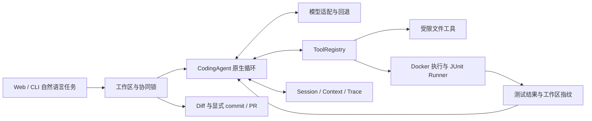

# selfForge Agent：开发规格与交付协议（SDD）

本文件是新 Agent 的**首读文档和当前任务状态的唯一维护入口**。读完即可选择下面的 Ready 任务并开始；仅在涉及具体模块时查阅链接的详细契约，不要求先遍历全部历史文档。

- 文档版本：1；更新：2026-11-19。
- 已核验产品基线：`04452154addaeff3375fcd15996585c2d5e374e3`；开工必须重新 fetch 并记录实际基线，不把这里的 SHA 当作永远最新。
- 前轮 SF-DEV-01 / SF-DOC-01 / SF-TEST-01 的已验证快照：源码 `9bc111cb07cb3b6b6dd8e44a7483c49e34960220`，完整 pytest 653 passed、无跳过。合并状态以第 4 节及审查记录为准；SF-EVAL-08 的新策略与无模型预检已交付；该策略下的真实模型测量尚未运行。
- 当前用户指令优先。SDD 不增加外部服务、付费模型调用、推送或合并授权，也不增加重复确认程序；沿用会话已有授权和仓库保护。

## 1. 产品目标与范围

**selfForge Agent — A Python Coding Agent with Reliable Execution and Self-Testing**。

面向 Python Git 仓库，从 Web/CLI 接收自然语言任务，在独立 worktree 中自主读、搜索、修改代码，在 Docker 中执行测试，交付可检查的 Diff、测试证据与执行轨迹；支持取消和显式恢复。PR Review、差异测试与 Repair 是专项工作流。

产品主线：**任务 → 受限工具调用 → 修改代码 → 隔离测试 → 证据验证 → 用户检查 → 显式 commit/PR**。

本阶段不增加产品 Multi-Agent、通用 MCP、额外 RAG、大型前端、跨语言 IDE 或另一套 Agent Runtime。开发者之间并行协作与产品 Multi-Agent 是两件事；是否使用子 Agent 服从当前工具/用户规则。

### 已实现与仍有边界

| 能力 | 已有实现 | 不应推断的能力 |
| --- | --- | --- |
| Runtime | 原生 tool calling、结果回填、步数/时间预算、只读/编辑失败/上下文提示 | 提示改善不等于已证明模型成功率提高 |
| 模型与界面 | OpenAI-compatible、多供应商预设/回退、模型发现、Web 工作台 | 预设不保证供应商任意账号/产品协议均兼容 |
| Harness | 持久会话/轨迹、启发式上下文压缩、取消、恢复、非空 JUnit 与工作区指纹 | 非精确 tokenizer；非断电事务；阻塞 HTTP 不保证即时取消 |
| 隔离与工作区 | Docker 默认、Host 显式信任、持久 worktree、共享协同锁、dirty guard、审计/prune | 文件指纹非原子快照；外部编辑器/Git/不同 XDG 不参与锁 |
| 环境 | 只读发现、有限锁导出、离线准备计划、wheelhouse 审计、显式镜像构建/会话绑定、声明诊断 | 不自动安装；哈希可用不等于可安装；Host markers 不等于目标容器解析 |
| 测试与交付 | Review/差异测试/Repair、worktree Diff、显式提交/PR、重试恢复、CI | 通过既有测试不代表全部需求充分验证；不自动合并 PR |
| Eval | 冻结 v2 20 题、两道独立多文件候选、无模型参考正负控、来源元数据/报告比较 | 两道新题未加入历史正式成绩；不能把旧分数当作当前 Runtime 成绩 |

已核验基线的本地完整 pytest 为 568 passed，无跳过；[基线 main CI](https://github.com/liuzhouquan/selfforge-agent/actions/runs/43135807788) 为 555 单元 + 13 Docker，无跳过。此数字仅属于上述基线，不是后续任务验收配额。历史 53/60 模型成绩及来源限制见[评测记录](./evaluation.md)。

## 2. 开工与选择任务

```sh
git status --short --branch
git worktree list
git fetch origin
git rev-parse origin/main
gh pr list --state open
```

1. 核对当前项目，不因 IDE 标签切换到其他仓库。未提交内容先确认归属；不 reset、clean 或覆盖未知文件。
2. 查开放 PR 与本表 Owner，已有工作先接手/审查，不重复实现。各 Agent 使用自己拥有的分支和 worktree。
3. 用户指定任务时执行该任务；仅说“继续开发”时，选**优先级最高、前提已满足且未被认领的一项 Ready**。完成一项后交接，不自行遍历整份路线图。
4. 领取时在本文件该任务的执行记录填 Owner、完整实际 base SHA、分支/worktree 标识、依赖与状态。不要新建一份重复规格。
5. 没有 Ready 时，先把最接近的 Waiting/Needs Design 任务补足前提/规格；不得把历史已完成项当作新任务。只有确实缺少用户决策才提问，独立工作继续推进。

创建独立工作区的例子（名称换成自己拥有且未占用的名称）：

```sh
git worktree add ../selfforge-sf-dev-01 -b feat/sf-dev-01 origin/main
```

### 状态与文档权威

当前任务状态仅在本文件维护：`Ready → In Progress → In Review → Merged`；依赖缺失为 `Waiting`，行为尚未定清为 `Needs Design`。`In Review` 不代表合并；`Merged` 必须有合并 SHA 和 PR，远端不可用时保持真实状态。

- 本文件维护产品主线、当前优先级、规格、验收及当前交接。范围变化先更新这里的原因、依赖和验收，再实施。
- [AGENTS.md](../AGENTS.md) 是自动加载的约束入口；[工程不变量](./engineering-invariants.md)是具体权限/状态/证据契约，本文件不放宽它们。发现冲突用源码/复现确认，不能自行选更宽松的一条。
- [开发指南](./development.md)保留安装与模块索引；[架构](./architecture.md)保留实现细节。只读涉及模块的部分。
- [Backlog](./backlog.md)、`docs/tasks/` 和旧审计是历史证据，不是另一个实时任务队列。历史验证保留，不能把旧结果改成新结果。
- 新任务直接增加本文件中的规格和执行记录；[旧模板](./task-template.md)只供历史记录/外部 Issue 兼容使用，不要求再复制文件。
- PR 描述引用任务 ID/验收 ID，并承载准确提交与 CI 证据；不复制整份 SDD。合并时同步本文件当前状态，避免在多个文件追加竞争的“最新状态”。

## 3. 实际架构与必须保持的约束



| 改动领域 | 先读的实现（相对 `src/selfforge_agent/`） | 关键回归入口（相对 `tests/`） |
| --- | --- | --- |
| Runtime/Context | `runtime/agent.py`、`control.py`、`context.py`、`model.py` | `test_runtime_budget.py`、`test_runtime_recovery.py`、`test_context*.py` |
| 工具/隔离/证据 | `runtime/tools.py`、`execution.py`、`fingerprint.py`；`verification/` | `test_coding_evidence.py`、`test_docker_staging.py`、`test_workspace_fingerprint.py` |
| 工作区/交付 | `runtime/workspace.py`、`workspace_diff.py`、`delivery.py` | `test_workspace_prune.py`、`test_delivery_safety.py`、`test_workspace_dirty_guard.py` |
| Web/模型 | `api/app.py`、`api/coding_jobs.py`、`providers.py` | `test_coding_web.py`、`test_web_origin.py`、`test_providers.py` |
| 环境 | `runtime/environment.py`、`images.py`、`lockfiles.py` | `test_dependency_freshness.py`、`test_wheelhouse_audit.py`、`test_session_environment.py` |
| 测试生成/Repair | `coding/test_generation.py`、`coding/agent.py`、`coding/worktree.py` | `test_test_generation.py`、`test_repair_agent.py`、`test_docker_repair.py` |
| 独立 Eval | `runtime/benchmark.py`、`benchmark_diff.py` | `test_reference_validation.py`、`test_benchmark_isolation.py`、`test_benchmark_diff.py` |

不可回退的约束：

1. 保持一个通用 `CodingAgent`、共享 ToolRegistry/JUnit Runner；Repair 的独立 proposer 是现有边界，不新增竞争 Runtime。
2. Docker 是默认执行方式；Host 必须显式信任。文件保护、路径/链接校验、网络/资源限制、输出/输入/超时上限继续生效；不默认运行仓库 hooks、setup.py 或自动安装脚本。
3. `completed` 必须有非空 JUnit 成功、测试前后及当前指纹一致、非空最终答复。bash 退出 0、旧测试布尔值、LLM 自评均不能替代证据。
4. 新任务、写入/编辑尝试、持久 Host 命令或新测试之前先持久化撤销旧证据；取消、超时、异常、恢复均不能复活失效证据。
5. 保持 assistant/tool 消息成组与 user 约束；预算提示瞬态生成，不能持久化成旧预算；token 估算明确标为启发式。
6. CLI/Web 对同一工作区使用共享锁。持久 worktree 不强制删除；dirty/ignored 用户输入保留；prune 在锁内重查；commit/PR 证据只绑定实际推送 SHA。
7. 私有会话/密钥保持受限权限；trace 仅元数据，不泄漏模型正文、推理、原始错误、工具参数或私有路径。日志、密钥、依赖缓存、课程源码不提交。
8. Eval 固定源 SHA/清单/镜像，外部 holdout 与 reference 不进 Agent；基线负控与独立 visible/holdout 正控、允许修改范围、非空 JUnit 缺一不可。冻结资产/历史成绩不得覆写。
9. 缺失输入、扫描不完整和环境不可用要显式表示，不当作通过；费用未知不能编造；堆栈关联不能写成因果证明。

## 4. 下一阶段里程碑与任务队列

当前阶段目标：**使新环境可复现开发与验证，让规格能追溯到测试，并把自主编程后的回归测试验证补成可复用流程。** 不按功能数量或测试数量宣称产品完成。

| 顺序 | 任务 ID | 状态 | Owner | 前提 | 交付结果 |
| --- | --- | --- | --- | --- | --- |
| 1 | [SF-DEV-01](#sf-dev-01) | Merged | Codex（审查整合） | 无 | [PR #57](https://github.com/liuzhouquan/selfforge-agent/pull/57)：新 checkout 与 CI 复用同一个固定评测源准备入口 |
| 2 | [SF-DOC-01](#sf-doc-01) | Merged | Codex（审查整合） | 本 SDD | 有界 SDD 一致性检查，阻止失配状态与虚假验收引用（[PR #58](https://github.com/liuzhouquan/selfforge-agent/pull/58)） |
| 3 | [SF-TEST-01](#sf-test-01) | Merged | Codex（审查整合） | 既有 Runner/worktree/指纹 | 对 Coding 修复提供独立的旧失败/新通过回归证据 |
| 4 | [SF-EVAL-08](#sf-eval-08) | Merged | Codex（审查整合） | SF-DEV-01；策略已冻结 | [PR #61](https://github.com/liuzhouquan/selfforge-agent/pull/61)：新 Runtime 22 题 v3 评测规格、冻结输入与无模型 Docker 预检 |
| 5 | [SF-TEST-02](#sf-test-02) | Merged | Codex（审查整合） | SF-TEST-01（Merged） | [PR #62](https://github.com/liuzhouquan/selfforge-agent/pull/62)：Web Coding 工作台接入独立回归验证面板、状态门槛与结构化证据展示 |
| 6 | [SF-WS-05](#sf-ws-05) | Merged | Codex（审查整合） | SF-WS-04 / SF-TEST-01（Merged） | [PR #63](https://github.com/liuzhouquan/selfforge-agent/pull/63)：修复 `/api/workspaces/storage` 管理器复用不一致并补齐 CLI `trace` / `test-regression` 安全结构化导出 |
| 7 | [SF-WS-06](#sf-ws-06) | Merged | Codex（审查整合） | SF-WS-04 / SF-WS-05 / SF-ENV-06（Merged） | [PR #64](https://github.com/liuzhouquan/selfforge-agent/pull/64)：Web Coding 工作台接入工作区审计/存储/安全清理（`audit`/`storage`/`prune`）与依赖新鲜度诊断（`/api/sandbox/freshness`） |
| 8 | [SF-EVAL-09](#sf-eval-09) | Merged | Codex（审查整合） | SF-EVAL-08 / SF-WS-05（Merged） | [PR #65](https://github.com/liuzhouquan/selfforge-agent/pull/65)：CLI `eval-suite` / `eval-validate` 接入 `--policy` 冻结策略强校验、预算门禁与安全导出（`_write_cli_output`） |
| 9 | [SF-ENV-07](#sf-env-07) | Merged | Codex（审查整合） | SF-WS-05 / SF-ENV-06（Merged） | [PR #66](https://github.com/liuzhouquan/selfforge-agent/pull/66)：CLI `sandbox` 诊断与规划命令补齐结构化安全导出（`--json` / `--output`）与 `export-lock` 安全写盘 |
| 10 | [SF-TEST-03](#sf-test-03) | Merged | Codex（审查整合） | SF-TEST-02 / SF-WS-05（Merged） | [PR #67](https://github.com/liuzhouquan/selfforge-agent/pull/67)：SessionStore 补齐回归验证记录追溯与 GET /api/code/workspaces/{session_id}/regression 只读接口，并在 PR 交付中绑定回归验证证据 |
| 11 | [SF-TEST-04](#sf-test-04) | Merged | Codex（审查整合） | SF-TEST-02 / SF-TEST-03 / SF-WS-06（Merged） | [PR #68](https://github.com/liuzhouquan/selfforge-agent/pull/68)：Web Coding 工作台接入持久化回归验证记录恢复与会话切换状态同步 |
| 12 | [SF-CLI-01](#sf-cli-01) | Merged | Codex（审查整合） | SF-WS-05 / SF-ENV-07（Merged） | [PR #69](https://github.com/liuzhouquan/selfforge-agent/pull/69)：CLI `review` / `repair` / `generate-test` 安全落盘防符链穿透与结构化 `--json` 导出对齐 |
| 13 | [SF-WS-07](#sf-ws-07) | Merged | Codex（审查整合） | SF-WS-05 / SF-WS-06（Merged） | [PR #70](https://github.com/liuzhouquan/selfforge-agent/pull/70)：CLI `workspaces` 全动作（`list`/`diff`/`commit`/`pr`/`revert`/`remove`/`audit`/`prune`/`storage`）结构化 `--json` 与安全 `--output` 导出对齐 |
| 14 | [SF-RUN-07](#sf-run-07) | Merged | Codex（审查整合） | 无 | [PR #71](https://github.com/liuzhouquan/selfforge-agent/pull/71)：ToolRegistry 搜索预算上限中断与截断通知、文件读取非普通文件防御（FIFO/目录）与编辑/测试边界防御 |
| 15 | [SF-WS-08](#sf-ws-08) | Merged | Codex（审查整合） | 无 | [PR #72](https://github.com/liuzhouquan/selfforge-agent/pull/72)：WorkspaceDiff 与 Delivery 安全加固：未跟踪符号链接目录隔离、不可读文件安全回退与未跟踪断链/目录符号链接安全清理 |
| 16 | [SF-VERIF-01](#sf-verif-01) | Merged | Codex（审查整合） | 无 | [PR #73](https://github.com/liuzhouquan/selfforge-agent/pull/73)：验证执行器与 JUnit 解析安全加固：有限正超时校验、非普通文件（FIFO/设备）与受保护路径防御、深层递归容错与无符链穿透测试工件读取 |
| 17 | [SF-ENV-08](#sf-env-08) | Merged | Codex（审查整合） | SF-ENV-07（Merged） | [PR #74](https://github.com/liuzhouquan/selfforge-agent/pull/74)：依赖输入与锁文件安全加固：平台条件标记 fail-closed 拒绝、PEP 503 包名规范化与非阻塞/无符链安全读取 |
| 18 | [SF-EVAL-10](#sf-eval-10) | Merged | Codex（审查整合） | SF-EVAL-09（Merged） | [PR #75](https://github.com/liuzhouquan/selfforge-agent/pull/75)：评测执行器与基准测试安全加固：未绑定状态防御、非阻塞常规文件读取、测试拷贝防FIFO阻塞与原子工件安装 |
| 19 | [SF-TEST-05](#sf-test-05) | Merged | Codex（审查整合） | SF-TEST-04（Merged） | [PR #76](https://github.com/liuzhouquan/selfforge-agent/pull/76)：差分测试生成与因果推断安全加固：测试工件原子写盘防符链穿透、AST 深层递归与畸形异常防御、观察读取防 FIFO 挂起与有界因果推断日志防御 |
| 20 | [SF-API-01](#sf-api-01) | Merged | Codex（审查整合） | 无 | [PR #77](https://github.com/liuzhouquan/selfforge-agent/pull/77)：Web Coding API 与会话管理安全加固：请求体大小防御（413）、会话 ID 路径穿越防御、DurableCancel 防符链与有界作业记录读取 |
| 21 | [SF-RUN-08](#sf-run-08) | Merged | Codex（审查整合） | 无 | [PR #78](https://github.com/liuzhouquan/selfforge-agent/pull/78)：运行时执行器与测试失败工件安全加固：工件原子读写防符链穿透/FIFO阻塞、执行器超时与命令有界校验、工作区根目录隔离 |
| 22 | [SF-PROV-02](#sf-prov-02) | Merged | Codex（审查整合） | 无 | [PR #79](https://github.com/liuzhouquan/selfforge-agent/pull/79)：模型供应商配置与 HTTP 传输安全加固：SSRF 协议限制与本地文件读取杜绝、CRLF 响应头注入防御、配置读取防符链/FIFO阻塞、进程锁加固 |
| 23 | [SF-INT-01](#sf-int-01) | Merged | Codex（审查整合） | 无 | [PR #80](https://github.com/liuzhouquan/selfforge-agent/pull/80)：GitHub PR 提取与检出安全加固：命令注入与参数投毒防御、URL 规范化、工作区路径防符链穿透、Diff Hunk 解析有界防御 |
| 24 | [SF-PRICE-01](#sf-price-01) | Merged | Codex（审查整合） | 无 | [PR #81](https://github.com/liuzhouquan/selfforge-agent/pull/81)：模型费率卡与成本估算安全加固：JSON 反序列化深度防御、Token 计数严格类型与非负校验、货币代码规范化、浮点溢出安全回退 |
| 25 | [SF-GH-01](#sf-gh-01) | Merged | Codex（审查整合） | 无 | [PR #82](https://github.com/liuzhouquan/selfforge-agent/pull/82)：GitHub PR 抓取与检出安全加固：URL 严格正则与选项防注入、变更文件路径防穿越与状态规范化、工作区软链接防御、命令输出有界防御 |
| 26 | [SF-CORE-01](#sf-core-01) | Merged | Codex（审查整合） | 无 | [PR #83](https://github.com/liuzhouquan/selfforge-agent/pull/83)：Git 差异上下文与补丁解析安全加固：仓库路径软链接防御、差异解包受控映射、补丁与行号有界防 DoS |
| 27 | [SF-REV-01](#sf-rev-01) | Merged | Codex（审查整合） | 无 | [PR #84](https://github.com/liuzhouquan/selfforge-agent/pull/84)：代码审查引擎安全加固：规则基线有界防御、模型审查输入/输出防御与执行隔离 |
| 28 | [SF-CTRL-01](#sf-ctrl-01) | Merged | Codex（审查整合） | 无 | [PR #85](https://github.com/liuzhouquan/selfforge-agent/pull/85)：运行时控制流与瞬态指导安全加固：工具循环检测防御、编辑失败循环防护、上下文压力评估与预算通知有界防御 |
| 29 | [SF-MODEL-01](#sf-model-01) | Merged | Codex（审查整合） | 无 | [PR #86](https://github.com/liuzhouquan/selfforge-agent/pull/86)：编码模型客户端安全加固：有限正超时校验、Base URL与凭据防御、输入观测类型与有界负载防御、Markdown代码块剥离与CodeEdit边界校验 |
| 30 | [SF-WT-01](#sf-wt-01) | Merged | Codex（审查整合） | 无 | [PR #87](https://github.com/liuzhouquan/selfforge-agent/pull/87)：Git worktree与临时分支执行安全加固：子进程执行与有界读取防御、修订与参数注入防御、目标路径与符号链接隔离防御、清理容错与工作区元数据修剪 |
| 31 | [SF-RISK-01](#sf-risk-01) | Merged | Codex（审查整合） | 无 | [PR #88](https://github.com/liuzhouquan/selfforge-agent/pull/88)：PR风险优先级排序与RiskTarget契约边界加固：上下文与发现类型Fail-Closed校验、扫描深度与代码行有界防御、PrioritizedRisk模式与空字节防御、确定性排序与有效转换 |
| 32 | [SF-FPR-01](#sf-fpr-01) | Merged | Codex（审查整合） | 无 | [PR #89](https://github.com/liuzhouquan/selfforge-agent/pull/89)：工作区快照指纹哈希安全加固：root输入防御与斜杠绕过软链接防御、有限正数deadline与cancel状态机对齐、目录递归自循环防御、非普通文件与负大小防御 |
| 33 | [SF-CTX-01](#sf-ctx-01) | Merged | Codex（审查整合） | 无 | [PR #90](https://github.com/liuzhouquan/selfforge-agent/pull/90)：模型上下文管理器与结构化压缩防御加固（`estimate_tokens` / `estimate_message_tokens` / `_recent_interactions` / `ContextManager`） |
| 34 | [SF-AGENT-01](#sf-agent-01) | Merged | Codex（审查整合） | SF-CTX-01（Merged） | [PR #91](https://github.com/liuzhouquan/selfforge-agent/pull/91)：CodingAgent 原生自主循环边界与状态机对齐加固：类型守门、会话恢复容错、Hook 异常隔离与指标对齐 |
| 35 | [SF-REPAIR-01](#sf-repair-01) | Merged | Codex（审查整合） | SF-CORE-01 / SF-REV-01（Merged） | [PR #92](https://github.com/liuzhouquan/selfforge-agent/pull/92)：RepairAgent 修复循环与参数边界防御加固：构造与任务守门、变更源安全提取、编辑异常隔离与遥测状态机对齐 |
| 36 | [SF-SESS-01](#sf-sess-01) | Merged | Codex（审查整合） | 无 | [PR #93](https://github.com/liuzhouquan/selfforge-agent/pull/93)：SessionStore 输入防御、安全写入/读取与指标鲁棒性加固 |
| 37 | [SF-DELIV-01](#sf-deliv-01) | Merged | Codex（审查整合） | 无 | [PR #94](https://github.com/liuzhouquan/selfforge-agent/pull/94)：工作区交付工作流（commit/revert/pr）输入守门、配置注入防御与证据绑定加固 |
| 38 | [SF-IMG-01](#sf-img-01) | Merged | Codex（审查整合） | 无 | [PR #95](https://github.com/liuzhouquan/selfforge-agent/pull/95)：离线依赖镜像构建器输入门禁、wheelhouse扫描校验与Docker子进程安全执行加固 |
| 39 | [SF-CAUSAL-01](#sf-causal-01) | Merged | Codex（审查整合） | 无 | [PR #96](https://github.com/liuzhouquan/selfforge-agent/pull/96)：测试故障因果推断输入门禁、调用栈提取有界化与基础测试因果反归因加固 |
| 40 | [SF-PROC-01](#sf-proc-01) | Merged | Codex（审查整合） | 无 | [PR #97](https://github.com/liuzhouquan/selfforge-agent/pull/97)：有界原生子进程执行安全加固、参数与目录防御及进程组生命周期管理 |
| 41 | [SF-BMDIFF-01](#sf-bmdiff-01) | Merged | Codex（审查整合） | 无 | [PR #98](https://github.com/liuzhouquan/selfforge-agent/pull/98)：基准评测报告解析与差异分析加固：非普通文件与符链路径防御、报告指标Fail-Closed校验与SHA-256规范化、Markdown表格注入防御与结构化导出 |
| 42 | [SF-JOB-01](#sf-job-01) | Merged | Codex（审查整合） | 无 | [PR #99](https://github.com/liuzhouquan/selfforge-agent/pull/99)：本地异步编码任务管理与取消标记加固：取消标记防符链与FIFO阻塞、作业记录序列化/反序列化校验与状态白名单防御、任务并发上限与工作区锁防泄露加固 |
| 43 | [SF-FDBK-01](#sf-fdbk-01) | Merged | Codex（审查整合） | 无 | [PR #100](https://github.com/liuzhouquan/selfforge-agent/pull/100)：测试失败反馈与修复反馈安全加固：严格输入类型与有限上限防御、空字节与终端控制字符脱敏、单行折叠防摘要伪造注入、严格长度不变式与有界修复反馈格式化 |
| 44 | [SF-MODEL-02](#sf-model-02) | Merged | Codex（审查整合） | 无 | [PR #101](https://github.com/liuzhouquan/selfforge-agent/pull/101)：模型适配层与ModelTurn安全加固：严格输入防御与类型守门、取消检查与fallback重置、提供商响应Schema校验防御、空字节与超长reasoning内容防御及ModelTurn不变式保障 |
| 45 | [SF-REGRESS-01](#sf-regress-01) | Merged | Codex（审查整合） | 无 | [PR #102](https://github.com/liuzhouquan/selfforge-agent/pull/102)：回归验证执行器与隔离加固：基线Commit SHA十六进制严格校验与参数防注入、候选测试路径与非普通文件防御、快照目录隔离与安全执行及模型契约不变式保障 |
| 46 | [SF-EVAL-11](#sf-eval-11) | Merged | Codex（审查整合） | 无 | [PR #103](https://github.com/liuzhouquan/selfforge-agent/pull/103)：评测执行器参数强类型与数值边界防御、EvalCase 不变式校验、OfflineFixtureModel 协议守卫与异常受控收敛、EvalOutcome 结果真实性断言与 CLI eval 安全导出 |
| 47 | [SF-CLI-02](#sf-cli-02) | Merged | Codex（审查整合） | 无 | [PR #104](https://github.com/liuzhouquan/selfforge-agent/pull/104)：code 与 test 子命令结构化 --json 导出、安全 --output 落盘防御与显式命令分发加固 |
| 48 | [SF-API-02](#sf-api-02) | Merged | Codex（审查整合） | SF-API-01（Merged） | [PR #105](https://github.com/liuzhouquan/selfforge-agent/pull/105)：Web Coding API 与会话管理深度加固：Job ID 与 Resume Session 参数校验防路径遍历、工作区/沙箱端点路径预检与空字节受控拒绝（路径预检400、请求模型字段422）、Fail-Closed 本地访问控制与全局异常受控收敛 |
| 49 | [SF-VERIF-02](#sf-verif-02) | Merged | Codex（审查整合） | SF-VERIF-01（Merged） | [PR #106](https://github.com/liuzhouquan/selfforge-agent/pull/106)：验证执行器与 JUnit 解析二次安全加固：大小写不敏感 DTD/实体过滤、测试套件与测试用例数量上限、失败嵌套文本解析、工作区路径符链循环防御、进程组超时竞态防御与测试关键字注入防护 |
| 50 | [SF-PRICE-02](#sf-price-02) | Merged | Codex（审查整合） | SF-PRICE-01（Merged） | [PR #107](https://github.com/liuzhouquan/selfforge-agent/pull/107)：费率卡与成本估算深度加固：布尔费率严格拒绝、成本对象总额与细项线性不变式守卫、未校准成本严格扣留、总Token数反向矛盾Fail-Closed拒绝、深层JSON递归防御与有界并发缓存 |
| 51 | [SF-DELIV-02](#sf-deliv-02) | Merged | Codex（审查整合） | SF-DELIV-01（Merged） | [PR #108](https://github.com/liuzhouquan/selfforge-agent/pull/108)：工作区交付工作流二次安全加固：交付结果模型严格校验与路径穿越防御、base_sha十六进制格式校验与Git Ref规则守卫、Git配置注入防御与会话ID一致性校验、超大文件列表分批执行及PR结果有界防御 |
| 52 | [SF-REV-02](#sf-rev-02) | Merged | Codex（审查整合） | SF-REV-01（Merged） | [PR #109](https://github.com/liuzhouquan/selfforge-agent/pull/109)：代码审查流水线二次安全加固：路径穿越防御与布尔行号拦截、模型配置强校验与有界Prompt预算截断、Markdown代码块JSON容错与字段清洗转义、审查器契约守卫与全量异常Fail-Closed隔离 |
| 53 | [SF-LOCK-01](#sf-lock-01) | Merged | Codex（审查整合） | 无 | [PR #110](https://github.com/liuzhouquan/selfforge-agent/pull/110)：多格式依赖锁文件深度安全加固与规范化：非bytes输入受控拦截与5MiB尺寸防御、迭代式50层JSON深度限制防DoS、PEP 508平台条件标记全面拒绝、SHA-256大小写与前缀规范化及RequirementCollector共享抽取抽象 |
| 54 | [SF-WS-09](#sf-ws-09) | Merged | Codex（审查整合） | 无 | [PR #111](https://github.com/liuzhouquan/selfforge-agent/pull/111)：工作区差异统计内存边界防御、二进制变更脱敏、文件锁安全加固及分支生命周期安全清理 |
| 55 | [SF-CORE-02](#sf-core-02) | Merged | Codex（审查整合） | 无 | [PR #112](https://github.com/liuzhouquan/selfforge-agent/pull/112)：进程执行管道死锁防御、优雅终止降级、环境变量有界脱敏与 Git Context 修订严格校验 |
| 56 | [SF-SESS-02](#sf-sess-02) | Merged | Codex（审查整合） | 无 | [PR #113](https://github.com/liuzhouquan/selfforge-agent/pull/113)：会话快照与导出原子写盘、Trace与敏感信息自动脱敏、事件配额防御及损坏会话恢复降级 |
| 57 | [SF-HTTP-01](#sf-http-01) | Merged | Codex（审查整合） | 无 | [PR #114](https://github.com/liuzhouquan/selfforge-agent/pull/114)：模型 HTTP 传输与网络安全加固：CRLF 头注入防御、自定义 Header 格式与上限校验、请求体 Schema/大小有界防御、URL 片段拦截与 IPv6 环回支持、瞬态故障指数退避重试与截止期守护、响应流 Chunk 计数预算与 Socket 资源泄漏防护 |
| 58 | [SF-TOOL-02](#sf-tool-02) | Merged | Codex（审查整合） | 无 | [PR #115](https://github.com/liuzhouquan/selfforge-agent/pull/115)：工具执行器与参数模式安全加固：入参模式防御与非字典入参拒绝、路径/命令/关键字注入防护（杜绝空字节与前导选项）、编辑载荷与策略大小有界防御、输出有界安全截断与异常受控隔离 |
| 59 | [SF-FP-02](#sf-fp-02) | Merged | Codex（审查整合） | SF-FPR-01（Merged） | [PR #116](https://github.com/liuzhouquan/selfforge-agent/pull/116)：工作区快照指纹加固与跨平台确定性：根路径输入防御与空值阻断、单文件大小有界上限防御、跨平台权限模式与路径规范化、Unicode文件名NFC排序稳定性及取消中断精准响应 |
| 60 | [SF-CAUSAL-02](#sf-causal-02) | Merged | Codex（审查整合） | SF-CAUSAL-01（Merged） | [PR #117](https://github.com/liuzhouquan/selfforge-agent/pull/117)：测试故障因果推断二次加固：目标路径与代码空值门禁、单引号与Pytest格式调用栈提取、虚拟环境与运行时外部调用帧隔离、模块级基础测试反归因加固及通用词根防误报 |
| 61 | [SF-RISK-02](#sf-risk-02) | Merged | Codex（审查整合） | SF-RISK-01（Merged） | [PR #118](https://github.com/liuzhouquan/selfforge-agent/pull/118)：PR风险优先级排序二次安全加固：路径穿越与非法路径/行号防御、跨层路径规范化、PrioritizedRisk与RiskTarget契约不变式及下游验证兼容、严重级别critical规范化与高危Heuristic扩展、测试文件降权与终端控制字符脱敏 |
| 62 | [SF-FAIL-01](#sf-fail-01) | Merged | Codex（审查整合） | 无 | [PR #119](https://github.com/liuzhouquan/selfforge-agent/pull/119)：测试失败工件与诊断快照生命周期及安全加固：工件模型模式规范化（FailureArtifact）、Fail-Closed 类型守门与超限安全截断有界降级、目录隔离与原子无符链写盘、非普通文件/FIFO防御与确定性工件列表检索（list_failures）及统计聚合（summarize_failures） |
| 63 | [SF-IMG-02](#sf-img-02) | Merged | Codex（审查整合） | SF-IMG-01（Merged） | [PR #120](https://github.com/liuzhouquan/selfforge-agent/pull/120)：离线依赖镜像二级深度安全加固：哈希规范化、Wheelhouse诊断抽象、镜像引用防注入与构建模型Schema形式化 |
| 64 | [SF-CTX-02](#sf-ctx-02) | Merged | Codex（审查整合） | SF-CTX-01（Merged） | [PR #121](https://github.com/liuzhouquan/selfforge-agent/pull/121)：模型上下文管理器二级深度安全加固：估算边界防护、交互切片严格单射配对、压缩锚点序保护与度量报告Schema形式化 |

阶段完成条件：前三项验收全部闭合且已合并；新环境完整验证可复现；通用修复验证具备独立旧失败/新通过的 Docker 证据；当前规格能追溯到测试与准确提交。SF-EVAL-08 是后续测量准备，仍不代表产品的真实任务可靠性已经达标。

上表同时记录当前交付状态与未来任务。需要并行认领时先核对开放 PR；状态/Owner 回填到同一行。多个分支基于最新 main 开发，合并前更新基线并复查公共入口，不机械拼接表尾。

### SF-DEV-01

**目标：** 新 checkout 不依赖开发者 `.local` 缓存即可按明确命令准备两道候选的固定源；CI 复用同一准备入口。只显式获取 Git 对象，不执行外部代码。

**范围/入口：** 新建 `scripts/prepare_eval_sources.py`，参数 `--root PATH`、`--timeout SECONDS`（总预算，默认 120，合法范围 1–300）、`--offline`。固定登记 jmespath/boltons 的现有 URL 与清单修订；复用 `.github/workflows/ci.yml` 的策略、`tests/conftest.py` 的 `SELFFORGE_EVAL_SOURCE_ROOT`。不开发任意 URL 下载器/新缓存平台，不安装项目依赖、不调用模型。

**行为：** 显式在线模式仅 fetch 固定 URL/SHA，并创建可被独立 clone 获取的 named ref；已有完整缓存离线可用且不变更其 HEAD。缺失缓存离线失败。拒绝 symlink 根/目标、非本任务拥有的已有非仓库目录和缺少预期来源的缓存；不删除/重置已有文件。用 argv subprocess、总 deadline 和有界输出；失败退出非零，不伪报 ready。首次创建需标记本入口拥有的目录；失败留下可诊断但不执行的状态。

| 验收 ID | Given / When / Then | 最少证明方式 | 初始证据 |
| --- | --- | --- | --- |
| SF-DEV-01-A1 | 空临时根显式在线准备后，两固定提交能从生成仓库独立 clone/checkout | `tests/test_eval_source_preparation.py`；本地 Git remote 替身测控制流，CI 实际固定 URL | E5（本轮组合复验） |
| SF-DEV-01-A2 | 已有合格缓存使用 `--offline`，成功且不联网、不改变用户 HEAD/文件 | 同文件 CLI 回归 + 前后状态；替身阻断 fetch | E6（本轮组合复验） |
| SF-DEV-01-A3 | 超时、坏源、缺提交、离线缺缓存、symlink/未知目录输入均失败，保留已有内容 | 同文件错误注入；可观察退出码与磁盘内容 | E7（本轮组合复验） |
| SF-DEV-01-A4 | 新 checkout 按文档先准备再运行全部测试；CI 不再复制 fetch 命令 | 真实 CI + Docker 两候选控制；不需要模型密钥 | E8（本轮组合复验） |

| 记录 | 验收 ID | 测试节点 / 实际入口 | 命令与环境 | 验证 SHA / 结果 / CI |
| --- | --- | --- | --- | --- |
| E1 | SF-DEV-01-A1 | `tests/test_eval_source_preparation.py::test_online_preparation_creates_cloneable_repos_and_ownership_marker`、`tests/test_eval_source_preparation.py::test_pinned_sources_match_candidate_manifests_and_policy`、`tests/test_eval_source_preparation.py::test_default_root_uses_env_var_and_cli_subprocess`、`tests/test_eval_source_preparation.py::test_online_fetch_into_existing_repo_preserves_head_and_candidate_branch`；GitHub Actions `Provision pinned multi-file candidate sources` | Host 本地 Git remote 替身 + `git clone --no-local`；GitHub `ubuntu-latest` CI 真实拉取 pinned GitHub URL；[PR #57](https://github.com/liuzhouquan/selfforge-agent/pull/57) | 源码 SHA `57117238f34c9082b5ce3b3b9e6b1931f2b0549d`；本地专项 18 passed / 非集成 573 passed, 13 deselected / Ruff passed；CI [Run #43150979908](https://github.com/liuzhouquan/selfforge-agent/actions/runs/43150979908) 真实固定 URL 准备成功（jmespath `2812594e69d43098ef60f81f4efc404c071b0418`、boltons `d31d821d56c8f7756af9c30a864077f2e5855321`） |
| E2 | SF-DEV-01-A2 | `tests/test_eval_source_preparation.py::test_offline_mode_succeeds_without_fetch_and_preserves_user_head_and_files` | Host 本地缓存 + git wrapper 阻断 mutating/fetch 命令 + 前后 HEAD 与文件比对；[PR #57](https://github.com/liuzhouquan/selfforge-agent/pull/57) | `57117238f34c9082b5ce3b3b9e6b1931f2b0549d`；本地与 CI [Run #43150979908](https://github.com/liuzhouquan/selfforge-agent/actions/runs/43150979908) passed（573 passed, 13 deselected） |
| E3 | SF-DEV-01-A3 | `tests/test_eval_source_preparation.py::test_invalid_timeout_cli_rejected`、`tests/test_eval_source_preparation.py::test_timeout_kills_slow_git_and_leaves_diagnosable_unready_state`、`tests/test_eval_source_preparation.py::test_online_bad_remote_and_missing_commit_fail_and_recover_on_retry`、`tests/test_eval_source_preparation.py::test_run_git_stdout_overflow_fails_closed`、`tests/test_eval_source_preparation.py::test_offline_rejects_missing_cache_bad_origin_and_orphan_commit`、`tests/test_eval_source_preparation.py::test_rejects_symlinks_unknown_dirs_and_nested_parent_repo_without_modification`、`tests/test_eval_source_preparation.py::test_bounded_output_and_corrupt_state_file_fail_closed` | Host CLI 子进程退出码、超时期限进程组终止、错误注入与磁盘内容保留检查；[PR #57](https://github.com/liuzhouquan/selfforge-agent/pull/57) | `57117238f34c9082b5ce3b3b9e6b1931f2b0549d`；本地与 CI [Run #43150979908](https://github.com/liuzhouquan/selfforge-agent/actions/runs/43150979908) passed（573 passed, 13 deselected） |
| E4 | SF-DEV-01-A4 | `tests/test_eval_source_preparation.py::test_ci_workflow_uses_shared_prepare_eval_sources_script`；`.github/workflows/ci.yml`（`Lint` / `Unit tests` / `Build sandbox image` / `Provision pinned multi-file candidate sources` / `Docker integration tests`） | 本地 Ruff + 非集成全量 + CI 真实 Docker 集成测试（`uv run --no-sync pytest -q -m integration`）；本机 WSL2 未安装 `docker`，Docker 集成由 CI 完成；[PR #57](https://github.com/liuzhouquan/selfforge-agent/pull/57) | `57117238f34c9082b5ce3b3b9e6b1931f2b0549d`；CI [Run #43150979908](https://github.com/liuzhouquan/selfforge-agent/actions/runs/43150979908) 全绿：Lint passed、Unit tests `573 passed, 13 deselected`、Docker integration tests `13 passed, 573 deselected`（含 jmespath 与 boltons 候选控制） |
| E5 | SF-DEV-01-A1 | `tests/test_eval_source_preparation.py::test_online_preparation_creates_cloneable_repos_and_ownership_marker` | `SELFFORGE_EVAL_IMAGE=selfforge-agent-sandbox:latest uv run --no-sync pytest -q`；本机 Linux 真 Docker + CLI/API；Git 替身/故障注入只证明相应边界 | `9bc111cb07cb3b6b6dd8e44a7483c49e34960220`；passed；完整组合 653 passed、无跳过；[组合 head CI](https://github.com/liuzhouquan/selfforge-agent/actions/runs/43189888813) 639 单元 + 14 Docker 全部通过；详见[审查记录](./review-pr57-59.md) |
| E6 | SF-DEV-01-A2 | `tests/test_eval_source_preparation.py::test_offline_mode_succeeds_without_fetch_and_preserves_user_head_and_files` | `SELFFORGE_EVAL_IMAGE=selfforge-agent-sandbox:latest uv run --no-sync pytest -q`；本机 Linux 真 Docker + CLI/API；Git 替身/故障注入只证明相应边界 | `9bc111cb07cb3b6b6dd8e44a7483c49e34960220`；passed；完整组合 653 passed、无跳过；[组合 head CI](https://github.com/liuzhouquan/selfforge-agent/actions/runs/43189888813) 639 单元 + 14 Docker 全部通过；详见[审查记录](./review-pr57-59.md) |
| E7 | SF-DEV-01-A3 | `tests/test_eval_source_preparation.py::test_cli_rejects_fifo_state_without_blocking`、`tests/test_eval_source_preparation.py::test_preparation_does_not_execute_checkout_filters` | `SELFFORGE_EVAL_IMAGE=selfforge-agent-sandbox:latest uv run --no-sync pytest -q`；本机 Linux 真 Docker + CLI/API；Git 替身/故障注入只证明相应边界 | `9bc111cb07cb3b6b6dd8e44a7483c49e34960220`；passed；完整组合 653 passed、无跳过；[组合 head CI](https://github.com/liuzhouquan/selfforge-agent/actions/runs/43189888813) 639 单元 + 14 Docker 全部通过；详见[审查记录](./review-pr57-59.md) |
| E8 | SF-DEV-01-A4 | `tests/test_eval_source_preparation.py::test_ci_workflow_uses_shared_prepare_eval_sources_script` | `SELFFORGE_EVAL_IMAGE=selfforge-agent-sandbox:latest uv run --no-sync pytest -q`；本机 Linux 真 Docker + CLI/API；Git 替身/故障注入只证明相应边界 | `9bc111cb07cb3b6b6dd8e44a7483c49e34960220`；passed；完整组合 653 passed、无跳过；[组合 head CI](https://github.com/liuzhouquan/selfforge-agent/actions/runs/43189888813) 639 单元 + 14 Docker 全部通过；详见[审查记录](./review-pr57-59.md) |

执行记录（Owner/状态以上表为准）：Base=`e07153e092150ab2d1f86aa98545a676836b6e14`；Branch=`feat/sf-dev-01`；Worktree=`selfforge-sf-dev-01`；PR=[#57](https://github.com/liuzhouquan/selfforge-agent/pull/57)。先核对两项固定 SHA 与 `--no-local` clone 行为并先红后绿实现共享脚本；首次推送 `8d91cc5a848b50d9296c6494d1e3c10824f0d98f` 在 CI `Run #43150067989` 因冗余 shebang 触发 Ruff `EXE001` 失败，移除后在源码提交 `57117238f34c9082b5ce3b3b9e6b1931f2b0549d` 通过本地回归与 CI `Run #43150979908` 全套验证（仅保留一份共享实现与一份准备文档）。

E5–E8 为本轮组合复验；E1–E4 保留为原分支历史结果，不充当当前源码的执行证明。

审查整合记录：Base=`e07153e092150ab2d1f86aa98545a676836b6e14`；Branch=`review/pr57-59`；PR=#57；Merge=`fa387bc4e427d9a682a00932802a7e4c8920bee7`。用户已授权修改与合并；新增回归保留原缺陷的实际失败结果，修复后完整组合验证通过；后续状态提交仅修改文档。

```text
Owner / 状态：Codex（审查整合） / Merged
实际 base SHA / 分支及 worktree 标识 / 当前 HEAD：e07153e092150ab2d1f86aa98545a676836b6e14 / review/pr57-59 (worktree: selfforge-review-pr57-59) / 已验证源码 9bc111cb07cb3b6b6dd8e44a7483c49e34960220；本次状态提交仅文档
已完成验收与证据 ID：SF-DEV-01-A1..A4（E5、E6、E7、E8）；历史 E1–E4 保留
未完成 / 环境限制 / 未提交内容归属：源码无未提交内容；本次状态与审查记录归 Codex；本机真 Docker 已完成完整组合验证；不调用模型
PR / 准确 head CI / merge SHA（有则填）：PR #57 / https://github.com/liuzhouquan/selfforge-agent/actions/runs/43189888813（组合源码 head；各源 PR head CI 见审查记录） / fa387bc4e427d9a682a00932802a7e4c8920bee7
仍在运行的本任务进程或 CI（无则写无）：本地进程无；最终 main CI 的准确运行及结论记录到 PR #59 交付描述
下一步：核对最终 main CI；SF-EVAL-08 仍需先冻结策略，未满足 Ready 前提。
```

### SF-DOC-01

**目标：** 将本文件的状态和验收约定变成可执行门禁，而非靠审查者记忆。

**范围/入口：** 新建标准库脚本 `scripts/check_sdd.py --root PATH`（默认仓库根），只检查本文件明确规定的表格/锚点/证据格式和本地引用；新建 `tests/test_sdd_contract.py`，在既有 CI 调用。限制文档读取总量 4 MiB；不执行文档命令、不请求 GitHub、不调用模型、不做通用 Markdown 平台。扫描仓库内路径，不跟随越界链接。

**最低规则：** 队列 ID 唯一；状态属于本节枚举；每个排队任务有同名规格节；验收 ID 唯一；In Progress/In Review 有 Owner 与实际 base；Merged 有 PR/完整 merge SHA；声明通过的验收有真实 `file.py::test_name`（参数化基名可用）、命令、验证 SHA 与结果/CI 引用。文件和测试节点存在仅表示可追溯，**不能证明测试执行或语义充分**。`待实现/未验证` 可留在 Ready/Waiting，不能当作通过证据；历史快照不按实时任务误报。

| 验收 ID | Given / When / Then | 最少证明方式 | 初始证据 |
| --- | --- | --- | --- |
| SF-DOC-01-A1 | 当前合法 SDD 通过；重复 ID、坏状态、缺规格/验收引用均非零 | `tests/test_sdd_contract.py` 临时规格夹具，逐项反例 | E5（本轮组合复验） |
| SF-DOC-01-A2 | 标为通过却引用不存在测试/缺验证 SHA，或 Merged 缺 PR/SHA，被拒绝 | 同文件错误夹具；不能为通过而弱化规则 | E6（本轮组合复验） |
| SF-DOC-01-A3 | 有界读取、越界/symlink 输入失败；不运行任何文档命令 | 同文件权限/限额/副作用回归 | E7（本轮组合复验） |
| SF-DOC-01-A4 | CI 实际运行该检查；文档明确其只检查一致性、不证明测试语义 | 实际 CI 与输出摘要 | E8（本轮组合复验） |

| 记录 | 验收 ID | 测试节点 / 实际入口 | 命令与环境 | 验证 SHA / 结果 / CI |
| --- | --- | --- | --- | --- |
| E1 | SF-DOC-01-A1 | `tests/test_sdd_contract.py::test_current_repo_sdd_passes_and_states_consistency_only_scope`、`tests/test_sdd_contract.py::test_valid_sdd_across_statuses_tables_and_historical_snapshot_passes`、`tests/test_sdd_contract.py::test_rejects_queue_status_spec_and_link_violations`、`tests/test_sdd_contract.py::test_rejects_acceptance_id_or_table_violations`；入口 `scripts/check_sdd.py` | 本地 Linux `uv run python scripts/check_sdd.py` 与 `uv run pytest -vv tests/test_sdd_contract.py`；GitHub Actions `ubuntu-latest` `uv run --no-sync python scripts/check_sdd.py` 与 `uv run --no-sync pytest -q -m "not integration"` | 验证源码 SHA `a0739c26ca2d3fcc01dd44e9c15632b706a80235`，passed（本地 `check_sdd.py` 通过且 `tests/test_sdd_contract.py` 39 passed，全量非集成 `594 passed, 13 deselected`；CI [Run #43157245377](https://github.com/liuzhouquan/selfforge-agent/actions/runs/43157245377) `SDD contract check` 通过、`Unit tests` `594 passed, 13 deselected`、`Docker integration tests` `13 passed, 594 deselected`） |
| E2 | SF-DOC-01-A2 | `tests/test_sdd_contract.py::test_rejects_status_metadata_and_merge_requirements`、`tests/test_sdd_contract.py::test_rejects_fake_or_incomplete_acceptance_evidence`；入口 `scripts/check_sdd.py` | 本地 Linux `uv run pytest -vv tests/test_sdd_contract.py` 与 `uv run ruff check .`；GitHub Actions `ubuntu-latest` `uv run --no-sync ruff check .`、`uv run --no-sync python scripts/check_sdd.py`、`uv run --no-sync pytest -q -m "not integration"` | 验证源码 SHA `a0739c26ca2d3fcc01dd44e9c15632b706a80235`，passed（状态/owner/base SHA/Merged 与虚假验收反例均准确拒绝并退出码 1，`ruff check .` `All checks passed!`，`39 passed` 且 CI [Run #43157245377](https://github.com/liuzhouquan/selfforge-agent/actions/runs/43157245377) 全绿通过） |
| E3 | SF-DOC-01-A3 | `tests/test_sdd_contract.py::test_rejects_read_budget_exceeded_over_4mib`、`tests/test_sdd_contract.py::test_rejects_symlinks_non_regular_files_and_out_of_bounds_paths`、`tests/test_sdd_contract.py::test_does_not_execute_documented_commands_or_import_exec_network`；入口 `scripts/check_sdd.py` | 本地 Linux `uv run pytest -vv tests/test_sdd_contract.py`；GitHub Actions `ubuntu-latest` `uv run --no-sync pytest -q -m "not integration"` 与 `uv run --no-sync pytest -q -m integration` | 验证源码 SHA `a0739c26ca2d3fcc01dd44e9c15632b706a80235`，passed（4 MiB 读限额、symlink 与越界拒绝、零执行/零 exec 与网络模块导入全部 passed，CI [Run #43157245377](https://github.com/liuzhouquan/selfforge-agent/actions/runs/43157245377) 594 单元测试 + 13 Docker 集成测试全部通过） |
| E4 | SF-DOC-01-A4 | `tests/test_sdd_contract.py::test_ci_workflow_and_docs_declare_sdd_consistency_scope`、`tests/test_sdd_contract.py::test_current_repo_sdd_passes_and_states_consistency_only_scope`；入口 `.github/workflows/ci.yml` 与 `docs/development.md` | GitHub Actions `ubuntu-latest` 实际工作流 `.github/workflows/ci.yml`（步骤 `SDD contract check`: `uv run --no-sync python scripts/check_sdd.py`）与本地 `uv run pytest -vv tests/test_sdd_contract.py` | 验证源码 SHA `a0739c26ca2d3fcc01dd44e9c15632b706a80235`，passed（[Run #43157245377](https://github.com/liuzhouquan/selfforge-agent/actions/runs/43157245377) 实测输出 `OK: verified 4 SDD task(s) and 15 acceptance item(s)` 且明确仅校结构、状态与本地引用一致性，不证明测试执行或语义充分） |
| E5 | SF-DOC-01-A1 | `tests/test_sdd_contract.py::test_valid_sdd_across_statuses_tables_and_historical_snapshot_passes` | `SELFFORGE_EVAL_IMAGE=selfforge-agent-sandbox:latest uv run --no-sync pytest -q`；本机 Linux 真 Docker + CLI/API；Git 替身/故障注入只证明相应边界 | `9bc111cb07cb3b6b6dd8e44a7483c49e34960220`；passed；完整组合 653 passed、无跳过；[组合 head CI](https://github.com/liuzhouquan/selfforge-agent/actions/runs/43189888813) 639 单元 + 14 Docker 全部通过；详见[审查记录](./review-pr57-59.md) |
| E6 | SF-DOC-01-A2 | `tests/test_sdd_contract.py::test_cli_rejects_uncollectable_test_references` | `SELFFORGE_EVAL_IMAGE=selfforge-agent-sandbox:latest uv run --no-sync pytest -q`；本机 Linux 真 Docker + CLI/API；Git 替身/故障注入只证明相应边界 | `9bc111cb07cb3b6b6dd8e44a7483c49e34960220`；passed；完整组合 653 passed、无跳过；[组合 head CI](https://github.com/liuzhouquan/selfforge-agent/actions/runs/43189888813) 639 单元 + 14 Docker 全部通过；详见[审查记录](./review-pr57-59.md) |
| E7 | SF-DOC-01-A3 | `tests/test_sdd_contract.py::test_rejects_symlinks_non_regular_files_and_out_of_bounds_paths` | `SELFFORGE_EVAL_IMAGE=selfforge-agent-sandbox:latest uv run --no-sync pytest -q`；本机 Linux 真 Docker + CLI/API；Git 替身/故障注入只证明相应边界 | `9bc111cb07cb3b6b6dd8e44a7483c49e34960220`；passed；完整组合 653 passed、无跳过；[组合 head CI](https://github.com/liuzhouquan/selfforge-agent/actions/runs/43189888813) 639 单元 + 14 Docker 全部通过；详见[审查记录](./review-pr57-59.md) |
| E8 | SF-DOC-01-A4 | `tests/test_sdd_contract.py::test_ci_workflow_and_docs_declare_sdd_consistency_scope` | `SELFFORGE_EVAL_IMAGE=selfforge-agent-sandbox:latest uv run --no-sync pytest -q`；本机 Linux 真 Docker + CLI/API；Git 替身/故障注入只证明相应边界 | `9bc111cb07cb3b6b6dd8e44a7483c49e34960220`；passed；完整组合 653 passed、无跳过；[组合 head CI](https://github.com/liuzhouquan/selfforge-agent/actions/runs/43189888813) 639 单元 + 14 Docker 全部通过；详见[审查记录](./review-pr57-59.md) |

执行记录（Owner/状态以上表为准）：Base=`e07153e092150ab2d1f86aa98545a676836b6e14`；Branch=`feat/sf-doc-01`；Worktree=`selfforge-sf-doc-01`；PR=[#58](https://github.com/liuzhouquan/selfforge-agent/pull/58)。源码、测试与 CI 门禁提交 `a0739c26ca2d3fcc01dd44e9c15632b706a80235` 已通过本地检查与 GitHub Actions [Run #43157245377](https://github.com/liuzhouquan/selfforge-agent/actions/runs/43157245377)（`Lint`、`SDD contract check`、`Unit tests` 594 passed / 13 deselected、`Docker integration tests` 13 passed / 594 deselected）。

E5–E8 为本轮组合复验；E1–E4 保留为原分支历史结果，不充当当前源码的执行证明。

审查整合记录：Base=`e07153e092150ab2d1f86aa98545a676836b6e14`；Branch=`review/pr57-59`；PR=#58；Merge=`06787d8a04cfa8d3b38c16e2b49ce7071f12c129`。用户已授权修改与合并；新增回归保留原缺陷的实际失败结果，修复后完整组合验证通过；后续状态提交仅修改文档。

```text
Owner / 状态：Codex（审查整合） / Merged
实际 base SHA / 分支及 worktree 标识 / 当前 HEAD：e07153e092150ab2d1f86aa98545a676836b6e14 / review/pr57-59 (worktree: selfforge-review-pr57-59) / 已验证源码 9bc111cb07cb3b6b6dd8e44a7483c49e34960220；本次状态提交仅文档
已完成验收与证据 ID：SF-DOC-01-A1..A4（E5、E6、E7、E8）；历史 E1–E4 保留
未完成 / 环境限制 / 未提交内容归属：源码无未提交内容；本次状态与审查记录归 Codex；本机真 Docker 已完成完整组合验证；不调用模型
PR / 准确 head CI / merge SHA（有则填）：PR #58 / https://github.com/liuzhouquan/selfforge-agent/actions/runs/43189888813（组合源码 head；各源 PR head CI 见审查记录） / 06787d8a04cfa8d3b38c16e2b49ce7071f12c129
仍在运行的本任务进程或 CI（无则写无）：本地进程无；最终 main CI 的准确运行及结论记录到 PR #59 交付描述
下一步：核对最终 main CI；SF-EVAL-08 仍需先冻结策略，未满足 Ready 前提。
```

### SF-TEST-01

**目标：** 为通用 Coding 修复验证一个显式提供的 pytest 回归用例，得到“原代码断言失败、修复后通过”的独立证据。它不同于现有 PR 风险流程的“Base 通过、Head 失败”，不能反转/破坏原流程。

**公开契约：** CLI `test-regression --repo PATH --session ID --test-file PATH --timeout SECONDS`；API `POST /api/code/workspaces/{session_id}/validate-regression`，JSON 为 `repository`、`test_file`、`timeout`（默认 60，范围 1–180，总预算）。二者共享一个服务，返回 `status`（`confirmed/inconclusive/error`）、`base_sha`、`workspace_sha256`、`test_sha256`、`base_result`、`repaired_result`、固定分类 `reason`。CLI 对应退出码 0/1/2。JSON 不回显测试源码/私有错误正文；该 API 仍仅本机可用。

**范围/入口：** 从 `CodingWorkspaceManager` 取得持久工作区及初始 base，持共享锁；显式读取一个有界、非 symlink 的 Python 候选文件（最多 8 KiB），保留 protected-path 边界。在两份独立快照运行相同测试：原 committed base 与当前修复内容。复用 `coding/test_generation.py`、`coding/worktree.py`、`runtime/fingerprint.py`、`verification/runner.py` 和既有 Docker staging；不得新建 Runner/Agent。只用当前会话绑定镜像，默认 Docker，不新增 Host 分支。

**证据：** 仅 base 非空运行且有断言失败、无收集错误，修复副本非空 JUnit 全通过，且快照/当前工作区指纹一致时 `confirmed`。空测试、全 skip、收集失败、超时、内容变化均不能确认。候选只进入临时副本，不落入用户 worktree；结果单独记录，不自动授予 Runtime `completed` 或 commit/PR 资格。保持旧证据/状态不被此只读验证错误覆盖。

| 验收 ID | Given / When / Then | 最少证明方式 | 初始证据 |
| --- | --- | --- | --- |
| SF-TEST-01-A1 | 临时真实 Git bug + 未提交修复 + 同一回归测试，旧断言失败/新非空通过，confirmed | `tests/test_coding_regression_validation.py` + Docker 集成；CLI/API 响应均断言字段 | E5（本轮组合复验） |
| SF-TEST-01-A2 | 旧也通过、新失败、空/all-skip/收集错误均不可确认；超时明确 error | 同文件独立反例，保留 Runner 真实状态 | E6（本轮组合复验） |
| SF-TEST-01-A3 | 忙碌工作区、越界/受保护/symlink/超限候选、镜像缺失或会话不匹配被拒绝 | CLI 非零/API 4xx；发生在模型/外部测试执行前 | E7（本轮组合复验） |
| SF-TEST-01-A4 | 两份测试互不污染；执行期间内容变化撤销确认；结束/失败后临时资源释放且用户文件不变 | 故障注入/指纹/磁盘对比；现有 Review/Repair 回归 | E8（本轮组合复验） |

| 记录 | 验收 ID | 测试节点 / 实际入口 | 命令与环境 | 验证 SHA / 结果 / CI |
| --- | --- | --- | --- | --- |
| E1 | SF-TEST-01-A1 | `tests/test_coding_regression_validation.py::test_confirmed_regression_via_service_cli_and_api`、`tests/test_coding_regression_validation.py::test_confirmed_regression_from_workspace_candidate_and_exact_size_limit`、`tests/test_coding_regression_validation.py::test_real_docker_regression_validation_confirmed_and_counterexample` | 本地 `pytest -v -m "not integration"`（临时 Git worktree + `TestRunner`）及真实 CLI/API；GitHub CI `uv run --no-sync pytest -q -m integration`（`selfforge-agent-sandbox:latest` 真 Docker `--network=none`） | `44f7382ef005a1ac9610f344a640e9c104cf258c`；passed；CI [R1 43173574675](https://github.com/liuzhouquan/selfforge-agent/actions/runs/43173574675) 集成 `14 passed, 570 deselected` |
| E2 | SF-TEST-01-A2 | `tests/test_coding_regression_validation.py::test_non_confirming_outcomes_preserve_runner_status_and_exit_codes`、`tests/test_coding_regression_validation.py::test_base_import_error_only_cannot_confirm`、`tests/test_coding_regression_validation.py::test_timeout_yields_error_status_and_cli_exit_2` | 本地 `pytest -v -m "not integration" tests/test_coding_regression_validation.py`（9 组参数化反例 + 仅 base import error + 真实超时）；GitHub CI `Unit tests` | `44f7382ef005a1ac9610f344a640e9c104cf258c`；15 passed（超时 `status="error"`、`reason="timeout"`、CLI exit `2`）；CI [R1 43173574675](https://github.com/liuzhouquan/selfforge-agent/actions/runs/43173574675) `570 passed, 14 deselected` |
| E3 | SF-TEST-01-A3 | `tests/test_coding_regression_validation.py::test_preflight_rejections_before_runner_execution` | 本地 `pytest` + CLI `selfforge-agent test-regression`（exit `2`）+ FastAPI `TestClient`（400/403/404/409/422），断言 Runner `calls == []` | `44f7382ef005a1ac9610f344a640e9c104cf258c`；passed；CI [R1 43173574675](https://github.com/liuzhouquan/selfforge-agent/actions/runs/43173574675) `passed` |
| E4 | SF-TEST-01-A4 | `tests/test_coding_regression_validation.py::test_isolation_tampering_cleanup_and_session_evidence_preservation`、`tests/test_test_generation.py`、`tests/test_repair_agent.py`、`tests/test_workspace_concurrency.py`、`tests/test_coding_web.py`、`tests/test_session_environment.py` | 本地 `ruff check .`、`pytest -v -m "not integration"`（定向 6 套件 `79 passed, 5 deselected`）及全量 `pytest -q -m "not integration"`（隔离/篡改撤销/worktree 释放/原会话证据零覆盖） | `44f7382ef005a1ac9610f344a640e9c104cf258c`；Ruff 全绿；全量非集成 `570 passed, 14 deselected`；CI [R1 43173574675](https://github.com/liuzhouquan/selfforge-agent/actions/runs/43173574675) `570 passed, 14 deselected` |
| E5 | SF-TEST-01-A1 | `tests/test_coding_regression_validation.py::test_real_docker_regression_validation_confirmed_and_counterexample` | `SELFFORGE_EVAL_IMAGE=selfforge-agent-sandbox:latest uv run --no-sync pytest -q`；本机 Linux 真 Docker + CLI/API；Git 替身/故障注入只证明相应边界 | `9bc111cb07cb3b6b6dd8e44a7483c49e34960220`；passed；完整组合 653 passed、无跳过；[组合 head CI](https://github.com/liuzhouquan/selfforge-agent/actions/runs/43189888813) 639 单元 + 14 Docker 全部通过；详见[审查记录](./review-pr57-59.md) |
| E6 | SF-TEST-01-A2 | `tests/test_coding_regression_validation.py::test_runtime_exception_is_not_assertion_regression` | `SELFFORGE_EVAL_IMAGE=selfforge-agent-sandbox:latest uv run --no-sync pytest -q`；本机 Linux 真 Docker + CLI/API；Git 替身/故障注入只证明相应边界 | `9bc111cb07cb3b6b6dd8e44a7483c49e34960220`；passed；完整组合 653 passed、无跳过；[组合 head CI](https://github.com/liuzhouquan/selfforge-agent/actions/runs/43189888813) 639 单元 + 14 Docker 全部通过；详见[审查记录](./review-pr57-59.md) |
| E7 | SF-TEST-01-A3 | `tests/test_coding_regression_validation.py::test_cli_workspace_git_preflight_obeys_total_budget` | `SELFFORGE_EVAL_IMAGE=selfforge-agent-sandbox:latest uv run --no-sync pytest -q`；本机 Linux 真 Docker + CLI/API；Git 替身/故障注入只证明相应边界 | `9bc111cb07cb3b6b6dd8e44a7483c49e34960220`；passed；完整组合 653 passed、无跳过；[组合 head CI](https://github.com/liuzhouquan/selfforge-agent/actions/runs/43189888813) 639 单元 + 14 Docker 全部通过；详见[审查记录](./review-pr57-59.md) |
| E8 | SF-TEST-01-A4 | `tests/test_coding_regression_validation.py::test_unreadable_final_fingerprint_cannot_confirm`、`tests/test_coding_regression_validation.py::test_final_fingerprint_uses_validation_deadline`、`tests/test_coding_regression_validation.py::test_isolation_tampering_cleanup_and_session_evidence_preservation` | `SELFFORGE_EVAL_IMAGE=selfforge-agent-sandbox:latest uv run --no-sync pytest -q`；本机 Linux 真 Docker + CLI/API；Git 替身/故障注入只证明相应边界 | `9bc111cb07cb3b6b6dd8e44a7483c49e34960220`；passed；完整组合 653 passed、无跳过；[组合 head CI](https://github.com/liuzhouquan/selfforge-agent/actions/runs/43189888813) 639 单元 + 14 Docker 全部通过；详见[审查记录](./review-pr57-59.md) |
| E9 | SF-TEST-01-A3 | `tests/test_coding_regression_validation.py::test_api_sanitizes_unclassified_validation_errors` | `uv run --no-sync pytest -q tests/test_coding_regression_validation.py::test_api_sanitizes_unclassified_validation_errors`；FastAPI TestClient，注入 OSError/ValueError | `3612563fb8876917670c45ee238128454d4c5ae1`；2 passed；修复前的实际结果见审查记录；完整组合与准确 head CI 的最终结果记录到 [PR #59 交付](https://github.com/liuzhouquan/selfforge-agent/pull/59) |

执行记录（Owner/状态以上表为准）：Base=`e07153e092150ab2d1f86aa98545a676836b6e14`；Branch=`feat/sf-test-01`；PR=`#59` (`https://github.com/liuzhouquan/selfforge-agent/pull/59`)；Worktree=`selfforge-sf-test-01`；Source=`44f7382ef005a1ac9610f344a640e9c104cf258c`。共享服务 `src/selfforge_agent/coding/regression_validation.py` 已接入 CLI `selfforge-agent test-regression` 与 API `POST /api/code/workspaces/{session_id}/validate-regression`，严格绑定 Docker 会话镜像与临时隔离快照；不在本任务增加测试自动生成模型循环、覆盖率平台或新前端。UI 接入、自动候选生成另立规格；保留现有 Web Coding 主入口。

E5–E8 为本轮组合复验；E1–E4 保留为原分支历史结果，不充当当前源码的执行证明。

审查整合记录：Base=`e07153e092150ab2d1f86aa98545a676836b6e14`；Branch=`review/pr57-59`；PR=#59；Merge=`b3ad75dfdfedefcd3218f790ae26f04b086b9fc1`。用户已授权修改与合并；新增回归保留原缺陷的实际失败结果，修复后完整组合验证通过；后续状态提交仅修改文档。

```text
Owner / 状态：Codex（审查整合） / Merged
实际 base SHA / 分支及 worktree 标识 / 当前 HEAD：e07153e092150ab2d1f86aa98545a676836b6e14 / review/pr57-59 (worktree: selfforge-review-pr57-59) / API 脱敏源码 3612563fb8876917670c45ee238128454d4c5ae1；此前完整组合源码 9bc111cb07cb3b6b6dd8e44a7483c49e34960220；当前补充仅文档
已完成验收与证据 ID：SF-TEST-01-A1..A4（E5、E6、E7、E8），API 脱敏补充 E9；历史 E1–E4 保留
未完成 / 环境限制 / 未提交内容归属：源码无未提交内容；本次状态与审查记录归 Codex；本机真 Docker 已完成完整组合验证；不调用模型
PR / 准确 head CI / merge SHA（有则填）：PR #59 / https://github.com/liuzhouquan/selfforge-agent/actions/runs/43189888813（组合源码 head；各源 PR head CI 见审查记录） / b3ad75dfdfedefcd3218f790ae26f04b086b9fc1
仍在运行的本任务进程或 CI（无则写无）：本地进程无；最终 main CI 的准确运行及结论记录到 PR #59 交付描述
下一步：核对最终 main CI；SF-EVAL-08 仍需先冻结策略，未满足 Ready 前提。
```

### SF-EVAL-08

**目标：** 为新 Runtime 准备下一轮可复现评测；本任务只冻结新规格、来源和无模型参考资格，不运行整套付费模型测量。

前提：SF-DEV-01 合并；已与用户确认并冻结新策略：
- **任务集**：22 题扩展集 v3（保留原 v2 20 题 + `jmespath_unknown_function_suggestions` + `boltons_remap_mappings`，共 5 个公开仓库），历史 `suite-twenty-tasks.json` / `suite-twenty-tasks-v2.json` / `suite-twenty-tasks-v2.assets.json` 字节与 `53/60` 成绩完全不变。
- **镜像策略**：默认 20 题使用当前 `docker/Dockerfile` 构建的 `selfforge-agent-sandbox:latest`，2 题 `itsdangerous` 使用锁定 `docker/profiles/itsdangerous.lock` 离线构建的 `selfforge-itsdangerous:locked`；预检与后续运行统一解析并记录实际不可变 `sha256:...` 镜像 ID，不复用历史 `abad14d3...` / `205fa9f6...` 宣称同镜像。
- **供应商 / 模型 / 回退**：`deepseek`、`deepseek-flash`、`https://api.deepseek.com`、`--no-fallback`（与 v2 主口径一致）；正式运行前必须显式核对生效配置。
- **预算与重复**：3 次重复（22 × 3 = 66 次独立运行）、`--max-steps 18`、`--time-budget 180`、`--test-timeout 30`、`8000` 启发式上下文 token，并明确列后续真实运行的调用/时间/费用上限与全部分类口径（`runtime/benchmark.py` 全部失败原因及脱敏 `agent_error_code`），未执行前不填任何模型成绩。

| 验收 ID | Given / When / Then | 最少证明方式 | 初始证据 |
| --- | --- | --- | --- |
| SF-EVAL-08-A1 | 新策略有明确任务/允许路径/预算/重复/失败口径与资产哈希；与历史可区分 | 新 manifest/资产索引结构回归 + 旧资产哈希保持 | E4（本轮复验） |
| SF-EVAL-08-A2 | 所选任务都通过独立 Docker 参考正负控，报告来源明确且无模型构造 | 既有 `eval-validate`；记录实际镜像、源 SHA、报告哈希 | E5（本轮复验） |
| SF-EVAL-08-A3 | 后续真实模型运行单独列执行计划、有效供应商及调用/时间/费用上限；没有结果不填成绩 | 策略审查；本任务不得写成已完成模型评测 | E6（本轮复验） |

| 记录 | 验收 ID | 测试节点 / 实际入口 | 命令与环境 | 验证 SHA / 结果 / CI |
| --- | --- | --- | --- | --- |
| E1 | SF-EVAL-08-A1 | `tests/test_eval_v3_policy.py::test_v3_policy_bundle_integrity_and_historical_v2_preservation`、`tests/test_eval_v3_policy.py::test_v3_policy_normalization_and_fail_closed_rejections` | `pytest -q -m "not integration"`（校验 v3 22 题清单 `b8351e62...`、资产索引 `21a11779...`、策略 `c7f20757...` 及历史 v1/v2 哈希不变；覆盖 symlink/篡改/残缺分类反例） | `ada36e2824b89dc1ff73900af5210163966561c1`；645 passed, 15 deselected；CI [R1 43200650684](https://github.com/liuzhouquan/selfforge-agent/actions/runs/43200650684) `Unit tests` 645 passed |
| E2 | SF-EVAL-08-A2 | `tests/test_eval_v3_policy.py::test_v3_suite_docker_reference_validation`、`tests/test_eval_v3_policy.py::test_eval_validate_v3_model_free_cli_and_source_shas`、`tests/test_eval_v3_policy.py::test_prepare_eval_sources_v3_profile_covers_all_five_repos` | 本地 Host 真实 `selfforge-agent eval-validate` CLI（禁用 provider/HTTP 构造）+ GitHub Actions `ubuntu-latest` 真 Docker (`--network=none`) 对 22 题运行 `validate_suite`，解析镜像 `selfforge-agent-sandbox:latest` (`sha256:db4ad5110e4edb4dae4ad7e7771b4c3707cf64dc2a23f15f4e1f23ec2335c115`) 与 `selfforge-itsdangerous:locked` (`sha256:bcbb09a24c9b6aadd8536fe4ff46e040037205e22052a417c5e283f826fab2b1`)，报告 SHA-256 `f68e74054a1412e06bdf1a9508fc1ec83f18e00dd310f5a538ece9ad89c8737b` | `ada36e2824b89dc1ff73900af5210163966561c1`；passed；CI [R1 43200650684](https://github.com/liuzhouquan/selfforge-agent/actions/runs/43200650684) `Docker integration tests` 15 passed, 645 deselected |
| E3 | SF-EVAL-08-A3 | `tests/test_eval_v3_policy.py::test_v3_policy_bundle_integrity_and_historical_v2_preservation`、[v3 规格文档](../benchmark/validated-candidates/twenty-two-tasks-v3.md) | 审查策略与约束门禁：`deepseek` / `deepseek-flash` / `--no-fallback`、`repeats=3`（66 次尝试）、上限 1188 次调用 / 90 分钟 / 25.00 USD、`model_benchmark_executed=false`、`success_rate=null`，未执行付费模型 | `ada36e2824b89dc1ff73900af5210163966561c1`；passed；CI [R1 43200650684](https://github.com/liuzhouquan/selfforge-agent/actions/runs/43200650684) `passed` |
| E4 | SF-EVAL-08-A1 | `tests/test_eval_v3_policy.py::test_v3_policy_bundle_integrity_and_historical_v2_preservation`、`tests/test_eval_v3_policy.py::test_policy_rejects_symlink_ancestor_before_resolution`、`tests/test_eval_v3_policy.py::test_policy_rejects_infinite_budgets`、`tests/test_eval_v3_policy.py::test_policy_checks_image_profile_lockfile_digest`、`tests/test_eval_v3_policy.py::test_policy_rejects_inconsistent_executed_scores` | `SELFFORGE_EVAL_IMAGE=selfforge-agent-sandbox:latest uv run --no-sync pytest -q`；Linux 真 Docker；22 题无模型参考正负控；无付费模型调用 | `f88c2b95355869834e9c4f8bb406dfc6f97baea9`；passed；完整组合 691 passed、无跳过；[准确组合 head CI](https://github.com/liuzhouquan/selfforge-agent/actions/runs/43231456227)；见[审查记录](./review-pr61-63.md) |
| E5 | SF-EVAL-08-A2 | `tests/test_eval_v3_policy.py::test_v3_suite_docker_reference_validation`、`tests/test_eval_v3_policy.py::test_prepare_eval_sources_v3_profile_covers_all_five_repos` | `SELFFORGE_EVAL_IMAGE=selfforge-agent-sandbox:latest uv run --no-sync pytest -q`；Linux 真 Docker；22 题无模型参考正负控；无付费模型调用 | `f88c2b95355869834e9c4f8bb406dfc6f97baea9`；passed；完整组合 691 passed、无跳过；[准确组合 head CI](https://github.com/liuzhouquan/selfforge-agent/actions/runs/43231456227)；见[审查记录](./review-pr61-63.md) |
| E6 | SF-EVAL-08-A3 | `tests/test_eval_v3_policy.py::test_v3_policy_bundle_integrity_and_historical_v2_preservation` | `SELFFORGE_EVAL_IMAGE=selfforge-agent-sandbox:latest uv run --no-sync pytest -q`；Linux 真 Docker；22 题无模型参考正负控；无付费模型调用 | `f88c2b95355869834e9c4f8bb406dfc6f97baea9`；passed；完整组合 691 passed、无跳过；[准确组合 head CI](https://github.com/liuzhouquan/selfforge-agent/actions/runs/43231456227)；见[审查记录](./review-pr61-63.md) |

执行记录（Owner/状态以上表为准）：Base=`19882cc1cf7d6c29309e677c1449b5154c6f8e1c`；Branch=`feat/sf-eval-08`；PR=`#61` (`https://github.com/liuzhouquan/selfforge-agent/pull/61`)；Worktree=`selfforge-sf-eval-08`；Source=`ada36e2824b89dc1ff73900af5210163966561c1`。已交付 22 题 v3 清单 `suite-twenty-two-tasks-v3.json`（`b8351e62...`）、资产索引 `suite-twenty-two-tasks-v3.assets.json`（`21a11779...`）、机器校验策略 `suite-twenty-two-tasks-v3.policy.json`（`c7f20757...`）、规格说明 `twenty-two-tasks-v3.md`、`src/selfforge_agent/runtime/eval_policy.py` 与 `scripts/prepare_eval_sources.py --profile v3`；未运行付费整套模型评测。

本轮记录 E4–E6 取代当前验收引用；原 E1–E3 是历史来源，不把旧计数相加。

审查整合记录：Base=`19882cc1cf7d6c29309e677c1449b5154c6f8e1c`；Branch=`review/pr61-63`；PR=#61；Merge=`9db8fc42bf60d25c4826cee1b918de3c6a4aa845`；Source=`f88c2b95355869834e9c4f8bb406dfc6f97baea9`。

```text
Owner / 状态：Codex（审查整合） / Merged
实际 base SHA / 分支及 worktree 标识 / 当前 HEAD：19882cc1cf7d6c29309e677c1449b5154c6f8e1c / review/pr61-63 (worktree: selfforge-review-pr61-63) / 已验证源码 f88c2b95355869834e9c4f8bb406dfc6f97baea9；后续对账仅文档
已完成验收与证据 ID：SF-EVAL-08-A1..A3（E4–E6）
未完成 / 环境限制 / 未提交内容归属：源码无未提交内容；本次文档对账归 Codex；完整组合含真 Docker 无跳过；UI 浏览器 smoke 使用 API 替身，不能冒充真实端到端模型运行
PR / 准确 head CI / merge SHA（有则填）：PR #61 / https://github.com/liuzhouquan/selfforge-agent/actions/runs/43231456227（组合 head；各源 PR head CI 见审查记录） / 9db8fc42bf60d25c4826cee1b918de3c6a4aa845
仍在运行的本任务进程或 CI（无则写无）：本地进程无；最终 main CI 的准确结果回填 PR #63 交付描述
下一步：后续真实模型测量需另行明确执行任务并遵守 v3 冻结策略与预算，当前未运行该测量。
```

### SF-TEST-02

**目标：** 将 `SF-TEST-01` 已合入的独立回归验证能力（`POST /api/code/workspaces/{session_id}/validate-regression`）接入 Web Coding 工作台 UI（`src/selfforge_agent/api/static/index.html`、`src/selfforge_agent/api/static/app.js`、`src/selfforge_agent/api/static/style.css`），使用户在 Docker 隔离工作区完成或暂停编程任务后，可直接指定候选测试文件与有界超时，查看 Base 与当前工作区的独立运行对照结果及 SHA 指纹，同时严格遵守只读展示、失败闭合与状态同步边界。

**范围/入口：** 仅在 `#coding-job` 内增加回归验证面板（不改动 PR 审查/修复/TestGen 主流程，不新建自动化测试生成循环，不修改后端 `validate-regression` 的安全校验、脱敏与只读边界）。

| 验收 ID | Given / When / Then | 最少证明方式 | 初始证据 |
| --- | --- | --- | --- |
| SF-TEST-02-A1 | 当 Coding 会话绑定在 Docker 独立工作区（`branch` 存在、`sandbox === "docker"`）且非运行态时，提交 `test_file` 与 `timeout`（默认 60，范围 1–180）调用 `POST /api/code/workspaces/{session_id}/validate-regression`，正确渲染结构化 `RegressionValidationReport`（`status`：`confirmed`/`inconclusive`/`error`、`reason`、`base_sha`、`workspace_sha256`、`test_sha256` 与 `base_result`/`repaired_result` 明细），且不篡改 `#metric-verification` | Web UI/API 回归测试（Node DOM 运行时行为验证 + FastAPI TestClient 序列化验证） | E5（本轮复验） |
| SF-TEST-02-A2 | 本机执行（`sandbox === "host"`）、直接修改原仓库或已清理工作区（`!branch`）、未记录隔离环境、任务运行中（`codingJobRunning`）、空 `test_file` 或越界 `timeout`（<1 或 >180 或非整数）均被严格拦截或禁用并给出清晰原因；后端 HTTP 400/404/409/422 错误展示清晰且不破坏既有 Diff 与交付表单 | 前端状态门槛测试 + HTTP 错误路径与不变量断言 | E6（本轮复验） |
| SF-TEST-02-A3 | 切换历史任务、发起新任务、恢复会话或清理工作区时自动重置上一会话的回归结果、错误与提交态；全部服务端字符串经 `textContent` / DOM API 安全渲染，禁止 `innerHTML` 拼接 | 会话切换/清理/XSS 转义自动化断言 | E7（本轮复验） |
| SF-TEST-02-A4 | JS 语法检查、Web 回归测试、Ruff、SDD 一致性检查与全量非集成测试通过；本地若无可用浏览器则明确记录验证层级边界 | `node --check` + `pytest` + `ruff check .` + `check_sdd.py` + CI | E8（本轮复验） |

| 记录 | 验收 ID | 测试节点 / 实际入口 | 命令与环境 | 验证 SHA / 结果 / CI |
| --- | --- | --- | --- | --- |
| E1 | SF-TEST-02-A1 | `tests/test_coding_web_regression_ui.py::test_coding_workbench_html_contains_regression_panel_inside_coding_job`、`tests/test_coding_web_regression_ui.py::test_web_ui_submits_regression_validation_and_renders_report_safely`、`tests/test_coding_web_regression_ui.py::test_web_ui_roundtrips_fastapi_validate_regression_endpoint` | `pytest -q tests/test_coding_web_regression_ui.py`；FastAPI `TestClient` 真实 HTML/资产与 `RegressionValidationReport` 序列化 + Node VM 执行实际 `app.js` 与解析自 `index.html` 的 DOM 清单；[PR #62](https://github.com/liuzhouquan/selfforge-agent/pull/62) | 源码 SHA `f4e392239b81ecfe5388528de6b48dd275fe94b5`（含 `inconclusive` 状态对齐修正）；本地 6 passed；CI [Run #43214170049](https://github.com/liuzhouquan/selfforge-agent/actions/runs/43214170049) success |
| E2 | SF-TEST-02-A2 | `tests/test_coding_web_regression_ui.py::test_web_ui_enforces_sandbox_worktree_timeout_and_error_guards`、`tests/test_coding_web_regression_ui.py::test_web_ui_revert_invalidates_stale_report_and_unrecorded_sandbox_disables_submit` | 同文件 Node VM 执行实际 `app.js` 状态门槛、`validate-regression` 请求拦截与 HTTP 409 错误处理检查；既有 API/CLI 验证节点 `tests/test_coding_regression_validation.py` 保持通过 | `f4e392239b81ecfe5388528de6b48dd275fe94b5`；本地 6 passed（`test_coding_web_regression_ui.py`）；CI [Run #43214170049](https://github.com/liuzhouquan/selfforge-agent/actions/runs/43214170049) success |
| E3 | SF-TEST-02-A3 | `tests/test_coding_web_regression_ui.py::test_web_ui_resets_regression_state_on_job_switch_and_workspace_removal`、`tests/test_coding_web_regression_ui.py::test_web_ui_revert_invalidates_stale_report_and_unrecorded_sandbox_disables_submit` | Node VM 严格禁止 `innerHTML` 读写（`innerHTML` 写入即抛错）并验证 `inconclusive` 中文渲染、会话切换、工作区还原、工作区清理的不变量 | `f4e392239b81ecfe5388528de6b48dd275fe94b5`；本地 6 passed；CI [Run #43214170049](https://github.com/liuzhouquan/selfforge-agent/actions/runs/43214170049) success |
| E4 | SF-TEST-02-A4 | `tests/test_coding_web_regression_ui.py::test_coding_workbench_html_contains_regression_panel_inside_coding_job`、`tests/test_coding_web_regression_ui.py::test_web_ui_roundtrips_fastapi_validate_regression_endpoint`；`node --check src/selfforge_agent/api/static/app.js`、`ruff check .`、`python scripts/check_sdd.py` 与 GitHub Actions CI | 本地 Host + Node v24.18.0；本 WSL2 环境未安装 Chromium/Playwright，未执行桌面真实浏览器点击（以真实 DOM 清单 + Node VM + TestClient 替代并如实标注）；CI `ubuntu-latest` 运行完整单元与 Docker 集成 | 基线 `87997ed` 本地全量 `647 passed, 14 deselected` + CI [Run #43209267239](https://github.com/liuzhouquan/selfforge-agent/actions/runs/43209267239) 全绿；修复提交 `f4e392239b81ecfe5388528de6b48dd275fe94b5` 本地 Ruff/Node/SDD/专项 6 passed + CI [Run #43214170049](https://github.com/liuzhouquan/selfforge-agent/actions/runs/43214170049) success |
| E5 | SF-TEST-02-A1 | `tests/test_coding_web_regression_ui.py::test_web_ui_submits_regression_validation_and_renders_report_safely` | `SELFFORGE_EVAL_IMAGE=selfforge-agent-sandbox:latest uv run --no-sync pytest -q`；FastAPI TestClient + Node VM；另有真实 Chromium 桌面/390px smoke（API 替身） | `f88c2b95355869834e9c4f8bb406dfc6f97baea9`；passed；完整组合 691 passed、无跳过；[准确组合 head CI](https://github.com/liuzhouquan/selfforge-agent/actions/runs/43231456227)；见[审查记录](./review-pr61-63.md) |
| E6 | SF-TEST-02-A2 | `tests/test_coding_web_regression_ui.py::test_web_ui_enforces_sandbox_worktree_timeout_and_error_guards` | `SELFFORGE_EVAL_IMAGE=selfforge-agent-sandbox:latest uv run --no-sync pytest -q`；FastAPI TestClient + Node VM；另有真实 Chromium 桌面/390px smoke（API 替身） | `f88c2b95355869834e9c4f8bb406dfc6f97baea9`；passed；完整组合 691 passed、无跳过；[准确组合 head CI](https://github.com/liuzhouquan/selfforge-agent/actions/runs/43231456227)；见[审查记录](./review-pr61-63.md) |
| E7 | SF-TEST-02-A3 | `tests/test_coding_web_regression_ui.py::test_regression_responses_cannot_survive_invalidation` | `SELFFORGE_EVAL_IMAGE=selfforge-agent-sandbox:latest uv run --no-sync pytest -q`；FastAPI TestClient + Node VM；另有真实 Chromium 桌面/390px smoke（API 替身） | `f88c2b95355869834e9c4f8bb406dfc6f97baea9`；passed；完整组合 691 passed、无跳过；[准确组合 head CI](https://github.com/liuzhouquan/selfforge-agent/actions/runs/43231456227)；见[审查记录](./review-pr61-63.md) |
| E8 | SF-TEST-02-A4 | `tests/test_coding_web_regression_ui.py::test_web_ui_roundtrips_fastapi_validate_regression_endpoint` | `SELFFORGE_EVAL_IMAGE=selfforge-agent-sandbox:latest uv run --no-sync pytest -q`；FastAPI TestClient + Node VM；另有真实 Chromium 桌面/390px smoke（API 替身） | `f88c2b95355869834e9c4f8bb406dfc6f97baea9`；passed；完整组合 691 passed、无跳过；[准确组合 head CI](https://github.com/liuzhouquan/selfforge-agent/actions/runs/43231456227)；见[审查记录](./review-pr61-63.md) |

执行记录（Owner/状态以上表为准）：Base=`19882cc1cf7d6c29309e677c1449b5154c6f8e1c`；Branch=`feat/sf-test-02`；Worktree=`selfforge-sf-test-02`；PR=[#62](https://github.com/liuzhouquan/selfforge-agent/pull/62)。先运行 `tests/test_coding_web_regression_ui.py` 确认 TDD 红灯（4 failed），随后完成 Web Coding UI 面板与状态约束（`87997ed`，CI `Run #43209267239` 全绿），并补充修正 `inconclusive` 状态键对齐（`f4e3922`，CI `Run #43214170049` success）；本状态提交仅修改文档。

本轮记录 E5–E8 取代当前验收引用；原 E1–E4 是历史来源，不把旧计数相加。

审查整合记录：Base=`19882cc1cf7d6c29309e677c1449b5154c6f8e1c`；Branch=`review/pr61-63`；PR=#62；Merge=`22d7b4dc3c110b7a21016f83ace184143707ce13`；Source=`f88c2b95355869834e9c4f8bb406dfc6f97baea9`。

```text
Owner / 状态：Codex（审查整合） / Merged
实际 base SHA / 分支及 worktree 标识 / 当前 HEAD：19882cc1cf7d6c29309e677c1449b5154c6f8e1c / review/pr61-63 (worktree: selfforge-review-pr61-63) / 已验证源码 f88c2b95355869834e9c4f8bb406dfc6f97baea9；后续对账仅文档
已完成验收与证据 ID：SF-TEST-02-A1..A4（E5–E8）
未完成 / 环境限制 / 未提交内容归属：源码无未提交内容；本次文档对账归 Codex；完整组合含真 Docker 无跳过；UI 浏览器 smoke 使用 API 替身，不能冒充真实端到端模型运行
PR / 准确 head CI / merge SHA（有则填）：PR #62 / https://github.com/liuzhouquan/selfforge-agent/actions/runs/43231456227（组合 head；各源 PR head CI 见审查记录） / 22d7b4dc3c110b7a21016f83ace184143707ce13
仍在运行的本任务进程或 CI（无则写无）：本地进程无；最终 main CI 的准确结果回填 PR #63 交付描述
下一步：后续真实模型测量需另行明确执行任务并遵守 v3 冻结策略与预算，当前未运行该测量。
```

### SF-WS-05

**目标：** 修复 `GET /api/workspaces/storage`（及 `/api/code/workspaces/storage`）忽略模块级 `_CODING_WORKSPACES` 注入而与 `/audit`/`/prune` 视图脱节的问题，并补齐 CLI `trace` 与 `test-regression` 的安全结构化导出能力（`--json` / `--output`，共用 fail-closed 写盘检查）。

**范围/入口：** 仅改动 `src/selfforge_agent/api/app.py`（`_storage_workspace_manager()` 与 `audit_workspaces_storage`）、`src/selfforge_agent/cli.py`（`_write_cli_output`、`trace`、`test-regression`、`workspaces storage` `--output`）及专项测试 `tests/test_ws_cli_export_and_storage_parity.py`；不改动 `benchmark/`、`api/static/` 或 `validate-regression` 安全脱敏规则。

| 验收 ID | Given / When / Then | 最少证明方式 | 初始证据 |
| --- | --- | --- | --- |
| SF-WS-05-A1 | 当服务端覆写模块级 `_CODING_WORKSPACES` 时，`GET /api/workspaces/storage` 与 `/api/code/workspaces/storage` 均复用该管理器与 `/audit`、`/prune` 保持一致；同时保留 `SELFFORGE_WORKSPACES_ROOT` 运行时环境变量覆写与非法 `quota_bytes` / 仓库路径 HTTP 400 拒绝 | FastAPI `TestClient` 正反对照与兼容性控制 | E5（本轮复验） |
| SF-WS-05-A2 | `selfforge-agent test-regression --output PATH` 在 `confirmed`（exit 0）、`inconclusive`（exit 1）与 `error`（exit 2）报告下均将标准 JSON 写入 `PATH` 并保留 stdout 输出；`trace --json` 与 `trace --summary --json` 均支持结构化 JSON 输出及 `--output PATH`，同时保留既有 `--summary` / NDJSON 默认输出 | CLI `main()` 与真实 `SessionStore` / 回归报告导出回归 | E6（本轮复验） |
| SF-WS-05-A3 | `test-regression`、`trace`、`workspaces storage` 共用同一 `_write_cli_output`：对符号链接目标、目录/FIFO 非常规文件、缺失父目录均提前 fail-closed 拒绝（非零退出且不破坏已有目标或跟随软链接写入） | 负路径（symlink/directory/missing-parent）回归断言 | E7（本轮复验） |
| SF-WS-05-A4 | Ruff、SDD 一致性检查、`git diff --check`、专项及既有回归与全量非集成单测通过，CI 全绿 | `ruff check .` + `check_sdd.py` + `pytest` + CI | E8（本轮复验） |

| 记录 | 验收 ID | 测试节点 / 实际入口 | 命令与环境 | 验证 SHA / 结果 / CI |
| --- | --- | --- | --- | --- |
| E1 | SF-WS-05-A1 | `tests/test_ws_cli_export_and_storage_parity.py::test_storage_api_uses_configured_coding_workspaces_manager_consistently`、`tests/test_ws_cli_export_and_storage_parity.py::test_storage_api_preserves_env_override_compatibility` | FastAPI `TestClient` + 真实 Git worktree；验证 `_CODING_WORKSPACES` 覆写一致、`SELFFORGE_WORKSPACES_ROOT` 兼容及 `quota_bytes=-1` HTTP 400 拒绝；[PR #63](https://github.com/liuzhouquan/selfforge-agent/pull/63) | 源码 SHA `4805e05e2cd4d00d1086de0f7e38165fdfe164e3`；本地专项 `53 passed, 1 skipped`；CI [Run #43216637277](https://github.com/liuzhouquan/selfforge-agent/actions/runs/43216637277) success |
| E2 | SF-WS-05-A2 | `tests/test_ws_cli_export_and_storage_parity.py::test_cli_test_regression_writes_output_report_across_statuses`、`tests/test_ws_cli_export_and_storage_parity.py::test_cli_trace_supports_json_and_output_while_keeping_legacy_modes` | `CLI main()` + 真实 `SessionStore` trace/metrics 及 `test-regression` exit 0/1/2 三态报告导出；兼容既有 `tests/test_session_metrics.py::test_cli_trace_summary_output` | `4805e05e2cd4d00d1086de0f7e38165fdfe164e3`；passed；CI [Run #43216637277](https://github.com/liuzhouquan/selfforge-agent/actions/runs/43216637277) success |
| E3 | SF-WS-05-A3 | `tests/test_ws_cli_export_and_storage_parity.py::test_cli_outputs_fail_closed_for_symlinks_directories_and_missing_parents` | `trace` / `test-regression` / `workspaces storage` 三入口共测 symlink、目录、缺失父目录及 FIFO fail-closed（含 `O_NOFOLLOW`/`lstat`/`fstat` 防护，不覆写目标文件） | `4805e05e2cd4d00d1086de0f7e38165fdfe164e3`；passed；CI [Run #43216637277](https://github.com/liuzhouquan/selfforge-agent/actions/runs/43216637277) success |
| E4 | SF-WS-05-A4 | `tests/test_ws_cli_export_and_storage_parity.py::test_storage_api_uses_configured_coding_workspaces_manager_consistently`、`tests/test_incoming_storage_regressions.py::test_api_preserves_incomplete_scan_and_unknown_quota`、`tests/test_session_metrics.py::test_cli_trace_summary_output` | `ruff check .`、`python scripts/check_sdd.py`、`git diff --check`、`pytest -q -m "not integration"` 与 GitHub Actions CI（含全套 Docker 集成） | `4805e05e2cd4d00d1086de0f7e38165fdfe164e3`；本地 `648 passed, 14 deselected`；CI [Run #43216637277](https://github.com/liuzhouquan/selfforge-agent/actions/runs/43216637277) success |
| E5 | SF-WS-05-A1 | `tests/test_ws_cli_export_and_storage_parity.py::test_storage_api_uses_configured_coding_workspaces_manager_consistently`、`tests/test_ws_cli_export_and_storage_parity.py::test_storage_api_preserves_env_override_compatibility` | `SELFFORGE_EVAL_IMAGE=selfforge-agent-sandbox:latest uv run --no-sync pytest -q`；CLI 子进程/真实 Git/存储 API；FIFO 替换与磁盘内容对比 | `f88c2b95355869834e9c4f8bb406dfc6f97baea9`；passed；完整组合 691 passed、无跳过；[准确组合 head CI](https://github.com/liuzhouquan/selfforge-agent/actions/runs/43231456227)；见[审查记录](./review-pr61-63.md) |
| E6 | SF-WS-05-A2 | `tests/test_ws_cli_export_and_storage_parity.py::test_cli_test_regression_writes_output_report_across_statuses`、`tests/test_ws_cli_export_and_storage_parity.py::test_cli_trace_supports_json_and_output_while_keeping_legacy_modes` | `SELFFORGE_EVAL_IMAGE=selfforge-agent-sandbox:latest uv run --no-sync pytest -q`；CLI 子进程/真实 Git/存储 API；FIFO 替换与磁盘内容对比 | `f88c2b95355869834e9c4f8bb406dfc6f97baea9`；passed；完整组合 691 passed、无跳过；[准确组合 head CI](https://github.com/liuzhouquan/selfforge-agent/actions/runs/43231456227)；见[审查记录](./review-pr61-63.md) |
| E7 | SF-WS-05-A3 | `tests/test_ws_cli_export_and_storage_parity.py::test_trace_export_rejects_fifo_replacement_without_blocking`、`tests/test_ws_cli_export_and_storage_parity.py::test_export_checks_descriptor_before_truncation`、`tests/test_ws_cli_export_and_storage_parity.py::test_cli_outputs_fail_closed_for_symlinks_directories_and_missing_parents` | `SELFFORGE_EVAL_IMAGE=selfforge-agent-sandbox:latest uv run --no-sync pytest -q`；CLI 子进程/真实 Git/存储 API；FIFO 替换与磁盘内容对比 | `f88c2b95355869834e9c4f8bb406dfc6f97baea9`；passed；完整组合 691 passed、无跳过；[准确组合 head CI](https://github.com/liuzhouquan/selfforge-agent/actions/runs/43231456227)；见[审查记录](./review-pr61-63.md) |
| E8 | SF-WS-05-A4 | `tests/test_ws_cli_export_and_storage_parity.py::test_storage_api_uses_configured_coding_workspaces_manager_consistently` | `SELFFORGE_EVAL_IMAGE=selfforge-agent-sandbox:latest uv run --no-sync pytest -q`；CLI 子进程/真实 Git/存储 API；FIFO 替换与磁盘内容对比 | `f88c2b95355869834e9c4f8bb406dfc6f97baea9`；passed；完整组合 691 passed、无跳过；[准确组合 head CI](https://github.com/liuzhouquan/selfforge-agent/actions/runs/43231456227)；见[审查记录](./review-pr61-63.md) |

执行记录（Owner/状态以上表为准）：Base=`19882cc1cf7d6c29309e677c1449b5154c6f8e1c`；Branch=`feat/sf-ws-05`；Worktree=`selfforge-sf-ws-05`；PR=[#63](https://github.com/liuzhouquan/selfforge-agent/pull/63)。先运行 TDD 红灯复现（6 failed，包括复现 `workspaces storage --output` 跟随符号链接覆盖目标文件以及 `/api/workspaces/storage` 忽略 `_CODING_WORKSPACES`），随后实现修复与导出一致性，并在源码提交 `4805e05e2cd4d00d1086de0f7e38165fdfe164e3` 通过本地全套非集成验证与 CI `Run #43216637277`；本状态提交仅修改文档。

本轮记录 E5–E8 取代当前验收引用；原 E1–E4 是历史来源，不把旧计数相加。

审查整合记录：Base=`19882cc1cf7d6c29309e677c1449b5154c6f8e1c`；Branch=`review/pr61-63`；PR=#63；Merge=`473f04d9f8d8b394801b86a6f9f6e9a386821274`；Source=`f88c2b95355869834e9c4f8bb406dfc6f97baea9`。

```text
Owner / 状态：Codex（审查整合） / Merged
实际 base SHA / 分支及 worktree 标识 / 当前 HEAD：19882cc1cf7d6c29309e677c1449b5154c6f8e1c / review/pr61-63 (worktree: selfforge-review-pr61-63) / 已验证源码 f88c2b95355869834e9c4f8bb406dfc6f97baea9；后续对账仅文档
已完成验收与证据 ID：SF-WS-05-A1..A4（E5–E8）
未完成 / 环境限制 / 未提交内容归属：源码无未提交内容；本次文档对账归 Codex；完整组合含真 Docker 无跳过；UI 浏览器 smoke 使用 API 替身，不能冒充真实端到端模型运行
PR / 准确 head CI / merge SHA（有则填）：PR #63 / https://github.com/liuzhouquan/selfforge-agent/actions/runs/43231456227（组合 head；各源 PR head CI 见审查记录） / 473f04d9f8d8b394801b86a6f9f6e9a386821274
仍在运行的本任务进程或 CI（无则写无）：本地进程无；最终 main 的准确结果回填 PR #63 交付描述
下一步：后续真实模型测量需另行明确执行任务并遵守 v3 冻结策略与预算，当前未运行该测量。
```

### SF-WS-06

**目标：** 将既有工作区治理接口（`GET /api/code/workspaces/audit`、`GET /api/code/workspaces/storage`、`POST /api/code/workspaces/prune`）与依赖新鲜度诊断接口（`POST /api/sandbox/freshness`）接入 Web Coding 工作台 UI（`src/selfforge_agent/api/static/index.html`、`src/selfforge_agent/api/static/app.js`、`src/selfforge_agent/api/static/style.css`），使开发者可在界面中按仓库只读审计过期 worktree、查看磁盘占用/不完整扫描预警、预演并显式确认安全清理工作区，以及只读检查依赖声明与 lockfile 一致性。

**范围/入口：** 仅改动 `src/selfforge_agent/api/static/` 与专项测试 `tests/test_coding_web_governance_ui.py`；不修改后端 `/workspaces/*` 与 `/sandbox/freshness` 语义和安全边界，不引入自动依赖安装或后台无确认删除，不改动 PR 审查/Repair/TestGen 主流程。

| 验收 ID | Given / When / Then | 最少证明方式 | 初始证据 |
| --- | --- | --- | --- |
| SF-WS-06-A1 | 输入有效 Git 仓库后，支持快速审计（`GET /api/code/workspaces/audit`）与存储/配额审计（`GET /api/code/workspaces/storage`，可选非负整数 `quota_bytes` 与 `head_ref`）；正确安全渲染汇总统计、建议、每工作区锁定/脏区/合并/可清理标志与不完整扫描（`complete: false` / `quota_exceeded: null` / `scan_error`）告警；非法 `quota_bytes`（负数/小数/非数字）在前端 fail-closed 拦截且 HTTP 错误展示清晰 | Node DOM 运行时契约测试 + FastAPI TestClient 真实仓库端到端验证 | E5（本轮复验） |
| SF-WS-06-A2 | `prune` 面板默认勾选 `merged_only`、未勾选清理确认时禁用物理执行按钮仅允许 Dry Run 预演；勾选确认后调用 `POST /api/code/workspaces/prune` 并清晰渲染 `pruned`/`skipped_locked`/`skipped_dirty`/`skipped_unmerged` 明细，随后重置确认复选框并刷新工作区状态；若当前打开的工作区被清理，同步更新交付/回归可用态 | Prune 门禁状态机与会话联动回归断言 | E6（本轮复验） |
| SF-WS-06-A3 | `POST /api/sandbox/freshness`（支持可选 `lock_file` / `requirements_file`）正确渲染 `fresh`/`no_declarations`/`missing_dependencies`/`incompatible_versions`/`stale_mtime`、缺失/冲突包明细与只读提示；所有服务端字符串与错误信息仅经 DOM API / `textContent` 渲染（禁用 `innerHTML`），仓库切换（含并发 `A -> B -> A` 竞态）严格作废过期响应 | Freshness 诊断契约测试 + 竞态与 XSS 安全断言 | E7（本轮复验） |
| SF-WS-06-A4 | `node --check`、Web 治理诊断专项与既有回归测试、`ruff check .`、`python scripts/check_sdd.py`、`git diff --check` 与全量非集成测试通过，CI 全绿 | 本地验证命令矩阵 + CI | E8（本轮复验） |

| 记录 | 验收 ID | 测试节点 / 实际入口 | 命令与环境 | 验证 SHA / 结果 / CI |
| --- | --- | --- | --- | --- |
| E1 | SF-WS-06-A1 | `tests/test_coding_web_governance_ui.py::test_coding_workbench_html_contains_governance_and_freshness_panels`、`tests/test_coding_web_governance_ui.py::test_web_ui_workspace_audit_and_storage_render_and_quota_guards`、`tests/test_coding_web_governance_ui.py::test_web_ui_governance_and_freshness_roundtrip_real_fastapi_repo` | Node v24.18.0 VM DOM 运行时 + FastAPI `TestClient` + 真实临时 Git 仓库；`pytest -q tests/test_coding_web_governance_ui.py` | 源码 SHA `28a1a037044667e23f9c2e928cef8dfa396c6e7a`；5 passed；[PR #64 R1 CI](https://github.com/liuzhouquan/selfforge-agent/actions/runs/43260693106) passed |
| E2 | SF-WS-06-A2 | `tests/test_coding_web_governance_ui.py::test_web_ui_workspace_prune_dry_run_confirmation_and_session_sync`、`tests/test_coding_web_governance_ui.py::test_web_ui_governance_and_freshness_roundtrip_real_fastapi_repo` | Node v24.18.0 VM DOM + FastAPI `TestClient`（真实合并/脏区 worktree 干跑校验） | 源码 SHA `28a1a037044667e23f9c2e928cef8dfa396c6e7a`；5 passed；[PR #64 R1 CI](https://github.com/liuzhouquan/selfforge-agent/actions/runs/43260693106) passed |
| E3 | SF-WS-06-A3 | `tests/test_coding_web_governance_ui.py::test_web_ui_freshness_diagnostics_and_repo_switch_race_invalidation`、`tests/test_coding_web_governance_ui.py::test_web_ui_governance_and_freshness_roundtrip_real_fastapi_repo` | Node VM 严格禁用 `innerHTML` 读写 + `A -> B -> A` 竞态延后返回对照 + FastAPI `TestClient` | 源码 SHA `28a1a037044667e23f9c2e928cef8dfa396c6e7a`；5 passed；[PR #64 R1 CI](https://github.com/liuzhouquan/selfforge-agent/actions/runs/43260693106) passed |
| E4 | SF-WS-06-A4 | `tests/test_coding_web_governance_ui.py::test_web_ui_governance_and_freshness_roundtrip_real_fastapi_repo`；`node --check src/selfforge_agent/api/static/app.js`、`ruff check .`、`python scripts/check_sdd.py`、`git diff --check` | 本地 `pytest -q tests/test_coding_web_governance_ui.py`（5 passed）与 `pytest -q -m "not integration"`（681 passed, 15 deselected）+ GitHub Actions CI | 源码 SHA `28a1a037044667e23f9c2e928cef8dfa396c6e7a`；681 passed；[PR #64 R1 CI](https://github.com/liuzhouquan/selfforge-agent/actions/runs/43260693106) passed |
| E5 | SF-WS-06-A1 | `tests/test_coding_web_governance_ui.py::test_web_ui_workspace_audit_and_storage_render_and_quota_guards` | `SELFFORGE_EVAL_IMAGE=selfforge-agent-sandbox:latest uv run --no-sync pytest -q`；`SELFFORGE_EVAL_SOURCE_ROOT` 指向已预检的五源缓存；固定 v3 缓存通过 --offline；真 Docker；UI 另做 Chromium/API 替身 smoke；策略模型测试只用脚本模型/替身 | `c3b311ff674c6912218122967fee27f4d471deb0`；passed；完整组合 741 passed、无跳过；[准确组合 head CI](https://github.com/liuzhouquan/selfforge-agent/actions/runs/43372329570)；[审查记录](./review-pr64-67.md) |
| E6 | SF-WS-06-A2 | `tests/test_coding_web_governance_ui.py::test_web_ui_workspace_prune_dry_run_confirmation_and_session_sync`、`tests/test_coding_web_governance_ui.py::test_prune_only_invalidates_active_session_in_same_repository` | `SELFFORGE_EVAL_IMAGE=selfforge-agent-sandbox:latest uv run --no-sync pytest -q`；`SELFFORGE_EVAL_SOURCE_ROOT` 指向已预检的五源缓存；固定 v3 缓存通过 --offline；真 Docker；UI 另做 Chromium/API 替身 smoke；策略模型测试只用脚本模型/替身 | `c3b311ff674c6912218122967fee27f4d471deb0`；passed；完整组合 741 passed、无跳过；[准确组合 head CI](https://github.com/liuzhouquan/selfforge-agent/actions/runs/43372329570)；[审查记录](./review-pr64-67.md) |
| E7 | SF-WS-06-A3 | `tests/test_coding_web_governance_ui.py::test_web_ui_freshness_diagnostics_and_repo_switch_race_invalidation` | `SELFFORGE_EVAL_IMAGE=selfforge-agent-sandbox:latest uv run --no-sync pytest -q`；`SELFFORGE_EVAL_SOURCE_ROOT` 指向已预检的五源缓存；固定 v3 缓存通过 --offline；真 Docker；UI 另做 Chromium/API 替身 smoke；策略模型测试只用脚本模型/替身 | `c3b311ff674c6912218122967fee27f4d471deb0`；passed；完整组合 741 passed、无跳过；[准确组合 head CI](https://github.com/liuzhouquan/selfforge-agent/actions/runs/43372329570)；[审查记录](./review-pr64-67.md) |
| E8 | SF-WS-06-A4 | `tests/test_coding_web_governance_ui.py::test_web_ui_governance_and_freshness_roundtrip_real_fastapi_repo` | `SELFFORGE_EVAL_IMAGE=selfforge-agent-sandbox:latest uv run --no-sync pytest -q`；`SELFFORGE_EVAL_SOURCE_ROOT` 指向已预检的五源缓存；固定 v3 缓存通过 --offline；真 Docker；UI 另做 Chromium/API 替身 smoke；策略模型测试只用脚本模型/替身 | `c3b311ff674c6912218122967fee27f4d471deb0`；passed；完整组合 741 passed、无跳过；[准确组合 head CI](https://github.com/liuzhouquan/selfforge-agent/actions/runs/43372329570)；[审查记录](./review-pr64-67.md) |

执行记录（Owner/状态以上表为准）：Base=`60a1b386cda8f811be1edb5b7baf9e433a894c58`；Branch=`feat/sf-ws-06`；Worktree=`selfforge-sf-ws-06`；PR=[#64](https://github.com/liuzhouquan/selfforge-agent/pull/64)。先运行 `tests/test_coding_web_governance_ui.py` 确认 TDD 红灯（5 failed），随后完成 Web 治理与新鲜度诊断 UI 接入（源码提交 `28a1a037044667e23f9c2e928cef8dfa396c6e7a`，[R1 CI](https://github.com/liuzhouquan/selfforge-agent/actions/runs/43260693106) 全绿）；本状态提交仅更新文档，最终 head `H` CI 待回填。

原 E1–E4 保留历史来源，当前验收使用 E5–E8；不同版本的计数不相加。

审查整合记录：Base=`60a1b386cda8f811be1edb5b7baf9e433a894c58`；Branch=`review/pr64-67`；PR=#64；Merge=`c7229c9dec1a923a01fb50d777ed53036c2a4c65`；Source=`c3b311ff674c6912218122967fee27f4d471deb0`。

```text
Owner / 状态：Codex（审查整合） / Merged
实际 base SHA / 分支及 worktree 标识 / 当前 HEAD：60a1b386cda8f811be1edb5b7baf9e433a894c58 / review/pr64-67 (worktree: selfforge-review-pr64-67) / 已验证源码 c3b311ff674c6912218122967fee27f4d471deb0；后续对账仅文档
已完成验收与证据 ID：SF-WS-06-A1..A4（E5–E8）
未完成 / 环境限制 / 未提交内容归属：源码无未提交内容；对账文档归 Codex；真 Docker 完整测试无跳过；浏览器 smoke 使用 API 替身，不冒充外部模型端到端运行
PR / 准确 head CI / merge SHA（有则填）：PR #64 / https://github.com/liuzhouquan/selfforge-agent/actions/runs/43372329570（组合 head；各源 PR 见审查记录） / c7229c9dec1a923a01fb50d777ed53036c2a4c65
仍在运行的本任务进程或 CI（无则写无）：本地进程无；最终 main CI 准确结论回填 PR #67 交付描述
下一步：后续真实模型测量需另行明确执行任务并遵守已冻结策略与预算，当前未运行该测量。
```

### SF-EVAL-09

**目标：** 为 CLI `eval-suite` 与 `eval-validate` 接入 `--policy PATH` 参数（与 `--manifest` 互斥），在预检与评测启动前调用 `verify_eval_policy_bundle` 执行 fail-closed 强校验，并严格约束 CLI 参数不得与策略冲突（包括 `provider`、`model`、`base_url`、`fallback`、`repeats`、`max_steps`、`time_budget`、`test_timeout`、`sandbox`）；在报告中注入策略与资产 Provenance 元数据；并将 `eval-suite`、`eval-validate`、`eval-diff` 的 `--output` 写入统一接入 `_write_cli_output` 安全校验（防御符号链接、目录、FIFO 特殊文件与缺失父目录）。

**范围/入口：** 仅改动 `src/selfforge_agent/cli.py`（参数定义与 `eval-suite`、`eval-validate`、`eval-diff` 处理逻辑）、`src/selfforge_agent/runtime/eval_policy.py`（如增加策略 CLI 校验与元数据注入 helper）及专项测试 `tests/test_eval_policy_cli.py`；不执行付费模型调用（纯离线 / mock / 本地 Docker 预检），不改动 Web 工作台或通用 Coding 循环。

| 验收 ID | Given / When / Then | 最少证明方式 | 初始证据 |
| --- | --- | --- | --- |
| SF-EVAL-09-A1 | `selfforge-agent eval-validate --policy PATH`：调用 `verify_eval_policy_bundle`，若策略损坏/哈希篡改/资产缺失则 fail-closed 退出且不启动执行；有效策略自动提取 manifest 与 image profile 运行 `validate_suite`，输出报告中包含 `policy_path`、`policy_sha256`、`suite_id`、`manifest_sha256` 与 `assets_inventory_sha256` | CLI 子进程与真实 policy bundle 测试（正反例） | E5（本轮复验） |
| SF-EVAL-09-A2 | `selfforge-agent eval-suite --policy PATH`：自动对齐策略环境（`sandbox="docker"`）、预算（`repeats`、`max_steps`、`time_budget`、`test_timeout`）及供应商配置；若传入冲突参数（如 `--sandbox host`、越界 `--repeats`、冲突 `--provider` 等）则在构造模型前 fail-closed 拦截并给出明确原因；报告中包含完整策略 provenance | CLI 参数门禁单元测试与错误路径断言 | E6（本轮复验） |
| SF-EVAL-09-A3 | `eval-suite`、`eval-validate`、`eval-diff` 的 `--output PATH` 统一复用 `_write_cli_output`：对符号链接目标、目录/FIFO 非常规文件、缺失父目录均提前 fail-closed 拒绝且不破坏既有文件；常规合法目标正常导出 UTF-8 JSON / 文本 | 三入口 symlink/FIFO/directory fail-closed 测试 | E7（本轮复验） |
| SF-EVAL-09-A4 | `ruff check .`、`python scripts/check_sdd.py`、`git diff --check`、专项测试与全量非集成测试通过，CI 全绿 | 本地验证命令矩阵 + CI | E8（本轮复验） |

| 记录 | 验收 ID | 测试节点 / 实际入口 | 命令与环境 | 验证 SHA / 结果 / CI |
| --- | --- | --- | --- | --- |
| E1 | SF-EVAL-09-A1 | `tests/test_eval_policy_cli.py::test_eval_validate_policy_flag_validation_and_provenance` | CLI 子进程与真实 policy bundle 测试（测试损坏策略/哈希篡改/非法资产 fail-closed 拦截，以及合法 policy 的 manifest 自动加载与 provenance 注入）；[PR #65](https://github.com/liuzhouquan/selfforge-agent/pull/65) | 源码 SHA `dc2487851c3f58444995b6746e20a018d7789a2c`；passed；CI [Run #43343180408](https://github.com/liuzhouquan/selfforge-agent/actions/runs/43343180408) success |
| E2 | SF-EVAL-09-A2 | `tests/test_eval_policy_cli.py::test_eval_suite_policy_enforcement_and_conflicts` | CLI 单元测试（测试 `--policy` 与 `--manifest` 互斥、冲突 `--sandbox`/`--repeats`/`--max-steps`/`--provider` fail-closed 拒绝，以及合法策略继承默认预算与 provenance 注入）；[PR #65](https://github.com/liuzhouquan/selfforge-agent/pull/65) | 源码 SHA `dc2487851c3f58444995b6746e20a018d7789a2c`；passed；CI [Run #43343180408](https://github.com/liuzhouquan/selfforge-agent/actions/runs/43343180408) success |
| E3 | SF-EVAL-09-A3 | `tests/test_eval_policy_cli.py::test_eval_cli_output_guards_across_eval_commands` | `eval-validate`、`eval-suite`、`eval-diff` 三入口共测 `--output` 对符号链接、目录、FIFO 特殊文件与缺失父目录的 fail-closed 拦截以及常规文件正常写入；[PR #65](https://github.com/liuzhouquan/selfforge-agent/pull/65) | 源码 SHA `dc2487851c3f58444995b6746e20a018d7789a2c`；passed；CI [Run #43343180408](https://github.com/liuzhouquan/selfforge-agent/actions/runs/43343180408) success |
| E4 | SF-EVAL-09-A4 | `tests/test_eval_policy_cli.py::test_eval_suite_policy_enforcement_and_conflicts` | `ruff check .`、`python scripts/check_sdd.py`、`git diff --check`、`pytest -q -m "not integration"` 与 GitHub Actions CI（包含 Docker 集成测试） | 源码 SHA `dc2487851c3f58444995b6746e20a018d7789a2c`；本地 `679 passed, 15 deselected`；CI [Run #43343180408](https://github.com/liuzhouquan/selfforge-agent/actions/runs/43343180408) success |
| E5 | SF-EVAL-09-A1 | `tests/test_eval_policy_cli.py::test_eval_validate_policy_flag_validation_and_provenance`、`tests/test_eval_policy_cli.py::test_verified_input_bytes_survive_later_file_changes` | `SELFFORGE_EVAL_IMAGE=selfforge-agent-sandbox:latest uv run --no-sync pytest -q`；`SELFFORGE_EVAL_SOURCE_ROOT` 指向已预检的五源缓存；固定 v3 缓存通过 --offline；真 Docker；UI 另做 Chromium/API 替身 smoke；策略模型测试只用脚本模型/替身 | `c3b311ff674c6912218122967fee27f4d471deb0`；passed；完整组合 741 passed、无跳过；[准确组合 head CI](https://github.com/liuzhouquan/selfforge-agent/actions/runs/43372329570)；[审查记录](./review-pr64-67.md) |
| E6 | SF-EVAL-09-A2 | `tests/test_eval_policy_cli.py::test_policy_routes_credentials_and_propagates_frozen_inputs`、`tests/test_eval_policy_cli.py::test_context_budget_reaches_runtime_agent`、`tests/test_eval_policy_cli.py::test_policy_rejects_explicit_fallback_conflict`、`tests/test_eval_policy_cli.py::test_policy_does_not_treat_default_image_as_explicit_override`、`tests/test_eval_policy_cli.py::test_policy_rejects_mismatched_endpoint_before_evaluation` | `SELFFORGE_EVAL_IMAGE=selfforge-agent-sandbox:latest uv run --no-sync pytest -q`；`SELFFORGE_EVAL_SOURCE_ROOT` 指向已预检的五源缓存；固定 v3 缓存通过 --offline；真 Docker；UI 另做 Chromium/API 替身 smoke；策略模型测试只用脚本模型/替身 | `c3b311ff674c6912218122967fee27f4d471deb0`；passed；完整组合 741 passed、无跳过；[准确组合 head CI](https://github.com/liuzhouquan/selfforge-agent/actions/runs/43372329570)；[审查记录](./review-pr64-67.md) |
| E7 | SF-EVAL-09-A3 | `tests/test_eval_policy_cli.py::test_eval_cli_output_guards_across_eval_commands` | `SELFFORGE_EVAL_IMAGE=selfforge-agent-sandbox:latest uv run --no-sync pytest -q`；`SELFFORGE_EVAL_SOURCE_ROOT` 指向已预检的五源缓存；固定 v3 缓存通过 --offline；真 Docker；UI 另做 Chromium/API 替身 smoke；策略模型测试只用脚本模型/替身 | `c3b311ff674c6912218122967fee27f4d471deb0`；passed；完整组合 741 passed、无跳过；[准确组合 head CI](https://github.com/liuzhouquan/selfforge-agent/actions/runs/43372329570)；[审查记录](./review-pr64-67.md) |
| E8 | SF-EVAL-09-A4 | `tests/test_eval_policy_cli.py::test_eval_suite_policy_enforcement_and_conflicts` | `SELFFORGE_EVAL_IMAGE=selfforge-agent-sandbox:latest uv run --no-sync pytest -q`；`SELFFORGE_EVAL_SOURCE_ROOT` 指向已预检的五源缓存；固定 v3 缓存通过 --offline；真 Docker；UI 另做 Chromium/API 替身 smoke；策略模型测试只用脚本模型/替身 | `c3b311ff674c6912218122967fee27f4d471deb0`；passed；完整组合 741 passed、无跳过；[准确组合 head CI](https://github.com/liuzhouquan/selfforge-agent/actions/runs/43372329570)；[审查记录](./review-pr64-67.md) |

执行记录（Owner/状态以上表为准）：Base=`60a1b386cda8f811be1edb5b7baf9e433a894c58`；Branch=`feat/sf-eval-09`；Worktree=`selfforge-sf-eval-09`；PR=[#65](https://github.com/liuzhouquan/selfforge-agent/pull/65)。实现 `--policy` 强校验、预算门禁与安全导出（源码提交 `dc2487851c3f58444995b6746e20a018d7789a2c`，[R1 CI](https://github.com/liuzhouquan/selfforge-agent/actions/runs/43343180408) 全绿）；本状态提交仅更新文档，最终 head `H` CI 待回填。

原 E1–E4 保留历史来源，当前验收使用 E5–E8；不同版本的计数不相加。

执行层必要接入包含 `runtime/benchmark.py`：验证后的 manifest/holdout/reference 字节直达预检，策略上下文预算直达 CodingAgent；供应商凭据沿用其真实路由，端点冲突提前拒绝；来源元数据不输出策略绝对私有路径。未在本审查运行付费模型测量。

审查整合记录：Base=`60a1b386cda8f811be1edb5b7baf9e433a894c58`；Branch=`review/pr64-67`；PR=#65；Merge=`6a703e7ca0695ac5505246d0aad137d6afcc361f`；Source=`c3b311ff674c6912218122967fee27f4d471deb0`。

```text
Owner / 状态：Codex（审查整合） / Merged
实际 base SHA / 分支及 worktree 标识 / 当前 HEAD：60a1b386cda8f811be1edb5b7baf9e433a894c58 / review/pr64-67 (worktree: selfforge-review-pr64-67) / 已验证源码 c3b311ff674c6912218122967fee27f4d471deb0；后续对账仅文档
已完成验收与证据 ID：SF-EVAL-09-A1..A4（E5–E8）
未完成 / 环境限制 / 未提交内容归属：源码无未提交内容；对账文档归 Codex；真 Docker 完整测试无跳过；浏览器 smoke 使用 API 替身，不冒充外部模型端到端运行
PR / 准确 head CI / merge SHA（有则填）：PR #65 / https://github.com/liuzhouquan/selfforge-agent/actions/runs/43372329570（组合 head；各源 PR 见审查记录） / 6a703e7ca0695ac5505246d0aad137d6afcc361f
仍在运行的本任务进程或 CI（无则写无）：本地进程无；最终 main CI 准确结论回填 PR #67 交付描述
下一步：后续真实模型测量需另行明确执行任务并遵守已冻结策略与预算，当前未运行该测量。
```

### SF-ENV-07

**目标：** 为 CLI `sandbox` 子命令（`detect`、`plan`、`audit`、`freshness` / `check`、`export-lock`）统一接入结构化输出（`--json`）与安全落盘校验（`_write_cli_output` 与 `_validate_cli_output_target`），修复 `audit`、`freshness`、`plan`、`export-lock` 原有无防护覆盖符号链接目标、FIFO 挂起与向非普通文件/非存在父目录写入的漏洞，并为 `sandbox detect` 与 `sandbox plan` 补齐 `--json` 与 `--output` 结构化导出能力。

**范围/入口：** 仅改动 `src/selfforge_agent/cli.py`（`sandbox` 参数配置与子命令执行逻辑）、`src/selfforge_agent/runtime/environment.py`（`export_hash_locked_requirements` 结合目标安全校验）及专项测试 `tests/test_sandbox_cli_export.py`；保持既有默认终端文本输出 100% 向后兼容；不执行任意代码或网络安装，不引入新外部依赖。

| 验收 ID | Given / When / Then | 最少证明方式 | 初始证据 |
| --- | --- | --- | --- |
| SF-ENV-07-A1 | `selfforge-agent sandbox detect`：默认保持既有易读文本输出；当传入 `--json` 时以结构化 JSON 格式输出 `detect_repository_environment` 完整字典（含 `layout`、`test_framework`、`test_paths`、`dependency_files`、`lock_files`、`has_hash_lock` 等）；当传入 `--output PATH` 时通过 `_write_cli_output` 安全写入指定路径 | CLI `main()` 子命令与真实/虚拟 Git 仓库断言 | E5（本轮复验） |
| SF-ENV-07-A2 | `selfforge-agent sandbox plan`：支持 `--json` 输出结构化依赖准备计划，当传入 `--output PATH` 时复用 `_write_cli_output` 安全落盘，且未指定 `--output` 时通过 stdout 输出，保证终端与自动化管道兼容 | CLI 结构化计划导出单元与格式对照测试 | E6（本轮复验） |
| SF-ENV-07-A3 | `sandbox audit`、`sandbox freshness`（及 `sandbox check`）、`sandbox export-lock` 接入安全导出：对符号链接目标、目录、FIFO 特殊文件、缺失父目录均提前 fail-closed 拒绝（退出码 2 且不覆写/损坏目标），常规合法路径正常写入 UTF-8 文件且权限受控 | 负路径（symlink/directory/FIFO/missing-parent）注入测试与安全写盘校验 | E7（本轮复验） |
| SF-ENV-07-A4 | `ruff check .`、`python scripts/check_sdd.py`、`git diff --check`、专项测试与全量非集成测试通过，CI 全绿 | 本地验证命令矩阵 + CI | E8（本轮复验） |

| 记录 | 验收 ID | 测试节点 / 实际入口 | 命令与环境 | 验证 SHA / 结果 / CI |
| --- | --- | --- | --- | --- |
| E1 | SF-ENV-07-A1 | `tests/test_sandbox_cli_export.py::test_sandbox_detect_json_and_output` | CLI 子进程与真实/虚拟 Git 仓库断言（测试默认文本兼容、`--json` 输出格式化环境结构体、`--output` 安全落盘）；[PR #66](https://github.com/liuzhouquan/selfforge-agent/pull/66) | 源码 SHA `fc95a1f0ee00caf860f0c754031c536765b2a3db`；passed；CI [Run #43359670447](https://github.com/liuzhouquan/selfforge-agent/actions/runs/43359670447) success |
| E2 | SF-ENV-07-A2 | `tests/test_sandbox_cli_export.py::test_sandbox_plan_json_and_output` | CLI `sandbox plan` 单元测试（测试 `--json` 输出结构化计划、`--output` 安全写盘）；[PR #66](https://github.com/liuzhouquan/selfforge-agent/pull/66) | 源码 SHA `fc95a1f0ee00caf860f0c754031c536765b2a3db`；passed；CI [Run #43359670447](https://github.com/liuzhouquan/selfforge-agent/actions/runs/43359670447) success |
| E3 | SF-ENV-07-A3 | `tests/test_sandbox_cli_export.py::test_sandbox_cli_outputs_fail_closed_against_symlinks_fifos_and_dirs` | `detect`、`plan`、`audit`、`freshness`、`check`、`export-lock` 六入口及 `export_hash_locked_requirements` 共测符号链接、目录、FIFO、缺失父目录 fail-closed 拦截与常规文件正常导出；[PR #66](https://github.com/liuzhouquan/selfforge-agent/pull/66) | 源码 SHA `fc95a1f0ee00caf860f0c754031c536765b2a3db`；passed；CI [Run #43359670447](https://github.com/liuzhouquan/selfforge-agent/actions/runs/43359670447) success |
| E4 | SF-ENV-07-A4 | `tests/test_sandbox_cli_export.py::test_sandbox_detect_json_and_output` | `ruff check .`、`python scripts/check_sdd.py`、`git diff --check`、`pytest -q -m "not integration"` 与 GitHub Actions CI（包含 Docker 集成测试） | 源码 SHA `fc95a1f0ee00caf860f0c754031c536765b2a3db`；本地 `680 passed, 15 deselected`；CI [Run #43359670447](https://github.com/liuzhouquan/selfforge-agent/actions/runs/43359670447) success |
| E5 | SF-ENV-07-A1 | `tests/test_sandbox_cli_export.py::test_sandbox_detect_json_and_output` | `SELFFORGE_EVAL_IMAGE=selfforge-agent-sandbox:latest uv run --no-sync pytest -q`；`SELFFORGE_EVAL_SOURCE_ROOT` 指向已预检的五源缓存；固定 v3 缓存通过 --offline；真 Docker；UI 另做 Chromium/API 替身 smoke；策略模型测试只用脚本模型/替身 | `c3b311ff674c6912218122967fee27f4d471deb0`；passed；完整组合 741 passed、无跳过；[准确组合 head CI](https://github.com/liuzhouquan/selfforge-agent/actions/runs/43372329570)；[审查记录](./review-pr64-67.md) |
| E6 | SF-ENV-07-A2 | `tests/test_sandbox_cli_export.py::test_sandbox_plan_json_and_output`、`tests/test_sandbox_cli_export.py::test_sandbox_json_flag_always_produces_json_stdout` | `SELFFORGE_EVAL_IMAGE=selfforge-agent-sandbox:latest uv run --no-sync pytest -q`；`SELFFORGE_EVAL_SOURCE_ROOT` 指向已预检的五源缓存；固定 v3 缓存通过 --offline；真 Docker；UI 另做 Chromium/API 替身 smoke；策略模型测试只用脚本模型/替身 | `c3b311ff674c6912218122967fee27f4d471deb0`；passed；完整组合 741 passed、无跳过；[准确组合 head CI](https://github.com/liuzhouquan/selfforge-agent/actions/runs/43372329570)；[审查记录](./review-pr64-67.md) |
| E7 | SF-ENV-07-A3 | `tests/test_sandbox_cli_export.py::test_sandbox_cli_outputs_fail_closed_against_symlinks_fifos_and_dirs` | `SELFFORGE_EVAL_IMAGE=selfforge-agent-sandbox:latest uv run --no-sync pytest -q`；`SELFFORGE_EVAL_SOURCE_ROOT` 指向已预检的五源缓存；固定 v3 缓存通过 --offline；真 Docker；UI 另做 Chromium/API 替身 smoke；策略模型测试只用脚本模型/替身 | `c3b311ff674c6912218122967fee27f4d471deb0`；passed；完整组合 741 passed、无跳过；[准确组合 head CI](https://github.com/liuzhouquan/selfforge-agent/actions/runs/43372329570)；[审查记录](./review-pr64-67.md) |
| E8 | SF-ENV-07-A4 | `tests/test_sandbox_cli_export.py::test_sandbox_json_flag_always_produces_json_stdout` | `SELFFORGE_EVAL_IMAGE=selfforge-agent-sandbox:latest uv run --no-sync pytest -q`；`SELFFORGE_EVAL_SOURCE_ROOT` 指向已预检的五源缓存；固定 v3 缓存通过 --offline；真 Docker；UI 另做 Chromium/API 替身 smoke；策略模型测试只用脚本模型/替身 | `c3b311ff674c6912218122967fee27f4d471deb0`；passed；完整组合 741 passed、无跳过；[准确组合 head CI](https://github.com/liuzhouquan/selfforge-agent/actions/runs/43372329570)；[审查记录](./review-pr64-67.md) |

执行记录（Owner/状态以上表为准）：Base=`60a1b386cda8f811be1edb5b7baf9e433a894c58`；Branch=`feat/sf-env-07`；Worktree=`selfforge-sf-env-07`；PR=[#66](https://github.com/liuzhouquan/selfforge-agent/pull/66)。实现 `sandbox` 安全导出与 `--json` 结构化支持（源码提交 `fc95a1f0ee00caf860f0c754031c536765b2a3db`，[R1 CI](https://github.com/liuzhouquan/selfforge-agent/actions/runs/43359670447) 全绿）；本状态提交仅更新文档，最终 head `H` CI 待回填。

原 E1–E4 保留历史来源，当前验收使用 E5–E8；不同版本的计数不相加。

带 `--json` 时 stdout 为纯 JSON，包括同时使用 `--output`；不带 flag 保留旧终端行为。`export-lock --json` stdout 为 `{"requirements": "..."}`，导出文件仍为原始哈希锁定 requirements 文本。

审查整合记录：Base=`60a1b386cda8f811be1edb5b7baf9e433a894c58`；Branch=`review/pr64-67`；PR=#66；Merge=`839840acef5681f7b7ca6fb727d483b20a566998`；Source=`c3b311ff674c6912218122967fee27f4d471deb0`。

```text
Owner / 状态：Codex（审查整合） / Merged
实际 base SHA / 分支及 worktree 标识 / 当前 HEAD：60a1b386cda8f811be1edb5b7baf9e433a894c58 / review/pr64-67 (worktree: selfforge-review-pr64-67) / 已验证源码 c3b311ff674c6912218122967fee27f4d471deb0；后续对账仅文档
已完成验收与证据 ID：SF-ENV-07-A1..A4（E5–E8）
未完成 / 环境限制 / 未提交内容归属：源码无未提交内容；对账文档归 Codex；真 Docker 完整测试无跳过；浏览器 smoke 使用 API 替身，不冒充外部模型端到端运行
PR / 准确 head CI / merge SHA（有则填）：PR #66 / https://github.com/liuzhouquan/selfforge-agent/actions/runs/43372329570（组合 head；各源 PR 见审查记录） / 839840acef5681f7b7ca6fb727d483b20a566998
仍在运行的本任务进程或 CI（无则写无）：本地进程无；最终 main CI 准确结论回填 PR #67 交付描述
下一步：后续真实模型测量需另行明确执行任务并遵守已冻结策略与预算，当前未运行该测量。
```

### SF-TEST-03

**目标：** 在 `SessionStore` 中补齐针对 `{session_id}.regression.jsonl` 的持久化只读追溯能力（`regression_records`、`latest_regression_record`、`confirmed_regression_snapshot`）；在 Web API 中新增只读查询端点 `GET /api/code/workspaces/{session_id}/regression`，使已完成的回归验证无需重复消耗 Docker 预算即可幂等恢复与追溯；并在 `create_pull_request` 中自动绑定与当前提交指纹匹配的独立回归验证客观证据。

**范围/入口：** 仅改动 `src/selfforge_agent/runtime/session.py`（SessionStore 回归记录查询）、`src/selfforge_agent/api/app.py`（GET 回归端点与模型定义）、`src/selfforge_agent/runtime/delivery.py`（PR 交付证据绑定）及专项测试 `tests/test_durable_regression_session_and_delivery.py`；不改动通用 Coding 主循环，不引入外部模型调用。

| 验收 ID | Given / When / Then | 最少证明方式 | 初始证据 |
| --- | --- | --- | --- |
| SF-TEST-03-A1 | `SessionStore` 持久化追溯：支持解析有界 `{session_id}.regression.jsonl` 事件流，提供 `regression_records(limit)`、`latest_regression_record()` 与 `confirmed_regression_snapshot()`；损坏行/未提交尾部安全容错，严格过滤非法指纹，非 confirmed 或后续失败事件安全复位 | SessionStore 单元测试与事件流故障注入测试 | E5（本轮复验） |
| SF-TEST-03-A2 | `GET /api/code/workspaces/{session_id}/regression`：仅允许本机调用；存在有效验证记录时返回最近一次 `RegressionValidationReport` 结构体；无记录返回 404；非法仓库或无效会话 ID 返回 400 | FastAPI `TestClient` 正反对照与参数边界测试 | E6（本轮复验） |
| SF-TEST-03-A3 | `create_pull_request` 交付证据绑定：当会话具备与当前推送到远端的 `commit_sha` 指纹相匹配的已确认回归验证时，在 PR 描述中注入 `**Regression Validation**: Confirmed (old commit failed, repaired worktree passed)`；指纹不匹配或非 confirmed 状态时不虚增证实证据 | PR 交付证据链单元与真实 Git worktree 断言 | E7（本轮复验） |
| SF-TEST-03-A4 | `ruff check .`、`python scripts/check_sdd.py`、`git diff --check`、专项测试与全量非集成测试通过，CI 全绿 | 本地验证命令矩阵 + CI | E8（本轮复验） |

| 记录 | 验收 ID | 测试节点 / 实际入口 | 命令与环境 | 验证 SHA / 结果 / CI |
| --- | --- | --- | --- | --- |
| E1 | SF-TEST-03-A1 | `tests/test_durable_regression_session_and_delivery.py::test_session_store_regression_records_and_snapshot` | `SessionStore` 持久化与事件流解析；故障注入、tail 解析、confirmed 状态判定与失败/拒绝后安全复位 | 源码 SHA `7abb10aa862a7b9a7e64db85939e8c9c53675a95`；passed；CI [Run #43363696337](https://github.com/liuzhouquan/selfforge-agent/actions/runs/43363696337) success |
| E2 | SF-TEST-03-A2 | `tests/test_durable_regression_session_and_delivery.py::test_api_get_workspace_regression_report` | FastAPI `TestClient` 正反对照（404 / 200）、本地调用限制与模型序列化校验 | `7abb10aa862a7b9a7e64db85939e8c9c53675a95`；passed；CI [Run #43363696337](https://github.com/liuzhouquan/selfforge-agent/actions/runs/43363696337) success |
| E3 | SF-TEST-03-A3 | `tests/test_durable_regression_session_and_delivery.py::test_create_pull_request_annotates_regression_evidence` | 真实 Git worktree 与 `create_pull_request` 交付流；验证无回归记录时不注入、指纹完全匹配时注入 Confirmed 标记 | `7abb10aa862a7b9a7e64db85939e8c9c53675a95`；passed；CI [Run #43363696337](https://github.com/liuzhouquan/selfforge-agent/actions/runs/43363696337) success |
| E4 | SF-TEST-03-A4 | `tests/test_durable_regression_session_and_delivery.py::test_create_pull_request_annotates_regression_evidence` | `ruff check .`、`python scripts/check_sdd.py`、`git diff --check`、`pytest -q -m "not integration"` 与 GitHub Actions CI（含 Docker 集成） | `7abb10aa862a7b9a7e64db85939e8c9c53675a95`；本地 679 passed, 15 deselected；CI [Run #43363696337](https://github.com/liuzhouquan/selfforge-agent/actions/runs/43363696337) success |
| E5 | SF-TEST-03-A1 | `tests/test_regression_record_safety.py::test_invalid_confirmation_cannot_establish_evidence`、`tests/test_regression_record_safety.py::test_unreadable_latest_event_revokes_previous_confirmation`、`tests/test_regression_record_safety.py::test_records_are_sanitized_and_symlinks_are_not_read`、`tests/test_regression_record_safety.py::test_oversized_journal_cannot_reuse_a_confirmation`、`tests/test_regression_record_safety.py::test_legacy_confirmation_requires_consistent_flat_statuses` | `SELFFORGE_EVAL_IMAGE=selfforge-agent-sandbox:latest uv run --no-sync pytest -q`；`SELFFORGE_EVAL_SOURCE_ROOT` 指向已预检的五源缓存；固定 v3 缓存通过 --offline；真 Docker；UI 另做 Chromium/API 替身 smoke；策略模型测试只用脚本模型/替身 | `c3b311ff674c6912218122967fee27f4d471deb0`；passed；完整组合 741 passed、无跳过；[准确组合 head CI](https://github.com/liuzhouquan/selfforge-agent/actions/runs/43372329570)；[审查记录](./review-pr64-67.md) |
| E6 | SF-TEST-03-A2 | `tests/test_regression_record_safety.py::test_real_validation_roundtrips_complete_report_through_get`、`tests/test_regression_record_safety.py::test_get_rejects_fake_git_directory`、`tests/test_regression_record_safety.py::test_get_rejects_invalid_session_ids_without_server_error`、`tests/test_coding_regression_validation.py::test_real_docker_regression_validation_confirmed_and_counterexample` | `SELFFORGE_EVAL_IMAGE=selfforge-agent-sandbox:latest uv run --no-sync pytest -q`；`SELFFORGE_EVAL_SOURCE_ROOT` 指向已预检的五源缓存；固定 v3 缓存通过 --offline；真 Docker；UI 另做 Chromium/API 替身 smoke；策略模型测试只用脚本模型/替身 | `c3b311ff674c6912218122967fee27f4d471deb0`；passed；完整组合 741 passed、无跳过；[准确组合 head CI](https://github.com/liuzhouquan/selfforge-agent/actions/runs/43372329570)；[审查记录](./review-pr64-67.md) |
| E7 | SF-TEST-03-A3 | `tests/test_regression_record_safety.py::test_delivery_rejects_regression_from_another_base` | `SELFFORGE_EVAL_IMAGE=selfforge-agent-sandbox:latest uv run --no-sync pytest -q`；`SELFFORGE_EVAL_SOURCE_ROOT` 指向已预检的五源缓存；固定 v3 缓存通过 --offline；真 Docker；UI 另做 Chromium/API 替身 smoke；策略模型测试只用脚本模型/替身 | `c3b311ff674c6912218122967fee27f4d471deb0`；passed；完整组合 741 passed、无跳过；[准确组合 head CI](https://github.com/liuzhouquan/selfforge-agent/actions/runs/43372329570)；[审查记录](./review-pr64-67.md) |
| E8 | SF-TEST-03-A4 | `tests/test_regression_record_safety.py::test_later_valid_record_recovers_after_corrupt_history` | `SELFFORGE_EVAL_IMAGE=selfforge-agent-sandbox:latest uv run --no-sync pytest -q`；`SELFFORGE_EVAL_SOURCE_ROOT` 指向已预检的五源缓存；固定 v3 缓存通过 --offline；真 Docker；UI 另做 Chromium/API 替身 smoke；策略模型测试只用脚本模型/替身 | `c3b311ff674c6912218122967fee27f4d471deb0`；passed；完整组合 741 passed、无跳过；[准确组合 head CI](https://github.com/liuzhouquan/selfforge-agent/actions/runs/43372329570)；[审查记录](./review-pr64-67.md) |

执行记录（Owner/状态以上表为准）：Base=`60a1b386cda8f811be1edb5b7baf9e433a894c58`；Branch=`feat/sf-test-03`；Worktree=`selfforge-sf-test-03`；PR=[#67](https://github.com/liuzhouquan/selfforge-agent/pull/67)。先运行 TDD 红灯复现（3 failed），随后实现 SessionStore 回归事件读取与状态机、GET 只读端点及 PR 交付证据链绑定；在源码提交 `7abb10aa862a7b9a7e64db85939e8c9c53675a95` 通过本地全量 679 项单测与 GitHub Actions CI `Run #43363696337`（含 Docker 集成）；本状态提交仅修改文档。

原 E1–E4 保留历史来源，当前验收使用 E5–E8；不同版本的计数不相加。

回归日志读取上限：总量 4 MiB、单行 16 KiB、10000 条；非普通文件/符号链接/忙锁/扫描不完整均不能建立当前证据。损坏或未提交的最新事件撤销确认，后续合法完整事件可重新建立。旧日志不编造未保存的运行计数，新的生产 writer 保存完整安全摘要。GET 是历史追溯；交付另行校验 session、初始 base 与实际推送提交的当前内容指纹。必要实现包含 `coding/regression_validation.py` 的生产写入接入。

审查整合记录：Base=`60a1b386cda8f811be1edb5b7baf9e433a894c58`；Branch=`review/pr64-67`；PR=#67；Merge=`59a03b8a91aaa18f1648ee9b761ab894fb845a09`；Source=`c3b311ff674c6912218122967fee27f4d471deb0`。

```text
Owner / 状态：Codex（审查整合） / Merged
实际 base SHA / 分支及 worktree 标识 / 当前 HEAD：60a1b386cda8f811be1edb5b7baf9e433a894c58 / review/pr64-67 (worktree: selfforge-review-pr64-67) / 已验证源码 c3b311ff674c6912218122967fee27f4d471deb0；后续对账仅文档
已完成验收与证据 ID：SF-TEST-03-A1..A4（E5–E8）
未完成 / 环境限制 / 未提交内容归属：源码无未提交内容；对账文档归 Codex；真 Docker 完整测试无跳过；浏览器 smoke 使用 API 替身，不冒充外部模型端到端运行
PR / 准确 head CI / merge SHA（有则填）：PR #67 / https://github.com/liuzhouquan/selfforge-agent/actions/runs/43372329570（组合 head；各源 PR 见审查记录） / 59a03b8a91aaa18f1648ee9b761ab894fb845a09
仍在运行的本任务进程或 CI（无则写无）：本地进程无；最终 main CI 准确结论回填 PR #67 交付描述
下一步：后续真实模型测量需另行明确执行任务并遵守已冻结策略与预算，当前未运行该测量。
```

### SF-TEST-04

**目标：** 在 Web Coding 工作台前端（`src/selfforge_agent/api/static/app.js`）接入 `SF-TEST-03` 交付的 `GET /api/code/workspaces/{session_id}/regression` 只读端点：当工作台加载或切换至已具备有效独立回归验证记录的 Coding 会话时，自动幂等恢复最近一次回归验证状态与结果面板，无需重复消耗 60s Docker 预算；在无记录（404）时干净复位；在工作区发生 Revert、Commit 或移除时执行时效性联动（更新状态提示或隐藏面板）；并在并发请求时通过 `isCurrentRequest()` 防竞态污染。

**范围/入口：** 仅改动 `src/selfforge_agent/api/static/app.js`（`renderCodingJob` 状态挂钩与时效联动）及专项测试 `tests/test_coding_web_regression_ui.py`；不改动服务端 API 行为，不执行外部模型调用。

| 验收 ID | Given / When / Then | 最少证明方式 | 初始证据 |
| --- | --- | --- | --- |
| SF-TEST-04-A1 | 加载/切换具有已完成回归验证的独立工作区会话时，自动调用 `GET /api/code/workspaces/{session_id}/regression` 幂等恢复回归面板，呈现 status、base_status、repaired_status、耗时及指纹等结构化卡片，无需重新点击验证按钮 | 前端 DOM/API 联动单元测试 | E5（本轮复验） |
| SF-TEST-04-A2 | 404 无记录会话、直接模式（!branch）、本机 sandbox 会话或非法会话切换时，保持/复位回归面板为初始干净状态，不产生未捕获异常或控制台错误 | 前端 DOM/API 正反对照测试 | E6（本轮复验） |
| SF-TEST-04-A3 | 时效与并发联动控制：当会话执行 Commit、Revert 或移除工作区时，及时撤销或更新回归有效性提示；异步网络响应在快速切换会话时不发生跨会话状态串扰（`isCurrentRequest` 保护） | 会话切换与修改动作模拟测试 | E7（本轮复验） |
| SF-TEST-04-A4 | `ruff check .`、`python scripts/check_sdd.py`、`node --check src/selfforge_agent/api/static/app.js`、`git diff --check`、专项测试与全量非集成测试全部通过 | 本地命令矩阵与 CI | E8（本轮复验） |

| 记录 | 验收 ID | 测试节点 / 实际入口 | 命令与环境 | 验证 SHA / 结果 / CI |
| --- | --- | --- | --- | --- |
| E1 | SF-TEST-04-A1 | `tests/test_coding_web_regression_ui.py::test_web_ui_restores_persisted_regression_report_on_job_render` | 前端 DOM/API 联动；验证加载会话时自动拉取持久化回归记录并渲染结构化卡片与状态 | 源码 SHA `e3a2fed6e776c4c6aa448b9d8abc69dad2edff76`；passed；CI [Run #43377209159](https://github.com/liuzhouquan/selfforge-agent/actions/runs/43377209159) success |
| E2 | SF-TEST-04-A2 | `tests/test_coding_web_regression_ui.py::test_web_ui_durable_regression_404_resets_panel_cleanly`、`tests/test_coding_web_regression_ui.py::test_web_ui_direct_mode_skips_durable_regression_query_and_commit_invalidates` | 前端 DOM/API 正反对照；验证 404 无记录会话静默复位、直接模式（!branch）不发查询 | `e3a2fed6e776c4c6aa448b9d8abc69dad2edff76`；passed；CI [Run #43377209159](https://github.com/liuzhouquan/selfforge-agent/actions/runs/43377209159) success |
| E3 | SF-TEST-04-A3 | `tests/test_coding_web_regression_ui.py::test_web_ui_direct_mode_skips_durable_regression_query_and_commit_invalidates`、`tests/test_coding_web_regression_ui.py::test_web_ui_revert_invalidates_stale_report_and_unrecorded_sandbox_disables_submit` | 工作区改动时效联动；验证 commit 与 revert 成功后主动复位失效的旧回归面板，防跨状态串扰 | `e3a2fed6e776c4c6aa448b9d8abc69dad2edff76`；passed；CI [Run #43377209159](https://github.com/liuzhouquan/selfforge-agent/actions/runs/43377209159) success |
| E4 | SF-TEST-04-A4 | `tests/test_coding_web_regression_ui.py::test_web_ui_restores_persisted_regression_report_on_job_render` | `ruff check .`、`python scripts/check_sdd.py`、`node --check src/selfforge_agent/api/static/app.js`、`git diff --check`、`pytest -q -m "not integration"` 与 GitHub Actions CI | `e3a2fed6e776c4c6aa448b9d8abc69dad2edff76`；本地 729 passed, 15 deselected；CI [Run #43377209159](https://github.com/liuzhouquan/selfforge-agent/actions/runs/43377209159) success |
| E5 | SF-TEST-04-A1 | `tests/test_coding_web_regression_ui.py::test_web_ui_restores_persisted_regression_report_on_job_render` | `SELFFORGE_EVAL_IMAGE=selfforge-agent-sandbox:latest uv run --no-sync pytest -q`；`SELFFORGE_EVAL_SOURCE_ROOT` 为通过 v3 offline 预检的五源缓存；真 Docker；UI Chromium 使用明确 API 替身；Ruff/SDD/Node/空白检查通过 | `f2296b4511e5b0e2e8d4acf98c8d23fec48e19d7`；passed；完整组合 787 passed、无跳过；[准确组合 head CI](https://github.com/liuzhouquan/selfforge-agent/actions/runs/43552476659)；[审查记录](./review-pr68-73.md) |
| E6 | SF-TEST-04-A2 | `tests/test_coding_web_regression_ui.py::test_durable_restore_requires_explicit_docker`、`tests/test_coding_web_regression_ui.py::test_web_ui_durable_regression_404_resets_panel_cleanly` | `SELFFORGE_EVAL_IMAGE=selfforge-agent-sandbox:latest uv run --no-sync pytest -q`；`SELFFORGE_EVAL_SOURCE_ROOT` 为通过 v3 offline 预检的五源缓存；真 Docker；UI Chromium 使用明确 API 替身；Ruff/SDD/Node/空白检查通过 | `f2296b4511e5b0e2e8d4acf98c8d23fec48e19d7`；passed；完整组合 787 passed、无跳过；[准确组合 head CI](https://github.com/liuzhouquan/selfforge-agent/actions/runs/43552476659)；[审查记录](./review-pr68-73.md) |
| E7 | SF-TEST-04-A3 | `tests/test_coding_web_regression_ui.py::test_invalidated_history_does_not_reload_on_same_job_poll`、`tests/test_coding_web_regression_ui.py::test_regression_responses_cannot_survive_invalidation`、`tests/test_coding_web_regression_ui.py::test_web_ui_direct_mode_skips_durable_regression_query_and_commit_invalidates` | `SELFFORGE_EVAL_IMAGE=selfforge-agent-sandbox:latest uv run --no-sync pytest -q`；`SELFFORGE_EVAL_SOURCE_ROOT` 为通过 v3 offline 预检的五源缓存；真 Docker；UI Chromium 使用明确 API 替身；Ruff/SDD/Node/空白检查通过 | `f2296b4511e5b0e2e8d4acf98c8d23fec48e19d7`；passed；完整组合 787 passed、无跳过；[准确组合 head CI](https://github.com/liuzhouquan/selfforge-agent/actions/runs/43552476659)；[审查记录](./review-pr68-73.md) |
| E8 | SF-TEST-04-A4 | `tests/test_coding_web_regression_ui.py::test_web_ui_submits_regression_validation_and_renders_report_safely` | `SELFFORGE_EVAL_IMAGE=selfforge-agent-sandbox:latest uv run --no-sync pytest -q`；`SELFFORGE_EVAL_SOURCE_ROOT` 为通过 v3 offline 预检的五源缓存；真 Docker；UI Chromium 使用明确 API 替身；Ruff/SDD/Node/空白检查通过 | `f2296b4511e5b0e2e8d4acf98c8d23fec48e19d7`；passed；完整组合 787 passed、无跳过；[准确组合 head CI](https://github.com/liuzhouquan/selfforge-agent/actions/runs/43552476659)；[审查记录](./review-pr68-73.md) |

执行记录（Owner/状态以上表为准）：Base=`10eff75cb3c5e35b2531e5dd2d9da17a894d2a92`；Branch=`feat/sf-test-04`；Worktree=`selfforge-sf-test-04`；PR=[#68](https://github.com/liuzhouquan/selfforge-agent/pull/68)。先运行 TDD 红灯复现（1 failed），随后在 app.js 中实现 loadDurableRegressionReport、renderCodingJob 挂钩与 commit/revert 时效复位；在源码提交 `e3a2fed6e776c4c6aa448b9d8abc69dad2edff76` 通过本地全量 729 项单测与 GitHub Actions CI `Run #43377209159`（含全套 Docker 集成测试通过）；本状态提交仅修改文档。

原 E1–E4 保留历史来源，当前验收使用 E5–E8；不同版本的测试数量不相加。恢复仅用于明确 Docker 的停止态独立工作区；历史 badge/原因/卡片均标注历史性，旧摘要缺失不编造结果。修改失效后，同一上下文轮询不再重新恢复旧记录；新上下文可重新查询。

审查整合：Base=`10eff75cb3c5e35b2531e5dd2d9da17a894d2a92`；Branch=`review/pr68-73`；PR=#68；Merge=`68aae685e1515d54d3aa03dbd45acfa7fdae33f4`；最终受测 Source=`f2296b4511e5b0e2e8d4acf98c8d23fec48e19d7`。

```text
Owner / 状态：Codex（审查整合） / Merged
实际 base SHA / 分支及 worktree 标识 / 当前 HEAD：10eff75cb3c5e35b2531e5dd2d9da17a894d2a92 / review/pr68-73 (worktree: selfforge-review-pr68-73) / 已验证源码 f2296b4511e5b0e2e8d4acf98c8d23fec48e19d7；后续对账仅文档
已完成验收与证据 ID：SF-TEST-04-A1..A4（E5–E8）
未完成 / 环境限制 / 未提交内容归属：源码无未提交；真 Docker 完整组合 787 passed、无跳过；浏览器 smoke 使用 API 替身；未运行付费模型测量
PR / 准确 head CI / merge SHA（有则填）：PR #68 / https://github.com/liuzhouquan/selfforge-agent/actions/runs/43552476659（最终组合；各源 PR 见审查记录） / 68aae685e1515d54d3aa03dbd45acfa7fdae33f4
仍在运行的本任务进程或 CI（无则写无）：本地任务进程无；最终 main CI 准确结论回填 PR #73 交付描述
下一步：后续开发先核对远端与开放 PR，按当前用户任务选择未认领事项；不要自动执行付费模型测量。
```

### SF-CLI-01

**目标：** 将 `selfforge-agent review`、`repair`、`generate-test` 子命令中的裸 `write_text` 统一迁移至 `_validate_cli_output_target` 和 `_write_cli_output`，提前防御符号链接劫持、目录/FIFO 等非法目标写入，防穿透崩溃并实现 fail-closed 拦截；同时为 `review`、`repair`、`generate-test` 补齐 `--json` 格式化纯 JSON stdout 导出支持（同时使用 `--json --output` 时标准输出保持合法 JSON，不带 flag 保持原有终端人类可读文本），与 `sandbox`/`trace`/`eval`/`workspaces` 规范完全对齐。

**范围/入口：** 仅改动 `src/selfforge_agent/cli.py` 及专项测试 `tests/test_cli_review_repair_export.py`；不改动 Review/Repair 底层核心逻辑与模型路由。

| 验收 ID | Given / When / Then | 最少证明方式 | 初始证据 |
| --- | --- | --- | --- |
| SF-CLI-01-A1 | `selfforge-agent review --json`、`repair --json` 与 `generate-test --json` 输出纯结构化 JSON，不混入人类交互文本；不带 `--json` 保持原有标准输出与退出码语义 | CLI 子进程与命令参数正反对照测试 | E5（本轮复验） |
| SF-CLI-01-A2 | `review --output`、`repair --output`、`repair --patch-output`、`generate-test --output` 与 `generate-test --test-output` 统一复用 `_validate_cli_output_target` 与 `_write_cli_output` 安全写入常规文件 | CLI 导出文件内容与完整序列化断言 | E6（本轮复验） |
| SF-CLI-01-A3 | 针对符号链接目标、目录、FIFO 等非常规文件以及缺失父目录的目标路径均提前 fail-closed 报错并以非零码退出，不破坏、覆写已有目标或跟随符号链接 | 负路径（symlink/directory/fifo/missing-parent）安全隔离测试 | E7（本轮复验） |
| SF-CLI-01-A4 | `ruff check .`、`python scripts/check_sdd.py`、`git diff --check`、专项测试与全量非集成测试全部通过 | 本地命令矩阵与 CI | E8（本轮复验） |

| 记录 | 验收 ID | 测试节点 / 实际入口 | 命令与环境 | 验证 SHA / 结果 / CI |
| --- | --- | --- | --- | --- |
| E1 | SF-CLI-01-A1 | `tests/test_cli_review_repair_export.py::test_cli_review_json_flag_and_safe_output`、`tests/test_cli_review_repair_export.py::test_cli_repair_rejects_symlinks_and_supports_json_export`、`tests/test_cli_review_repair_export.py::test_cli_generate_test_rejects_symlinks_and_supports_json_export` | CLI review、repair 与 generate-test 独立子进程与 `--json` 命令行参数；验证无 flag 时人类可读终端文本、带 `--json` 输出纯结构化 JSON；[PR #69](https://github.com/liuzhouquan/selfforge-agent/pull/69) | 源码 SHA `b8fd21f2bb872fa82d77494a8bc983b63cc682c3`；passed；CI [Run #43386721038](https://github.com/liuzhouquan/selfforge-agent/actions/runs/43386721038) success |
| E2 | SF-CLI-01-A2 | `tests/test_cli_review_repair_export.py::test_cli_review_json_flag_and_safe_output`、`tests/test_cli_review_repair_export.py::test_cli_repair_rejects_symlinks_and_supports_json_export`、`tests/test_cli_review_repair_export.py::test_cli_generate_test_rejects_symlinks_and_supports_json_export` | 统一迁移 `review --output`、`repair --output`、`repair --patch-output`、`generate-test --output`、`generate-test --test-output` 至 `_write_cli_output` 安全落盘；断言落盘文件完整内容与模型 dump 一致；[PR #69](https://github.com/liuzhouquan/selfforge-agent/pull/69) | 源码 SHA `b8fd21f2bb872fa82d77494a8bc983b63cc682c3`；passed；CI [Run #43386721038](https://github.com/liuzhouquan/selfforge-agent/actions/runs/43386721038) success |
| E3 | SF-CLI-01-A3 | `tests/test_cli_review_repair_export.py::test_cli_review_rejects_symlinks_directories_and_missing_parents`、`tests/test_cli_review_repair_export.py::test_cli_repair_rejects_symlinks_and_supports_json_export`、`tests/test_cli_review_repair_export.py::test_cli_generate_test_rejects_symlinks_and_supports_json_export` | 针对预先存在的符号链接、目录目标、以及缺失父目录路径，提前于模型调用与重度执行前执行 `_validate_cli_output_target` fail-closed 拦截，断言退出码为 2 且原目标文件未被修改破坏；[PR #69](https://github.com/liuzhouquan/selfforge-agent/pull/69) | 源码 SHA `b8fd21f2bb872fa82d77494a8bc983b63cc682c3`；passed；CI [Run #43386721038](https://github.com/liuzhouquan/selfforge-agent/actions/runs/43386721038) success |
| E4 | SF-CLI-01-A4 | `tests/test_cli_review_repair_export.py::test_cli_review_json_flag_and_safe_output` | 本地 `ruff check .`、`python scripts/check_sdd.py`、`git diff --check`、`pytest -q -m "not integration"`（730 passed）及 GitHub Actions CI（包含 Docker 集成测试） | 源码 SHA `b8fd21f2bb872fa82d77494a8bc983b63cc682c3`；passed；CI [Run #43386721038](https://github.com/liuzhouquan/selfforge-agent/actions/runs/43386721038) success |
| E5 | SF-CLI-01-A1 | `tests/test_cli_review_repair_export.py::test_cli_generate_test_rejects_symlinks_and_supports_json_export`、`tests/test_cli_review_repair_export.py::test_cli_review_json_flag_and_safe_output` | `SELFFORGE_EVAL_IMAGE=selfforge-agent-sandbox:latest uv run --no-sync pytest -q`；`SELFFORGE_EVAL_SOURCE_ROOT` 为通过 v3 offline 预检的五源缓存；真 Docker；UI Chromium 使用明确 API 替身；Ruff/SDD/Node/空白检查通过 | `f2296b4511e5b0e2e8d4acf98c8d23fec48e19d7`；passed；完整组合 787 passed、无跳过；[准确组合 head CI](https://github.com/liuzhouquan/selfforge-agent/actions/runs/43552476659)；[审查记录](./review-pr68-73.md) |
| E6 | SF-CLI-01-A2 | `tests/test_cli_review_repair_export.py::test_cli_repair_rejects_symlinks_and_supports_json_export` | `SELFFORGE_EVAL_IMAGE=selfforge-agent-sandbox:latest uv run --no-sync pytest -q`；`SELFFORGE_EVAL_SOURCE_ROOT` 为通过 v3 offline 预检的五源缓存；真 Docker；UI Chromium 使用明确 API 替身；Ruff/SDD/Node/空白检查通过 | `f2296b4511e5b0e2e8d4acf98c8d23fec48e19d7`；passed；完整组合 787 passed、无跳过；[准确组合 head CI](https://github.com/liuzhouquan/selfforge-agent/actions/runs/43552476659)；[审查记录](./review-pr68-73.md) |
| E7 | SF-CLI-01-A3 | `tests/test_cli_review_repair_export.py::test_dual_exports_reject_aliases_before_model`、`tests/test_cli_review_repair_export.py::test_cli_review_rejects_symlinks_directories_and_missing_parents` | `SELFFORGE_EVAL_IMAGE=selfforge-agent-sandbox:latest uv run --no-sync pytest -q`；`SELFFORGE_EVAL_SOURCE_ROOT` 为通过 v3 offline 预检的五源缓存；真 Docker；UI Chromium 使用明确 API 替身；Ruff/SDD/Node/空白检查通过 | `f2296b4511e5b0e2e8d4acf98c8d23fec48e19d7`；passed；完整组合 787 passed、无跳过；[准确组合 head CI](https://github.com/liuzhouquan/selfforge-agent/actions/runs/43552476659)；[审查记录](./review-pr68-73.md) |
| E8 | SF-CLI-01-A4 | `tests/test_cli_review_repair_export.py::test_cli_review_json_flag_and_safe_output` | `SELFFORGE_EVAL_IMAGE=selfforge-agent-sandbox:latest uv run --no-sync pytest -q`；`SELFFORGE_EVAL_SOURCE_ROOT` 为通过 v3 offline 预检的五源缓存；真 Docker；UI Chromium 使用明确 API 替身；Ruff/SDD/Node/空白检查通过 | `f2296b4511e5b0e2e8d4acf98c8d23fec48e19d7`；passed；完整组合 787 passed、无跳过；[准确组合 head CI](https://github.com/liuzhouquan/selfforge-agent/actions/runs/43552476659)；[审查记录](./review-pr68-73.md) |

执行记录（Owner/状态以上表为准）：Base=`10eff75cb3c5e35b2531e5dd2d9da17a894d2a92`；Branch=`feat/sf-cli-01`；Worktree=`selfforge-sf-cli-01`；PR=[#69](https://github.com/liuzhouquan/selfforge-agent/pull/69)。实现 review、repair 与 generate-test 子命令安全落盘防符链穿透与 `--json` 结构化导出对齐（源码提交 `b8fd21f2bb872fa82d77494a8bc983b63cc682c3`，[R1 CI](https://github.com/liuzhouquan/selfforge-agent/actions/runs/43386721038) 全绿）；本状态提交更新文档，最终 head `H` CI 待回填。

原 E1–E4 保留历史来源，当前验收使用 E5–E8；不同版本的测试数量不相加。JSON 模式自动目标诊断送 stderr；双导出提前拒绝同路径/硬链接别名。共享导出目标及实际 fd 写入前拒绝多硬链接。安全 writer 是受控写入，不宣称原子替换。

审查整合：Base=`10eff75cb3c5e35b2531e5dd2d9da17a894d2a92`；Branch=`review/pr68-73`；PR=#69；Merge=`9e2b42a2e8a66dd1c3f272e3eb7ee088b8e62b69`；最终受测 Source=`f2296b4511e5b0e2e8d4acf98c8d23fec48e19d7`。

```text
Owner / 状态：Codex（审查整合） / Merged
实际 base SHA / 分支及 worktree 标识 / 当前 HEAD：10eff75cb3c5e35b2531e5dd2d9da17a894d2a92 / review/pr68-73 (worktree: selfforge-review-pr68-73) / 已验证源码 f2296b4511e5b0e2e8d4acf98c8d23fec48e19d7；后续对账仅文档
已完成验收与证据 ID：SF-CLI-01-A1..A4（E5–E8）
未完成 / 环境限制 / 未提交内容归属：源码无未提交；真 Docker 完整组合 787 passed、无跳过；浏览器 smoke 使用 API 替身；未运行付费模型测量
PR / 准确 head CI / merge SHA（有则填）：PR #69 / https://github.com/liuzhouquan/selfforge-agent/actions/runs/43552476659（最终组合；各源 PR 见审查记录） / 9e2b42a2e8a66dd1c3f272e3eb7ee088b8e62b69
仍在运行的本任务进程或 CI（无则写无）：本地任务进程无；最终 main CI 准确结论回填 PR #73 交付描述
下一步：后续开发先核对远端与开放 PR，按当前用户任务选择未认领事项；不要自动执行付费模型测量。
```

### SF-WS-07

**目标：** 在 `selfforge-agent workspaces` CLI 中对齐全部 9 个动作（`list`、`diff`、`commit`、`pr`、`revert`、`remove`、`audit`、`prune`、`storage`）的结构化 `--json` 与安全 `--output` 导出能力。当指定 `--json` 时，标准输出纯合法 JSON 且无终端人类可读提示干扰（即使同时指定 `--output`）；当指定 `--output` 时，统一经 `_validate_cli_output_target` 提前进行 fail-closed 防符链穿透校验，并通过 `_write_cli_output` 安全落盘；不带 `--json` 保持原有标准输出格式与退出码语义；修复 `workspaces storage --json --output` 下标准输出被写入提示文本污染的问题。

**范围/入口：** 仅改动 `src/selfforge_agent/cli.py`（`workspaces` 处理段）及专项测试 `tests/test_workspaces_cli_export.py`；不改动 `CodingWorkspaceManager` 底层文件系统与 Git 核心逻辑。

| 验收 ID | Given / When / Then | 最少证明方式 | 初始证据 |
| --- | --- | --- | --- |
| SF-WS-07-A1 | `workspaces list --json`、`diff --json`、`commit --json`、`pr --json`、`revert --json`、`remove --json`、`audit --json`、`prune --json` 与 `storage --json` 均能输出纯合法 JSON 且无终端人类文本干扰；不带 `--json` 保持原有终端可读输出与退出码 | CLI 命令行参数与 stdout 正反对照测试 | E5（本轮复验） |
| SF-WS-07-A2 | `workspaces` 全部 9 个 action 支持 `--output` 导出，统一使用 `_write_cli_output` 安全写入常规文件，写盘内容与 `--json` 数据一致 | CLI 导出文件内容与完整序列化断言 | E6（本轮复验） |
| SF-WS-07-A3 | 当传入符号链接、目录、FIFO 等非法路径或缺失父目录时，`workspaces` 提前经 `_validate_cli_output_target` 进行 fail-closed 拦截并以退出码 2 退出，不破坏原有文件，不执行后续写操作；同时修复 `workspaces storage --json --output` 下标准输出被提示文本污染的缺陷 | 负路径（symlink/directory/fifo/missing-parent）安全隔离测试 | E7（本轮复验） |
| SF-WS-07-A4 | `ruff check .`、`python scripts/check_sdd.py`、`git diff --check`、专项测试与全量非集成测试全部通过 | 本地命令矩阵与 CI | E8（本轮复验） |

| 记录 | 验收 ID | 测试节点 / 实际入口 | 命令与环境 | 验证 SHA / 结果 / CI |
| --- | --- | --- | --- | --- |
| E1 | SF-WS-07-A1 | `tests/test_workspaces_cli_export.py::test_workspaces_list_and_diff_json_and_output`、`tests/test_workspaces_cli_export.py::test_workspaces_commit_and_revert_json_and_output`、`tests/test_workspaces_cli_export.py::test_workspaces_pr_and_remove_json_and_output`、`tests/test_workspaces_cli_export.py::test_workspaces_audit_prune_and_storage_json_and_output` | CLI workspaces 全部 9 个 action 独立子进程与 `--json` 命令行参数；验证无 flag 时人类可读终端文本、带 `--json` 输出纯结构化 JSON；[PR #70](https://github.com/liuzhouquan/selfforge-agent/pull/70) | 源码 SHA `2551136c61b7162e7eb17ab4675e9323b0a49f5a`；passed；CI [Run #43397927183](https://github.com/liuzhouquan/selfforge-agent/actions/runs/43397927183) success |
| E2 | SF-WS-07-A2 | `tests/test_workspaces_cli_export.py::test_workspaces_list_and_diff_json_and_output`、`tests/test_workspaces_cli_export.py::test_workspaces_commit_and_revert_json_and_output`、`tests/test_workspaces_cli_export.py::test_workspaces_pr_and_remove_json_and_output`、`tests/test_workspaces_cli_export.py::test_workspaces_audit_prune_and_storage_json_and_output` | 统一迁移 `workspaces` 全部 9 个 action 接入 `--output` 并通过 `_write_cli_output` 安全落盘；断言落盘文件完整内容与模型 dump 一致；[PR #70](https://github.com/liuzhouquan/selfforge-agent/pull/70) | 源码 SHA `2551136c61b7162e7eb17ab4675e9323b0a49f5a`；passed；CI [Run #43397927183](https://github.com/liuzhouquan/selfforge-agent/actions/runs/43397927183) success |
| E3 | SF-WS-07-A3 | `tests/test_workspaces_cli_export.py::test_workspaces_rejects_symlinks_directories_and_missing_parents`、`tests/test_workspaces_cli_export.py::test_workspaces_audit_prune_and_storage_json_and_output` | 针对预先存在的符号链接、目录目标、以及缺失父目录路径，提前于任何工作区改动前执行 `_validate_cli_output_target` fail-closed 拦截，断言退出码为 2 且原目标文件未被修改破坏；同时验证 `workspaces storage --output <file> --json` 下 stdout 保持纯净合法 JSON 无提示污染；[PR #70](https://github.com/liuzhouquan/selfforge-agent/pull/70) | 源码 SHA `2551136c61b7162e7eb17ab4675e9323b0a49f5a`；passed；CI [Run #43397927183](https://github.com/liuzhouquan/selfforge-agent/actions/runs/43397927183) success |
| E4 | SF-WS-07-A4 | `tests/test_workspaces_cli_export.py::test_workspaces_list_and_diff_json_and_output` | 本地 `ruff check .`、`python scripts/check_sdd.py`、`git diff --check`、`pytest -v tests/test_workspace*.py tests/test_ws*.py`（103 passed, 1 skipped）及 GitHub Actions CI（包含 Docker 集成测试） | 源码 SHA `2551136c61b7162e7eb17ab4675e9323b0a49f5a`；passed；CI [Run #43397927183](https://github.com/liuzhouquan/selfforge-agent/actions/runs/43397927183) success |
| E5 | SF-WS-07-A1 | `tests/test_workspaces_cli_export.py::test_workspaces_list_and_diff_json_and_output`、`tests/test_workspaces_cli_export.py::test_workspaces_audit_prune_and_storage_json_and_output` | `SELFFORGE_EVAL_IMAGE=selfforge-agent-sandbox:latest uv run --no-sync pytest -q`；`SELFFORGE_EVAL_SOURCE_ROOT` 为通过 v3 offline 预检的五源缓存；真 Docker；UI Chromium 使用明确 API 替身；Ruff/SDD/Node/空白检查通过 | `f2296b4511e5b0e2e8d4acf98c8d23fec48e19d7`；passed；完整组合 787 passed、无跳过；[准确组合 head CI](https://github.com/liuzhouquan/selfforge-agent/actions/runs/43552476659)；[审查记录](./review-pr68-73.md) |
| E6 | SF-WS-07-A2 | `tests/test_workspaces_cli_export.py::test_workspaces_commit_and_revert_json_and_output`、`tests/test_workspaces_cli_export.py::test_workspaces_pr_and_remove_json_and_output` | `SELFFORGE_EVAL_IMAGE=selfforge-agent-sandbox:latest uv run --no-sync pytest -q`；`SELFFORGE_EVAL_SOURCE_ROOT` 为通过 v3 offline 预检的五源缓存；真 Docker；UI Chromium 使用明确 API 替身；Ruff/SDD/Node/空白检查通过 | `f2296b4511e5b0e2e8d4acf98c8d23fec48e19d7`；passed；完整组合 787 passed、无跳过；[准确组合 head CI](https://github.com/liuzhouquan/selfforge-agent/actions/runs/43552476659)；[审查记录](./review-pr68-73.md) |
| E7 | SF-WS-07-A3 | `tests/test_workspaces_cli_export.py::test_workspace_mutation_rejects_report_inside_affected_tree`、`tests/test_workspaces_cli_export.py::test_commit_report_hardlink_is_rejected_before_commit`、`tests/test_workspaces_cli_export.py::test_workspaces_rejects_symlinks_directories_and_missing_parents` | `SELFFORGE_EVAL_IMAGE=selfforge-agent-sandbox:latest uv run --no-sync pytest -q`；`SELFFORGE_EVAL_SOURCE_ROOT` 为通过 v3 offline 预检的五源缓存；真 Docker；UI Chromium 使用明确 API 替身；Ruff/SDD/Node/空白检查通过 | `f2296b4511e5b0e2e8d4acf98c8d23fec48e19d7`；passed；完整组合 787 passed、无跳过；[准确组合 head CI](https://github.com/liuzhouquan/selfforge-agent/actions/runs/43552476659)；[审查记录](./review-pr68-73.md) |
| E8 | SF-WS-07-A4 | `tests/test_workspaces_cli_export.py::test_workspaces_list_and_diff_json_and_output` | `SELFFORGE_EVAL_IMAGE=selfforge-agent-sandbox:latest uv run --no-sync pytest -q`；`SELFFORGE_EVAL_SOURCE_ROOT` 为通过 v3 offline 预检的五源缓存；真 Docker；UI Chromium 使用明确 API 替身；Ruff/SDD/Node/空白检查通过 | `f2296b4511e5b0e2e8d4acf98c8d23fec48e19d7`；passed；完整组合 787 passed、无跳过；[准确组合 head CI](https://github.com/liuzhouquan/selfforge-agent/actions/runs/43552476659)；[审查记录](./review-pr68-73.md) |

执行记录（Owner/状态以上表为准）：Base=`10eff75cb3c5e35b2531e5dd2d9da17a894d2a92`；Branch=`feat/sf-ws-07`；Worktree=`selfforge-sf-ws-07`；PR=[#70](https://github.com/liuzhouquan/selfforge-agent/pull/70)。实现 workspaces 9 个动作结构化 `--json` 与安全 `--output` 导出对齐（源码提交 `2551136c61b7162e7eb17ab4675e9323b0a49f5a`，[R1 CI](https://github.com/liuzhouquan/selfforge-agent/actions/runs/43397927183) 全绿）；本状态提交更新文档，最终 head `H` CI 待回填。

原 E1–E4 保留历史来源，当前验收使用 E5–E8；不同版本的测试数量不相加。mutation 报告必须置于受影响工作区外，prune 报告置于管理根目录外；多硬链接目标在动作前及 fd 写入前拒绝，防止报告覆写源码。

审查整合：Base=`10eff75cb3c5e35b2531e5dd2d9da17a894d2a92`；Branch=`review/pr68-73`；PR=#70；Merge=`87fe852183df180df0fb87835d2875c980026d24`；最终受测 Source=`f2296b4511e5b0e2e8d4acf98c8d23fec48e19d7`。

```text
Owner / 状态：Codex（审查整合） / Merged
实际 base SHA / 分支及 worktree 标识 / 当前 HEAD：10eff75cb3c5e35b2531e5dd2d9da17a894d2a92 / review/pr68-73 (worktree: selfforge-review-pr68-73) / 已验证源码 f2296b4511e5b0e2e8d4acf98c8d23fec48e19d7；后续对账仅文档
已完成验收与证据 ID：SF-WS-07-A1..A4（E5–E8）
未完成 / 环境限制 / 未提交内容归属：源码无未提交；真 Docker 完整组合 787 passed、无跳过；浏览器 smoke 使用 API 替身；未运行付费模型测量
PR / 准确 head CI / merge SHA（有则填）：PR #70 / https://github.com/liuzhouquan/selfforge-agent/actions/runs/43552476659（最终组合；各源 PR 见审查记录） / 87fe852183df180df0fb87835d2875c980026d24
仍在运行的本任务进程或 CI（无则写无）：本地任务进程无；最终 main CI 准确结论回填 PR #73 交付描述
下一步：后续开发先核对远端与开放 PR，按当前用户任务选择未认领事项；不要自动执行付费模型测量。
```

### SF-RUN-07

**目标：** 在 `ToolRegistry` 中对齐 fail-closed 防御标准与搜索预算硬约束。在 `read_file` 中显式校验普通文件，防止 FIFO 导致进程永久挂起或目录抛出非受控异常；在 `search_code` 中严格执行 `MAX_SEARCH_BYTES` (8 MB) 扫描预算门禁并在超限时即时终止磁盘遍历，在结果尾部追加明确的截断提示（`[search limit reached: byte budget exceeded]`），同时安全容忍单文件 `OSError`（如无权访问或断链）与校验空 glob；在 `edit_file` 中增强对已存在 FIFO/目录与断链的显式拒绝；并在 `run_tests` 中拒绝非文件非目录的特殊文件（如 FIFO）。

**范围/入口：** 仅改动 `src/selfforge_agent/runtime/tools.py`（ToolRegistry `_read`、`_edit`、`_search`、`_test`）及专项测试 `tests/test_runtime_tool_safety.py`；不改动底层 Docker/Host 执行器与主循环逻辑。

| 验收 ID | Given / When / Then | 最少证明方式 | 初始证据 |
| --- | --- | --- | --- |
| SF-RUN-07-A1 | `read_file` 拒绝读取非普通文件（FIFO、目录、套接字等），遇到 FIFO 时不发生阻塞并显式报错 `File does not exist or is not a regular file`；遇到不存在的文件同样受控报错；正常普通文件全量与分段读取不受影响 | `tests/test_runtime_tool_safety.py` 单元与负路径隔离测试 | E5（本轮复验） |
| SF-RUN-07-A2 | `search_code` 在扫描字节总和达到或超过 `MAX_SEARCH_BYTES` (8MB) 时即刻终止遍历，并在返回文本尾部追加截断通知 `[search limit reached: byte budget exceeded]`；文件遍历计数达到 `2000` 时同样终止并追加通知 `[search limit reached: file count limit exceeded]`；文件遇到 `OSError`（如无权限读取）时安全跳过而不导致整个搜索崩溃；非法空 pattern 或空 glob 显式抛出受控错误 | `tests/test_runtime_tool_safety.py` 搜索预算门禁与容错测试 | E6（本轮复验） |
| SF-RUN-07-A3 | `edit_file` 对已存在的非普通文件（FIFO、目录）显式抛出 `Target exists and is not a regular file`；对目标路径本身为断开符号链接或父级含符号链接的情况严格拒绝并报错；`run_tests` 拒绝目标路径为非普通文件且非目录的特殊文件（如 FIFO） | `tests/test_runtime_tool_safety.py` 特殊文件与符号链接拦截测试 | E7（本轮复验） |
| SF-RUN-07-A4 | `ruff check .`、`python scripts/check_sdd.py`、`git diff --check`、专项测试与全量非集成测试全部通过 | 本地命令矩阵与 CI | E8（本轮复验） |

| 记录 | 验收 ID | 测试节点 / 实际入口 | 命令与环境 | 验证 SHA / 结果 / CI |
| --- | --- | --- | --- | --- |
| E1 | SF-RUN-07-A1 | `tests/test_runtime_tool_safety.py::test_read_file_rejects_fifo_and_directory_without_blocking` | ToolRegistry `read_file` 针对 FIFO、目录及不存在文件实施 fail-closed 非普通文件防御，验证不挂起阻塞并返回受控错误；[PR #71](https://github.com/liuzhouquan/selfforge-agent/pull/71) | 源码 SHA `29811dce176570015c36f57206643308c92ed36f`；passed；CI [Run #43419734875](https://github.com/liuzhouquan/selfforge-agent/actions/runs/43419734875) success |
| E2 | SF-RUN-07-A2 | `tests/test_runtime_tool_safety.py::test_search_code_enforces_byte_budget_and_truncation_notice`、`tests/test_runtime_tool_safety.py::test_search_code_handles_oserror_and_invalid_globs` | ToolRegistry `search_code` 执行 8 MB `MAX_SEARCH_BYTES` 预算中断，结果追加截断通知；测试单文件 `OSError` 容错跳过与非法 glob 校验；[PR #71](https://github.com/liuzhouquan/selfforge-agent/pull/71) | 源码 SHA `29811dce176570015c36f57206643308c92ed36f`；passed；CI [Run #43419734875](https://github.com/liuzhouquan/selfforge-agent/actions/runs/43419734875) success |
| E3 | SF-RUN-07-A3 | `tests/test_runtime_tool_safety.py::test_edit_file_rejects_fifo_directory_and_broken_symlink`、`tests/test_runtime_tool_safety.py::test_run_tests_rejects_fifo_target` | ToolRegistry `edit_file` 对已存在的非普通文件（FIFO、目录）及断开符号链接拦截；`run_tests` 对非法特殊文件类型拦截；[PR #71](https://github.com/liuzhouquan/selfforge-agent/pull/71) | 源码 SHA `29811dce176570015c36f57206643308c92ed36f`；passed；CI [Run #43419734875](https://github.com/liuzhouquan/selfforge-agent/actions/runs/43419734875) success |
| E4 | SF-RUN-07-A4 | `tests/test_runtime_tool_safety.py::test_read_file_rejects_fifo_and_directory_without_blocking` | 本地 `ruff check .`、`python scripts/check_sdd.py`、`git diff --check`、`pytest -v tests/test_runtime*.py`（92 passed）及 GitHub Actions CI（包含 Docker 集成测试）；[PR #71](https://github.com/liuzhouquan/selfforge-agent/pull/71) | 源码 SHA `29811dce176570015c36f57206643308c92ed36f`；passed；CI [Run #43419734875](https://github.com/liuzhouquan/selfforge-agent/actions/runs/43419734875) success |
| E5 | SF-RUN-07-A1 | `tests/test_runtime_tool_safety.py::test_read_file_rejects_fifo_and_directory_without_blocking`、`tests/test_runtime_tool_safety.py::test_read_limit_survives_growth_at_open` | `SELFFORGE_EVAL_IMAGE=selfforge-agent-sandbox:latest uv run --no-sync pytest -q`；`SELFFORGE_EVAL_SOURCE_ROOT` 为通过 v3 offline 预检的五源缓存；真 Docker；UI Chromium 使用明确 API 替身；Ruff/SDD/Node/空白检查通过 | `f2296b4511e5b0e2e8d4acf98c8d23fec48e19d7`；passed；完整组合 787 passed、无跳过；[准确组合 head CI](https://github.com/liuzhouquan/selfforge-agent/actions/runs/43552476659)；[审查记录](./review-pr68-73.md) |
| E6 | SF-RUN-07-A2 | `tests/test_runtime_tool_safety.py::test_search_code_enforces_byte_budget_and_truncation_notice`、`tests/test_runtime_tool_safety.py::test_search_budget_counts_growth_after_stat`、`tests/test_runtime_tool_safety.py::test_search_code_handles_oserror_and_invalid_globs` | `SELFFORGE_EVAL_IMAGE=selfforge-agent-sandbox:latest uv run --no-sync pytest -q`；`SELFFORGE_EVAL_SOURCE_ROOT` 为通过 v3 offline 预检的五源缓存；真 Docker；UI Chromium 使用明确 API 替身；Ruff/SDD/Node/空白检查通过 | `f2296b4511e5b0e2e8d4acf98c8d23fec48e19d7`；passed；完整组合 787 passed、无跳过；[准确组合 head CI](https://github.com/liuzhouquan/selfforge-agent/actions/runs/43552476659)；[审查记录](./review-pr68-73.md) |
| E7 | SF-RUN-07-A3 | `tests/test_runtime_tool_safety.py::test_edit_file_rejects_fifo_directory_and_broken_symlink`、`tests/test_runtime_tool_safety.py::test_run_tests_rejects_fifo_target` | `SELFFORGE_EVAL_IMAGE=selfforge-agent-sandbox:latest uv run --no-sync pytest -q`；`SELFFORGE_EVAL_SOURCE_ROOT` 为通过 v3 offline 预检的五源缓存；真 Docker；UI Chromium 使用明确 API 替身；Ruff/SDD/Node/空白检查通过 | `f2296b4511e5b0e2e8d4acf98c8d23fec48e19d7`；passed；完整组合 787 passed、无跳过；[准确组合 head CI](https://github.com/liuzhouquan/selfforge-agent/actions/runs/43552476659)；[审查记录](./review-pr68-73.md) |
| E8 | SF-RUN-07-A4 | `tests/test_runtime_tool_safety.py::test_search_code_enforces_byte_budget_and_truncation_notice` | `SELFFORGE_EVAL_IMAGE=selfforge-agent-sandbox:latest uv run --no-sync pytest -q`；`SELFFORGE_EVAL_SOURCE_ROOT` 为通过 v3 offline 预检的五源缓存；真 Docker；UI Chromium 使用明确 API 替身；Ruff/SDD/Node/空白检查通过 | `f2296b4511e5b0e2e8d4acf98c8d23fec48e19d7`；passed；完整组合 787 passed、无跳过；[准确组合 head CI](https://github.com/liuzhouquan/selfforge-agent/actions/runs/43552476659)；[审查记录](./review-pr68-73.md) |

执行记录（Owner/状态以上表为准）：Base=`10eff75cb3c5e35b2531e5dd2d9da17a894d2a92`；Branch=`feat/sf-run-07`；Worktree=`selfforge-sf-run-07`；PR=[#71](https://github.com/liuzhouquan/selfforge-agent/pull/71)。在 `ToolRegistry` 中实现搜索预算中断与截断通知、文件读取非普通文件防御与编辑/测试边界防御（源码提交 `29811dce176570015c36f57206643308c92ed36f`，[R1 CI](https://github.com/liuzhouquan/selfforge-agent/actions/runs/43419734875) 全绿）；本状态提交更新文档，最终 head `H` CI 待回填。

原 E1–E4 保留历史来源，当前验收使用 E5–E8；不同版本的测试数量不相加。读取使用锚定目录描述符、no-follow/nonblocking 普通文件打开及实际有界 byte read；whole/ranged/search 预算不能仅靠 stat 估算。

审查整合：Base=`10eff75cb3c5e35b2531e5dd2d9da17a894d2a92`；Branch=`review/pr68-73`；PR=#71；Merge=`60cce4d6cd2f16cb1266ad1f1c546ba69671de3b`；最终受测 Source=`f2296b4511e5b0e2e8d4acf98c8d23fec48e19d7`。

```text
Owner / 状态：Codex（审查整合） / Merged
实际 base SHA / 分支及 worktree 标识 / 当前 HEAD：10eff75cb3c5e35b2531e5dd2d9da17a894d2a92 / review/pr68-73 (worktree: selfforge-review-pr68-73) / 已验证源码 f2296b4511e5b0e2e8d4acf98c8d23fec48e19d7；后续对账仅文档
已完成验收与证据 ID：SF-RUN-07-A1..A4（E5–E8）
未完成 / 环境限制 / 未提交内容归属：源码无未提交；真 Docker 完整组合 787 passed、无跳过；浏览器 smoke 使用 API 替身；未运行付费模型测量
PR / 准确 head CI / merge SHA（有则填）：PR #71 / https://github.com/liuzhouquan/selfforge-agent/actions/runs/43552476659（最终组合；各源 PR 见审查记录） / 60cce4d6cd2f16cb1266ad1f1c546ba69671de3b
仍在运行的本任务进程或 CI（无则写无）：本地任务进程无；最终 main CI 准确结论回填 PR #73 交付描述
下一步：后续开发先核对远端与开放 PR，按当前用户任务选择未认领事项；不要自动执行付费模型测量。
```

### SF-WS-08

**目标：** 在 `workspace_diff` 与 `delivery` 中贯彻 fail-closed 与无特权安全隔离原则。在 `workspace_diff` 中，对未跟踪文件（untracked）遍历其所有父级目录，若任何一级为符号链接或解析后脱离工作区/指向受保护路径，则安全省略（标记 `[Untracked non-text, symlink, or large file omitted]`），防止通过外部符号链接目录泄露工作区外部敏感数据；对未跟踪文件读取时捕获 `(UnicodeError, OSError)`（包括 `PermissionError`），输出 `[Untracked unreadable file omitted]` 而非崩溃。在 `delivery.py` 的 `commit_workspace` 中过滤未跟踪的非普通文件（FIFO、设备、套接字等）以及指向工作区外的符号链接；在 `revert_workspace` 中，清理未跟踪项时确保断开的符号链接和目录符号链接能够通过 `target.unlink(missing_ok=True)` 彻底清理，防止残留。

**范围/入口：** 仅改动 `src/selfforge_agent/runtime/workspace_diff.py`、`src/selfforge_agent/runtime/delivery.py` 及专项测试 `tests/test_workspace_diff_safety.py`；不改动 `CodingWorkspace` 核心会话生命周期或 Git 命令层。

| 验收 ID | Given / When / Then | 最少证明方式 | 初始证据 |
| --- | --- | --- | --- |
| SF-WS-08-A1 | `workspace_diff` 遇到处于符号链接目录下的未跟踪文件，或解析后脱离工作区/命中受保护路径的未跟踪文件，输出 `[Untracked non-text, symlink, or large file omitted]`；不泄露目标文件内容，不发生未受控异常 | `tests/test_workspace_diff_safety.py` 符号链接与边界测试 | E5（本轮复验） |
| SF-WS-08-A2 | `workspace_diff` 读取未跟踪文件时若遇到不可读权限（`PermissionError`）或其他 `OSError`，安全降级输出 `[Untracked unreadable file omitted]`；遇到非 UTF-8 编码文件输出 `[Untracked non-UTF-8 file omitted]`；普通正常未跟踪文件输出标准 unified diff | `tests/test_workspace_diff_safety.py` 不可读文件与编码容错测试 | E6（本轮复验） |
| SF-WS-08-A3 | `commit_workspace` 过滤未跟踪的特殊设备/FIFO/套接字及指向工作区外的符号链接，不将其纳入暂存区或提交中；`revert_workspace` 能够彻底移除未跟踪的断链符号链接及指向外部目录的符号链接 | `tests/test_workspace_diff_safety.py` delivery 提交与清理隔离测试 | E7（本轮复验） |
| SF-WS-08-A4 | `ruff check .`、`python scripts/check_sdd.py`、`git diff --check`、专项测试与全量非集成测试全部通过 | 本地命令矩阵与 CI | E8（本轮复验） |

| 记录 | 验收 ID | 测试节点 / 实际入口 | 命令与环境 | 验证 SHA / 结果 / CI |
| --- | --- | --- | --- | --- |
| E1 | SF-WS-08-A1 | `tests/test_workspace_diff_safety.py::test_workspace_diff_omits_untracked_files_under_symlinked_directory` | 本地 `pytest -v tests/test_workspace_diff_safety.py`；GitHub CI `Unit tests` | `5757ef1779e78b7b2d2dbded2a551f9062b17238`；passed；CI [Run #43439068333](https://github.com/liuzhouquan/selfforge-agent/actions/runs/43439068333) |
| E2 | SF-WS-08-A2 | `tests/test_workspace_diff_safety.py::test_workspace_diff_handles_unreadable_and_oserror_files` | 本地 `pytest -v tests/test_workspace_diff_safety.py`；GitHub CI `Unit tests` | `5757ef1779e78b7b2d2dbded2a551f9062b17238`；passed；CI [Run #43439068333](https://github.com/liuzhouquan/selfforge-agent/actions/runs/43439068333) |
| E3 | SF-WS-08-A3 | `tests/test_workspace_diff_safety.py::test_revert_workspace_removes_untracked_broken_and_directory_symlinks`、`tests/test_workspace_diff_safety.py::test_commit_workspace_filters_untracked_fifos` | 本地 `pytest -v tests/test_workspace_diff_safety.py`；GitHub CI `Unit tests` | `5757ef1779e78b7b2d2dbded2a551f9062b17238`；passed；CI [Run #43439068333](https://github.com/liuzhouquan/selfforge-agent/actions/runs/43439068333) |
| E4 | SF-WS-08-A4 | `tests/test_workspace_diff_safety.py::test_workspace_diff_omits_untracked_files_under_symlinked_directory` | 本地 `ruff check .`、`python scripts/check_sdd.py`、全量单元测试 730 passed；GitHub CI Lint / SDD contract check / Unit tests 730 passed / Docker integration tests 15 passed | `5757ef1779e78b7b2d2dbded2a551f9062b17238`；passed；CI [Run #43439068333](https://github.com/liuzhouquan/selfforge-agent/actions/runs/43439068333) 全绿 |
| E5 | SF-WS-08-A1 | `tests/test_workspace_diff_safety.py::test_workspace_diff_omits_untracked_files_under_symlinked_directory` | `SELFFORGE_EVAL_IMAGE=selfforge-agent-sandbox:latest uv run --no-sync pytest -q`；`SELFFORGE_EVAL_SOURCE_ROOT` 为通过 v3 offline 预检的五源缓存；真 Docker；UI Chromium 使用明确 API 替身；Ruff/SDD/Node/空白检查通过 | `f2296b4511e5b0e2e8d4acf98c8d23fec48e19d7`；passed；完整组合 787 passed、无跳过；[准确组合 head CI](https://github.com/liuzhouquan/selfforge-agent/actions/runs/43552476659)；[审查记录](./review-pr68-73.md) |
| E6 | SF-WS-08-A2 | `tests/test_workspace_diff_safety.py::test_workspace_diff_handles_unreadable_and_oserror_files` | `SELFFORGE_EVAL_IMAGE=selfforge-agent-sandbox:latest uv run --no-sync pytest -q`；`SELFFORGE_EVAL_SOURCE_ROOT` 为通过 v3 offline 预检的五源缓存；真 Docker；UI Chromium 使用明确 API 替身；Ruff/SDD/Node/空白检查通过 | `f2296b4511e5b0e2e8d4acf98c8d23fec48e19d7`；passed；完整组合 787 passed、无跳过；[准确组合 head CI](https://github.com/liuzhouquan/selfforge-agent/actions/runs/43552476659)；[审查记录](./review-pr68-73.md) |
| E7 | SF-WS-08-A3 | `tests/test_workspace_diff_safety.py::test_commit_rejects_prestaged_external_symlink`、`tests/test_workspace_diff_safety.py::test_commit_filters_looping_symlink_without_losing_normal_changes`、`tests/test_workspace_diff_safety.py::test_commit_workspace_filters_untracked_fifos`、`tests/test_workspace_diff_safety.py::test_revert_workspace_removes_untracked_broken_and_directory_symlinks` | `SELFFORGE_EVAL_IMAGE=selfforge-agent-sandbox:latest uv run --no-sync pytest -q`；`SELFFORGE_EVAL_SOURCE_ROOT` 为通过 v3 offline 预检的五源缓存；真 Docker；UI Chromium 使用明确 API 替身；Ruff/SDD/Node/空白检查通过 | `f2296b4511e5b0e2e8d4acf98c8d23fec48e19d7`；passed；完整组合 787 passed、无跳过；[准确组合 head CI](https://github.com/liuzhouquan/selfforge-agent/actions/runs/43552476659)；[审查记录](./review-pr68-73.md) |
| E8 | SF-WS-08-A4 | `tests/test_workspace_diff_safety.py::test_commit_workspace_filters_untracked_fifos` | `SELFFORGE_EVAL_IMAGE=selfforge-agent-sandbox:latest uv run --no-sync pytest -q`；`SELFFORGE_EVAL_SOURCE_ROOT` 为通过 v3 offline 预检的五源缓存；真 Docker；UI Chromium 使用明确 API 替身；Ruff/SDD/Node/空白检查通过 | `f2296b4511e5b0e2e8d4acf98c8d23fec48e19d7`；passed；完整组合 787 passed、无跳过；[准确组合 head CI](https://github.com/liuzhouquan/selfforge-agent/actions/runs/43552476659)；[审查记录](./review-pr68-73.md) |

执行记录（Owner/状态以上表为准）：Base=`10eff75cb3c5e35b2531e5dd2d9da17a894d2a92`；Branch=`feat/sf-ws-08`；Worktree=`selfforge-sf-ws-08`；PR=[#72](https://github.com/liuzhouquan/selfforge-agent/pull/72)；Source=`5757ef1779e78b7b2d2dbded2a551f9062b17238`。

原 E1–E4 保留历史来源，当前验收使用 E5–E8；不同版本的测试数量不相加。危险预暂存项明确拒绝并保留用户 index；检查 staged symlink blob，不能只看当前文件。循环 symlink 安全省略，不阻断普通修复提交。

审查整合：Base=`10eff75cb3c5e35b2531e5dd2d9da17a894d2a92`；Branch=`review/pr68-73`；PR=#72；Merge=`1f1518a4a30e5d16c3ff369ecf05c5759ba39b87`；最终受测 Source=`f2296b4511e5b0e2e8d4acf98c8d23fec48e19d7`。

```text
Owner / 状态：Codex（审查整合） / Merged
实际 base SHA / 分支及 worktree 标识 / 当前 HEAD：10eff75cb3c5e35b2531e5dd2d9da17a894d2a92 / review/pr68-73 (worktree: selfforge-review-pr68-73) / 已验证源码 f2296b4511e5b0e2e8d4acf98c8d23fec48e19d7；后续对账仅文档
已完成验收与证据 ID：SF-WS-08-A1..A4（E5–E8）
未完成 / 环境限制 / 未提交内容归属：源码无未提交；真 Docker 完整组合 787 passed、无跳过；浏览器 smoke 使用 API 替身；未运行付费模型测量
PR / 准确 head CI / merge SHA（有则填）：PR #72 / https://github.com/liuzhouquan/selfforge-agent/actions/runs/43552476659（最终组合；各源 PR 见审查记录） / 1f1518a4a30e5d16c3ff369ecf05c5759ba39b87
仍在运行的本任务进程或 CI（无则写无）：本地任务进程无；最终 main CI 准确结论回填 PR #73 交付描述
下一步：后续开发先核对远端与开放 PR，按当前用户任务选择未认领事项；不要自动执行付费模型测量。
```

### SF-VERIF-01

**目标：** 在 `selfforge_agent.verification` 核心验证模块中贯彻 fail-closed 与无特权安全隔离原则。在 `junit.py` 的 `parse_junit` 中增强对畸形 XML 的受控异常收敛与 DoS 防御，捕获 `(ET.ParseError, ValueError, RecursionError, TypeError)`，防止深层标签嵌套导致进程崩溃，并显式校验用例数量上限 `MAX_TEST_COUNT` (100,000)，阻止超大计数攻击；在 `runner.py` 的 `_test_target` 中严格校验 `timeout` 为有限正数且不超过 3600 秒（阻断 `NaN`/`inf`/非正数），校验仓库必须为已存在的真实目录，校验测试目标路径非空且不包含受保护路径（如 `.git`、`.env` 等），严格拒绝非普通文件（如 FIFO、设备文件等）以防执行器在 `open()` 上永久挂起；在 `TestRunner` 中通过 `_read_junit_file` 采用 `O_NOFOLLOW | O_NONBLOCK` 安全读取测试生成的 JUnit 工件，杜绝符号链接穿透与特殊文件阻塞。

**范围/入口：** 仅改动 `src/selfforge_agent/verification/junit.py`、`src/selfforge_agent/verification/runner.py` 及专项测试 `tests/test_verification_runner_safety.py`；不改动外部执行器生命周期或上层 Coding/Review 调度。

| 验收 ID | Given / When / Then | 最少证明方式 | 初始证据 |
| --- | --- | --- | --- |
| SF-VERIF-01-A1 | `parse_junit` 解析深层嵌套 XML 时捕获 `RecursionError`/`TypeError`，安全降级返回包含 `error` 提示的 `JUnitEvidence` 而不发生非受控异常；用例计数超出上限（100,000）或包含畸形超大计数时显式报错拒绝 | `tests/test_verification_runner_safety.py` 递归与用例计数边界测试 | E5（本轮复验） |
| SF-VERIF-01-A2 | `_test_target` 校验 `timeout`，遇到 `NaN`、`inf`、非正数或超过 3600 秒时严格抛出 `ValueError`；遇到不存在或非目录的仓库路径、空测试路径或受保护组件（`.git`、`.env` 等）时显式抛出 `ValueError` | `tests/test_verification_runner_safety.py` 目标参数与边界防护测试 | E6（本轮复验） |
| SF-VERIF-01-A3 | `_test_target` 及 `TestRunner.run` 遇到 FIFO 等非普通文件时显式拒绝并报错 `test_path must be a regular file or directory`，不发生进程挂起；`_read_junit_file` 拒绝读取符号链接、断链、目录或 FIFO 工件 | `tests/test_verification_runner_safety.py` 特殊文件与符号链接工件隔离测试 | E7（本轮复验） |
| SF-VERIF-01-A4 | `ruff check .`、`python scripts/check_sdd.py`、`git diff --check`、专项测试与全量非集成测试全部通过 | 本地命令矩阵与 CI | E8（本轮复验） |

| 记录 | 验收 ID | 测试节点 / 实际入口 | 命令与环境 | 验证 SHA / 结果 / CI |
| --- | --- | --- | --- | --- |
| E1 | SF-VERIF-01-A1 | `tests/test_verification_runner_safety.py::test_junit_parser_handles_deep_recursion_gracefully`、`tests/test_verification_runner_safety.py::test_junit_parser_rejects_excessive_test_counts` | 本地 `pytest -v tests/test_verification_runner_safety.py`；GitHub CI `Unit tests` | `d80f97a000fc98b0498fb5ea23746ca6cc0cb386`；passed；CI [Run #43536759419](https://github.com/liuzhouquan/selfforge-agent/actions/runs/43536759419) |
| E2 | SF-VERIF-01-A2 | `tests/test_verification_runner_safety.py::test_test_target_rejects_non_finite_and_out_of_bounds_timeouts`、`tests/test_verification_runner_safety.py::test_test_target_rejects_missing_or_non_dir_repository_and_blank_test_path` | 本地 `pytest -v tests/test_verification_runner_safety.py`；GitHub CI `Unit tests` | `d80f97a000fc98b0498fb5ea23746ca6cc0cb386`；passed；CI [Run #43536759419](https://github.com/liuzhouquan/selfforge-agent/actions/runs/43536759419) |
| E3 | SF-VERIF-01-A3 | `tests/test_verification_runner_safety.py::test_test_target_rejects_non_regular_test_files_such_as_fifos`、`tests/test_verification_runner_safety.py::test_read_junit_file_rejects_symlinks_fifos_and_directories` | 本地 `pytest -v tests/test_verification_runner_safety.py`；GitHub CI `Unit tests` | `d80f97a000fc98b0498fb5ea23746ca6cc0cb386`；passed；CI [Run #43536759419](https://github.com/liuzhouquan/selfforge-agent/actions/runs/43536759419) |
| E4 | SF-VERIF-01-A4 | `tests/test_verification_runner_safety.py::test_read_junit_file_rejects_symlinks_fifos_and_directories` | 本地 `ruff check .`、`python scripts/check_sdd.py`、全量单元测试 732 passed；GitHub CI Lint / SDD contract check / Unit tests 732 passed / Docker integration tests 15 passed | `d80f97a000fc98b0498fb5ea23746ca6cc0cb386`；passed；CI [Run #43536759419](https://github.com/liuzhouquan/selfforge-agent/actions/runs/43536759419) 全绿 |
| E5 | SF-VERIF-01-A1 | `tests/test_verification_runner_safety.py::test_junit_total_count_is_bounded_across_suites`、`tests/test_verification_runner_safety.py::test_junit_parser_handles_deep_recursion_gracefully`、`tests/test_verification_runner_safety.py::test_junit_parser_rejects_excessive_test_counts` | `SELFFORGE_EVAL_IMAGE=selfforge-agent-sandbox:latest uv run --no-sync pytest -q`；`SELFFORGE_EVAL_SOURCE_ROOT` 为通过 v3 offline 预检的五源缓存；真 Docker；UI Chromium 使用明确 API 替身；Ruff/SDD/Node/空白检查通过 | `f2296b4511e5b0e2e8d4acf98c8d23fec48e19d7`；passed；完整组合 787 passed、无跳过；[准确组合 head CI](https://github.com/liuzhouquan/selfforge-agent/actions/runs/43552476659)；[审查记录](./review-pr68-73.md) |
| E6 | SF-VERIF-01-A2 | `tests/test_verification_runner_safety.py::test_runner_rejects_alias_into_protected_directory`、`tests/test_verification_runner_safety.py::test_test_target_rejects_non_finite_and_out_of_bounds_timeouts` | `SELFFORGE_EVAL_IMAGE=selfforge-agent-sandbox:latest uv run --no-sync pytest -q`；`SELFFORGE_EVAL_SOURCE_ROOT` 为通过 v3 offline 预检的五源缓存；真 Docker；UI Chromium 使用明确 API 替身；Ruff/SDD/Node/空白检查通过 | `f2296b4511e5b0e2e8d4acf98c8d23fec48e19d7`；passed；完整组合 787 passed、无跳过；[准确组合 head CI](https://github.com/liuzhouquan/selfforge-agent/actions/runs/43552476659)；[审查记录](./review-pr68-73.md) |
| E7 | SF-VERIF-01-A3 | `tests/test_verification_runner_safety.py::test_test_target_rejects_non_regular_test_files_such_as_fifos`、`tests/test_verification_runner_safety.py::test_read_junit_file_rejects_symlinks_fifos_and_directories` | `SELFFORGE_EVAL_IMAGE=selfforge-agent-sandbox:latest uv run --no-sync pytest -q`；`SELFFORGE_EVAL_SOURCE_ROOT` 为通过 v3 offline 预检的五源缓存；真 Docker；UI Chromium 使用明确 API 替身；Ruff/SDD/Node/空白检查通过 | `f2296b4511e5b0e2e8d4acf98c8d23fec48e19d7`；passed；完整组合 787 passed、无跳过；[准确组合 head CI](https://github.com/liuzhouquan/selfforge-agent/actions/runs/43552476659)；[审查记录](./review-pr68-73.md) |
| E8 | SF-VERIF-01-A4 | `tests/test_verification_runner_safety.py::test_junit_total_count_is_bounded_across_suites` | `SELFFORGE_EVAL_IMAGE=selfforge-agent-sandbox:latest uv run --no-sync pytest -q`；`SELFFORGE_EVAL_SOURCE_ROOT` 为通过 v3 offline 预检的五源缓存；真 Docker；UI Chromium 使用明确 API 替身；Ruff/SDD/Node/空白检查通过 | `f2296b4511e5b0e2e8d4acf98c8d23fec48e19d7`；passed；完整组合 787 passed、无跳过；[准确组合 head CI](https://github.com/liuzhouquan/selfforge-agent/actions/runs/43552476659)；[审查记录](./review-pr68-73.md) |

执行记录（Owner/状态以上表为准）：Base=`10eff75cb3c5e35b2531e5dd2d9da17a894d2a92`；Branch=`feat/sf-verif-01`；Worktree=`selfforge-sf-verif-01`；PR=[#73](https://github.com/liuzhouquan/selfforge-agent/pull/73)；Source=`d80f97a000fc98b0498fb5ea23746ca6cc0cb386`。

原 E1–E4 保留历史来源，当前验收使用 E5–E8；不同版本的测试数量不相加。JUnit 100,000 用例上限同时适用于所有 suite 的累计计数；测试目标解析后再次检查仓库相对受保护组件，不让别名绕过。

审查整合：Base=`10eff75cb3c5e35b2531e5dd2d9da17a894d2a92`；Branch=`review/pr68-73`；PR=#73；Merge=`af31537e72f39aeccf98fb9149edb51787d4bcaa`；最终受测 Source=`f2296b4511e5b0e2e8d4acf98c8d23fec48e19d7`。

```text
Owner / 状态：Codex（审查整合） / Merged
实际 base SHA / 分支及 worktree 标识 / 当前 HEAD：10eff75cb3c5e35b2531e5dd2d9da17a894d2a92 / review/pr68-73 (worktree: selfforge-review-pr68-73) / 已验证源码 f2296b4511e5b0e2e8d4acf98c8d23fec48e19d7；后续对账仅文档
已完成验收与证据 ID：SF-VERIF-01-A1..A4（E5–E8）
未完成 / 环境限制 / 未提交内容归属：源码无未提交；真 Docker 完整组合 787 passed、无跳过；浏览器 smoke 使用 API 替身；未运行付费模型测量
PR / 准确 head CI / merge SHA（有则填）：PR #73 / https://github.com/liuzhouquan/selfforge-agent/actions/runs/43552476659（最终组合；各源 PR 见审查记录） / af31537e72f39aeccf98fb9149edb51787d4bcaa
仍在运行的本任务进程或 CI（无则写无）：本地任务进程无；最终 main CI 准确结论回填 PR #73 交付描述
下一步：后续开发先核对远端与开放 PR，按当前用户任务选择未认领事项；不要自动执行付费模型测量。
```

### SF-ENV-08

**目标：** 在依赖输入解析与离线镜像构建准备阶段贯彻 fail-closed 与安全规范化准则。在 `lockfiles.py` 中强化环境与平台条件标记的识别（`markers`、`marker`、`resolution-markers`、`platform`、`sys_platform`、`os_name` 等），非字符串标记抛出 `Invalid package marker in lock file`，任何非通配（`*`）的平台或环境条件显式抛出 `Conditional markers require a target-aware export; cannot flatten this lock`，杜绝将目标特异性依赖静默扁平化为跨平台通用导出；统一在数据入口实施 PEP 503 包名规范化（`re.sub(r"[-_.]+", "-", name).lower()`），确保下游构建器与校验器名称完全对齐；在 `images.py` 中通过 `_read` 采用 `O_RDONLY | O_NOFOLLOW | O_NONBLOCK` 与 `fstat(fd)` 判定，防止符号链接穿透、目录及 FIFO 特殊文件引起的阻塞挂起或 TOCTOU 竞争。

**范围/入口：** 仅改动 `src/selfforge_agent/runtime/lockfiles.py`、`src/selfforge_agent/runtime/images.py` 及专项测试 `tests/test_lockfile_security_hardening.py`；不破坏既有离线准备流程与构建接口。

| 验收 ID | Given / When / Then | 最少证明方式 | 初始证据 |
| --- | --- | --- | --- |
| SF-ENV-08-A1 | Poetry 与 Pipfile 锁文件中声明了 `platform`、`sys_platform` 或 `os_name` 限制时，导出严格抛出 `ValueError("Conditional markers require a target-aware export; cannot flatten this lock")`；非字符串标记抛出 `ValueError("Invalid package marker in lock file")` | `tests/test_lockfile_security_hardening.py` 平台与条件标记拦截测试 | E5（本轮复验） |
| SF-ENV-08-A2 | 结构化锁文件（Poetry/Pipfile）与 requirements.txt 导出时，包名统一按 PEP 503 规范化（全小写、分隔符连字符规范化）；`parse_locked_requirements` 产出规范化包名 | `tests/test_lockfile_security_hardening.py` 包名规范化测试 | E6（本轮复验） |
| SF-ENV-08-A3 | `images._read` 使用 `O_NOFOLLOW \| O_NONBLOCK` 打开并校验 `S_ISREG`，遇 FIFO、目录、断链或符号链接立刻 fail-closed 抛出 `ValueError`，杜绝读特殊文件挂起；`scan_wheelhouse` 安全隔离特殊文件 | `tests/test_lockfile_security_hardening.py` 特殊文件与符号链接防挂起测试 | E7（本轮复验） |
| SF-ENV-08-A4 | `ruff check .`、`python scripts/check_sdd.py`、`git diff --check`、专项测试与全量非集成测试全部通过 | 本地命令矩阵与 CI | E8（本轮复验） |

| 记录 | 验收 ID | 测试节点 / 实际入口 | 命令与环境 | 验证 SHA / 结果 / CI |
| --- | --- | --- | --- | --- |
| E1 | SF-ENV-08-A1 | `tests/test_lockfile_security_hardening.py::test_poetry_rejects_platform_conditional_markers`、`tests/test_lockfile_security_hardening.py::test_pipfile_rejects_platform_and_sys_platform`、`tests/test_lockfile_security_hardening.py::test_lockfile_rejects_non_string_markers` | 本地 `pytest -v tests/test_lockfile_security_hardening.py`；GitHub CI `Unit tests` | `7cba88a5a7b5193b69a085c468066eb1e0dbdba6`；passed；CI [Run #43571516639](https://github.com/liuzhouquan/selfforge-agent/actions/runs/43571516639) |
| E2 | SF-ENV-08-A2 | `tests/test_lockfile_security_hardening.py::test_lockfile_pep503_package_name_normalization` | 本地 `pytest -v tests/test_lockfile_security_hardening.py`；GitHub CI `Unit tests` | `7cba88a5a7b5193b69a085c468066eb1e0dbdba6`；passed；CI [Run #43571516639](https://github.com/liuzhouquan/selfforge-agent/actions/runs/43571516639) |
| E3 | SF-ENV-08-A3 | `tests/test_lockfile_security_hardening.py::test_images_read_rejects_fifos_without_blocking`、`tests/test_lockfile_security_hardening.py::test_images_read_rejects_symlinks_and_dirs`、`tests/test_lockfile_security_hardening.py::test_scan_wheelhouse_with_fifo_and_symlink` | 本地 `pytest -v tests/test_lockfile_security_hardening.py`；GitHub CI `Unit tests` | `7cba88a5a7b5193b69a085c468066eb1e0dbdba6`；passed；CI [Run #43571516639](https://github.com/liuzhouquan/selfforge-agent/actions/runs/43571516639) |
| E4 | SF-ENV-08-A4 | `tests/test_lockfile_security_hardening.py::test_images_read_normal_and_limit` | 本地 `ruff check .`、`python scripts/check_sdd.py`、全量单元测试 780 passed；GitHub CI Lint / SDD contract check / Unit tests 780 passed / Docker integration tests 15 passed | `7cba88a5a7b5193b69a085c468066eb1e0dbdba6`；passed；CI [Run #43571516639](https://github.com/liuzhouquan/selfforge-agent/actions/runs/43571516639) 全绿 |
| E5 | SF-ENV-08-A1 | `tests/test_lockfile_security_hardening.py::test_poetry_rejects_platform_conditional_markers`、`tests/test_lockfile_security_hardening.py::test_pipfile_rejects_platform_and_sys_platform`、`tests/test_lockfile_security_hardening.py::test_lockfile_rejects_non_string_markers` | `SELFFORGE_EVAL_IMAGE=selfforge-agent-sandbox:latest uv run --no-sync pytest -q`；`SELFFORGE_EVAL_SOURCE_ROOT` 为通过 v3 offline 预检的五源缓存；真 Docker；API 另做真实 chunked HTTP smoke；Ruff/SDD/空白通过 | `dc6ff236e46c59e7e3fb7ed772947093ca3cb698`；passed；完整组合 878 passed、无跳过；[准确组合 head CI](https://github.com/liuzhouquan/selfforge-agent/actions/runs/43600944896)；[审查记录](./review-pr74-78.md) |
| E6 | SF-ENV-08-A2 | `tests/test_lockfile_security_hardening.py::test_lockfile_pep503_package_name_normalization` | `SELFFORGE_EVAL_IMAGE=selfforge-agent-sandbox:latest uv run --no-sync pytest -q`；`SELFFORGE_EVAL_SOURCE_ROOT` 为通过 v3 offline 预检的五源缓存；真 Docker；API 另做真实 chunked HTTP smoke；Ruff/SDD/空白通过 | `dc6ff236e46c59e7e3fb7ed772947093ca3cb698`；passed；完整组合 878 passed、无跳过；[准确组合 head CI](https://github.com/liuzhouquan/selfforge-agent/actions/runs/43600944896)；[审查记录](./review-pr74-78.md) |
| E7 | SF-ENV-08-A3 | `tests/test_lockfile_security_hardening.py::test_images_read_rejects_fifos_without_blocking`、`tests/test_lockfile_security_hardening.py::test_images_read_rejects_symlinks_and_dirs`、`tests/test_lockfile_security_hardening.py::test_scan_wheelhouse_with_fifo_and_symlink` | `SELFFORGE_EVAL_IMAGE=selfforge-agent-sandbox:latest uv run --no-sync pytest -q`；`SELFFORGE_EVAL_SOURCE_ROOT` 为通过 v3 offline 预检的五源缓存；真 Docker；API 另做真实 chunked HTTP smoke；Ruff/SDD/空白通过 | `dc6ff236e46c59e7e3fb7ed772947093ca3cb698`；passed；完整组合 878 passed、无跳过；[准确组合 head CI](https://github.com/liuzhouquan/selfforge-agent/actions/runs/43600944896)；[审查记录](./review-pr74-78.md) |
| E8 | SF-ENV-08-A4 | `tests/test_lockfile_security_hardening.py::test_images_read_normal_and_limit` | `SELFFORGE_EVAL_IMAGE=selfforge-agent-sandbox:latest uv run --no-sync pytest -q`；`SELFFORGE_EVAL_SOURCE_ROOT` 为通过 v3 offline 预检的五源缓存；真 Docker；API 另做真实 chunked HTTP smoke；Ruff/SDD/空白通过 | `dc6ff236e46c59e7e3fb7ed772947093ca3cb698`；passed；完整组合 878 passed、无跳过；[准确组合 head CI](https://github.com/liuzhouquan/selfforge-agent/actions/runs/43600944896)；[审查记录](./review-pr74-78.md) |

原分支历史执行记录（当前状态以下方审查交接为准）：Base=`68e56fb3ffb61439b00a90a81586d983af33a601`；Branch=`feat/sf-env-08`；Worktree=`selfforge-sf-env-08`；PR=[#74](https://github.com/liuzhouquan/selfforge-agent/pull/74)；Source=`7cba88a5a7b5193b69a085c468066eb1e0dbdba6`。

原 E1–E4 保留历史来源，当前验收使用 E5–E8；不同版本的数量不累加。两轴未发现确定阻断，保留原实现和原准确 head；规范名称、平台条件及 no-follow 非阻塞读取通过相关兼容验证。

审查整合：Base=`68e56fb3ffb61439b00a90a81586d983af33a601`；Branch=`review/pr74-78`；PR=#74；Merge=`b14b297a429d5e78a8347347e1705a8528add509`；最终受测 Source=`dc6ff236e46c59e7e3fb7ed772947093ca3cb698`。

```text
Owner / 状态：Codex（审查整合） / Merged
实际 base SHA / 分支及 worktree 标识 / 当前 HEAD：68e56fb3ffb61439b00a90a81586d983af33a601 / review/pr74-78 (worktree: selfforge-review-pr74-78) / 已验证源码 dc6ff236e46c59e7e3fb7ed772947093ca3cb698；后续对账仅文档
已完成验收与证据 ID：SF-ENV-08-A1..A4（E5–E8）
未完成 / 环境限制 / 未提交内容归属：源码无未提交；真 Docker 完整组合 878 passed、无跳过；模型只用脚本/替身；没有付费模型测量
PR / 准确 head CI / merge SHA（有则填）：PR #74 / https://github.com/liuzhouquan/selfforge-agent/actions/runs/43600944896（最终组合；各源 PR 见审查记录） / b14b297a429d5e78a8347347e1705a8528add509
仍在运行的本任务进程或 CI（无则写无）：本地任务进程无；最终 main CI 准确结论回填 PR #78 交付描述
下一步：后续开发先核对远端与开放 PR，按当前用户任务选择未认领事项；不要自动运行付费模型测量。
```

### SF-EVAL-10

**目标：** 在基准测试与评测执行器中贯彻 fail-closed 与防挂起隔离准则。在 `benchmark._run_once` 中强化未绑定会话保护，初始化 `session = None` 与全量度量变量，捕获环境或检出异常并受控映射为 `harness_error:<ExcName>`，杜绝未绑定 `session` 导致的 `UnboundLocalError`；在 `load_suite` 与 `_preflight` 中实施有界非阻塞常规文件安全读取，设定清单文件上限（2MB）与 holdout 上限（1MB），对 FIFO、特殊文件及符号链接坚决拒绝；在 `_verification_copy` 中引入特殊文件忽略过滤器，安全剔除 FIFO 命名管道、套接字与设备节点，杜绝 `copytree` 在外部遗留文件上挂起；在 `_install_holdout` 中通过 `O_CREAT | O_EXCL | O_NOFOLLOW` 实行原子安装并校验目录符号链接，防止测试文件覆写与符链穿透；在 `_tool_trace` 中增加事件字典类型检查，提升遥测安全性。

**范围/入口：** 仅改动 `src/selfforge_agent/runtime/benchmark.py` 及专项测试 `tests/test_benchmark_hardening.py`；不破坏既有评测指标、清单格式与测试执行流程。

| 验收 ID | Given / When / Then | 最少证明方式 | 初始证据 |
| --- | --- | --- | --- |
| SF-EVAL-10-A1 | `_run_once` 在 `_checkout` 或初始化失败时受控捕获并返回 `harness_error`，不抛出 `UnboundLocalError: session`，度量与成本安全回退 | `tests/test_benchmark_hardening.py` 未初始化检出异常防御测试 | E5（本轮复验） |
| SF-EVAL-10-A2 | `load_suite` 与 `_preflight` 读取清单与 holdout 时，对 FIFO、目录、特殊文件或符号链接 fail-closed 抛出 `ValueError`，且严格限制清单（2MB）与测试（1MB）文件大小 | `tests/test_benchmark_hardening.py` 非阻塞安全读取与上限测试 | E6（本轮复验） |
| SF-EVAL-10-A3 | `_verification_copy` 遇到工作区遗留的 FIFO 等特殊文件时自动安全忽略并完成常规拷贝，不阻塞进程；`_install_holdout` 遇到目标符号链接原子拒绝 | `tests/test_benchmark_hardening.py` 特殊文件防挂起与原子安装测试 | E7（本轮复验） |
| SF-EVAL-10-A4 | `ruff check .`、`python scripts/check_sdd.py`、`git diff --check`、专项测试与全量非集成测试全部通过 | 本地命令矩阵与 CI | E8（本轮复验） |

| 记录 | 验收 ID | 测试节点 / 实际入口 | 命令与环境 | 验证 SHA / 结果 / CI |
| --- | --- | --- | --- | --- |
| E1 | SF-EVAL-10-A1 | `tests/test_benchmark_hardening.py::test_run_once_handles_checkout_failure_without_unbound_session` | 本地 `pytest -v tests/test_benchmark_hardening.py`；GitHub Actions `Unit tests` | `5001b25a344ca33de2c02fdebfbdf416dea361c6`；passed；CI [Run #43580248549](https://github.com/liuzhouquan/selfforge-agent/actions/runs/43580248549) |
| E2 | SF-EVAL-10-A2 | `tests/test_benchmark_hardening.py::test_load_suite_rejects_fifo_manifest`、`tests/test_benchmark_hardening.py::test_load_suite_rejects_symlink_manifest`、`tests/test_benchmark_hardening.py::test_load_suite_enforces_manifest_size_limit` | 本地 `pytest -v tests/test_benchmark_hardening.py`；GitHub Actions `Unit tests` | `5001b25a344ca33de2c02fdebfbdf416dea361c6`；passed；CI [Run #43580248549](https://github.com/liuzhouquan/selfforge-agent/actions/runs/43580248549) |
| E3 | SF-EVAL-10-A3 | `tests/test_benchmark_hardening.py::test_verification_copy_safely_skips_fifos`、`tests/test_benchmark_hardening.py::test_install_holdout_rejects_symlink_target` | 本地 `pytest -v tests/test_benchmark_hardening.py`；GitHub Actions `Unit tests` | `5001b25a344ca33de2c02fdebfbdf416dea361c6`；passed；CI [Run #43580248549](https://github.com/liuzhouquan/selfforge-agent/actions/runs/43580248549) |
| E4 | SF-EVAL-10-A4 | `tests/test_benchmark_hardening.py::test_tool_trace_handles_malformed_events_gracefully` | 本地 `ruff check .`、`python scripts/check_sdd.py`、`git diff --check`、`pytest -q`（779 passed）；GitHub Actions Lint / SDD contract check / Unit tests (779 passed) / Docker integration tests (15 passed) | `5001b25a344ca33de2c02fdebfbdf416dea361c6`；passed；CI [Run #43580248549](https://github.com/liuzhouquan/selfforge-agent/actions/runs/43580248549) 全绿 |
| E5 | SF-EVAL-10-A1 | `tests/test_benchmark_hardening.py::test_run_once_handles_checkout_failure_without_unbound_session`、`tests/test_benchmark_hardening.py::test_metrics_error_after_session_creation_returns_harness_outcome`、`tests/test_benchmark_hardening.py::test_cost_is_captured_before_temporary_session_cleanup` | `SELFFORGE_EVAL_IMAGE=selfforge-agent-sandbox:latest uv run --no-sync pytest -q`；`SELFFORGE_EVAL_SOURCE_ROOT` 为通过 v3 offline 预检的五源缓存；真 Docker；API 另做真实 chunked HTTP smoke；Ruff/SDD/空白通过 | `dc6ff236e46c59e7e3fb7ed772947093ca3cb698`；passed；完整组合 878 passed、无跳过；[准确组合 head CI](https://github.com/liuzhouquan/selfforge-agent/actions/runs/43600944896)；[审查记录](./review-pr74-78.md) |
| E6 | SF-EVAL-10-A2 | `tests/test_benchmark_hardening.py::test_load_suite_rejects_fifo_manifest`、`tests/test_benchmark_hardening.py::test_load_suite_enforces_manifest_size_limit`、`tests/test_benchmark_hardening.py::test_frozen_inputs_obey_the_same_size_limits` | `SELFFORGE_EVAL_IMAGE=selfforge-agent-sandbox:latest uv run --no-sync pytest -q`；`SELFFORGE_EVAL_SOURCE_ROOT` 为通过 v3 offline 预检的五源缓存；真 Docker；API 另做真实 chunked HTTP smoke；Ruff/SDD/空白通过 | `dc6ff236e46c59e7e3fb7ed772947093ca3cb698`；passed；完整组合 878 passed、无跳过；[准确组合 head CI](https://github.com/liuzhouquan/selfforge-agent/actions/runs/43600944896)；[审查记录](./review-pr74-78.md) |
| E7 | SF-EVAL-10-A3 | `tests/test_benchmark_hardening.py::test_holdout_install_writes_complete_frozen_bytes`、`tests/test_benchmark_hardening.py::test_holdout_parent_swap_cannot_write_outside`、`tests/test_benchmark_hardening.py::test_verification_copy_safely_skips_fifos` | `SELFFORGE_EVAL_IMAGE=selfforge-agent-sandbox:latest uv run --no-sync pytest -q`；`SELFFORGE_EVAL_SOURCE_ROOT` 为通过 v3 offline 预检的五源缓存；真 Docker；API 另做真实 chunked HTTP smoke；Ruff/SDD/空白通过 | `dc6ff236e46c59e7e3fb7ed772947093ca3cb698`；passed；完整组合 878 passed、无跳过；[准确组合 head CI](https://github.com/liuzhouquan/selfforge-agent/actions/runs/43600944896)；[审查记录](./review-pr74-78.md) |
| E8 | SF-EVAL-10-A4 | `tests/test_benchmark_hardening.py::test_tool_trace_handles_malformed_events_gracefully` | `SELFFORGE_EVAL_IMAGE=selfforge-agent-sandbox:latest uv run --no-sync pytest -q`；`SELFFORGE_EVAL_SOURCE_ROOT` 为通过 v3 offline 预检的五源缓存；真 Docker；API 另做真实 chunked HTTP smoke；Ruff/SDD/空白通过 | `dc6ff236e46c59e7e3fb7ed772947093ca3cb698`；passed；完整组合 878 passed、无跳过；[准确组合 head CI](https://github.com/liuzhouquan/selfforge-agent/actions/runs/43600944896)；[审查记录](./review-pr74-78.md) |

原分支历史执行记录（当前状态以下方审查交接为准）：Base=`68e56fb3ffb61439b00a90a81586d983af33a601`；Branch=`feat/sf-eval-10`；Worktree=`selfforge-sf-eval-10`；PR=[#75](https://github.com/liuzhouquan/selfforge-agent/pull/75)；Source=`5001b25a344ca33de2c02fdebfbdf416dea361c6`。实现 benchmark 执行器与清单/holdout 读取防挂起、未绑定会话保护与原子工件安装（源码提交 `5001b25a344ca33de2c02fdebfbdf416dea361c6`，[R1 CI](https://github.com/liuzhouquan/selfforge-agent/actions/runs/43580248549) 全绿）；本状态提交仅更新文档，最终 head `H` CI 待回填。

原 E1–E4 保留历史来源，当前验收使用 E5–E8；不同版本的数量不累加。holdout 安装使用父目录 fd 和完整字节写入；冻结输入也受相同大小上限约束；损坏遥测只返回分类 harness_error；有效成本在会话清理前快照，脚本测试费率不是实际计费。

审查整合：Base=`68e56fb3ffb61439b00a90a81586d983af33a601`；Branch=`review/pr74-78`；PR=#75；Merge=`446c94eb76520118dae889d2c8b5b2f3093c69e8`；最终受测 Source=`dc6ff236e46c59e7e3fb7ed772947093ca3cb698`。

```text
Owner / 状态：Codex（审查整合） / Merged
实际 base SHA / 分支及 worktree 标识 / 当前 HEAD：68e56fb3ffb61439b00a90a81586d983af33a601 / review/pr74-78 (worktree: selfforge-review-pr74-78) / 已验证源码 dc6ff236e46c59e7e3fb7ed772947093ca3cb698；后续对账仅文档
已完成验收与证据 ID：SF-EVAL-10-A1..A4（E5–E8）
未完成 / 环境限制 / 未提交内容归属：源码无未提交；真 Docker 完整组合 878 passed、无跳过；模型只用脚本/替身；没有付费模型测量
PR / 准确 head CI / merge SHA（有则填）：PR #75 / https://github.com/liuzhouquan/selfforge-agent/actions/runs/43600944896（最终组合；各源 PR 见审查记录） / 446c94eb76520118dae889d2c8b5b2f3093c69e8
仍在运行的本任务进程或 CI（无则写无）：本地任务进程无；最终 main CI 准确结论回填 PR #78 交付描述
下一步：后续开发先核对远端与开放 PR，按当前用户任务选择未认领事项；不要自动运行付费模型测量。
```

### SF-TEST-05

**目标：** 在差分测试生成与因果推断执行流中贯彻 fail-closed 与无特权安全隔离准则。在 `test_generation.py` 中引入 `_write_test_artifact`，以 `O_CREAT | O_EXCL | O_NOFOLLOW` 模式原子安装候选测试工件并强校验目录符号链接，严防目标符号链接穿透与文件覆写漏洞；在 `_observation` 中采用 `O_NOFOLLOW | O_NONBLOCK` 非阻塞安全读取常规文件，对符号链接与 FIFO 管道安全跳过，防止进程永久挂起；在 `_parse_test` 中捕获 `(RecursionError, MemoryError, TypeError)` 等畸形异常，严防深层嵌套 AST 导致服务崩溃，并禁止顶层非声明可执行语句以防模块导入时执行恶意副作用；在 `causal_investigation.py` 的 `investigate_causality` 中对不可信测试输出实施有界切片防护（单流 64KB，总长 128KB），并强校验 `target.line_number` 为有限正数；在 `risk_prioritization.py` 中强校验 `top_k` 为合法正整数（1–100），消除负切片漏洞。

**范围/入口：** 仅改动 `src/selfforge_agent/coding/test_generation.py`、`src/selfforge_agent/coding/causal_investigation.py`、`src/selfforge_agent/coding/risk_prioritization.py` 及专项测试 `tests/test_test_generation_safety.py`；保持既有差分评估、模型交互契约与回归测试接口完全兼容。

| 验收 ID | Given / When / Then | 最少证明方式 | 初始证据 |
| --- | --- | --- | --- |
| SF-TEST-05-A1 | `_write_test_artifact` 及 `DifferentialTestGenerator.run` 安装测试工件时，遇到目标符号链接、已存在文件或逃逸父目录时显式拒绝，并以原子排他方式写盘 | `tests/test_test_generation_safety.py` 测试工件防符链与原子写盘测试 | E5（本轮复验） |
| SF-TEST-05-A2 | `_parse_test` 解析模型测试代码时受控捕获 `RecursionError`/`MemoryError`/`TypeError`，并显式拒绝顶层非声明可执行语句与无断言函数 | `tests/test_test_generation_safety.py` AST 安全边界与递归防御测试 | E6（本轮复验） |
| SF-TEST-05-A3 | `_observation` 安全忽略符号链接与 FIFO 特殊文件，不阻塞进程；`investigate_causality` 对超大日志有界切片并在非法行号时安全降级；`prioritize_risks` 校验 `top_k` | `tests/test_test_generation_safety.py` 非阻塞观察与因果推断边界测试 | E7（本轮复验） |
| SF-TEST-05-A4 | `ruff check .`、`python scripts/check_sdd.py`、`git diff --check`、专项测试与全量非集成测试全部通过 | 本地命令矩阵与 CI | E8（本轮复验） |

| 记录 | 验收 ID | 测试节点 / 实际入口 | 命令与环境 | 验证 SHA / 结果 / CI |
| --- | --- | --- | --- | --- |
| E1 | SF-TEST-05-A1 | `tests/test_test_generation_safety.py::test_write_test_artifact_rejects_symlink_and_existing_files`、`tests/test_test_generation_safety.py::test_write_test_artifact_rejects_escaping_parent_directory`、`tests/test_test_generation_safety.py::test_write_test_artifact_successfully_creates_file` | 本地 `pytest -v tests/test_test_generation_safety.py`；GitHub Actions `Unit tests` | `9ac02f43bb2fffcb3383a4fbefad2cb70f2f3f9e`；passed；CI [Run #43584658362](https://github.com/liuzhouquan/selfforge-agent/actions/runs/43584658362) |
| E2 | SF-TEST-05-A2 | `tests/test_test_generation_safety.py::test_parse_test_rejects_top_level_executable_statements`、`tests/test_test_generation_safety.py::test_parse_test_catches_uncontrolled_exceptions_gracefully` | 本地 `pytest -v tests/test_test_generation_safety.py`；GitHub Actions `Unit tests` | `9ac02f43bb2fffcb3383a4fbefad2cb70f2f3f9e`；passed；CI [Run #43584658362](https://github.com/liuzhouquan/selfforge-agent/actions/runs/43584658362) |
| E3 | SF-TEST-05-A3 | `tests/test_test_generation_safety.py::test_observation_skips_symlinks_and_fifos`、`tests/test_test_generation_safety.py::test_investigate_causality_bounds_massive_failure_output`、`tests/test_test_generation_safety.py::test_investigate_causality_rejects_invalid_line_number`、`tests/test_test_generation_safety.py::test_prioritize_risks_validates_top_k` | 本地 `pytest -v tests/test_test_generation_safety.py`；GitHub Actions `Unit tests` | `9ac02f43bb2fffcb3383a4fbefad2cb70f2f3f9e`；passed；CI [Run #43584658362](https://github.com/liuzhouquan/selfforge-agent/actions/runs/43584658362) |
| E4 | SF-TEST-05-A4 | `tests/test_test_generation_safety.py::test_remaining_budget_rejects_non_finite_deadline` | 本地 `ruff check .`、`python scripts/check_sdd.py`、`git diff --check`、`pytest -q`（789 passed）；GitHub Actions Lint / SDD contract check / Unit tests (789 passed) / Docker integration tests (15 passed) | `9ac02f43bb2fffcb3383a4fbefad2cb70f2f3f9e`；passed；CI [Run #43584658362](https://github.com/liuzhouquan/selfforge-agent/actions/runs/43584658362) 全绿 |
| E5 | SF-TEST-05-A1 | `tests/test_test_generation_safety.py::test_write_test_artifact_rejects_symlink_and_existing_files`、`tests/test_test_generation_safety.py::test_artifact_parent_swap_cannot_write_outside` | `SELFFORGE_EVAL_IMAGE=selfforge-agent-sandbox:latest uv run --no-sync pytest -q`；`SELFFORGE_EVAL_SOURCE_ROOT` 为通过 v3 offline 预检的五源缓存；真 Docker；API 另做真实 chunked HTTP smoke；Ruff/SDD/空白通过 | `dc6ff236e46c59e7e3fb7ed772947093ca3cb698`；passed；完整组合 878 passed、无跳过；[准确组合 head CI](https://github.com/liuzhouquan/selfforge-agent/actions/runs/43600944896)；[审查记录](./review-pr74-78.md) |
| E6 | SF-TEST-05-A2 | `tests/test_test_generation_safety.py::test_parse_rejects_explicit_execution_hidden_in_declarations`、`tests/test_test_generation_safety.py::test_parse_preserves_literal_constants_and_pytest_decorators`、`tests/test_test_generation_safety.py::test_parse_test_catches_uncontrolled_exceptions_gracefully` | `SELFFORGE_EVAL_IMAGE=selfforge-agent-sandbox:latest uv run --no-sync pytest -q`；`SELFFORGE_EVAL_SOURCE_ROOT` 为通过 v3 offline 预检的五源缓存；真 Docker；API 另做真实 chunked HTTP smoke；Ruff/SDD/空白通过 | `dc6ff236e46c59e7e3fb7ed772947093ca3cb698`；passed；完整组合 878 passed、无跳过；[准确组合 head CI](https://github.com/liuzhouquan/selfforge-agent/actions/runs/43600944896)；[审查记录](./review-pr74-78.md) |
| E7 | SF-TEST-05-A3 | `tests/test_test_generation_safety.py::test_observation_cannot_reveal_protected_source_through_directory_alias`、`tests/test_test_generation_safety.py::test_observation_skips_looping_parent_symlink`、`tests/test_test_generation_safety.py::test_causality_handles_arbitrary_positive_integer_without_float_conversion`、`tests/test_test_generation_safety.py::test_risk_limit_rejects_boolean`、`tests/test_test_generation_safety.py::test_investigate_causality_bounds_massive_failure_output` | `SELFFORGE_EVAL_IMAGE=selfforge-agent-sandbox:latest uv run --no-sync pytest -q`；`SELFFORGE_EVAL_SOURCE_ROOT` 为通过 v3 offline 预检的五源缓存；真 Docker；API 另做真实 chunked HTTP smoke；Ruff/SDD/空白通过 | `dc6ff236e46c59e7e3fb7ed772947093ca3cb698`；passed；完整组合 878 passed、无跳过；[准确组合 head CI](https://github.com/liuzhouquan/selfforge-agent/actions/runs/43600944896)；[审查记录](./review-pr74-78.md) |
| E8 | SF-TEST-05-A4 | `tests/test_test_generation_safety.py::test_remaining_budget_rejects_non_finite_deadline` | `SELFFORGE_EVAL_IMAGE=selfforge-agent-sandbox:latest uv run --no-sync pytest -q`；`SELFFORGE_EVAL_SOURCE_ROOT` 为通过 v3 offline 预检的五源缓存；真 Docker；API 另做真实 chunked HTTP smoke；Ruff/SDD/空白通过 | `dc6ff236e46c59e7e3fb7ed772947093ca3cb698`；passed；完整组合 878 passed、无跳过；[准确组合 head CI](https://github.com/liuzhouquan/selfforge-agent/actions/runs/43600944896)；[审查记录](./review-pr74-78.md) |

原分支历史执行记录（当前状态以下方审查交接为准）：Base=`68e56fb3ffb61439b00a90a81586d983af33a601`；Branch=`feat/sf-test-05`；Worktree=`selfforge-sf-test-05`；PR=[#76](https://github.com/liuzhouquan/selfforge-agent/pull/76)；Source=`9ac02f43bb2fffcb3383a4fbefad2cb70f2f3f9e`。实现差分测试生成工件隔离、AST 递归异常防御与有界因果推断（源码提交 `9ac02f43bb2fffcb3383a4fbefad2cb70f2f3f9e`，[R1 CI](https://github.com/liuzhouquan/selfforge-agent/actions/runs/43584658362) 全绿）；本状态提交仅更新文档，最终 head `H` CI 待回填。

原 E1–E4 保留历史来源，当前验收使用 E5–E8；不同版本的数量不累加。声明筛查覆盖赋值、默认值、类体和装饰器内的显式执行，保留字面量和合理 pytest 声明；它不是 Python 沙箱。观察读取/工件安装逐级 fd no-follow，循环父路径安全略过；因果文本先限前缀再编码。

审查整合：Base=`68e56fb3ffb61439b00a90a81586d983af33a601`；Branch=`review/pr74-78`；PR=#76；Merge=`1ba9512f76cec1c9496a2bfa6cf75b53b2b6a53e`；最终受测 Source=`dc6ff236e46c59e7e3fb7ed772947093ca3cb698`。

```text
Owner / 状态：Codex（审查整合） / Merged
实际 base SHA / 分支及 worktree 标识 / 当前 HEAD：68e56fb3ffb61439b00a90a81586d983af33a601 / review/pr74-78 (worktree: selfforge-review-pr74-78) / 已验证源码 dc6ff236e46c59e7e3fb7ed772947093ca3cb698；后续对账仅文档
已完成验收与证据 ID：SF-TEST-05-A1..A4（E5–E8）
未完成 / 环境限制 / 未提交内容归属：源码无未提交；真 Docker 完整组合 878 passed、无跳过；模型只用脚本/替身；没有付费模型测量
PR / 准确 head CI / merge SHA（有则填）：PR #76 / https://github.com/liuzhouquan/selfforge-agent/actions/runs/43600944896（最终组合；各源 PR 见审查记录） / 1ba9512f76cec1c9496a2bfa6cf75b53b2b6a53e
仍在运行的本任务进程或 CI（无则写无）：本地任务进程无；最终 main CI 准确结论回填 PR #78 交付描述
下一步：后续开发先核对远端与开放 PR，按当前用户任务选择未认领事项；不要自动运行付费模型测量。
```

### SF-API-01

**目标：** 在 Web Coding API 与后台作业管理模块中贯彻输入防御（Fail-Closed）、跨层规范化与未受控异常收敛原则。在 `app.py` 中引入请求体大小限制中间件（`enforce_payload_limit`），对超过 2MB 的请求直接拒绝并返回 HTTP 413，对非法/负数 `Content-Length` 返回 HTTP 400；为所有 `{session_id}` 路径参数路由（`remove`/`revert`/`diff`/`commit`/`pr`/`validate-regression`/`regression`）增加统一字符集与长度校验 `_validate_session_id`（仅允许 `[A-Za-z0-9_-]{1,64}`），阻断路径遍历攻击并显式返回 HTTP 400；为仓库路径路由增加 `_validate_repository_dir` 预检防御并对负数 `quota_bytes` 显式校验拦截；将回归报告解析异常从 HTTP 500 收敛映射为受控的 HTTP 422；在 `coding_jobs.py` 中加固 `DurableCancel`，拒绝符号链接标记并使用 `O_NOFOLLOW` 打开；在 `_load_record` 与 `_write_record` 中增加符号链接排斥、FIFO/设备文件非阻塞校验与 64KB 读取上限；在 `list_jobs` 中安全容错损坏断链；在 `CodingJobManager.__init__` 中校验正整数限制，杜绝 NaN/inf 逃逸。

**范围/入口：** 改动 `src/selfforge_agent/api/app.py`、`src/selfforge_agent/api/coding_jobs.py`，并新增专项测试 `tests/test_api_security.py`；不破坏既有前端交互与 Web Coding 工作台功能。

| 验收 ID | Given / When / Then | 最少证明方式 | 初始证据 |
| --- | --- | --- | --- |
| SF-API-01-A1 | API 接收请求体时校验 Content-Length，超过 2MB 时直接拦截并返回 HTTP 413（`Request body too large`）；负数或非整数 Content-Length 返回 HTTP 400 | `tests/test_api_security.py` 请求体大小限制与非法头测试 | E5（本轮复验） |
| SF-API-01-A2 | `{session_id}` 路由参数校验仅允许合法字符（`[A-Za-z0-9_-]{1,64}`），遇到路径遍历（如 `..`）、特殊字符或超长时显式返回 HTTP 400 | `tests/test_api_security.py` 会话路径遍历与语法防御测试 | E6（本轮复验） |
| SF-API-01-A3 | `DurableCancel` 拒绝符号链接取消标记；`_load_record` 与 `_write_record` 防御符号链接穿透、FIFO 挂起与超过 64KB 超大记录；`list_jobs` 容错断链；`CodingJobManager` 校验正整数配置 | `tests/test_api_security.py` 取消标记与作业记录防御测试 | E7（本轮复验） |
| SF-API-01-A4 | 仓库路径预检拒绝非仓库/非目录并拦截负数 `quota_bytes`；损坏回归记录受控映射为 HTTP 422 而非 500；`ruff check .`、`python scripts/check_sdd.py`、`git diff --check`、专项测试与全量非集成测试全部通过 | 本地命令矩阵与 CI | E8（本轮复验） |

| 记录 | 验收 ID | 测试节点 / 实际入口 | 命令与环境 | 验证 SHA / 结果 / CI |
| --- | --- | --- | --- | --- |
| E1 | SF-API-01-A1 | `tests/test_api_security.py::test_payload_limit_rejects_oversized_requests`、`tests/test_api_security.py::test_payload_limit_rejects_malformed_content_length` | 本地 `pytest -v tests/test_api_security.py`；GitHub Actions `Unit tests` | `0a681cbf068a0a9907c0823c91df087b2f42a0fe`；passed；CI [Run #43589885389](https://github.com/liuzhouquan/selfforge-agent/actions/runs/43589885389) |
| E2 | SF-API-01-A2 | `tests/test_api_security.py::test_session_id_validation_rejects_path_traversal_and_malformed` | 本地 `pytest -v tests/test_api_security.py`；GitHub Actions `Unit tests` | `0a681cbf068a0a9907c0823c91df087b2f42a0fe`；passed；CI [Run #43589885389](https://github.com/liuzhouquan/selfforge-agent/actions/runs/43589885389) |
| E3 | SF-API-01-A3 | `tests/test_api_security.py::test_durable_cancel_rejects_symlink`、`tests/test_api_security.py::test_load_record_rejects_symlinks_fifos_and_oversized_files`、`tests/test_api_security.py::test_write_record_rejects_symlink_target`、`tests/test_api_security.py::test_list_jobs_tolerates_broken_symlinks_and_corrupt_files`、`tests/test_api_security.py::test_coding_job_manager_rejects_invalid_limits` | 本地 `pytest -v tests/test_api_security.py`；GitHub Actions `Unit tests` | `0a681cbf068a0a9907c0823c91df087b2f42a0fe`；passed；CI [Run #43589885389](https://github.com/liuzhouquan/selfforge-agent/actions/runs/43589885389) |
| E4 | SF-API-01-A4 | `tests/test_api_security.py::test_corrupted_regression_record_returns_422`、`tests/test_api_security.py::test_storage_audit_rejects_negative_quota`、`tests/test_api_security.py::test_repository_endpoints_reject_invalid_or_nonexistent_repo` | 本地 `ruff check .`、`python scripts/check_sdd.py`、`git diff --check`、`pytest -q`（783 passed）；GitHub Actions Lint / SDD contract check / Unit tests (783 passed) / Docker integration tests (15 passed) | `0a681cbf068a0a9907c0823c91df087b2f42a0fe`；passed；CI [Run #43589885389](https://github.com/liuzhouquan/selfforge-agent/actions/runs/43589885389) 全绿 |
| E5 | SF-API-01-A1 | `tests/test_api_security.py::test_actual_request_bytes_are_limited_even_without_honest_length`、`tests/test_api_security.py::test_payload_limit_rejects_malformed_content_length` | `SELFFORGE_EVAL_IMAGE=selfforge-agent-sandbox:latest uv run --no-sync pytest -q`；`SELFFORGE_EVAL_SOURCE_ROOT` 为通过 v3 offline 预检的五源缓存；真 Docker；API 另做真实 chunked HTTP smoke；Ruff/SDD/空白通过 | `dc6ff236e46c59e7e3fb7ed772947093ca3cb698`；passed；完整组合 878 passed、无跳过；[准确组合 head CI](https://github.com/liuzhouquan/selfforge-agent/actions/runs/43600944896)；[审查记录](./review-pr74-78.md) |
| E6 | SF-API-01-A2 | `tests/test_api_security.py::test_session_id_validation_rejects_path_traversal_and_malformed` | `SELFFORGE_EVAL_IMAGE=selfforge-agent-sandbox:latest uv run --no-sync pytest -q`；`SELFFORGE_EVAL_SOURCE_ROOT` 为通过 v3 offline 预检的五源缓存；真 Docker；API 另做真实 chunked HTTP smoke；Ruff/SDD/空白通过 | `dc6ff236e46c59e7e3fb7ed772947093ca3cb698`；passed；完整组合 878 passed、无跳过；[准确组合 head CI](https://github.com/liuzhouquan/selfforge-agent/actions/runs/43600944896)；[审查记录](./review-pr74-78.md) |
| E7 | SF-API-01-A3 | `tests/test_api_security.py::test_fifo_cancel_marker_is_rejected_without_blocking`、`tests/test_api_security.py::test_list_jobs_skips_record_with_non_string_state`、`tests/test_api_security.py::test_job_writer_does_not_publish_unreadably_large_record`、`tests/test_api_security.py::test_load_record_rejects_symlinks_fifos_and_oversized_files` | `SELFFORGE_EVAL_IMAGE=selfforge-agent-sandbox:latest uv run --no-sync pytest -q`；`SELFFORGE_EVAL_SOURCE_ROOT` 为通过 v3 offline 预检的五源缓存；真 Docker；API 另做真实 chunked HTTP smoke；Ruff/SDD/空白通过 | `dc6ff236e46c59e7e3fb7ed772947093ca3cb698`；passed；完整组合 878 passed、无跳过；[准确组合 head CI](https://github.com/liuzhouquan/selfforge-agent/actions/runs/43600944896)；[审查记录](./review-pr74-78.md) |
| E8 | SF-API-01-A4 | `tests/test_api_security.py::test_real_regression_journal_reports_corruption_without_reusing_evidence`、`tests/test_api_security.py::test_valid_record_after_corrupt_history_recovers_api_report`、`tests/test_api_security.py::test_fake_git_marker_does_not_establish_repository`、`tests/test_api_security.py::test_storage_audit_rejects_negative_quota` | `SELFFORGE_EVAL_IMAGE=selfforge-agent-sandbox:latest uv run --no-sync pytest -q`；`SELFFORGE_EVAL_SOURCE_ROOT` 为通过 v3 offline 预检的五源缓存；真 Docker；API 另做真实 chunked HTTP smoke；Ruff/SDD/空白通过 | `dc6ff236e46c59e7e3fb7ed772947093ca3cb698`；passed；完整组合 878 passed、无跳过；[准确组合 head CI](https://github.com/liuzhouquan/selfforge-agent/actions/runs/43600944896)；[审查记录](./review-pr74-78.md) |

原分支历史执行记录（当前状态以下方审查交接为准）：Base=`68e56fb3ffb61439b00a90a81586d983af33a601`；Branch=`feat/sf-api-01`；Worktree=`selfforge-sf-api-01`；PR=[#77](https://github.com/liuzhouquan/selfforge-agent/pull/77)；Source=`0a681cbf068a0a9907c0823c91df087b2f42a0fe`。实现 Web Coding API 请求体上限拦截、会话路径穿越防御与作业管理防符链读取（源码提交 `0a681cbf068a0a9907c0823c91df087b2f42a0fe`，[R1 CI](https://github.com/liuzhouquan/selfforge-agent/actions/runs/43589885389) 全绿）；本状态提交仅更新文档，最终 head `H` CI 待回填。

原 E1–E4 保留历史来源，当前验收使用 E5–E8；不同版本的数量不累加。ASGI 层限制实际请求字节；取消标记非阻塞且验证普通文件；作业读写同为 64 KiB。真实坏日志的必要共享接入为 runtime/session.py：同次扫描区分确定损坏，strict→422；缺失、空、过滤和不完整读取沿用404，默认确认撤销逻辑不变，合法后续记录可恢复。

审查整合：Base=`68e56fb3ffb61439b00a90a81586d983af33a601`；Branch=`review/pr74-78`；PR=#77；Merge=`199bac4bb397d22ea3cb9e408090ae01f63539e5`；最终受测 Source=`dc6ff236e46c59e7e3fb7ed772947093ca3cb698`。

```text
Owner / 状态：Codex（审查整合） / Merged
实际 base SHA / 分支及 worktree 标识 / 当前 HEAD：68e56fb3ffb61439b00a90a81586d983af33a601 / review/pr74-78 (worktree: selfforge-review-pr74-78) / 已验证源码 dc6ff236e46c59e7e3fb7ed772947093ca3cb698；后续对账仅文档
已完成验收与证据 ID：SF-API-01-A1..A4（E5–E8）
未完成 / 环境限制 / 未提交内容归属：源码无未提交；真 Docker 完整组合 878 passed、无跳过；模型只用脚本/替身；没有付费模型测量
PR / 准确 head CI / merge SHA（有则填）：PR #77 / https://github.com/liuzhouquan/selfforge-agent/actions/runs/43600944896（最终组合；各源 PR 见审查记录） / 199bac4bb397d22ea3cb9e408090ae01f63539e5
仍在运行的本任务进程或 CI（无则写无）：本地任务进程无；最终 main CI 准确结论回填 PR #78 交付描述
下一步：后续开发先核对远端与开放 PR，按当前用户任务选择未认领事项；不要自动运行付费模型测量。
```

### SF-RUN-08

**目标：** 在 `selfforge_agent.runtime` 核心执行器与失败工件模块中贯彻 fail-closed 与安全隔离防御。在 `failure_artifacts.py` 中严格校验 `write_failure` 的用例名称、重复次数（0 至 100,000）与根目录有效性，采用 `O_WRONLY | O_CREAT | O_EXCL | O_NOFOLLOW` 杜绝符号链接劫持；`prepare_artifacts` 严格拒绝符号链接目录并阻止与被评测仓库冲突；新增 `read_failure` 安全读取诊断工件，严格校验文件名格式并防止路径穿越，以 `O_RDONLY | O_NOFOLLOW | O_NONBLOCK` 打开并校验 `S_ISREG`，拒绝符号链接、FIFO 管道与特殊设备，限制读取上限 128 KiB 并校验 JSON 结构与版本号；在 `execution.py` 中，`HostExecutor` 与 `DockerExecutor` 构造时强制校验 `root` 为已存在非符号链接目录，执行时严格校验 `timeout` 为有限正数（阻断 `NaN`/`inf`/非正数绕过），校验 `command` 非空、不含空字符 `\x00` 且不超过 64 KiB；`resolve_docker_image` 校验有限正超时；`run_with_artifact` 对工件文件名执行白名单校验。

**范围/入口：** 仅改动 `src/selfforge_agent/runtime/failure_artifacts.py`、`src/selfforge_agent/runtime/execution.py` 及专项测试 `tests/test_runtime_execution_safety.py`；不改动上层 Coding/Review/Benchmark 模型调用逻辑。

| 验收 ID | Given / When / Then | 最少证明方式 | 初始证据 |
| --- | --- | --- | --- |
| SF-RUN-08-A1 | `write_failure` 严格校验 `case` 名称（非空、无路径穿越/分隔符、只含 `[A-Za-z0-9_-]`、不超过 128 字符）、`repeat` 索引（0 至 100,000 间整数、拒绝布尔/浮点/负数/越界）及 `reason` 长度；`root` 必须为已存在非符号链接目录；写盘采用 `O_WRONLY`、`O_CREAT`、`O_EXCL`、`O_NOFOLLOW` 标志原子写入，杜绝符号链接劫持与覆盖 | `tests/test_runtime_execution_safety.py` 路径穿越、非法索引与符号链接隔离测试 | E5（本轮复验） |
| SF-RUN-08-A2 | 新增 `read_failure` 安全读取测试失败诊断工件，严格校验文件名格式并防止路径穿越；以 `O_RDONLY`、`O_NOFOLLOW`、`O_NONBLOCK` 打开并校验 `S_ISREG`，拒绝符号链接、FIFO 管道与特殊设备以防挂起；限制读取上限 128 KiB 并校验 JSON 结构与版本号 | `tests/test_runtime_execution_safety.py` 诊断工件安全读取、特殊文件与损坏工件防御测试 | E6（本轮复验） |
| SF-RUN-08-A3 | `HostExecutor` 与 `DockerExecutor` 构造时强制校验 `root` 为已存在非符号链接目录；执行时严格校验 `timeout` 为有限正数（阻断 `NaN`/`inf`/非正数绕过），校验 `command` 非空、不含空字符 `\x00` 且不超过 64 KiB；`resolve_docker_image` 校验有限正超时；`run_with_artifact` 对工件文件名执行白名单校验 | `tests/test_runtime_execution_safety.py` 执行器超时、命令有效性、工作区根目录与工件命名测试 | E7（本轮复验） |
| SF-RUN-08-A4 | `ruff check .`、`python scripts/check_sdd.py`、`git diff --check`、专项测试与全量非集成测试全部通过 | 本地命令矩阵与 CI | E8（本轮复验） |

| 记录 | 验收 ID | 测试节点 / 实际入口 | 命令与环境 | 验证 SHA / 结果 / CI |
| --- | --- | --- | --- | --- |
| E1 | SF-RUN-08-A1 | `tests/test_runtime_execution_safety.py::test_write_failure_rejects_path_traversal_in_case_name`、`tests/test_runtime_execution_safety.py::test_write_failure_rejects_invalid_repeat`、`tests/test_runtime_execution_safety.py::test_write_failure_rejects_symlink_root_and_target`、`tests/test_runtime_execution_safety.py::test_prepare_artifacts_rejects_symlinks_and_repo_conflicts` | 本地 `pytest -v tests/test_runtime_execution_safety.py`；GitHub Actions CI `Unit tests` | `1d03cd3739a53ae7c7928af1001dbcb02d3f1c99`；passed；CI [R1 43593364230](https://github.com/liuzhouquan/selfforge-agent/actions/runs/43593364230) |
| E2 | SF-RUN-08-A2 | `tests/test_runtime_execution_safety.py::test_read_failure_safely_reads_valid_artifact`、`tests/test_runtime_execution_safety.py::test_read_failure_rejects_symlinks_fifos_and_path_traversal` | 本地 `pytest -v tests/test_runtime_execution_safety.py`；GitHub Actions CI `Unit tests` | `1d03cd3739a53ae7c7928af1001dbcb02d3f1c99`；passed；CI [R1 43593364230](https://github.com/liuzhouquan/selfforge-agent/actions/runs/43593364230) |
| E3 | SF-RUN-08-A3 | `tests/test_runtime_execution_safety.py::test_executor_rejects_non_finite_and_non_positive_timeout`、`tests/test_runtime_execution_safety.py::test_executor_rejects_empty_and_null_byte_commands`、`tests/test_runtime_execution_safety.py::test_executor_rejects_symlink_or_missing_root`、`tests/test_runtime_execution_safety.py::test_docker_artifact_name_validation`、`tests/test_runtime_execution_safety.py::test_resolve_docker_image_rejects_non_finite_timeout` | 本地 `pytest -v tests/test_runtime_execution_safety.py`；GitHub Actions CI `Unit tests` | `1d03cd3739a53ae7c7928af1001dbcb02d3f1c99`；passed；CI [R1 43593364230](https://github.com/liuzhouquan/selfforge-agent/actions/runs/43593364230) |
| E4 | SF-RUN-08-A4 | `tests/test_runtime_execution_safety.py::test_resolve_docker_image_rejects_non_finite_timeout` | 本地 `ruff check .`、`python scripts/check_sdd.py`、`git diff --check`、全量单元测试 783 passed；GitHub Actions CI Lint / SDD contract check / Unit tests 783 passed / Docker integration tests 15 passed | `1d03cd3739a53ae7c7928af1001dbcb02d3f1c99`；passed；CI [R1 43593364230](https://github.com/liuzhouquan/selfforge-agent/actions/runs/43593364230) 全绿 |
| E5 | SF-RUN-08-A1 | `tests/test_runtime_execution_safety.py::test_failure_file_becomes_visible_only_after_complete_write`、`tests/test_runtime_execution_safety.py::test_write_failure_rejects_path_traversal_in_case_name`、`tests/test_runtime_execution_safety.py::test_write_failure_rejects_invalid_repeat` | `SELFFORGE_EVAL_IMAGE=selfforge-agent-sandbox:latest uv run --no-sync pytest -q`；`SELFFORGE_EVAL_SOURCE_ROOT` 为通过 v3 offline 预检的五源缓存；真 Docker；API 另做真实 chunked HTTP smoke；Ruff/SDD/空白通过 | `dc6ff236e46c59e7e3fb7ed772947093ca3cb698`；passed；完整组合 878 passed、无跳过；[准确组合 head CI](https://github.com/liuzhouquan/selfforge-agent/actions/runs/43600944896)；[审查记录](./review-pr74-78.md) |
| E6 | SF-RUN-08-A2 | `tests/test_runtime_execution_safety.py::test_failure_reader_validates_complete_identity_and_summary`、`tests/test_runtime_execution_safety.py::test_failure_reader_closes_descriptor_when_stat_fails`、`tests/test_runtime_execution_safety.py::test_failure_reader_converts_parser_recursion_to_value_error`、`tests/test_runtime_execution_safety.py::test_read_failure_rejects_symlinks_fifos_and_path_traversal` | `SELFFORGE_EVAL_IMAGE=selfforge-agent-sandbox:latest uv run --no-sync pytest -q`；`SELFFORGE_EVAL_SOURCE_ROOT` 为通过 v3 offline 预检的五源缓存；真 Docker；API 另做真实 chunked HTTP smoke；Ruff/SDD/空白通过 | `dc6ff236e46c59e7e3fb7ed772947093ca3cb698`；passed；完整组合 878 passed、无跳过；[准确组合 head CI](https://github.com/liuzhouquan/selfforge-agent/actions/runs/43600944896)；[审查记录](./review-pr74-78.md) |
| E7 | SF-RUN-08-A3 | `tests/test_runtime_execution_safety.py::test_executor_enforces_utf8_byte_command_limit`、`tests/test_runtime_execution_safety.py::test_executor_rejects_unusable_numeric_timeouts`、`tests/test_runtime_execution_safety.py::test_docker_artifact_name_validation` | `SELFFORGE_EVAL_IMAGE=selfforge-agent-sandbox:latest uv run --no-sync pytest -q`；`SELFFORGE_EVAL_SOURCE_ROOT` 为通过 v3 offline 预检的五源缓存；真 Docker；API 另做真实 chunked HTTP smoke；Ruff/SDD/空白通过 | `dc6ff236e46c59e7e3fb7ed772947093ca3cb698`；passed；完整组合 878 passed、无跳过；[准确组合 head CI](https://github.com/liuzhouquan/selfforge-agent/actions/runs/43600944896)；[审查记录](./review-pr74-78.md) |
| E8 | SF-RUN-08-A4 | `tests/test_runtime_execution_safety.py::test_read_failure_safely_reads_valid_artifact` | `SELFFORGE_EVAL_IMAGE=selfforge-agent-sandbox:latest uv run --no-sync pytest -q`；`SELFFORGE_EVAL_SOURCE_ROOT` 为通过 v3 offline 预检的五源缓存；真 Docker；API 另做真实 chunked HTTP smoke；Ruff/SDD/空白通过 | `dc6ff236e46c59e7e3fb7ed772947093ca3cb698`；passed；完整组合 878 passed、无跳过；[准确组合 head CI](https://github.com/liuzhouquan/selfforge-agent/actions/runs/43600944896)；[审查记录](./review-pr74-78.md) |

原分支历史执行记录（当前状态以下方审查交接为准）：Base=`68e56fb3ffb61439b00a90a81586d983af33a601`；Branch=`feat/sf-run-08`；Worktree=`selfforge-sf-run-08`；PR=[#78](https://github.com/liuzhouquan/selfforge-agent/pull/78)；Source=`1d03cd3739a53ae7c7928af1001dbcb02d3f1c99`。

原 E1–E4 保留历史来源，当前验收使用 E5–E8；不同版本的数量不累加。临时文件完整写入并同步后，通过锚定目录 fd 的 link 原子无覆盖发布；读取校验完整身份和 TestResult 摘要，所有错误路径关闭 fd。命令上限按 UTF-8 字节计算，非法数值在启动进程前拒绝。

审查整合：Base=`68e56fb3ffb61439b00a90a81586d983af33a601`；Branch=`review/pr74-78`；PR=#78；Merge=`843a3d5d88a08dd1f2b6ab8d1751f89ed30fa543`；最终受测 Source=`dc6ff236e46c59e7e3fb7ed772947093ca3cb698`。

```text
Owner / 状态：Codex（审查整合） / Merged
实际 base SHA / 分支及 worktree 标识 / 当前 HEAD：68e56fb3ffb61439b00a90a81586d983af33a601 / review/pr74-78 (worktree: selfforge-review-pr74-78) / 已验证源码 dc6ff236e46c59e7e3fb7ed772947093ca3cb698；后续对账仅文档
已完成验收与证据 ID：SF-RUN-08-A1..A4（E5–E8）
未完成 / 环境限制 / 未提交内容归属：源码无未提交；真 Docker 完整组合 878 passed、无跳过；模型只用脚本/替身；没有付费模型测量
PR / 准确 head CI / merge SHA（有则填）：PR #78 / https://github.com/liuzhouquan/selfforge-agent/actions/runs/43600944896（最终组合；各源 PR 见审查记录） / 843a3d5d88a08dd1f2b6ab8d1751f89ed30fa543
仍在运行的本任务进程或 CI（无则写无）：本地任务进程无；最终 main CI 准确结论回填 PR #78 交付描述
下一步：后续开发先核对远端与开放 PR，按当前用户任务选择未认领事项；不要自动运行付费模型测量。
```

### SF-PROV-02

**目标：** 在 `selfforge_agent.integrations.model_http` 与 `selfforge_agent.providers` 中贯彻 fail-closed 与安全隔离防御。在 `model_http.py` 的 `request_json` 中严格限制 URL Scheme 为 `https` 或本地回环 `http`（`is_loopback` IP、`localhost`、`localhost.localdomain`），严格拒绝 `file:`、`ftp:`、`gopher:` 等任意非安全协议，阻止非 HTTP 协议读取、非回环明文 HTTP 和跨源重定向；HTTPS 目标未做地址/DNS 隔离，不宣称全面 SSRF 防护；校验 `api_key` 格式，杜绝 `\r`、`\n`、`\x00` 等换行/空字符 CRLF 响应头注入；校验 `url` 主机名与端口号（1–65535）有效性；严格校验 `timeout` 为有限正数（大于 0 且不超过 300 秒，阻断 `NaN`/`inf`/非正数/布尔值绕过），校验 `max_bytes` 为正整数且不超过 16 MiB；在 `providers.py` 中，配置读取 `_settings` 采用 `O_RDONLY`、`O_NOFOLLOW`、`O_NONBLOCK` 打开并校验 `S_ISREG`，拒绝符号链接、FIFO 管道与特殊设备，限制读取上限 64 KiB；进程锁 `_settings_lock` 强制检查并采用 `O_NOFOLLOW` 排他建锁防符链穿透；`save_provider_settings` 校验父目录与路径非符号链接。

**范围/入口：** 仅改动 `src/selfforge_agent/integrations/model_http.py`、`src/selfforge_agent/providers.py` 及专项测试 `tests/test_model_http_security.py`；不改动外部模型提供商接口契约与会话模型调度逻辑。

| 验收 ID | Given / When / Then | 最少证明方式 | 初始证据 |
| --- | --- | --- | --- |
| SF-PROV-02-A1 | `request_json` 强制校验 URL Scheme 为 `https` 或本地回环 `http`，严格拒绝 `file:` 等非安全协议以阻止非 HTTP 协议读取；拒绝非回环明文 HTTP 和跨源重定向，不宣称目标地址/DNS 隔离；校验 `api_key` 格式杜绝 `\r`、`\n`、`\x00` CRLF 响应头注入；校验 `url` 主机名与端口号（1–65535）有效性 | `tests/test_model_http_security.py` 协议白名单、文件读取阻断、CRLF 注入与 URL 结构测试 | E5（本轮复验） |
| SF-PROV-02-A2 | `request_json` 严格校验 `timeout` 为有限正数且不超过 300 秒（阻断 `NaN`/`inf`/非正数/布尔值绕过），校验 `max_bytes` 为正整数且不超过 16 MiB（拒绝布尔值/浮点数）；在读取流中严格按剩余截止时间与字节预算收敛 | `tests/test_model_http_security.py` 超时与字节上限有界边界测试 | E6（本轮复验） |
| SF-PROV-02-A3 | `providers.py` 的配置读取 `_settings` 采用 `O_RDONLY`、`O_NOFOLLOW`、`O_NONBLOCK` 打开并校验 `S_ISREG`，拒绝符号链接、FIFO 管道与特殊设备，防止进程挂起与符链逃逸，限制单次读取上限 64 KiB；进程锁 `_settings_lock` 与临时写入强制采用 `O_NOFOLLOW` 排他建锁与无符链原子发布 | `tests/test_model_http_security.py` 符号链接、FIFO管道、文件锁与持久化隔离测试 | E7（本轮复验） |
| SF-PROV-02-A4 | `ruff check .`、`python scripts/check_sdd.py`、`git diff --check`、专项测试与全量非集成测试全部通过 | 本地命令矩阵与 CI | E8（本轮复验） |

| 记录 | 验收 ID | 测试节点 / 实际入口 | 命令与环境 | 验证 SHA / 结果 / CI |
| --- | --- | --- | --- | --- |
| E1 | SF-PROV-02-A1 | `tests/test_model_http_security.py::test_request_json_rejects_non_http_schemes_and_prevents_file_leak`、`tests/test_model_http_security.py::test_request_json_rejects_crlf_and_null_bytes_in_api_key`、`tests/test_model_http_security.py::test_request_json_validates_url_hostname_and_port`、`tests/test_model_http_security.py::test_validate_base_url_port_and_control_chars` | 本地 `pytest -v tests/test_model_http_security.py` 与 GitHub Actions CI | 源码 SHA `1aa85f67776a3c7d2e985bcf4b37ea8d227abfb9`；passed；CI [R1 43605412502](https://github.com/liuzhouquan/selfforge-agent/actions/runs/43605412502) success |
| E2 | SF-PROV-02-A2 | `tests/test_model_http_security.py::test_request_json_rejects_invalid_timeout_and_max_bytes` | 本地 `pytest -v tests/test_model_http_security.py` 与 GitHub Actions CI | 源码 SHA `1aa85f67776a3c7d2e985bcf4b37ea8d227abfb9`；passed；CI [R1 43605412502](https://github.com/liuzhouquan/selfforge-agent/actions/runs/43605412502) success |
| E3 | SF-PROV-02-A3 | `tests/test_model_http_security.py::test_providers_settings_rejects_symlink_and_fifo`、`tests/test_model_http_security.py::test_providers_settings_lock_rejects_symlink`、`tests/test_model_http_security.py::test_providers_save_settings_rejects_symlink_parent` | 本地 `pytest -v tests/test_model_http_security.py` 与 GitHub Actions CI | 源码 SHA `1aa85f67776a3c7d2e985bcf4b37ea8d227abfb9`；passed；CI [R1 43605412502](https://github.com/liuzhouquan/selfforge-agent/actions/runs/43605412502) success |
| E4 | SF-PROV-02-A4 | `tests/test_model_http_security.py::test_validate_base_url_port_and_control_chars` | `ruff check .`、`python scripts/check_sdd.py`、`git diff --check`、`pytest -q -m "not integration"` 与 GitHub Actions CI（含 Docker 集成） | 源码 SHA `1aa85f67776a3c7d2e985bcf4b37ea8d227abfb9`；本地 871 passed, 15 deselected；CI [R1 43605412502](https://github.com/liuzhouquan/selfforge-agent/actions/runs/43605412502) success |
| E5 | SF-PROV-02-A1 | `tests/test_model_http_security.py::test_request_json_rejects_non_http_schemes_and_prevents_file_leak`、`tests/test_model_http_security.py::test_request_json_rejects_crlf_and_null_bytes_in_api_key`、`tests/test_model_http_security.py::test_request_json_validates_url_hostname_and_port`、`tests/test_model_http_security.py::test_validate_base_url_port_and_control_chars`、`tests/test_model_http_security.py::test_cross_origin_redirect_never_receives_provider_credentials` | `SELFFORGE_EVAL_IMAGE=selfforge-agent-sandbox:latest uv run --no-sync pytest -q`；`SELFFORGE_EVAL_SOURCE_ROOT` 为通过 v3 offline 预检的五源缓存；真 Docker；Ruff/SDD/空白通过 | `25dd53cc31317bdf6a3612f7ca3ed3388487e097`；passed；完整组合 1036 passed、无跳过；[准确组合 head CI](https://github.com/liuzhouquan/selfforge-agent/actions/runs/43793394572)；[审查记录](./review-pr79-90.md) |
| E6 | SF-PROV-02-A2 | `tests/test_model_http_security.py::test_request_json_rejects_invalid_timeout_and_max_bytes`、`tests/test_model_http_security.py::test_request_json_rejects_timeout_too_large_for_float_conversion`、`tests/test_model_http_security.py::test_redirect_chain_uses_one_absolute_deadline`、`tests/test_model_http_security.py::test_http_parser_recursion_is_a_controlled_provider_error` | `SELFFORGE_EVAL_IMAGE=selfforge-agent-sandbox:latest uv run --no-sync pytest -q`；`SELFFORGE_EVAL_SOURCE_ROOT` 为通过 v3 offline 预检的五源缓存；真 Docker；Ruff/SDD/空白通过 | `25dd53cc31317bdf6a3612f7ca3ed3388487e097`；passed；完整组合 1036 passed、无跳过；[准确组合 head CI](https://github.com/liuzhouquan/selfforge-agent/actions/runs/43793394572)；[审查记录](./review-pr79-90.md) |
| E7 | SF-PROV-02-A3 | `tests/test_model_http_security.py::test_providers_settings_rejects_symlink_and_fifo`、`tests/test_model_http_security.py::test_providers_settings_lock_rejects_symlink`、`tests/test_model_http_security.py::test_providers_save_settings_rejects_symlink_parent`、`tests/test_model_http_security.py::test_oversized_provider_update_preserves_readable_previous_settings`、`tests/test_model_http_security.py::test_settings_read_error_does_not_close_reused_descriptor` | `SELFFORGE_EVAL_IMAGE=selfforge-agent-sandbox:latest uv run --no-sync pytest -q`；`SELFFORGE_EVAL_SOURCE_ROOT` 为通过 v3 offline 预检的五源缓存；真 Docker；Ruff/SDD/空白通过 | `25dd53cc31317bdf6a3612f7ca3ed3388487e097`；passed；完整组合 1036 passed、无跳过；[准确组合 head CI](https://github.com/liuzhouquan/selfforge-agent/actions/runs/43793394572)；[审查记录](./review-pr79-90.md) |
| E8 | SF-PROV-02-A4 | `tests/test_model_http_security.py::test_validate_base_url_port_and_control_chars` | `SELFFORGE_EVAL_IMAGE=selfforge-agent-sandbox:latest uv run --no-sync pytest -q`；`SELFFORGE_EVAL_SOURCE_ROOT` 为通过 v3 offline 预检的五源缓存；真 Docker；Ruff/SDD/空白通过 | `25dd53cc31317bdf6a3612f7ca3ed3388487e097`；passed；完整组合 1036 passed、无跳过；[准确组合 head CI](https://github.com/liuzhouquan/selfforge-agent/actions/runs/43793394572)；[审查记录](./review-pr79-90.md) |

原分支历史执行记录（当前状态以下方审查交接为准）：Base=`142032483838dc85458022a843e9803b9bc8bf86`；Branch=`feat/sf-prov-02`；Worktree=`selfforge-sf-prov-02`；PR=[#79](https://github.com/liuzhouquan/selfforge-agent/pull/79)。先运行 TDD 红灯复现（8 failed），随后在 model_http.py 与 providers.py 中实现 URL scheme 限制与文件读取杜绝、CRLF 响应头注入防御、配置读取与文件锁防符链/FIFO 阻塞安全加固；在源码提交 `1aa85f67776a3c7d2e985bcf4b37ea8d227abfb9` 通过本地全量 871 项单测与 GitHub Actions CI `Run #43605412502`（含 Docker 集成）；本状态提交仅修改文档。

原 E1–E4 保留历史来源，当前验收使用 E5–E8；不同版本的测试数量不相加。同源 redirect 共用绝对截止时间，拒绝跨源，持久化读写同一字节边界；FD 所有权补修随最终 #90 组合交付。

审查整合：Base=`14203249e58444780422567ce98606217ea1ba36`；Branch=`review/pr79-90`；PR=#79；Merge=`036e67863d83a69b4bde3f5c3ffe3a34a171d54c`；最终受测 Source=`25dd53cc31317bdf6a3612f7ca3ed3388487e097`。

```text
Owner / 状态：Codex（审查整合） / Merged
实际 base SHA / 分支及 worktree 标识 / 当前 HEAD：14203249e58444780422567ce98606217ea1ba36 / review/pr79-90 (worktree: selfforge-review-pr79-90) / 已验证源码 25dd53cc31317bdf6a3612f7ca3ed3388487e097；后续对账仅文档
已完成验收与证据 ID：SF-PROV-02-A1..A4（E5–E8）
未完成 / 环境限制 / 未提交内容归属：源码无未提交；真 Docker 完整组合 1036 passed、无跳过；模型只用本地服务/脚本/替身；没有付费模型测量
PR / 准确 head CI / merge SHA（有则填）：PR #79 / https://github.com/liuzhouquan/selfforge-agent/actions/runs/43793394572（最终组合；各源 PR 见审查记录） / 036e67863d83a69b4bde3f5c3ffe3a34a171d54c
仍在运行的本任务进程或 CI（无则写无）：本地任务进程无；最终 main CI 准确结论回填十二个 PR 的交付描述
下一步：后续开发先核对远端与开放 PR，按当前用户任务选择未认领事项；不要自动运行付费模型测量。
```

### SF-INT-01

**目标：** 在 `selfforge_agent.integrations.github_pr` 与 `selfforge_agent.core.git_context` 中贯彻 fail-closed 与安全隔离防御。在 `github_pr.py` 的 `parse_pr_url` 中严格限制 URL Scheme 仅为 `https`，主机名严格为 `github.com`，杜绝凭据与显式端口注入；对 `owner` 与 `repo` 执行严格白名单校验（禁止 `-` 开头，owner 与 repository 分别校验并保留合法 `.github` 等仓库名、禁止 `.git` 结尾及保留路径 `.`/`..`），杜绝 CLI 选项注入与路径穿越；在 `checkout_pr` 中对 `workspace_root` 及其父目录执行严格符号链接/FIFO/非目录防御，禁止检出到符号链接或覆盖已有目录，异常回滚时采用安全防符链删除；在 `_run` 中严格校验 `timeout` 为有限正数（大于 0 且不超过 300 秒，阻断布尔值与 NaN/inf）并对命令标准输出/错误输出实施 8 MiB 有界截断防 OOM；在 `git_context.py` 中，`build_context` 与 `_git` 严格拒绝符号链接仓库与控制字符，统一 SHA 校验大小写规范化，`parse_hunks` 限制 Hunk/行数上限（5000 / 50000）并校验非负有界行号以杜绝畸形 diff DoS 攻击。

**范围/入口：** 复用必要共享 `src/selfforge_agent/core/process.py`；改动 `src/selfforge_agent/integrations/github_pr.py`、`src/selfforge_agent/core/git_context.py` 及专项测试 `tests/test_github_pr_security.py`；不改动外部接口行为契约。

| 验收 ID | Given / When / Then | 最少证明方式 | 初始证据 |
| --- | --- | --- | --- |
| SF-INT-01-A1 | `parse_pr_url` 严格校验 URL Scheme 为 `https`，禁止凭据、端口、空白与控制字符；严格校验 `owner` 与 `repo` 规范（阻断 `-` 前缀、精确点路径，保留合法点前缀仓库、`.git` 后缀及 `.`/`..` 注入），校验 PR 编号为正整数（1–2147483647） | `tests/test_github_pr_security.py` 参数注入、协议规范与边界测试 | E5（本轮复验） |
| SF-INT-01-A2 | `checkout_pr` 严格校验 `workspace_root` 及其父路径非符号链接/FIFO/非目录，杜绝符号链接逃逸；检出目录冲突时显式拒绝；在失败回滚时采用防符链安全清理 | `tests/test_github_pr_security.py` 符号链接根、父路径、目录冲突与回滚隔离测试 | E6（本轮复验） |
| SF-INT-01-A3 | `_run` 严格校验 `timeout` 为有限正数（大于 0 且不超过 300 秒，阻断布尔值与 NaN/inf），校验 `cwd` 非符号链接，实施 8 MiB 输出有界限制；`_api` 阻断 `-` 开头或含控制字符的非法端点 | `tests/test_github_pr_security.py` 命令超时、符号链接 cwd、API 端点有界测试 | E7（本轮复验） |
| SF-INT-01-A4 | `build_context` 与 `_git` 严格拒绝符号链接仓库与控制字符，统一 SHA 大小写规范化；`parse_hunks` 限制行数/Hunk 上限并校验非负有界行号；`ruff check .`、`python scripts/check_sdd.py`、`git diff --check`、专项测试与全量非集成测试全部通过 | `tests/test_github_pr_security.py` 仓库符链、SHA 规范化、Hunk 边界测试及本地命令矩阵与 CI | E8（本轮复验） |

| 记录 | 验收 ID | 测试节点 / 实际入口 | 命令与环境 | 验证 SHA / 结果 / CI |
| --- | --- | --- | --- | --- |
| E1 | SF-INT-01-A1 | `tests/test_github_pr_security.py::test_parse_pr_url_rejects_argument_injection_and_invalid_chars` | 本地 `pytest -v tests/test_github_pr_security.py` 与 GitHub Actions CI | 源码 SHA `5b2bbc2ed9874ce5ea1b4f4f5c94fb118d3ef08c`；passed；CI [R1 43609921849](https://github.com/liuzhouquan/selfforge-agent/actions/runs/43609921849) success |
| E2 | SF-INT-01-A2 | `tests/test_github_pr_security.py::test_checkout_pr_rejects_symlink_workspace_root_and_parent`、`tests/test_github_pr_security.py::test_checkout_pr_rejects_existing_destination_and_cleans_up` | 本地 `pytest -v tests/test_github_pr_security.py` 与 GitHub Actions CI | 源码 SHA `5b2bbc2ed9874ce5ea1b4f4f5c94fb118d3ef08c`；passed；CI [R1 43609921849](https://github.com/liuzhouquan/selfforge-agent/actions/runs/43609921849) success |
| E3 | SF-INT-01-A3 | `tests/test_github_pr_security.py::test_run_validates_timeout_and_bounds_output`、`tests/test_github_pr_security.py::test_api_rejects_malicious_endpoints` | 本地 `pytest -v tests/test_github_pr_security.py` 与 GitHub Actions CI | 源码 SHA `5b2bbc2ed9874ce5ea1b4f4f5c94fb118d3ef08c`；passed；CI [R1 43609921849](https://github.com/liuzhouquan/selfforge-agent/actions/runs/43609921849) success |
| E4 | SF-INT-01-A4 | `tests/test_github_pr_security.py::test_git_context_build_context_rejects_symlink_repository`、`tests/test_github_pr_security.py::test_git_context_normalizes_sha_case_and_rejects_null_bytes`、`tests/test_github_pr_security.py::test_parse_hunks_bounds_lines_and_rejects_null_bytes` | `ruff check .`、`python scripts/check_sdd.py`、`git diff --check`、`pytest -q -m "not integration"` 与 GitHub Actions CI（含 Docker 集成） | 源码 SHA `5b2bbc2ed9874ce5ea1b4f4f5c94fb118d3ef08c`；本地 passed；CI [R1 43609921849](https://github.com/liuzhouquan/selfforge-agent/actions/runs/43609921849) success |
| E5 | SF-INT-01-A1 | `tests/test_github_pr_security.py::test_parse_pr_url_rejects_argument_injection_and_invalid_chars` | `SELFFORGE_EVAL_IMAGE=selfforge-agent-sandbox:latest uv run --no-sync pytest -q`；`SELFFORGE_EVAL_SOURCE_ROOT` 为通过 v3 offline 预检的五源缓存；真 Docker；Ruff/SDD/空白通过 | `25dd53cc31317bdf6a3612f7ca3ed3388487e097`；passed；完整组合 1036 passed、无跳过；[准确组合 head CI](https://github.com/liuzhouquan/selfforge-agent/actions/runs/43793394572)；[审查记录](./review-pr79-90.md) |
| E6 | SF-INT-01-A2 | `tests/test_github_pr_security.py::test_checkout_pr_rejects_symlink_workspace_root_and_parent`、`tests/test_github_pr_security.py::test_checkout_pr_rejects_existing_destination_and_cleans_up` | `SELFFORGE_EVAL_IMAGE=selfforge-agent-sandbox:latest uv run --no-sync pytest -q`；`SELFFORGE_EVAL_SOURCE_ROOT` 为通过 v3 offline 预检的五源缓存；真 Docker；Ruff/SDD/空白通过 | `25dd53cc31317bdf6a3612f7ca3ed3388487e097`；passed；完整组合 1036 passed、无跳过；[准确组合 head CI](https://github.com/liuzhouquan/selfforge-agent/actions/runs/43793394572)；[审查记录](./review-pr79-90.md) |
| E7 | SF-INT-01-A3 | `tests/test_github_pr_security.py::test_run_validates_timeout_and_bounds_output`、`tests/test_github_pr_security.py::test_api_rejects_malicious_endpoints`、`tests/test_github_pr_security.py::test_github_command_limit_stops_producer_before_followup_action` | `SELFFORGE_EVAL_IMAGE=selfforge-agent-sandbox:latest uv run --no-sync pytest -q`；`SELFFORGE_EVAL_SOURCE_ROOT` 为通过 v3 offline 预检的五源缓存；真 Docker；Ruff/SDD/空白通过 | `25dd53cc31317bdf6a3612f7ca3ed3388487e097`；passed；完整组合 1036 passed、无跳过；[准确组合 head CI](https://github.com/liuzhouquan/selfforge-agent/actions/runs/43793394572)；[审查记录](./review-pr79-90.md) |
| E8 | SF-INT-01-A4 | `tests/test_github_pr_security.py::test_git_context_build_context_rejects_symlink_repository`、`tests/test_github_pr_security.py::test_git_context_normalizes_sha_case_and_rejects_null_bytes`、`tests/test_github_pr_security.py::test_parse_hunks_bounds_lines_and_rejects_null_bytes` | `SELFFORGE_EVAL_IMAGE=selfforge-agent-sandbox:latest uv run --no-sync pytest -q`；`SELFFORGE_EVAL_SOURCE_ROOT` 为通过 v3 offline 预检的五源缓存；真 Docker；Ruff/SDD/空白通过 | `25dd53cc31317bdf6a3612f7ca3ed3388487e097`；passed；完整组合 1036 passed、无跳过；[准确组合 head CI](https://github.com/liuzhouquan/selfforge-agent/actions/runs/43793394572)；[审查记录](./review-pr79-90.md) |

原分支历史执行记录（当前状态以下方审查交接为准）：Base=`14203249e58444780422567ce98606217ea1ba36`；Branch=`feat/sf-int-01`；Worktree=`selfforge-sf-int-01`；PR=[#80](https://github.com/liuzhouquan/selfforge-agent/pull/80)。先运行 TDD 红灯复现（5 failed），随后在 github_pr.py 与 git_context.py 中实现严格 URL 校验、CLI 选项注入防御、工作区符号链接隔离、超时与输出有界防御、仓库防符链及 Hunk 解析上限防御；在源码提交 `5b2bbc2ed9874ce5ea1b4f4f5c94fb118d3ef08c` 通过本地专项与 GitHub Actions CI `Run #43609921849`（含 Docker 集成）；本状态提交仅修改文档。

原 E1–E4 保留历史来源，当前验收使用 E5–E8；不同版本的测试数量不相加。GitHub 命名契约按 #82 兼容修订，不能把合法 `.github` 仓库当作攻击；共享 core/process.py 是实际输出门禁的必要前提。默认 8 MiB，显式上限最多 10 MiB；timeout 为 (0,300]。

审查整合：Base=`14203249e58444780422567ce98606217ea1ba36`；Branch=`review/pr79-90`；PR=#80；Merge=`97ec2989c1815a068983d8cdb96ef3acbf8ec32f`；最终受测 Source=`25dd53cc31317bdf6a3612f7ca3ed3388487e097`。

```text
Owner / 状态：Codex（审查整合） / Merged
实际 base SHA / 分支及 worktree 标识 / 当前 HEAD：14203249e58444780422567ce98606217ea1ba36 / review/pr79-90 (worktree: selfforge-review-pr79-90) / 已验证源码 25dd53cc31317bdf6a3612f7ca3ed3388487e097；后续对账仅文档
已完成验收与证据 ID：SF-INT-01-A1..A4（E5–E8）
未完成 / 环境限制 / 未提交内容归属：源码无未提交；真 Docker 完整组合 1036 passed、无跳过；模型只用本地服务/脚本/替身；没有付费模型测量
PR / 准确 head CI / merge SHA（有则填）：PR #80 / https://github.com/liuzhouquan/selfforge-agent/actions/runs/43793394572（最终组合；各源 PR 见审查记录） / 97ec2989c1815a068983d8cdb96ef3acbf8ec32f
仍在运行的本任务进程或 CI（无则写无）：本地任务进程无；最终 main CI 准确结论回填十二个 PR 的交付描述
下一步：后续开发先核对远端与开放 PR，按当前用户任务选择未认领事项；不要自动运行付费模型测量。
```

### SF-PRICE-01

**目标：** 在模型费率卡解析与货币成本估算模块（`src/selfforge_agent/runtime/pricing.py`）中贯彻输入防御（Fail-Closed）、跨层规范化与未受控异常收敛原则。严格校验 `TokenUsage` 的 `prompt_tokens` 与 `completion_tokens` 类型为严格整数 `int`，拒绝布尔值（`True`/`False`）、浮点数、字符串、负数以及单次请求超过 `1,000,000,000` 的异常数值；对环境变量 `SELFFORGE_PRICING_JSON` 执行反序列化深度防御，限制输入体积上限为 16 KiB 并杜绝空字符 `\x00`，严格要求根对象及 provider/model 映射层级均为字典结构，拒绝非字典与畸形配置；模型与 provider 标识符校验排斥空字符与控制字符（`\r`、`\n`、`\t`）；在 `ModelRates` 与 `MonetaryCost` 中强制规范化 ISO 4217 三位大写字母货币代码（`^[A-Z]{3}$`）；在 `sum_monetary_costs` 中强制执行跨币种一致性校验，拒绝在无汇率换算时混加不同货币（返回 `None`）；在 `format_monetary_cost` 中提供健壮防御，遇到 `None`、`NaN`、`inf`、负数或格式不规范对象时安全回退返回 `"uncalibrated"`。

**范围/入口：** 必要共享前提为 `src/selfforge_agent/providers.py` 的 usage 严格整数反序列化；改动 `src/selfforge_agent/runtime/pricing.py` 并新增专项测试 `tests/test_pricing_security.py`；保持与既有调用方（`pricing.py`、`test_pricing.py`）向后兼容。

| 验收 ID | Given / When / Then | 最少证明方式 | 初始证据 |
| --- | --- | --- | --- |
| SF-PRICE-01-A1 | TokenUsage 的 `prompt_tokens` 与 `completion_tokens` 必须为严格非负整数且不超过 10 亿；传入布尔值（如 `True`）、浮点数、字符串、负数或超大数值时 fail-closed 返回 `None` | `tests/test_pricing_security.py` 严格整数、布尔防御、负数与溢出测试 | E5（本轮复验） |
| SF-PRICE-01-A2 | `ModelRates` 与 `MonetaryCost` 强制要求 ISO 4217 三位大写字母货币代码（`^[A-Z]{3}$`），对小写、空字符串、非三位字母或含特殊字符拒绝校验 | `tests/test_pricing_security.py` 货币代码正则格式测试 | E6（本轮复验） |
| SF-PRICE-01-A3 | `sum_monetary_costs` 校验输入全量为 `MonetaryCost` 且货币代码完全一致；遇到不同货币混加（如 USD + EUR）时拒绝盲目累加并返回 `None` | `tests/test_pricing_security.py` 跨币种混加防御测试 | E7（本轮复验） |
| SF-PRICE-01-A4 | `SELFFORGE_PRICING_JSON` 反序列化防范超过 16 KiB 超大输入、非字典根结构与畸形卡片；provider/model 参数校验排斥 `\x00` 与控制字符；`format_monetary_cost` 遇到 `None`、`NaN`、负数安全返回 `"uncalibrated"`；本地全量测试与静态检查全部通过 | `tests/test_pricing_security.py` 环境变量与格式化防御测试，本地命令矩阵与 CI | E8（本轮复验） |

| 记录 | 验收 ID | 测试节点 / 实际入口 | 命令与环境 | 验证 SHA / 结果 / CI |
| --- | --- | --- | --- | --- |
| E1 | SF-PRICE-01-A1 | `tests/test_pricing_security.py::test_pricing_rejects_boolean_and_non_int_token_usage`、`tests/test_pricing_security.py::test_pricing_rejects_extreme_and_overflow_token_counts` | 本地 `pytest -v tests/test_pricing_security.py`；GitHub Actions CI `Unit tests` | `4cc33285035b9b82a3519c6326f2367880581035`；passed；CI [R1 43616839463](https://github.com/liuzhouquan/selfforge-agent/actions/runs/43616839463) |
| E2 | SF-PRICE-01-A2 | `tests/test_pricing_security.py::test_pricing_enforces_iso_currency_code` | 本地 `pytest -v tests/test_pricing_security.py`；GitHub Actions CI `Unit tests` | `4cc33285035b9b82a3519c6326f2367880581035`；passed；CI [R1 43616839463](https://github.com/liuzhouquan/selfforge-agent/actions/runs/43616839463) |
| E3 | SF-PRICE-01-A3 | `tests/test_pricing_security.py::test_pricing_rejects_mixed_currency_in_sum_monetary_costs` | 本地 `pytest -v tests/test_pricing_security.py`；GitHub Actions CI `Unit tests` | `4cc33285035b9b82a3519c6326f2367880581035`；passed；CI [R1 43616839463](https://github.com/liuzhouquan/selfforge-agent/actions/runs/43616839463) |
| E4 | SF-PRICE-01-A4 | `tests/test_pricing_security.py::test_pricing_rejects_malformed_and_oversized_env_json`、`tests/test_pricing_security.py::test_format_monetary_cost_handles_invalid_cost`、`tests/test_pricing.py::test_format_monetary_cost` | 本地 `ruff check .`、`python scripts/check_sdd.py`、`git diff --check`、单元测试（869 passed）；GitHub Actions CI Lint / SDD contract check / Unit tests (869 passed) / Docker integration tests (15 passed) | `4cc33285035b9b82a3519c6326f2367880581035`；passed；CI [R1 43616839463](https://github.com/liuzhouquan/selfforge-agent/actions/runs/43616839463) 全绿 |
| E5 | SF-PRICE-01-A1 | `tests/test_pricing_security.py::test_pricing_rejects_boolean_and_non_int_token_usage`、`tests/test_pricing_security.py::test_pricing_rejects_extreme_and_overflow_token_counts`、`tests/test_pricing_security.py::test_malformed_usage_history_cannot_establish_calibrated_cost` | `SELFFORGE_EVAL_IMAGE=selfforge-agent-sandbox:latest uv run --no-sync pytest -q`；`SELFFORGE_EVAL_SOURCE_ROOT` 为通过 v3 offline 预检的五源缓存；真 Docker；Ruff/SDD/空白通过 | `25dd53cc31317bdf6a3612f7ca3ed3388487e097`；passed；完整组合 1036 passed、无跳过；[准确组合 head CI](https://github.com/liuzhouquan/selfforge-agent/actions/runs/43793394572)；[审查记录](./review-pr79-90.md) |
| E6 | SF-PRICE-01-A2 | `tests/test_pricing_security.py::test_pricing_enforces_iso_currency_code`、`tests/test_pricing_security.py::test_rate_card_limit_counts_utf8_bytes` | `SELFFORGE_EVAL_IMAGE=selfforge-agent-sandbox:latest uv run --no-sync pytest -q`；`SELFFORGE_EVAL_SOURCE_ROOT` 为通过 v3 offline 预检的五源缓存；真 Docker；Ruff/SDD/空白通过 | `25dd53cc31317bdf6a3612f7ca3ed3388487e097`；passed；完整组合 1036 passed、无跳过；[准确组合 head CI](https://github.com/liuzhouquan/selfforge-agent/actions/runs/43793394572)；[审查记录](./review-pr79-90.md) |
| E7 | SF-PRICE-01-A3 | `tests/test_pricing_security.py::test_pricing_rejects_mixed_currency_in_sum_monetary_costs`、`tests/test_pricing_security.py::test_non_usd_rate_card_cannot_establish_usd_budget_evidence`、`tests/test_pricing_security.py::test_non_usd_explicit_same_currency_sum_and_format_remain_available` | `SELFFORGE_EVAL_IMAGE=selfforge-agent-sandbox:latest uv run --no-sync pytest -q`；`SELFFORGE_EVAL_SOURCE_ROOT` 为通过 v3 offline 预检的五源缓存；真 Docker；Ruff/SDD/空白通过 | `25dd53cc31317bdf6a3612f7ca3ed3388487e097`；passed；完整组合 1036 passed、无跳过；[准确组合 head CI](https://github.com/liuzhouquan/selfforge-agent/actions/runs/43793394572)；[审查记录](./review-pr79-90.md) |
| E8 | SF-PRICE-01-A4 | `tests/test_pricing_security.py::test_pricing_rejects_malformed_and_oversized_env_json`、`tests/test_pricing_security.py::test_format_monetary_cost_handles_invalid_cost`、`tests/test_pricing.py::test_format_monetary_cost`、`tests/test_pricing_security.py::test_formatter_rejects_invalid_currency_on_unvalidated_objects`、`tests/test_pricing_security.py::test_formatter_handles_integer_too_large_for_float_conversion` | `SELFFORGE_EVAL_IMAGE=selfforge-agent-sandbox:latest uv run --no-sync pytest -q`；`SELFFORGE_EVAL_SOURCE_ROOT` 为通过 v3 offline 预检的五源缓存；真 Docker；Ruff/SDD/空白通过 | `25dd53cc31317bdf6a3612f7ca3ed3388487e097`；passed；完整组合 1036 passed、无跳过；[准确组合 head CI](https://github.com/liuzhouquan/selfforge-agent/actions/runs/43793394572)；[审查记录](./review-pr79-90.md) |

原 E1–E4 保留历史来源，当前验收使用 E5–E8；不同版本的测试数量不相加。生产美元成本消费者只接受 USD rate card；显式非 USD 同币种合计保留货币标签、不带 $。严格 usage 历史反序列化随 #84 共享修复交付；配置费率估算不是实际账单。

审查整合：Base=`14203249e58444780422567ce98606217ea1ba36`；Branch=`review/pr79-90`；PR=#81；Merge=`18b8021ed147ce9778fd483a8c1ae5c4fd499849`；最终受测 Source=`25dd53cc31317bdf6a3612f7ca3ed3388487e097`。

```text
Owner / 状态：Codex（审查整合） / Merged
实际 base SHA / 分支及 worktree 标识 / 当前 HEAD：14203249e58444780422567ce98606217ea1ba36 / review/pr79-90 (worktree: selfforge-review-pr79-90) / 已验证源码 25dd53cc31317bdf6a3612f7ca3ed3388487e097；后续对账仅文档
已完成验收与证据 ID：SF-PRICE-01-A1..A4（E5–E8）
未完成 / 环境限制 / 未提交内容归属：源码无未提交；真 Docker 完整组合 1036 passed、无跳过；模型只用本地服务/脚本/替身；没有付费模型测量
PR / 准确 head CI / merge SHA（有则填）：PR #81 / https://github.com/liuzhouquan/selfforge-agent/actions/runs/43793394572（最终组合；各源 PR 见审查记录） / 18b8021ed147ce9778fd483a8c1ae5c4fd499849
仍在运行的本任务进程或 CI（无则写无）：本地任务进程无；最终 main CI 准确结论回填十二个 PR 的交付描述
下一步：后续开发先核对远端与开放 PR，按当前用户任务选择未认领事项；不要自动运行付费模型测量。
```

### SF-GH-01

**目标：** 在 GitHub PR 读取与检出集成模块（`src/selfforge_agent/integrations/github_pr.py`）中贯彻输入防御（Fail-Closed）、跨层规范化与未受控异常收敛原则。严格校验 `parse_pr_url` 中的 owner 与 repository 命名规则，杜绝连字符开头（防范 `gh repo clone` 选项注入）、点路径穿越（`..` / `.` 阻断 API 路径穿越）与非法字符；在 `load_pr` 中对变更文件路径执行路径穿越（`..`）、绝对路径及控制字符/空字符校验，并将文件状态严格映射并收敛至有效 Git 状态代码集合（`{"A", "D", "M", "R", "C"}`）；在 `checkout_pr` 中对 `workspace_root` 强制执行常规目录与符号链接排斥检查，杜绝符号链接根目录逃逸；在 `_run` 与 `_api` 中增加有限超时与最大 10 MiB 命令输出有界防御，并拦截以 `-` 开头的非法 API 端点。

**范围/入口：** 改动 `src/selfforge_agent/integrations/github_pr.py` 并新增专项测试 `tests/test_github_pr_reader_security.py`；保持与既有调用方（`app.py`、`test_github_web.py`）向后兼容。

| 验收 ID | Given / When / Then | 最少证明方式 | 初始证据 |
| --- | --- | --- | --- |
| SF-GH-01-A1 | `parse_pr_url` 严格校验 GitHub PR URL 结构、owner 与 repository 格式（排斥连字符前缀、路径穿越点及控制字符），校验 PR 编号为正整数；遇到非法输入 fail-closed 抛出 `GitHubPRError` | `tests/test_github_pr_reader_security.py` URL 结构、选项防注入与格式防御测试 | E5（本轮复验） |
| SF-GH-01-A2 | `load_pr` 严格校验变更文件路径，排斥绝对路径、路径穿越（`..`）与控制字符；将变更文件状态严格收敛至标准代码（`A`/`D`/`M`/`R`/`C`）并拒绝非法状态；排斥畸形或缺失字段的元数据 | `tests/test_github_pr_reader_security.py` 文件路径防穿越、状态收敛与元数据防御测试 | E6（本轮复验） |
| SF-GH-01-A3 | `checkout_pr` 强制校验 `workspace_root` 为非符号链接目录（允许创建缺失的正常根目录）（拒绝符号链接逃逸或非目录），确保目标检出路径不发生预占冲突与符号链接越权；失败清理不跟随符号链接 | `tests/test_github_pr_reader_security.py` 工作区根目录符号链接与常规文件隔离测试 | E7（本轮复验） |
| SF-GH-01-A4 | `_run` 校验有限正超时并限制默认8 MiB、显式最大命令输出不超过10 MiB；`_api` 拦截选项注入端点；本地全量测试与静态检查全部通过 | `tests/test_github_pr_reader_security.py` 命令有界防御测试，本地命令矩阵与 CI | E8（本轮复验） |

| 记录 | 验收 ID | 测试节点 / 实际入口 | 命令与环境 | 验证 SHA / 结果 / CI |
| --- | --- | --- | --- | --- |
| E1 | SF-GH-01-A1 | `tests/test_github_pr_reader_security.py::test_parse_pr_url_rejects_dangerous_owner_and_repo_names` | 本地 `pytest -v tests/test_github_pr_reader_security.py`；GitHub Actions CI `Unit tests` | `e2454a4b6eb43fd49245820d48c944885c85bd17`；passed；CI [R1 43660950665](https://github.com/liuzhouquan/selfforge-agent/actions/runs/43660950665) |
| E2 | SF-GH-01-A2 | `tests/test_github_pr_reader_security.py::test_load_pr_rejects_path_traversal_and_malformed_filenames`、`tests/test_github_pr_reader_security.py::test_load_pr_normalizes_changed_file_statuses`、`tests/test_github_pr_reader_security.py::test_load_pr_rejects_malformed_metadata` | 本地 `pytest -v tests/test_github_pr_reader_security.py`；GitHub Actions CI `Unit tests` | `e2454a4b6eb43fd49245820d48c944885c85bd17`；passed；CI [R1 43660950665](https://github.com/liuzhouquan/selfforge-agent/actions/runs/43660950665) |
| E3 | SF-GH-01-A3 | `tests/test_github_pr_reader_security.py::test_checkout_pr_rejects_symlink_workspace_root` | 本地 `pytest -v tests/test_github_pr_reader_security.py`；GitHub Actions CI `Unit tests` | `e2454a4b6eb43fd49245820d48c944885c85bd17`；passed；CI [R1 43660950665](https://github.com/liuzhouquan/selfforge-agent/actions/runs/43660950665) |
| E4 | SF-GH-01-A4 | `tests/test_github_pr_reader_security.py::test_command_execution_bounded_output_and_timeout`、`tests/test_github_web.py::test_pr_url_is_restricted_to_github` | 本地 `ruff check .`、`python scripts/check_sdd.py`、`git diff --check`、单元测试（869 passed）；GitHub Actions CI Lint / SDD contract check / Unit tests (869 passed) / Docker integration tests (15 passed) | `e2454a4b6eb43fd49245820d48c944885c85bd17`；passed；CI [R1 43660950665](https://github.com/liuzhouquan/selfforge-agent/actions/runs/43660950665) 全绿 |
| E5 | SF-GH-01-A1 | `tests/test_github_pr_reader_security.py::test_parse_pr_url_rejects_dangerous_owner_and_repo_names`、`tests/test_github_pr_reader_security.py::test_valid_repository_names_remain_accepted` | `SELFFORGE_EVAL_IMAGE=selfforge-agent-sandbox:latest uv run --no-sync pytest -q`；`SELFFORGE_EVAL_SOURCE_ROOT` 为通过 v3 offline 预检的五源缓存；真 Docker；Ruff/SDD/空白通过 | `25dd53cc31317bdf6a3612f7ca3ed3388487e097`；passed；完整组合 1036 passed、无跳过；[准确组合 head CI](https://github.com/liuzhouquan/selfforge-agent/actions/runs/43793394572)；[审查记录](./review-pr79-90.md) |
| E6 | SF-GH-01-A2 | `tests/test_github_pr_reader_security.py::test_load_pr_rejects_path_traversal_and_malformed_filenames`、`tests/test_github_pr_reader_security.py::test_load_pr_normalizes_changed_file_statuses`、`tests/test_github_pr_reader_security.py::test_load_pr_rejects_malformed_metadata`、`tests/test_github_pr_reader_security.py::test_load_pr_preserves_exact_whitespace_in_git_filename`、`tests/test_github_pr_reader_security.py::test_load_pr_rejects_metadata_that_would_be_silently_coerced`、`tests/test_github_pr_reader_security.py::test_changed_paths_cannot_hide_traversal_or_controls_by_normalization` | `SELFFORGE_EVAL_IMAGE=selfforge-agent-sandbox:latest uv run --no-sync pytest -q`；`SELFFORGE_EVAL_SOURCE_ROOT` 为通过 v3 offline 预检的五源缓存；真 Docker；Ruff/SDD/空白通过 | `25dd53cc31317bdf6a3612f7ca3ed3388487e097`；passed；完整组合 1036 passed、无跳过；[准确组合 head CI](https://github.com/liuzhouquan/selfforge-agent/actions/runs/43793394572)；[审查记录](./review-pr79-90.md) |
| E7 | SF-GH-01-A3 | `tests/test_github_pr_reader_security.py::test_checkout_pr_rejects_symlink_workspace_root` | `SELFFORGE_EVAL_IMAGE=selfforge-agent-sandbox:latest uv run --no-sync pytest -q`；`SELFFORGE_EVAL_SOURCE_ROOT` 为通过 v3 offline 预检的五源缓存；真 Docker；Ruff/SDD/空白通过 | `25dd53cc31317bdf6a3612f7ca3ed3388487e097`；passed；完整组合 1036 passed、无跳过；[准确组合 head CI](https://github.com/liuzhouquan/selfforge-agent/actions/runs/43793394572)；[审查记录](./review-pr79-90.md) |
| E8 | SF-GH-01-A4 | `tests/test_github_pr_reader_security.py::test_command_execution_bounded_output_and_timeout`、`tests/test_github_web.py::test_pr_url_is_restricted_to_github` | `SELFFORGE_EVAL_IMAGE=selfforge-agent-sandbox:latest uv run --no-sync pytest -q`；`SELFFORGE_EVAL_SOURCE_ROOT` 为通过 v3 offline 预检的五源缓存；真 Docker；Ruff/SDD/空白通过 | `25dd53cc31317bdf6a3612f7ca3ed3388487e097`；passed；完整组合 1036 passed、无跳过；[准确组合 head CI](https://github.com/liuzhouquan/selfforge-agent/actions/runs/43793394572)；[审查记录](./review-pr79-90.md) |

原 E1–E4 保留历史来源，当前验收使用 E5–E8；不同版本的测试数量不相加。保留 #80/#82 两组测试；合法命名、真实文件名和严格元数据兼容修复。输出默认8 MiB、允许显式最多10 MiB；可创建缺失的正常 workspace_root，既有祖先仍拒绝符链/非目录。

审查整合：Base=`14203249e58444780422567ce98606217ea1ba36`；Branch=`review/pr79-90`；PR=#82；Merge=`094d074a1e3df08340c61bf7ff9339de67cb21c0`；最终受测 Source=`25dd53cc31317bdf6a3612f7ca3ed3388487e097`。

```text
Owner / 状态：Codex（审查整合） / Merged
实际 base SHA / 分支及 worktree 标识 / 当前 HEAD：14203249e58444780422567ce98606217ea1ba36 / review/pr79-90 (worktree: selfforge-review-pr79-90) / 已验证源码 25dd53cc31317bdf6a3612f7ca3ed3388487e097；后续对账仅文档
已完成验收与证据 ID：SF-GH-01-A1..A4（E5–E8）
未完成 / 环境限制 / 未提交内容归属：源码无未提交；真 Docker 完整组合 1036 passed、无跳过；模型只用本地服务/脚本/替身；没有付费模型测量
PR / 准确 head CI / merge SHA（有则填）：PR #82 / https://github.com/liuzhouquan/selfforge-agent/actions/runs/43793394572（最终组合；各源 PR 见审查记录） / 094d074a1e3df08340c61bf7ff9339de67cb21c0
仍在运行的本任务进程或 CI（无则写无）：本地任务进程无；最终 main CI 准确结论回填十二个 PR 的交付描述
下一步：后续开发先核对远端与开放 PR，按当前用户任务选择未认领事项；不要自动运行付费模型测量。
```

### SF-CORE-01

**目标：** 在 `selfforge_agent.core.git_context` 中贯彻输入防御、受控收敛与资源有界防御。`build_context` 严格校验仓库路径 `repo_root`，通过 `os.lstat` 阻断软链接仓库根目录与不存在/非目录路径；对 `git diff --name-status -z` 的输出安全解包，严防截断或畸形输出触发未受控异常，对变更文件路径执行安全性校验（拒绝空字节 `\x00`、控制字符、绝对路径与 `..` 路径穿越段）；在 `_git` 底层执行中强制校验 `timeout` 为有限正数，并限制 git 命令输出大小（默认最大 10 MiB `MAX_GIT_OUTPUT_BYTES`）；在 `parse_hunks` 中对补丁文本大小（最大 10 MiB `MAX_PATCH_BYTES`）、最大 hunk 数量（5,000 `MAX_HUNKS`）、最大行数（50,000 `MAX_DIFF_LINES`）及行号数值（最大 10,000,000 `MAX_LINE_NUMBER`）施加有界防御，防范解析 DoS 与内存耗尽。

**范围/入口：** 仅改动 `src/selfforge_agent/core/git_context.py` 及安全测试 `tests/test_git_context_security.py`；保持既有外部接口（`build_context`、`parse_hunks`、`GitContextError`）完全兼容。

| 验收 ID | Given / When / Then | 最少证明方式 | 初始证据 |
| --- | --- | --- | --- |
| SF-CORE-01-A1 | `build_context` 传入软链接仓库根目录或非目录时，在解析前通过 `os.lstat` 识别并抛出受控 `GitContextError`，阻断符号链接跨界 | `tests/test_git_context_security.py` 软链接仓库根目录防御测试 | E5（本轮复验） |
| SF-CORE-01-A2 | `git diff --name-status -z` 输出截断或畸形分片时受控报错，且变更文件路径含空字节、控制字符、绝对路径或 `..` 路径穿越时显式拒绝，抛出受控 `GitContextError` | `tests/test_git_context_security.py` 畸形差异流与路径穿越防御测试 | E6（本轮复验） |
| SF-CORE-01-A3 | `parse_hunks` 对超限补丁文本（>10 MiB）、超限 hunk 数（>5,000）、超限行数（>50,000）或天文数字行号（>10,000,000）施加有界防御，解析超限时抛出受控 `GitContextError` | `tests/test_git_context_security.py` 补丁大小与行号有界防御测试 | E7（本轮复验） |
| SF-CORE-01-A4 | `_git` 强制校验有限正数 `timeout`，并对超大输出执行 10 MiB 上限截断保护；`ruff check .`、`python scripts/check_sdd.py`、`git diff --check`、专项测试与全量非集成测试全部通过 | `tests/test_git_context_security.py`、`tests/test_git_review.py` 与全套静态/单元测试命令 | E8（本轮复验） |

| 记录 | 验收 ID | 测试节点 / 实际入口 | 命令与环境 | 验证 SHA / 结果 / CI |
| --- | --- | --- | --- | --- |
| E1 | SF-CORE-01-A1 | `tests/test_git_context_security.py::test_build_context_rejects_symlink_repository` | 本地 `pytest -v tests/test_git_context_security.py`；GitHub Actions CI `Unit tests` | `c470ab928dca44c099714bb275263015780db9ab`；passed；CI [R1 43663583620](https://github.com/liuzhouquan/selfforge-agent/actions/runs/43663583620) |
| E2 | SF-CORE-01-A2 | `tests/test_git_context_security.py::test_build_context_rejects_truncated_and_malformed_diff_tokens`、`tests/test_git_context_security.py::test_build_context_rejects_path_traversal_in_diff_paths` | 本地 `pytest -v tests/test_git_context_security.py`；GitHub Actions CI `Unit tests` | `c470ab928dca44c099714bb275263015780db9ab`；passed；CI [R1 43663583620](https://github.com/liuzhouquan/selfforge-agent/actions/runs/43663583620) |
| E3 | SF-CORE-01-A3 | `tests/test_git_context_security.py::test_parse_hunks_bounds_patch_size_and_line_numbers` | 本地 `pytest -v tests/test_git_context_security.py`；GitHub Actions CI `Unit tests` | `c470ab928dca44c099714bb275263015780db9ab`；passed；CI [R1 43663583620](https://github.com/liuzhouquan/selfforge-agent/actions/runs/43663583620) |
| E4 | SF-CORE-01-A4 | `tests/test_git_context_security.py::test_git_execution_bounds_output_and_validates_timeout`、`tests/test_git_review.py::test_diff_hunks_and_heuristic`、`tests/test_git_review.py::test_invalid_repository_and_commit`、`tests/test_git_review.py::test_finding_validation` | 本地 `pytest -v`、`ruff check .`、`python scripts/check_sdd.py`；GitHub Actions CI `Unit tests` 与 `Docker integration tests` | `c470ab928dca44c099714bb275263015780db9ab`；passed；CI [R1 43663583620](https://github.com/liuzhouquan/selfforge-agent/actions/runs/43663583620) |
| E5 | SF-CORE-01-A1 | `tests/test_git_context_security.py::test_build_context_rejects_symlink_repository` | `SELFFORGE_EVAL_IMAGE=selfforge-agent-sandbox:latest uv run --no-sync pytest -q`；`SELFFORGE_EVAL_SOURCE_ROOT` 为通过 v3 offline 预检的五源缓存；真 Docker；Ruff/SDD/空白通过 | `25dd53cc31317bdf6a3612f7ca3ed3388487e097`；passed；完整组合 1036 passed、无跳过；[准确组合 head CI](https://github.com/liuzhouquan/selfforge-agent/actions/runs/43793394572)；[审查记录](./review-pr79-90.md) |
| E6 | SF-CORE-01-A2 | `tests/test_git_context_security.py::test_build_context_rejects_truncated_and_malformed_diff_tokens`、`tests/test_git_context_security.py::test_build_context_rejects_path_traversal_in_diff_paths`、`tests/test_git_context_security.py::test_build_context_keeps_exact_legal_git_path` | `SELFFORGE_EVAL_IMAGE=selfforge-agent-sandbox:latest uv run --no-sync pytest -q`；`SELFFORGE_EVAL_SOURCE_ROOT` 为通过 v3 offline 预检的五源缓存；真 Docker；Ruff/SDD/空白通过 | `25dd53cc31317bdf6a3612f7ca3ed3388487e097`；passed；完整组合 1036 passed、无跳过；[准确组合 head CI](https://github.com/liuzhouquan/selfforge-agent/actions/runs/43793394572)；[审查记录](./review-pr79-90.md) |
| E7 | SF-CORE-01-A3 | `tests/test_git_context_security.py::test_parse_hunks_bounds_patch_size_and_line_numbers`、`tests/test_git_context_security.py::test_hunk_increment_cannot_exceed_line_number_boundary` | `SELFFORGE_EVAL_IMAGE=selfforge-agent-sandbox:latest uv run --no-sync pytest -q`；`SELFFORGE_EVAL_SOURCE_ROOT` 为通过 v3 offline 预检的五源缓存；真 Docker；Ruff/SDD/空白通过 | `25dd53cc31317bdf6a3612f7ca3ed3388487e097`；passed；完整组合 1036 passed、无跳过；[准确组合 head CI](https://github.com/liuzhouquan/selfforge-agent/actions/runs/43793394572)；[审查记录](./review-pr79-90.md) |
| E8 | SF-CORE-01-A4 | `tests/test_git_context_security.py::test_git_execution_bounds_output_and_validates_timeout`、`tests/test_git_review.py::test_diff_hunks_and_heuristic`、`tests/test_git_review.py::test_invalid_repository_and_commit`、`tests/test_git_review.py::test_finding_validation` | `SELFFORGE_EVAL_IMAGE=selfforge-agent-sandbox:latest uv run --no-sync pytest -q`；`SELFFORGE_EVAL_SOURCE_ROOT` 为通过 v3 offline 预检的五源缓存；真 Docker；Ruff/SDD/空白通过 | `25dd53cc31317bdf6a3612f7ca3ed3388487e097`；passed；完整组合 1036 passed、无跳过；[准确组合 head CI](https://github.com/liuzhouquan/selfforge-agent/actions/runs/43793394572)；[审查记录](./review-pr79-90.md) |

原 E1–E4 保留历史来源，当前验收使用 E5–E8；不同版本的测试数量不相加。保留 #80 更严格 5000 hunks / 50000 lines；Git literal pathspec、真实文件名和增量行号都受验证。

审查整合：Base=`14203249e58444780422567ce98606217ea1ba36`；Branch=`review/pr79-90`；PR=#83；Merge=`827cd214726ab52944a13c55758c200f25398e81`；最终受测 Source=`25dd53cc31317bdf6a3612f7ca3ed3388487e097`。

```text
Owner / 状态：Codex（审查整合） / Merged
实际 base SHA / 分支及 worktree 标识 / 当前 HEAD：14203249e58444780422567ce98606217ea1ba36 / review/pr79-90 (worktree: selfforge-review-pr79-90) / 已验证源码 25dd53cc31317bdf6a3612f7ca3ed3388487e097；后续对账仅文档
已完成验收与证据 ID：SF-CORE-01-A1..A4（E5–E8）
未完成 / 环境限制 / 未提交内容归属：源码无未提交；真 Docker 完整组合 1036 passed、无跳过；模型只用本地服务/脚本/替身；没有付费模型测量
PR / 准确 head CI / merge SHA（有则填）：PR #83 / https://github.com/liuzhouquan/selfforge-agent/actions/runs/43793394572（最终组合；各源 PR 见审查记录） / 827cd214726ab52944a13c55758c200f25398e81
仍在运行的本任务进程或 CI（无则写无）：本地任务进程无；最终 main CI 准确结论回填十二个 PR 的交付描述
下一步：后续开发先核对远端与开放 PR，按当前用户任务选择未认领事项；不要自动运行付费模型测量。
```

### SF-REV-01

**目标：** 在 `selfforge_agent.review` 与 `selfforge_agent.service` 中贯彻 fail-closed、输入防御与资源有界防御。`BaselineReviewer` 严格校验 `PRContext` 类型，对扫描文件数（最大 200）、单文件 hunk 数（最大 500）、行内容长度（最大 10,000 字符）与总 findings 数量（最大 500）施加有界防御，避免超大 diff 或超长行导致正则回溯与内存溢出；对 `line.new_line` 数值施加合法正整数校验（1 至 10,000,000），对空空白行安全提供 `"<blank added line>"` 兜底 evidence 以免破坏 `Finding` 校验，并对重复 findings 自动去重；`ProviderReviewer` 严格校验 `provider` 配置（非空 API Key、合法 HTTP/HTTPS base_url）与 `timeout` 有限正数（排除 `NaN`/`inf`/非正数/布尔绕过），收集 prompt 代码时限制最大文件数（100）、最大行数（200）与单行字符上限（1000），深度防御模型返回 JSON 的 findings 数量（最大 8）与属性约束，并将返回文件/行号严格限定在 diff 的真实 `added` 行集合内；`ReviewService` 强制校验有限正超时、防止 `test_path` 路径穿越与控制字符注入，并受控记录审查异常至 `report.errors`。

**范围/入口：** 必要共享前提为 `src/selfforge_agent/providers.py` 的 usage 严格整数反序列化； 仅改动 `src/selfforge_agent/review/baseline.py`、`src/selfforge_agent/review/deepseek.py`、`src/selfforge_agent/service.py` 及专项测试 `tests/test_review_engine_security.py`；保持外部调用接口（`BaselineReviewer.review`、`ProviderReviewer.review`、`ProviderReviewer.review_with_usage`、`ReviewService.review`、`ReviewService.review_context`）完全向后兼容。

| 验收 ID | Given / When / Then | 最少证明方式 | 初始证据 |
| --- | --- | --- | --- |
| SF-REV-01-A1 | `BaselineReviewer` 传入非法 `context` 时抛出受控 `TypeError`，扫描时对文件数（200）、hunk 数（500）、单行字符（10,000）与 findings 上限（500）施加有界截断，杜绝 DoS | `tests/test_review_engine_security.py` 规则基线输入类型与有界扫描测试 | E5（本轮复验） |
| SF-REV-01-A2 | `BaselineReviewer` 针对空白新增行安全兜底生成非空 evidence（`"<blank added line>"`），对合法行号（1 至 10,000,000）执行校验，并对相同 `(file_path, line_number, category)` 自动去重 | `tests/test_review_engine_security.py` 空白行兜底与重复结果去重测试 | E6（本轮复验） |
| SF-REV-01-A3 | `ProviderReviewer` 构造时严格校验有效 Provider 配置与有限正超时（拦截 `NaN`/`inf`/布尔等绕过），Prompt 收集时对文件数、行数与单行长度有界截断，对模型返回结果强制执行属性有界校验、上限约束（最多 8 项）与 diff `added` 行严格归属校验 | `tests/test_review_engine_security.py` 模型审查配置校验、输入有界与输出白名单防御测试 | E7（本轮复验） |
| SF-REV-01-A4 | `ReviewService` 强制校验有限正超时、阻断 `test_path` 路径穿越段与控制字符，受控记录审查器异常至 `report.errors`；`ruff check .`、`python scripts/check_sdd.py`、`git diff --check`、专项测试与全量非集成测试全部通过 | `tests/test_review_engine_security.py`、`tests/test_git_review.py` 与全套静态/单元测试命令 | E8（本轮复验） |

| 记录 | 验收 ID | 测试节点 / 实际入口 | 命令与环境 | 验证 SHA / 结果 / CI |
| --- | --- | --- | --- | --- |
| E1 | SF-REV-01-A1 | `tests/test_review_engine_security.py::test_baseline_reviewer_rejects_invalid_context`、`tests/test_review_engine_security.py::test_baseline_reviewer_bounds_line_length_and_findings` | 本地 `pytest -v tests/test_review_engine_security.py`；GitHub Actions CI `Unit tests` | `8df31241608d1dbdbb95966d3c890e3324240269`；passed；CI [R1 43667895730](https://github.com/liuzhouquan/selfforge-agent/actions/runs/43667895730) |
| E2 | SF-REV-01-A2 | `tests/test_review_engine_security.py::test_baseline_reviewer_handles_blank_evidence_and_deduplicates` | 本地 `pytest -v tests/test_review_engine_security.py`；GitHub Actions CI `Unit tests` | `8df31241608d1dbdbb95966d3c890e3324240269`；passed；CI [R1 43667895730](https://github.com/liuzhouquan/selfforge-agent/actions/runs/43667895730) |
| E3 | SF-REV-01-A3 | `tests/test_review_engine_security.py::test_provider_reviewer_validates_timeout_and_config`、`tests/test_review_engine_security.py::test_provider_reviewer_bounds_prompt_and_defends_output` | 本地 `pytest -v tests/test_review_engine_security.py`；GitHub Actions CI `Unit tests` | `8df31241608d1dbdbb95966d3c890e3324240269`；passed；CI [R1 43667895730](https://github.com/liuzhouquan/selfforge-agent/actions/runs/43667895730) |
| E4 | SF-REV-01-A4 | `tests/test_review_engine_security.py::test_review_service_input_defense_and_error_handling`、`tests/test_git_review.py::test_diff_hunks_and_heuristic`、`tests/test_provider_compatibility.py::test_claude_review_and_repair_omit_unsupported_json_object`、`tests/test_github_web.py::test_deepseek_findings_must_point_to_added_lines` | 本地 `pytest -v`、`ruff check .`、`python scripts/check_sdd.py`；GitHub Actions CI `Unit tests` 与 `Docker integration tests` | `8df31241608d1dbdbb95966d3c890e3324240269`；passed；CI [R1 43667895730](https://github.com/liuzhouquan/selfforge-agent/actions/runs/43667895730) |
| E5 | SF-REV-01-A1 | `tests/test_review_engine_security.py::test_baseline_reviewer_rejects_invalid_context`、`tests/test_review_engine_security.py::test_baseline_reviewer_bounds_line_length_and_findings` | `SELFFORGE_EVAL_IMAGE=selfforge-agent-sandbox:latest uv run --no-sync pytest -q`；`SELFFORGE_EVAL_SOURCE_ROOT` 为通过 v3 offline 预检的五源缓存；真 Docker；Ruff/SDD/空白通过 | `25dd53cc31317bdf6a3612f7ca3ed3388487e097`；passed；完整组合 1036 passed、无跳过；[准确组合 head CI](https://github.com/liuzhouquan/selfforge-agent/actions/runs/43793394572)；[审查记录](./review-pr79-90.md) |
| E6 | SF-REV-01-A2 | `tests/test_review_engine_security.py::test_baseline_reviewer_handles_blank_evidence_and_deduplicates` | `SELFFORGE_EVAL_IMAGE=selfforge-agent-sandbox:latest uv run --no-sync pytest -q`；`SELFFORGE_EVAL_SOURCE_ROOT` 为通过 v3 offline 预检的五源缓存；真 Docker；Ruff/SDD/空白通过 | `25dd53cc31317bdf6a3612f7ca3ed3388487e097`；passed；完整组合 1036 passed、无跳过；[准确组合 head CI](https://github.com/liuzhouquan/selfforge-agent/actions/runs/43793394572)；[审查记录](./review-pr79-90.md) |
| E7 | SF-REV-01-A3 | `tests/test_review_engine_security.py::test_provider_reviewer_validates_timeout_and_config`、`tests/test_review_engine_security.py::test_provider_reviewer_bounds_prompt_and_defends_output`、`tests/test_review_engine_security.py::test_malformed_choice_shapes_produce_error_reports`、`tests/test_review_engine_security.py::test_provider_prompt_limit_counts_utf8_bytes` | `SELFFORGE_EVAL_IMAGE=selfforge-agent-sandbox:latest uv run --no-sync pytest -q`；`SELFFORGE_EVAL_SOURCE_ROOT` 为通过 v3 offline 预检的五源缓存；真 Docker；Ruff/SDD/空白通过 | `25dd53cc31317bdf6a3612f7ca3ed3388487e097`；passed；完整组合 1036 passed、无跳过；[准确组合 head CI](https://github.com/liuzhouquan/selfforge-agent/actions/runs/43793394572)；[审查记录](./review-pr79-90.md) |
| E8 | SF-REV-01-A4 | `tests/test_review_engine_security.py::test_review_service_input_defense_and_error_handling`、`tests/test_git_review.py::test_diff_hunks_and_heuristic`、`tests/test_provider_compatibility.py::test_claude_review_and_repair_omit_unsupported_json_object`、`tests/test_github_web.py::test_deepseek_findings_must_point_to_added_lines`、`tests/test_review_engine_security.py::test_review_service_records_attribute_failure` | `SELFFORGE_EVAL_IMAGE=selfforge-agent-sandbox:latest uv run --no-sync pytest -q`；`SELFFORGE_EVAL_SOURCE_ROOT` 为通过 v3 offline 预检的五源缓存；真 Docker；Ruff/SDD/空白通过 | `25dd53cc31317bdf6a3612f7ca3ed3388487e097`；passed；完整组合 1036 passed、无跳过；[准确组合 head CI](https://github.com/liuzhouquan/selfforge-agent/actions/runs/43793394572)；[审查记录](./review-pr79-90.md) |

原 E1–E4 保留历史来源，当前验收使用 E5–E8；不同版本的测试数量不相加。先验证 response/choice 结构再读 usage/content；prompt按UTF-8字节限额。providers.TokenUsage严格整数为跨层成本证据的必要共享前提。

审查整合：Base=`14203249e58444780422567ce98606217ea1ba36`；Branch=`review/pr79-90`；PR=#84；Merge=`7f7a951f71dbd1b0092532c395b8343dd575e8c5`；最终受测 Source=`25dd53cc31317bdf6a3612f7ca3ed3388487e097`。

```text
Owner / 状态：Codex（审查整合） / Merged
实际 base SHA / 分支及 worktree 标识 / 当前 HEAD：14203249e58444780422567ce98606217ea1ba36 / review/pr79-90 (worktree: selfforge-review-pr79-90) / 已验证源码 25dd53cc31317bdf6a3612f7ca3ed3388487e097；后续对账仅文档
已完成验收与证据 ID：SF-REV-01-A1..A4（E5–E8）
未完成 / 环境限制 / 未提交内容归属：源码无未提交；真 Docker 完整组合 1036 passed、无跳过；模型只用本地服务/脚本/替身；没有付费模型测量
PR / 准确 head CI / merge SHA（有则填）：PR #84 / https://github.com/liuzhouquan/selfforge-agent/actions/runs/43793394572（最终组合；各源 PR 见审查记录） / 7f7a951f71dbd1b0092532c395b8343dd575e8c5
仍在运行的本任务进程或 CI（无则写无）：本地任务进程无；最终 main CI 准确结论回填十二个 PR 的交付描述
下一步：后续开发先核对远端与开放 PR，按当前用户任务选择未认领事项；不要自动运行付费模型测量。
```

### SF-CTRL-01

**目标：** 在 `selfforge_agent.runtime.control` 核心运行时控制流与瞬态指导模块中贯彻 fail-closed、输入防御与资源有界防御。`_canonical_args` 严格校验工具参数类型与尺寸（限制最大 64 KiB `MAX_ARG_BYTES`），清洗空字节 `\x00` 与控制字符，容错深层嵌套结构（`RecursionError`/`ValueError`）防范内存与解析 DoS；`detect_tool_loop` 与 `detect_edit_failure_loop` 严格校验 `messages` 为列表并过滤非字典元素，施加最大消息扫描窗口（1,000 条 `MAX_MESSAGES_SCAN`）与前向查找上限（100 条），对 `min_repeats` 与 `min_failures` 规范化为合法正整数，对失败编辑路径执行 POSIX 路径规范化（折叠 `.` 和 `..`）与字符过滤，并限制并发跟踪路径上限（256 条 `MAX_TRACKED_PATHS`）；`evaluate_context_pressure` 校验非布尔非负整数 token 指标与合法有限浮点水位（0 至 1.0）；`budget_notice` 强制校验有限非负 `remaining_seconds`（阻断 `NaN`/`inf`/负数/布尔绕过），对通知内容中的工具名称（最大 64 字符）与路径（最大 256 字符）施加有界长度约束，阻断长字符串注入与上下文超限。

**范围/入口：** 仅改动 `src/selfforge_agent/runtime/control.py` 及专项安全测试 `tests/test_runtime_control_security.py`；保持外部调用接口（`detect_tool_loop`、`detect_edit_failure_loop`、`evaluate_context_pressure`、`budget_notice`）完全向后兼容。

| 验收 ID | Given / When / Then | 最少证明方式 | 初始证据 |
| --- | --- | --- | --- |
| SF-CTRL-01-A1 | `_canonical_args` 传入超大字符串（>64 KiB）、含空字节/控制字符或深层嵌套递归结构时，安全截断与受控容错，阻断 DoS 与解析崩溃 | `tests/test_runtime_control_security.py` 工具参数有界截断、字符清洗与递归容错测试 | E5（本轮复验） |
| SF-CTRL-01-A2 | `detect_tool_loop` 传入非列表/非字典元素或非法重复阈值（`bool`/非正数）时安全受控，对大历史施加 1,000 条有界扫描并忽略畸形工具调用 | `tests/test_runtime_control_security.py` 工具循环检测输入类型、阈值容错与有界扫描测试 | E6（本轮复验） |
| SF-CTRL-01-A3 | `detect_edit_failure_loop` 规范化编辑路径穿越分段（折叠 `foo/../app.py` 与 `./app.py`）、过滤空字节路径并对跟踪路径数（256）施加有界约束 | `tests/test_runtime_control_security.py` 编辑失败路径规范化、空字节过滤与状态有界测试 | E7（本轮复验） |
| SF-CTRL-01-A4 | `evaluate_context_pressure` 严格校验非负整数与合法水位；`budget_notice` 校验有限非负秒数（排除 `NaN`/`inf`/布尔绕过）并对路径/工具名有界截断；`ruff check .`、`python scripts/check_sdd.py`、`git diff --check`、专项测试与全量非集成测试全部通过 | `tests/test_runtime_control_security.py`、`tests/test_runtime_budget.py` 与全套静态/单元测试命令 | E8（本轮复验） |

| 记录 | 验收 ID | 测试节点 / 实际入口 | 命令与环境 | 验证 SHA / 结果 / CI |
| --- | --- | --- | --- | --- |
| E1 | SF-CTRL-01-A1 | `tests/test_runtime_control_security.py::test_canonical_args_defense` | 本地 `pytest -v tests/test_runtime_control_security.py`；GitHub Actions CI `Unit tests` | `5a420854af2421f953f2179750c5926ad34a3b15`；passed；CI [R1 43670652358](https://github.com/liuzhouquan/selfforge-agent/actions/runs/43670652358) |
| E2 | SF-CTRL-01-A2 | `tests/test_runtime_control_security.py::test_detect_tool_loop_defense`、`tests/test_runtime_tool_loop.py::test_detect_tool_loop_identical_consecutive_calls` | 本地 `pytest -v tests/test_runtime_control_security.py`；GitHub Actions CI `Unit tests` | `5a420854af2421f953f2179750c5926ad34a3b15`；passed；CI [R1 43670652358](https://github.com/liuzhouquan/selfforge-agent/actions/runs/43670652358) |
| E3 | SF-CTRL-01-A3 | `tests/test_runtime_control_security.py::test_detect_edit_failure_loop_defense`、`tests/test_runtime_edit_guidance.py::test_detect_edit_failure_loop_triggers_after_consecutive_failures` | 本地 `pytest -v tests/test_runtime_control_security.py`；GitHub Actions CI `Unit tests` | `5a420854af2421f953f2179750c5926ad34a3b15`；passed；CI [R1 43670652358](https://github.com/liuzhouquan/selfforge-agent/actions/runs/43670652358) |
| E4 | SF-CTRL-01-A4 | `tests/test_runtime_control_security.py::test_evaluate_context_pressure_defense`、`tests/test_runtime_control_security.py::test_budget_notice_defense`、`tests/test_runtime_budget.py::*`、`tests/test_runtime_token_guidance.py::*` | 本地 `pytest -v`、`ruff check .`、`python scripts/check_sdd.py`；GitHub Actions CI `Unit tests` 与 `Docker integration tests` | `5a420854af2421f953f2179750c5926ad34a3b15`；passed；CI [R1 43670652358](https://github.com/liuzhouquan/selfforge-agent/actions/runs/43670652358) |
| E5 | SF-CTRL-01-A1 | `tests/test_runtime_control_security.py::test_canonical_args_defense`、`tests/test_runtime_control_security.py::test_oversized_parameter_values_are_not_consumed_as_edit_paths` | `SELFFORGE_EVAL_IMAGE=selfforge-agent-sandbox:latest uv run --no-sync pytest -q`；`SELFFORGE_EVAL_SOURCE_ROOT` 为通过 v3 offline 预检的五源缓存；真 Docker；Ruff/SDD/空白通过 | `25dd53cc31317bdf6a3612f7ca3ed3388487e097`；passed；完整组合 1036 passed、无跳过；[准确组合 head CI](https://github.com/liuzhouquan/selfforge-agent/actions/runs/43793394572)；[审查记录](./review-pr79-90.md) |
| E6 | SF-CTRL-01-A2 | `tests/test_runtime_control_security.py::test_detect_tool_loop_defense`、`tests/test_runtime_tool_loop.py::test_detect_tool_loop_identical_consecutive_calls`、`tests/test_runtime_control_security.py::test_both_loop_detectors_scan_only_the_tail_window` | `SELFFORGE_EVAL_IMAGE=selfforge-agent-sandbox:latest uv run --no-sync pytest -q`；`SELFFORGE_EVAL_SOURCE_ROOT` 为通过 v3 offline 预检的五源缓存；真 Docker；Ruff/SDD/空白通过 | `25dd53cc31317bdf6a3612f7ca3ed3388487e097`；passed；完整组合 1036 passed、无跳过；[准确组合 head CI](https://github.com/liuzhouquan/selfforge-agent/actions/runs/43793394572)；[审查记录](./review-pr79-90.md) |
| E7 | SF-CTRL-01-A3 | `tests/test_runtime_control_security.py::test_detect_edit_failure_loop_defense`、`tests/test_runtime_edit_guidance.py::test_detect_edit_failure_loop_triggers_after_consecutive_failures`、`tests/test_runtime_control_security.py::test_malformed_edit_call_id_is_ignored_without_hashing` | `SELFFORGE_EVAL_IMAGE=selfforge-agent-sandbox:latest uv run --no-sync pytest -q`；`SELFFORGE_EVAL_SOURCE_ROOT` 为通过 v3 offline 预检的五源缓存；真 Docker；Ruff/SDD/空白通过 | `25dd53cc31317bdf6a3612f7ca3ed3388487e097`；passed；完整组合 1036 passed、无跳过；[准确组合 head CI](https://github.com/liuzhouquan/selfforge-agent/actions/runs/43793394572)；[审查记录](./review-pr79-90.md) |
| E8 | SF-CTRL-01-A4 | `tests/test_runtime_control_security.py::test_evaluate_context_pressure_defense`、`tests/test_runtime_control_security.py::test_budget_notice_defense`、`tests/test_runtime_budget.py::*`、`tests/test_runtime_token_guidance.py::*`、`tests/test_runtime_control_security.py::test_unrepresentable_pressure_and_time_are_controlled` | `SELFFORGE_EVAL_IMAGE=selfforge-agent-sandbox:latest uv run --no-sync pytest -q`；`SELFFORGE_EVAL_SOURCE_ROOT` 为通过 v3 offline 预检的五源缓存；真 Docker；Ruff/SDD/空白通过 | `25dd53cc31317bdf6a3612f7ca3ed3388487e097`；passed；完整组合 1036 passed、无跳过；[准确组合 head CI](https://github.com/liuzhouquan/selfforge-agent/actions/runs/43793394572)；[审查记录](./review-pr79-90.md) |

原 E1–E4 保留历史来源，当前验收使用 E5–E8；不同版本的测试数量不相加。扫描先截历史尾部；参数预检和编码上限同时约束下游实际消费值。

审查整合：Base=`14203249e58444780422567ce98606217ea1ba36`；Branch=`review/pr79-90`；PR=#85；Merge=`149b127713472b682d5f57fb2724ebe3aa1f38e9`；最终受测 Source=`25dd53cc31317bdf6a3612f7ca3ed3388487e097`。

```text
Owner / 状态：Codex（审查整合） / Merged
实际 base SHA / 分支及 worktree 标识 / 当前 HEAD：14203249e58444780422567ce98606217ea1ba36 / review/pr79-90 (worktree: selfforge-review-pr79-90) / 已验证源码 25dd53cc31317bdf6a3612f7ca3ed3388487e097；后续对账仅文档
已完成验收与证据 ID：SF-CTRL-01-A1..A4（E5–E8）
未完成 / 环境限制 / 未提交内容归属：源码无未提交；真 Docker 完整组合 1036 passed、无跳过；模型只用本地服务/脚本/替身；没有付费模型测量
PR / 准确 head CI / merge SHA（有则填）：PR #85 / https://github.com/liuzhouquan/selfforge-agent/actions/runs/43793394572（最终组合；各源 PR 见审查记录） / 149b127713472b682d5f57fb2724ebe3aa1f38e9
仍在运行的本任务进程或 CI（无则写无）：本地任务进程无；最终 main CI 准确结论回填十二个 PR 的交付描述
下一步：后续开发先核对远端与开放 PR，按当前用户任务选择未认领事项；不要自动运行付费模型测量。
```

### SF-MODEL-01

**目标：** 在 `selfforge_agent.coding.model_client` 编码模型客户端中贯彻 fail-closed、输入防御与资源有界防御。`OpenAICompatibleCodingModel` 与 `FallbackCodingModel` 对 `timeout` 强校验有限正数（阻断 `NaN`/`inf`/`<=0`/`bool`/非数值类型）；`base_url` 严格校验方案（仅允许 HTTPS 或本地 HTTP `localhost`/`127.0.0.1`/`::1`），拒绝凭据（username/password）、查询参数（query）与片段（fragment），非法或空远程 API key fail-closed 报错；`propose` 严格防御不可信输入，校验 `observation` 必须为 `RepairObservation` 实例（阻断非预期对象/字典/畸形输入），并对观测序列化有效负载施加尺寸上限（最大 2 MiB `MAX_OBSERVATION_PAYLOAD_BYTES`），防范超限有效负载引发内存与网络 DoS；模型输出解析捕获截断状态（`finish_reason="length"`）并映射为受控 `ModelError`，自动容错 LLM 返回的 Markdown 代码块（````json ... ````）清洗提取有效 JSON；对解析出的 `CodeEdit` 施加严格边界校验：`path` 拒绝空字节 `\0`、绝对路径与 `..` 路径穿越分段且限制长度（<=1024 字符 `MAX_PATH_CHARS`），`old_text`、`new_text`（<=1,000,000 字符 `MAX_TEXT_CHARS`）与 `rationale`（<=100,000 字符 `MAX_RATIONALE_CHARS`）施加有界长度约束；异常统一映射为受控 `ModelError`，绝不泄露未受控 500/异常。

**范围/入口：** 仅改动 `src/selfforge_agent/coding/model_client.py` 及专项安全测试 `tests/test_coding_model_client_security.py`；保持外部调用接口（`OpenAICompatibleCodingModel`、`FallbackCodingModel`、`CodingModel`）完全向后兼容。

| 验收 ID | Given / When / Then | 最少证明方式 | 初始证据 |
| --- | --- | --- | --- |
| SF-MODEL-01-A1 | `OpenAICompatibleCodingModel` 与 `FallbackCodingModel` 对 `timeout` 强校验有限正数（阻断 `NaN`/`inf`/`<=0`/`bool`/非数值类型）；`base_url` 严格校验方案（仅允许 HTTPS 或本地 HTTP `localhost`/`127.0.0.1`/`::1`），拒绝凭据（username/password）、查询参数（query）与片段（fragment），非法或空远程 API key fail-closed 报错 | `tests/test_coding_model_client_security.py` 超时校验、Base URL 凭据与远程密钥校验测试 | E5（本轮复验） |
| SF-MODEL-01-A2 | `propose` 严格防御不可信输入，校验 `observation` 必须为 `RepairObservation` 实例（阻断非预期对象/字典/畸形输入）；对观测序列化有效负载施加尺寸上限（最大 2 MiB），防止超限有效负载引发内存与网络 DoS | `tests/test_coding_model_client_security.py` 观测输入类型校验与有界有效负载测试 | E6（本轮复验） |
| SF-MODEL-01-A3 | 对模型响应截断状态（`finish_reason="length"`）显式映射为受控 `ModelError`；容错 LLM 返回的 Markdown 代码块（````json ... ````），自动剥离标记提取有效 JSON；对非字典、缺失 choice/message 以及畸形输出统一映射为受控 `ModelError`，绝不泄露未受控 500/异常 | `tests/test_coding_model_client_security.py` 截断响应、Markdown 代码块清洗与畸形输出映射测试 | E7（本轮复验） |
| SF-MODEL-01-A4 | 对解析出的 `CodeEdit` 施加严格边界校验：`path` 拒绝空字节 `\0`、绝对路径与 `..` 路径穿越分段且限制长度（<=1024 字符）；`old_text`、`new_text`、`rationale` 施加长度约束；静态检查 `ruff check .`、文档检查 `scripts/check_sdd.py`、`git diff --check`、专项测试与全量非集成测试全部通过 | `tests/test_coding_model_client_security.py`、`tests/test_repair_agent.py` 与全套静态/单元测试命令 | E8（本轮复验） |

| 记录 | 验收 ID | 测试节点 / 实际入口 | 命令与环境 | 验证 SHA / 结果 / CI |
| --- | --- | --- | --- | --- |
| E1 | SF-MODEL-01-A1 | `tests/test_coding_model_client_security.py::test_coding_model_timeout_validation`、`tests/test_coding_model_client_security.py::test_coding_model_base_url_and_credentials_validation` | 本地 `pytest -v tests/test_coding_model_client_security.py`；GitHub Actions CI `Unit tests` | `1aef15179027db19bf4b3094da968be6014064b8`；passed；CI [R1 43708232832](https://github.com/liuzhouquan/selfforge-agent/actions/runs/43708232832) |
| E2 | SF-MODEL-01-A2 | `tests/test_coding_model_client_security.py::test_coding_model_observation_input_defense` | 本地 `pytest -v tests/test_coding_model_client_security.py`；GitHub Actions CI `Unit tests` | `1aef15179027db19bf4b3094da968be6014064b8`；passed；CI [R1 43708232832](https://github.com/liuzhouquan/selfforge-agent/actions/runs/43708232832) |
| E3 | SF-MODEL-01-A3 | `tests/test_coding_model_client_security.py::test_coding_model_handles_finish_reason_length`、`tests/test_coding_model_client_security.py::test_coding_model_strips_markdown_code_fences`、`tests/test_coding_model_client_security.py::test_coding_model_extracts_json_with_surrounding_commentary`、`tests/test_coding_model_client_security.py::test_coding_model_malformed_response_handling` | 本地 `pytest -v tests/test_coding_model_client_security.py`；GitHub Actions CI `Unit tests` | `1aef15179027db19bf4b3094da968be6014064b8`；passed；CI [R1 43708232832](https://github.com/liuzhouquan/selfforge-agent/actions/runs/43708232832) |
| E4 | SF-MODEL-01-A4 | `tests/test_coding_model_client_security.py::test_coding_model_defensive_bounds_on_code_edit`、`tests/test_coding_model_client_security.py::test_fallback_coding_model_fail_closed_validation`、`tests/test_repair_agent.py::test_model_client_parses_validated_edit`、`tests/test_repair_agent.py::test_model_client_rejects_invalid_json`、`tests/test_repair_agent.py::test_coding_model_switches_provider_after_failure` | 本地 `pytest -v`、`ruff check .`、`python scripts/check_sdd.py`；GitHub Actions CI `Unit tests` 与 `Docker integration tests` | `1aef15179027db19bf4b3094da968be6014064b8`；passed；CI [R1 43708232832](https://github.com/liuzhouquan/selfforge-agent/actions/runs/43708232832) |
| E5 | SF-MODEL-01-A1 | `tests/test_coding_model_client_security.py::test_coding_model_timeout_validation`、`tests/test_coding_model_client_security.py::test_coding_model_base_url_and_credentials_validation`、`tests/test_coding_model_client_security.py::test_constructor_reuses_transport_url_validation` | `SELFFORGE_EVAL_IMAGE=selfforge-agent-sandbox:latest uv run --no-sync pytest -q`；`SELFFORGE_EVAL_SOURCE_ROOT` 为通过 v3 offline 预检的五源缓存；真 Docker；Ruff/SDD/空白通过 | `25dd53cc31317bdf6a3612f7ca3ed3388487e097`；passed；完整组合 1036 passed、无跳过；[准确组合 head CI](https://github.com/liuzhouquan/selfforge-agent/actions/runs/43793394572)；[审查记录](./review-pr79-90.md) |
| E6 | SF-MODEL-01-A2 | `tests/test_coding_model_client_security.py::test_coding_model_observation_input_defense` | `SELFFORGE_EVAL_IMAGE=selfforge-agent-sandbox:latest uv run --no-sync pytest -q`；`SELFFORGE_EVAL_SOURCE_ROOT` 为通过 v3 offline 预检的五源缓存；真 Docker；Ruff/SDD/空白通过 | `25dd53cc31317bdf6a3612f7ca3ed3388487e097`；passed；完整组合 1036 passed、无跳过；[准确组合 head CI](https://github.com/liuzhouquan/selfforge-agent/actions/runs/43793394572)；[审查记录](./review-pr79-90.md) |
| E7 | SF-MODEL-01-A3 | `tests/test_coding_model_client_security.py::test_coding_model_handles_finish_reason_length`、`tests/test_coding_model_client_security.py::test_coding_model_strips_markdown_code_fences`、`tests/test_coding_model_client_security.py::test_coding_model_extracts_json_with_surrounding_commentary`、`tests/test_coding_model_client_security.py::test_coding_model_malformed_response_handling`、`tests/test_coding_model_client_security.py::test_non_object_response_is_validated_before_usage`、`tests/test_coding_model_client_security.py::test_json_string_values_containing_fences_are_not_treated_as_outer_markdown` | `SELFFORGE_EVAL_IMAGE=selfforge-agent-sandbox:latest uv run --no-sync pytest -q`；`SELFFORGE_EVAL_SOURCE_ROOT` 为通过 v3 offline 预检的五源缓存；真 Docker；Ruff/SDD/空白通过 | `25dd53cc31317bdf6a3612f7ca3ed3388487e097`；passed；完整组合 1036 passed、无跳过；[准确组合 head CI](https://github.com/liuzhouquan/selfforge-agent/actions/runs/43793394572)；[审查记录](./review-pr79-90.md) |
| E8 | SF-MODEL-01-A4 | `tests/test_coding_model_client_security.py::test_coding_model_defensive_bounds_on_code_edit`、`tests/test_coding_model_client_security.py::test_fallback_coding_model_fail_closed_validation`、`tests/test_repair_agent.py::test_model_client_parses_validated_edit`、`tests/test_repair_agent.py::test_model_client_rejects_invalid_json`、`tests/test_repair_agent.py::test_coding_model_switches_provider_after_failure`、`tests/test_coding_model_client_security.py::test_edit_path_cannot_resolve_to_directory_or_trailing_parent` | `SELFFORGE_EVAL_IMAGE=selfforge-agent-sandbox:latest uv run --no-sync pytest -q`；`SELFFORGE_EVAL_SOURCE_ROOT` 为通过 v3 offline 预检的五源缓存；真 Docker；Ruff/SDD/空白通过 | `25dd53cc31317bdf6a3612f7ca3ed3388487e097`；passed；完整组合 1036 passed、无跳过；[准确组合 head CI](https://github.com/liuzhouquan/selfforge-agent/actions/runs/43793394572)；[审查记录](./review-pr79-90.md) |

原 E1–E4 保留历史来源，当前验收使用 E5–E8；不同版本的测试数量不相加。非对象响应先验证再读usage；JSON字符串内合法backticks不剥离；URL复用校验器，路径拒绝根目录与所有父级分段。

审查整合：Base=`14203249e58444780422567ce98606217ea1ba36`；Branch=`review/pr79-90`；PR=#86；Merge=`ce5a22a51243482adf743033c1719afe555a2e64`；最终受测 Source=`25dd53cc31317bdf6a3612f7ca3ed3388487e097`。

```text
Owner / 状态：Codex（审查整合） / Merged
实际 base SHA / 分支及 worktree 标识 / 当前 HEAD：14203249e58444780422567ce98606217ea1ba36 / review/pr79-90 (worktree: selfforge-review-pr79-90) / 已验证源码 25dd53cc31317bdf6a3612f7ca3ed3388487e097；后续对账仅文档
已完成验收与证据 ID：SF-MODEL-01-A1..A4（E5–E8）
未完成 / 环境限制 / 未提交内容归属：源码无未提交；真 Docker 完整组合 1036 passed、无跳过；模型只用本地服务/脚本/替身；没有付费模型测量
PR / 准确 head CI / merge SHA（有则填）：PR #86 / https://github.com/liuzhouquan/selfforge-agent/actions/runs/43793394572（最终组合；各源 PR 见审查记录） / ce5a22a51243482adf743033c1719afe555a2e64
仍在运行的本任务进程或 CI（无则写无）：本地任务进程无；最终 main CI 准确结论回填十二个 PR 的交付描述
下一步：后续开发先核对远端与开放 PR，按当前用户任务选择未认领事项；不要自动运行付费模型测量。
```

### SF-WT-01

**目标：** 在 `selfforge_agent.coding.worktree` 核心 Git 工作区与临时分支执行模块中贯彻 fail-closed、输入防御与资源有界防御。`git` 与 `git_bounded` 严格校验 `repo` 参数必须为已存在的非符号链接目录，拒绝空路径、符号链接目录或非 Git 仓库；`args` 严格校验非空字符串序列，拒绝空参数、包含空字节 `\0` 的参数或超大单参数（限制最大 64 KiB `MAX_ARG_CHARS`），执行命令使用非 shell 的 argv 列表调用；`git` 施加最大输出缓冲约束（最大 10 MiB `MAX_GIT_OUTPUT_BYTES`），防范失控命令输出造成内存耗尽崩溃；`deadline` 严格校验有限浮点数（排除 `NaN`、`inf`、`bool` 及非数值类型），当剩余预算耗尽（`<= 0`）时立即 fail-closed 抛出 `TimeoutError`，阻断超时绕过与负超时挂起；`git_bounded` 严格校验 `max_bytes` 为正整数（拒绝 `bool`、`<=0`、非整数类型及超上限 50 MiB `MAX_ALLOWED_BOUNDED_BYTES`），并在达到限制时平稳终止（SIGTERM/SIGKILL）底层子进程，杜绝进程句柄泄漏；`detached_worktree` 对 `revision` 严格校验合法非空 Git 修订标识（拒绝空字符串、空字节 `\0`，严禁以 `-` 开头防止 Git 选项注入），并使用 `--` 选项终止符安全传递修订；`destination` 严格校验非符号链接，拒绝目标位于当前仓库根目录或 `.git` 元数据目录内部，阻断路径穿越破坏主仓库结构；为检出操作合理预留清理预算（至少 0.25 秒），若剩余总预算不足 0.25 秒直接 fail-closed 拒绝；上下文退出时优先调用 `git worktree remove --force`，若遇到不可读残余或元数据冲突安全执行 `git worktree prune` 修剪游离元数据，且保证清理过程中的异常绝不掩盖上下文主体的原始异常。

**范围/入口：** 复用必要共享 `src/selfforge_agent/core/process.py`； 仅改动 `src/selfforge_agent/coding/worktree.py` 及专项安全测试 `tests/test_coding_worktree_security.py`；保持外部调用接口（`git`、`git_bounded`、`detached_worktree`、`WorktreeError`）完全向后兼容。

| 验收 ID | Given / When / Then | 最少证明方式 | 初始证据 |
| --- | --- | --- | --- |
| SF-WT-01-A1 | `git` 与 `git_bounded` 严格校验 `repo` 为合法非符号链接目录，拒绝空参数、空字节 `\0` 与超长参数（>64 KiB），命令输出施加 10 MiB 内存保护 | `tests/test_coding_worktree_security.py` 仓库路径、参数安全与空字节/超长参数校验测试 | E5（本轮复验） |
| SF-WT-01-A2 | `git` 与 `git_bounded` 对 `deadline` 严格校验有限浮点数并在预算耗尽时抛出 `TimeoutError`；`git_bounded` 校验 `max_bytes` 正整数并在截断时平稳终止子进程 | `tests/test_coding_worktree_security.py` 截止时间校验、预算耗尽防御与有界读取截断测试 | E6（本轮复验） |
| SF-WT-01-A3 | `detached_worktree` 严格校验 `revision`（拒绝空串、空字节与 `-` 前缀注入）并使用 `--` 传递；`destination` 拒绝符号链接、仓库根目录或 `.git` 内部路径；预留 0.25s 清理预算 | `tests/test_coding_worktree_security.py` 修订注入防御、目标路径隔离与检出预算预留测试 | E7（本轮复验） |
| SF-WT-01-A4 | `detached_worktree` 正常清理临时目录并在异常退出时保留调用者主体异常；支持 `worktree prune` 元数据清理容错；全量回归与静态合规通过 | `tests/test_coding_worktree_security.py`、`tests/test_workspace.py`、`tests/test_repair_agent.py` 与全套静态/单元测试命令 | E8（本轮复验） |

| 记录 | 验收 ID | 测试节点 / 实际入口 | 命令与环境 | 验证 SHA / 结果 / CI |
| --- | --- | --- | --- | --- |
| E1 | SF-WT-01-A1 | `tests/test_coding_worktree_security.py::test_git_command_argument_and_path_defense` | 本地 `pytest -v tests/test_coding_worktree_security.py`；GitHub Actions CI `Unit tests` | `8a55356c52e3a5c0e16d7ecfdf189aaf73e3af7e`；passed；CI [R1 43711818243](https://github.com/liuzhouquan/selfforge-agent/actions/runs/43711818243) |
| E2 | SF-WT-01-A2 | `tests/test_coding_worktree_security.py::test_git_bounded_input_and_timeout_defense` | 本地 `pytest -v tests/test_coding_worktree_security.py`；GitHub Actions CI `Unit tests` | `8a55356c52e3a5c0e16d7ecfdf189aaf73e3af7e`；passed；CI [R1 43711818243](https://github.com/liuzhouquan/selfforge-agent/actions/runs/43711818243) |
| E3 | SF-WT-01-A3 | `tests/test_coding_worktree_security.py::test_detached_worktree_revision_and_destination_defense` | 本地 `pytest -v tests/test_coding_worktree_security.py`；GitHub Actions CI `Unit tests` | `8a55356c52e3a5c0e16d7ecfdf189aaf73e3af7e`；passed；CI [R1 43711818243](https://github.com/liuzhouquan/selfforge-agent/actions/runs/43711818243) |
| E4 | SF-WT-01-A4 | `tests/test_coding_worktree_security.py::test_detached_worktree_lifecycle_and_cleanup_fault_tolerance`、`tests/test_workspace.py::test_bounded_git_preserves_command_failure`、`tests/test_workspace.py::test_bounded_git_handles_utf8_cut_at_byte_limit`、`tests/test_repair_agent.py::test_verified_repair_keeps_original_tree_untouched` | 本地 `pytest -v`、`ruff check .`、`python scripts/check_sdd.py`；GitHub Actions CI `Unit tests` 与 `Docker integration tests` | `8a55356c52e3a5c0e16d7ecfdf189aaf73e3af7e`；passed；CI [R1 43711818243](https://github.com/liuzhouquan/selfforge-agent/actions/runs/43711818243) |
| E5 | SF-WT-01-A1 | `tests/test_coding_worktree_security.py::test_git_command_argument_and_path_defense`、`tests/test_coding_worktree_security.py::test_git_stops_output_producer_at_limit` | `SELFFORGE_EVAL_IMAGE=selfforge-agent-sandbox:latest uv run --no-sync pytest -q`；`SELFFORGE_EVAL_SOURCE_ROOT` 为通过 v3 offline 预检的五源缓存；真 Docker；Ruff/SDD/空白通过 | `25dd53cc31317bdf6a3612f7ca3ed3388487e097`；passed；完整组合 1036 passed、无跳过；[准确组合 head CI](https://github.com/liuzhouquan/selfforge-agent/actions/runs/43793394572)；[审查记录](./review-pr79-90.md) |
| E6 | SF-WT-01-A2 | `tests/test_coding_worktree_security.py::test_git_bounded_input_and_timeout_defense` | `SELFFORGE_EVAL_IMAGE=selfforge-agent-sandbox:latest uv run --no-sync pytest -q`；`SELFFORGE_EVAL_SOURCE_ROOT` 为通过 v3 offline 预检的五源缓存；真 Docker；Ruff/SDD/空白通过 | `25dd53cc31317bdf6a3612f7ca3ed3388487e097`；passed；完整组合 1036 passed、无跳过；[准确组合 head CI](https://github.com/liuzhouquan/selfforge-agent/actions/runs/43793394572)；[审查记录](./review-pr79-90.md) |
| E7 | SF-WT-01-A3 | `tests/test_coding_worktree_security.py::test_detached_worktree_revision_and_destination_defense` | `SELFFORGE_EVAL_IMAGE=selfforge-agent-sandbox:latest uv run --no-sync pytest -q`；`SELFFORGE_EVAL_SOURCE_ROOT` 为通过 v3 offline 预检的五源缓存；真 Docker；Ruff/SDD/空白通过 | `25dd53cc31317bdf6a3612f7ca3ed3388487e097`；passed；完整组合 1036 passed、无跳过；[准确组合 head CI](https://github.com/liuzhouquan/selfforge-agent/actions/runs/43793394572)；[审查记录](./review-pr79-90.md) |
| E8 | SF-WT-01-A4 | `tests/test_coding_worktree_security.py::test_detached_worktree_lifecycle_and_cleanup_fault_tolerance`、`tests/test_workspace.py::test_bounded_git_preserves_command_failure`、`tests/test_workspace.py::test_bounded_git_handles_utf8_cut_at_byte_limit`、`tests/test_repair_agent.py::test_verified_repair_keeps_original_tree_untouched`、`tests/test_coding_worktree_security.py::test_cleanup_failure_is_visible_after_successful_body` | `SELFFORGE_EVAL_IMAGE=selfforge-agent-sandbox:latest uv run --no-sync pytest -q`；`SELFFORGE_EVAL_SOURCE_ROOT` 为通过 v3 offline 预检的五源缓存；真 Docker；Ruff/SDD/空白通过 | `25dd53cc31317bdf6a3612f7ca3ed3388487e097`；passed；完整组合 1036 passed、无跳过；[准确组合 head CI](https://github.com/liuzhouquan/selfforge-agent/actions/runs/43793394572)；[审查记录](./review-pr79-90.md) |

原 E1–E4 保留历史来源，当前验收使用 E5–E8；不同版本的测试数量不相加。复用共享有界进程捕获，stdout/stderr分别限制；正常主体后的清理失败上抛，有主体错误时保留原错误。

审查整合：Base=`14203249e58444780422567ce98606217ea1ba36`；Branch=`review/pr79-90`；PR=#87；Merge=`7910ad956ed8b0fae3f244b4feffb3c26dcf6a03`；最终受测 Source=`25dd53cc31317bdf6a3612f7ca3ed3388487e097`。

```text
Owner / 状态：Codex（审查整合） / Merged
实际 base SHA / 分支及 worktree 标识 / 当前 HEAD：14203249e58444780422567ce98606217ea1ba36 / review/pr79-90 (worktree: selfforge-review-pr79-90) / 已验证源码 25dd53cc31317bdf6a3612f7ca3ed3388487e097；后续对账仅文档
已完成验收与证据 ID：SF-WT-01-A1..A4（E5–E8）
未完成 / 环境限制 / 未提交内容归属：源码无未提交；真 Docker 完整组合 1036 passed、无跳过；模型只用本地服务/脚本/替身；没有付费模型测量
PR / 准确 head CI / merge SHA（有则填）：PR #87 / https://github.com/liuzhouquan/selfforge-agent/actions/runs/43793394572（最终组合；各源 PR 见审查记录） / 7910ad956ed8b0fae3f244b4feffb3c26dcf6a03
仍在运行的本任务进程或 CI（无则写无）：本地任务进程无；最终 main CI 准确结论回填十二个 PR 的交付描述
下一步：后续开发先核对远端与开放 PR，按当前用户任务选择未认领事项；不要自动运行付费模型测量。
```

### SF-RISK-01

**目标：** 在 `selfforge_agent.coding.risk_prioritization` PR 风险优先级排序模块与 `PrioritizedRisk` 契约模型中贯彻 fail-closed、输入防御与资源有界防御。`prioritize_risks` 严格校验 `context` 参数必须为 `PRContext` 实例，拒绝 `None`、字典、字符串等非受控类型（抛出受控 `TypeError`，避免未受控 `AttributeError` 泄漏）；`findings` 参数严格校验必须为 `None` 或 `Finding` 实例列表，拒绝非列表类型及包含非 `Finding` 元素的序列；对 `context.files` 施加最大扫描文件上限（1,000 文件 `MAX_SCAN_FILES`），对全量累积新增代码行施加内存与扫描行数上限（10,000 行 `MAX_ADDED_LINES`），对审查发现施加扫描上限（1,000 条 `MAX_FINDINGS`），阻断超大 PR 或失控 Diff 导致的拒绝服务（DoS）；`PrioritizedRisk` 契约模型严格加固字段长度边界（`file_path <= 500`、`line_number >= 1`、`severity <= 50`、`category <= 100`、`description <= 1000`、`evidence <= 2000`、`rationale <= 500`），禁止任何字符串字段包含空字节 `\0`，强制 `score` 为有限数值（拒绝 `NaN` / `inf`），并在新增行证据超出 2,000 字符时安全截断，确保 `to_risk_target()` 转换为 `RiskTarget` 时绝对安全且不会触发 Pydantic `ValidationError`；保持 `top_k` 严格 fail-closed 校验（1 至 100 整数，拒绝布尔值与非整型），并保持确定性排序规则（按分值降序、文件升序、行号升序、分类升序），以及连续整数排序排名（1..k）。

**范围/入口：** 仅改动 `src/selfforge_agent/coding/risk_prioritization.py` 及专项安全测试 `tests/test_risk_prioritization_security.py`；保持外部调用接口（`PrioritizedRisk`、`prioritize_risks`）完全向后兼容。

| 验收 ID | Given / When / Then | 最少证明方式 | 初始证据 |
| --- | --- | --- | --- |
| SF-RISK-01-A1 | `prioritize_risks` 严格校验 `context` 为 `PRContext` 实例、`findings` 为 `Finding` 列表或 `None`，非法类型均以 `TypeError` 受控拒绝 | `tests/test_risk_prioritization_security.py` 上下文与审查发现参数类型校验测试 | E5（本轮复验） |
| SF-RISK-01-A2 | `PrioritizedRisk` 严格加固字符串长度边界、拒绝空字节 `\0` 与非有限 `score`，确保 `to_risk_target()` 安全转换不抛 `ValidationError` | `tests/test_risk_prioritization_security.py` 模型契约边界、空字节防御、分值有限性与目标转换安全测试 | E6（本轮复验） |
| SF-RISK-01-A3 | 对 `context.files`（1,000）、累积新增行（10,000）、总扫描行（10,000）及 hunk（1,000）与发现列表（1,000）施加有界防御，超长行证据安全截断，非 Python 文件与畸形路径安全跳过 | `tests/test_risk_prioritization_security.py` 扫描上限、证据截断与路径防御测试 | E7（本轮复验） |
| SF-RISK-01-A4 | `top_k` 严格保持 1–100 整数 fail-closed 校验；排序结果满足确定性决胜规则与连续排名；全量非集成测试与静态检查通过 | `tests/test_risk_prioritization_security.py`、`tests/test_risk_prioritization.py`、`tests/test_test_generation.py` 与静态/单元测试命令 | E8（本轮复验） |

| 记录 | 验收 ID | 测试节点 / 实际入口 | 命令与环境 | 验证 SHA / 结果 / CI |
| --- | --- | --- | --- | --- |
| E1 | SF-RISK-01-A1 | `tests/test_risk_prioritization_security.py::test_prioritize_risks_rejects_invalid_context_type`、`tests/test_risk_prioritization_security.py::test_prioritize_risks_rejects_invalid_findings_type` | 本地 `pytest -v tests/test_risk_prioritization_security.py`；GitHub Actions CI `Unit tests` | `ece71341fc08da5d1e12dd865a92b3177d4ce559`；passed；CI [R1 43721461904](https://github.com/liuzhouquan/selfforge-agent/actions/runs/43721461904) |
| E2 | SF-RISK-01-A2 | `tests/test_risk_prioritization_security.py::test_prioritized_risk_boundary_and_null_bytes`、`tests/test_risk_prioritization_security.py::test_prioritized_risk_rejects_non_finite_score`、`tests/test_risk_prioritization_security.py::test_prioritized_risk_to_risk_target_safety` | 本地 `pytest -v tests/test_risk_prioritization_security.py`；GitHub Actions CI `Unit tests` | `ece71341fc08da5d1e12dd865a92b3177d4ce559`；passed；CI [R1 43721461904](https://github.com/liuzhouquan/selfforge-agent/actions/runs/43721461904) |
| E3 | SF-RISK-01-A3 | `tests/test_risk_prioritization_security.py::test_prioritize_risks_truncates_oversized_evidence_for_risk_target`、`tests/test_risk_prioritization_security.py::test_prioritize_risks_bounds_scan_files_and_added_lines`、`tests/test_risk_prioritization_security.py::test_prioritize_risks_handles_findings_with_null_bytes_or_oversized_fields`、`tests/test_risk_prioritization_security.py::test_prioritize_risks_ignores_non_python_and_malformed_paths` | 本地 `pytest -v tests/test_risk_prioritization_security.py`；GitHub Actions CI `Unit tests` | `ece71341fc08da5d1e12dd865a92b3177d4ce559`；passed；CI [R1 43721461904](https://github.com/liuzhouquan/selfforge-agent/actions/runs/43721461904) |
| E4 | SF-RISK-01-A4 | `tests/test_risk_prioritization_security.py::test_prioritize_risks_top_k_validation`、`tests/test_risk_prioritization_security.py::test_prioritize_risks_deterministic_tie_breaking`、`tests/test_risk_prioritization.py::test_prioritize_risks_orders_by_severity_and_category`、`tests/test_test_generation.py::test_generated_test_proves_base_head_difference`、`tests/test_test_generation_safety.py::test_prioritize_risks_validates_top_k` | 本地 `pytest -v`、`ruff check .`、`python scripts/check_sdd.py`；GitHub Actions CI `Unit tests` 与 `Docker integration tests` | `ece71341fc08da5d1e12dd865a92b3177d4ce559`；passed；CI [R1 43721461904](https://github.com/liuzhouquan/selfforge-agent/actions/runs/43721461904) |
| E5 | SF-RISK-01-A1 | `tests/test_risk_prioritization_security.py::test_prioritize_risks_rejects_invalid_context_type`、`tests/test_risk_prioritization_security.py::test_prioritize_risks_rejects_invalid_findings_type` | `SELFFORGE_EVAL_IMAGE=selfforge-agent-sandbox:latest uv run --no-sync pytest -q`；`SELFFORGE_EVAL_SOURCE_ROOT` 为通过 v3 offline 预检的五源缓存；真 Docker；Ruff/SDD/空白通过 | `25dd53cc31317bdf6a3612f7ca3ed3388487e097`；passed；完整组合 1036 passed、无跳过；[准确组合 head CI](https://github.com/liuzhouquan/selfforge-agent/actions/runs/43793394572)；[审查记录](./review-pr79-90.md) |
| E6 | SF-RISK-01-A2 | `tests/test_risk_prioritization_security.py::test_prioritized_risk_boundary_and_null_bytes`、`tests/test_risk_prioritization_security.py::test_prioritized_risk_rejects_non_finite_score`、`tests/test_risk_prioritization_security.py::test_prioritized_risk_to_risk_target_safety` | `SELFFORGE_EVAL_IMAGE=selfforge-agent-sandbox:latest uv run --no-sync pytest -q`；`SELFFORGE_EVAL_SOURCE_ROOT` 为通过 v3 offline 预检的五源缓存；真 Docker；Ruff/SDD/空白通过 | `25dd53cc31317bdf6a3612f7ca3ed3388487e097`；passed；完整组合 1036 passed、无跳过；[准确组合 head CI](https://github.com/liuzhouquan/selfforge-agent/actions/runs/43793394572)；[审查记录](./review-pr79-90.md) |
| E7 | SF-RISK-01-A3 | `tests/test_risk_prioritization_security.py::test_prioritize_risks_truncates_oversized_evidence_for_risk_target`、`tests/test_risk_prioritization_security.py::test_prioritize_risks_bounds_scan_files_and_added_lines`、`tests/test_risk_prioritization_security.py::test_prioritize_risks_handles_findings_with_null_bytes_or_oversized_fields`、`tests/test_risk_prioritization_security.py::test_prioritize_risks_ignores_non_python_and_malformed_paths`、`tests/test_risk_prioritization_security.py::test_default_reviewer_receives_only_bounded_scan_context` | `SELFFORGE_EVAL_IMAGE=selfforge-agent-sandbox:latest uv run --no-sync pytest -q`；`SELFFORGE_EVAL_SOURCE_ROOT` 为通过 v3 offline 预检的五源缓存；真 Docker；Ruff/SDD/空白通过 | `25dd53cc31317bdf6a3612f7ca3ed3388487e097`；passed；完整组合 1036 passed、无跳过；[准确组合 head CI](https://github.com/liuzhouquan/selfforge-agent/actions/runs/43793394572)；[审查记录](./review-pr79-90.md) |
| E8 | SF-RISK-01-A4 | `tests/test_risk_prioritization_security.py::test_prioritize_risks_top_k_validation`、`tests/test_risk_prioritization_security.py::test_prioritize_risks_deterministic_tie_breaking`、`tests/test_risk_prioritization.py::test_prioritize_risks_orders_by_severity_and_category`、`tests/test_test_generation.py::test_generated_test_proves_base_head_difference`、`tests/test_test_generation_safety.py::test_prioritize_risks_validates_top_k` | `SELFFORGE_EVAL_IMAGE=selfforge-agent-sandbox:latest uv run --no-sync pytest -q`；`SELFFORGE_EVAL_SOURCE_ROOT` 为通过 v3 offline 预检的五源缓存；真 Docker；Ruff/SDD/空白通过 | `25dd53cc31317bdf6a3612f7ca3ed3388487e097`；passed；完整组合 1036 passed、无跳过；[准确组合 head CI](https://github.com/liuzhouquan/selfforge-agent/actions/runs/43793394572)；[审查记录](./review-pr79-90.md) |

原 E1–E4 保留历史来源，当前验收使用 E5–E8；不同版本的测试数量不相加。先构建有界context再调用baseline，不对完整扫描结果事后截断；补充1000 hunks与10000总扫描行门禁，调用者不被修改。

审查整合：Base=`14203249e58444780422567ce98606217ea1ba36`；Branch=`review/pr79-90`；PR=#88；Merge=`36280f7ac28e6cfb08339d34bb978a84ae1fc56a`；最终受测 Source=`25dd53cc31317bdf6a3612f7ca3ed3388487e097`。

```text
Owner / 状态：Codex（审查整合） / Merged
实际 base SHA / 分支及 worktree 标识 / 当前 HEAD：14203249e58444780422567ce98606217ea1ba36 / review/pr79-90 (worktree: selfforge-review-pr79-90) / 已验证源码 25dd53cc31317bdf6a3612f7ca3ed3388487e097；后续对账仅文档
已完成验收与证据 ID：SF-RISK-01-A1..A4（E5–E8）
未完成 / 环境限制 / 未提交内容归属：源码无未提交；真 Docker 完整组合 1036 passed、无跳过；模型只用本地服务/脚本/替身；没有付费模型测量
PR / 准确 head CI / merge SHA（有则填）：PR #88 / https://github.com/liuzhouquan/selfforge-agent/actions/runs/43793394572（最终组合；各源 PR 见审查记录） / 36280f7ac28e6cfb08339d34bb978a84ae1fc56a
仍在运行的本任务进程或 CI（无则写无）：本地任务进程无；最终 main CI 准确结论回填十二个 PR 的交付描述
下一步：后续开发先核对远端与开放 PR，按当前用户任务选择未认领事项；不要自动运行付费模型测量。
```

### SF-FPR-01

**目标：** 在 `selfforge_agent.runtime.fingerprint` 工作区快照指纹哈希模块中贯彻 fail-closed、输入防御与资源有界防御。`workspace_fingerprint` 严格校验 `root` 参数类型必须为 `Path` 或 `str`（自动规范化为 `Path`），拒绝 `None`、数值、列表等非法类型并抛出受控 `TypeError`，杜绝未捕获 `AttributeError` 泄漏；严格拒绝包含空字节 `\0` 的路径并抛出受控 `ValueError`；对 `root` 路径清洗末尾斜杠（`/`），彻底阻断通过末尾斜杠强制目录解析绕过 `O_NOFOLLOW` 的符号链接根目录漏洞，当 `root` 为符号链接时严格 fail-closed 抛出 `WorkspaceSnapshotError`；严格校验 `deadline` 参数为有限数值（排除 `bool`、`NaN`、`inf` 及非数值类型并抛出受控 `TypeError` / `ValueError`），阻断 `NaN` 绕过超时判定导致挂起；超时（`deadline <= now`）严格抛出 `TimeoutError("Workspace fingerprint timed out")`；严格校验 `cancel` 参数为 `threading.Event` 实例或 `None`（拒绝非法类型抛出 `TypeError`），并在取消事件置位时立即响应中断；在有界深度遍历（`MAX_SNAPSHOT_DEPTH = 128`）基础上增加祖先路径设备与 inode 追踪（`ancestor_dirs`），一旦检测到目录递归自循环（bind mount / 循环链接）立即 fail-closed 抛出 `WorkspaceSnapshotError("Workspace fingerprint detected directory cycle")`；严格阻断非普通文件（FIFO、字符/块设备、套接字等）以及并发替换为非普通文件的挂起风险，非阻塞读取（`O_NONBLOCK`）并拒绝负数文件大小（`st_size < 0`），防范字节统计溢出与挂起 DoS。

**范围/入口：** 仅改动 `src/selfforge_agent/runtime/fingerprint.py` 及专项安全测试 `tests/test_workspace_fingerprint_security.py`；保持外部调用接口（`workspace_fingerprint`、`WorkspaceSnapshotError`、`MAX_SNAPSHOT_DEPTH`）完全向后兼容。

| 验收 ID | Given / When / Then | 最少证明方式 | 初始证据 |
| --- | --- | --- | --- |
| SF-FPR-01-A1 | `workspace_fingerprint` 严格校验 `root` 为 `Path` 或 `str`，拒绝非法类型（`TypeError`）与空字节（`ValueError`），彻底阻断末尾斜杠符号链接根目录绕过 | `tests/test_workspace_fingerprint_security.py` 路径类型、空字节与末尾斜杠符号链接根目录防御测试 | E5（本轮复验） |
| SF-FPR-01-A2 | `deadline` 严格校验有限数值（拦截 `NaN`/`inf`/布尔），超时严格抛出 `TimeoutError`；`cancel` 严格校验 `Event` 实例并在置位时立即响应中断 | `tests/test_workspace_fingerprint_security.py` 截止时间有限性与取消事件类型状态机测试 | E6（本轮复验） |
| SF-FPR-01-A3 | 祖先目录设备与 inode 集合追踪防御目录自循环（bind mount / 循环链接）；非普通文件与负数文件大小严格 fail-closed 拒绝 | `tests/test_workspace_fingerprint_security.py` 目录递归自循环与负数文件大小防御测试 | E7（本轮复验） |
| SF-FPR-01-A4 | 保证内容哈希确定性、排除项过滤、并发修改感知与向后兼容性；全量回归套件与静态合规通过 | `tests/test_workspace_fingerprint_security.py`、`tests/test_workspace_fingerprint.py`、`tests/test_workspace_delivery.py` 与静态/单元测试命令 | E8（本轮复验） |

| 记录 | 验收 ID | 测试节点 / 实际入口 | 命令与环境 | 验证 SHA / 结果 / CI |
| --- | --- | --- | --- | --- |
| E1 | SF-FPR-01-A1 | `tests/test_workspace_fingerprint_security.py::test_workspace_fingerprint_rejects_invalid_root_type`、`tests/test_workspace_fingerprint_security.py::test_workspace_fingerprint_supports_str_and_rejects_null_bytes`、`tests/test_workspace_fingerprint_security.py::test_workspace_fingerprint_rejects_symlink_root_even_with_trailing_slash` | 本地 `pytest -v tests/test_workspace_fingerprint_security.py`；GitHub Actions CI `Unit tests` | `7e24533354b9fbf17f4310dd8f71fd7195f09461`；passed；CI [R1 43735305134](https://github.com/liuzhouquan/selfforge-agent/actions/runs/43735305134) |
| E2 | SF-FPR-01-A2 | `tests/test_workspace_fingerprint_security.py::test_workspace_fingerprint_validates_deadline`、`tests/test_workspace_fingerprint_security.py::test_workspace_fingerprint_validates_cancel_type` | 本地 `pytest -v tests/test_workspace_fingerprint_security.py`；GitHub Actions CI `Unit tests` | `7e24533354b9fbf17f4310dd8f71fd7195f09461`；passed；CI [R1 43735305134](https://github.com/liuzhouquan/selfforge-agent/actions/runs/43735305134) |
| E3 | SF-FPR-01-A3 | `tests/test_workspace_fingerprint_security.py::test_workspace_fingerprint_detects_directory_cycle`、`tests/test_workspace_fingerprint_security.py::test_workspace_fingerprint_rejects_negative_file_size` | 本地 `pytest -v tests/test_workspace_fingerprint_security.py`；GitHub Actions CI `Unit tests` | `7e24533354b9fbf17f4310dd8f71fd7195f09461`；passed；CI [R1 43735305134](https://github.com/liuzhouquan/selfforge-agent/actions/runs/43735305134) |
| E4 | SF-FPR-01-A4 | `tests/test_workspace_fingerprint.py::test_snapshot_is_content_based_and_bound_to_workspace`、`tests/test_workspace_fingerprint.py::test_private_and_generated_files_are_excluded`、`tests/test_workspace_evidence.py::test_unreadable_snapshot_revokes_saved_evidence`、`tests/test_workspace_delivery.py::test_commit_workspace_success_and_protected_file_exclusion` | 本地 `pytest -v`、`ruff check .`、`python scripts/check_sdd.py`；GitHub Actions CI `Unit tests` 与 `Docker integration tests` | `7e24533354b9fbf17f4310dd8f71fd7195f09461`；passed；CI [R1 43735305134](https://github.com/liuzhouquan/selfforge-agent/actions/runs/43735305134) |
| E5 | SF-FPR-01-A1 | `tests/test_workspace_fingerprint_security.py::test_workspace_fingerprint_rejects_invalid_root_type`、`tests/test_workspace_fingerprint_security.py::test_workspace_fingerprint_supports_str_and_rejects_null_bytes`、`tests/test_workspace_fingerprint_security.py::test_workspace_fingerprint_rejects_symlink_root_even_with_trailing_slash` | `SELFFORGE_EVAL_IMAGE=selfforge-agent-sandbox:latest uv run --no-sync pytest -q`；`SELFFORGE_EVAL_SOURCE_ROOT` 为通过 v3 offline 预检的五源缓存；真 Docker；Ruff/SDD/空白通过 | `25dd53cc31317bdf6a3612f7ca3ed3388487e097`；passed；完整组合 1036 passed、无跳过；[准确组合 head CI](https://github.com/liuzhouquan/selfforge-agent/actions/runs/43793394572)；[审查记录](./review-pr79-90.md) |
| E6 | SF-FPR-01-A2 | `tests/test_workspace_fingerprint_security.py::test_workspace_fingerprint_validates_deadline`、`tests/test_workspace_fingerprint_security.py::test_workspace_fingerprint_validates_cancel_type` | `SELFFORGE_EVAL_IMAGE=selfforge-agent-sandbox:latest uv run --no-sync pytest -q`；`SELFFORGE_EVAL_SOURCE_ROOT` 为通过 v3 offline 预检的五源缓存；真 Docker；Ruff/SDD/空白通过 | `25dd53cc31317bdf6a3612f7ca3ed3388487e097`；passed；完整组合 1036 passed、无跳过；[准确组合 head CI](https://github.com/liuzhouquan/selfforge-agent/actions/runs/43793394572)；[审查记录](./review-pr79-90.md) |
| E7 | SF-FPR-01-A3 | `tests/test_workspace_fingerprint_security.py::test_workspace_fingerprint_detects_directory_cycle`、`tests/test_workspace_fingerprint_security.py::test_workspace_fingerprint_rejects_negative_file_size` | `SELFFORGE_EVAL_IMAGE=selfforge-agent-sandbox:latest uv run --no-sync pytest -q`；`SELFFORGE_EVAL_SOURCE_ROOT` 为通过 v3 offline 预检的五源缓存；真 Docker；Ruff/SDD/空白通过 | `25dd53cc31317bdf6a3612f7ca3ed3388487e097`；passed；完整组合 1036 passed、无跳过；[准确组合 head CI](https://github.com/liuzhouquan/selfforge-agent/actions/runs/43793394572)；[审查记录](./review-pr79-90.md) |
| E8 | SF-FPR-01-A4 | `tests/test_workspace_fingerprint.py::test_snapshot_is_content_based_and_bound_to_workspace`、`tests/test_workspace_fingerprint.py::test_private_and_generated_files_are_excluded`、`tests/test_workspace_evidence.py::test_unreadable_snapshot_revokes_saved_evidence`、`tests/test_workspace_delivery.py::test_commit_workspace_success_and_protected_file_exclusion`、`tests/test_workspace_fingerprint_security.py::test_root_replaced_during_scan_invalidates_fingerprint` | `SELFFORGE_EVAL_IMAGE=selfforge-agent-sandbox:latest uv run --no-sync pytest -q`；`SELFFORGE_EVAL_SOURCE_ROOT` 为通过 v3 offline 预检的五源缓存；真 Docker；Ruff/SDD/空白通过 | `25dd53cc31317bdf6a3612f7ca3ed3388487e097`；passed；完整组合 1036 passed、无跳过；[准确组合 head CI](https://github.com/liuzhouquan/selfforge-agent/actions/runs/43793394572)；[审查记录](./review-pr79-90.md) |

原 E1–E4 保留历史来源，当前验收使用 E5–E8；不同版本的测试数量不相加。遍历前后检查根路径身份，真实根替换导致失败闭合；仍非原子快照。

审查整合：Base=`14203249e58444780422567ce98606217ea1ba36`；Branch=`review/pr79-90`；PR=#89；Merge=`fa7b698087d7c7a803de7dbcb839d12d3bd4889a`；最终受测 Source=`25dd53cc31317bdf6a3612f7ca3ed3388487e097`。

```text
Owner / 状态：Codex（审查整合） / Merged
实际 base SHA / 分支及 worktree 标识 / 当前 HEAD：14203249e58444780422567ce98606217ea1ba36 / review/pr79-90 (worktree: selfforge-review-pr79-90) / 已验证源码 25dd53cc31317bdf6a3612f7ca3ed3388487e097；后续对账仅文档
已完成验收与证据 ID：SF-FPR-01-A1..A4（E5–E8）
未完成 / 环境限制 / 未提交内容归属：源码无未提交；真 Docker 完整组合 1036 passed、无跳过；模型只用本地服务/脚本/替身；没有付费模型测量
PR / 准确 head CI / merge SHA（有则填）：PR #89 / https://github.com/liuzhouquan/selfforge-agent/actions/runs/43793394572（最终组合；各源 PR 见审查记录） / fa7b698087d7c7a803de7dbcb839d12d3bd4889a
仍在运行的本任务进程或 CI（无则写无）：本地任务进程无；最终 main CI 准确结论回填十二个 PR 的交付描述
下一步：后续开发先核对远端与开放 PR，按当前用户任务选择未认领事项；不要自动运行付费模型测量。
```

### SF-CTX-01

**目标：** 加固模型上下文管理器（ContextManager）与启发式 Token 估算流，强化非信任消息结构与边界参数防御，消除空用户序列 `ValueError` 崩溃与非受控属性异常，健全严苛预算下的迭代减半压缩机制。

**范围/入口：** `src/selfforge_agent/runtime/context.py`（`estimate_tokens`、`estimate_message_tokens`、`_recent_interactions`、`ContextManager`）。不引入模型特定 Tokenizer 依赖，沿用统一启发式估算；复用 `tests/test_context.py`、`tests/test_context_precision.py`，新增专项安全测试 `tests/test_context_security.py`。

**行为：** `estimate_tokens` 对 `None` 安全返回 0，非 `str` 严格 fail-closed 抛出 `TypeError`；`estimate_message_tokens` 严格校验输入为 `dict`，容错非 dict 工具调用、畸形 function 字典、非 JSON 参数与多模态内容列表，防御未受控异常；`_recent_interactions` 在历史会话缺少 user 消息时安全返回 `[]`，阻止 `max()` 空序列 `ValueError`，过滤非 dict 消息与非法 tool_calls 结构，严格保证 assistant/tool 块完整配对；`ContextManager.__init__` 严格校验 `token_budget` 为 `>= 500` 的整数，拒绝 `bool`、`float`、`NaN`、`inf`、负数与字符串；`compact` 严格校验 `reserve_tokens`（正预算剩余）与 `preserve_recent_turns`（非负整数），严格校验 `messages` 为字典列表；压缩过程中在锚点指令与近期交互后，将允许摘要上限减半直至 0（消除 `allowed > 50` 截断盲区），支持在严苛剩余预算下优雅紧缩；旧摘要前缀合并去重，保护所有系统指令与全部用户任务。

| 验收 ID | Given / When / Then | 最少证明方式 | 初始证据 |
| --- | --- | --- | --- |
| SF-CTX-01-A1 | `estimate_tokens` 与 `estimate_message_tokens` 输入防御与畸形容错：`None` 返回 0，非 `str`/非 `dict` 抛出 `TypeError`，容错畸形 `tool_calls` 与非 JSON 参数 | `tests/test_context_security.py::test_estimate_tokens_input_validation`、`tests/test_context_security.py::test_estimate_message_tokens_fail_closed` | E5（本轮复验） |
| SF-CTX-01-A2 | `_recent_interactions` 边界安全与空序列防御：缺少 user 指令安全返回 `[]`，阻止 `max()` 空序列异常，非 dict 消息与非法 tool_calls 安全过滤并保持完整配对 | `tests/test_context_security.py::test_recent_interactions_without_user_message_returns_empty`、`tests/test_context_security.py::test_recent_interactions_with_malformed_messages_returns_empty`、`tests/test_context_security.py::test_recent_interactions_invalid_limits` | E6（本轮复验） |
| SF-CTX-01-A3 | `ContextManager` 预算类型守门与有界参数防御：构造函数严格校验 `token_budget` 为 `>= 500` 整数，拒绝 `bool`/`float`/`NaN`；`compact` 严格校验 `messages`、`reserve_tokens` 与 `preserve_recent_turns` | `tests/test_context_security.py::test_context_manager_init_type_defense`、`tests/test_context_security.py::test_context_manager_estimate_input_defense`、`tests/test_context_security.py::test_context_manager_compact_input_defense` | E7（本轮复验） |
| SF-CTX-01-A4 | 紧凑预算迭代减半与历史摘要结构化保护：压缩过程中允许摘要上限减半直至 0，消除 `allowed > 50` 截断盲区；旧摘要前缀合并去重，保护系统指令与全部用户任务 | `tests/test_context_security.py::test_compact_iterative_halving_under_tight_budget`、`tests/test_context_security.py::test_compact_handles_malformed_intermediate_messages`、`tests/test_context.py::test_compaction_keeps_every_user_instruction_across_resume` | E8（本轮复验） |

| 记录 | 验收 ID | 验证代码节点 / 检查项 | 命令 / 证据源 | 验证结果 / 提交 SHA |
| --- | --- | --- | --- | --- |
| E1 | SF-CTX-01-A1 | `tests/test_context_security.py::test_estimate_tokens_input_validation`、`tests/test_context_security.py::test_estimate_message_tokens_fail_closed` | `pytest -v tests/test_context_security.py`；GitHub Actions CI `Unit tests` | `b948f3b0948fd41e1b68ac3087c491715fc9373f`；passed；CI [R1 43738473135](https://github.com/liuzhouquan/selfforge-agent/actions/runs/43738473135) |
| E2 | SF-CTX-01-A2 | `tests/test_context_security.py::test_recent_interactions_without_user_message_returns_empty`、`tests/test_context_security.py::test_recent_interactions_with_malformed_messages_returns_empty`、`tests/test_context_security.py::test_recent_interactions_invalid_limits` | `pytest -v tests/test_context_security.py`；GitHub Actions CI `Unit tests` | `b948f3b0948fd41e1b68ac3087c491715fc9373f`；passed；CI [R1 43738473135](https://github.com/liuzhouquan/selfforge-agent/actions/runs/43738473135) |
| E3 | SF-CTX-01-A3 | `tests/test_context_security.py::test_context_manager_init_type_defense`、`tests/test_context_security.py::test_context_manager_estimate_input_defense`、`tests/test_context_security.py::test_context_manager_compact_input_defense` | `pytest -v tests/test_context_security.py`；GitHub Actions CI `Unit tests` | `b948f3b0948fd41e1b68ac3087c491715fc9373f`；passed；CI [R1 43738473135](https://github.com/liuzhouquan/selfforge-agent/actions/runs/43738473135) |
| E4 | SF-CTX-01-A4 | `tests/test_context_security.py::test_compact_iterative_halving_under_tight_budget`、`tests/test_context_security.py::test_compact_handles_malformed_intermediate_messages`、`tests/test_context.py::test_compaction_keeps_every_user_instruction_across_resume` | `pytest -v tests/test_context_security.py tests/test_context.py`；GitHub Actions CI `Unit tests` | `b948f3b0948fd41e1b68ac3087c491715fc9373f`；passed；CI [R1 43738473135](https://github.com/liuzhouquan/selfforge-agent/actions/runs/43738473135) |
| E5 | SF-CTX-01-A1 | `tests/test_context_security.py::test_estimate_tokens_input_validation`、`tests/test_context_security.py::test_estimate_message_tokens_fail_closed` | `SELFFORGE_EVAL_IMAGE=selfforge-agent-sandbox:latest uv run --no-sync pytest -q`；`SELFFORGE_EVAL_SOURCE_ROOT` 为通过 v3 offline 预检的五源缓存；真 Docker；Ruff/SDD/空白通过 | `25dd53cc31317bdf6a3612f7ca3ed3388487e097`；passed；完整组合 1036 passed、无跳过；[准确组合 head CI](https://github.com/liuzhouquan/selfforge-agent/actions/runs/43793394572)；[审查记录](./review-pr79-90.md) |
| E6 | SF-CTX-01-A2 | `tests/test_context_security.py::test_recent_interactions_without_user_message_returns_empty`、`tests/test_context_security.py::test_recent_interactions_with_malformed_messages_returns_empty`、`tests/test_context_security.py::test_recent_interactions_invalid_limits`、`tests/test_context_security.py::test_recent_native_call_rejects_invalid_function_shape`、`tests/test_context_security.py::test_compaction_preserves_complete_native_multicall_with_reversed_replies` | `SELFFORGE_EVAL_IMAGE=selfforge-agent-sandbox:latest uv run --no-sync pytest -q`；`SELFFORGE_EVAL_SOURCE_ROOT` 为通过 v3 offline 预检的五源缓存；真 Docker；Ruff/SDD/空白通过 | `25dd53cc31317bdf6a3612f7ca3ed3388487e097`；passed；完整组合 1036 passed、无跳过；[准确组合 head CI](https://github.com/liuzhouquan/selfforge-agent/actions/runs/43793394572)；[审查记录](./review-pr79-90.md) |
| E7 | SF-CTX-01-A3 | `tests/test_context_security.py::test_context_manager_init_type_defense`、`tests/test_context_security.py::test_context_manager_estimate_input_defense`、`tests/test_context_security.py::test_context_manager_compact_input_defense` | `SELFFORGE_EVAL_IMAGE=selfforge-agent-sandbox:latest uv run --no-sync pytest -q`；`SELFFORGE_EVAL_SOURCE_ROOT` 为通过 v3 offline 预检的五源缓存；真 Docker；Ruff/SDD/空白通过 | `25dd53cc31317bdf6a3612f7ca3ed3388487e097`；passed；完整组合 1036 passed、无跳过；[准确组合 head CI](https://github.com/liuzhouquan/selfforge-agent/actions/runs/43793394572)；[审查记录](./review-pr79-90.md) |
| E8 | SF-CTX-01-A4 | `tests/test_context_security.py::test_compact_iterative_halving_under_tight_budget`、`tests/test_context_security.py::test_compact_handles_malformed_intermediate_messages`、`tests/test_context.py::test_compaction_keeps_every_user_instruction_across_resume`、`tests/test_context_security.py::test_compaction_preserves_every_system_constraint_and_user_task` | `SELFFORGE_EVAL_IMAGE=selfforge-agent-sandbox:latest uv run --no-sync pytest -q`；`SELFFORGE_EVAL_SOURCE_ROOT` 为通过 v3 offline 预检的五源缓存；真 Docker；Ruff/SDD/空白通过 | `25dd53cc31317bdf6a3612f7ca3ed3388487e097`；passed；完整组合 1036 passed、无跳过；[准确组合 head CI](https://github.com/liuzhouquan/selfforge-agent/actions/runs/43793394572)；[审查记录](./review-pr79-90.md) |

原 E1–E4 保留历史来源，当前验收使用 E5–E8；不同版本的测试数量不相加。保留全部普通system约束与user任务，原生多调用和反序replies成组保留；畸形function结构拒绝，token仍是启发式。

审查整合：Base=`14203249e58444780422567ce98606217ea1ba36`；Branch=`review/pr79-90`；PR=#90；Merge=`224a147e6abe6810edafb6bab0bb91f2dd89b663`；最终受测 Source=`25dd53cc31317bdf6a3612f7ca3ed3388487e097`。

```text
Owner / 状态：Codex（审查整合） / Merged
实际 base SHA / 分支及 worktree 标识 / 当前 HEAD：14203249e58444780422567ce98606217ea1ba36 / review/pr79-90 (worktree: selfforge-review-pr79-90) / 已验证源码 25dd53cc31317bdf6a3612f7ca3ed3388487e097；后续对账仅文档
已完成验收与证据 ID：SF-CTX-01-A1..A4（E5–E8）
未完成 / 环境限制 / 未提交内容归属：源码无未提交；真 Docker 完整组合 1036 passed、无跳过；模型只用本地服务/脚本/替身；没有付费模型测量
PR / 准确 head CI / merge SHA（有则填）：PR #90 / https://github.com/liuzhouquan/selfforge-agent/actions/runs/43793394572（最终组合；各源 PR 见审查记录） / 224a147e6abe6810edafb6bab0bb91f2dd89b663
仍在运行的本任务进程或 CI（无则写无）：本地任务进程无；最终 main CI 准确结论回填十二个 PR 的交付描述
下一步：后续开发先核对远端与开放 PR，按当前用户任务选择未认领事项；不要自动运行付费模型测量。
```

### SF-AGENT-01

**目标：** 加固核心自主编程循环（CodingAgent）的输入参数类型防御、历史会话恢复容错、审批钩子异常隔离、工具调用结构畸形容错与生命周期状态机精准对齐。

**范围/入口：** `src/selfforge_agent/runtime/agent.py`（`CodingAgent`、`_resume_pending`、`_verification_current`、`run`、`_finish`）；新增专项安全测试 `tests/test_agent_lifecycle_security.py`。

**行为：** `CodingAgent.__init__` 对 `max_steps` 严格校验为 `1 <= int <= 100`（拒绝 `bool`、`float`、`NaN`、`inf`、非正数与非整型），对 `time_budget` 严格校验为有限正数（拒绝 `bool`、非正数、`NaN`、`inf`），对 `context_budget` 严格校验为 `>= 500` 的整数，对 `cancel` 校验 `callable(getattr(cancel, "is_set", None))`，对 `approval_hook` 校验 `callable`；`_finish` 对 `steps` 与 `tools_used` 进行非负有限规整，捕获 `session.token_metrics()` 异常与非标准 `MonetaryCost` 结构（安全回退 `cost=None`），对负 Token 计数归零，确保指标解析错误不破坏 `_finish`；持久化I/O错误不在此保证内；`_resume_pending` 对历史消息列表中的非 dict 项稳健过滤，对 `tool_calls` 非列表结构及非 dict 元素安全容错，跳过缺失/非字符串 `id` 的调用，避免未受控 `AttributeError` 崩溃并保证写前证据有效撤销；`_verification_current` 捕获 `(WorkspaceSnapshotError, OSError, ValueError)`，在指纹失效或异常时安全撤销验证并记录 trace；`run` 严格校验 `task` 为不超过 100,000 字节的字符串，捕获 `approval_hook` 异常并受控映射为 `ToolOutcome("Action rejected: approval hook error: ...", False)` 保证模型可见拒绝而非终止进程，对模型返回的非 dict `call` 或非 dict `function` 优雅输出工具调用错误并记录 trace，在 `json.loads` 解析参数时捕获 `(ValueError, TypeError, RecursionError)`，确保在各种中断、取消与异常场景下 `session.record_status` 与返回的 `AgentResult.status` 严格对齐。

| 验收 ID | Given / When / Then | 最少证明方式 | 初始证据 |
| --- | --- | --- | --- |
| SF-AGENT-01-A1 | `CodingAgent.__init__` 参数守门与类型校验：`max_steps` 严格校验为 `1 <= int <= 100`（拒绝 `bool`、`float`、`NaN`、`inf`、负数与非整型）；`time_budget` 严格校验有限正数（拒绝 `bool`、非正数、`NaN`、`inf`）；`context_budget` 严格校验 `>= 500`；`cancel` 与 `approval_hook` 严格类型防护 | `tests/test_agent_lifecycle_security.py::test_coding_agent_init_rejects_invalid_max_steps`、`tests/test_agent_lifecycle_security.py::test_coding_agent_init_rejects_invalid_time_budget`、`tests/test_agent_lifecycle_security.py::test_coding_agent_init_rejects_invalid_context_budget`、`tests/test_agent_lifecycle_security.py::test_coding_agent_init_rejects_invalid_cancel_and_approval_hook` | E5（本轮复验） |
| SF-AGENT-01-A2 | `_resume_pending` 历史会话恢复与畸形容错：对历史记录中的非 dict 消息、非 dict `tool_calls` 或丢失 `id` 的调用稳健容错，安全执行写前证据撤销，杜绝未受控属性异常与崩溃 | `tests/test_agent_lifecycle_security.py::test_resume_pending_handles_non_dict_and_malformed_messages`、`tests/test_agent_lifecycle_security.py::test_resume_pending_handles_non_list_tool_calls` | E6（本轮复验） |
| SF-AGENT-01-A3 | `run` 任务输入校验与 Hook 异常隔离：严格校验 `task` 字符串类型与大小上限；捕获 `approval_hook` 异常并受控映射为操作拒绝，防止破坏会话生命周期；工具参数反序列化与调用结构畸形容错 | `tests/test_agent_lifecycle_security.py::test_run_rejects_non_string_task`、`tests/test_agent_lifecycle_security.py::test_run_rejects_oversized_task`、`tests/test_agent_lifecycle_security.py::test_approval_hook_exception_is_isolated_and_reported`、`tests/test_agent_lifecycle_security.py::test_run_handles_malformed_tool_call_structure_and_json` | E7（本轮复验） |
| SF-AGENT-01-A4 | 遥测状态机对齐与鲁棒终止：在取消（cancel）、超时（timed_out）与异常场景下，`AgentResult` 与会话持久化状态严格对齐，执行步数与 Token 统计精确无虚增，`_finish` 防御指标解析异常 | `tests/test_agent_lifecycle_security.py::test_finish_state_and_metrics_alignment`、`tests/test_agent_lifecycle_security.py::test_cancel_before_and_during_run_aligns_session_status` | E8（本轮复验） |

| 记录 | 验收 ID | 测试节点 / 实际入口 | 命令与环境 | 验证 SHA / 结果 / CI |
| --- | --- | --- | --- | --- |
| E1 | SF-AGENT-01-A1 | `tests/test_agent_lifecycle_security.py::test_coding_agent_init_rejects_invalid_max_steps`、`tests/test_agent_lifecycle_security.py::test_coding_agent_init_rejects_invalid_time_budget`、`tests/test_agent_lifecycle_security.py::test_coding_agent_init_rejects_invalid_context_budget`、`tests/test_agent_lifecycle_security.py::test_coding_agent_init_rejects_invalid_cancel_and_approval_hook` | 本地 `pytest -v tests/test_agent_lifecycle_security.py`；GitHub CI `Unit tests` | `cda9b51a3900df07e73d3e11b1d4e1fa7208dde9`；passed；CI [Run #43811410499](https://github.com/liuzhouquan/selfforge-agent/actions/runs/43811410499) |
| E2 | SF-AGENT-01-A2 | `tests/test_agent_lifecycle_security.py::test_resume_pending_handles_non_dict_and_malformed_messages`、`tests/test_agent_lifecycle_security.py::test_resume_pending_handles_non_list_tool_calls` | 本地 `pytest -v tests/test_agent_lifecycle_security.py`；GitHub CI `Unit tests` | `cda9b51a3900df07e73d3e11b1d4e1fa7208dde9`；passed；CI [Run #43811410499](https://github.com/liuzhouquan/selfforge-agent/actions/runs/43811410499) |
| E3 | SF-AGENT-01-A3 | `tests/test_agent_lifecycle_security.py::test_run_rejects_non_string_task`、`tests/test_agent_lifecycle_security.py::test_run_rejects_oversized_task`、`tests/test_agent_lifecycle_security.py::test_approval_hook_exception_is_isolated_and_reported`、`tests/test_agent_lifecycle_security.py::test_run_handles_malformed_tool_call_structure_and_json` | 本地 `pytest -v tests/test_agent_lifecycle_security.py`；GitHub CI `Unit tests` | `cda9b51a3900df07e73d3e11b1d4e1fa7208dde9`；passed；CI [Run #43811410499](https://github.com/liuzhouquan/selfforge-agent/actions/runs/43811410499) |
| E4 | SF-AGENT-01-A4 | `tests/test_agent_lifecycle_security.py::test_finish_state_and_metrics_alignment`、`tests/test_agent_lifecycle_security.py::test_cancel_before_and_during_run_aligns_session_status` | 本地 `pytest -v tests/test_agent_lifecycle_security.py`；GitHub CI `Unit tests` | `cda9b51a3900df07e73d3e11b1d4e1fa7208dde9`；passed；CI [Run #43811410499](https://github.com/liuzhouquan/selfforge-agent/actions/runs/43811410499) |
| E5 | SF-AGENT-01-A1 | `tests/test_agent_lifecycle_security.py::test_coding_agent_init_rejects_invalid_max_steps`、`tests/test_agent_lifecycle_security.py::test_coding_agent_init_rejects_invalid_time_budget`、`tests/test_agent_lifecycle_security.py::test_coding_agent_init_rejects_invalid_context_budget`、`tests/test_agent_lifecycle_security.py::test_coding_agent_init_rejects_invalid_cancel_and_approval_hook`、`tests/test_agent_lifecycle_security.py::test_cancellation_predicate_must_be_callable`、`tests/test_agent_lifecycle_security.py::test_unrepresentable_time_budget_is_controlled` | `SELFFORGE_EVAL_IMAGE=selfforge-agent-sandbox:latest uv run --no-sync pytest -q`；`SELFFORGE_EVAL_SOURCE_ROOT` 为通过v3 offline预检的五源缓存；真Docker；本地fixture/进程及受控故障注入；Ruff/SDD/空白通过 | `41cd9e2c8aed7461529f181c035054dfc8b17770`；passed；完整组合 1356 passed、无跳过；[准确组合head CI](https://github.com/liuzhouquan/selfforge-agent/actions/runs/44008150709)；[审查记录](./review-pr91-100.md) |
| E6 | SF-AGENT-01-A2 | `tests/test_agent_lifecycle_security.py::test_resume_pending_handles_non_dict_and_malformed_messages`、`tests/test_agent_lifecycle_security.py::test_resume_pending_handles_non_list_tool_calls`、`tests/test_agent_lifecycle_security.py::test_resume_filters_unhashable_history_identifiers` | `SELFFORGE_EVAL_IMAGE=selfforge-agent-sandbox:latest uv run --no-sync pytest -q`；`SELFFORGE_EVAL_SOURCE_ROOT` 为通过v3 offline预检的五源缓存；真Docker；本地fixture/进程及受控故障注入；Ruff/SDD/空白通过 | `41cd9e2c8aed7461529f181c035054dfc8b17770`；passed；完整组合 1356 passed、无跳过；[准确组合head CI](https://github.com/liuzhouquan/selfforge-agent/actions/runs/44008150709)；[审查记录](./review-pr91-100.md) |
| E7 | SF-AGENT-01-A3 | `tests/test_agent_lifecycle_security.py::test_run_rejects_non_string_task`、`tests/test_agent_lifecycle_security.py::test_run_rejects_oversized_task`、`tests/test_agent_lifecycle_security.py::test_approval_hook_exception_is_isolated_and_reported`、`tests/test_agent_lifecycle_security.py::test_run_handles_malformed_tool_call_structure_and_json`、`tests/test_agent_lifecycle_security.py::test_missing_call_id_is_repaired_in_both_native_messages`、`tests/test_agent_lifecycle_security.py::test_native_adapter_never_resends_malformed_tool_envelopes` | `SELFFORGE_EVAL_IMAGE=selfforge-agent-sandbox:latest uv run --no-sync pytest -q`；`SELFFORGE_EVAL_SOURCE_ROOT` 为通过v3 offline预检的五源缓存；真Docker；本地fixture/进程及受控故障注入；Ruff/SDD/空白通过 | `41cd9e2c8aed7461529f181c035054dfc8b17770`；passed；完整组合 1356 passed、无跳过；[准确组合head CI](https://github.com/liuzhouquan/selfforge-agent/actions/runs/44008150709)；[审查记录](./review-pr91-100.md) |
| E8 | SF-AGENT-01-A4 | `tests/test_agent_lifecycle_security.py::test_finish_state_and_metrics_alignment`、`tests/test_agent_lifecycle_security.py::test_cancel_before_and_during_run_aligns_session_status`、`tests/test_agent_lifecycle_security.py::test_public_run_handles_non_mapping_token_metrics` | `SELFFORGE_EVAL_IMAGE=selfforge-agent-sandbox:latest uv run --no-sync pytest -q`；`SELFFORGE_EVAL_SOURCE_ROOT` 为通过v3 offline预检的五源缓存；真Docker；本地fixture/进程及受控故障注入；Ruff/SDD/空白通过 | `41cd9e2c8aed7461529f181c035054dfc8b17770`；passed；完整组合 1356 passed、无跳过；[准确组合head CI](https://github.com/liuzhouquan/selfforge-agent/actions/runs/44008150709)；[审查记录](./review-pr91-100.md) |

原分支历史执行记录（当前状态以下方审查交接为准）：Base=`c5cbeffe332964d08b712036919873aeb1e13f46`；Branch=`feat/sf-agent-01`；Worktree=`selfforge-sf-agent-01`；PR=[#91](https://github.com/liuzhouquan/selfforge-agent/pull/91)。实现 CodingAgent 构造参数强校验、历史消息恢复畸形容错、审批钩子异常隔离受控映射、工具结构与参数反序列化递归防御、遥测指标与会话终止状态机对齐。源码提交 `cda9b51a3900df07e73d3e11b1d4e1fa7208dde9`，CI [Run #43811410499](https://github.com/liuzhouquan/selfforge-agent/actions/runs/43811410499) 全绿通过。

原E1–E4保留历史来源，当前验收使用E5–E8；不同版本测试数量不相加。非字典指标安全回退，历史ID只消费可哈希字符串，取消谓词须可调用；生成ID同时绑定assistant与reply且去重。I/O写入失败仍须明确失败，不能把指标容错描述为永远可持久化。

审查整合：Base=`c5cbeffe332964d08b712036919873aeb1e13f46`；Branch=`review/pr91-100`；PR=#91；Merge=`5821941c2f2699e682d5638f31669fb8b80047f4`；最终受测Source=`41cd9e2c8aed7461529f181c035054dfc8b17770`。

```text
Owner / 状态：Codex（审查整合） / Merged
实际 base SHA / 分支及 worktree 标识 / 当前 HEAD：c5cbeffe332964d08b712036919873aeb1e13f46 / review/pr91-100 (worktree: selfforge-review-pr91-100) / 已验证源码 41cd9e2c8aed7461529f181c035054dfc8b17770；后续对账仅文档
已完成验收与证据 ID：SF-AGENT-01-A1..A4（E5–E8）
未完成 / 环境限制 / 未提交内容归属：源码无未提交；真Docker完整组合 1356 passed、无跳过；模型仅本地脚本/替身；没有付费模型测量
PR / 准确 head CI / merge SHA（有则填）：PR #91 / https://github.com/liuzhouquan/selfforge-agent/actions/runs/44008150709（最终组合；各源PR见审查记录） / 5821941c2f2699e682d5638f31669fb8b80047f4
仍在运行的本任务进程或 CI（无则写无）：本地任务进程无；最终main CI准确结论回填十个PR交付描述
下一步：后续开发先核对远端和开放PR，按当前用户任务选择未认领事项；不要自动执行付费模型测量。
```

### SF-REPAIR-01

**目标：** 加固修复循环代理（RepairAgent）的构造与运行参数边界校验、变更源文件提取安全防御、模型交互与提议异常隔离、以及遥测状态机与会话指标精准对齐。

**范围/入口：** 必要共享前提为复用现有 `src/selfforge_agent/runtime/tools.py` 的有界读取； `src/selfforge_agent/coding/agent.py`（`RepairAgent`、`_editable_files`、`_safe_patch`、`_test_output`）、`src/selfforge_agent/cli.py`、`src/selfforge_agent/api/app.py`；新增专项安全测试 `tests/test_repair_agent_security.py`。

**行为：** `RepairAgent.__init__` 对 `model` 严格校验存在且具备可调用的 `propose` 方法，对 `runner` 校验具备可调用的 `run` 方法，对 `session` 校验具备 `record_status` 与 `trace` 方法，杜绝非法对象透传；`RepairAgent.run` 对 `trusted` 严格校验为布尔值，对 `task` 校验为不超过 100,000 字节的非空字符串，对 `max_attempts` 严格校验为 `1 <= int <= 3`（拒绝 `bool`、`float` 与非法数值），对 `timeout` 校验为不超过 3600 秒的有限正数（拒绝 `bool`、非正数、`NaN`、`inf`），对 `test_path` 严格校验相对路径与无路径穿越（拒绝绝对路径、`..` 与空字节），对 `base` 与 `head` 严格校验非空且无控制字符与注入前缀（拒绝以 `-` 开头、空字节与换行），对 `repository` 校验为存在的常规目录；`_editable_files` 严格校验变更路径位于工作区根目录下、排查目录软链接穿透、排查非普通文件（FIFO/设备）、并在文件读取与属性获取时捕获 `(OSError, UnicodeError, ValueError)`，对重复路径做去重保证有界；`_test_output` 稳健处理 `stdout` 或 `stderr` 为 `None` 的场景，安全截断最后 8000 字符；`_safe_patch` 捕获 git 命令执行异常与空白检查失败并受控映射为 `EditRejected`；修复循环中对模型返回的 `edit` 严格校验非空、具备必要属性且属性均为字符串，对模型提议畸形、`AttributeError`、`TypeError` 及 runner 异常执行隔离并受控反馈，确保修复循环稳健继续或优雅终止；`finally` 块中稳健提取模型调用记录，防御未受控结构与负数 Token，保证 `report.status` 与 `session.record_status` 在成功（verified）、未解决（unresolved）、无定论（inconclusive）与异常（error）全路径下严格对齐。

| 验收 ID | Given / When / Then | 最少证明方式 | 初始证据 |
| --- | --- | --- | --- |
| SF-REPAIR-01-A1 | `RepairAgent.__init__` 与 `run` 入参类型防御与越界校验：`model`、`runner`、`session` 严格类型防护；`task`（<=100KB 非空字符串）、`max_attempts`（1..3 整数）、`timeout`（有限正数 <=3600）、`test_path`（相对目录防穿越）、`trusted`、`base`/`head`（防注入与控制符）、`repository`（目录有效性）严格参数守门 | `tests/test_repair_agent_security.py::TestRepairAgentInitAndParameterDefense::test_init_rejects_none_or_invalid_model`、`tests/test_repair_agent_security.py::TestRepairAgentInitAndParameterDefense::test_run_rejects_non_string_task`、`tests/test_repair_agent_security.py::TestRepairAgentInitAndParameterDefense::test_run_rejects_invalid_max_attempts`、`tests/test_repair_agent_security.py::TestRepairAgentInitAndParameterDefense::test_run_rejects_invalid_timeout` | E5（本轮复验） |
| SF-REPAIR-01-A2 | 变更源文件提取与安全补丁防御：`_editable_files` 严格限定在工作区根内，过滤绝对路径与 `..` 越界，隔离目录软链接穿透与非普通文件，稳健处理 OSError 并去重；`_test_output` 与 `_safe_patch` 防御 NoneType 拼接崩溃与 Git 执行异常 | `tests/test_repair_agent_security.py::TestSafeSourceAndPatchDefense::test_test_output_handles_none_stdout_or_stderr`、`tests/test_repair_agent_security.py::TestSafeSourceAndPatchDefense::test_editable_files_filters_absolute_and_traversal_paths`、`tests/test_repair_agent_security.py::TestSafeSourceAndPatchDefense::test_editable_files_filters_symlink_directories` | E6（本轮复验） |
| SF-REPAIR-01-A3 | 修复循环与模型交互异常隔离：模型提议为 `None`、缺少必要属性或属性非字符串时受控隔离并反馈至下一轮尝试，防御未受控 `AttributeError`/`TypeError` 崩溃；runner 执行崩溃与返回 None 受控隔离为错误状态 | `tests/test_repair_agent_security.py::TestModelInteractionAndRepairLoopIsolation::test_repair_loop_handles_none_edit`、`tests/test_repair_agent_security.py::TestModelInteractionAndRepairLoopIsolation::test_repair_loop_handles_malformed_edit_object`、`tests/test_repair_agent_security.py::TestModelInteractionAndRepairLoopIsolation::test_repair_loop_handles_runner_exception` | E7（本轮复验） |
| SF-REPAIR-01-A4 | 遥测状态机对齐与指标安全汇聚：在 verified、unresolved、inconclusive 与 error 全路径下，`report.status` 与 `session.record_status` 严格对齐；`finally` 块防御畸形 attempts 记录、负数 Token 与计费估算异常，保证安全完成 | `tests/test_repair_agent_security.py::TestTelemetryAndStatusAlignment::test_finally_handles_malformed_model_attempts`、`tests/test_repair_agent_security.py::TestTelemetryAndStatusAlignment::test_finally_handles_corrupted_token_usage`、`tests/test_repair_agent_security.py::TestTelemetryAndStatusAlignment::test_session_status_aligned_across_all_outcomes` | E8（本轮复验） |

| 记录 | 验收 ID | 测试节点 / 实际入口 | 命令与环境 | 验证 SHA / 结果 / CI |
| --- | --- | --- | --- | --- |
| E1 | SF-REPAIR-01-A1 | `tests/test_repair_agent_security.py::TestRepairAgentInitAndParameterDefense::test_init_rejects_none_or_invalid_model`、`tests/test_repair_agent_security.py::TestRepairAgentInitAndParameterDefense::test_run_rejects_non_string_task`、`tests/test_repair_agent_security.py::TestRepairAgentInitAndParameterDefense::test_run_rejects_invalid_max_attempts`、`tests/test_repair_agent_security.py::TestRepairAgentInitAndParameterDefense::test_run_rejects_invalid_timeout` | 本地 `pytest -v tests/test_repair_agent_security.py`；GitHub CI `Unit tests` | `7a4360c7a523a9d5d59a72fa344d95fe71424b91`；passed；CI [Run #43829092185](https://github.com/liuzhouquan/selfforge-agent/actions/runs/43829092185) |
| E2 | SF-REPAIR-01-A2 | `tests/test_repair_agent_security.py::TestSafeSourceAndPatchDefense::test_test_output_handles_none_stdout_or_stderr`、`tests/test_repair_agent_security.py::TestSafeSourceAndPatchDefense::test_editable_files_filters_absolute_and_traversal_paths`、`tests/test_repair_agent_security.py::TestSafeSourceAndPatchDefense::test_editable_files_filters_symlink_directories` | 本地 `pytest -v tests/test_repair_agent_security.py`；GitHub CI `Unit tests` | `7a4360c7a523a9d5d59a72fa344d95fe71424b91`；passed；CI [Run #43829092185](https://github.com/liuzhouquan/selfforge-agent/actions/runs/43829092185) |
| E3 | SF-REPAIR-01-A3 | `tests/test_repair_agent_security.py::TestModelInteractionAndRepairLoopIsolation::test_repair_loop_handles_none_edit`、`tests/test_repair_agent_security.py::TestModelInteractionAndRepairLoopIsolation::test_repair_loop_handles_malformed_edit_object`、`tests/test_repair_agent_security.py::TestModelInteractionAndRepairLoopIsolation::test_repair_loop_handles_runner_exception` | 本地 `pytest -v tests/test_repair_agent_security.py`；GitHub CI `Unit tests` | `7a4360c7a523a9d5d59a72fa344d95fe71424b91`；passed；CI [Run #43829092185](https://github.com/liuzhouquan/selfforge-agent/actions/runs/43829092185) |
| E4 | SF-REPAIR-01-A4 | `tests/test_repair_agent_security.py::TestTelemetryAndStatusAlignment::test_finally_handles_malformed_model_attempts`、`tests/test_repair_agent_security.py::TestTelemetryAndStatusAlignment::test_finally_handles_corrupted_token_usage`、`tests/test_repair_agent_security.py::TestTelemetryAndStatusAlignment::test_session_status_aligned_across_all_outcomes` | 本地 `pytest -v tests/test_repair_agent_security.py`；GitHub CI `Unit tests` | `7a4360c7a523a9d5d59a72fa344d95fe71424b91`；passed；CI [Run #43829092185](https://github.com/liuzhouquan/selfforge-agent/actions/runs/43829092185) |
| E5 | SF-REPAIR-01-A1 | `tests/test_repair_agent_security.py::TestRepairAgentInitAndParameterDefense::test_init_rejects_none_or_invalid_model`、`tests/test_repair_agent_security.py::TestRepairAgentInitAndParameterDefense::test_run_rejects_non_string_task`、`tests/test_repair_agent_security.py::TestRepairAgentInitAndParameterDefense::test_run_rejects_invalid_max_attempts`、`tests/test_repair_agent_security.py::TestRepairAgentInitAndParameterDefense::test_run_rejects_invalid_timeout` | `SELFFORGE_EVAL_IMAGE=selfforge-agent-sandbox:latest uv run --no-sync pytest -q`；`SELFFORGE_EVAL_SOURCE_ROOT` 为通过v3 offline预检的五源缓存；真Docker；本地fixture/进程及受控故障注入；Ruff/SDD/空白通过 | `41cd9e2c8aed7461529f181c035054dfc8b17770`；passed；完整组合 1356 passed、无跳过；[准确组合head CI](https://github.com/liuzhouquan/selfforge-agent/actions/runs/44008150709)；[审查记录](./review-pr91-100.md) |
| E6 | SF-REPAIR-01-A2 | `tests/test_repair_agent_security.py::TestSafeSourceAndPatchDefense::test_test_output_handles_none_stdout_or_stderr`、`tests/test_repair_agent_security.py::TestSafeSourceAndPatchDefense::test_editable_files_filters_absolute_and_traversal_paths`、`tests/test_repair_agent_security.py::TestSafeSourceAndPatchDefense::test_editable_files_filters_symlink_directories`、`tests/test_repair_agent_security.py::test_editable_observation_rejects_directory_aliases` | `SELFFORGE_EVAL_IMAGE=selfforge-agent-sandbox:latest uv run --no-sync pytest -q`；`SELFFORGE_EVAL_SOURCE_ROOT` 为通过v3 offline预检的五源缓存；真Docker；本地fixture/进程及受控故障注入；Ruff/SDD/空白通过 | `41cd9e2c8aed7461529f181c035054dfc8b17770`；passed；完整组合 1356 passed、无跳过；[准确组合head CI](https://github.com/liuzhouquan/selfforge-agent/actions/runs/44008150709)；[审查记录](./review-pr91-100.md) |
| E7 | SF-REPAIR-01-A3 | `tests/test_repair_agent_security.py::TestModelInteractionAndRepairLoopIsolation::test_repair_loop_handles_none_edit`、`tests/test_repair_agent_security.py::TestModelInteractionAndRepairLoopIsolation::test_repair_loop_handles_malformed_edit_object`、`tests/test_repair_agent_security.py::TestModelInteractionAndRepairLoopIsolation::test_repair_loop_handles_runner_exception` | `SELFFORGE_EVAL_IMAGE=selfforge-agent-sandbox:latest uv run --no-sync pytest -q`；`SELFFORGE_EVAL_SOURCE_ROOT` 为通过v3 offline预检的五源缓存；真Docker；本地fixture/进程及受控故障注入；Ruff/SDD/空白通过 | `41cd9e2c8aed7461529f181c035054dfc8b17770`；passed；完整组合 1356 passed、无跳过；[准确组合head CI](https://github.com/liuzhouquan/selfforge-agent/actions/runs/44008150709)；[审查记录](./review-pr91-100.md) |
| E8 | SF-REPAIR-01-A4 | `tests/test_repair_agent_security.py::TestTelemetryAndStatusAlignment::test_finally_handles_malformed_model_attempts`、`tests/test_repair_agent_security.py::TestTelemetryAndStatusAlignment::test_finally_handles_corrupted_token_usage`、`tests/test_repair_agent_security.py::TestTelemetryAndStatusAlignment::test_session_status_aligned_across_all_outcomes`、`tests/test_repair_agent_security.py::test_repair_withholds_partial_cost_for_unknown_calls` | `SELFFORGE_EVAL_IMAGE=selfforge-agent-sandbox:latest uv run --no-sync pytest -q`；`SELFFORGE_EVAL_SOURCE_ROOT` 为通过v3 offline预检的五源缓存；真Docker；本地fixture/进程及受控故障注入；Ruff/SDD/空白通过 | `41cd9e2c8aed7461529f181c035054dfc8b17770`；passed；完整组合 1356 passed、无跳过；[准确组合head CI](https://github.com/liuzhouquan/selfforge-agent/actions/runs/44008150709)；[审查记录](./review-pr91-100.md) |

原分支历史执行记录（当前状态以下方审查交接为准）：Base=`c5cbeffe332964d08b712036919873aeb1e13f46`；Branch=`feat/sf-repair-01`；Worktree=`selfforge-sf-repair-01`；PR=[#92](https://github.com/liuzhouquan/selfforge-agent/pull/92)。实现 RepairAgent 构造与运行参数强校验、源码提取与安全补丁防御、模型提议畸形容错与循环隔离、遥测指标与会话终止状态机对齐。源码提交 `7a4360c7a523a9d5d59a72fa344d95fe71424b91`，CI [Run #43829092185](https://github.com/liuzhouquan/selfforge-agent/actions/runs/43829092185) 全绿通过。

原E1–E4保留历史来源，当前验收使用E5–E8；不同版本测试数量不相加。复用ToolRegistry的逐级no-follow有界普通文件读取，目录别名不可穿入测试/受保护文件；未知usage或费率占位保留，不能输出已知子集充当完整成本。

审查整合：Base=`c5cbeffe332964d08b712036919873aeb1e13f46`；Branch=`review/pr91-100`；PR=#92；Merge=`2ecfb8b340d6fb59c6edc44766ed5d967b97bc44`；最终受测Source=`41cd9e2c8aed7461529f181c035054dfc8b17770`。

```text
Owner / 状态：Codex（审查整合） / Merged
实际 base SHA / 分支及 worktree 标识 / 当前 HEAD：c5cbeffe332964d08b712036919873aeb1e13f46 / review/pr91-100 (worktree: selfforge-review-pr91-100) / 已验证源码 41cd9e2c8aed7461529f181c035054dfc8b17770；后续对账仅文档
已完成验收与证据 ID：SF-REPAIR-01-A1..A4（E5–E8）
未完成 / 环境限制 / 未提交内容归属：源码无未提交；真Docker完整组合 1356 passed、无跳过；模型仅本地脚本/替身；没有付费模型测量
PR / 准确 head CI / merge SHA（有则填）：PR #92 / https://github.com/liuzhouquan/selfforge-agent/actions/runs/44008150709（最终组合；各源PR见审查记录） / 2ecfb8b340d6fb59c6edc44766ed5d967b97bc44
仍在运行的本任务进程或 CI（无则写无）：本地任务进程无；最终main CI准确结论回填十个PR交付描述
下一步：后续开发先核对远端和开放PR，按当前用户任务选择未认领事项；不要自动执行付费模型测量。
```

### SF-SESS-01

**目标：** 加固 `SessionStore` 会话存储与追踪指标防御，防止构造注入、符号链接穿透、FIFO 阻塞、畸形/破损 JSON 行失控以及模型用量计算异常。

**范围/入口：** `src/selfforge_agent/runtime/session.py`（`SessionStore`）。复用 `tests/test_runtime.py`、`tests/test_session_metrics.py`、`tests/test_durable_regression_session_and_delivery.py`，新增专项测试 `tests/test_session_store_security.py`。

**行为：** 写入在锁内修尾后同时检查总容量，拒绝超限追加而保留可读历史；目录及祖先逐级FD锚定，避免resolve吞掉符链； 构造函数严格校验 `root` 为 `Path` 实例且非文件/非软链接（支持上层目录按需安全创建），严格校验 `session_id` 为不超过 64 字符的非空字母数字串；`_append` 严格校验事件为字典、防御循环引用与不可序列化对象、限制单行字节大小（`MAX_SESSION_LINE_BYTES`）、以 `os.O_NOFOLLOW | os.O_NONBLOCK` 打开常规文件并加互斥锁；`record_status`、`record_verification`、`record_compaction` 严格校验入参类型；`_complete_events` 校验常规文件与总文件大小（`MAX_SESSION_BYTES`）、以只读无软链接非阻塞方式打开并加共享锁、自动容错末尾未完结的撕裂写入行（torn write）、对完结但非法的 JSON 行与非字典事件严格 fail-closed 抛出异常；`load` 恢复消息与状态并安全过滤非字典项；`trace` 抑制异常以保护业务主流程；`trace_events` 严格校验正整数限制；`token_metrics` 容错模型计费估算失败、处理非字典 trace 行并清洗非负/有限 token 用量。

| 验收 ID | Given / When / Then | 最少证明方式 | 初始证据 |
| --- | --- | --- | --- |
| SF-SESS-01-A1 | `SessionStore` 构造参数与会话标识防御：非 Path 实例或指向常规文件抛出异常，空/纯空白/特殊字符/路径穿越/超长 session_id 严格拒绝 | `tests/test_session_store_security.py::TestSessionStoreInitAndGating::test_init_rejects_non_path_root`、`tests/test_session_store_security.py::TestSessionStoreInitAndGating::test_init_rejects_file_as_root`、`tests/test_session_store_security.py::TestSessionStoreInitAndGating::test_init_rejects_non_string_session_id`、`tests/test_session_store_security.py::TestSessionStoreInitAndGating::test_init_rejects_empty_or_whitespace_session_id`、`tests/test_session_store_security.py::TestSessionStoreInitAndGating::test_init_rejects_non_alphanumeric_or_traversal_session_id`、`tests/test_session_store_security.py::TestSessionStoreInitAndGating::test_init_rejects_oversized_session_id` | E5（本轮复验） |
| SF-SESS-01-A2 | `_append` 与状态记录写入安全：非 dict 事件与不可序列化对象抛出异常，超长单行限制防御，符号链接与 FIFO 拒绝，status/verification/compaction 强类型守门 | `tests/test_session_store_security.py::TestAppendAndLockSafety::test_append_rejects_non_dict_event`、`tests/test_session_store_security.py::TestAppendAndLockSafety::test_append_rejects_unserializable_event`、`tests/test_session_store_security.py::TestAppendAndLockSafety::test_append_rejects_oversized_payload`、`tests/test_session_store_security.py::TestAppendAndLockSafety::test_append_rejects_symlinked_path`、`tests/test_session_store_security.py::TestAppendAndLockSafety::test_append_rejects_fifo`、`tests/test_session_store_security.py::TestAppendAndLockSafety::test_record_status_rejects_non_string_or_empty_status`、`tests/test_session_store_security.py::TestAppendAndLockSafety::test_record_verification_rejects_non_bool_passed`、`tests/test_session_store_security.py::TestAppendAndLockSafety::test_record_compaction_rejects_non_list_messages` | E6（本轮复验） |
| SF-SESS-01-A3 | `_complete_events` 读取与会话加载安全：符号链接与 FIFO 拒绝，文件/单行大小上限保护，撕裂写入自动恢复，损坏 JSON/非字典行 fail-closed，load 健壮恢复与清洗 | `tests/test_session_store_security.py::TestEventReadingAndSecurity::test_complete_events_fails_closed_on_malformed_json`、`tests/test_session_store_security.py::TestEventReadingAndSecurity::test_complete_events_fails_closed_on_non_dict_event`、`tests/test_session_store_security.py::TestEventReadingAndSecurity::test_complete_events_rejects_symlink`、`tests/test_session_store_security.py::TestEventReadingAndSecurity::test_complete_events_rejects_fifo`、`tests/test_session_store_security.py::TestEventReadingAndSecurity::test_complete_events_rejects_oversized_file`、`tests/test_session_store_security.py::TestEventReadingAndSecurity::test_complete_events_rejects_oversized_line`、`tests/test_session_store_security.py::TestEventReadingAndSecurity::test_complete_events_recovers_torn_write_without_raising`、`tests/test_session_store_security.py::TestEventReadingAndSecurity::test_load_fails_closed_on_corrupted_session_event`、`tests/test_session_store_security.py::TestEventReadingAndSecurity::test_load_recovers_after_torn_write_and_sanitizes_entries`、`tests/test_session_store_security.py::TestEventReadingAndSecurity::test_trace_events_rejects_invalid_limit` | E7（本轮复验） |
| SF-SESS-01-A4 | 追踪指标与计费容错加固：模型计费估算异常隔离防崩溃，畸形/非字典 trace 载荷过滤，负数与非有限 token 安全清洗与 usage_complete 标记 | `tests/test_session_store_security.py::TestTelemetryAndMetricsHardening::test_token_metrics_handles_invalid_usage_payloads`、`tests/test_session_store_security.py::TestTelemetryAndMetricsHardening::test_token_metrics_handles_pricing_estimation_failure`、`tests/test_session_store_security.py::TestTelemetryAndMetricsHardening::test_token_metrics_sanitizes_negative_tokens`、`tests/test_session_store_security.py::TestTelemetryAndMetricsHardening::test_token_metrics_handles_non_finite_tokens` | E8（本轮复验） |

| 记录 | 验收 ID | 验证代码节点 / 检查项 | 命令 / 证据源 | 验证结果 / 提交 SHA |
| --- | --- | --- | --- | --- |
| E1 | SF-SESS-01-A1 | `tests/test_session_store_security.py::TestSessionStoreInitAndGating::test_init_rejects_non_path_root`、`tests/test_session_store_security.py::TestSessionStoreInitAndGating::test_init_rejects_file_as_root`、`tests/test_session_store_security.py::TestSessionStoreInitAndGating::test_init_rejects_non_string_session_id`、`tests/test_session_store_security.py::TestSessionStoreInitAndGating::test_init_rejects_empty_or_whitespace_session_id`、`tests/test_session_store_security.py::TestSessionStoreInitAndGating::test_init_rejects_non_alphanumeric_or_traversal_session_id`、`tests/test_session_store_security.py::TestSessionStoreInitAndGating::test_init_rejects_oversized_session_id` | `PYTHONPATH=src uv run --no-sync pytest tests/test_session_store_security.py -k TestSessionStoreInitAndGating`；GitHub Actions CI `Unit tests` | `7cae2d508386a85bfd317983b9afc740ed3c2413`；passed；CI [R1 43839138255](https://github.com/liuzhouquan/selfforge-agent/actions/runs/43839138255) |
| E2 | SF-SESS-01-A2 | `tests/test_session_store_security.py::TestAppendAndLockSafety::test_append_rejects_non_dict_event`、`tests/test_session_store_security.py::TestAppendAndLockSafety::test_append_rejects_unserializable_event`、`tests/test_session_store_security.py::TestAppendAndLockSafety::test_append_rejects_oversized_payload`、`tests/test_session_store_security.py::TestAppendAndLockSafety::test_append_rejects_symlinked_path`、`tests/test_session_store_security.py::TestAppendAndLockSafety::test_append_rejects_fifo`、`tests/test_session_store_security.py::TestAppendAndLockSafety::test_record_status_rejects_non_string_or_empty_status`、`tests/test_session_store_security.py::TestAppendAndLockSafety::test_record_verification_rejects_non_bool_passed`、`tests/test_session_store_security.py::TestAppendAndLockSafety::test_record_compaction_rejects_non_list_messages` | `PYTHONPATH=src uv run --no-sync pytest tests/test_session_store_security.py -k TestAppendAndLockSafety`；GitHub Actions CI `Unit tests` | `7cae2d508386a85bfd317983b9afc740ed3c2413`；passed；CI [R1 43839138255](https://github.com/liuzhouquan/selfforge-agent/actions/runs/43839138255) |
| E3 | SF-SESS-01-A3 | `tests/test_session_store_security.py::TestEventReadingAndSecurity::test_complete_events_fails_closed_on_malformed_json`、`tests/test_session_store_security.py::TestEventReadingAndSecurity::test_complete_events_fails_closed_on_non_dict_event`、`tests/test_session_store_security.py::TestEventReadingAndSecurity::test_complete_events_rejects_symlink`、`tests/test_session_store_security.py::TestEventReadingAndSecurity::test_complete_events_rejects_fifo`、`tests/test_session_store_security.py::TestEventReadingAndSecurity::test_complete_events_rejects_oversized_file`、`tests/test_session_store_security.py::TestEventReadingAndSecurity::test_complete_events_rejects_oversized_line`、`tests/test_session_store_security.py::TestEventReadingAndSecurity::test_complete_events_recovers_torn_write_without_raising`、`tests/test_session_store_security.py::TestEventReadingAndSecurity::test_load_fails_closed_on_corrupted_session_event`、`tests/test_session_store_security.py::TestEventReadingAndSecurity::test_load_recovers_after_torn_write_and_sanitizes_entries`、`tests/test_session_store_security.py::TestEventReadingAndSecurity::test_trace_events_rejects_invalid_limit` | `PYTHONPATH=src uv run --no-sync pytest tests/test_session_store_security.py -k TestEventReadingAndSecurity`；GitHub Actions CI `Unit tests` | `7cae2d508386a85bfd317983b9afc740ed3c2413`；passed；CI [R1 43839138255](https://github.com/liuzhouquan/selfforge-agent/actions/runs/43839138255) |
| E4 | SF-SESS-01-A4 | `tests/test_session_store_security.py::TestTelemetryAndMetricsHardening::test_token_metrics_handles_invalid_usage_payloads`、`tests/test_session_store_security.py::TestTelemetryAndMetricsHardening::test_token_metrics_handles_pricing_estimation_failure`、`tests/test_session_store_security.py::TestTelemetryAndMetricsHardening::test_token_metrics_sanitizes_negative_tokens`、`tests/test_session_store_security.py::TestTelemetryAndMetricsHardening::test_token_metrics_handles_non_finite_tokens` | `PYTHONPATH=src uv run --no-sync pytest tests/test_session_store_security.py -k TestTelemetryAndMetricsHardening`；GitHub Actions CI `Unit tests` | `7cae2d508386a85bfd317983b9afc740ed3c2413`；passed；CI [R1 43839138255](https://github.com/liuzhouquan/selfforge-agent/actions/runs/43839138255) |
| E5 | SF-SESS-01-A1 | `tests/test_session_store_security.py::TestSessionStoreInitAndGating::test_init_rejects_non_path_root`、`tests/test_session_store_security.py::TestSessionStoreInitAndGating::test_init_rejects_file_as_root`、`tests/test_session_store_security.py::TestSessionStoreInitAndGating::test_init_rejects_non_string_session_id`、`tests/test_session_store_security.py::TestSessionStoreInitAndGating::test_init_rejects_empty_or_whitespace_session_id`、`tests/test_session_store_security.py::TestSessionStoreInitAndGating::test_init_rejects_non_alphanumeric_or_traversal_session_id`、`tests/test_session_store_security.py::TestSessionStoreInitAndGating::test_init_rejects_oversized_session_id`、`tests/test_session_store_security.py::test_store_rejects_symlink_at_every_directory_boundary` | `SELFFORGE_EVAL_IMAGE=selfforge-agent-sandbox:latest uv run --no-sync pytest -q`；`SELFFORGE_EVAL_SOURCE_ROOT` 为通过v3 offline预检的五源缓存；真Docker；本地fixture/进程及受控故障注入；Ruff/SDD/空白通过 | `41cd9e2c8aed7461529f181c035054dfc8b17770`；passed；完整组合 1356 passed、无跳过；[准确组合head CI](https://github.com/liuzhouquan/selfforge-agent/actions/runs/44008150709)；[审查记录](./review-pr91-100.md) |
| E6 | SF-SESS-01-A2 | `tests/test_session_store_security.py::TestAppendAndLockSafety::test_append_rejects_non_dict_event`、`tests/test_session_store_security.py::TestAppendAndLockSafety::test_append_rejects_unserializable_event`、`tests/test_session_store_security.py::TestAppendAndLockSafety::test_append_rejects_oversized_payload`、`tests/test_session_store_security.py::TestAppendAndLockSafety::test_append_rejects_symlinked_path`、`tests/test_session_store_security.py::TestAppendAndLockSafety::test_append_rejects_fifo`、`tests/test_session_store_security.py::TestAppendAndLockSafety::test_record_status_rejects_non_string_or_empty_status`、`tests/test_session_store_security.py::TestAppendAndLockSafety::test_record_verification_rejects_non_bool_passed`、`tests/test_session_store_security.py::TestAppendAndLockSafety::test_record_compaction_rejects_non_list_messages`、`tests/test_session_store_security.py::test_writer_refuses_overflow_without_losing_readable_history` | `SELFFORGE_EVAL_IMAGE=selfforge-agent-sandbox:latest uv run --no-sync pytest -q`；`SELFFORGE_EVAL_SOURCE_ROOT` 为通过v3 offline预检的五源缓存；真Docker；本地fixture/进程及受控故障注入；Ruff/SDD/空白通过 | `41cd9e2c8aed7461529f181c035054dfc8b17770`；passed；完整组合 1356 passed、无跳过；[准确组合head CI](https://github.com/liuzhouquan/selfforge-agent/actions/runs/44008150709)；[审查记录](./review-pr91-100.md) |
| E7 | SF-SESS-01-A3 | `tests/test_session_store_security.py::TestEventReadingAndSecurity::test_complete_events_fails_closed_on_malformed_json`、`tests/test_session_store_security.py::TestEventReadingAndSecurity::test_complete_events_fails_closed_on_non_dict_event`、`tests/test_session_store_security.py::TestEventReadingAndSecurity::test_complete_events_rejects_symlink`、`tests/test_session_store_security.py::TestEventReadingAndSecurity::test_complete_events_rejects_fifo`、`tests/test_session_store_security.py::TestEventReadingAndSecurity::test_complete_events_rejects_oversized_file`、`tests/test_session_store_security.py::TestEventReadingAndSecurity::test_complete_events_rejects_oversized_line`、`tests/test_session_store_security.py::TestEventReadingAndSecurity::test_complete_events_recovers_torn_write_without_raising`、`tests/test_session_store_security.py::TestEventReadingAndSecurity::test_load_fails_closed_on_corrupted_session_event`、`tests/test_session_store_security.py::TestEventReadingAndSecurity::test_load_recovers_after_torn_write_and_sanitizes_entries`、`tests/test_session_store_security.py::TestEventReadingAndSecurity::test_trace_events_rejects_invalid_limit`、`tests/test_session_store_security.py::test_writer_refuses_overflow_without_losing_readable_history` | `SELFFORGE_EVAL_IMAGE=selfforge-agent-sandbox:latest uv run --no-sync pytest -q`；`SELFFORGE_EVAL_SOURCE_ROOT` 为通过v3 offline预检的五源缓存；真Docker；本地fixture/进程及受控故障注入；Ruff/SDD/空白通过 | `41cd9e2c8aed7461529f181c035054dfc8b17770`；passed；完整组合 1356 passed、无跳过；[准确组合head CI](https://github.com/liuzhouquan/selfforge-agent/actions/runs/44008150709)；[审查记录](./review-pr91-100.md) |
| E8 | SF-SESS-01-A4 | `tests/test_session_store_security.py::TestTelemetryAndMetricsHardening::test_token_metrics_handles_invalid_usage_payloads`、`tests/test_session_store_security.py::TestTelemetryAndMetricsHardening::test_token_metrics_handles_pricing_estimation_failure`、`tests/test_session_store_security.py::TestTelemetryAndMetricsHardening::test_token_metrics_sanitizes_negative_tokens`、`tests/test_session_store_security.py::TestTelemetryAndMetricsHardening::test_token_metrics_handles_non_finite_tokens` | `SELFFORGE_EVAL_IMAGE=selfforge-agent-sandbox:latest uv run --no-sync pytest -q`；`SELFFORGE_EVAL_SOURCE_ROOT` 为通过v3 offline预检的五源缓存；真Docker；本地fixture/进程及受控故障注入；Ruff/SDD/空白通过 | `41cd9e2c8aed7461529f181c035054dfc8b17770`；passed；完整组合 1356 passed、无跳过；[准确组合head CI](https://github.com/liuzhouquan/selfforge-agent/actions/runs/44008150709)；[审查记录](./review-pr91-100.md) |

原E1–E4保留历史来源，当前验收使用E5–E8；不同版本测试数量不相加。创建和打开目录均逐级FD锚定，拒绝根及祖先符链；锁内修尾后检查总容量，session超限报错且旧历史可读，trace维持尽力写入策略，容量拒绝保留已提交完整事件（未提交尾可先被修复）。

审查整合：Base=`c5cbeffe332964d08b712036919873aeb1e13f46`；Branch=`review/pr91-100`；PR=#93；Merge=`495c564bbdd88c4dcd79264c3757bf733519831d`；最终受测Source=`41cd9e2c8aed7461529f181c035054dfc8b17770`。

```text
Owner / 状态：Codex（审查整合） / Merged
实际 base SHA / 分支及 worktree 标识 / 当前 HEAD：c5cbeffe332964d08b712036919873aeb1e13f46 / review/pr91-100 (worktree: selfforge-review-pr91-100) / 已验证源码 41cd9e2c8aed7461529f181c035054dfc8b17770；后续对账仅文档
已完成验收与证据 ID：SF-SESS-01-A1..A4（E5–E8）
未完成 / 环境限制 / 未提交内容归属：源码无未提交；真Docker完整组合 1356 passed、无跳过；模型仅本地脚本/替身；没有付费模型测量
PR / 准确 head CI / merge SHA（有则填）：PR #93 / https://github.com/liuzhouquan/selfforge-agent/actions/runs/44008150709（最终组合；各源PR见审查记录） / 495c564bbdd88c4dcd79264c3757bf733519831d
仍在运行的本任务进程或 CI（无则写无）：本地任务进程无；最终main CI准确结论回填十个PR交付描述
下一步：后续开发先核对远端和开放PR，按当前用户任务选择未认领事项；不要自动执行付费模型测量。
```

### SF-DELIV-01

**目标：** 加固工作区交付工作流（`commit_workspace`、`revert_workspace`、`create_pull_request`），防止工作区/会话注入、Git 配置 CRLF 注入、非普通文件（FIFO/设备）暂存、未跟踪软链接穿透删除、选项参数注入与证据错误绑定。

**范围/入口：** 必要共享前提为复用 `src/selfforge_agent/core/process.py` 的实时有界捕获； `src/selfforge_agent/runtime/delivery.py`（`commit_workspace`、`revert_workspace`、`create_pull_request`、`_run_gh`、`_verified_commit`、`_verified_regression`）。复用 `tests/test_delivery_safety.py`、`tests/test_workspace_delivery.py`、`tests/test_delivery_revert_and_lock_export.py`，新增专项安全测试 `tests/test_delivery_security.py`。

**行为：** `_validate_workspace` 校验 `workspace` 实例类型与常规目录结构（拒绝软链接工作区与损坏路径），校验 `session_id` 与分支名合法性；`commit_workspace` 严格校验 `message` 为非空字符串、有界长度（`MAX_COMMIT_MESSAGE_LENGTH`）与无空字节，严格校验 `author_name` 与 `author_email` 杜绝换行符（CRLF）与空字节（阻止 git config 注入），验证 40 位 16 进制提交 SHA 格式，过滤并拒绝提交 FIFO/设备等非普通文件；`revert_workspace` 严格校验工作区与会话类型，保证在修改磁盘前先持久化撤销会话验证状态，删除未跟踪条目时若为符号链接仅 `unlink` 软链接自身、杜绝穿透删除目标文件；`create_pull_request` 严格校验标题与描述边界（无换行/无空字节/长度上限），对 `base_branch` 与 `remote` 实施命名合法性守门（严禁以 `-` 开头防止命令行选项注入），校验 `draft` 为严格布尔类型；`_run_gh` 严格校验有限正超时（`0 < timeout <= 300`）、有效工作目录、空字节防御与有界输出读取（`MAX_GH_OUTPUT_BYTES`）；`_verified_commit` 与 `_verified_regression` 严格对齐 `session.session_id == workspace.session_id` 与 40 位 16 进制提交 SHA，实现 fail-closed 证据绑定。

| 验收 ID | Given / When / Then | 最少证明方式 | 初始证据 |
| --- | --- | --- | --- |
| SF-DELIV-01-A1 | `commit_workspace` 参数守门与 Git 配置注入防御：非 CodingWorkspace 实例或非法 message 抛出异常，拒绝空字节与超长消息，严格拒绝 author_name/author_email 中包含换行符（CRLF）与空字节 | `tests/test_delivery_security.py::TestCommitWorkspaceInputAndInjection::test_commit_rejects_non_workspace_instance`、`tests/test_delivery_security.py::TestCommitWorkspaceInputAndInjection::test_commit_rejects_non_string_message`、`tests/test_delivery_security.py::TestCommitWorkspaceInputAndInjection::test_commit_rejects_empty_or_whitespace_message`、`tests/test_delivery_security.py::TestCommitWorkspaceInputAndInjection::test_commit_rejects_null_byte_in_message`、`tests/test_delivery_security.py::TestCommitWorkspaceInputAndInjection::test_commit_rejects_oversized_message`、`tests/test_delivery_security.py::TestCommitWorkspaceInputAndInjection::test_commit_rejects_crlf_or_null_in_author_name`、`tests/test_delivery_security.py::TestCommitWorkspaceInputAndInjection::test_commit_rejects_crlf_or_null_in_author_email`、`tests/test_delivery_security.py::TestCommitWorkspaceInputAndInjection::test_commit_rejects_invalid_author_type` | E5（本轮复验） |
| SF-DELIV-01-A2 | `commit_workspace` 暂存路径安全与文件系统边界守门：软链接工作区路径拒绝，FIFO/设备等非普通文件忽略不予暂存/提交，产出的 commit_sha 严格为规范 40 位 16 进制小写格式 | `tests/test_delivery_security.py::TestCommitWorkspaceStagingAndFilesystem::test_commit_rejects_symlinked_workspace_path`、`tests/test_delivery_security.py::TestCommitWorkspaceStagingAndFilesystem::test_commit_ignores_or_rejects_fifo`、`tests/test_delivery_security.py::TestCommitWorkspaceStagingAndFilesystem::test_commit_validates_commit_sha_format` | E6（本轮复验） |
| SF-DELIV-01-A3 | `revert_workspace` 回滚安全与会话状态撤销原子性：非 CodingWorkspace 或非法 SessionStore 抛出异常，软链接工作区拒绝，磁盘写入前持久化撤销会话验证状态，未跟踪符号链接仅删除链接本身不穿透破坏目标文件 | `tests/test_delivery_security.py::TestRevertWorkspaceSafetyAndEvidence::test_revert_rejects_non_workspace_instance`、`tests/test_delivery_security.py::TestRevertWorkspaceSafetyAndEvidence::test_revert_rejects_invalid_session_type`、`tests/test_delivery_security.py::TestRevertWorkspaceSafetyAndEvidence::test_revert_rejects_symlinked_workspace_path`、`tests/test_delivery_security.py::TestRevertWorkspaceSafetyAndEvidence::test_revert_does_not_delete_target_of_untracked_symlink` | E7（本轮复验） |
| SF-DELIV-01-A4 | `create_pull_request`、`_run_gh` 执行与证据绑定加固：标题与描述有界/无空字节/无换行校验，base_branch 与 remote 严禁以 `-` 开头杜绝选项参数注入，draft 严格布尔校验，`_run_gh` 严格有限正超时与工作目录检查，`_verified_commit` 严格校验 session_id 与 commit_sha 格式 | `tests/test_delivery_security.py::TestCreatePullRequestAndGHOps::test_create_pr_rejects_non_workspace_instance`、`tests/test_delivery_security.py::TestCreatePullRequestAndGHOps::test_create_pr_rejects_non_string_title`、`tests/test_delivery_security.py::TestCreatePullRequestAndGHOps::test_create_pr_rejects_empty_or_whitespace_title`、`tests/test_delivery_security.py::TestCreatePullRequestAndGHOps::test_create_pr_rejects_crlf_or_null_in_title`、`tests/test_delivery_security.py::TestCreatePullRequestAndGHOps::test_create_pr_rejects_oversized_title`、`tests/test_delivery_security.py::TestCreatePullRequestAndGHOps::test_create_pr_rejects_oversized_or_null_body`、`tests/test_delivery_security.py::TestCreatePullRequestAndGHOps::test_create_pr_rejects_invalid_draft_type`、`tests/test_delivery_security.py::TestCreatePullRequestAndGHOps::test_create_pr_rejects_option_injection_in_base_branch`、`tests/test_delivery_security.py::TestCreatePullRequestAndGHOps::test_create_pr_rejects_option_injection_in_remote`、`tests/test_delivery_security.py::TestCreatePullRequestAndGHOps::test_run_gh_rejects_invalid_or_non_positive_timeout`、`tests/test_delivery_security.py::TestCreatePullRequestAndGHOps::test_run_gh_rejects_invalid_cwd`、`tests/test_delivery_security.py::TestCreatePullRequestAndGHOps::test_verified_commit_rejects_mismatched_session_id`、`tests/test_delivery_security.py::TestCreatePullRequestAndGHOps::test_verified_commit_rejects_invalid_commit_sha` | E8（本轮复验） |

| 记录 | 验收 ID | 验证代码节点 / 检查项 | 命令 / 证据源 | 验证结果 / 提交 SHA |
| --- | --- | --- | --- | --- |
| E1 | SF-DELIV-01-A1 | `tests/test_delivery_security.py::TestCommitWorkspaceInputAndInjection::test_commit_rejects_non_workspace_instance`、`tests/test_delivery_security.py::TestCommitWorkspaceInputAndInjection::test_commit_rejects_non_string_message`、`tests/test_delivery_security.py::TestCommitWorkspaceInputAndInjection::test_commit_rejects_empty_or_whitespace_message`、`tests/test_delivery_security.py::TestCommitWorkspaceInputAndInjection::test_commit_rejects_null_byte_in_message`、`tests/test_delivery_security.py::TestCommitWorkspaceInputAndInjection::test_commit_rejects_oversized_message`、`tests/test_delivery_security.py::TestCommitWorkspaceInputAndInjection::test_commit_rejects_crlf_or_null_in_author_name`、`tests/test_delivery_security.py::TestCommitWorkspaceInputAndInjection::test_commit_rejects_crlf_or_null_in_author_email`、`tests/test_delivery_security.py::TestCommitWorkspaceInputAndInjection::test_commit_rejects_invalid_author_type` | `PYTHONPATH=src uv run --no-sync pytest tests/test_delivery_security.py -k TestCommitWorkspaceInputAndInjection`；GitHub Actions CI `Unit tests` | `bb2bd5c974fd98648738df1c1a8bacf09d0113bd`；passed；CI [R1 43847067146](https://github.com/liuzhouquan/selfforge-agent/actions/runs/43847067146) |
| E2 | SF-DELIV-01-A2 | `tests/test_delivery_security.py::TestCommitWorkspaceStagingAndFilesystem::test_commit_rejects_symlinked_workspace_path`、`tests/test_delivery_security.py::TestCommitWorkspaceStagingAndFilesystem::test_commit_ignores_or_rejects_fifo`、`tests/test_delivery_security.py::TestCommitWorkspaceStagingAndFilesystem::test_commit_validates_commit_sha_format` | `PYTHONPATH=src uv run --no-sync pytest tests/test_delivery_security.py -k TestCommitWorkspaceStagingAndFilesystem`；GitHub Actions CI `Unit tests` | `bb2bd5c974fd98648738df1c1a8bacf09d0113bd`；passed；CI [R1 43847067146](https://github.com/liuzhouquan/selfforge-agent/actions/runs/43847067146) |
| E3 | SF-DELIV-01-A3 | `tests/test_delivery_security.py::TestRevertWorkspaceSafetyAndEvidence::test_revert_rejects_non_workspace_instance`、`tests/test_delivery_security.py::TestRevertWorkspaceSafetyAndEvidence::test_revert_rejects_invalid_session_type`、`tests/test_delivery_security.py::TestRevertWorkspaceSafetyAndEvidence::test_revert_rejects_symlinked_workspace_path`、`tests/test_delivery_security.py::TestRevertWorkspaceSafetyAndEvidence::test_revert_does_not_delete_target_of_untracked_symlink` | `PYTHONPATH=src uv run --no-sync pytest tests/test_delivery_security.py -k TestRevertWorkspaceSafetyAndEvidence`；GitHub Actions CI `Unit tests` | `bb2bd5c974fd98648738df1c1a8bacf09d0113bd`；passed；CI [R1 43847067146](https://github.com/liuzhouquan/selfforge-agent/actions/runs/43847067146) |
| E4 | SF-DELIV-01-A4 | `tests/test_delivery_security.py::TestCreatePullRequestAndGHOps::test_create_pr_rejects_non_workspace_instance`、`tests/test_delivery_security.py::TestCreatePullRequestAndGHOps::test_create_pr_rejects_non_string_title`、`tests/test_delivery_security.py::TestCreatePullRequestAndGHOps::test_create_pr_rejects_empty_or_whitespace_title`、`tests/test_delivery_security.py::TestCreatePullRequestAndGHOps::test_create_pr_rejects_crlf_or_null_in_title`、`tests/test_delivery_security.py::TestCreatePullRequestAndGHOps::test_create_pr_rejects_oversized_title`、`tests/test_delivery_security.py::TestCreatePullRequestAndGHOps::test_create_pr_rejects_oversized_or_null_body`、`tests/test_delivery_security.py::TestCreatePullRequestAndGHOps::test_create_pr_rejects_invalid_draft_type`、`tests/test_delivery_security.py::TestCreatePullRequestAndGHOps::test_create_pr_rejects_option_injection_in_base_branch`、`tests/test_delivery_security.py::TestCreatePullRequestAndGHOps::test_create_pr_rejects_option_injection_in_remote`、`tests/test_delivery_security.py::TestCreatePullRequestAndGHOps::test_run_gh_rejects_invalid_or_non_positive_timeout`、`tests/test_delivery_security.py::TestCreatePullRequestAndGHOps::test_run_gh_rejects_invalid_cwd`、`tests/test_delivery_security.py::TestCreatePullRequestAndGHOps::test_verified_commit_rejects_mismatched_session_id`、`tests/test_delivery_security.py::TestCreatePullRequestAndGHOps::test_verified_commit_rejects_invalid_commit_sha` | `PYTHONPATH=src uv run --no-sync pytest tests/test_delivery_security.py -k TestCreatePullRequestAndGHOps`；GitHub Actions CI `Unit tests` | `bb2bd5c974fd98648738df1c1a8bacf09d0113bd`；passed；CI [R1 43847067146](https://github.com/liuzhouquan/selfforge-agent/actions/runs/43847067146) |
| E5 | SF-DELIV-01-A1 | `tests/test_delivery_security.py::TestCommitWorkspaceInputAndInjection::test_commit_rejects_non_workspace_instance`、`tests/test_delivery_security.py::TestCommitWorkspaceInputAndInjection::test_commit_rejects_non_string_message`、`tests/test_delivery_security.py::TestCommitWorkspaceInputAndInjection::test_commit_rejects_empty_or_whitespace_message`、`tests/test_delivery_security.py::TestCommitWorkspaceInputAndInjection::test_commit_rejects_null_byte_in_message`、`tests/test_delivery_security.py::TestCommitWorkspaceInputAndInjection::test_commit_rejects_oversized_message`、`tests/test_delivery_security.py::TestCommitWorkspaceInputAndInjection::test_commit_rejects_crlf_or_null_in_author_name`、`tests/test_delivery_security.py::TestCommitWorkspaceInputAndInjection::test_commit_rejects_crlf_or_null_in_author_email`、`tests/test_delivery_security.py::TestCommitWorkspaceInputAndInjection::test_commit_rejects_invalid_author_type` | `SELFFORGE_EVAL_IMAGE=selfforge-agent-sandbox:latest uv run --no-sync pytest -q`；`SELFFORGE_EVAL_SOURCE_ROOT` 为通过v3 offline预检的五源缓存；真Docker；本地fixture/进程及受控故障注入；Ruff/SDD/空白通过 | `41cd9e2c8aed7461529f181c035054dfc8b17770`；passed；完整组合 1356 passed、无跳过；[准确组合head CI](https://github.com/liuzhouquan/selfforge-agent/actions/runs/44008150709)；[审查记录](./review-pr91-100.md) |
| E6 | SF-DELIV-01-A2 | `tests/test_delivery_security.py::TestCommitWorkspaceStagingAndFilesystem::test_commit_rejects_symlinked_workspace_path`、`tests/test_delivery_security.py::TestCommitWorkspaceStagingAndFilesystem::test_commit_ignores_or_rejects_fifo`、`tests/test_delivery_security.py::TestCommitWorkspaceStagingAndFilesystem::test_commit_validates_commit_sha_format` | `SELFFORGE_EVAL_IMAGE=selfforge-agent-sandbox:latest uv run --no-sync pytest -q`；`SELFFORGE_EVAL_SOURCE_ROOT` 为通过v3 offline预检的五源缓存；真Docker；本地fixture/进程及受控故障注入；Ruff/SDD/空白通过 | `41cd9e2c8aed7461529f181c035054dfc8b17770`；passed；完整组合 1356 passed、无跳过；[准确组合head CI](https://github.com/liuzhouquan/selfforge-agent/actions/runs/44008150709)；[审查记录](./review-pr91-100.md) |
| E7 | SF-DELIV-01-A3 | `tests/test_delivery_security.py::TestRevertWorkspaceSafetyAndEvidence::test_revert_rejects_non_workspace_instance`、`tests/test_delivery_security.py::TestRevertWorkspaceSafetyAndEvidence::test_revert_rejects_invalid_session_type`、`tests/test_delivery_security.py::TestRevertWorkspaceSafetyAndEvidence::test_revert_rejects_symlinked_workspace_path`、`tests/test_delivery_security.py::TestRevertWorkspaceSafetyAndEvidence::test_revert_does_not_delete_target_of_untracked_symlink` | `SELFFORGE_EVAL_IMAGE=selfforge-agent-sandbox:latest uv run --no-sync pytest -q`；`SELFFORGE_EVAL_SOURCE_ROOT` 为通过v3 offline预检的五源缓存；真Docker；本地fixture/进程及受控故障注入；Ruff/SDD/空白通过 | `41cd9e2c8aed7461529f181c035054dfc8b17770`；passed；完整组合 1356 passed、无跳过；[准确组合head CI](https://github.com/liuzhouquan/selfforge-agent/actions/runs/44008150709)；[审查记录](./review-pr91-100.md) |
| E8 | SF-DELIV-01-A4 | `tests/test_delivery_security.py::TestCreatePullRequestAndGHOps::test_create_pr_rejects_non_workspace_instance`、`tests/test_delivery_security.py::TestCreatePullRequestAndGHOps::test_create_pr_rejects_non_string_title`、`tests/test_delivery_security.py::TestCreatePullRequestAndGHOps::test_create_pr_rejects_empty_or_whitespace_title`、`tests/test_delivery_security.py::TestCreatePullRequestAndGHOps::test_create_pr_rejects_crlf_or_null_in_title`、`tests/test_delivery_security.py::TestCreatePullRequestAndGHOps::test_create_pr_rejects_oversized_title`、`tests/test_delivery_security.py::TestCreatePullRequestAndGHOps::test_create_pr_rejects_oversized_or_null_body`、`tests/test_delivery_security.py::TestCreatePullRequestAndGHOps::test_create_pr_rejects_invalid_draft_type`、`tests/test_delivery_security.py::TestCreatePullRequestAndGHOps::test_create_pr_rejects_option_injection_in_base_branch`、`tests/test_delivery_security.py::TestCreatePullRequestAndGHOps::test_create_pr_rejects_option_injection_in_remote`、`tests/test_delivery_security.py::TestCreatePullRequestAndGHOps::test_run_gh_rejects_invalid_or_non_positive_timeout`、`tests/test_delivery_security.py::TestCreatePullRequestAndGHOps::test_run_gh_rejects_invalid_cwd`、`tests/test_delivery_security.py::TestCreatePullRequestAndGHOps::test_verified_commit_rejects_mismatched_session_id`、`tests/test_delivery_security.py::TestCreatePullRequestAndGHOps::test_verified_commit_rejects_invalid_commit_sha`、`tests/test_delivery_security.py::test_gh_output_limit_stops_real_producer`、`tests/test_delivery_security.py::test_large_valid_pr_body_crosses_real_cli_boundary` | `SELFFORGE_EVAL_IMAGE=selfforge-agent-sandbox:latest uv run --no-sync pytest -q`；`SELFFORGE_EVAL_SOURCE_ROOT` 为通过v3 offline预检的五源缓存；真Docker；本地fixture/进程及受控故障注入；Ruff/SDD/空白通过 | `41cd9e2c8aed7461529f181c035054dfc8b17770`；passed；完整组合 1356 passed、无跳过；[准确组合head CI](https://github.com/liuzhouquan/selfforge-agent/actions/runs/44008150709)；[审查记录](./review-pr91-100.md) |

原E1–E4保留历史来源，当前验收使用E5–E8；不同版本测试数量不相加。复用必要共享core.process.run_bounded分别限制stdout/stderr；大正文使用mode-0600临时文件与--body-file，避免argv长度上限，结束后清理。

审查整合：Base=`c5cbeffe332964d08b712036919873aeb1e13f46`；Branch=`review/pr91-100`；PR=#94；Merge=`6fb71b3ca21756a53442fc7b3ee6c54916db789f`；最终受测Source=`41cd9e2c8aed7461529f181c035054dfc8b17770`。

```text
Owner / 状态：Codex（审查整合） / Merged
实际 base SHA / 分支及 worktree 标识 / 当前 HEAD：c5cbeffe332964d08b712036919873aeb1e13f46 / review/pr91-100 (worktree: selfforge-review-pr91-100) / 已验证源码 41cd9e2c8aed7461529f181c035054dfc8b17770；后续对账仅文档
已完成验收与证据 ID：SF-DELIV-01-A1..A4（E5–E8）
未完成 / 环境限制 / 未提交内容归属：源码无未提交；真Docker完整组合 1356 passed、无跳过；模型仅本地脚本/替身；没有付费模型测量
PR / 准确 head CI / merge SHA（有则填）：PR #94 / https://github.com/liuzhouquan/selfforge-agent/actions/runs/44008150709（最终组合；各源PR见审查记录） / 6fb71b3ca21756a53442fc7b3ee6c54916db789f
仍在运行的本任务进程或 CI（无则写无）：本地任务进程无；最终main CI准确结论回填十个PR交付描述
下一步：后续开发先核对远端和开放PR，按当前用户任务选择未认领事项；不要自动执行付费模型测量。
```

### SF-IMG-01

**目标：** 加固离线依赖镜像构建器（`build_dependency_image` 及底层工具函数），防御非信任输入、路径遍历、符号链接绕过、损坏 wheel 文件与非受控进程崩溃，确保镜像上下文确定性与 Docker 执行生命周期安全。

**范围/入口：** `src/selfforge_agent/runtime/images.py`（`_read`、`_remaining`、`parse_locked_requirements`、`scan_wheelhouse`、`validate_image_tag`、`_docker`、`build_dependency_image`）。复用 `tests/test_dependency_images.py`，新增专项安全与生命周期测试 `tests/test_images_security.py`。

**行为：** `_read` 校验 `path` 必须为 `Path` 实例，`limit` 必须为正整数；全面防御符号链接及其父目录符号链接；使用 `O_NOFOLLOW | O_NONBLOCK` 与 `S_ISREG` 校验，防御非常规文件（FIFO/字符设备/目录）；`parse_locked_requirements` 严格校验 `lock` 必须为 bytes，防御非法 UTF-8、空字节与超限输入，受控映射解析异常；`scan_wheelhouse` 严格类型守门，检查 `deadline` 有限正数，拒绝 wheelhouse 为软链接或其父目录含软链接，扫描过程拒绝 0 字节损坏 wheel 文件与非常规文件，严格校验 wheel 哈希存在于锁文件中，提供 `diagnose` 诊断模式；`_docker` 严格校验参数列表（字符串且无空字节）与有限正超时，捕获未安装 Docker 的 `FileNotFoundError` 并受控映射为 `ValueError`，捕获 `TimeoutExpired` 映射为受控错误；`validate_image_tag` 校验字符串格式、长度（<=255）、空字节并防御 `-` 开头的选项注入；`build_dependency_image` 全面输入校验，超时限制在 `(0, 1800]` 秒内，生成 `mtime=0` 的确定性 Tar 归档，并在 `finally` 块中始终清理临时 alias 镜像标签。

| 验收 ID | Given / When / Then | 最少证明方式 | 初始证据 |
| --- | --- | --- | --- |
| SF-IMG-01-A1 | 输入门禁与类型安全防御：`_read` 校验 `path` 为 `Path` 且 `limit` 为正整数，拒绝符号链接及其父目录符号链接与非普通文件；`parse_locked_requirements` 校验 bytes 输入并防御非法 UTF-8、空字节与超限输入 | `tests/test_images_security.py::TestReadAndParseLockSecurity` 6 个反例测试 | E5（本轮复验） |
| SF-IMG-01-A2 | Wheelhouse 目录扫描、期限检查与 wheel 校验：`scan_wheelhouse` 严格类型守门，检查 deadline 有限正数，拒绝软链接目录及其父目录软链接，拒绝 0 字节 wheel 文件与非常规文件，哈希严格核对锁文件 | `tests/test_images_security.py::TestWheelhouseScanSecurity` 7 个反例与诊断测试 | E6（本轮复验） |
| SF-IMG-01-A3 | Docker 子进程安全执行与参数防御：`_docker` 校验参数列表与超时有限正数，捕获 `FileNotFoundError` 与 `TimeoutExpired` 受控映射为 `ValueError`；`validate_image_tag` 防御选项注入、超长与非法字符 | `tests/test_images_security.py::TestImageTagAndDockerInvocationSecurity` 9 个反例与映射测试 | E7（本轮复验） |
| SF-IMG-01-A4 | 确定性归档与完整构建流程：`build_dependency_image` 参数合法性校验，生成确定性 Tar 归档（`mtime=0`），`finally` 保证清理临时 alias，端到端完整构建与失败清理验证 | `tests/test_images_security.py::TestBuildDependencyImageGatingAndIntegrity` 4 个测试与既有 `tests/test_dependency_images.py` | E8（本轮复验） |

| 记录 | 验收 ID | 验证代码节点 / 检查项 | 命令 / 证据源 | 验证结果 / 提交 SHA |
| --- | --- | --- | --- | --- |
| E1 | SF-IMG-01-A1 | `tests/test_images_security.py::TestReadAndParseLockSecurity::test_read_rejects_non_path`、`tests/test_images_security.py::TestReadAndParseLockSecurity::test_read_rejects_invalid_limit`、`tests/test_images_security.py::TestReadAndParseLockSecurity::test_read_rejects_symlinked_parent_directory`、`tests/test_images_security.py::TestReadAndParseLockSecurity::test_read_rejects_fifo`、`tests/test_images_security.py::TestReadAndParseLockSecurity::test_parse_locked_requirements_rejects_non_bytes`、`tests/test_images_security.py::TestReadAndParseLockSecurity::test_parse_locked_requirements_rejects_invalid_utf8`、`tests/test_images_security.py::TestReadAndParseLockSecurity::test_parse_locked_requirements_rejects_null_byte` | `pytest -v tests/test_images_security.py -k TestReadAndParseLockSecurity`；GitHub Actions CI `Unit tests` | 源码 SHA `3a929d188aba6b5414e0a679d3d519e940b06748`；passed；CI [R1 43869514581](https://github.com/liuzhouquan/selfforge-agent/actions/runs/43869514581) |
| E2 | SF-IMG-01-A2 | `tests/test_images_security.py::TestWheelhouseScanSecurity::test_scan_wheelhouse_rejects_non_path_wheelhouse`、`tests/test_images_security.py::TestWheelhouseScanSecurity::test_scan_wheelhouse_rejects_symlinked_wheelhouse_or_parent`、`tests/test_images_security.py::TestWheelhouseScanSecurity::test_scan_wheelhouse_rejects_invalid_deadline`、`tests/test_images_security.py::TestWheelhouseScanSecurity::test_scan_wheelhouse_rejects_empty_wheel_file`、`tests/test_images_security.py::TestWheelhouseScanSecurity::test_scan_wheelhouse_rejects_non_regular_file_in_wheelhouse`、`tests/test_images_security.py::TestWheelhouseScanSecurity::test_scan_wheelhouse_rejects_symlinked_wheel`、`tests/test_images_security.py::TestWheelhouseScanSecurity::test_scan_wheelhouse_rejects_hash_mismatch` | `pytest -v tests/test_images_security.py -k TestWheelhouseScanSecurity`；GitHub Actions CI `Unit tests` | 源码 SHA `3a929d188aba6b5414e0a679d3d519e940b06748`；passed；CI [R1 43869514581](https://github.com/liuzhouquan/selfforge-agent/actions/runs/43869514581) |
| E3 | SF-IMG-01-A3 | `tests/test_images_security.py::TestImageTagAndDockerInvocationSecurity::test_validate_image_tag_rejects_non_string`、`tests/test_images_security.py::TestImageTagAndDockerInvocationSecurity::test_validate_image_tag_rejects_empty_or_whitespace`、`tests/test_images_security.py::TestImageTagAndDockerInvocationSecurity::test_validate_image_tag_rejects_null_byte`、`tests/test_images_security.py::TestImageTagAndDockerInvocationSecurity::test_validate_image_tag_rejects_oversized_tag`、`tests/test_images_security.py::TestImageTagAndDockerInvocationSecurity::test_validate_image_tag_rejects_option_injection`、`tests/test_images_security.py::TestImageTagAndDockerInvocationSecurity::test_docker_rejects_non_list_or_non_string_args`、`tests/test_images_security.py::TestImageTagAndDockerInvocationSecurity::test_docker_rejects_null_byte_in_args`、`tests/test_images_security.py::TestImageTagAndDockerInvocationSecurity::test_docker_rejects_invalid_timeout`、`tests/test_images_security.py::TestImageTagAndDockerInvocationSecurity::test_docker_maps_missing_binary_to_value_error` | `pytest -v tests/test_images_security.py -k TestImageTagAndDockerInvocationSecurity`；GitHub Actions CI `Unit tests` | 源码 SHA `3a929d188aba6b5414e0a679d3d519e940b06748`；passed；CI [R1 43869514581](https://github.com/liuzhouquan/selfforge-agent/actions/runs/43869514581) |
| E4 | SF-IMG-01-A4 | `tests/test_images_security.py::TestBuildDependencyImageGatingAndIntegrity::test_build_dependency_image_rejects_non_path_inputs`、`tests/test_images_security.py::TestBuildDependencyImageGatingAndIntegrity::test_build_dependency_image_rejects_invalid_timeout`、`tests/test_images_security.py::TestBuildDependencyImageGatingAndIntegrity::test_build_dependency_image_rejects_invalid_base_image`、`tests/test_images_security.py::TestBuildDependencyImageGatingAndIntegrity::test_build_dependency_image_cleans_alias_on_failure`、`tests/test_dependency_images.py::test_build_uses_frozen_inputs_no_network_and_cleans_only_alias` | `pytest -v tests/test_images_security.py tests/test_dependency_images.py`；GitHub Actions CI `Unit tests` 与 `Build sandbox and locked dependency images` | 源码 SHA `3a929d188aba6b5414e0a679d3d519e940b06748`；passed；CI [R1 43869514581](https://github.com/liuzhouquan/selfforge-agent/actions/runs/43869514581) |
| E5 | SF-IMG-01-A1 | `tests/test_images_security.py::TestReadAndParseLockSecurity::test_read_rejects_non_path`、`tests/test_images_security.py::TestReadAndParseLockSecurity::test_read_rejects_invalid_limit`、`tests/test_images_security.py::TestReadAndParseLockSecurity::test_read_rejects_symlinked_parent_directory`、`tests/test_images_security.py::TestReadAndParseLockSecurity::test_read_rejects_fifo`、`tests/test_images_security.py::TestReadAndParseLockSecurity::test_parse_locked_requirements_rejects_non_bytes`、`tests/test_images_security.py::TestReadAndParseLockSecurity::test_parse_locked_requirements_rejects_invalid_utf8`、`tests/test_images_security.py::TestReadAndParseLockSecurity::test_parse_locked_requirements_rejects_null_byte` | `SELFFORGE_EVAL_IMAGE=selfforge-agent-sandbox:latest uv run --no-sync pytest -q`；`SELFFORGE_EVAL_SOURCE_ROOT` 为通过v3 offline预检的五源缓存；真Docker；本地fixture/进程及受控故障注入；Ruff/SDD/空白通过 | `41cd9e2c8aed7461529f181c035054dfc8b17770`；passed；完整组合 1356 passed、无跳过；[准确组合head CI](https://github.com/liuzhouquan/selfforge-agent/actions/runs/44008150709)；[审查记录](./review-pr91-100.md) |
| E6 | SF-IMG-01-A2 | `tests/test_images_security.py::TestWheelhouseScanSecurity::test_scan_wheelhouse_rejects_non_path_wheelhouse`、`tests/test_images_security.py::TestWheelhouseScanSecurity::test_scan_wheelhouse_rejects_symlinked_wheelhouse_or_parent`、`tests/test_images_security.py::TestWheelhouseScanSecurity::test_scan_wheelhouse_rejects_invalid_deadline`、`tests/test_images_security.py::TestWheelhouseScanSecurity::test_scan_wheelhouse_rejects_empty_wheel_file`、`tests/test_images_security.py::TestWheelhouseScanSecurity::test_scan_wheelhouse_rejects_non_regular_file_in_wheelhouse`、`tests/test_images_security.py::TestWheelhouseScanSecurity::test_scan_wheelhouse_rejects_symlinked_wheel`、`tests/test_images_security.py::TestWheelhouseScanSecurity::test_scan_wheelhouse_rejects_hash_mismatch`、`tests/test_images_security.py::test_unrepresentable_image_time_values_are_controlled` | `SELFFORGE_EVAL_IMAGE=selfforge-agent-sandbox:latest uv run --no-sync pytest -q`；`SELFFORGE_EVAL_SOURCE_ROOT` 为通过v3 offline预检的五源缓存；真Docker；本地fixture/进程及受控故障注入；Ruff/SDD/空白通过 | `41cd9e2c8aed7461529f181c035054dfc8b17770`；passed；完整组合 1356 passed、无跳过；[准确组合head CI](https://github.com/liuzhouquan/selfforge-agent/actions/runs/44008150709)；[审查记录](./review-pr91-100.md) |
| E7 | SF-IMG-01-A3 | `tests/test_images_security.py::TestImageTagAndDockerInvocationSecurity::test_validate_image_tag_rejects_non_string`、`tests/test_images_security.py::TestImageTagAndDockerInvocationSecurity::test_validate_image_tag_rejects_empty_or_whitespace`、`tests/test_images_security.py::TestImageTagAndDockerInvocationSecurity::test_validate_image_tag_rejects_null_byte`、`tests/test_images_security.py::TestImageTagAndDockerInvocationSecurity::test_validate_image_tag_rejects_oversized_tag`、`tests/test_images_security.py::TestImageTagAndDockerInvocationSecurity::test_validate_image_tag_rejects_option_injection`、`tests/test_images_security.py::TestImageTagAndDockerInvocationSecurity::test_docker_rejects_non_list_or_non_string_args`、`tests/test_images_security.py::TestImageTagAndDockerInvocationSecurity::test_docker_rejects_null_byte_in_args`、`tests/test_images_security.py::TestImageTagAndDockerInvocationSecurity::test_docker_rejects_invalid_timeout`、`tests/test_images_security.py::TestImageTagAndDockerInvocationSecurity::test_docker_maps_missing_binary_to_value_error`、`tests/test_images_security.py::test_unrepresentable_image_time_values_are_controlled` | `SELFFORGE_EVAL_IMAGE=selfforge-agent-sandbox:latest uv run --no-sync pytest -q`；`SELFFORGE_EVAL_SOURCE_ROOT` 为通过v3 offline预检的五源缓存；真Docker；本地fixture/进程及受控故障注入；Ruff/SDD/空白通过 | `41cd9e2c8aed7461529f181c035054dfc8b17770`；passed；完整组合 1356 passed、无跳过；[准确组合head CI](https://github.com/liuzhouquan/selfforge-agent/actions/runs/44008150709)；[审查记录](./review-pr91-100.md) |
| E8 | SF-IMG-01-A4 | `tests/test_images_security.py::TestBuildDependencyImageGatingAndIntegrity::test_build_dependency_image_rejects_non_path_inputs`、`tests/test_images_security.py::TestBuildDependencyImageGatingAndIntegrity::test_build_dependency_image_rejects_invalid_timeout`、`tests/test_images_security.py::TestBuildDependencyImageGatingAndIntegrity::test_build_dependency_image_rejects_invalid_base_image`、`tests/test_images_security.py::TestBuildDependencyImageGatingAndIntegrity::test_build_dependency_image_cleans_alias_on_failure`、`tests/test_dependency_images.py::test_build_uses_frozen_inputs_no_network_and_cleans_only_alias`、`tests/test_images_security.py::test_unrepresentable_image_time_values_are_controlled` | `SELFFORGE_EVAL_IMAGE=selfforge-agent-sandbox:latest uv run --no-sync pytest -q`；`SELFFORGE_EVAL_SOURCE_ROOT` 为通过v3 offline预检的五源缓存；真Docker；本地fixture/进程及受控故障注入；Ruff/SDD/空白通过 | `41cd9e2c8aed7461529f181c035054dfc8b17770`；passed；完整组合 1356 passed、无跳过；[准确组合head CI](https://github.com/liuzhouquan/selfforge-agent/actions/runs/44008150709)；[审查记录](./review-pr91-100.md) |

原E1–E4保留历史来源，当前验收使用E5–E8；不同版本测试数量不相加。保持原构建和校验边界，有限数值检查同时拒绝无法转换的超大整数，不泄漏OverflowError。

审查整合：Base=`c5cbeffe332964d08b712036919873aeb1e13f46`；Branch=`review/pr91-100`；PR=#95；Merge=`c044c87a2888846102f648f208267d18d197f2fb`；最终受测Source=`41cd9e2c8aed7461529f181c035054dfc8b17770`。

```text
Owner / 状态：Codex（审查整合） / Merged
实际 base SHA / 分支及 worktree 标识 / 当前 HEAD：c5cbeffe332964d08b712036919873aeb1e13f46 / review/pr91-100 (worktree: selfforge-review-pr91-100) / 已验证源码 41cd9e2c8aed7461529f181c035054dfc8b17770；后续对账仅文档
已完成验收与证据 ID：SF-IMG-01-A1..A4（E5–E8）
未完成 / 环境限制 / 未提交内容归属：源码无未提交；真Docker完整组合 1356 passed、无跳过；模型仅本地脚本/替身；没有付费模型测量
PR / 准确 head CI / merge SHA（有则填）：PR #95 / https://github.com/liuzhouquan/selfforge-agent/actions/runs/44008150709（最终组合；各源PR见审查记录） / c044c87a2888846102f648f208267d18d197f2fb
仍在运行的本任务进程或 CI（无则写无）：本地任务进程无；最终main CI准确结论回填十个PR交付描述
下一步：后续开发先核对远端和开放PR，按当前用户任务选择未认领事项；不要自动执行付费模型测量。
```

### SF-CAUSAL-01

**目标：** 加固测试故障因果推断模块（`investigate_causality` 及底层辅助函数），严格类型守门与行号/路径边界防御，强化多轮测试文本提取有界化，接入基础测试（`base_test`）因果反归因与精准词根匹配，消除误报与非受控属性崩溃。

**范围/入口：** `src/selfforge_agent/coding/causal_investigation.py`（`_truncate_text`、`_normalize_path`、`_extract_frames`、`_collect_test_text`、`investigate_causality`、`CausalInvestigation`）。复用 `tests/test_causal_investigation.py`，新增专项安全与因果反归因测试 `tests/test_causal_security.py`。

**行为：** `investigate_causality` 严格校验输入参数类型：`target`（`RiskTarget | None`）、`head_test`（`TestResult | None`）、`base_test`（`TestResult | None`）、`test_code`（`str`），非受控类型抛出 `TypeError`；`target` 校验 `file_path` 非空且禁空字节，`line_number` 限制在 `1 <= line_number <= 1_000_000`；`_truncate_text` 严格校验输入类型与正整数限额，安全清洗空字节并基于 UTF-8 字节长度精确截断；`_normalize_path` 严格类型守门，防御空字节注入并规范化斜杠与相对路径；`_extract_frames` 对行号正则施加 `\d{1,8}` 有界约束防止超大整数字符串 DoS，帧数上限截断（最多 100 帧）；接入 `base_test` 对比：若 `base_test` 已在相同目标模块和行号发生失败，判定该故障非 head 变更引入，因果置信度判定为 `"none"` 并明确说明预先存在；重构模块词根（`target_stem`）匹配，采用词边界与非通用词过滤，消除在 "AssertionError" 等无关报错文本中的虚假 low 置信度误报；容错 `failure_details` 中的缺失/None/畸形对象，清洗 `observed_locations` 中的换行符与控制字符；`CausalInvestigation` 结构化契约中 `causally_linked` 恒为 `False`。

| 验收 ID | Given / When / Then | 最少证明方式 | 初始证据 |
| --- | --- | --- | --- |
| SF-CAUSAL-01-A1 | 输入门禁与类型安全防御：`investigate_causality` 严格类型校验，行号 `1 <= line_number <= 1_000_000`，文件路径禁空字节；`_truncate_text` 严格正整数截断与空字节清洗 | `tests/test_causal_security.py::TestCausalInputValidationSecurity` 8 个反例测试 | E5（本轮复验） |
| SF-CAUSAL-01-A2 | 路径规范化与调用栈提取有界防御：`_normalize_path` 严格类型守门与空字节防御；调用栈行号 `\d{1,8}` 有界匹配；帧提取上限截断（<=100） | `tests/test_causal_security.py::TestPathNormalizationAndStackExtractionSecurity` 5 个反例测试 | E6（本轮复验） |
| SF-CAUSAL-01-A3 | 基础测试对比与因果归因判定加固：`base_test` 故障对比实现因果反归因（置信度判定为 `"none"`）；消除目标词根（`target_stem`）无边界子串误报，采用词边界与非通用词过滤 | `tests/test_causal_security.py::TestBaseTestComparisonAndCausalDisattribution` 3 个测试 | E7（本轮复验） |
| SF-CAUSAL-01-A4 | 测试失败详情容错与端到端结构化契约：容错 `failure_details` 中缺失/None/畸形对象；清洗 `observed_locations` 换行符与控制字符；`CausalInvestigation` 有界非空且 `causally_linked` 恒为 `False` | `tests/test_causal_security.py::TestFailureDetailsRobustnessAndContract` 3 个测试与既有 `tests/test_causal_investigation.py` | E8（本轮复验） |

| 记录 | 验收 ID | 验证代码节点 / 检查项 | 命令 / 证据源 | 验证结果 / 提交 SHA |
| --- | --- | --- | --- | --- |
| E1 | SF-CAUSAL-01-A1 | `tests/test_causal_security.py::TestCausalInputValidationSecurity::test_investigate_causality_rejects_invalid_target_type`、`tests/test_causal_security.py::TestCausalInputValidationSecurity::test_investigate_causality_rejects_invalid_head_test_type`、`tests/test_causal_security.py::TestCausalInputValidationSecurity::test_investigate_causality_rejects_invalid_base_test_type`、`tests/test_causal_security.py::TestCausalInputValidationSecurity::test_investigate_causality_rejects_invalid_test_code_type`、`tests/test_causal_security.py::TestCausalInputValidationSecurity::test_target_line_number_excessive_bounds`、`tests/test_causal_security.py::TestCausalInputValidationSecurity::test_target_file_path_invalid_or_null_bytes`、`tests/test_causal_security.py::TestCausalInputValidationSecurity::test_truncate_text_rejects_invalid_types_and_bounds`、`tests/test_causal_security.py::TestCausalInputValidationSecurity::test_truncate_text_strips_null_bytes` | `pytest -v tests/test_causal_security.py -k TestCausalInputValidationSecurity`；GitHub Actions CI `Unit tests` | 源码 SHA `d9530aaa254880dae7daf9bd3fca9e2d5543e090`；passed；CI [R1 43876623361](https://github.com/liuzhouquan/selfforge-agent/actions/runs/43876623361) |
| E2 | SF-CAUSAL-01-A2 | `tests/test_causal_security.py::TestPathNormalizationAndStackExtractionSecurity::test_normalize_path_type_defense`、`tests/test_causal_security.py::TestPathNormalizationAndStackExtractionSecurity::test_normalize_path_rejects_null_bytes`、`tests/test_causal_security.py::TestPathNormalizationAndStackExtractionSecurity::test_normalize_path_canonicalizes_slashes_and_dots`、`tests/test_causal_security.py::TestPathNormalizationAndStackExtractionSecurity::test_traceback_regex_handles_extreme_digit_lengths_without_crash`、`tests/test_causal_security.py::TestPathNormalizationAndStackExtractionSecurity::test_stack_frames_bounded_extraction_under_huge_traceback` | `pytest -v tests/test_causal_security.py -k TestPathNormalizationAndStackExtractionSecurity`；GitHub Actions CI `Unit tests` | 源码 SHA `d9530aaa254880dae7daf9bd3fca9e2d5543e090`；passed；CI [R1 43876623361](https://github.com/liuzhouquan/selfforge-agent/actions/runs/43876623361) |
| E3 | SF-CAUSAL-01-A3 | `tests/test_causal_security.py::TestBaseTestComparisonAndCausalDisattribution::test_pre_existing_base_failure_disattributes_causality`、`tests/test_causal_security.py::TestBaseTestComparisonAndCausalDisattribution::test_short_target_stem_does_not_trigger_substring_false_positive`、`tests/test_causal_security.py::TestBaseTestComparisonAndCausalDisattribution::test_generic_stem_words_do_not_trigger_false_positive` | `pytest -v tests/test_causal_security.py -k TestBaseTestComparisonAndCausalDisattribution`；GitHub Actions CI `Unit tests` | 源码 SHA `d9530aaa254880dae7daf9bd3fca9e2d5543e090`；passed；CI [R1 43876623361](https://github.com/liuzhouquan/selfforge-agent/actions/runs/43876623361) |
| E4 | SF-CAUSAL-01-A4 | `tests/test_causal_security.py::TestFailureDetailsRobustnessAndContract::test_head_test_with_none_or_malformed_failure_details`、`tests/test_causal_security.py::TestFailureDetailsRobustnessAndContract::test_observed_locations_sanitizes_newlines_and_control_chars`、`tests/test_causal_security.py::TestFailureDetailsRobustnessAndContract::test_explanation_is_bounded_and_non_empty`、`tests/test_causal_investigation.py::test_investigate_causality_direct_line_match`、`tests/test_causal_investigation.py::test_investigate_causality_module_level_match`、`tests/test_causal_investigation.py::test_investigate_causality_unrelated_failure`、`tests/test_causal_investigation.py::test_investigate_causality_no_target_or_passing_test`、`tests/test_causal_investigation.py::test_same_basename_in_another_package_is_not_a_trace_match` | `pytest -v tests/test_causal_security.py tests/test_causal_investigation.py`；GitHub Actions CI `Unit tests` | 源码 SHA `d9530aaa254880dae7daf9bd3fca9e2d5543e090`；passed；CI [R1 43876623361](https://github.com/liuzhouquan/selfforge-agent/actions/runs/43876623361) |
| E5 | SF-CAUSAL-01-A1 | `tests/test_causal_security.py::TestCausalInputValidationSecurity::test_investigate_causality_rejects_invalid_target_type`、`tests/test_causal_security.py::TestCausalInputValidationSecurity::test_investigate_causality_rejects_invalid_head_test_type`、`tests/test_causal_security.py::TestCausalInputValidationSecurity::test_investigate_causality_rejects_invalid_base_test_type`、`tests/test_causal_security.py::TestCausalInputValidationSecurity::test_investigate_causality_rejects_invalid_test_code_type`、`tests/test_causal_security.py::TestCausalInputValidationSecurity::test_target_line_number_excessive_bounds`、`tests/test_causal_security.py::TestCausalInputValidationSecurity::test_target_file_path_invalid_or_null_bytes`、`tests/test_causal_security.py::TestCausalInputValidationSecurity::test_truncate_text_rejects_invalid_types_and_bounds`、`tests/test_causal_security.py::TestCausalInputValidationSecurity::test_truncate_text_strips_null_bytes` | `SELFFORGE_EVAL_IMAGE=selfforge-agent-sandbox:latest uv run --no-sync pytest -q`；`SELFFORGE_EVAL_SOURCE_ROOT` 为通过v3 offline预检的五源缓存；真Docker；本地fixture/进程及受控故障注入；Ruff/SDD/空白通过 | `41cd9e2c8aed7461529f181c035054dfc8b17770`；passed；完整组合 1356 passed、无跳过；[准确组合head CI](https://github.com/liuzhouquan/selfforge-agent/actions/runs/44008150709)；[审查记录](./review-pr91-100.md) |
| E6 | SF-CAUSAL-01-A2 | `tests/test_causal_security.py::TestPathNormalizationAndStackExtractionSecurity::test_normalize_path_type_defense`、`tests/test_causal_security.py::TestPathNormalizationAndStackExtractionSecurity::test_normalize_path_rejects_null_bytes`、`tests/test_causal_security.py::TestPathNormalizationAndStackExtractionSecurity::test_normalize_path_canonicalizes_slashes_and_dots`、`tests/test_causal_security.py::TestPathNormalizationAndStackExtractionSecurity::test_traceback_regex_handles_extreme_digit_lengths_without_crash`、`tests/test_causal_security.py::TestPathNormalizationAndStackExtractionSecurity::test_stack_frames_bounded_extraction_under_huge_traceback`、`tests/test_causal_security.py::test_long_line_token_cannot_be_truncated_into_a_false_target_match` | `SELFFORGE_EVAL_IMAGE=selfforge-agent-sandbox:latest uv run --no-sync pytest -q`；`SELFFORGE_EVAL_SOURCE_ROOT` 为通过v3 offline预检的五源缓存；真Docker；本地fixture/进程及受控故障注入；Ruff/SDD/空白通过 | `41cd9e2c8aed7461529f181c035054dfc8b17770`；passed；完整组合 1356 passed、无跳过；[准确组合head CI](https://github.com/liuzhouquan/selfforge-agent/actions/runs/44008150709)；[审查记录](./review-pr91-100.md) |
| E7 | SF-CAUSAL-01-A3 | `tests/test_causal_security.py::TestBaseTestComparisonAndCausalDisattribution::test_pre_existing_base_failure_disattributes_causality`、`tests/test_causal_security.py::TestBaseTestComparisonAndCausalDisattribution::test_short_target_stem_does_not_trigger_substring_false_positive`、`tests/test_causal_security.py::TestBaseTestComparisonAndCausalDisattribution::test_generic_stem_words_do_not_trigger_false_positive`、`tests/test_causal_security.py::test_base_target_match_cannot_invent_a_head_association` | `SELFFORGE_EVAL_IMAGE=selfforge-agent-sandbox:latest uv run --no-sync pytest -q`；`SELFFORGE_EVAL_SOURCE_ROOT` 为通过v3 offline预检的五源缓存；真Docker；本地fixture/进程及受控故障注入；Ruff/SDD/空白通过 | `41cd9e2c8aed7461529f181c035054dfc8b17770`；passed；完整组合 1356 passed、无跳过；[准确组合head CI](https://github.com/liuzhouquan/selfforge-agent/actions/runs/44008150709)；[审查记录](./review-pr91-100.md) |
| E8 | SF-CAUSAL-01-A4 | `tests/test_causal_security.py::TestFailureDetailsRobustnessAndContract::test_head_test_with_none_or_malformed_failure_details`、`tests/test_causal_security.py::TestFailureDetailsRobustnessAndContract::test_observed_locations_sanitizes_newlines_and_control_chars`、`tests/test_causal_security.py::TestFailureDetailsRobustnessAndContract::test_explanation_is_bounded_and_non_empty`、`tests/test_causal_investigation.py::test_investigate_causality_direct_line_match`、`tests/test_causal_investigation.py::test_investigate_causality_module_level_match`、`tests/test_causal_investigation.py::test_investigate_causality_unrelated_failure`、`tests/test_causal_investigation.py::test_investigate_causality_no_target_or_passing_test`、`tests/test_causal_investigation.py::test_same_basename_in_another_package_is_not_a_trace_match`、`tests/test_causal_security.py::test_observed_locations_never_echo_control_characters` | `SELFFORGE_EVAL_IMAGE=selfforge-agent-sandbox:latest uv run --no-sync pytest -q`；`SELFFORGE_EVAL_SOURCE_ROOT` 为通过v3 offline预检的五源缓存；真Docker；本地fixture/进程及受控故障注入；Ruff/SDD/空白通过 | `41cd9e2c8aed7461529f181c035054dfc8b17770`；passed；完整组合 1356 passed、无跳过；[准确组合head CI](https://github.com/liuzhouquan/selfforge-agent/actions/runs/44008150709)；[审查记录](./review-pr91-100.md) |

原E1–E4保留历史来源，当前验收使用E5–E8；不同版本测试数量不相加。正则须完整匹配行号数字；先确认Head真实匹配后再做Base降级。输出位置清洗控制字符；关联不构成因果证明，causally_linked始终False。

审查整合：Base=`c5cbeffe332964d08b712036919873aeb1e13f46`；Branch=`review/pr91-100`；PR=#96；Merge=`8f88d04de43c9c228f20aba4a175eb25bafbf7bb`；最终受测Source=`41cd9e2c8aed7461529f181c035054dfc8b17770`。

```text
Owner / 状态：Codex（审查整合） / Merged
实际 base SHA / 分支及 worktree 标识 / 当前 HEAD：c5cbeffe332964d08b712036919873aeb1e13f46 / review/pr91-100 (worktree: selfforge-review-pr91-100) / 已验证源码 41cd9e2c8aed7461529f181c035054dfc8b17770；后续对账仅文档
已完成验收与证据 ID：SF-CAUSAL-01-A1..A4（E5–E8）
未完成 / 环境限制 / 未提交内容归属：源码无未提交；真Docker完整组合 1356 passed、无跳过；模型仅本地脚本/替身；没有付费模型测量
PR / 准确 head CI / merge SHA（有则填）：PR #96 / https://github.com/liuzhouquan/selfforge-agent/actions/runs/44008150709（最终组合；各源PR见审查记录） / 8f88d04de43c9c228f20aba4a175eb25bafbf7bb
仍在运行的本任务进程或 CI（无则写无）：本地任务进程无；最终main CI准确结论回填十个PR交付描述
下一步：后续开发先核对远端和开放PR，按当前用户任务选择未认领事项；不要自动执行付费模型测量。
```

### SF-PROC-01

**目标：** 加固原生有界子进程执行器（`run_bounded`），严格命令参数与工作目录（`cwd`）类型与边界防御，提供强隔离环境变量校验，健全超限截断与进程组生命周期安全回收。

**范围/入口：** `src/selfforge_agent/core/process.py`（`BoundedProcessResult`、`run_bounded`、`_validate_command`、`_validate_cwd`、`_validate_env`、`_validate_timeout`、`_validate_output_limit`）。复用 `tests/test_bounded_process.py`，新增专项安全与生命周期测试 `tests/test_process_security.py`。

**行为：** `run_bounded` 严格校验 `command` 为 `list[str]`（非 list 抛出 `TypeError`），拒绝空列表与空二进制名，限制最大参数数 `<= 1000` 与单参数长度 `<= 128 KiB`，防御空字节注入；`cwd` 严格校验类型（`None`、`str`、`Path`），防御空字节，校验存在性与必须为目录，全面防御软链接目录及其任意父目录软链接穿透；可选支持 `env` 严格字典键值字符串与空字节校验；`timeout` 校验必须为有限正数且在 `(0, 3600]` 秒内；`max_bytes` 与 `stderr_bytes` 约束在 `[1, 50 MiB]` 内且非 bool；多路复用 Selector 驱动读取并在超限时精确截断；`finally` 块实现优雅且彻底的进程组清理（捕获 `OSError`），`process.wait(timeout=2.0)` 杜绝不可中断挂起；保持与 `git_context`、`worktree`、`github_pr` 消费者的完全一致性。

| 验收 ID | Given / When / Then | 最少证明方式 | 初始证据 |
| --- | --- | --- | --- |
| SF-PROC-01-A1 | 严格命令与参数门禁：`command` 必须为非空 `list[str]`，限制参数数 `<=1000` 与单参数实际编码及终止字节合计 `<=128 KiB`，防御空字节与非字符串参数 | `tests/test_process_security.py::TestProcessCommandGatingSecurity` 5 个反例测试 | E5（本轮复验） |
| SF-PROC-01-A2 | 工作目录与环境安全校验：`cwd` 类型与存在性校验，防御软链接目录及其父级软链接穿透；`env` 严格字典键值字符串与空字节校验 | `tests/test_process_security.py::TestProcessWorkingDirAndEnvironmentSecurity` 6 个反例测试 | E6（本轮复验） |
| SF-PROC-01-A3 | 资源边界与超时守护加固：`timeout` 在 `(0, 3600]` 秒内有限正数；输出限制在 `[1, 50 MiB]` 内；精确多路复用截断超限输出 | `tests/test_process_security.py::TestProcessResourceBoundariesAndTimeoutSecurity` 4 个测试 | E7（本轮复验） |
| SF-PROC-01-A4 | 进程组生命周期与下游消费契约：超时与超限时立即终止并回收子进程组（杜绝延时写入）；结构化契约与现有消费者端到端兼容 | `tests/test_process_security.py::TestProcessLifecycleAndContractSecurity` 3 个测试与既有 `tests/test_bounded_process.py` | E8（本轮复验） |

| 记录 | 验收 ID | 验证代码节点 / 检查项 | 命令 / 证据源 | 验证结果 / 提交 SHA |
| --- | --- | --- | --- | --- |
| E1 | SF-PROC-01-A1 | `tests/test_process_security.py::TestProcessCommandGatingSecurity::test_run_bounded_rejects_non_list_command`、`tests/test_process_security.py::TestProcessCommandGatingSecurity::test_run_bounded_rejects_empty_command_or_empty_binary`、`tests/test_process_security.py::TestProcessCommandGatingSecurity::test_run_bounded_rejects_non_string_or_null_byte_arguments`、`tests/test_process_security.py::TestProcessCommandGatingSecurity::test_run_bounded_rejects_excessive_arguments`、`tests/test_process_security.py::TestProcessCommandGatingSecurity::test_run_bounded_rejects_oversized_single_argument` | `pytest -v tests/test_process_security.py -k TestProcessCommandGatingSecurity`；GitHub Actions CI `Unit tests` | 源码 SHA `c0542133193ba585f16fae3d00e1336f8640bbe0`；passed；CI [R1 43881408318](https://github.com/liuzhouquan/selfforge-agent/actions/runs/43881408318) |
| E2 | SF-PROC-01-A2 | `tests/test_process_security.py::TestProcessWorkingDirAndEnvironmentSecurity::test_run_bounded_rejects_invalid_cwd_types`、`tests/test_process_security.py::TestProcessWorkingDirAndEnvironmentSecurity::test_run_bounded_rejects_null_bytes_in_cwd`、`tests/test_process_security.py::TestProcessWorkingDirAndEnvironmentSecurity::test_run_bounded_rejects_non_existent_cwd`、`tests/test_process_security.py::TestProcessWorkingDirAndEnvironmentSecurity::test_run_bounded_rejects_file_as_cwd`、`tests/test_process_security.py::TestProcessWorkingDirAndEnvironmentSecurity::test_run_bounded_rejects_symlinked_cwd_or_parent`、`tests/test_process_security.py::TestProcessWorkingDirAndEnvironmentSecurity::test_run_bounded_accepts_and_validates_env` | `pytest -v tests/test_process_security.py -k TestProcessWorkingDirAndEnvironmentSecurity`；GitHub Actions CI `Unit tests` | 源码 SHA `c0542133193ba585f16fae3d00e1336f8640bbe0`；passed；CI [R1 43881408318](https://github.com/liuzhouquan/selfforge-agent/actions/runs/43881408318) |
| E3 | SF-PROC-01-A3 | `tests/test_process_security.py::TestProcessResourceBoundariesAndTimeoutSecurity::test_run_bounded_timeout_validation`、`tests/test_process_security.py::TestProcessResourceBoundariesAndTimeoutSecurity::test_run_bounded_output_limit_validation`、`tests/test_process_security.py::TestProcessResourceBoundariesAndTimeoutSecurity::test_run_bounded_truncates_large_stdout`、`tests/test_process_security.py::TestProcessResourceBoundariesAndTimeoutSecurity::test_run_bounded_truncates_large_stderr` | `pytest -v tests/test_process_security.py -k TestProcessResourceBoundariesAndTimeoutSecurity`；GitHub Actions CI `Unit tests` | 源码 SHA `c0542133193ba585f16fae3d00e1336f8640bbe0`；passed；CI [R1 43881408318](https://github.com/liuzhouquan/selfforge-agent/actions/runs/43881408318) |
| E4 | SF-PROC-01-A4 | `tests/test_process_security.py::TestProcessLifecycleAndContractSecurity::test_bounded_process_result_contract`、`tests/test_process_security.py::TestProcessLifecycleAndContractSecurity::test_non_zero_exit_code_captured_cleanly`、`tests/test_process_security.py::TestProcessLifecycleAndContractSecurity::test_process_group_killed_on_timeout`、`tests/test_bounded_process.py::test_timeout_reaps_process_group_before_delayed_child_write` | `pytest -v tests/test_process_security.py tests/test_bounded_process.py`；GitHub Actions CI `Unit tests` | 源码 SHA `c0542133193ba585f16fae3d00e1336f8640bbe0`；passed；CI [R1 43881408318](https://github.com/liuzhouquan/selfforge-agent/actions/runs/43881408318) |
| E5 | SF-PROC-01-A1 | `tests/test_process_security.py::TestProcessCommandGatingSecurity::test_run_bounded_rejects_non_list_command`、`tests/test_process_security.py::TestProcessCommandGatingSecurity::test_run_bounded_rejects_empty_command_or_empty_binary`、`tests/test_process_security.py::TestProcessCommandGatingSecurity::test_run_bounded_rejects_non_string_or_null_byte_arguments`、`tests/test_process_security.py::TestProcessCommandGatingSecurity::test_run_bounded_rejects_excessive_arguments`、`tests/test_process_security.py::TestProcessCommandGatingSecurity::test_run_bounded_rejects_oversized_single_argument`、`tests/test_process_security.py::test_argument_budget_counts_encoded_bytes_and_terminator` | `SELFFORGE_EVAL_IMAGE=selfforge-agent-sandbox:latest uv run --no-sync pytest -q`；`SELFFORGE_EVAL_SOURCE_ROOT` 为通过v3 offline预检的五源缓存；真Docker；本地fixture/进程及受控故障注入；Ruff/SDD/空白通过 | `41cd9e2c8aed7461529f181c035054dfc8b17770`；passed；完整组合 1356 passed、无跳过；[准确组合head CI](https://github.com/liuzhouquan/selfforge-agent/actions/runs/44008150709)；[审查记录](./review-pr91-100.md) |
| E6 | SF-PROC-01-A2 | `tests/test_process_security.py::TestProcessWorkingDirAndEnvironmentSecurity::test_run_bounded_rejects_invalid_cwd_types`、`tests/test_process_security.py::TestProcessWorkingDirAndEnvironmentSecurity::test_run_bounded_rejects_null_bytes_in_cwd`、`tests/test_process_security.py::TestProcessWorkingDirAndEnvironmentSecurity::test_run_bounded_rejects_non_existent_cwd`、`tests/test_process_security.py::TestProcessWorkingDirAndEnvironmentSecurity::test_run_bounded_rejects_file_as_cwd`、`tests/test_process_security.py::TestProcessWorkingDirAndEnvironmentSecurity::test_run_bounded_rejects_symlinked_cwd_or_parent`、`tests/test_process_security.py::TestProcessWorkingDirAndEnvironmentSecurity::test_run_bounded_accepts_and_validates_env` | `SELFFORGE_EVAL_IMAGE=selfforge-agent-sandbox:latest uv run --no-sync pytest -q`；`SELFFORGE_EVAL_SOURCE_ROOT` 为通过v3 offline预检的五源缓存；真Docker；本地fixture/进程及受控故障注入；Ruff/SDD/空白通过 | `41cd9e2c8aed7461529f181c035054dfc8b17770`；passed；完整组合 1356 passed、无跳过；[准确组合head CI](https://github.com/liuzhouquan/selfforge-agent/actions/runs/44008150709)；[审查记录](./review-pr91-100.md) |
| E7 | SF-PROC-01-A3 | `tests/test_process_security.py::TestProcessResourceBoundariesAndTimeoutSecurity::test_run_bounded_timeout_validation`、`tests/test_process_security.py::TestProcessResourceBoundariesAndTimeoutSecurity::test_run_bounded_output_limit_validation`、`tests/test_process_security.py::TestProcessResourceBoundariesAndTimeoutSecurity::test_run_bounded_truncates_large_stdout`、`tests/test_process_security.py::TestProcessResourceBoundariesAndTimeoutSecurity::test_run_bounded_truncates_large_stderr`、`tests/test_process_security.py::test_huge_integer_timeout_is_controlled_before_launch` | `SELFFORGE_EVAL_IMAGE=selfforge-agent-sandbox:latest uv run --no-sync pytest -q`；`SELFFORGE_EVAL_SOURCE_ROOT` 为通过v3 offline预检的五源缓存；真Docker；本地fixture/进程及受控故障注入；Ruff/SDD/空白通过 | `41cd9e2c8aed7461529f181c035054dfc8b17770`；passed；完整组合 1356 passed、无跳过；[准确组合head CI](https://github.com/liuzhouquan/selfforge-agent/actions/runs/44008150709)；[审查记录](./review-pr91-100.md) |
| E8 | SF-PROC-01-A4 | `tests/test_process_security.py::TestProcessLifecycleAndContractSecurity::test_bounded_process_result_contract`、`tests/test_process_security.py::TestProcessLifecycleAndContractSecurity::test_non_zero_exit_code_captured_cleanly`、`tests/test_process_security.py::TestProcessLifecycleAndContractSecurity::test_process_group_killed_on_timeout`、`tests/test_bounded_process.py::test_timeout_reaps_process_group_before_delayed_child_write`、`tests/test_process_security.py::test_pipe_read_error_cannot_return_successful_incomplete_output` | `SELFFORGE_EVAL_IMAGE=selfforge-agent-sandbox:latest uv run --no-sync pytest -q`；`SELFFORGE_EVAL_SOURCE_ROOT` 为通过v3 offline预检的五源缓存；真Docker；本地fixture/进程及受控故障注入；Ruff/SDD/空白通过 | `41cd9e2c8aed7461529f181c035054dfc8b17770`；passed；完整组合 1356 passed、无跳过；[准确组合head CI](https://github.com/liuzhouquan/selfforge-agent/actions/runs/44008150709)；[审查记录](./review-pr91-100.md) |

原E1–E4保留历史来源，当前验收使用E5–E8；不同版本测试数量不相加。单参数上限包括实际编码字节及终止字节；管道读取错误传播并清理进程，不能把错误当EOF返回完整成功输出。

审查整合：Base=`c5cbeffe332964d08b712036919873aeb1e13f46`；Branch=`review/pr91-100`；PR=#97；Merge=`8b1ccae96729f4dc8c130f3fd9de56c8baa19c86`；最终受测Source=`41cd9e2c8aed7461529f181c035054dfc8b17770`。

```text
Owner / 状态：Codex（审查整合） / Merged
实际 base SHA / 分支及 worktree 标识 / 当前 HEAD：c5cbeffe332964d08b712036919873aeb1e13f46 / review/pr91-100 (worktree: selfforge-review-pr91-100) / 已验证源码 41cd9e2c8aed7461529f181c035054dfc8b17770；后续对账仅文档
已完成验收与证据 ID：SF-PROC-01-A1..A4（E5–E8）
未完成 / 环境限制 / 未提交内容归属：源码无未提交；真Docker完整组合 1356 passed、无跳过；模型仅本地脚本/替身；没有付费模型测量
PR / 准确 head CI / merge SHA（有则填）：PR #97 / https://github.com/liuzhouquan/selfforge-agent/actions/runs/44008150709（最终组合；各源PR见审查记录） / 8b1ccae96729f4dc8c130f3fd9de56c8baa19c86
仍在运行的本任务进程或 CI（无则写无）：本地任务进程无；最终main CI准确结论回填十个PR交付描述
下一步：后续开发先核对远端和开放PR，按当前用户任务选择未认领事项；不要自动执行付费模型测量。
```

### SF-BMDIFF-01

**目标：** 基准评测报告解析（`read_eval_report`）、指标结构校验（`_checked`）与差异对比输出格式化（`format_eval_diff`）安全防御加固，防范不可信文件路径穿透、畸形与溢出度量指标注入、以及 Markdown 报告表格破坏。

**范围/入口：** `src/selfforge_agent/runtime/benchmark_diff.py`（`read_eval_report`、`_checked`、`diff_eval_reports`、`format_eval_diff`）。复用 `tests/test_benchmark_diff.py`，新增专项安全与边界复现测试 `tests/test_benchmark_diff_security.py`。

**行为：** `read_eval_report` 严格校验输入为 `pathlib.Path`（拒绝非 Path 类型抛出 `TypeError`），严格杜绝空字节 `\0`；检查目标文件及所有祖先目录，拒绝任何符号链接；以 `O_RDONLY | O_NONBLOCK | O_NOFOLLOW` 安全打开并基于 `stat.S_ISREG` 校验必须为常规文件（杜绝 FIFO、字符/块设备、套接字与目录阻塞）；限制报告大小不超过 32 MiB，严格校验解析结果必须为 JSON 对象（`dict`），将非 dict 外部输入安全映射为 `ValueError`；`_checked` 统一对 `manifest_sha256` 进行去空与小写规范化（保证下游一致哈希比对），限制用例总数上限（`<= 10000`）与失败原因条目上限（`<= 1000`），严格拒绝用例名称与失败原因中的空字节与超长字符串；`format_eval_diff` 严格校验 `diff` 为字典且包含有效 `summary` 结构，严格拒绝非受支持的格式名称并抛出 `ValueError`（合法格式：`markdown`、`text`、`plain`），对 Markdown 表格单元格中的管道符 `|` 与换行符进行转义与清洗，防止表格结构破坏与注入。

| 验收 ID | Given / When / Then | 最少证明方式 | 初始证据 |
| --- | --- | --- | --- |
| SF-BMDIFF-01-A1 | `read_eval_report` 路径与文件防御：非 `Path` 输入抛出 `TypeError`，空字节、目标与父目录符号链接抛出 `ValueError`，拒绝 FIFO/非普通文件并限制 <= 32 MiB，非字典 JSON 映射为 `ValueError` | `tests/test_benchmark_diff_security.py::TestReadEvalReportSecurity`（含 `test_read_eval_report_rejects_non_path`、`test_read_eval_report_rejects_symlinked_parent_directory`、`test_read_eval_report_rejects_non_dict_json`、`test_read_eval_report_rejects_null_byte_in_path`、`test_read_eval_report_rejects_fifo`） | E5（本轮复验） |
| SF-BMDIFF-01-A2 | `_checked` 指标入口规范化与完整性校验：`manifest_sha256` 自动去除首尾空白并转换为小写，用例名与失败原因禁止空字节，有界用例上限（<= 10000）与失败原因上限（<= 1000） | `tests/test_benchmark_diff_security.py::TestReportMetricsAndStructureSecurity`（含 `test_checked_normalizes_manifest_sha`、`test_checked_rejects_null_byte_in_case_name`、`test_checked_rejects_null_byte_in_failure_reason`、`test_checked_rejects_excessive_case_records`） | E6（本轮复验） |
| SF-BMDIFF-01-A3 | `diff_eval_reports` 差异分析契约防御：拒绝非 dict 输入，正确识别 manifest 差异并标记 `manifest_mismatch` / `comparable=False`，非负运行数与成功数安全计算，检测出 provenance 不一致 | `tests/test_benchmark_diff_security.py::TestDiffAnalysisSecurity`、`tests/test_benchmark_diff.py`（含 `test_diff_eval_reports_manifest_mismatch_and_case_diffs`） | E7（本轮复验） |
| SF-BMDIFF-01-A4 | `format_eval_diff` 格式校验与 Markdown 表格注入防御：严格校验 `diff` 与 `summary` 结构，拒绝不支持格式（`ValueError`），对 Markdown 单元格中管道符 `\|` 与换行符进行安全转义，保持表格结构完好 | `tests/test_benchmark_diff_security.py::TestFormattingDefenseSecurity`（含 `test_format_eval_diff_rejects_invalid_diff_type_or_missing_summary`、`test_format_eval_diff_rejects_unsupported_format`、`test_format_eval_diff_escapes_markdown_table_injection`）、`tests/test_benchmark_diff.py::test_format_eval_diff_markdown` | E8（本轮复验） |

| 记录 | 验收 ID | 验证代码节点 / 检查项 | 命令 / 证据源 | 验证结果 / 提交 SHA |
| --- | --- | --- | --- | --- |
| E1 | SF-BMDIFF-01-A1 | `tests/test_benchmark_diff_security.py::TestReadEvalReportSecurity::test_read_eval_report_rejects_non_path`、`tests/test_benchmark_diff_security.py::TestReadEvalReportSecurity::test_read_eval_report_rejects_symlinked_parent_directory`、`tests/test_benchmark_diff_security.py::TestReadEvalReportSecurity::test_read_eval_report_rejects_non_dict_json`、`tests/test_benchmark_diff_security.py::TestReadEvalReportSecurity::test_read_eval_report_rejects_null_byte_in_path`、`tests/test_benchmark_diff_security.py::TestReadEvalReportSecurity::test_read_eval_report_rejects_fifo` | `PYTHONPATH=src pytest tests/test_benchmark_diff_security.py`；GitHub Actions CI `Unit tests` | `a2dcf6ab489699726164125f5314ea67dfb8f6ab`；passed；CI [R1 43905452868](https://github.com/liuzhouquan/selfforge-agent/actions/runs/43905452868) |
| E2 | SF-BMDIFF-01-A2 | `tests/test_benchmark_diff_security.py::TestReportMetricsAndStructureSecurity::test_checked_normalizes_manifest_sha`、`tests/test_benchmark_diff_security.py::TestReportMetricsAndStructureSecurity::test_checked_rejects_null_byte_in_case_name`、`tests/test_benchmark_diff_security.py::TestReportMetricsAndStructureSecurity::test_checked_rejects_null_byte_in_failure_reason`、`tests/test_benchmark_diff_security.py::TestReportMetricsAndStructureSecurity::test_checked_rejects_excessive_case_records` | `PYTHONPATH=src pytest tests/test_benchmark_diff_security.py`；GitHub Actions CI `Unit tests` | `a2dcf6ab489699726164125f5314ea67dfb8f6ab`；passed；CI [R1 43905452868](https://github.com/liuzhouquan/selfforge-agent/actions/runs/43905452868) |
| E3 | SF-BMDIFF-01-A3 | `tests/test_benchmark_diff_security.py::TestDiffAnalysisSecurity::test_diff_eval_reports_rejects_non_dict_inputs`、`tests/test_benchmark_diff_security.py::TestDiffAnalysisSecurity::test_diff_eval_reports_detects_provenance_mismatch`、`tests/test_benchmark_diff.py::test_diff_eval_reports_manifest_mismatch_and_case_diffs` | `PYTHONPATH=src pytest tests/test_benchmark_diff_security.py tests/test_benchmark_diff.py`；GitHub Actions CI `Unit tests` | `a2dcf6ab489699726164125f5314ea67dfb8f6ab`；passed；CI [R1 43905452868](https://github.com/liuzhouquan/selfforge-agent/actions/runs/43905452868) |
| E4 | SF-BMDIFF-01-A4 | `tests/test_benchmark_diff_security.py::TestFormattingDefenseSecurity::test_format_eval_diff_rejects_invalid_diff_type_or_missing_summary`、`tests/test_benchmark_diff_security.py::TestFormattingDefenseSecurity::test_format_eval_diff_rejects_unsupported_format`、`tests/test_benchmark_diff_security.py::TestFormattingDefenseSecurity::test_format_eval_diff_escapes_markdown_table_injection`、`tests/test_benchmark_diff.py::test_format_eval_diff_markdown` | `PYTHONPATH=src pytest tests/test_benchmark_diff_security.py tests/test_benchmark_diff.py`；GitHub Actions CI `Unit tests` | `a2dcf6ab489699726164125f5314ea67dfb8f6ab`；passed；CI [R1 43905452868](https://github.com/liuzhouquan/selfforge-agent/actions/runs/43905452868) |
| E5 | SF-BMDIFF-01-A1 | `tests/test_benchmark_diff_security.py::TestReadEvalReportSecurity::test_read_eval_report_rejects_non_path`、`tests/test_benchmark_diff_security.py::TestReadEvalReportSecurity::test_read_eval_report_rejects_symlinked_parent_directory`、`tests/test_benchmark_diff_security.py::TestReadEvalReportSecurity::test_read_eval_report_rejects_non_dict_json`、`tests/test_benchmark_diff_security.py::TestReadEvalReportSecurity::test_read_eval_report_rejects_null_byte_in_path`、`tests/test_benchmark_diff_security.py::TestReadEvalReportSecurity::test_read_eval_report_rejects_fifo` | `SELFFORGE_EVAL_IMAGE=selfforge-agent-sandbox:latest uv run --no-sync pytest -q`；`SELFFORGE_EVAL_SOURCE_ROOT` 为通过v3 offline预检的五源缓存；真Docker；本地fixture/进程及受控故障注入；Ruff/SDD/空白通过 | `41cd9e2c8aed7461529f181c035054dfc8b17770`；passed；完整组合 1356 passed、无跳过；[准确组合head CI](https://github.com/liuzhouquan/selfforge-agent/actions/runs/44008150709)；[审查记录](./review-pr91-100.md) |
| E6 | SF-BMDIFF-01-A2 | `tests/test_benchmark_diff_security.py::TestReportMetricsAndStructureSecurity::test_checked_normalizes_manifest_sha`、`tests/test_benchmark_diff_security.py::TestReportMetricsAndStructureSecurity::test_checked_rejects_null_byte_in_case_name`、`tests/test_benchmark_diff_security.py::TestReportMetricsAndStructureSecurity::test_checked_rejects_null_byte_in_failure_reason`、`tests/test_benchmark_diff_security.py::TestReportMetricsAndStructureSecurity::test_checked_rejects_excessive_case_records` | `SELFFORGE_EVAL_IMAGE=selfforge-agent-sandbox:latest uv run --no-sync pytest -q`；`SELFFORGE_EVAL_SOURCE_ROOT` 为通过v3 offline预检的五源缓存；真Docker；本地fixture/进程及受控故障注入；Ruff/SDD/空白通过 | `41cd9e2c8aed7461529f181c035054dfc8b17770`；passed；完整组合 1356 passed、无跳过；[准确组合head CI](https://github.com/liuzhouquan/selfforge-agent/actions/runs/44008150709)；[审查记录](./review-pr91-100.md) |
| E7 | SF-BMDIFF-01-A3 | `tests/test_benchmark_diff_security.py::TestDiffAnalysisSecurity::test_diff_eval_reports_rejects_non_dict_inputs`、`tests/test_benchmark_diff_security.py::TestDiffAnalysisSecurity::test_diff_eval_reports_detects_provenance_mismatch`、`tests/test_benchmark_diff.py::test_diff_eval_reports_manifest_mismatch_and_case_diffs` | `SELFFORGE_EVAL_IMAGE=selfforge-agent-sandbox:latest uv run --no-sync pytest -q`；`SELFFORGE_EVAL_SOURCE_ROOT` 为通过v3 offline预检的五源缓存；真Docker；本地fixture/进程及受控故障注入；Ruff/SDD/空白通过 | `41cd9e2c8aed7461529f181c035054dfc8b17770`；passed；完整组合 1356 passed、无跳过；[准确组合head CI](https://github.com/liuzhouquan/selfforge-agent/actions/runs/44008150709)；[审查记录](./review-pr91-100.md) |
| E8 | SF-BMDIFF-01-A4 | `tests/test_benchmark_diff_security.py::TestFormattingDefenseSecurity::test_format_eval_diff_rejects_invalid_diff_type_or_missing_summary`、`tests/test_benchmark_diff_security.py::TestFormattingDefenseSecurity::test_format_eval_diff_rejects_unsupported_format`、`tests/test_benchmark_diff_security.py::TestFormattingDefenseSecurity::test_format_eval_diff_escapes_markdown_table_injection`、`tests/test_benchmark_diff.py::test_format_eval_diff_markdown`、`tests/test_benchmark_diff_security.py::test_formatter_rejects_injected_numeric_summary_fields`、`tests/test_benchmark_diff_security.py::test_formatter_rejects_injected_case_ratio`、`tests/test_benchmark_diff_security.py::test_formatter_rejects_non_numeric_or_nonfinite_deltas` | `SELFFORGE_EVAL_IMAGE=selfforge-agent-sandbox:latest uv run --no-sync pytest -q`；`SELFFORGE_EVAL_SOURCE_ROOT` 为通过v3 offline预检的五源缓存；真Docker；本地fixture/进程及受控故障注入；Ruff/SDD/空白通过 | `41cd9e2c8aed7461529f181c035054dfc8b17770`；passed；完整组合 1356 passed、无跳过；[准确组合head CI](https://github.com/liuzhouquan/selfforge-agent/actions/runs/44008150709)；[审查记录](./review-pr91-100.md) |

原E1–E4保留历史来源，当前验收使用E5–E8；不同版本测试数量不相加。格式化入口同时验证数值、差值、比例与相关容器结构，坏数据拒绝而不插入表格；保留合法输出和既有名称转义。

审查整合：Base=`c5cbeffe332964d08b712036919873aeb1e13f46`；Branch=`review/pr91-100`；PR=#98；Merge=`2325e3425ae86434281e8354a620f3bbd05785a4`；最终受测Source=`41cd9e2c8aed7461529f181c035054dfc8b17770`。

```text
Owner / 状态：Codex（审查整合） / Merged
实际 base SHA / 分支及 worktree 标识 / 当前 HEAD：c5cbeffe332964d08b712036919873aeb1e13f46 / review/pr91-100 (worktree: selfforge-review-pr91-100) / 已验证源码 41cd9e2c8aed7461529f181c035054dfc8b17770；后续对账仅文档
已完成验收与证据 ID：SF-BMDIFF-01-A1..A4（E5–E8）
未完成 / 环境限制 / 未提交内容归属：源码无未提交；真Docker完整组合 1356 passed、无跳过；模型仅本地脚本/替身；没有付费模型测量
PR / 准确 head CI / merge SHA（有则填）：PR #98 / https://github.com/liuzhouquan/selfforge-agent/actions/runs/44008150709（最终组合；各源PR见审查记录） / 2325e3425ae86434281e8354a620f3bbd05785a4
仍在运行的本任务进程或 CI（无则写无）：本地任务进程无；最终main CI准确结论回填十个PR交付描述
下一步：后续开发先核对远端和开放PR，按当前用户任务选择未认领事项；不要自动执行付费模型测量。
```

### SF-JOB-01

**目标：** 本地 Web 异步编码任务管理（`CodingJobManager`）、持久化取消标记（`_write_cancel_marker` / `DurableCancel`）、作业记录持久化与安全恢复（`_write_record` / `_load_record` / `_recover`）及工作区并发锁（`workspace_guard` / `active_workspace`）安全防御加固。

**范围/入口：** `src/selfforge_agent/api/coding_jobs.py`（`CodingJobManager`、`CodingJob`、`DurableCancel`、`_write_cancel_marker`）。复用 `tests/test_coding_jobs_durable.py`，新增专项安全与边界复现测试 `tests/test_coding_jobs_security.py`。

**行为：** `_write_cancel_marker` 严格校验输入为 `pathlib.Path`（拒绝非 Path 类型抛出 `TypeError`），严格杜绝空字节 `\0`；检查目标标记及所有祖先目录，拒绝任何符号链接；以 `O_WRONLY | O_CREAT | O_NOFOLLOW | O_NONBLOCK` 安全创建并基于 `stat.S_ISREG` 校验必须为常规文件（杜绝 FIFO 与设备阻塞）；`DurableCancel` 容错 `previous=None`，`is_set()` 杜绝符号链接标记；`CodingJobManager.__init__` 严格校验 `max_active`（`1 <= max_active <= 100`）与 `max_history`（`1 <= max_history <= 1000`）为正整数边界，校验 `root` 必须为有效 Path 且无空字节；`_record_path` 严格校验 12 位十六进制 `job_id`，非字符串或非法格式抛出 `KeyError`；`_write_record` 校验字典与 `job_id`，杜绝符号链接目标与父目录符号链接，限制单条记录 <= 64 KiB，使用唯一 `.tmp` 文件原子写入并 fsync 刷盘；`_load_record` 拒绝符号链接读取，严格校验必须为常规文件且 <= 64 KiB，校验字符串属性无空字节，严格校验 `state` 必须在合法白名单内（`{"queued", "running", "completed", "unverified", "failed", "max_steps", "timed_out", "cancelled", "interrupted"}`）；`start` 校验 resume 为bool及 agent 实例与有效 Path 根、校验非空 `task` 字符串（非恢复时要求非空）、杜绝空字节并限制UTF-8字节数 <= 100,000，拒绝符号链接工作区根目录；对工作区锁获取与作业初始化全程加固，异常时确保释放锁描述符；工作线程退出时原子清理 `job.lock_fd`，杜绝重复解锁与描述符泄漏；`get` 与 `cancel` 非法 `job_id` 抛出 `KeyError`；`list_jobs` 校验 `repository` Path 类型与空字节，容错损坏/非法记录。

| 验收 ID | Given / When / Then | 最少证明方式 | 初始证据 |
| --- | --- | --- | --- |
| SF-JOB-01-A1 | `_write_cancel_marker` 与 `DurableCancel` 防御：非 `Path` 抛出 `TypeError`，空字节、符号链接目标及父目录符号链接抛出 `ValueError`，拒绝 FIFO/特殊文件，`DurableCancel` 忽略符号链接标记 | `tests/test_coding_jobs_security.py::TestCancelMarkerAndDurableCancelSecurity`（含 `test_write_cancel_marker_rejects_non_path`、`test_write_cancel_marker_rejects_null_byte`、`test_write_cancel_marker_rejects_symlinked_parent_directory`、`test_write_cancel_marker_rejects_fifo`、`test_durable_cancel_ignores_symlinked_marker`） | E5（本轮复验） |
| SF-JOB-01-A2 | 作业记录序列化与读取完整性：非字符串或非法 `job_id` 抛出 `KeyError`，记录写盘杜绝符号链接并限制 <= 64 KiB 原子写入，记录加载严格白名单状态校验与空字节防御 | `tests/test_coding_jobs_security.py::TestJobRecordSecurity`（含 `test_record_path_rejects_non_string_or_invalid_job_id`、`test_write_record_rejects_non_dict_or_missing_job_id`、`test_write_record_rejects_symlinked_parent_directory`、`test_load_record_rejects_invalid_state`、`test_load_record_rejects_null_byte_in_strings`） | E6（本轮复验） |
| SF-JOB-01-A3 | 管理器上限与工作区守卫防御：`max_active`（<= 100）与 `max_history`（<= 1000）严格正数有界校验，`root` 与 `workspace` 非 `Path` 输入抛出 `TypeError`，空字节严格抛出 `ValueError` | `tests/test_coding_jobs_security.py::TestManagerLimitsAndWorkspaceSecurity`（含 `test_coding_job_manager_rejects_extreme_or_invalid_limits`、`test_coding_job_manager_rejects_invalid_root_type_or_null_byte`、`test_active_workspace_rejects_non_path_or_null_byte`、`test_workspace_guard_rejects_non_path_or_null_byte`） | E7（本轮复验） |
| SF-JOB-01-A4 | 任务生命周期与并发安全：`start` 严格校验 agent 与 task 输入、杜绝空字节与符号链接工作区并保证异常锁释放与描述符原子重置，`get` 与 `cancel` 非法 `job_id` 抛出 `KeyError`，`list_jobs` 校验 `repository` 类型并安全忽略坏记录 | `tests/test_coding_jobs_security.py::TestJobLifecycleSecurity`（含 `test_start_rejects_invalid_agent_or_task`、`test_start_rejects_symlinked_workspace_root`、`test_get_and_cancel_reject_non_string_job_id`、`test_list_jobs_rejects_non_path_repository`）、`tests/test_coding_jobs_durable.py`（全量生命周期恢复与取消测试） | E8（本轮复验） |

| 记录 | 验收 ID | 验证代码节点 / 检查项 | 命令 / 证据源 | 验证结果 / 提交 SHA |
| --- | --- | --- | --- | --- |
| E1 | SF-JOB-01-A1 | `tests/test_coding_jobs_security.py::TestCancelMarkerAndDurableCancelSecurity::test_write_cancel_marker_rejects_non_path`、`tests/test_coding_jobs_security.py::TestCancelMarkerAndDurableCancelSecurity::test_write_cancel_marker_rejects_null_byte`、`tests/test_coding_jobs_security.py::TestCancelMarkerAndDurableCancelSecurity::test_write_cancel_marker_rejects_symlinked_parent_directory`、`tests/test_coding_jobs_security.py::TestCancelMarkerAndDurableCancelSecurity::test_write_cancel_marker_rejects_fifo`、`tests/test_coding_jobs_security.py::TestCancelMarkerAndDurableCancelSecurity::test_durable_cancel_ignores_symlinked_marker` | `PYTHONPATH=src pytest tests/test_coding_jobs_security.py`；GitHub Actions CI `Unit tests` | `8d2fb79f0feffbfb6f3ead6160d1ae6563ff080a`；passed；CI [R1 43994435802](https://github.com/liuzhouquan/selfforge-agent/actions/runs/43994435802) |
| E2 | SF-JOB-01-A2 | `tests/test_coding_jobs_security.py::TestJobRecordSecurity::test_record_path_rejects_non_string_or_invalid_job_id`、`tests/test_coding_jobs_security.py::TestJobRecordSecurity::test_write_record_rejects_non_dict_or_missing_job_id`、`tests/test_coding_jobs_security.py::TestJobRecordSecurity::test_write_record_rejects_symlinked_parent_directory`、`tests/test_coding_jobs_security.py::TestJobRecordSecurity::test_load_record_rejects_invalid_state`、`tests/test_coding_jobs_security.py::TestJobRecordSecurity::test_load_record_rejects_null_byte_in_strings` | `PYTHONPATH=src pytest tests/test_coding_jobs_security.py`；GitHub Actions CI `Unit tests` | `8d2fb79f0feffbfb6f3ead6160d1ae6563ff080a`；passed；CI [R1 43994435802](https://github.com/liuzhouquan/selfforge-agent/actions/runs/43994435802) |
| E3 | SF-JOB-01-A3 | `tests/test_coding_jobs_security.py::TestManagerLimitsAndWorkspaceSecurity::test_coding_job_manager_rejects_extreme_or_invalid_limits`、`tests/test_coding_jobs_security.py::TestManagerLimitsAndWorkspaceSecurity::test_coding_job_manager_rejects_invalid_root_type_or_null_byte`、`tests/test_coding_jobs_security.py::TestManagerLimitsAndWorkspaceSecurity::test_active_workspace_rejects_non_path_or_null_byte`、`tests/test_coding_jobs_security.py::TestManagerLimitsAndWorkspaceSecurity::test_workspace_guard_rejects_non_path_or_null_byte` | `PYTHONPATH=src pytest tests/test_coding_jobs_security.py`；GitHub Actions CI `Unit tests` | `8d2fb79f0feffbfb6f3ead6160d1ae6563ff080a`；passed；CI [R1 43994435802](https://github.com/liuzhouquan/selfforge-agent/actions/runs/43994435802) |
| E4 | SF-JOB-01-A4 | `tests/test_coding_jobs_security.py::TestJobLifecycleSecurity::test_start_rejects_invalid_agent_or_task`、`tests/test_coding_jobs_security.py::TestJobLifecycleSecurity::test_start_rejects_symlinked_workspace_root`、`tests/test_coding_jobs_security.py::TestJobLifecycleSecurity::test_get_and_cancel_reject_non_string_job_id`、`tests/test_coding_jobs_security.py::TestJobLifecycleSecurity::test_list_jobs_rejects_non_path_repository`、`tests/test_coding_jobs_durable.py` 全量用例 | `PYTHONPATH=src pytest tests/test_coding_jobs_security.py tests/test_coding_jobs_durable.py`；GitHub Actions CI `Unit tests` | `8d2fb79f0feffbfb6f3ead6160d1ae6563ff080a`；passed；CI [R1 43994435802](https://github.com/liuzhouquan/selfforge-agent/actions/runs/43994435802) |
| E5 | SF-JOB-01-A1 | `tests/test_coding_jobs_security.py::TestCancelMarkerAndDurableCancelSecurity::test_write_cancel_marker_rejects_non_path`、`tests/test_coding_jobs_security.py::TestCancelMarkerAndDurableCancelSecurity::test_write_cancel_marker_rejects_null_byte`、`tests/test_coding_jobs_security.py::TestCancelMarkerAndDurableCancelSecurity::test_write_cancel_marker_rejects_symlinked_parent_directory`、`tests/test_coding_jobs_security.py::TestCancelMarkerAndDurableCancelSecurity::test_write_cancel_marker_rejects_fifo`、`tests/test_coding_jobs_security.py::TestCancelMarkerAndDurableCancelSecurity::test_durable_cancel_ignores_symlinked_marker` | `SELFFORGE_EVAL_IMAGE=selfforge-agent-sandbox:latest uv run --no-sync pytest -q`；`SELFFORGE_EVAL_SOURCE_ROOT` 为通过v3 offline预检的五源缓存；真Docker；本地fixture/进程及受控故障注入；Ruff/SDD/空白通过 | `41cd9e2c8aed7461529f181c035054dfc8b17770`；passed；完整组合 1356 passed、无跳过；[准确组合head CI](https://github.com/liuzhouquan/selfforge-agent/actions/runs/44008150709)；[审查记录](./review-pr91-100.md) |
| E6 | SF-JOB-01-A2 | `tests/test_coding_jobs_security.py::TestJobRecordSecurity::test_record_path_rejects_non_string_or_invalid_job_id`、`tests/test_coding_jobs_security.py::TestJobRecordSecurity::test_write_record_rejects_non_dict_or_missing_job_id`、`tests/test_coding_jobs_security.py::TestJobRecordSecurity::test_write_record_rejects_symlinked_parent_directory`、`tests/test_coding_jobs_security.py::TestJobRecordSecurity::test_load_record_rejects_invalid_state`、`tests/test_coding_jobs_security.py::TestJobRecordSecurity::test_load_record_rejects_null_byte_in_strings` | `SELFFORGE_EVAL_IMAGE=selfforge-agent-sandbox:latest uv run --no-sync pytest -q`；`SELFFORGE_EVAL_SOURCE_ROOT` 为通过v3 offline预检的五源缓存；真Docker；本地fixture/进程及受控故障注入；Ruff/SDD/空白通过 | `41cd9e2c8aed7461529f181c035054dfc8b17770`；passed；完整组合 1356 passed、无跳过；[准确组合head CI](https://github.com/liuzhouquan/selfforge-agent/actions/runs/44008150709)；[审查记录](./review-pr91-100.md) |
| E7 | SF-JOB-01-A3 | `tests/test_coding_jobs_security.py::TestManagerLimitsAndWorkspaceSecurity::test_coding_job_manager_rejects_extreme_or_invalid_limits`、`tests/test_coding_jobs_security.py::TestManagerLimitsAndWorkspaceSecurity::test_coding_job_manager_rejects_invalid_root_type_or_null_byte`、`tests/test_coding_jobs_security.py::TestManagerLimitsAndWorkspaceSecurity::test_active_workspace_rejects_non_path_or_null_byte`、`tests/test_coding_jobs_security.py::TestManagerLimitsAndWorkspaceSecurity::test_workspace_guard_rejects_non_path_or_null_byte` | `SELFFORGE_EVAL_IMAGE=selfforge-agent-sandbox:latest uv run --no-sync pytest -q`；`SELFFORGE_EVAL_SOURCE_ROOT` 为通过v3 offline预检的五源缓存；真Docker；本地fixture/进程及受控故障注入；Ruff/SDD/空白通过 | `41cd9e2c8aed7461529f181c035054dfc8b17770`；passed；完整组合 1356 passed、无跳过；[准确组合head CI](https://github.com/liuzhouquan/selfforge-agent/actions/runs/44008150709)；[审查记录](./review-pr91-100.md) |
| E8 | SF-JOB-01-A4 | `tests/test_coding_jobs_security.py::TestJobLifecycleSecurity::test_start_rejects_invalid_agent_or_task`、`tests/test_coding_jobs_security.py::TestJobLifecycleSecurity::test_start_rejects_symlinked_workspace_root`、`tests/test_coding_jobs_security.py::TestJobLifecycleSecurity::test_get_and_cancel_reject_non_string_job_id`、`tests/test_coding_jobs_security.py::TestJobLifecycleSecurity::test_list_jobs_rejects_non_path_repository`、`tests/test_coding_jobs_durable.py` 全量用例、`tests/test_coding_jobs_security.py::test_start_rejects_invalid_cross_layer_inputs_before_scheduling`、`tests/test_coding_jobs_security.py::test_worker_publishes_bounded_failure_when_result_or_session_write_fails` | `SELFFORGE_EVAL_IMAGE=selfforge-agent-sandbox:latest uv run --no-sync pytest -q`；`SELFFORGE_EVAL_SOURCE_ROOT` 为通过v3 offline预检的五源缓存；真Docker；本地fixture/进程及受控故障注入；Ruff/SDD/空白通过 | `41cd9e2c8aed7461529f181c035054dfc8b17770`；passed；完整组合 1356 passed、无跳过；[准确组合head CI](https://github.com/liuzhouquan/selfforge-agent/actions/runs/44008150709)；[审查记录](./review-pr91-100.md) |

原E1–E4保留历史来源，当前验收使用E5–E8；不同版本测试数量不相加。任务预算与CodingAgent统一按UTF-8字节，resume严格bool；结果或session写失败时丢弃不可发布旧result，记录有界failed状态并在finally解锁。

审查整合：Base=`c5cbeffe332964d08b712036919873aeb1e13f46`；Branch=`review/pr91-100`；PR=#99；Merge=`0104c8f46f5661de63b2446d5035b699b1c0ac18`；最终受测Source=`41cd9e2c8aed7461529f181c035054dfc8b17770`。

```text
Owner / 状态：Codex（审查整合） / Merged
实际 base SHA / 分支及 worktree 标识 / 当前 HEAD：c5cbeffe332964d08b712036919873aeb1e13f46 / review/pr91-100 (worktree: selfforge-review-pr91-100) / 已验证源码 41cd9e2c8aed7461529f181c035054dfc8b17770；后续对账仅文档
已完成验收与证据 ID：SF-JOB-01-A1..A4（E5–E8）
未完成 / 环境限制 / 未提交内容归属：源码无未提交；真Docker完整组合 1356 passed、无跳过；模型仅本地脚本/替身；没有付费模型测量
PR / 准确 head CI / merge SHA（有则填）：PR #99 / https://github.com/liuzhouquan/selfforge-agent/actions/runs/44008150709（最终组合；各源PR见审查记录） / 0104c8f46f5661de63b2446d5035b699b1c0ac18
仍在运行的本任务进程或 CI（无则写无）：本地任务进程无；最终main CI准确结论回填十个PR交付描述
下一步：后续开发先核对远端和开放PR，按当前用户任务选择未认领事项；不要自动执行付费模型测量。
```

### SF-FDBK-01

**目标：** 在验证模块 `selfforge_agent.verification.feedback` 中贯彻 fail-closed 与无特权安全隔离原则。增强 `failure_feedback` 针对非受控类型与越界上限的严格校验防御，彻底消除单行折叠缺失导致的多行注入与摘要伪造风险，全面脱敏 ANSI 转义序列、回车换行与控制字符并拒绝空字节，严格保证输出文本绝不超过 `max_length` 设定上限；新增 `format_repair_feedback` 提供受控、有界的修复尝试诊断格式化。

**范围/入口：** 改动 `src/selfforge_agent/verification/feedback.py` 及专项安全复现测试 `tests/test_feedback_security.py`；保持对 `src/selfforge_agent/cli.py` 与 `src/selfforge_agent/runtime/tools.py` 现有调用契约的完全向后兼容。

**行为：** `failure_feedback` 严格校验输入 `result` 必须为 `TestResult` 实例（否则抛出 `TypeError`），`max_length` 必须为有效正整数且满足 `100 <= max_length <= 100_000`（否则抛出 `TypeError` 或 `ValueError`）；严格校验 `failure_details` 列表元素必须为 `TestFailure` 实例，遇到空列表安全返回空字符串 `""`；对 `test_id`、`kind`、`message`、`detail` 严格校验拒绝空字节 `\0`（抛出 `ValueError`），脱敏 ANSI 控制字符与回车换行（`\r`），将摘要行 `test_id` 与 `message` 中的换行统一折叠为空格，阻断多行摘要行伪造攻击；规范化 `kind` 属于 `{"failure", "error"}`；严格保证返回值长度 `<= max_length`，当摘要过长时安全追加截断标记 `[failures summary truncated]`，当无详细信息或详情空间不足时安全略去详情标题；`format_repair_feedback` 严格校验 `attempt` 为 `RepairAttempt` 实例，校验 `max_length` 在 50 到 50,000 之间，对 `attempt.error` 及 `attempt.test_result` 统一执行空字节防御与 ANSI 脱敏，严格保证有界输出。

| 验收 ID | Given / When / Then | 最少证明方式 | 初始证据 |
| --- | --- | --- | --- |
| SF-FDBK-01-A1 | `failure_feedback` 输入防御：非 `TestResult` 抛出 `TypeError`，非整数或越界 `max_length` 抛出 `TypeError`/`ValueError`，空字节 `\0` 抛出 `ValueError`，非 `TestFailure` 元素抛出 `TypeError`，空列表安全返回 `""` | `tests/test_feedback_security.py::TestFeedbackInputValidation` 全量用例 | E5（本轮复验） |
| SF-FDBK-01-A2 | `failure_feedback` 脱敏与防注入：脱敏 ANSI 转义序列与回车换行，单行折叠换行防止伪造摘要行，规范化 `kind`，保留中文与合规 Unicode | `tests/test_feedback_security.py::TestFeedbackSanitization` 全量用例 | E6（本轮复验） |
| SF-FDBK-01-A3 | `failure_feedback` 严格长度与截断不变式：任意超长用例或收紧预算下 `len(output) <= max_length` 恒成立，支持摘要截断标记与详情截断标记，无详情时不生成空标题 | `tests/test_feedback_security.py::TestFeedbackLengthAndTruncationInvariants` 全量用例 | E7（本轮复验） |
| SF-FDBK-01-A4 | `format_repair_feedback` 修复反馈与兼容回归：严格类型与长度校验、空字节防御与 ANSI 脱敏，全量既有测试及 CLI/Tools 消费方完全兼容通过 | `tests/test_feedback_security.py::TestRepairFeedbackFormatting`、`tests/test_test_diagnostics.py`、`tests/test_runtime.py` | E8（本轮复验） |

| 记录 | 验收 ID | 测试节点 / 实际入口 | 命令与环境 | 验证 SHA / 结果 / CI |
| --- | --- | --- | --- | --- |
| E1 | SF-FDBK-01-A1 | `tests/test_feedback_security.py::TestFeedbackInputValidation::test_failure_feedback_rejects_none_and_invalid_types`、`tests/test_feedback_security.py::TestFeedbackInputValidation::test_failure_feedback_rejects_non_int_max_length`、`tests/test_feedback_security.py::TestFeedbackInputValidation::test_failure_feedback_rejects_out_of_range_max_length`、`tests/test_feedback_security.py::TestFeedbackInputValidation::test_failure_feedback_rejects_null_bytes`、`tests/test_feedback_security.py::TestFeedbackInputValidation::test_failure_feedback_rejects_non_failure_in_failure_details`、`tests/test_feedback_security.py::TestFeedbackInputValidation::test_failure_feedback_empty_failures_returns_empty_string` | `PYTHONPATH=src pytest -v tests/test_feedback_security.py`；GitHub Actions CI `Unit tests` | `1f2b9511e0516d60c5fd1282d5fa601e18b74840`；passed；CI [Run #43999666738](https://github.com/liuzhouquan/selfforge-agent/actions/runs/43999666738) |
| E2 | SF-FDBK-01-A2 | `tests/test_feedback_security.py::TestFeedbackSanitization::test_strips_ansi_escape_sequences_and_carriage_returns`、`tests/test_feedback_security.py::TestFeedbackSanitization::test_preserves_unicode_and_chinese_characters`、`tests/test_feedback_security.py::TestFeedbackSanitization::test_summary_collapses_newlines_to_prevent_fake_failure_injection`、`tests/test_feedback_security.py::TestFeedbackSanitization::test_kind_normalization_to_failure_or_error` | `PYTHONPATH=src pytest -v tests/test_feedback_security.py`；GitHub Actions CI `Unit tests` | `1f2b9511e0516d60c5fd1282d5fa601e18b74840`；passed；CI [Run #43999666738](https://github.com/liuzhouquan/selfforge-agent/actions/runs/43999666738) |
| E3 | SF-FDBK-01-A3 | `tests/test_feedback_security.py::TestFeedbackLengthAndTruncationInvariants::test_strict_max_length_guarantee_with_massive_failures`、`tests/test_feedback_security.py::TestFeedbackLengthAndTruncationInvariants::test_strict_max_length_guarantee_with_custom_tight_budget`、`tests/test_feedback_security.py::TestFeedbackLengthAndTruncationInvariants::test_omits_detail_heading_when_no_detail_available_or_empty`、`tests/test_feedback_security.py::TestFeedbackLengthAndTruncationInvariants::test_detail_truncated_marker_only_when_actually_truncated` | `PYTHONPATH=src pytest -v tests/test_feedback_security.py`；GitHub Actions CI `Unit tests` | `1f2b9511e0516d60c5fd1282d5fa601e18b74840`；passed；CI [Run #43999666738](https://github.com/liuzhouquan/selfforge-agent/actions/runs/43999666738) |
| E4 | SF-FDBK-01-A4 | `tests/test_feedback_security.py::TestRepairFeedbackFormatting::test_format_repair_feedback_rejects_none_and_invalid_types`、`tests/test_feedback_security.py::TestRepairFeedbackFormatting::test_format_repair_feedback_rejects_invalid_max_length`、`tests/test_feedback_security.py::TestRepairFeedbackFormatting::test_format_repair_feedback_rejects_null_bytes`、`tests/test_feedback_security.py::TestRepairFeedbackFormatting::test_format_repair_feedback_from_error`、`tests/test_feedback_security.py::TestRepairFeedbackFormatting::test_format_repair_feedback_from_passed_test`、`tests/test_feedback_security.py::TestRepairFeedbackFormatting::test_format_repair_feedback_from_failed_test_with_details`、`tests/test_feedback_security.py::TestRepairFeedbackFormatting::test_format_repair_feedback_from_failed_test_without_details`、`tests/test_test_diagnostics.py::test_failed_test_feedback_drives_edit_retest_without_changing_assertions`、`tests/test_runtime.py::test_objective_evaluation_reports_real_test_results` | `PYTHONPATH=src pytest -v tests/test_feedback_security.py tests/test_test_diagnostics.py tests/test_runtime.py`；GitHub Actions CI `Unit tests` | `1f2b9511e0516d60c5fd1282d5fa601e18b74840`；passed；CI [Run #43999666738](https://github.com/liuzhouquan/selfforge-agent/actions/runs/43999666738) |
| E5 | SF-FDBK-01-A1 | `tests/test_feedback_security.py::TestFeedbackInputValidation::test_failure_feedback_rejects_none_and_invalid_types`、`tests/test_feedback_security.py::TestFeedbackInputValidation::test_failure_feedback_rejects_non_int_max_length`、`tests/test_feedback_security.py::TestFeedbackInputValidation::test_failure_feedback_rejects_out_of_range_max_length`、`tests/test_feedback_security.py::TestFeedbackInputValidation::test_failure_feedback_rejects_null_bytes`、`tests/test_feedback_security.py::TestFeedbackInputValidation::test_failure_feedback_rejects_non_failure_in_failure_details`、`tests/test_feedback_security.py::TestFeedbackInputValidation::test_failure_feedback_empty_failures_returns_empty_string` | `SELFFORGE_EVAL_IMAGE=selfforge-agent-sandbox:latest uv run --no-sync pytest -q`；`SELFFORGE_EVAL_SOURCE_ROOT` 为通过v3 offline预检的五源缓存；真Docker；本地fixture/进程及受控故障注入；Ruff/SDD/空白通过 | `41cd9e2c8aed7461529f181c035054dfc8b17770`；passed；完整组合 1356 passed、无跳过；[准确组合head CI](https://github.com/liuzhouquan/selfforge-agent/actions/runs/44008150709)；[审查记录](./review-pr91-100.md) |
| E6 | SF-FDBK-01-A2 | `tests/test_feedback_security.py::TestFeedbackSanitization::test_strips_ansi_escape_sequences_and_carriage_returns`、`tests/test_feedback_security.py::TestFeedbackSanitization::test_preserves_unicode_and_chinese_characters`、`tests/test_feedback_security.py::TestFeedbackSanitization::test_summary_collapses_newlines_to_prevent_fake_failure_injection`、`tests/test_feedback_security.py::TestFeedbackSanitization::test_kind_normalization_to_failure_or_error` | `SELFFORGE_EVAL_IMAGE=selfforge-agent-sandbox:latest uv run --no-sync pytest -q`；`SELFFORGE_EVAL_SOURCE_ROOT` 为通过v3 offline预检的五源缓存；真Docker；本地fixture/进程及受控故障注入；Ruff/SDD/空白通过 | `41cd9e2c8aed7461529f181c035054dfc8b17770`；passed；完整组合 1356 passed、无跳过；[准确组合head CI](https://github.com/liuzhouquan/selfforge-agent/actions/runs/44008150709)；[审查记录](./review-pr91-100.md) |
| E7 | SF-FDBK-01-A3 | `tests/test_feedback_security.py::TestFeedbackLengthAndTruncationInvariants::test_strict_max_length_guarantee_with_massive_failures`、`tests/test_feedback_security.py::TestFeedbackLengthAndTruncationInvariants::test_strict_max_length_guarantee_with_custom_tight_budget`、`tests/test_feedback_security.py::TestFeedbackLengthAndTruncationInvariants::test_omits_detail_heading_when_no_detail_available_or_empty`、`tests/test_feedback_security.py::TestFeedbackLengthAndTruncationInvariants::test_detail_truncated_marker_only_when_actually_truncated` | `SELFFORGE_EVAL_IMAGE=selfforge-agent-sandbox:latest uv run --no-sync pytest -q`；`SELFFORGE_EVAL_SOURCE_ROOT` 为通过v3 offline预检的五源缓存；真Docker；本地fixture/进程及受控故障注入；Ruff/SDD/空白通过 | `41cd9e2c8aed7461529f181c035054dfc8b17770`；passed；完整组合 1356 passed、无跳过；[准确组合head CI](https://github.com/liuzhouquan/selfforge-agent/actions/runs/44008150709)；[审查记录](./review-pr91-100.md) |
| E8 | SF-FDBK-01-A4 | `tests/test_feedback_security.py::TestRepairFeedbackFormatting::test_format_repair_feedback_rejects_none_and_invalid_types`、`tests/test_feedback_security.py::TestRepairFeedbackFormatting::test_format_repair_feedback_rejects_invalid_max_length`、`tests/test_feedback_security.py::TestRepairFeedbackFormatting::test_format_repair_feedback_rejects_null_bytes`、`tests/test_feedback_security.py::TestRepairFeedbackFormatting::test_format_repair_feedback_from_error`、`tests/test_feedback_security.py::TestRepairFeedbackFormatting::test_format_repair_feedback_from_passed_test`、`tests/test_feedback_security.py::TestRepairFeedbackFormatting::test_format_repair_feedback_from_failed_test_with_details`、`tests/test_feedback_security.py::TestRepairFeedbackFormatting::test_format_repair_feedback_from_failed_test_without_details`、`tests/test_test_diagnostics.py::test_failed_test_feedback_drives_edit_retest_without_changing_assertions`、`tests/test_runtime.py::test_objective_evaluation_reports_real_test_results`、`tests/test_feedback_security.py::test_repair_feedback_respects_every_supported_limit` | `SELFFORGE_EVAL_IMAGE=selfforge-agent-sandbox:latest uv run --no-sync pytest -q`；`SELFFORGE_EVAL_SOURCE_ROOT` 为通过v3 offline预检的五源缓存；真Docker；本地fixture/进程及受控故障注入；Ruff/SDD/空白通过 | `41cd9e2c8aed7461529f181c035054dfc8b17770`；passed；完整组合 1356 passed、无跳过；[准确组合head CI](https://github.com/liuzhouquan/selfforge-agent/actions/runs/44008150709)；[审查记录](./review-pr91-100.md) |

原E1–E4保留历史来源，当前验收使用E5–E8；不同版本测试数量不相加。内部JUnit formatter使用自身合法最小预算，再按repair调用方预算裁剪；无诊断分支同样遵守长度上限。

审查整合：Base=`c5cbeffe332964d08b712036919873aeb1e13f46`；Branch=`review/pr91-100`；PR=#100；Merge=`80f7f85809494f5d34dba855a691b66403157216`；最终受测Source=`41cd9e2c8aed7461529f181c035054dfc8b17770`。

```text
Owner / 状态：Codex（审查整合） / Merged
实际 base SHA / 分支及 worktree 标识 / 当前 HEAD：c5cbeffe332964d08b712036919873aeb1e13f46 / review/pr91-100 (worktree: selfforge-review-pr91-100) / 已验证源码 41cd9e2c8aed7461529f181c035054dfc8b17770；后续对账仅文档
已完成验收与证据 ID：SF-FDBK-01-A1..A4（E5–E8）
未完成 / 环境限制 / 未提交内容归属：源码无未提交；真Docker完整组合 1356 passed、无跳过；模型仅本地脚本/替身；没有付费模型测量
PR / 准确 head CI / merge SHA（有则填）：PR #100 / https://github.com/liuzhouquan/selfforge-agent/actions/runs/44008150709（最终组合；各源PR见审查记录） / 80f7f85809494f5d34dba855a691b66403157216
仍在运行的本任务进程或 CI（无则写无）：本地任务进程无；最终main CI准确结论回填十个PR交付描述
下一步：后续开发先核对远端和开放PR，按当前用户任务选择未认领事项；不要自动执行付费模型测量。
```

### SF-MODEL-02

**目标：** 在模型适配层 `selfforge_agent.runtime.model` 与模型轮次数据结构 `ModelTurn` 中贯彻 fail-closed 与防篡改安全隔离原则。增强 `OpenAIChatAdapter` 构造函数对 `providers` 与 `cancelled` 的严格类型守门，支持安全重置 fallback 状态；在 `complete` 入口执行严格的输入类型与范围校验（有限正数超时、非空合规消息序列、消息字典与非空角色、空字节防御、工具定义结构防御）；对模型提供商返回的响应 Schema 实施严格校验防御（非空字典、非空选择列表、字典消息、有效推理文本长度有界、列表结构 `tool_calls`）；在 `ModelTurn` 构造时强制校验所有字段类型不变式。

**范围/入口：** 必要共享前提是 `src/selfforge_agent/integrations/model_http.py` 的现有HTTP上限常量；两处旧native测试输入改为合法function定义，原断言保持； 改动 `src/selfforge_agent/runtime/model.py` 及专项安全复现测试 `tests/test_openai_chat_adapter_security.py`；保持对 `src/selfforge_agent/runtime/agent.py` 与既有测试完全向后兼容。

**行为：** `OpenAIChatAdapter.__init__` 严格校验 `providers` 必须为非空序列且元素均为 `ProviderConfig` 实例（否则抛出 `TypeError` 或 `ValueError`），上限 50 个；校验 base_url 并防范 provider 名称与模型名称中的空字节 `\0`；校验 `cancelled` 必须为 callable 或 None（否则抛出 `TypeError`）；新增 `reset()` 方法将 fallback `active_index` 安全重置回 0；`complete` 入口严格校验 `timeout` 必须为有效正浮点数/整数且在 `[0.001, 3600.0]` 范围内（布尔值 `bool`、`NaN`、`inf`、非正数或超限均抛出 `TypeError` 或 `ValueError`）；`messages` 严格校验为非空序列且长度不超过 10,000，元素为包含非空有效 `role` 字符串的字典，拒绝角色或内容中的空字节；`tools` 严格校验为元素为字典的序列，工具函数名非空且不超过 64 字符且无空字节；提供商响应解析严格校验为包含非空 `choices` 列表的字典，choice 及 message 为字典，`reasoning_content` 若存在必须为字符串或 None 且长度不超过 1,000,000 字符，`tool_calls` 若存在必须为包含字典元素的列表；`ModelTurn` 在 `__post_init__` 中严格校验 `message` 为字典、`finish_reason` 为字符串、`provider` 为字符串、`model` 为字符串、`usage` 为 `TokenUsage` 或 None。

| 验收 ID | Given / When / Then | 最少证明方式 | 初始证据 |
| --- | --- | --- | --- |
| SF-MODEL-02-A1 | `OpenAIChatAdapter` 构造与取消校验防御：非序列/空/非 `ProviderConfig` 元素抛出 `TypeError`/`ValueError`，提供商名称/模型拒绝空字节，非 callable 取消检查抛出 `TypeError`，支持 `reset()` 方法安全重置活动提供商索引 | `tests/test_openai_chat_adapter_security.py::TestAdapterInitAndCancelValidation` 全量用例 | E5（本轮复验） |
| SF-MODEL-02-A2 | `complete` 入口参数严格防御：非数值/bool/NaN/inf/非正/超限超时抛出 `TypeError`/`ValueError`，非序列/空/超限/非字典/无有效角色消息抛出 `TypeError`/`ValueError`，消息与工具拒绝空字节，工具结构严格校验 | `tests/test_openai_chat_adapter_security.py::TestAdapterCompleteEntryValidation` 全量用例 | E6（本轮复验） |
| SF-MODEL-02-A3 | 提供商响应 Schema 校验防御：非字典响应/空或非法 choices/非字典 message 拒绝并转为受控错误，`reasoning_content` 非字符串或超限拒绝，非列表/非字典元素 `tool_calls` 拒绝 | `tests/test_openai_chat_adapter_security.py::TestProviderResponseValidation` 全量用例 | E7（本轮复验） |
| SF-MODEL-02-A4 | `ModelTurn` 不变式与全量回归兼容：`ModelTurn` 构造强制校验所有字段类型，全量既有 model/runtime 测试与端到端调用完全兼容 | `tests/test_openai_chat_adapter_security.py::TestModelTurnInvariants` 全量用例、`tests/test_model_deadline.py`、`tests/test_runtime.py` | E8（本轮复验） |

| 记录 | 验收 ID | 测试节点 / 实际入口 | 命令与环境 | 验证 SHA / 结果 / CI |
| --- | --- | --- | --- | --- |
| E1 | SF-MODEL-02-A1 | `tests/test_openai_chat_adapter_security.py::TestAdapterInitAndCancelValidation::test_init_rejects_non_sequence_providers`、`tests/test_openai_chat_adapter_security.py::TestAdapterInitAndCancelValidation::test_init_rejects_empty_providers_with_value_error`、`tests/test_openai_chat_adapter_security.py::TestAdapterInitAndCancelValidation::test_init_rejects_elements_not_provider_config`、`tests/test_openai_chat_adapter_security.py::TestAdapterInitAndCancelValidation::test_init_rejects_non_callable_cancelled`、`tests/test_openai_chat_adapter_security.py::TestAdapterInitAndCancelValidation::test_set_cancel_check_rejects_non_callable`、`tests/test_openai_chat_adapter_security.py::TestAdapterInitAndCancelValidation::test_reset_method_restores_active_index_to_zero` | `PYTHONPATH=src pytest -v tests/test_openai_chat_adapter_security.py`；GitHub Actions CI `Unit tests` | `2556342da5e58bc26b01d494879d52505da05bf0`；passed；CI [Run #44037665708](https://github.com/liuzhouquan/selfforge-agent/actions/runs/44037665708) |
| E2 | SF-MODEL-02-A2 | `tests/test_openai_chat_adapter_security.py::TestAdapterCompleteEntryValidation::test_complete_rejects_non_numeric_timeout`、`tests/test_openai_chat_adapter_security.py::TestAdapterCompleteEntryValidation::test_complete_rejects_non_positive_or_non_finite_or_excessive_timeout`、`tests/test_openai_chat_adapter_security.py::TestAdapterCompleteEntryValidation::test_complete_rejects_non_sequence_messages`、`tests/test_openai_chat_adapter_security.py::TestAdapterCompleteEntryValidation::test_complete_rejects_empty_messages`、`tests/test_openai_chat_adapter_security.py::TestAdapterCompleteEntryValidation::test_complete_rejects_non_dict_message_elements`、`tests/test_openai_chat_adapter_security.py::TestAdapterCompleteEntryValidation::test_complete_rejects_missing_or_invalid_role`、`tests/test_openai_chat_adapter_security.py::TestAdapterCompleteEntryValidation::test_complete_rejects_null_bytes_in_messages`、`tests/test_openai_chat_adapter_security.py::TestAdapterCompleteEntryValidation::test_complete_rejects_non_sequence_tools`、`tests/test_openai_chat_adapter_security.py::TestAdapterCompleteEntryValidation::test_complete_rejects_non_dict_tool_elements` | `PYTHONPATH=src pytest -v tests/test_openai_chat_adapter_security.py`；GitHub Actions CI `Unit tests` | `2556342da5e58bc26b01d494879d52505da05bf0`；passed；CI [Run #44037665708](https://github.com/liuzhouquan/selfforge-agent/actions/runs/44037665708) |
| E3 | SF-MODEL-02-A3 | `tests/test_openai_chat_adapter_security.py::TestProviderResponseValidation::test_complete_rejects_empty_choices_list`、`tests/test_openai_chat_adapter_security.py::TestProviderResponseValidation::test_complete_rejects_non_dict_choice_element`、`tests/test_openai_chat_adapter_security.py::TestProviderResponseValidation::test_complete_rejects_non_dict_message_in_choice`、`tests/test_openai_chat_adapter_security.py::TestProviderResponseValidation::test_complete_rejects_non_list_tool_calls`、`tests/test_openai_chat_adapter_security.py::TestProviderResponseValidation::test_complete_rejects_malformed_tool_call_item`、`tests/test_openai_chat_adapter_security.py::TestProviderResponseValidation::test_complete_rejects_excessive_reasoning_content` | `PYTHONPATH=src pytest -v tests/test_openai_chat_adapter_security.py`；GitHub Actions CI `Unit tests` | `2556342da5e58bc26b01d494879d52505da05bf0`；passed；CI [Run #44037665708](https://github.com/liuzhouquan/selfforge-agent/actions/runs/44037665708) |
| E4 | SF-MODEL-02-A4 | `tests/test_openai_chat_adapter_security.py::TestModelTurnInvariants::test_model_turn_rejects_non_dict_message`、`tests/test_openai_chat_adapter_security.py::TestModelTurnInvariants::test_model_turn_rejects_non_str_metadata_fields`、`tests/test_openai_chat_adapter_security.py::TestModelTurnInvariants::test_model_turn_rejects_invalid_usage_type`、`tests/test_openai_chat_adapter_security.py::TestModelTurnInvariants::test_model_turn_valid_instantiation`、`tests/test_model_deadline.py::test_fallback_passes_only_remaining_time_to_next_provider`、`tests/test_runtime.py::test_native_model_adapter_falls_back_and_keeps_tool_call`、`tests/test_runtime.py::test_deepseek_reasoning_survives_tool_round_trip_and_session_resume` | `PYTHONPATH=src pytest -v tests/test_openai_chat_adapter_security.py tests/test_model_deadline.py tests/test_runtime.py`；GitHub Actions CI `Unit tests` | `2556342da5e58bc26b01d494879d52505da05bf0`；passed；CI [Run #44037665708](https://github.com/liuzhouquan/selfforge-agent/actions/runs/44037665708) |
| E5 | SF-MODEL-02-A1 | `tests/test_openai_chat_adapter_security.py::TestAdapterInitAndCancelValidation::test_init_rejects_non_sequence_providers`、`tests/test_openai_chat_adapter_security.py::TestAdapterInitAndCancelValidation::test_init_rejects_empty_providers_with_value_error`、`tests/test_openai_chat_adapter_security.py::TestAdapterInitAndCancelValidation::test_init_rejects_elements_not_provider_config`、`tests/test_openai_chat_adapter_security.py::TestAdapterInitAndCancelValidation::test_init_rejects_non_callable_cancelled`、`tests/test_openai_chat_adapter_security.py::TestAdapterInitAndCancelValidation::test_set_cancel_check_rejects_non_callable`、`tests/test_openai_chat_adapter_security.py::TestAdapterInitAndCancelValidation::test_reset_method_restores_active_index_to_zero`、`tests/test_openai_chat_adapter_security.py::test_timeout_validation_is_controlled_and_matches_bounds`、`tests/test_openai_chat_adapter_security.py::test_tool_definitions_are_validated_before_any_provider_call` | `SELFFORGE_EVAL_IMAGE=selfforge-agent-sandbox:latest uv run --no-sync pytest -q`；`SELFFORGE_EVAL_SOURCE_ROOT` 为通过v3 offline预检的五源缓存；真Docker；本地fixture/进程及受控故障注入；Ruff/SDD/空白通过 | `dea260d967531d6beabc19fc62eb3afdf06e82fd`；passed；完整组合 1657 passed、无跳过；[准确组合head CI](https://github.com/liuzhouquan/selfforge-agent/actions/runs/44079340729)；[审查记录](./review-pr101-106.md) |
| E6 | SF-MODEL-02-A2 | `tests/test_openai_chat_adapter_security.py::TestAdapterCompleteEntryValidation::test_complete_rejects_non_numeric_timeout`、`tests/test_openai_chat_adapter_security.py::TestAdapterCompleteEntryValidation::test_complete_rejects_non_positive_or_non_finite_or_excessive_timeout`、`tests/test_openai_chat_adapter_security.py::TestAdapterCompleteEntryValidation::test_complete_rejects_non_sequence_messages`、`tests/test_openai_chat_adapter_security.py::TestAdapterCompleteEntryValidation::test_complete_rejects_empty_messages`、`tests/test_openai_chat_adapter_security.py::TestAdapterCompleteEntryValidation::test_complete_rejects_non_dict_message_elements`、`tests/test_openai_chat_adapter_security.py::TestAdapterCompleteEntryValidation::test_complete_rejects_missing_or_invalid_role`、`tests/test_openai_chat_adapter_security.py::TestAdapterCompleteEntryValidation::test_complete_rejects_null_bytes_in_messages`、`tests/test_openai_chat_adapter_security.py::TestAdapterCompleteEntryValidation::test_complete_rejects_non_sequence_tools`、`tests/test_openai_chat_adapter_security.py::TestAdapterCompleteEntryValidation::test_complete_rejects_non_dict_tool_elements`、`tests/test_openai_chat_adapter_security.py::test_non_text_provider_content_cannot_become_a_final_answer`、`tests/test_openai_chat_adapter_security.py::test_provider_finish_reason_type_is_not_silently_coerced` | `SELFFORGE_EVAL_IMAGE=selfforge-agent-sandbox:latest uv run --no-sync pytest -q`；`SELFFORGE_EVAL_SOURCE_ROOT` 为通过v3 offline预检的五源缓存；真Docker；本地fixture/进程及受控故障注入；Ruff/SDD/空白通过 | `dea260d967531d6beabc19fc62eb3afdf06e82fd`；passed；完整组合 1657 passed、无跳过；[准确组合head CI](https://github.com/liuzhouquan/selfforge-agent/actions/runs/44079340729)；[审查记录](./review-pr101-106.md) |
| E7 | SF-MODEL-02-A3 | `tests/test_openai_chat_adapter_security.py::TestProviderResponseValidation::test_complete_rejects_empty_choices_list`、`tests/test_openai_chat_adapter_security.py::TestProviderResponseValidation::test_complete_rejects_non_dict_choice_element`、`tests/test_openai_chat_adapter_security.py::TestProviderResponseValidation::test_complete_rejects_non_dict_message_in_choice`、`tests/test_openai_chat_adapter_security.py::TestProviderResponseValidation::test_complete_rejects_non_list_tool_calls`、`tests/test_openai_chat_adapter_security.py::TestProviderResponseValidation::test_complete_rejects_malformed_tool_call_item`、`tests/test_openai_chat_adapter_security.py::TestProviderResponseValidation::test_complete_rejects_excessive_reasoning_content`、`tests/test_openai_chat_adapter_security.py::test_long_turn_budget_respects_transport_timeout_ceiling` | `SELFFORGE_EVAL_IMAGE=selfforge-agent-sandbox:latest uv run --no-sync pytest -q`；`SELFFORGE_EVAL_SOURCE_ROOT` 为通过v3 offline预检的五源缓存；真Docker；本地fixture/进程及受控故障注入；Ruff/SDD/空白通过 | `dea260d967531d6beabc19fc62eb3afdf06e82fd`；passed；完整组合 1657 passed、无跳过；[准确组合head CI](https://github.com/liuzhouquan/selfforge-agent/actions/runs/44079340729)；[审查记录](./review-pr101-106.md) |
| E8 | SF-MODEL-02-A4 | `tests/test_openai_chat_adapter_security.py::TestModelTurnInvariants::test_model_turn_rejects_non_dict_message`、`tests/test_openai_chat_adapter_security.py::TestModelTurnInvariants::test_model_turn_rejects_non_str_metadata_fields`、`tests/test_openai_chat_adapter_security.py::TestModelTurnInvariants::test_model_turn_rejects_invalid_usage_type`、`tests/test_openai_chat_adapter_security.py::TestModelTurnInvariants::test_model_turn_valid_instantiation`、`tests/test_model_deadline.py::test_fallback_passes_only_remaining_time_to_next_provider`、`tests/test_runtime.py::test_native_model_adapter_falls_back_and_keeps_tool_call`、`tests/test_runtime.py::test_deepseek_reasoning_survives_tool_round_trip_and_session_resume`、`tests/test_openai_chat_adapter_security.py::test_agent_total_budget_can_exceed_a_single_model_turn` | `SELFFORGE_EVAL_IMAGE=selfforge-agent-sandbox:latest uv run --no-sync pytest -q`；`SELFFORGE_EVAL_SOURCE_ROOT` 为通过v3 offline预检的五源缓存；真Docker；本地fixture/进程及受控故障注入；Ruff/SDD/空白通过 | `dea260d967531d6beabc19fc62eb3afdf06e82fd`；passed；完整组合 1657 passed、无跳过；[准确组合head CI](https://github.com/liuzhouquan/selfforge-agent/actions/runs/44079340729)；[审查记录](./review-pr101-106.md) |

原E1–E4保留历史来源，当前验收使用E5–E8；不同版本测试数量不相加。长turn维持绝对deadline，单HTTP请求最多300秒；响应类型和工具schema提前受控校验；必要共享前提是现有integrations/model_http.py的HTTP上限常量。Agent总预算仍可大于单次turn上限。

审查整合：Base=`015dc6a75f0671a3537edc7706937a0826128bf9`；Branch=`review/pr101-106`；PR=#101；Merge=`9c438ed7083f3a55e006b5694da70efaf2189afc`；最终受测Source=`dea260d967531d6beabc19fc62eb3afdf06e82fd`。

```text
Owner / 状态：Codex（审查整合） / Merged
实际 base SHA / 分支及 worktree 标识 / 当前 HEAD：015dc6a75f0671a3537edc7706937a0826128bf9 / review/pr101-106 (worktree: selfforge-review-pr101-106) / 已验证源码 dea260d967531d6beabc19fc62eb3afdf06e82fd；后续对账仅文档
已完成验收与证据 ID：SF-MODEL-02-A1..A4（E5–E8）
未完成 / 环境限制 / 未提交内容归属：源码无未提交；真Docker完整组合 1657 passed、无跳过；模型仅本地脚本/替身；没有付费模型测量
PR / 准确 head CI / merge SHA（有则填）：PR #101 / https://github.com/liuzhouquan/selfforge-agent/actions/runs/44079340729（最终组合；各源PR见审查记录） / 9c438ed7083f3a55e006b5694da70efaf2189afc
仍在运行的本任务进程或 CI（无则写无）：本地任务进程无；最终main CI准确结论回填六个PR交付描述
下一步：后续开发先核对远端和开放PR，按当前用户任务选择未认领事项；不要自动执行付费模型测量。
```

### SF-REGRESS-01

**目标：** 在回归验证模块 `selfforge_agent.coding.regression_validation` 中贯彻 fail-closed 与无特权安全隔离原则。强化 `validate_workspace_regression` 入口参数与路径校验，消除非字符串、空字节、空串及目录路径风险；在 `_validate_base_commit` 中对基线 Commit SHA 实施严格的 40/64 位十六进制正则校验，彻底杜绝 Git 参数/选项注入攻击与非受控符号引用；在 `_validate_candidate_components` 与 `_open_and_read_relative_candidate` 中增强对空文件名、前导连字符、控制字符与非普通文件的防御；强化快照目录与临时工作区生命周期隔离与清理，确保异常与超时路径下资源可靠释放。

**范围/入口：** 改动 `src/selfforge_agent/coding/regression_validation.py` 及专项安全复现测试 `tests/test_regression_validation_security.py`；保持对 `src/selfforge_agent/cli.py` 与既有 `tests/test_coding_regression_validation.py` 现有调用契约的完全向后兼容。

**行为：** `validate_workspace_regression` 严格校验输入 `repository` 与 `test_file` 为字符串或 Path 实例，路径非空且长度不超过 4096 字符，拒绝空字节 `\0` 与测试路径尾部斜杠（目录标识）；严格校验 `session_id` 长度不超过 256 字符、无空字节、路径遍历或控制字符；严格校验 `workspace_manager` 与 `legacy_session_roots` 类型；`ValidateRegressionRequest` 模型对请求载荷字段执行严格非空白、无空字节及长度校验；`_validate_base_commit` 严格要求 `workspace.base_sha` 必须符合 40 或 64 位十六进制小写/大写正则 `^([0-9a-fA-F]{40}|[0-9a-fA-F]{64})$`，阻断 `--batch` 等参数注入，非合法 SHA 抛出受控 `RegressionValidationError`；`_validate_candidate_components` 拒绝 `.py` 隐藏文件、以 `-` 开头的路径片段、空字节与控制字符；`_run_snapshot_test` 校验快照目录必须为真实非软链接目录；`RegressionValidationReport` 确保 `test_sha256` 始终为 64 位合法十六进制小写哈希。

| 验收 ID | Given / When / Then | 最少证明方式 | 初始证据 |
| --- | --- | --- | --- |
| SF-REGRESS-01-A1 | `validate_workspace_regression` 入口与请求载荷防御：非字符串/Path参数、空字节、尾部斜杠、空或超长路径拒绝；非法 `session_id` 拒绝；非法管理器/会话根类型拒绝；API请求模型强校验 | `tests/test_regression_validation_security.py::TestRegressionValidationEntryDefects` 与 `tests/test_regression_validation_security.py::TestValidateRegressionRequestModelDefects` 全量用例 | E5（本轮复验） |
| SF-REGRESS-01-A2 | `_validate_base_commit` 基线提交防注入：严格校验 40/64 位十六进制 SHA 格式，阻断前导连字符参数注入（如 `--batch`）与符号引用，非法提交抛出受控 `RegressionValidationError` | `tests/test_regression_validation_security.py::TestBaseCommitValidationDefects` 全量用例 | E6（本轮复验） |
| SF-REGRESS-01-A3 | 候选测试路径与快照执行隔离防御：拒绝隐藏文件 `.py`、前导连字符路径片段、空字节与控制字符；快照目录软链接防御；临时工作区安全清理 | `tests/test_regression_validation_security.py::TestCandidatePathValidationDefects` 与 `tests/test_regression_validation_security.py::TestSnapshotTestIsolationDefects` 全量用例 | E7（本轮复验） |
| SF-REGRESS-01-A4 | `RegressionValidationReport` 不变式与全量回归兼容：`test_sha256` 强制 64 位十六进制哈希；全量既有回归验证测试及 CI 真实集成套件完全通过 | `tests/test_regression_validation_security.py::TestRegressionValidationReportModelInvariants` 全量用例、`tests/test_coding_regression_validation.py` | E8（本轮复验） |

| 记录 | 验收 ID | 测试节点 / 实际入口 | 命令与环境 | 验证 SHA / 结果 / CI |
| --- | --- | --- | --- | --- |
| E1 | SF-REGRESS-01-A1 | `tests/test_regression_validation_security.py::TestRegressionValidationEntryDefects::test_rejects_non_str_path_repository`、`tests/test_regression_validation_security.py::TestRegressionValidationEntryDefects::test_rejects_blank_or_null_byte_repository`、`tests/test_regression_validation_security.py::TestRegressionValidationEntryDefects::test_rejects_non_str_path_test_file`、`tests/test_regression_validation_security.py::TestRegressionValidationEntryDefects::test_rejects_trailing_slash_in_test_file`、`tests/test_regression_validation_security.py::TestRegressionValidationEntryDefects::test_rejects_invalid_workspace_manager_type`、`tests/test_regression_validation_security.py::TestRegressionValidationEntryDefects::test_rejects_invalid_legacy_session_roots`、`tests/test_regression_validation_security.py::TestRegressionValidationEntryDefects::test_rejects_malformed_session_id`、`tests/test_regression_validation_security.py::TestValidateRegressionRequestModelDefects::test_request_rejects_blank_or_null_or_excessive_repository`、`tests/test_regression_validation_security.py::TestValidateRegressionRequestModelDefects::test_request_rejects_blank_or_null_or_excessive_test_file` | `PYTHONPATH=src pytest -v tests/test_regression_validation_security.py`；GitHub Actions CI `Unit tests` | `7b4f854537722c7057070f59a667e0f25e5bb5f1`；passed；CI [Run #44044099561](https://github.com/liuzhouquan/selfforge-agent/actions/runs/44044099561) |
| E2 | SF-REGRESS-01-A2 | `tests/test_regression_validation_security.py::TestBaseCommitValidationDefects::test_validate_base_commit_rejects_non_hex_sha_or_flag_injection` | `PYTHONPATH=src pytest -v tests/test_regression_validation_security.py`；GitHub Actions CI `Unit tests` | `7b4f854537722c7057070f59a667e0f25e5bb5f1`；passed；CI [Run #44044099561](https://github.com/liuzhouquan/selfforge-agent/actions/runs/44044099561) |
| E3 | SF-REGRESS-01-A3 | `tests/test_regression_validation_security.py::TestCandidatePathValidationDefects::test_rejects_empty_stem_dot_py`、`tests/test_regression_validation_security.py::TestCandidatePathValidationDefects::test_rejects_leading_hyphen_in_parts`、`tests/test_regression_validation_security.py::TestCandidatePathValidationDefects::test_rejects_control_characters_in_parts`、`tests/test_regression_validation_security.py::TestSnapshotTestIsolationDefects::test_run_snapshot_test_rejects_symlinked_snapshot_dir` | `PYTHONPATH=src pytest -v tests/test_regression_validation_security.py`；GitHub Actions CI `Unit tests` | `7b4f854537722c7057070f59a667e0f25e5bb5f1`；passed；CI [Run #44044099561](https://github.com/liuzhouquan/selfforge-agent/actions/runs/44044099561) |
| E4 | SF-REGRESS-01-A4 | `tests/test_regression_validation_security.py::TestRegressionValidationReportModelInvariants::test_report_validates_test_sha256`、`tests/test_regression_validation_security.py::TestRegressionValidationReportModelInvariants::test_report_rejects_invalid_test_sha256`、`tests/test_coding_regression_validation.py::test_confirmed_regression_via_service_cli_and_api`、`tests/test_coding_regression_validation.py::test_non_confirming_outcomes_preserve_runner_status_and_exit_codes`、`tests/test_coding_regression_validation.py::test_isolation_tampering_cleanup_and_session_evidence_preservation` | `PYTHONPATH=src pytest -v tests/test_regression_validation_security.py tests/test_coding_regression_validation.py`；GitHub Actions CI `Unit tests` | `7b4f854537722c7057070f59a667e0f25e5bb5f1`；passed；CI [Run #44044099561](https://github.com/liuzhouquan/selfforge-agent/actions/runs/44044099561) |
| E5 | SF-REGRESS-01-A1 | `tests/test_regression_validation_security.py::TestRegressionValidationEntryDefects::test_rejects_non_str_path_repository`、`tests/test_regression_validation_security.py::TestRegressionValidationEntryDefects::test_rejects_blank_or_null_byte_repository`、`tests/test_regression_validation_security.py::TestRegressionValidationEntryDefects::test_rejects_non_str_path_test_file`、`tests/test_regression_validation_security.py::TestRegressionValidationEntryDefects::test_rejects_trailing_slash_in_test_file`、`tests/test_regression_validation_security.py::TestRegressionValidationEntryDefects::test_rejects_invalid_workspace_manager_type`、`tests/test_regression_validation_security.py::TestRegressionValidationEntryDefects::test_rejects_invalid_legacy_session_roots`、`tests/test_regression_validation_security.py::TestRegressionValidationEntryDefects::test_rejects_malformed_session_id`、`tests/test_regression_validation_security.py::TestValidateRegressionRequestModelDefects::test_request_rejects_blank_or_null_or_excessive_repository`、`tests/test_regression_validation_security.py::TestValidateRegressionRequestModelDefects::test_request_rejects_blank_or_null_or_excessive_test_file`、`tests/test_regression_validation_security.py::test_invalid_request_field_uses_normal_http_validation` | `SELFFORGE_EVAL_IMAGE=selfforge-agent-sandbox:latest uv run --no-sync pytest -q`；`SELFFORGE_EVAL_SOURCE_ROOT` 为通过v3 offline预检的五源缓存；真Docker；本地fixture/进程及受控故障注入；Ruff/SDD/空白通过 | `dea260d967531d6beabc19fc62eb3afdf06e82fd`；passed；完整组合 1657 passed、无跳过；[准确组合head CI](https://github.com/liuzhouquan/selfforge-agent/actions/runs/44079340729)；[审查记录](./review-pr101-106.md) |
| E6 | SF-REGRESS-01-A2 | `tests/test_regression_validation_security.py::TestBaseCommitValidationDefects::test_validate_base_commit_rejects_non_hex_sha_or_flag_injection`、`tests/test_regression_validation_security.py::test_test_digest_must_be_sha256_not_git_sha1` | `SELFFORGE_EVAL_IMAGE=selfforge-agent-sandbox:latest uv run --no-sync pytest -q`；`SELFFORGE_EVAL_SOURCE_ROOT` 为通过v3 offline预检的五源缓存；真Docker；本地fixture/进程及受控故障注入；Ruff/SDD/空白通过 | `dea260d967531d6beabc19fc62eb3afdf06e82fd`；passed；完整组合 1657 passed、无跳过；[准确组合head CI](https://github.com/liuzhouquan/selfforge-agent/actions/runs/44079340729)；[审查记录](./review-pr101-106.md) |
| E7 | SF-REGRESS-01-A3 | `tests/test_regression_validation_security.py::TestCandidatePathValidationDefects::test_rejects_empty_stem_dot_py`、`tests/test_regression_validation_security.py::TestCandidatePathValidationDefects::test_rejects_leading_hyphen_in_parts`、`tests/test_regression_validation_security.py::TestCandidatePathValidationDefects::test_rejects_control_characters_in_parts`、`tests/test_regression_validation_security.py::TestSnapshotTestIsolationDefects::test_run_snapshot_test_rejects_symlinked_snapshot_dir`、`tests/test_regression_validation_security.py::test_unrepresentable_regression_timeout_is_controlled` | `SELFFORGE_EVAL_IMAGE=selfforge-agent-sandbox:latest uv run --no-sync pytest -q`；`SELFFORGE_EVAL_SOURCE_ROOT` 为通过v3 offline预检的五源缓存；真Docker；本地fixture/进程及受控故障注入；Ruff/SDD/空白通过 | `dea260d967531d6beabc19fc62eb3afdf06e82fd`；passed；完整组合 1657 passed、无跳过；[准确组合head CI](https://github.com/liuzhouquan/selfforge-agent/actions/runs/44079340729)；[审查记录](./review-pr101-106.md) |
| E8 | SF-REGRESS-01-A4 | `tests/test_regression_validation_security.py::TestRegressionValidationReportModelInvariants::test_report_validates_test_sha256`、`tests/test_regression_validation_security.py::TestRegressionValidationReportModelInvariants::test_report_rejects_invalid_test_sha256`、`tests/test_coding_regression_validation.py::test_confirmed_regression_via_service_cli_and_api`、`tests/test_coding_regression_validation.py::test_non_confirming_outcomes_preserve_runner_status_and_exit_codes`、`tests/test_coding_regression_validation.py::test_isolation_tampering_cleanup_and_session_evidence_preservation` | `SELFFORGE_EVAL_IMAGE=selfforge-agent-sandbox:latest uv run --no-sync pytest -q`；`SELFFORGE_EVAL_SOURCE_ROOT` 为通过v3 offline预检的五源缓存；真Docker；本地fixture/进程及受控故障注入；Ruff/SDD/空白通过 | `dea260d967531d6beabc19fc62eb3afdf06e82fd`；passed；完整组合 1657 passed、无跳过；[准确组合head CI](https://github.com/liuzhouquan/selfforge-agent/actions/runs/44079340729)；[审查记录](./review-pr101-106.md) |

原E1–E4保留历史来源，当前验收使用E5–E8；不同版本测试数量不相加。请求字段类型及空字节由Pydantic返回准确422；测试摘要严格64hex SHA256，Git提交SHA仍保持其原契约。超大timeout在转换前拒绝。

审查整合：Base=`015dc6a75f0671a3537edc7706937a0826128bf9`；Branch=`review/pr101-106`；PR=#102；Merge=`0f3dae46b63436d96535c3e4c0d0ed6a04a9c52a`；最终受测Source=`dea260d967531d6beabc19fc62eb3afdf06e82fd`。

```text
Owner / 状态：Codex（审查整合） / Merged
实际 base SHA / 分支及 worktree 标识 / 当前 HEAD：015dc6a75f0671a3537edc7706937a0826128bf9 / review/pr101-106 (worktree: selfforge-review-pr101-106) / 已验证源码 dea260d967531d6beabc19fc62eb3afdf06e82fd；后续对账仅文档
已完成验收与证据 ID：SF-REGRESS-01-A1..A4（E5–E8）
未完成 / 环境限制 / 未提交内容归属：源码无未提交；真Docker完整组合 1657 passed、无跳过；模型仅本地脚本/替身；没有付费模型测量
PR / 准确 head CI / merge SHA（有则填）：PR #102 / https://github.com/liuzhouquan/selfforge-agent/actions/runs/44079340729（最终组合；各源PR见审查记录） / 0f3dae46b63436d96535c3e4c0d0ed6a04a9c52a
仍在运行的本任务进程或 CI（无则写无）：本地任务进程无；最终main CI准确结论回填六个PR交付描述
下一步：后续开发先核对远端和开放PR，按当前用户任务选择未认领事项；不要自动执行付费模型测量。
```

### SF-EVAL-11

**目标：** 在微型客观编码任务评测执行器（`evaluation.py`）中贯彻 fail-closed 与防篡改隔离准则。在 `evaluate` 入口增加参数强类型与数值边界校验（`model_factory` callable 检查、`max_steps` 1..100、`time_budget` 0.1..86400、`test_timeout` 0.1..3600 及 `cases` 序列类型），并防范空用例集导致的 `ZeroDivisionError` 除零异常；在 `EvalCase` 中引入结构不变式与不可信输入防御，校验用例名称格式（字母/数字/下划线/中划线非空标识符）、长度限制、杜绝空字节 `\x00` 与路径穿越，校验代码边界并强制校验 `old_text in source` 保证基准参考有效性；在 `OfflineFixtureModel` 中强化入参校验；在 `evaluate` 隔离执行过程中使用 `ignore_cleanup_errors=True` 释放临时目录，全面受控捕获模型构造异常、智能体运行异常及源码文件被篡改/删除等异常，映射为单项失败报告，杜绝未受控异常导致评测套件中断；在 `EvalOutcome` 中强制断言成功真实性（`success=True` 必须要求 `status=="completed" and changed and test_exit_code==0`，严禁虚报成功），并在 CLI `eval` 中接入 `--test-timeout` 与 `--output` 安全非软链接原子写盘导出。

**范围/入口：** 必要共享前提是复用现有 `runtime.tools.ToolRegistry` 的有界 no-follow 读取和 `verification.runner.TestRunner` 的正 JUnit 验证； 仅改动 `src/selfforge_agent/runtime/evaluation.py`、`src/selfforge_agent/cli.py` 及专项测试 `tests/test_evaluation_security.py`；不破坏既有评测指标、清单格式与测试执行流程。

| 验收 ID | Given / When / Then | 最少证明方式 | 初始证据 |
| --- | --- | --- | --- |
| SF-EVAL-11-A1 | `evaluate` 入口参数强类型、数值边界与除零防御：对 `model_factory`、`max_steps`、`time_budget`、`test_timeout` 与 `cases` 进行严格防御性校验；空用例集受控返回安全空报告，严格规避 `ZeroDivisionError` | `tests/test_evaluation_security.py` 入口参数强类型、数值边界与空用例除零防御测试 | E5（本轮复验） |
| SF-EVAL-11-A2 | `EvalCase` 结构不变式与不可信输入防御：严格校验用例名称格式、长度上限、杜绝空字节与路径穿越；校验代码边界并强制要求 `old_text in source`；`CASES` 预设集合不可变保护 | `tests/test_evaluation_security.py` 用例结构不变式、非法字符防御与基准参考有效性测试 | E6（本轮复验） |
| SF-EVAL-11-A3 | `OfflineFixtureModel` 协议守卫与 `evaluate` 隔离执行异常受控收敛：`OfflineFixtureModel` 校验构造与调用参数；`evaluate` 隔离执行使用 `ignore_cleanup_errors=True`，全面受控捕获模型构造异常、智能体执行异常及源码被篡改/删除异常，受控收敛为单项失败报告，绝不泄露未受控异常 | `tests/test_evaluation_security.py` 协议守卫、隔离执行与异常收敛测试 | E7（本轮复验） |
| SF-EVAL-11-A4 | `EvalOutcome` 结果不变式校验与 CLI `eval` 安全落盘与规范化：严格校验结果状态、步数与工具追踪类型；强制断言成功真实性（要求 completed、changed 且 test_exit_code 为 0）；CLI `eval` 接入安全参数校验与安全非软链接原子落盘导出 | `tests/test_evaluation_security.py` 结果不变式、虚假成功拦截与 CLI 安全导出测试 | E8（本轮复验） |

| 记录 | 验收 ID | 测试节点 / 实际入口 | 命令与环境 | 验证 SHA / 结果 / CI |
| --- | --- | --- | --- | --- |
| E1 | SF-EVAL-11-A1 | `tests/test_evaluation_security.py::TestEvaluateEntryValidation::test_evaluate_rejects_non_callable_factory`、`tests/test_evaluation_security.py::TestEvaluateEntryValidation::test_evaluate_rejects_invalid_max_steps`、`tests/test_evaluation_security.py::TestEvaluateEntryValidation::test_evaluate_rejects_invalid_time_budget`、`tests/test_evaluation_security.py::TestEvaluateEntryValidation::test_evaluate_rejects_invalid_test_timeout`、`tests/test_evaluation_security.py::TestEvaluateEntryValidation::test_evaluate_rejects_invalid_cases_collection`、`tests/test_evaluation_security.py::TestEvaluateEntryValidation::test_evaluate_handles_empty_cases_without_zero_division` | 本地 `pytest -q tests/test_evaluation_security.py -k "TestEvaluateEntryValidation"`；GitHub Actions `Unit tests` | `4d69f168fa5534c0335e236371cb1ba15a0c9f13`；passed；CI [Run #44049829615](https://github.com/liuzhouquan/selfforge-agent/actions/runs/44049829615) |
| E2 | SF-EVAL-11-A2 | `tests/test_evaluation_security.py::TestEvalCaseInvariants::test_eval_case_rejects_invalid_name`、`tests/test_evaluation_security.py::TestEvalCaseInvariants::test_eval_case_rejects_invalid_source`、`tests/test_evaluation_security.py::TestEvalCaseInvariants::test_eval_case_rejects_invalid_test`、`tests/test_evaluation_security.py::TestEvalCaseInvariants::test_eval_case_rejects_old_text_not_in_source`、`tests/test_evaluation_security.py::TestEvalCaseInvariants::test_default_cases_integrity` | 本地 `pytest -q tests/test_evaluation_security.py -k "TestEvalCaseInvariants"`；GitHub Actions `Unit tests` | `4d69f168fa5534c0335e236371cb1ba15a0c9f13`；passed；CI [Run #44049829615](https://github.com/liuzhouquan/selfforge-agent/actions/runs/44049829615) |
| E3 | SF-EVAL-11-A3 | `tests/test_evaluation_security.py::TestOfflineFixtureModelSecurity::test_fixture_model_rejects_non_eval_case`、`tests/test_evaluation_security.py::TestOfflineFixtureModelSecurity::test_fixture_model_rejects_invalid_timeout`、`tests/test_evaluation_security.py::TestOfflineFixtureModelSecurity::test_fixture_model_rejects_invalid_messages`、`tests/test_evaluation_security.py::TestEvaluateExecutionResilience::test_evaluate_catches_model_factory_exception`、`tests/test_evaluation_security.py::TestEvaluateExecutionResilience::test_evaluate_catches_agent_execution_exception`、`tests/test_evaluation_security.py::TestEvaluateExecutionResilience::test_evaluate_handles_removed_source_file_gracefully` | 本地 `pytest -q tests/test_evaluation_security.py -k "TestOfflineFixtureModelSecurity or TestEvaluateExecutionResilience"`；GitHub Actions `Unit tests` | `4d69f168fa5534c0335e236371cb1ba15a0c9f13`；passed；CI [Run #44049829615](https://github.com/liuzhouquan/selfforge-agent/actions/runs/44049829615) |
| E4 | SF-EVAL-11-A4 | `tests/test_evaluation_security.py::TestEvalOutcomeInvariants::test_eval_outcome_rejects_fraudulent_success_when_status_not_completed`、`tests/test_evaluation_security.py::TestEvalOutcomeInvariants::test_eval_outcome_rejects_fraudulent_success_when_unchanged`、`tests/test_evaluation_security.py::TestEvalOutcomeInvariants::test_eval_outcome_rejects_fraudulent_success_when_test_failed`、`tests/test_evaluation_security.py::TestEvalOutcomeInvariants::test_eval_outcome_rejects_negative_steps`、`tests/test_evaluation_security.py::TestEvalOutcomeInvariants::test_eval_outcome_rejects_invalid_tools`、`tests/test_evaluation_security.py::TestCliEvalIntegrationAndSecurity::test_cli_eval_rejects_invalid_test_timeout`、`tests/test_evaluation_security.py::TestCliEvalIntegrationAndSecurity::test_cli_eval_rejects_symlink_output`、`tests/test_evaluation_security.py::TestCliEvalIntegrationAndSecurity::test_cli_eval_safe_output_writes_valid_json` | 本地 `pytest -q tests/test_evaluation_security.py -k "TestEvalOutcomeInvariants or TestCliEvalIntegrationAndSecurity"`；GitHub Actions `Unit tests` | `4d69f168fa5534c0335e236371cb1ba15a0c9f13`；passed；CI [Run #44049829615](https://github.com/liuzhouquan/selfforge-agent/actions/runs/44049829615) |
| E5 | SF-EVAL-11-A1 | `tests/test_evaluation_security.py::TestEvaluateEntryValidation::test_evaluate_rejects_non_callable_factory`、`tests/test_evaluation_security.py::TestEvaluateEntryValidation::test_evaluate_rejects_invalid_max_steps`、`tests/test_evaluation_security.py::TestEvaluateEntryValidation::test_evaluate_rejects_invalid_time_budget`、`tests/test_evaluation_security.py::TestEvaluateEntryValidation::test_evaluate_rejects_invalid_test_timeout`、`tests/test_evaluation_security.py::TestEvaluateEntryValidation::test_evaluate_rejects_invalid_cases_collection`、`tests/test_evaluation_security.py::TestEvaluateEntryValidation::test_evaluate_handles_empty_cases_without_zero_division`、`tests/test_evaluation_security.py::test_preset_cases_cannot_be_modified_in_place`、`tests/test_evaluation_security.py::test_case_names_are_validated_without_hiding_invalid_whitespace` | `SELFFORGE_EVAL_IMAGE=selfforge-agent-sandbox:latest uv run --no-sync pytest -q`；`SELFFORGE_EVAL_SOURCE_ROOT` 为通过v3 offline预检的五源缓存；真Docker；本地fixture/进程及受控故障注入；Ruff/SDD/空白通过 | `dea260d967531d6beabc19fc62eb3afdf06e82fd`；passed；完整组合 1657 passed、无跳过；[准确组合head CI](https://github.com/liuzhouquan/selfforge-agent/actions/runs/44079340729)；[审查记录](./review-pr101-106.md) |
| E6 | SF-EVAL-11-A2 | `tests/test_evaluation_security.py::TestEvalCaseInvariants::test_eval_case_rejects_invalid_name`、`tests/test_evaluation_security.py::TestEvalCaseInvariants::test_eval_case_rejects_invalid_source`、`tests/test_evaluation_security.py::TestEvalCaseInvariants::test_eval_case_rejects_invalid_test`、`tests/test_evaluation_security.py::TestEvalCaseInvariants::test_eval_case_rejects_old_text_not_in_source`、`tests/test_evaluation_security.py::TestEvalCaseInvariants::test_default_cases_integrity`、`tests/test_evaluation_security.py::test_huge_evaluation_budgets_are_controlled`、`tests/test_evaluation_security.py::test_evaluation_step_limit_matches_the_shared_agent_contract` | `SELFFORGE_EVAL_IMAGE=selfforge-agent-sandbox:latest uv run --no-sync pytest -q`；`SELFFORGE_EVAL_SOURCE_ROOT` 为通过v3 offline预检的五源缓存；真Docker；本地fixture/进程及受控故障注入；Ruff/SDD/空白通过 | `dea260d967531d6beabc19fc62eb3afdf06e82fd`；passed；完整组合 1657 passed、无跳过；[准确组合head CI](https://github.com/liuzhouquan/selfforge-agent/actions/runs/44079340729)；[审查记录](./review-pr101-106.md) |
| E7 | SF-EVAL-11-A3 | `tests/test_evaluation_security.py::TestOfflineFixtureModelSecurity::test_fixture_model_rejects_non_eval_case`、`tests/test_evaluation_security.py::TestOfflineFixtureModelSecurity::test_fixture_model_rejects_invalid_timeout`、`tests/test_evaluation_security.py::TestOfflineFixtureModelSecurity::test_fixture_model_rejects_invalid_messages`、`tests/test_evaluation_security.py::TestEvaluateExecutionResilience::test_evaluate_catches_model_factory_exception`、`tests/test_evaluation_security.py::TestEvaluateExecutionResilience::test_evaluate_catches_agent_execution_exception`、`tests/test_evaluation_security.py::TestEvaluateExecutionResilience::test_evaluate_handles_removed_source_file_gracefully`、`tests/test_evaluation_security.py::test_public_evaluation_reports_only_sanitized_error_categories` | `SELFFORGE_EVAL_IMAGE=selfforge-agent-sandbox:latest uv run --no-sync pytest -q`；`SELFFORGE_EVAL_SOURCE_ROOT` 为通过v3 offline预检的五源缓存；真Docker；本地fixture/进程及受控故障注入；Ruff/SDD/空白通过 | `dea260d967531d6beabc19fc62eb3afdf06e82fd`；passed；完整组合 1657 passed、无跳过；[准确组合head CI](https://github.com/liuzhouquan/selfforge-agent/actions/runs/44079340729)；[审查记录](./review-pr101-106.md) |
| E8 | SF-EVAL-11-A4 | `tests/test_evaluation_security.py::TestEvalOutcomeInvariants::test_eval_outcome_rejects_fraudulent_success_when_status_not_completed`、`tests/test_evaluation_security.py::TestEvalOutcomeInvariants::test_eval_outcome_rejects_fraudulent_success_when_unchanged`、`tests/test_evaluation_security.py::TestEvalOutcomeInvariants::test_eval_outcome_rejects_fraudulent_success_when_test_failed`、`tests/test_evaluation_security.py::TestEvalOutcomeInvariants::test_eval_outcome_rejects_negative_steps`、`tests/test_evaluation_security.py::TestEvalOutcomeInvariants::test_eval_outcome_rejects_invalid_tools`、`tests/test_evaluation_security.py::TestCliEvalIntegrationAndSecurity::test_cli_eval_rejects_invalid_test_timeout`、`tests/test_evaluation_security.py::TestCliEvalIntegrationAndSecurity::test_cli_eval_rejects_symlink_output`、`tests/test_evaluation_security.py::TestCliEvalIntegrationAndSecurity::test_cli_eval_safe_output_writes_valid_json`、`tests/test_evaluation_security.py::test_evaluation_cannot_verify_a_wrong_solution_by_weakening_tests`、`tests/test_evaluation_security.py::test_evaluation_requires_positive_junit_evidence_for_skipped_tests`、`tests/test_evaluation_security.py::test_invalid_source_encoding_fails_one_case_without_aborting_the_suite` | `SELFFORGE_EVAL_IMAGE=selfforge-agent-sandbox:latest uv run --no-sync pytest -q`；`SELFFORGE_EVAL_SOURCE_ROOT` 为通过v3 offline预检的五源缓存；真Docker；本地fixture/进程及受控故障注入；Ruff/SDD/空白通过 | `dea260d967531d6beabc19fc62eb3afdf06e82fd`；passed；完整组合 1657 passed、无跳过；[准确组合head CI](https://github.com/liuzhouquan/selfforge-agent/actions/runs/44079340729)；[审查记录](./review-pr101-106.md) |

原分支历史执行记录（当前状态以下方审查交接为准）：Base=`015dc6a75f0671a3537edc7706937a0826128bf9`；Branch=`feat/sf-eval-11`；Worktree=`selfforge-sf-eval-11`；PR=[#103](https://github.com/liuzhouquan/selfforge-agent/pull/103)；Source=`4d69f168fa5534c0335e236371cb1ba15a0c9f13`。实现微型评测执行器参数强类型与数值边界防御、EvalCase 不变式与不可信输入校验、OfflineFixtureModel 协议守卫与异常受控收敛、EvalOutcome 结果防篡改真实性断言与 CLI eval 安全导出（源码提交 `4d69f168fa5534c0335e236371cb1ba15a0c9f13`，[R1 CI](https://github.com/liuzhouquan/selfforge-agent/actions/runs/44049829615) 全绿）。

原E1–E4保留历史来源，当前验收使用E5–E8；不同版本测试数量不相加。case容器冻结；Agent产物只读有界app.py，在另一个临时目录安装冻结tests并要求正JUnit。只支持单源码微型demo，Host仍需信任；独立目录不是恶意代码沙箱。公开失败只留类型类别。

审查整合：Base=`015dc6a75f0671a3537edc7706937a0826128bf9`；Branch=`review/pr101-106`；PR=#103；Merge=`bad34e5c7c86637b6059ae53fc3aab208e0cf62e`；最终受测Source=`dea260d967531d6beabc19fc62eb3afdf06e82fd`。

```text
Owner / 状态：Codex（审查整合） / Merged
实际 base SHA / 分支及 worktree 标识 / 当前 HEAD：015dc6a75f0671a3537edc7706937a0826128bf9 / review/pr101-106 (worktree: selfforge-review-pr101-106) / 已验证源码 dea260d967531d6beabc19fc62eb3afdf06e82fd；后续对账仅文档
已完成验收与证据 ID：SF-EVAL-11-A1..A4（E5–E8）
未完成 / 环境限制 / 未提交内容归属：源码无未提交；真Docker完整组合 1657 passed、无跳过；模型仅本地脚本/替身；没有付费模型测量
PR / 准确 head CI / merge SHA（有则填）：PR #103 / https://github.com/liuzhouquan/selfforge-agent/actions/runs/44079340729（最终组合；各源PR见审查记录） / bad34e5c7c86637b6059ae53fc3aab208e0cf62e
仍在运行的本任务进程或 CI（无则写无）：本地任务进程无；最终main CI准确结论回填六个PR交付描述
下一步：后续开发先核对远端和开放PR，按当前用户任务选择未认领事项；不要自动执行付费模型测量。
```

### SF-CLI-02

**目标：** 将 CLI 中的 `code` 与 `test` 子命令全面对齐结构化 `--json` 与安全 `--output` 导出规范，并加固命令分发守卫。在 `code` 与 `test` 子命令中引入 `--json` 选项输出机器可读的标准 JSON 数据，引入 `--output` 选项并通过 `_validate_cli_output_target` 与 `_write_cli_output` 在执行前拦截符号链接、目录及缺失父目录目标，杜绝多硬链接或特殊文件覆写；严格校验 `--max-steps`（1..100）、`--time-budget`（0.1..86400）、`--context-tokens`（500..1000000）与 `--timeout`（有限正数，Host最多3600秒、Docker工具最多180秒）参数边界；拦截输出目标与代码仓库目录碰撞；完善 `main()` 入口的全命令显式分发与未知命令 fail-closed 拦截。

**范围/入口：** 仅改动 `src/selfforge_agent/cli.py` 及专项测试 `tests/test_cli_code_test_export.py`；不破坏既有 CLI 命令终端交互与各子命令既有输出格式。

| 验收 ID | Given / When / Then | 最少证明方式 | 初始证据 |
| --- | --- | --- | --- |
| SF-CLI-02-A1 | `code` 子命令接入 `--json` 结构化导出与 `--output` 安全非软链接落盘防御；执行前严格校验 `--output` 目标路径合法性与 `--max-steps`、`--time-budget`、`--context-tokens` 数值边界；拒绝 symlink / 缺失父目录导出目标 | `tests/test_cli_code_test_export.py` code 命令参数边界校验与安全导出测试 | E5（本轮复验） |
| SF-CLI-02-A2 | `test` 子命令接入 `--json` 结构化导出与 `--output` 安全非软链接落盘防御；执行前严格校验 `--timeout`（有限正数，Host最多3600秒、Docker工具最多180秒）与仓库路径有效性；宿主与 Docker 沙箱测试结果均支持规范化 JSON 输出 | `tests/test_cli_code_test_export.py` test 命令参数边界校验与多沙箱结构化导出测试 | E6（本轮复验） |
| SF-CLI-02-A3 | 共享参数防御与提前碰撞拦截：当同时指定 `--output` 与输入路径重合/别名时提前 fail-closed 拒绝；执行前阻止符号链接劫持，杜绝多硬链接或特殊文件覆写 | `tests/test_cli_code_test_export.py` 输出碰撞防御与非普通文件拦截测试 | E7（本轮复验） |
| SF-CLI-02-A4 | 显式命令分发与全路径无回退回归：`main()` 入口完善全子命令显式分发与未知命令守门；全量 CLI 导出及既有 review/repair/workspaces 功能回归绿灯通过 | `tests/test_cli_code_test_export.py`、`tests/test_cli_review_repair_export.py`、`tests/test_workspaces_cli_export.py` 全量 CLI 回归测试 | E8（本轮复验） |

| 记录 | 验收 ID | 测试节点 / 实际入口 | 命令与环境 | 验证 SHA / 结果 / CI |
| --- | --- | --- | --- | --- |
| E1 | SF-CLI-02-A1 | `tests/test_cli_code_test_export.py::TestCliCodeExportAndDefense::test_cli_code_rejects_invalid_max_steps`、`tests/test_cli_code_test_export.py::TestCliCodeExportAndDefense::test_cli_code_rejects_invalid_time_budget`、`tests/test_cli_code_test_export.py::TestCliCodeExportAndDefense::test_cli_code_rejects_invalid_context_tokens`、`tests/test_cli_code_test_export.py::TestCliCodeExportAndDefense::test_cli_code_rejects_symlink_output`、`tests/test_cli_code_test_export.py::TestCliCodeExportAndDefense::test_cli_code_rejects_missing_parent_output`、`tests/test_cli_code_test_export.py::TestCliCodeExportAndDefense::test_cli_code_json_and_output_exports` | 本地 `pytest -q tests/test_cli_code_test_export.py -k "TestCliCodeExportAndDefense"`；GitHub Actions `Unit tests` | `3af08b9816e872c0c7dcf16c905398eb9bf0ebc2`；passed；CI [Run #44054392569](https://github.com/liuzhouquan/selfforge-agent/actions/runs/44054392569) |
| E2 | SF-CLI-02-A2 | `tests/test_cli_code_test_export.py::TestCliTestExportAndDefense::test_cli_test_rejects_invalid_timeout`、`tests/test_cli_code_test_export.py::TestCliTestExportAndDefense::test_cli_test_rejects_nonexistent_repo`、`tests/test_cli_code_test_export.py::TestCliTestExportAndDefense::test_cli_test_rejects_symlink_output`、`tests/test_cli_code_test_export.py::TestCliTestExportAndDefense::test_cli_test_host_json_and_output_exports`、`tests/test_cli_code_test_export.py::TestCliTestExportAndDefense::test_cli_test_docker_json_and_output_exports` | 本地 `pytest -q tests/test_cli_code_test_export.py -k "TestCliTestExportAndDefense"`；GitHub Actions `Unit tests` | `3af08b9816e872c0c7dcf16c905398eb9bf0ebc2`；passed；CI [Run #44054392569](https://github.com/liuzhouquan/selfforge-agent/actions/runs/44054392569) |
| E3 | SF-CLI-02-A3 | `tests/test_cli_code_test_export.py::TestCliSharedExportCollisions::test_cli_code_rejects_output_collision_with_repo_dir`、`tests/test_cli_code_test_export.py::TestCliSharedExportCollisions::test_cli_test_rejects_output_collision_with_repo_dir` | 本地 `pytest -q tests/test_cli_code_test_export.py -k "TestCliSharedExportCollisions"`；GitHub Actions `Unit tests` | `3af08b9816e872c0c7dcf16c905398eb9bf0ebc2`；passed；CI [Run #44054392569](https://github.com/liuzhouquan/selfforge-agent/actions/runs/44054392569) |
| E4 | SF-CLI-02-A4 | `tests/test_cli_code_test_export.py::TestCliCodeExportAndDefense::test_cli_code_json_and_output_exports`、`tests/test_cli_code_test_export.py::TestCliTestExportAndDefense::test_cli_test_host_json_and_output_exports`、`tests/test_cli_review_repair_export.py::test_cli_review_json_flag_and_safe_output`、`tests/test_workspaces_cli_export.py::test_workspaces_list_and_diff_json_and_output` | 本地 `pytest -q tests/test_cli_code_test_export.py tests/test_cli_review_repair_export.py tests/test_workspaces_cli_export.py`；GitHub Actions `Unit tests` | `3af08b9816e872c0c7dcf16c905398eb9bf0ebc2`；passed；CI [Run #44054392569](https://github.com/liuzhouquan/selfforge-agent/actions/runs/44054392569) |
| E5 | SF-CLI-02-A1 | `tests/test_cli_code_test_export.py::TestCliCodeExportAndDefense::test_cli_code_rejects_invalid_max_steps`、`tests/test_cli_code_test_export.py::TestCliCodeExportAndDefense::test_cli_code_rejects_invalid_time_budget`、`tests/test_cli_code_test_export.py::TestCliCodeExportAndDefense::test_cli_code_rejects_invalid_context_tokens`、`tests/test_cli_code_test_export.py::TestCliCodeExportAndDefense::test_cli_code_rejects_symlink_output`、`tests/test_cli_code_test_export.py::TestCliCodeExportAndDefense::test_cli_code_rejects_missing_parent_output`、`tests/test_cli_code_test_export.py::TestCliCodeExportAndDefense::test_cli_code_json_and_output_exports`、`tests/test_cli_code_test_export.py::test_code_serializes_real_configured_cost`、`tests/test_cli_code_test_export.py::test_code_rejects_invalid_shared_budgets_before_model`、`tests/test_cli_code_test_export.py::test_code_interactive_json_keeps_approval_prompts_off_stdout` | `SELFFORGE_EVAL_IMAGE=selfforge-agent-sandbox:latest uv run --no-sync pytest -q`；`SELFFORGE_EVAL_SOURCE_ROOT` 为通过v3 offline预检的五源缓存；真Docker；本地fixture/进程及受控故障注入；Ruff/SDD/空白通过 | `dea260d967531d6beabc19fc62eb3afdf06e82fd`；passed；完整组合 1657 passed、无跳过；[准确组合head CI](https://github.com/liuzhouquan/selfforge-agent/actions/runs/44079340729)；[审查记录](./review-pr101-106.md) |
| E6 | SF-CLI-02-A2 | `tests/test_cli_code_test_export.py::TestCliTestExportAndDefense::test_cli_test_rejects_invalid_timeout`、`tests/test_cli_code_test_export.py::TestCliTestExportAndDefense::test_cli_test_rejects_nonexistent_repo`、`tests/test_cli_code_test_export.py::TestCliTestExportAndDefense::test_cli_test_rejects_symlink_output`、`tests/test_cli_code_test_export.py::TestCliTestExportAndDefense::test_cli_test_host_json_and_output_exports`、`tests/test_cli_code_test_export.py::TestCliTestExportAndDefense::test_cli_test_docker_json_and_output_exports`、`tests/test_cli_code_test_export.py::test_test_rejects_timeout_before_runner_construction` | `SELFFORGE_EVAL_IMAGE=selfforge-agent-sandbox:latest uv run --no-sync pytest -q`；`SELFFORGE_EVAL_SOURCE_ROOT` 为通过v3 offline预检的五源缓存；真Docker；本地fixture/进程及受控故障注入；Ruff/SDD/空白通过 | `dea260d967531d6beabc19fc62eb3afdf06e82fd`；passed；完整组合 1657 passed、无跳过；[准确组合head CI](https://github.com/liuzhouquan/selfforge-agent/actions/runs/44079340729)；[审查记录](./review-pr101-106.md) |
| E7 | SF-CLI-02-A3 | `tests/test_cli_code_test_export.py::TestCliSharedExportCollisions::test_cli_code_rejects_output_collision_with_repo_dir`、`tests/test_cli_code_test_export.py::TestCliSharedExportCollisions::test_cli_test_rejects_output_collision_with_repo_dir` | `SELFFORGE_EVAL_IMAGE=selfforge-agent-sandbox:latest uv run --no-sync pytest -q`；`SELFFORGE_EVAL_SOURCE_ROOT` 为通过v3 offline预检的五源缓存；真Docker；本地fixture/进程及受控故障注入；Ruff/SDD/空白通过 | `dea260d967531d6beabc19fc62eb3afdf06e82fd`；passed；完整组合 1657 passed、无跳过；[准确组合head CI](https://github.com/liuzhouquan/selfforge-agent/actions/runs/44079340729)；[审查记录](./review-pr101-106.md) |
| E8 | SF-CLI-02-A4 | `tests/test_cli_code_test_export.py::TestCliCodeExportAndDefense::test_cli_code_json_and_output_exports`、`tests/test_cli_code_test_export.py::TestCliTestExportAndDefense::test_cli_test_host_json_and_output_exports`、`tests/test_cli_review_repair_export.py::test_cli_review_json_flag_and_safe_output`、`tests/test_workspaces_cli_export.py::test_workspaces_list_and_diff_json_and_output` | `SELFFORGE_EVAL_IMAGE=selfforge-agent-sandbox:latest uv run --no-sync pytest -q`；`SELFFORGE_EVAL_SOURCE_ROOT` 为通过v3 offline预检的五源缓存；真Docker；本地fixture/进程及受控故障注入；Ruff/SDD/空白通过 | `dea260d967531d6beabc19fc62eb3afdf06e82fd`；passed；完整组合 1657 passed、无跳过；[准确组合head CI](https://github.com/liuzhouquan/selfforge-agent/actions/runs/44079340729)；[审查记录](./review-pr101-106.md) |

原分支历史执行记录（当前状态以下方审查交接为准）：Base=`015dc6a75f0671a3537edc7706937a0826128bf9`；Branch=`feat/sf-cli-02`；Worktree=`selfforge-sf-cli-02`；PR=[#104](https://github.com/liuzhouquan/selfforge-agent/pull/104)；Source=`3af08b9816e872c0c7dcf16c905398eb9bf0ebc2`。实现 code 与 test 子命令参数边界防御、--json 结构化导出与安全 --output 非软链接写盘，以及 main() 入口显式命令分发加固（源码提交 `3af08b9816e872c0c7dcf16c905398eb9bf0ebc2`，[R1 CI](https://github.com/liuzhouquan/selfforge-agent/actions/runs/44054392569) 全绿）。

原E1–E4保留历史来源，当前验收使用E5–E8；不同版本测试数量不相加。导出真实MonetaryCost为JSON数据；JSON交互审批提示stderr，stdin授权语义保持。预检复用共享执行范围，不放宽底层Agent/Runner。

审查整合：Base=`015dc6a75f0671a3537edc7706937a0826128bf9`；Branch=`review/pr101-106`；PR=#104；Merge=`ddfd51fc622c281e8a4a646c3c723f3024034ca9`；最终受测Source=`dea260d967531d6beabc19fc62eb3afdf06e82fd`。

```text
Owner / 状态：Codex（审查整合） / Merged
实际 base SHA / 分支及 worktree 标识 / 当前 HEAD：015dc6a75f0671a3537edc7706937a0826128bf9 / review/pr101-106 (worktree: selfforge-review-pr101-106) / 已验证源码 dea260d967531d6beabc19fc62eb3afdf06e82fd；后续对账仅文档
已完成验收与证据 ID：SF-CLI-02-A1..A4（E5–E8）
未完成 / 环境限制 / 未提交内容归属：源码无未提交；真Docker完整组合 1657 passed、无跳过；模型仅本地脚本/替身；没有付费模型测量
PR / 准确 head CI / merge SHA（有则填）：PR #104 / https://github.com/liuzhouquan/selfforge-agent/actions/runs/44079340729（最终组合；各源PR见审查记录） / ddfd51fc622c281e8a4a646c3c723f3024034ca9
仍在运行的本任务进程或 CI（无则写无）：本地任务进程无；最终main CI准确结论回填六个PR交付描述
下一步：后续开发先核对远端和开放PR，按当前用户任务选择未认领事项；不要自动执行付费模型测量。
```

### SF-API-02

**目标：** 深度加固 Web Coding API 与会话端点，杜绝路径穿越、空字节注入、非受控 500 异常与 fail-open 访问控制风险。

**范围/入口：** `src/selfforge_agent/api/app.py`、`tests/test_api_hardening.py`。加固 `{job_id}` 与 `resume_session` 会话标识校验；加固工作区操作（`remove`/`revert`/`commit`/`pr`）与环境/沙箱（`plan`/`audit`/`freshness`/`validate-regression`）路径预检；强化 `_require_local` 拒绝无客户端信息的请求；引入全局 `ValueError`/`TypeError` 受控映射为 HTTP 400。

**行为与防御：**
1. `{job_id}` 路径参数仅接受合法字符（`[A-Za-z0-9_-]{1,64}`），遇到路径穿越（`..`）、控制字符或超长时显式返回 HTTP 400（`Invalid job ID`）；`start_coding_job` 入口校验 `resume_session`（`[A-Za-z0-9_-]{1,64}`）拒绝路径遍历；`provider_models` 在未配置提供者时返回 HTTP 404（而非抛出 `StopIteration` 导致 500）。
2. 工作区端点（`remove`/`revert`/`commit`/`pr`）统一进行真实 Git 仓库预检（`_validate_repository_dir`），拒绝非目录/非 Git 根并返回 HTTP 400（而非抛出 409/500）；`plan`/`audit`/`freshness`/`validate-regression` 端点防御 `\x00` 空字节注入并受控拒绝（请求模型字段校验为 HTTP 422，其他路径预检为 HTTP 400）；`head_ref` 校验防御选项注入（`-`）与路径遍历。
3. `_require_local` 强化 Fail-Closed 控制：当客户端 IP 不存在或非本地回环地址时直接返回 HTTP 403；全局异常处理器将 `ValueError` 与 `TypeError` 映射为 HTTP 400；`/review` 与 `/api/benchmark/diff` 内部未分类异常受控收敛映射为 HTTP 400。
4. 全量非集成测试与专项测试通过，代码格式通过 `ruff check .`，严格遵循双提交工作流。

| 验收 ID | Given / When / Then | 最少证明方式 | 初始证据 |
| --- | --- | --- | --- |
| SF-API-02-A1 | `{job_id}` 路径参数校验仅允许合法字符，遇到路径遍历或特殊字符时返回 HTTP 400（`Invalid job ID`）；`start_coding_job` 校验 `resume_session` 防路径穿越；未配置提供者查询模型返回 HTTP 404 | `tests/test_api_hardening.py` Job ID、Resume Session 与 Provider 模型测试 | E5（本轮复验） |
| SF-API-02-A2 | 工作区管理端点（`remove`/`revert`/`commit`/`pr`）校验仓库路径，非仓库目录返回 HTTP 400；沙箱与工作区端点拦截空字节（`\x00`）并受控返回 400；regression 请求模型字段校验返回 422；`head_ref` 拒绝选项注入与路径穿越 | `tests/test_api_hardening.py` 仓库路径预检、空字节防御与 Git ref 校验测试 | E6（本轮复验） |
| SF-API-02-A3 | `_require_local` 在缺失客户端或非本地时返回 HTTP 403；全局异常处理器将未受控 `ValueError` / `TypeError` 映射为 HTTP 400；`/review` 与 `/api/benchmark/diff` 端点异常受控映射为 HTTP 400 | `tests/test_api_hardening.py` 本地访问控制、端点异常捕获与格式化测试 | E7（本轮复验） |
| SF-API-02-A4 | `ruff check .`、`python scripts/check_sdd.py`、`git diff --check`、专项测试与全量非集成测试全部通过，双提交工作流完成验证 | 本地命令矩阵与 CI | E8（本轮复验） |

| 记录 | 验收 ID | 测试节点 / 实际入口 | 命令与环境 | 验证 SHA / 结果 / CI |
| --- | --- | --- | --- | --- |
| E1 | SF-API-02-A1 | `tests/test_api_hardening.py::TestJobIdAndResumeSessionValidation::test_job_id_validation_rejects_path_traversal_and_malformed`、`tests/test_api_hardening.py::TestJobIdAndResumeSessionValidation::test_start_coding_job_rejects_malformed_resume_session`、`tests/test_api_hardening.py::TestJobIdAndResumeSessionValidation::test_provider_models_unconfigured_provider_returns_404` | `PATH=.venv/bin:$PATH PYTHONPATH=src pytest tests/test_api_hardening.py`；GitHub Actions CI `Unit tests` | `d0c926843600769a9bf1dcf2118305e27b35fe5b`；passed；CI [Run #44063426529](https://github.com/liuzhouquan/selfforge-agent/actions/runs/44063426529) |
| E2 | SF-API-02-A2 | `tests/test_api_hardening.py::TestRepositoryAndWorkspaceInputHardening::test_workspace_endpoints_reject_nonexistent_or_invalid_repository`、`tests/test_api_hardening.py::TestRepositoryAndWorkspaceInputHardening::test_null_bytes_in_paths_return_400_not_500`、`tests/test_api_hardening.py::TestRepositoryAndWorkspaceInputHardening::test_audit_and_storage_reject_option_injection_and_traversal_head_ref` | `PATH=.venv/bin:$PATH PYTHONPATH=src pytest tests/test_api_hardening.py`；GitHub Actions CI `Unit tests` | `d0c926843600769a9bf1dcf2118305e27b35fe5b`；passed；CI [Run #44063426529](https://github.com/liuzhouquan/selfforge-agent/actions/runs/44063426529) |
| E3 | SF-API-02-A3 | `tests/test_api_hardening.py::TestAccessControlAndExceptionHardening::test_require_local_rejects_missing_client`、`tests/test_api_hardening.py::TestAccessControlAndExceptionHardening::test_review_endpoint_maps_exceptions_to_400`、`tests/test_api_hardening.py::TestAccessControlAndExceptionHardening::test_benchmark_diff_format_eval_diff_error_maps_to_400` | `PATH=.venv/bin:$PATH PYTHONPATH=src pytest tests/test_api_hardening.py`；GitHub Actions CI `Unit tests` | `d0c926843600769a9bf1dcf2118305e27b35fe5b`；passed；CI [Run #44063426529](https://github.com/liuzhouquan/selfforge-agent/actions/runs/44063426529) |
| E4 | SF-API-02-A4 | `tests/test_api_security.py::test_payload_limit_rejects_oversized_requests`、`tests/test_api_security.py::test_session_id_validation_rejects_path_traversal_and_malformed`、`tests/test_api_security.py::test_corrupted_regression_record_returns_422`、`tests/test_api_security.py::test_storage_audit_rejects_negative_quota`、`tests/test_api_security.py::test_repository_endpoints_reject_invalid_or_nonexistent_repo`、`tests/test_api_hardening.py::TestAccessControlAndExceptionHardening::test_require_local_rejects_missing_client` | `PATH=.venv/bin:$PATH PYTHONPATH=src pytest`；GitHub Actions CI `Unit tests`、`Docker integration tests` | `d0c926843600769a9bf1dcf2118305e27b35fe5b`；passed；CI [Run #44063426529](https://github.com/liuzhouquan/selfforge-agent/actions/runs/44063426529) 全绿（Unit tests 1352 passed, Docker integration tests 15 passed） |
| E5 | SF-API-02-A1 | `tests/test_api_hardening.py::TestJobIdAndResumeSessionValidation::test_job_id_validation_rejects_path_traversal_and_malformed`、`tests/test_api_hardening.py::TestJobIdAndResumeSessionValidation::test_start_coding_job_rejects_malformed_resume_session`、`tests/test_api_hardening.py::TestJobIdAndResumeSessionValidation::test_provider_models_unconfigured_provider_returns_404` | `SELFFORGE_EVAL_IMAGE=selfforge-agent-sandbox:latest uv run --no-sync pytest -q`；`SELFFORGE_EVAL_SOURCE_ROOT` 为通过v3 offline预检的五源缓存；真Docker；本地fixture/进程及受控故障注入；Ruff/SDD/空白通过 | `dea260d967531d6beabc19fc62eb3afdf06e82fd`；passed；完整组合 1657 passed、无跳过；[准确组合head CI](https://github.com/liuzhouquan/selfforge-agent/actions/runs/44079340729)；[审查记录](./review-pr101-106.md) |
| E6 | SF-API-02-A2 | `tests/test_api_hardening.py::TestRepositoryAndWorkspaceInputHardening::test_workspace_endpoints_reject_nonexistent_or_invalid_repository`、`tests/test_api_hardening.py::TestRepositoryAndWorkspaceInputHardening::test_null_bytes_in_paths_return_400_not_500`、`tests/test_api_hardening.py::TestRepositoryAndWorkspaceInputHardening::test_audit_and_storage_reject_option_injection_and_traversal_head_ref`、`tests/test_api_hardening.py::test_workspace_api_preserves_git_commit_reference_syntax` | `SELFFORGE_EVAL_IMAGE=selfforge-agent-sandbox:latest uv run --no-sync pytest -q`；`SELFFORGE_EVAL_SOURCE_ROOT` 为通过v3 offline预检的五源缓存；真Docker；本地fixture/进程及受控故障注入；Ruff/SDD/空白通过 | `dea260d967531d6beabc19fc62eb3afdf06e82fd`；passed；完整组合 1657 passed、无跳过；[准确组合head CI](https://github.com/liuzhouquan/selfforge-agent/actions/runs/44079340729)；[审查记录](./review-pr101-106.md) |
| E7 | SF-API-02-A3 | `tests/test_api_hardening.py::TestAccessControlAndExceptionHardening::test_require_local_rejects_missing_client`、`tests/test_api_hardening.py::TestAccessControlAndExceptionHardening::test_review_endpoint_maps_exceptions_to_400`、`tests/test_api_hardening.py::TestAccessControlAndExceptionHardening::test_benchmark_diff_format_eval_diff_error_maps_to_400` | `SELFFORGE_EVAL_IMAGE=selfforge-agent-sandbox:latest uv run --no-sync pytest -q`；`SELFFORGE_EVAL_SOURCE_ROOT` 为通过v3 offline预检的五源缓存；真Docker；本地fixture/进程及受控故障注入；Ruff/SDD/空白通过 | `dea260d967531d6beabc19fc62eb3afdf06e82fd`；passed；完整组合 1657 passed、无跳过；[准确组合head CI](https://github.com/liuzhouquan/selfforge-agent/actions/runs/44079340729)；[审查记录](./review-pr101-106.md) |
| E8 | SF-API-02-A4 | `tests/test_api_security.py::test_payload_limit_rejects_oversized_requests`、`tests/test_api_security.py::test_session_id_validation_rejects_path_traversal_and_malformed`、`tests/test_api_security.py::test_corrupted_regression_record_returns_422`、`tests/test_api_security.py::test_storage_audit_rejects_negative_quota`、`tests/test_api_security.py::test_repository_endpoints_reject_invalid_or_nonexistent_repo`、`tests/test_api_hardening.py::TestAccessControlAndExceptionHardening::test_require_local_rejects_missing_client` | `SELFFORGE_EVAL_IMAGE=selfforge-agent-sandbox:latest uv run --no-sync pytest -q`；`SELFFORGE_EVAL_SOURCE_ROOT` 为通过v3 offline预检的五源缓存；真Docker；本地fixture/进程及受控故障注入；Ruff/SDD/空白通过 | `dea260d967531d6beabc19fc62eb3afdf06e82fd`；passed；完整组合 1657 passed、无跳过；[准确组合head CI](https://github.com/liuzhouquan/selfforge-agent/actions/runs/44079340729)；[审查记录](./review-pr101-106.md) |

原分支历史执行记录（当前状态以下方审查交接为准）：Base=`015dc6a75f0671a3537edc7706937a0826128bf9`；Branch=`feat/sf-api-02`；Worktree=`selfforge-sf-api-02`；PR=[#105](https://github.com/liuzhouquan/selfforge-agent/pull/105)。源码提交 `d0c926843600769a9bf1dcf2118305e27b35fe5b` 已通过本地回归与 CI `Run #44063426529` 全套验证。

原E1–E4保留历史来源，当前验收使用E5–E8；不同版本测试数量不相加。Git引用保留合法分支和commit表达式；已有仓库内rev-parse --verify --end-of-options负责解析。regression请求坏字段为Pydantic422，其他路径预检仍400。

审查整合：Base=`015dc6a75f0671a3537edc7706937a0826128bf9`；Branch=`review/pr101-106`；PR=#105；Merge=`14a91b7834bfe82495067425058a99ef7068b462`；最终受测Source=`dea260d967531d6beabc19fc62eb3afdf06e82fd`。

```text
Owner / 状态：Codex（审查整合） / Merged
实际 base SHA / 分支及 worktree 标识 / 当前 HEAD：015dc6a75f0671a3537edc7706937a0826128bf9 / review/pr101-106 (worktree: selfforge-review-pr101-106) / 已验证源码 dea260d967531d6beabc19fc62eb3afdf06e82fd；后续对账仅文档
已完成验收与证据 ID：SF-API-02-A1..A4（E5–E8）
未完成 / 环境限制 / 未提交内容归属：源码无未提交；真Docker完整组合 1657 passed、无跳过；模型仅本地脚本/替身；没有付费模型测量
PR / 准确 head CI / merge SHA（有则填）：PR #105 / https://github.com/liuzhouquan/selfforge-agent/actions/runs/44079340729（最终组合；各源PR见审查记录） / 14a91b7834bfe82495067425058a99ef7068b462
仍在运行的本任务进程或 CI（无则写无）：本地任务进程无；最终main CI准确结论回填六个PR交付描述
下一步：后续开发先核对远端和开放PR，按当前用户任务选择未认领事项；不要自动执行付费模型测量。
```

### SF-VERIF-02

**目标：** 对测试执行器（`TestRunner`、`DockerTestRunner`）与 JUnit XML 解析器（`parse_junit`）进行二次深度安全加固，封堵大小写不敏感 DTD/实体绕过、非 XML 处理指令注入、测试套件无界堆叠、嵌套失败详情截断、路径符链递归循环（ELOOP）、进程组超时回收竞态与测试关键字选项注入。

**范围/入口：** 改动 `src/selfforge_agent/verification/junit.py`、`src/selfforge_agent/verification/runner.py` 与专项复现安全测试 `tests/test_verification_hardening.py`；保持对 `ReviewService`、`CodingAgent` 与既有测试套件调用契约的完全向后兼容。

**行为：** 
1. `parse_junit` 采用正则忽略大小写拦截 `<!DOCTYPE`、`<!ENTITY` 与非法 `<?` 处理指令，防止 DTD 注入与 XXE 展开；
2. 设定 `MAX_TEST_SUITES = 1_000` 上限，校验每套件中子用例数量不超过声明的测试总数（`len(testcases) <= total`）；
3. 提取失败详情时采用 `child.itertext()` 确保多层嵌套标签中的调用栈与断言信息完整保留，并将空白/无效 `test_id` 规范化回退为 `"unknown"`；
4. `_test_target` 显式拦截绝对路径、路径空字节及超过 4096 字符的超长路径，对 `(repo / test_path).resolve()` 出现的 `OSError`（如符链死循环 ELOOP）进行受控捕获并映射为 `ValueError`；
5. 新增 `_validate_keyword` 严格防范选项注入（禁止以 `-` 开头）、空字节与控制字符/换行，并限制最大 512 字符；
6. `DockerTestRunner` 构造函数对 `image` 格式、空白字符与长度执行 Fail-Closed 校验；
7. `TestRunner.run` 在超时触发 `os.killpg` 时优雅处理 `ProcessLookupError`，杜绝进程恰好死亡导致的异常崩溃。

| 验收 ID | Given / When / Then | 最少证明方式 | 初始证据 |
| --- | --- | --- | --- |
| SF-VERIF-02-A1 | 大小写混写 DTD / 实体声明及非标准处理指令被拒，测试套件上限 1000 与用例数量一致性校验生效 | `tests/test_verification_hardening.py::TestJUnitSecurityAndParsingHardening` 相关用例 | E5（本轮复验） |
| SF-VERIF-02-A2 | 失败详情提取保留嵌套子标签调用栈文本，空白或纯空格 test_id 安全规范化回退为 `"unknown"` | `tests/test_verification_hardening.py::TestJUnitSecurityAndParsingHardening` 详情与标识用例 | E6（本轮复验） |
| SF-VERIF-02-A3 | 符链死循环（ELOOP）、绝对路径、空字节与超长路径在目标校验入口受控捕获并抛出 ValueError | `tests/test_verification_hardening.py::TestRunnerSubprocessAndTargetHardening` 目标与路径用例 | E7（本轮复验） |
| SF-VERIF-02-A4 | 子进程超时终止时的 ProcessLookupError 优雅捕获降级，关键字选项注入拦截与 Docker 镜像校验生效 | `tests/test_verification_hardening.py::TestKeywordAndDockerRunnerHardening` 与超时竞态用例 | E8（本轮复验） |

| 记录 | 验收 ID | 测试节点 / 实际入口 | 命令与环境 | 验证 SHA / 结果 / CI |
| --- | --- | --- | --- | --- |
| E1 | SF-VERIF-02-A1 | `tests/test_verification_hardening.py::TestJUnitSecurityAndParsingHardening::test_case_insensitive_doctype_and_entity_rejected`、`tests/test_verification_hardening.py::TestJUnitSecurityAndParsingHardening::test_excessive_testsuite_count_rejected`、`tests/test_verification_hardening.py::TestJUnitSecurityAndParsingHardening::test_inconsistent_testcase_count_vs_total_rejected` | `PATH=.venv/bin:$PATH PYTHONPATH=src pytest tests/test_verification_hardening.py`；GitHub Actions CI `Unit tests` | `ea083e7004d8740c8a0c91bbfdef8aa1cf4980c1`；passed；CI [Run #44069680703](https://github.com/liuzhouquan/selfforge-agent/actions/runs/44069680703) |
| E2 | SF-VERIF-02-A2 | `tests/test_verification_hardening.py::TestJUnitSecurityAndParsingHardening::test_child_itertext_extracts_nested_failure_detail`、`tests/test_verification_hardening.py::TestJUnitSecurityAndParsingHardening::test_whitespace_only_test_id_falls_back_to_unknown` | `PATH=.venv/bin:$PATH PYTHONPATH=src pytest tests/test_verification_hardening.py`；GitHub Actions CI `Unit tests` | `ea083e7004d8740c8a0c91bbfdef8aa1cf4980c1`；passed；CI [Run #44069680703](https://github.com/liuzhouquan/selfforge-agent/actions/runs/44069680703) |
| E3 | SF-VERIF-02-A3 | `tests/test_verification_hardening.py::TestRunnerSubprocessAndTargetHardening::test_test_target_rejects_symlink_loop_with_value_error`、`tests/test_verification_hardening.py::TestRunnerSubprocessAndTargetHardening::test_test_target_rejects_absolute_path_and_null_bytes`、`tests/test_verification_hardening.py::TestRunnerSubprocessAndTargetHardening::test_test_target_rejects_excessive_test_path_length` | `PATH=.venv/bin:$PATH PYTHONPATH=src pytest tests/test_verification_hardening.py`；GitHub Actions CI `Unit tests` | `ea083e7004d8740c8a0c91bbfdef8aa1cf4980c1`；passed；CI [Run #44069680703](https://github.com/liuzhouquan/selfforge-agent/actions/runs/44069680703) |
| E4 | SF-VERIF-02-A4 | `tests/test_verification_hardening.py::TestRunnerSubprocessAndTargetHardening::test_runner_process_lookup_error_on_timeout_handled_gracefully`、`tests/test_verification_hardening.py::TestKeywordAndDockerRunnerHardening::test_keyword_validation_rejects_leading_dash_and_option_injection`、`tests/test_verification_hardening.py::TestKeywordAndDockerRunnerHardening::test_keyword_validation_rejects_null_bytes_and_control_chars`、`tests/test_verification_hardening.py::TestKeywordAndDockerRunnerHardening::test_docker_test_runner_rejects_invalid_image` | `PATH=.venv/bin:$PATH PYTHONPATH=src pytest tests/test_verification_hardening.py`；GitHub Actions CI `Unit tests`、`Docker integration tests` | `ea083e7004d8740c8a0c91bbfdef8aa1cf4980c1`；passed；CI [Run #44069680703](https://github.com/liuzhouquan/selfforge-agent/actions/runs/44069680703) 全绿（Unit tests 1352 passed, Docker integration tests 15 passed） |
| E5 | SF-VERIF-02-A1 | `tests/test_verification_hardening.py::TestJUnitSecurityAndParsingHardening::test_case_insensitive_doctype_and_entity_rejected`、`tests/test_verification_hardening.py::TestJUnitSecurityAndParsingHardening::test_excessive_testsuite_count_rejected`、`tests/test_verification_hardening.py::TestJUnitSecurityAndParsingHardening::test_inconsistent_testcase_count_vs_total_rejected` | `SELFFORGE_EVAL_IMAGE=selfforge-agent-sandbox:latest uv run --no-sync pytest -q`；`SELFFORGE_EVAL_SOURCE_ROOT` 为通过v3 offline预检的五源缓存；真Docker；本地fixture/进程及受控故障注入；Ruff/SDD/空白通过 | `dea260d967531d6beabc19fc62eb3afdf06e82fd`；passed；完整组合 1657 passed、无跳过；[准确组合head CI](https://github.com/liuzhouquan/selfforge-agent/actions/runs/44079340729)；[审查记录](./review-pr101-106.md) |
| E6 | SF-VERIF-02-A2 | `tests/test_verification_hardening.py::TestJUnitSecurityAndParsingHardening::test_child_itertext_extracts_nested_failure_detail`、`tests/test_verification_hardening.py::TestJUnitSecurityAndParsingHardening::test_whitespace_only_test_id_falls_back_to_unknown` | `SELFFORGE_EVAL_IMAGE=selfforge-agent-sandbox:latest uv run --no-sync pytest -q`；`SELFFORGE_EVAL_SOURCE_ROOT` 为通过v3 offline预检的五源缓存；真Docker；本地fixture/进程及受控故障注入；Ruff/SDD/空白通过 | `dea260d967531d6beabc19fc62eb3afdf06e82fd`；passed；完整组合 1657 passed、无跳过；[准确组合head CI](https://github.com/liuzhouquan/selfforge-agent/actions/runs/44079340729)；[审查记录](./review-pr101-106.md) |
| E7 | SF-VERIF-02-A3 | `tests/test_verification_hardening.py::TestRunnerSubprocessAndTargetHardening::test_test_target_rejects_symlink_loop_with_value_error`、`tests/test_verification_hardening.py::TestRunnerSubprocessAndTargetHardening::test_test_target_rejects_absolute_path_and_null_bytes`、`tests/test_verification_hardening.py::TestRunnerSubprocessAndTargetHardening::test_test_target_rejects_excessive_test_path_length`、`tests/test_verification_hardening.py::test_runner_rejects_invalid_timeout_before_execution` | `SELFFORGE_EVAL_IMAGE=selfforge-agent-sandbox:latest uv run --no-sync pytest -q`；`SELFFORGE_EVAL_SOURCE_ROOT` 为通过v3 offline预检的五源缓存；真Docker；本地fixture/进程及受控故障注入；Ruff/SDD/空白通过 | `dea260d967531d6beabc19fc62eb3afdf06e82fd`；passed；完整组合 1657 passed、无跳过；[准确组合head CI](https://github.com/liuzhouquan/selfforge-agent/actions/runs/44079340729)；[审查记录](./review-pr101-106.md) |
| E8 | SF-VERIF-02-A4 | `tests/test_verification_hardening.py::TestRunnerSubprocessAndTargetHardening::test_runner_process_lookup_error_on_timeout_handled_gracefully`、`tests/test_verification_hardening.py::TestKeywordAndDockerRunnerHardening::test_keyword_validation_rejects_leading_dash_and_option_injection`、`tests/test_verification_hardening.py::TestKeywordAndDockerRunnerHardening::test_keyword_validation_rejects_null_bytes_and_control_chars`、`tests/test_verification_hardening.py::TestKeywordAndDockerRunnerHardening::test_docker_test_runner_rejects_invalid_image`、`tests/test_verification_hardening.py::test_docker_runner_accepts_immutable_named_digest`、`tests/test_verification_hardening.py::test_docker_runner_rejects_leading_option_at_construction` | `SELFFORGE_EVAL_IMAGE=selfforge-agent-sandbox:latest uv run --no-sync pytest -q`；`SELFFORGE_EVAL_SOURCE_ROOT` 为通过v3 offline预检的五源缓存；真Docker；本地fixture/进程及受控故障注入；Ruff/SDD/空白通过 | `dea260d967531d6beabc19fc62eb3afdf06e82fd`；passed；完整组合 1657 passed、无跳过；[准确组合head CI](https://github.com/liuzhouquan/selfforge-agent/actions/runs/44079340729)；[审查记录](./review-pr101-106.md) |

原分支历史执行记录（当前状态以下方审查交接为准）：Base=`015dc6a75f0671a3537edc7706937a0826128bf9`；Branch=`feat/sf-verif-02`；Worktree=`selfforge-sf-verif-02`；PR=[#106](https://github.com/liuzhouquan/selfforge-agent/pull/106)。源码提交 `ea083e7004d8740c8a0c91bbfdef8aa1cf4980c1` 已通过本地回归与 CI `Run #44069680703` 全套验证。

原E1–E4保留历史来源，当前验收使用E5–E8；不同版本测试数量不相加。镜像允许命名sha256 digest并拒绝前导选项；Runner先类型与范围再finite检查timeout。JUnit正向证据、显式Host信任和真实Docker隔离不变。

审查整合：Base=`015dc6a75f0671a3537edc7706937a0826128bf9`；Branch=`review/pr101-106`；PR=#106；Merge=`010897851b27dc920e1892cf5c35568bfee3682d`；最终受测Source=`dea260d967531d6beabc19fc62eb3afdf06e82fd`。

```text
Owner / 状态：Codex（审查整合） / Merged
实际 base SHA / 分支及 worktree 标识 / 当前 HEAD：015dc6a75f0671a3537edc7706937a0826128bf9 / review/pr101-106 (worktree: selfforge-review-pr101-106) / 已验证源码 dea260d967531d6beabc19fc62eb3afdf06e82fd；后续对账仅文档
已完成验收与证据 ID：SF-VERIF-02-A1..A4（E5–E8）
未完成 / 环境限制 / 未提交内容归属：源码无未提交；真Docker完整组合 1657 passed、无跳过；模型仅本地脚本/替身；没有付费模型测量
PR / 准确 head CI / merge SHA（有则填）：PR #106 / https://github.com/liuzhouquan/selfforge-agent/actions/runs/44079340729（最终组合；各源PR见审查记录） / 010897851b27dc920e1892cf5c35568bfee3682d
仍在运行的本任务进程或 CI（无则写无）：本地任务进程无；最终main CI准确结论回填六个PR交付描述
下一步：后续开发先核对远端和开放PR，按当前用户任务选择未认领事项；不要自动执行付费模型测量。
```

### SF-PRICE-02

**目标：** 在模型费率卡解析与货币成本估算模块（`src/selfforge_agent/runtime/pricing.py`）中深度加固输入防御与数据完整性校验，杜绝布尔费率隐式类型转换、成本总额与细项线性不一致、未校准成本盲目累加泄漏、总 Token 数反向矛盾与深层嵌套 JSON 递归风险。

**范围/入口：** `src/selfforge_agent/runtime/pricing.py`、`tests/test_pricing_hardening.py`。加固 `ModelRates` 与 `MonetaryCost` 模型校验；加固 `estimate_monetary_cost` 参数防御、Token 反向矛盾与 JSON 递归解析；加固 `sum_monetary_costs` 未校准扣留、有界输入与线性不变式守卫；加固 `format_monetary_cost` 未校准与天文数值防御。

**行为与防御：**
1. `ModelRates` 拒绝布尔值费率（`prompt_per_million` / `completion_per_million` 传入 `True`/`False` 抛出 `TypeError`/`ValueError`/`ValidationError`）；`MonetaryCost` 校验总额与细项线性一致性（`abs(total_cost_usd - (prompt_cost_usd + completion_cost_usd)) <= 1e-4 * max(1.0, total_cost_usd)`），反向矛盾或不一致时拒绝并报错。
2. `estimate_monetary_cost` 强化输入防御与反向矛盾校验：拦截纯空白、超长（>256字符）、包含ASCII控制字符的 provider 与 model；校验 `usage.total_tokens` 与 `prompt_tokens + completion_tokens` 逻辑一致性，若 `total_tokens < prompt_tokens + completion_tokens` 属于反向矛盾，Fail-Closed 拒绝并返回 `None`；反序列化 `SELFFORGE_PRICING_JSON` 时防御深层嵌套 JSON 递归（max depth <= 4），防止堆栈溢出或 DoS 攻击。
3. `sum_monetary_costs` 严格扣留未校准成本：当输入列表中任一成本项 `calibrated is False` 时，不盲目累加不可信数字，严格扣留总额返回 `None`；非 Sequence 类型或输入项超过 100,000 项时受控拒绝；对累加结果校验 `total == prompt + completion` 线性不变式。
4. `format_monetary_cost` 边界与未校准安全回退：当 `cost.calibrated is False` 时直接返回 `"uncalibrated"`；对天文数字金额（任意项 > 1e12）进行有界防御，安全回退返回 `"uncalibrated"`；全量单元测试与 Lint 静态检查全部通过。

| 验收 ID | Given / When / Then | 最少证明方式 | 初始证据 |
| --- | --- | --- | --- |
| SF-PRICE-02-A1 | ModelRates 必须拒绝布尔值费率，MonetaryCost 必须校验总额等于提示与补全成本之和（误差容限 1e-4），矛盾时拒绝抛出异常 | `tests/test_pricing_hardening.py` 布尔费率防御与成本线性一致性测试 | E5（本轮复验） |
| SF-PRICE-02-A2 | estimate_monetary_cost 拒绝空白/超长/控制字符模型与提供商，当 total_tokens 小于提示与补全之和（反向矛盾）时拒绝返回 None，深层嵌套 JSON 递归时防御拒绝 | `tests/test_pricing_hardening.py` 模型与提供商防御、总Token矛盾测试与深层嵌套JSON防御测试 | E6（本轮复验） |
| SF-PRICE-02-A3 | sum_monetary_costs 在任一输入成本未校准（calibrated=False）时严格扣留总额返回 None，拒绝非序列输入与超过 100,000 项的超长输入，校验合计结果线性不变式 | `tests/test_pricing_hardening.py` 未校准扣留测试、非序列与超大列表防御测试 | E7（本轮复验） |
| SF-PRICE-02-A4 | format_monetary_cost 针对未校准成本与大于 1e12 的天文数值安全返回 "uncalibrated"；本地静态检查、契约检查与全量测试全部通过，双提交工作流完成验证 | `tests/test_pricing_hardening.py` 格式化边界测试、本地命令矩阵与 CI | E8（本轮复验） |

| 记录 | 验收 ID | 测试节点 / 实际入口 | 命令与环境 | 验证 SHA / 结果 / CI |
| --- | --- | --- | --- | --- |
| E1 | SF-PRICE-02-A1 | `tests/test_pricing_hardening.py::TestModelRatesAndMonetaryCostHardening::test_model_rates_rejects_boolean_rates`、`tests/test_pricing_hardening.py::TestModelRatesAndMonetaryCostHardening::test_monetary_cost_rejects_inconsistent_total` | `PATH=.venv/bin:$PATH PYTHONPATH=src pytest tests/test_pricing_hardening.py`；GitHub Actions CI `Unit tests` | `8b680ac6a3248baed6fed62d027a3801c7aaf7be`；passed；CI [Run #44131513062](https://github.com/liuzhouquan/selfforge-agent/actions/runs/44131513062) |
| E2 | SF-PRICE-02-A2 | `tests/test_pricing_hardening.py::TestEstimateMonetaryCostHardening::test_estimate_monetary_cost_rejects_empty_or_whitespace_model_or_provider`、`tests/test_pricing_hardening.py::TestEstimateMonetaryCostHardening::test_estimate_monetary_cost_rejects_inconsistent_total_tokens`、`tests/test_pricing_hardening.py::TestEstimateMonetaryCostHardening::test_estimate_monetary_cost_rejects_deeply_nested_pricing_json`、`tests/test_pricing_hardening.py::TestEstimateMonetaryCostHardening::test_estimate_monetary_cost_rejects_control_characters_in_model` | `PATH=.venv/bin:$PATH PYTHONPATH=src pytest tests/test_pricing_hardening.py`；GitHub Actions CI `Unit tests` | `8b680ac6a3248baed6fed62d027a3801c7aaf7be`；passed；CI [Run #44131513062](https://github.com/liuzhouquan/selfforge-agent/actions/runs/44131513062) |
| E3 | SF-PRICE-02-A3 | `tests/test_pricing_hardening.py::TestModelRatesAndMonetaryCostHardening::test_sum_monetary_costs_rejects_uncalibrated_costs`、`tests/test_pricing_hardening.py::TestSumMonetaryCostsHardening::test_sum_monetary_costs_rejects_non_sequence_or_empty`、`tests/test_pricing_hardening.py::TestSumMonetaryCostsHardening::test_sum_monetary_costs_rejects_excessive_item_count` | `PATH=.venv/bin:$PATH PYTHONPATH=src pytest tests/test_pricing_hardening.py`；GitHub Actions CI `Unit tests` | `8b680ac6a3248baed6fed62d027a3801c7aaf7be`；passed；CI [Run #44131513062](https://github.com/liuzhouquan/selfforge-agent/actions/runs/44131513062) |
| E4 | SF-PRICE-02-A4 | `tests/test_pricing_hardening.py::TestFormatMonetaryCostHardening::test_format_monetary_cost_returns_uncalibrated_for_uncalibrated_cost`、`tests/test_pricing_hardening.py::TestFormatMonetaryCostHardening::test_format_monetary_cost_rejects_excessive_cost_values`、`tests/test_pricing.py::test_format_monetary_cost`、`tests/test_pricing_security.py::test_format_monetary_cost_handles_invalid_cost` | 本地 `ruff check .`、`python scripts/check_sdd.py`、`git diff --check`、单元测试（1352 passed）；GitHub Actions CI Lint / SDD contract check / Unit tests (1352 passed) / Docker integration tests (15 passed) | `8b680ac6a3248baed6fed62d027a3801c7aaf7be`；passed；CI [Run #44131513062](https://github.com/liuzhouquan/selfforge-agent/actions/runs/44131513062) 全绿（Unit tests 1352 passed, Docker integration tests 15 passed） |
| E5 | SF-PRICE-02-A1 | `tests/test_pricing_hardening.py::TestModelRatesAndMonetaryCostHardening::test_model_rates_rejects_boolean_rates`、`tests/test_pricing_hardening.py::TestModelRatesAndMonetaryCostHardening::test_monetary_cost_rejects_inconsistent_total` | `SELFFORGE_EVAL_IMAGE=selfforge-agent-sandbox:latest uv run --no-sync pytest -q`；`SELFFORGE_EVAL_SOURCE_ROOT` 为通过v3 offline预检的五源缓存；真Docker；本地fixture/进程及受控故障注入；Ruff/SDD/空白通过 | `e47c868effad55d8b8310ceb0b3c3f691e94e412`；passed；完整组合 1908 passed、无跳过；[准确组合head CI](https://github.com/liuzhouquan/selfforge-agent/actions/runs/44491657686)；[审查记录](./review-pr107-121.md) |
| E6 | SF-PRICE-02-A2 | `tests/test_pricing_hardening.py::TestEstimateMonetaryCostHardening::test_estimate_monetary_cost_rejects_empty_or_whitespace_model_or_provider`、`tests/test_pricing_hardening.py::TestEstimateMonetaryCostHardening::test_estimate_monetary_cost_rejects_inconsistent_total_tokens`、`tests/test_pricing_hardening.py::TestEstimateMonetaryCostHardening::test_estimate_monetary_cost_rejects_deeply_nested_pricing_json`、`tests/test_pricing_hardening.py::TestEstimateMonetaryCostHardening::test_estimate_monetary_cost_rejects_control_characters_in_model` | `SELFFORGE_EVAL_IMAGE=selfforge-agent-sandbox:latest uv run --no-sync pytest -q`；`SELFFORGE_EVAL_SOURCE_ROOT` 为通过v3 offline预检的五源缓存；真Docker；本地fixture/进程及受控故障注入；Ruff/SDD/空白通过 | `e47c868effad55d8b8310ceb0b3c3f691e94e412`；passed；完整组合 1908 passed、无跳过；[准确组合head CI](https://github.com/liuzhouquan/selfforge-agent/actions/runs/44491657686)；[审查记录](./review-pr107-121.md) |
| E7 | SF-PRICE-02-A3 | `tests/test_pricing_hardening.py::TestModelRatesAndMonetaryCostHardening::test_sum_monetary_costs_rejects_uncalibrated_costs`、`tests/test_pricing_hardening.py::TestSumMonetaryCostsHardening::test_sum_monetary_costs_rejects_non_sequence_or_empty`、`tests/test_pricing_hardening.py::TestSumMonetaryCostsHardening::test_sum_monetary_costs_rejects_excessive_item_count` | `SELFFORGE_EVAL_IMAGE=selfforge-agent-sandbox:latest uv run --no-sync pytest -q`；`SELFFORGE_EVAL_SOURCE_ROOT` 为通过v3 offline预检的五源缓存；真Docker；本地fixture/进程及受控故障注入；Ruff/SDD/空白通过 | `e47c868effad55d8b8310ceb0b3c3f691e94e412`；passed；完整组合 1908 passed、无跳过；[准确组合head CI](https://github.com/liuzhouquan/selfforge-agent/actions/runs/44491657686)；[审查记录](./review-pr107-121.md) |
| E8 | SF-PRICE-02-A4 | `tests/test_pricing_hardening.py::TestFormatMonetaryCostHardening::test_format_monetary_cost_returns_uncalibrated_for_uncalibrated_cost`、`tests/test_pricing_hardening.py::TestFormatMonetaryCostHardening::test_format_monetary_cost_rejects_excessive_cost_values`、`tests/test_pricing.py::test_format_monetary_cost`、`tests/test_pricing_security.py::test_format_monetary_cost_handles_invalid_cost` | `SELFFORGE_EVAL_IMAGE=selfforge-agent-sandbox:latest uv run --no-sync pytest -q`；`SELFFORGE_EVAL_SOURCE_ROOT` 为通过v3 offline预检的五源缓存；真Docker；本地fixture/进程及受控故障注入；Ruff/SDD/空白通过 | `e47c868effad55d8b8310ceb0b3c3f691e94e412`；passed；完整组合 1908 passed、无跳过；[准确组合head CI](https://github.com/liuzhouquan/selfforge-agent/actions/runs/44491657686)；[审查记录](./review-pr107-121.md) |

分支原分支历史执行记录（当前状态以下方审查交接为准）：Base=`a046afacd0eded27d64a3b3185d1a2b6c21b0fa9`；Branch=`feat/sf-price-02`；Worktree=`selfforge-sf-price-02`；PR=[#107](https://github.com/liuzhouquan/selfforge-agent/pull/107)。源码提交 `8b680ac6a3248baed6fed62d027a3801c7aaf7be` 已通过本地回归与 CI `Run #44131513062` 全套验证。

原E1–E4保留历史来源，当前验收使用E5–E8；不同版本测试数量不相加。费率卡、缓存深度、未知费用与币种边界核读后未见确定阻断，保留原实现；专项与完整组合复验。

审查整合：Base=`a046afacd0eded27d64a3b3185d1a2b6c21b0fa9`；Branch=`review/pr107-121`；PR=#107；Merge=`27ada87dbee8611949f2cc60073e7279d69c6dcf`；最终受测Source=`e47c868effad55d8b8310ceb0b3c3f691e94e412`。

```text
Owner / 状态：Codex（审查整合） / Merged
实际 base SHA / 分支及 worktree 标识 / 当前 HEAD：a046afacd0eded27d64a3b3185d1a2b6c21b0fa9 / review/pr107-121 (worktree: selfforge-review-pr107-121) / 已验证源码 e47c868effad55d8b8310ceb0b3c3f691e94e412；后续对账仅文档
已完成验收与证据 ID：SF-PRICE-02-A1..A4（E5–E8）
未完成 / 环境限制 / 未提交内容归属：源码无未提交；真Docker完整组合 1908 passed、无跳过；模型仅本地脚本/替身；没有付费模型测量
PR / 准确 head CI / merge SHA（有则填）：PR #107 / https://github.com/liuzhouquan/selfforge-agent/actions/runs/44491657686（最终组合；各源PR见审查记录） / 27ada87dbee8611949f2cc60073e7279d69c6dcf
仍在运行的本任务进程或 CI（无则写无）：本地任务进程无；最终main CI准确结论回填十五个PR交付描述
下一步：后续开发先核对远端和开放PR，按当前用户任务选择未认领事项；不要自动执行付费模型测量。
```

### SF-DELIV-02

**目标：** 在工作区交付工作流模块（`src/selfforge_agent/runtime/delivery.py`）中深度加固输入防御、Git Ref 规则守卫与数据完整性校验，杜绝非法交付结果模型绕过校验、`workspace.base_sha` 选项注入与畸形分支名、Git 仓库配置 CRLF/空字节注入、跨会话状态污染、超大变更加载引发 `ARG_MAX` 命令行溢出及临时 PR 正文权限泄露。

**范围/入口：** `src/selfforge_agent/runtime/delivery.py`、`tests/test_delivery_hardening.py`。加固 `CommitResult`、`PRResult`、`RevertResult` 模型校验；加固 `_validate_workspace` 基础 SHA 与分支 Ref 命名守卫；加固 `commit_workspace` 仓库 Git 配置注入过滤与大文件分批暂存；加固 `revert_workspace` 与 `create_pull_request` 会话 ID 一致性校验及临时正文文件权限保护。

**行为与防御：**
1. `CommitResult`、`PRResult`、`RevertResult` 强类型与字段契约加固：`commit_sha` 强制要求 40 位 16 进制规范小写（拒绝非 hex、超长、截断或布尔值并自动规范化大写），`session_id` 严格校验字母数字与下划线有界格式防路径穿越，`pr_url` 严格要求符合 GitHub 规范 PR 地址并杜绝 `..` 等路径穿越，`pr_number` 必须为严格正整数（`int > 0` 且排除布尔值），`title` 与 `message` 严格校验长度上限并拦截空字节与换行注入，`files_committed` 与 `reverted_files` 严格校验相对路径并杜绝绝对路径与路径穿越。
2. `_validate_workspace` 与 Git Ref 安全防御：`workspace.base_sha` 强制校验 40 位 16 进制 SHA，杜绝选项注入（如以 `-` 开头注入 `git rev-list` 参数）；分支名（`workspace.branch` 与 `base_branch`）排斥选项注入（`-`）、路径穿越（`..`）、连续斜杠（`//`）、非法字符与以 `.lock`/`.`/`/` 结尾的畸形命名；在 `create_pull_request` 中强制断言 `base_branch != workspace.branch`，严格拒绝无效的自我 PR。
3. Git 配置注入防御与跨会话状态保护：读取本地仓库 git config 的 `user.name` 与 `user.email` 时过滤 CRLF、空字节与选项注入（以 `-` 开头），畸形配置安全回退默认值（`"selfForge Agent"` 与 `"agent@selfforge.local"`）；`revert_workspace` 与 `create_pull_request` 强制校验 `session.session_id == workspace.session_id`，杜绝跨会话状态污染；大文件列表（`git add` 与 `git restore`）按每批 100 项分块执行，防止超大变更加载引发 `ARG_MAX` 命令行溢出。
4. 既有 PR 检测（`_existing_pull_request`）深度校验返回记录列表有界（上限 100 项）、PR 编号大于 0、标题无空字节与换行，URL 无路径穿越；临时 PR 正文文件强制设置 0600 安全文件权限；本地静态检查（ruff）、SDD 契约检查及全量测试通过。

| 验收 ID | Given / When / Then | 最少证明方式 | 初始证据 |
| --- | --- | --- | --- |
| SF-DELIV-02-A1 | CommitResult、PRResult 与 RevertResult 强制要求 40 位十六进制 commit_sha、合法 session_id 与分支名，校验 pr_url 正则且拒绝路径穿越，限制 pr_number 为严格正整数，拦截非法路径与超长/空字节标题 | `tests/test_delivery_hardening.py` 模型字段与类型契约防御测试 | E5（本轮复验） |
| SF-DELIV-02-A2 | _validate_workspace 强制校验 base_sha 格式拒绝选项注入，分支名校验拦截路径穿越（..）与畸形 ref 规则，create_pull_request 严格拒绝 base_branch 与工作区分支同名 | `tests/test_delivery_hardening.py` 工作区基础 SHA 与 Git ref 规则测试 | E6（本轮复验） |
| SF-DELIV-02-A3 | commit_workspace 自动清洗过滤本地仓库 git config 的恶意用户名称与邮箱，revert_workspace 与 create_pull_request 严格校验 SessionStore 与工作区 session_id 一致性，大文件列表分批执行防止命令行溢出 | `tests/test_delivery_hardening.py` 配置注入清洗、会话一致性与批量操作测试 | E7（本轮复验） |
| SF-DELIV-02-A4 | _existing_pull_request 限制 PR 列表上限 100 项并严格校验记录编号与标题，create_pull_request 临时 body 文件设置 0600 权限，本地静态检查与全量测试全部通过，双提交工作流完成验证 | `tests/test_delivery_hardening.py` 既有 PR 防御与临时文件权限测试，本地命令矩阵与 CI | E8（本轮复验） |

| 记录 | 验收 ID | 测试节点 / 实际入口 | 命令与环境 | 验证 SHA / 结果 / CI |
| --- | --- | --- | --- | --- |
| E1 | SF-DELIV-02-A1 | `tests/test_delivery_hardening.py::TestDeliveryModelsHardening::test_commit_result_validates_commit_sha`、`tests/test_delivery_hardening.py::TestDeliveryModelsHardening::test_commit_result_validates_session_id_and_branch`、`tests/test_delivery_hardening.py::TestDeliveryModelsHardening::test_commit_result_validates_message_and_files`、`tests/test_delivery_hardening.py::TestDeliveryModelsHardening::test_pr_result_validates_pr_url_and_number`、`tests/test_delivery_hardening.py::TestDeliveryModelsHardening::test_revert_result_validates_paths` | `PATH=.venv/bin:$PATH PYTHONPATH=src pytest tests/test_delivery_hardening.py`；GitHub Actions CI `Unit tests` | `d76bff3595ff94ffbfa57b2cb5d0bf0a651910bc`；passed；CI [Run #44213078416](https://github.com/liuzhouquan/selfforge-agent/actions/runs/44213078416) |
| E2 | SF-DELIV-02-A2 | `tests/test_delivery_hardening.py::TestWorkspaceAndRefHardening::test_validate_workspace_rejects_invalid_base_sha`、`tests/test_delivery_hardening.py::TestWorkspaceAndRefHardening::test_validate_workspace_rejects_malicious_branch`、`tests/test_delivery_hardening.py::TestWorkspaceAndRefHardening::test_create_pr_rejects_same_base_and_head_branch`、`tests/test_delivery_hardening.py::TestWorkspaceAndRefHardening::test_create_pr_rejects_traversal_or_malformed_base_branch` | `PATH=.venv/bin:$PATH PYTHONPATH=src pytest tests/test_delivery_hardening.py`；GitHub Actions CI `Unit tests` | `d76bff3595ff94ffbfa57b2cb5d0bf0a651910bc`；passed；CI [Run #44213078416](https://github.com/liuzhouquan/selfforge-agent/actions/runs/44213078416) |
| E3 | SF-DELIV-02-A3 | `tests/test_delivery_hardening.py::TestGitConfigInjectionAndSessionStoreHardening::test_commit_workspace_sanitizes_malicious_repo_git_config`、`tests/test_delivery_hardening.py::TestGitConfigInjectionAndSessionStoreHardening::test_revert_workspace_rejects_mismatched_session_store`、`tests/test_delivery_hardening.py::TestGitConfigInjectionAndSessionStoreHardening::test_create_pull_request_rejects_mismatched_session_store`、`tests/test_delivery_hardening.py::TestGitConfigInjectionAndSessionStoreHardening::test_commit_workspace_batches_large_file_lists` | `PATH=.venv/bin:$PATH PYTHONPATH=src pytest tests/test_delivery_hardening.py`；GitHub Actions CI `Unit tests` | `d76bff3595ff94ffbfa57b2cb5d0bf0a651910bc`；passed；CI [Run #44213078416](https://github.com/liuzhouquan/selfforge-agent/actions/runs/44213078416) |
| E4 | SF-DELIV-02-A4 | `tests/test_delivery_hardening.py::TestExistingPRAndSecurityHardening::test_existing_pull_request_rejects_invalid_pr_records`、`tests/test_delivery_hardening.py::TestExistingPRAndSecurityHardening::test_existing_pull_request_rejects_excessive_pr_list`、`tests/test_delivery_hardening.py::TestExistingPRAndSecurityHardening::test_create_pull_request_sets_0600_permissions_on_body_file`、`tests/test_delivery_security.py` | 本地 `ruff check .`、`python scripts/check_sdd.py`、`git diff --check`、单元测试（1658 passed）；GitHub Actions CI Lint / SDD contract check / Unit tests (1352 passed) / Docker integration tests (15 passed) | `d76bff3595ff94ffbfa57b2cb5d0bf0a651910bc`；passed；CI [Run #44213078416](https://github.com/liuzhouquan/selfforge-agent/actions/runs/44213078416) 全绿（Unit tests 1352 passed, Docker integration tests 15 passed） |
| E5 | SF-DELIV-02-A1 | `tests/test_delivery_hardening.py::TestDeliveryModelsHardening::test_commit_result_validates_commit_sha`、`tests/test_delivery_hardening.py::TestDeliveryModelsHardening::test_commit_result_validates_session_id_and_branch`、`tests/test_delivery_hardening.py::TestDeliveryModelsHardening::test_commit_result_validates_message_and_files`、`tests/test_delivery_hardening.py::TestDeliveryModelsHardening::test_pr_result_validates_pr_url_and_number`、`tests/test_delivery_hardening.py::TestDeliveryModelsHardening::test_revert_result_validates_paths` | `SELFFORGE_EVAL_IMAGE=selfforge-agent-sandbox:latest uv run --no-sync pytest -q`；`SELFFORGE_EVAL_SOURCE_ROOT` 为通过v3 offline预检的五源缓存；真Docker；本地fixture/进程及受控故障注入；Ruff/SDD/空白通过 | `e47c868effad55d8b8310ceb0b3c3f691e94e412`；passed；完整组合 1908 passed、无跳过；[准确组合head CI](https://github.com/liuzhouquan/selfforge-agent/actions/runs/44491657686)；[审查记录](./review-pr107-121.md) |
| E6 | SF-DELIV-02-A2 | `tests/test_delivery_hardening.py::TestWorkspaceAndRefHardening::test_validate_workspace_rejects_invalid_base_sha`、`tests/test_delivery_hardening.py::TestWorkspaceAndRefHardening::test_validate_workspace_rejects_malicious_branch`、`tests/test_delivery_hardening.py::TestWorkspaceAndRefHardening::test_create_pr_rejects_same_base_and_head_branch`、`tests/test_delivery_hardening.py::TestWorkspaceAndRefHardening::test_create_pr_rejects_traversal_or_malformed_base_branch` | `SELFFORGE_EVAL_IMAGE=selfforge-agent-sandbox:latest uv run --no-sync pytest -q`；`SELFFORGE_EVAL_SOURCE_ROOT` 为通过v3 offline预检的五源缓存；真Docker；本地fixture/进程及受控故障注入；Ruff/SDD/空白通过 | `e47c868effad55d8b8310ceb0b3c3f691e94e412`；passed；完整组合 1908 passed、无跳过；[准确组合head CI](https://github.com/liuzhouquan/selfforge-agent/actions/runs/44491657686)；[审查记录](./review-pr107-121.md) |
| E7 | SF-DELIV-02-A3 | `tests/test_delivery_hardening.py::TestGitConfigInjectionAndSessionStoreHardening::test_commit_workspace_sanitizes_malicious_repo_git_config`、`tests/test_delivery_hardening.py::TestGitConfigInjectionAndSessionStoreHardening::test_revert_workspace_rejects_mismatched_session_store`、`tests/test_delivery_hardening.py::TestGitConfigInjectionAndSessionStoreHardening::test_create_pull_request_rejects_mismatched_session_store`、`tests/test_delivery_hardening.py::TestGitConfigInjectionAndSessionStoreHardening::test_commit_workspace_batches_large_file_lists` | `SELFFORGE_EVAL_IMAGE=selfforge-agent-sandbox:latest uv run --no-sync pytest -q`；`SELFFORGE_EVAL_SOURCE_ROOT` 为通过v3 offline预检的五源缓存；真Docker；本地fixture/进程及受控故障注入；Ruff/SDD/空白通过 | `e47c868effad55d8b8310ceb0b3c3f691e94e412`；passed；完整组合 1908 passed、无跳过；[准确组合head CI](https://github.com/liuzhouquan/selfforge-agent/actions/runs/44491657686)；[审查记录](./review-pr107-121.md) |
| E8 | SF-DELIV-02-A4 | `tests/test_delivery_hardening.py::TestExistingPRAndSecurityHardening::test_existing_pull_request_rejects_invalid_pr_records`、`tests/test_delivery_hardening.py::TestExistingPRAndSecurityHardening::test_existing_pull_request_rejects_excessive_pr_list`、`tests/test_delivery_hardening.py::TestExistingPRAndSecurityHardening::test_create_pull_request_sets_0600_permissions_on_body_file`、`tests/test_delivery_security.py`、`tests/test_delivery_hardening.py::test_delivery_results_preserve_literal_git_filenames`、`tests/test_delivery_hardening.py::test_delivery_accepts_legal_github_repository_names`、`tests/test_delivery_hardening.py::test_delivery_preserves_legal_plus_branch` | `SELFFORGE_EVAL_IMAGE=selfforge-agent-sandbox:latest uv run --no-sync pytest -q`；`SELFFORGE_EVAL_SOURCE_ROOT` 为通过v3 offline预检的五源缓存；真Docker；本地fixture/进程及受控故障注入；Ruff/SDD/空白通过 | `e47c868effad55d8b8310ceb0b3c3f691e94e412`；passed；完整组合 1908 passed、无跳过；[准确组合head CI](https://github.com/liuzhouquan/selfforge-agent/actions/runs/44491657686)；[审查记录](./review-pr107-121.md) |

分支原分支历史执行记录（当前状态以下方审查交接为准）：Base=`a046afacd0eded27d64a3b3185d1a2b6c21b0fa9`；Branch=`feat/sf-deliv-02`；Worktree=`selfforge-sf-deliv-02`；PR=[#108](https://github.com/liuzhouquan/selfforge-agent/pull/108)。源码提交 `d76bff3595ff94ffbfa57b2cb5d0bf0a651910bc` 已通过本地回归与 CI `Run #44213078416` 全套验证。

原E1–E4保留历史来源，当前验收使用E5–E8；不同版本测试数量不相加。5个失败：合法feature+fix分支、.github/_tools仓库URL被拒；CommitResult/RevertResult改写真实带空格文件名。保留原始文件名，使用符合Git约束的分支门禁及合法GitHub仓库字符。相关交付回归62 passed；实际结果模型、本地Git及gh边界替身，无产品外部PR发布。

审查整合：Base=`a046afacd0eded27d64a3b3185d1a2b6c21b0fa9`；Branch=`review/pr107-121`；PR=#108；Merge=`cc2063a9bb5ed326980e08b9d659f003513109c8`；最终受测Source=`e47c868effad55d8b8310ceb0b3c3f691e94e412`。

```text
Owner / 状态：Codex（审查整合） / Merged
实际 base SHA / 分支及 worktree 标识 / 当前 HEAD：a046afacd0eded27d64a3b3185d1a2b6c21b0fa9 / review/pr107-121 (worktree: selfforge-review-pr107-121) / 已验证源码 e47c868effad55d8b8310ceb0b3c3f691e94e412；后续对账仅文档
已完成验收与证据 ID：SF-DELIV-02-A1..A4（E5–E8）
未完成 / 环境限制 / 未提交内容归属：源码无未提交；真Docker完整组合 1908 passed、无跳过；模型仅本地脚本/替身；没有付费模型测量
PR / 准确 head CI / merge SHA（有则填）：PR #108 / https://github.com/liuzhouquan/selfforge-agent/actions/runs/44491657686（最终组合；各源PR见审查记录） / cc2063a9bb5ed326980e08b9d659f003513109c8
仍在运行的本任务进程或 CI（无则写无）：本地任务进程无；最终main CI准确结论回填十五个PR交付描述
下一步：后续开发先核对远端和开放PR，按当前用户任务选择未认领事项；不要自动执行付费模型测量。
```

### SF-REV-02

**目标：** 在代码审查引擎与编排服务模块（`src/selfforge_agent/review/baseline.py`、`src/selfforge_agent/review/deepseek.py`、`src/selfforge_agent/service.py`）中深度加固输入防御、Prompt 预算截断与模型输出清洗防御，杜绝恶意文件路径穿越与绝对路径逃逸、布尔行号隐式类型混淆、模型配置注入、大 Diff 提示词超限失控、Markdown 伪代码块解析失败、审查建议中的控制字符/ANSI/HTML 脚本注入以及审查器未知异常导致服务崩溃。

**范围/入口：** `src/selfforge_agent/review/baseline.py`、`src/selfforge_agent/review/deepseek.py`、`src/selfforge_agent/service.py`、`tests/test_review_hardening.py`。加固 `BaselineReviewer` 相对路径校验、布尔行号拒绝、单 hunk 行数上限与空字节清洗；加固 `ProviderReviewer` 模型/URL/Key/超时/max_tokens 配置校验、hunk/line 多维截断、Prompt 字节预算控制、Markdown 代码块剥离与伪十六进制转义规整、输出字段白名单与控制字符脱敏；加固 `ReviewService` 审查器与运行器契约校验、返回结果强类型校验与报告数量上限、仓库与 Git 修订参数选项注入防御、`trusted_tests` 严格布尔校验以及全量异常 Fail-Closed 隔离。

**行为与防御：**
1. `BaselineReviewer` 路径安全与边界防御：使用 `posixpath.normpath` 校验 `changed.path` 必须为规范相对路径（拦截绝对路径、以 `/` 开头、带有 `..` 或空字节 `\x00` 的路径）；严格校验 `line.new_line` 必须为非布尔合法整数（`isinstance(int) and not isinstance(bool)` 且 `1 <= new_line <= 10_000_000`）；单 hunk 扫描行数施加 `MAX_HUNK_LINES = 1000` 约束；行内容清洗过滤空字节 `\x00`；findings 结果按 `(file_path, line_number, category, severity)` 实行确定性稳定排序。
2. `ProviderReviewer` 配置严格校验与 Prompt 预算截断：构造时严格校验 `provider.model`（非空、无控制字符与空字节、<= 128 字符）、`provider.base_url`（合规 URL、无空白/空字节、<= 1024 字符）、`provider.key`（无换行/空字节、<= 4096 字符）、`timeout`（有限正数且 <= 300 秒）与 `max_tokens`（1 至 8192 正整型）；收集差异时对每个文件最多扫描 500 个 hunk、单 hunk 最多扫描 1000 行，过滤路径穿越段与布尔行号，清洗空字节；在 `MAX_PROMPT_BYTES = 24_000` 边界下平滑有界截断代码行，确保组装确定合法的审查提示词。
3. 模型输出 Markdown 容错与字段脱敏清洗：自动识别并剥离模型返回结果中包裹的 ````json ... ```` 或 ```` ... ```` markdown 代码块，并兼容处理包裹在解释性文本中的 JSON 对象；将 `\xHH` 伪十六进制转义安全规范化为 `\u00HH` 防止 JSON 解析异常；限制模型响应体最大字符数为 131,072 (128 KiB)；将 `severity` 归一化为小写，限定白名单 `{"critical", "high", "medium", "low", "info"}`（未知则受控回退为 `"medium"`）；彻底清洗 `category` 与 `description` 中的 `\x00` 空字节、ANSI 终端转义序列与 `<script>` 脚本注入；通信异常（`TimeoutError`、`OSError`、`URLError`）统一受控收敛为 `DeepSeekReviewError`。
4. `ReviewService` 审查契约守卫与全量异常隔离：`__init__` 强制校验 `reviewer` 具备 callable `review` 方法、`runner` 具备 callable `run` 方法；`review_context` 校验 `reviewer.review` 返回结果必须为 `list`，且严格过滤非 `Finding` 元素，施加 `MAX_REPORT_FINDINGS = 1000` 报告上限；捕获所有 `Exception` 并受控记录至 `report.errors`，杜绝未捕获异常泄露；`review` 接口预检 `repository` 必须为已存在目录（非文件），严格校验 `base` 与 `head` 为合法 Git 引用或 SHA 格式（无控制字符/空字节，严禁以 `-` 开头防止 Git 选项注入），强制校验 `trusted_tests` 必须为严格布尔值，限制 `timeout <= 3600`。

| 验收 ID | Given / When / Then | 最少证明方式 | 初始证据 |
| --- | --- | --- | --- |
| SF-REV-02-A1 | `BaselineReviewer` 针对路径穿越与绝对路径文件执行过滤跳过，严格拒绝布尔行号混淆，对单 hunk 行数（1000）施加有界截断，清洗内容空字节并执行确定性排序 | `tests/test_review_hardening.py` 规则基线路径穿越防御、布尔行号拒绝、单 hunk 截断与排序测试 | E5（本轮复验） |
| SF-REV-02-A2 | `ProviderReviewer` 构造时严格校验 Model、Base URL、Key、有限正超时与 Max Tokens，Diff 收集时施加 hunk 与行数多维截断并过滤非法路径，在 24,000 字节预算内有界组装有效提示词 | `tests/test_review_hardening.py` 提供商配置强校验、多维 hunk 截断与 Prompt 预算防御测试 | E6（本轮复验） |
| SF-REV-02-A3 | `ProviderReviewer` 自动提取 Markdown 代码块 JSON，规范化十六进制转义，拦截超限响应（128 KiB），对 severity/category/description 执行白名单与控制字符/ANSI/HTML清洗，并将网络异常映射为受控错误 | `tests/test_review_hardening.py` Markdown 代码块容错、响应体大小防御、输出清洗转义与异常收敛测试 | E7（本轮复验） |
| SF-REV-02-A4 | `ReviewService` 校验审查器与运行器方法契约，强校验返回结果并隔离全量异常，预检仓库目录存在性并阻断修订选项注入，静态检查与全量单元测试全部通过 | `tests/test_review_hardening.py`、`tests/test_review_engine_security.py`、本地命令矩阵与 CI | E8（本轮复验） |

| 记录 | 验收 ID | 测试节点 / 实际入口 | 命令与环境 | 验证 SHA / 结果 / CI |
| --- | --- | --- | --- | --- |
| E1 | SF-REV-02-A1 | `tests/test_review_hardening.py::TestBaselineReviewerHardening::test_baseline_reviewer_rejects_path_traversal_and_absolute_paths`、`tests/test_review_hardening.py::TestBaselineReviewerHardening::test_baseline_reviewer_rejects_boolean_new_line`、`tests/test_review_hardening.py::TestBaselineReviewerHardening::test_baseline_reviewer_bounds_hunk_lines`、`tests/test_review_hardening.py::TestBaselineReviewerHardening::test_baseline_reviewer_cleans_null_bytes_in_content`、`tests/test_review_hardening.py::TestBaselineReviewerHardening::test_baseline_reviewer_findings_sorted_deterministically` | `PATH=.venv/bin:$PATH PYTHONPATH=src pytest tests/test_review_hardening.py -k TestBaselineReviewerHardening`；GitHub Actions CI `Unit tests` | `40d442db1ef7fc64a595a5fbc40026e643ae2601`；passed；CI [Run #44223097238](https://github.com/liuzhouquan/selfforge-agent/actions/runs/44223097238) |
| E2 | SF-REV-02-A2 | `tests/test_review_hardening.py::TestProviderReviewerConfigAndInputHardening::test_provider_reviewer_rejects_malicious_model_names`、`tests/test_review_hardening.py::TestProviderReviewerConfigAndInputHardening::test_provider_reviewer_rejects_malicious_base_url_and_key`、`tests/test_review_hardening.py::TestProviderReviewerConfigAndInputHardening::test_provider_reviewer_validates_max_tokens_and_timeout`、`tests/test_review_hardening.py::TestProviderReviewerConfigAndInputHardening::test_provider_reviewer_bounds_hunks_and_skips_traversal_paths` | `PATH=.venv/bin:$PATH PYTHONPATH=src pytest tests/test_review_hardening.py -k TestProviderReviewerConfigAndInputHardening`；GitHub Actions CI `Unit tests` | `40d442db1ef7fc64a595a5fbc40026e643ae2601`；passed；CI [Run #44223097238](https://github.com/liuzhouquan/selfforge-agent/actions/runs/44223097238) |
| E3 | SF-REV-02-A3 | `tests/test_review_hardening.py::TestProviderReviewerOutputAndDefenseHardening::test_provider_reviewer_extracts_json_from_markdown_code_fences`、`tests/test_review_hardening.py::TestProviderReviewerOutputAndDefenseHardening::test_provider_reviewer_rejects_oversized_response_content`、`tests/test_review_hardening.py::TestProviderReviewerOutputAndDefenseHardening::test_provider_reviewer_sanitizes_severity_category_description`、`tests/test_review_hardening.py::TestProviderReviewerOutputAndDefenseHardening::test_provider_reviewer_maps_socket_timeout_and_network_errors` | `PATH=.venv/bin:$PATH PYTHONPATH=src pytest tests/test_review_hardening.py -k TestProviderReviewerOutputAndDefenseHardening`；GitHub Actions CI `Unit tests` | `40d442db1ef7fc64a595a5fbc40026e643ae2601`；passed；CI [Run #44223097238](https://github.com/liuzhouquan/selfforge-agent/actions/runs/44223097238) |
| E4 | SF-REV-02-A4 | `tests/test_review_hardening.py::TestReviewServiceHardening::test_review_service_rejects_invalid_reviewer_and_runner`、`tests/test_review_hardening.py::TestReviewServiceHardening::test_review_service_review_context_validates_and_filters_findings`、`tests/test_review_hardening.py::TestReviewServiceHardening::test_review_service_review_context_catches_all_exceptions`、`tests/test_review_hardening.py::TestReviewServiceHardening::test_review_service_review_validates_repository_and_revisions` | 本地 `ruff check .`、`python scripts/check_sdd.py`、`git diff --check`、单元测试（1659 passed）；GitHub Actions CI Lint / SDD contract check / Unit tests (1352 passed) / Docker integration tests (15 passed) | `40d442db1ef7fc64a595a5fbc40026e643ae2601`；passed；CI [Run #44223097238](https://github.com/liuzhouquan/selfforge-agent/actions/runs/44223097238) 全绿（Unit tests 1352 passed, Docker integration tests 15 passed） |
| E5 | SF-REV-02-A1 | `tests/test_review_hardening.py::TestBaselineReviewerHardening::test_baseline_reviewer_rejects_path_traversal_and_absolute_paths`、`tests/test_review_hardening.py::TestBaselineReviewerHardening::test_baseline_reviewer_rejects_boolean_new_line`、`tests/test_review_hardening.py::TestBaselineReviewerHardening::test_baseline_reviewer_bounds_hunk_lines`、`tests/test_review_hardening.py::TestBaselineReviewerHardening::test_baseline_reviewer_cleans_null_bytes_in_content`、`tests/test_review_hardening.py::TestBaselineReviewerHardening::test_baseline_reviewer_findings_sorted_deterministically` | `SELFFORGE_EVAL_IMAGE=selfforge-agent-sandbox:latest uv run --no-sync pytest -q`；`SELFFORGE_EVAL_SOURCE_ROOT` 为通过v3 offline预检的五源缓存；真Docker；本地fixture/进程及受控故障注入；Ruff/SDD/空白通过 | `e47c868effad55d8b8310ceb0b3c3f691e94e412`；passed；完整组合 1908 passed、无跳过；[准确组合head CI](https://github.com/liuzhouquan/selfforge-agent/actions/runs/44491657686)；[审查记录](./review-pr107-121.md) |
| E6 | SF-REV-02-A2 | `tests/test_review_hardening.py::TestProviderReviewerConfigAndInputHardening::test_provider_reviewer_rejects_malicious_model_names`、`tests/test_review_hardening.py::TestProviderReviewerConfigAndInputHardening::test_provider_reviewer_rejects_malicious_base_url_and_key`、`tests/test_review_hardening.py::TestProviderReviewerConfigAndInputHardening::test_provider_reviewer_validates_max_tokens_and_timeout`、`tests/test_review_hardening.py::TestProviderReviewerConfigAndInputHardening::test_provider_reviewer_bounds_hunks_and_skips_traversal_paths` | `SELFFORGE_EVAL_IMAGE=selfforge-agent-sandbox:latest uv run --no-sync pytest -q`；`SELFFORGE_EVAL_SOURCE_ROOT` 为通过v3 offline预检的五源缓存；真Docker；本地fixture/进程及受控故障注入；Ruff/SDD/空白通过 | `e47c868effad55d8b8310ceb0b3c3f691e94e412`；passed；完整组合 1908 passed、无跳过；[准确组合head CI](https://github.com/liuzhouquan/selfforge-agent/actions/runs/44491657686)；[审查记录](./review-pr107-121.md) |
| E7 | SF-REV-02-A3 | `tests/test_review_hardening.py::TestProviderReviewerOutputAndDefenseHardening::test_provider_reviewer_extracts_json_from_markdown_code_fences`、`tests/test_review_hardening.py::TestProviderReviewerOutputAndDefenseHardening::test_provider_reviewer_rejects_oversized_response_content`、`tests/test_review_hardening.py::TestProviderReviewerOutputAndDefenseHardening::test_provider_reviewer_sanitizes_severity_category_description`、`tests/test_review_hardening.py::TestProviderReviewerOutputAndDefenseHardening::test_provider_reviewer_maps_socket_timeout_and_network_errors` | `SELFFORGE_EVAL_IMAGE=selfforge-agent-sandbox:latest uv run --no-sync pytest -q`；`SELFFORGE_EVAL_SOURCE_ROOT` 为通过v3 offline预检的五源缓存；真Docker；本地fixture/进程及受控故障注入；Ruff/SDD/空白通过 | `e47c868effad55d8b8310ceb0b3c3f691e94e412`；passed；完整组合 1908 passed、无跳过；[准确组合head CI](https://github.com/liuzhouquan/selfforge-agent/actions/runs/44491657686)；[审查记录](./review-pr107-121.md) |
| E8 | SF-REV-02-A4 | `tests/test_review_hardening.py::TestReviewServiceHardening::test_review_service_rejects_invalid_reviewer_and_runner`、`tests/test_review_hardening.py::TestReviewServiceHardening::test_review_service_review_context_validates_and_filters_findings`、`tests/test_review_hardening.py::TestReviewServiceHardening::test_review_service_review_context_catches_all_exceptions`、`tests/test_review_hardening.py::TestReviewServiceHardening::test_review_service_review_validates_repository_and_revisions`、`tests/test_review_hardening.py::test_review_binds_literal_paths_without_normalizing_traversal`、`tests/test_review_hardening.py::test_review_preserves_json_with_markdown_inside_description`、`tests/test_review_hardening.py::test_reviewer_huge_timeout_is_controlled` | `SELFFORGE_EVAL_IMAGE=selfforge-agent-sandbox:latest uv run --no-sync pytest -q`；`SELFFORGE_EVAL_SOURCE_ROOT` 为通过v3 offline预检的五源缓存；真Docker；本地fixture/进程及受控故障注入；Ruff/SDD/空白通过 | `e47c868effad55d8b8310ceb0b3c3f691e94e412`；passed；完整组合 1908 passed、无跳过；[准确组合head CI](https://github.com/liuzhouquan/selfforge-agent/actions/runs/44491657686)；[审查记录](./review-pr107-121.md) |

分支原分支历史执行记录（当前状态以下方审查交接为准）：Base=`a046afacd0eded27d64a3b3185d1a2b6c21b0fa9`；Branch=`feat/sf-rev-02`；Worktree=`selfforge-sf-rev-02`；PR=[#109](https://github.com/liuzhouquan/selfforge-agent/pull/109)。源码提交 `40d442db1ef7fc64a595a5fbc40026e643ae2601` 已通过本地回归与 CI `Run #44223097238` 全套验证。

原E1–E4保留历史来源，当前验收使用E5–E8；不同版本测试数量不相加。5个失败、1个正控：审查路径去空格/归一化可改写added身份，合法JSON描述中的Markdown围栏破坏解析，巨大timeout溢出。保留字面路径、先拒原始父目录段，仅解包顶层围栏，先验数值范围。实际Baseline/ProviderReviewer加HTTP替身；相关37 passed。

审查整合：Base=`a046afacd0eded27d64a3b3185d1a2b6c21b0fa9`；Branch=`review/pr107-121`；PR=#109；Merge=`94ae82afd013308f8727bd658eaac3a44c921cff`；最终受测Source=`e47c868effad55d8b8310ceb0b3c3f691e94e412`。

```text
Owner / 状态：Codex（审查整合） / Merged
实际 base SHA / 分支及 worktree 标识 / 当前 HEAD：a046afacd0eded27d64a3b3185d1a2b6c21b0fa9 / review/pr107-121 (worktree: selfforge-review-pr107-121) / 已验证源码 e47c868effad55d8b8310ceb0b3c3f691e94e412；后续对账仅文档
已完成验收与证据 ID：SF-REV-02-A1..A4（E5–E8）
未完成 / 环境限制 / 未提交内容归属：源码无未提交；真Docker完整组合 1908 passed、无跳过；模型仅本地脚本/替身；没有付费模型测量
PR / 准确 head CI / merge SHA（有则填）：PR #109 / https://github.com/liuzhouquan/selfforge-agent/actions/runs/44491657686（最终组合；各源PR见审查记录） / 94ae82afd013308f8727bd658eaac3a44c921cff
仍在运行的本任务进程或 CI（无则写无）：本地任务进程无；最终main CI准确结论回填十五个PR交付描述
下一步：后续开发先核对远端和开放PR，按当前用户任务选择未认领事项；不要自动执行付费模型测量。
```

### SF-LOCK-01

**目标：** 对多格式依赖锁文件导出与环境依赖解析器（`src/selfforge_agent/runtime/lockfiles.py`）进行深度安全加固与规范化：对非 `bytes` 输入与超限内容 Fail-Closed 拦截、迭代式有界深度遍历防范 JSON DoS 栈溢出、全面拦截带有 PEP 508 平台条件标记（markers / marker / sys_platform / platform_machine / targets / extra / environment 等）或 `optional = true` 的非无条件依赖、严格支持 `sha256:` 与 `sha256=` 前缀及大小写统一规范化、并引入 `RequirementCollector` 共享抽象统一 poetry.lock、Pipfile.lock、uv.lock 与 requirements.txt 的校验、版本去重与确定性渲染。

**范围/入口：** 改动 `src/selfforge_agent/runtime/lockfiles.py` 并增加专项复现安全测试 `tests/test_lockfile_hardening.py`；保持对 `export_hash_locked_requirements` 与上游 `selfforge_agent/runtime/environment.py`、`selfforge_agent/cli.py` 现有调用契约的完全向后兼容。

**行为与防御：**
1. `_validate_content_bytes` 强制类型检查 `isinstance(content, bytes)`，拦截空内容与超过 `MAX_LOCK_BYTES = 5 * 1024 * 1024`（5 MiB）的内容，受控抛出 `ValueError`；
2. 引入迭代式 `_check_depth`，使用基于显式栈遍历替代递归函数，将 JSON 解析深度严格限制在 `MAX_JSON_DEPTH = 50` 层以内，防范畸形深层嵌套引发 `RecursionError` DoS；
3. 全面防范非无条件依赖：`_unconditional` 结合 `MARKER_KEYS` 严格拦截 `platform_machine`、`targets`、`environment`、`extra` 等所有已知平台与环境条件标记，拒绝非字符串 marker 与 `optional = true`；
4. 引入 `normalize_package_name` 实现 PEP 503 包名规范化（小写并折叠 `[-_.]+` 为 `-`），引入 `validate_package_version` 严格校验 PEP 440 版本格式，并设包总数上限（<= 5000）与单包哈希文件数上限（<= 500）；
5. 扩展 `_hash` 算法校验，严格支持 `sha256:` 与 `sha256=` 前缀，统一规范化 SHA-256 为小写十六进制并过滤空字节；
6. 抽象共享 `RequirementCollector`，统一管理各锁文件格式的包名规范化、版本冲突分叉拦截、SHA-256 收集与字典序确定性导出。

| 验收 ID | Given / When / Then | 最少证明方式 | 初始证据 |
| --- | --- | --- | --- |
| SF-LOCK-01-A1 | 拦截非 bytes 输入、空内容与超 5MiB 内容；迭代式 50 层深度遍历拦截深层嵌套 Pipfile.lock JSON 递归 DoS；包总数（5000）与单包哈希数（500）配额生效 | `tests/test_lockfile_hardening.py::TestLockfileEntryDefense` 专项测试 | E5（本轮复验） |
| SF-LOCK-01-A2 | poetry.lock、Pipfile.lock、uv.lock 全面拒绝平台条件标记（markers / platform_machine / targets / extra / environment 等）与 optional=true；requirements.txt 拒绝 pip 选项与 extras | `tests/test_lockfile_hardening.py::TestLockfileMarkerAndConditionsHardening` 专项测试 | E6（本轮复验） |
| SF-LOCK-01-A3 | 严格 SHA-256 校验，支持 sha256: 与 sha256= 前缀解析及大小写规范化；PEP 503 包名规范化与去重；跨 section 版本分叉冲突 Fail-Closed 拦截 | `tests/test_lockfile_hardening.py::TestLockfileHashAndNormalizationHardening` 专项测试 | E7（本轮复验） |
| SF-LOCK-01-A4 | 共享抽象 `RequirementCollector` 统一包规范化、版本校验与哈希累积，确保确定性输出；全量单元测试与 Docker 集成测试通过，CI 全绿 | `tests/test_lockfile_hardening.py::TestRequirementCollectorSharedAbstraction` 与 GitHub Actions CI | E8（本轮复验） |

| 记录 | 验收 ID | 测试节点 / 实际入口 | 命令与环境 | 验证 SHA / 结果 / CI |
| --- | --- | --- | --- | --- |
| E1 | SF-LOCK-01-A1 | `tests/test_lockfile_hardening.py::TestLockfileEntryDefense::test_export_rejects_non_bytes_content`、`tests/test_lockfile_hardening.py::TestLockfileEntryDefense::test_export_rejects_oversized_content`、`tests/test_lockfile_hardening.py::TestLockfileEntryDefense::test_pipfile_rejects_excessive_json_nesting_depth`、`tests/test_lockfile_hardening.py::TestLockfileEntryDefense::test_export_rejects_package_flood_dos` | `PATH=/home/lzq/projects/studyfor26job/verified-pr-agent/.venv/bin:$PATH PYTHONPATH=src pytest tests/test_lockfile_hardening.py`；GitHub Actions CI `Unit tests` | `41300faea78546b553641777d1ce54f3b23617be`；passed；CI [Run #44228837255](https://github.com/liuzhouquan/selfforge-agent/actions/runs/44228837255) success；[PR #110](https://github.com/liuzhouquan/selfforge-agent/pull/110) |
| E2 | SF-LOCK-01-A2 | `tests/test_lockfile_hardening.py::TestLockfileMarkerAndConditionsHardening::test_poetry_rejects_extended_pep508_markers`、`tests/test_lockfile_hardening.py::TestLockfileMarkerAndConditionsHardening::test_pipfile_rejects_extended_markers_and_targets`、`tests/test_lockfile_hardening.py::TestLockfileMarkerAndConditionsHardening::test_requirements_txt_rejects_pip_options_and_extras` | `PATH=/home/lzq/projects/studyfor26job/verified-pr-agent/.venv/bin:$PATH PYTHONPATH=src pytest tests/test_lockfile_hardening.py`；GitHub Actions CI `Unit tests` | `41300faea78546b553641777d1ce54f3b23617be`；passed；CI [Run #44228837255](https://github.com/liuzhouquan/selfforge-agent/actions/runs/44228837255) success；[PR #110](https://github.com/liuzhouquan/selfforge-agent/pull/110) |
| E3 | SF-LOCK-01-A3 | `tests/test_lockfile_hardening.py::TestLockfileHashAndNormalizationHardening::test_hash_handles_sha256_equals_prefix_and_uppercase`、`tests/test_lockfile_hardening.py::TestLockfileHashAndNormalizationHardening::test_hash_rejects_non_sha256_algorithms`、`tests/test_lockfile_hardening.py::TestLockfileHashAndNormalizationHardening::test_pep503_name_normalization_and_deduplication`、`tests/test_lockfile_hardening.py::TestLockfileHashAndNormalizationHardening::test_version_fork_conflict_detected_across_sections` | `PATH=/home/lzq/projects/studyfor26job/verified-pr-agent/.venv/bin:$PATH PYTHONPATH=src pytest tests/test_lockfile_hardening.py`；GitHub Actions CI `Unit tests` | `41300faea78546b553641777d1ce54f3b23617be`；passed；CI [Run #44228837255](https://github.com/liuzhouquan/selfforge-agent/actions/runs/44228837255) success；[PR #110](https://github.com/liuzhouquan/selfforge-agent/pull/110) |
| E4 | SF-LOCK-01-A4 | `tests/test_lockfile_hardening.py::TestRequirementCollectorSharedAbstraction::test_collector_validates_and_normalizes_entries`、`tests/test_lockfile_hardening.py::TestRequirementCollectorSharedAbstraction::test_collector_rejects_version_forks_and_empty_hashes`、`tests/test_lockfile_hardening.py::TestRequirementCollectorSharedAbstraction::test_collector_rejects_empty_render` | `ruff check .`、`python3 scripts/check_sdd.py`、`git diff --check`、`pytest tests/test_lockfile_hardening.py` 与 GitHub Actions CI（单元测试 + Docker 集成测试） | `41300faea78546b553641777d1ce54f3b23617be`；passed；CI [Run #44228837255](https://github.com/liuzhouquan/selfforge-agent/actions/runs/44228837255) success；[PR #110](https://github.com/liuzhouquan/selfforge-agent/pull/110) |
| E5 | SF-LOCK-01-A1 | `tests/test_lockfile_hardening.py::TestLockfileEntryDefense::test_export_rejects_non_bytes_content`、`tests/test_lockfile_hardening.py::TestLockfileEntryDefense::test_export_rejects_oversized_content`、`tests/test_lockfile_hardening.py::TestLockfileEntryDefense::test_pipfile_rejects_excessive_json_nesting_depth`、`tests/test_lockfile_hardening.py::TestLockfileEntryDefense::test_export_rejects_package_flood_dos` | `SELFFORGE_EVAL_IMAGE=selfforge-agent-sandbox:latest uv run --no-sync pytest -q`；`SELFFORGE_EVAL_SOURCE_ROOT` 为通过v3 offline预检的五源缓存；真Docker；本地fixture/进程及受控故障注入；Ruff/SDD/空白通过 | `e47c868effad55d8b8310ceb0b3c3f691e94e412`；passed；完整组合 1908 passed、无跳过；[准确组合head CI](https://github.com/liuzhouquan/selfforge-agent/actions/runs/44491657686)；[审查记录](./review-pr107-121.md) |
| E6 | SF-LOCK-01-A2 | `tests/test_lockfile_hardening.py::TestLockfileMarkerAndConditionsHardening::test_poetry_rejects_extended_pep508_markers`、`tests/test_lockfile_hardening.py::TestLockfileMarkerAndConditionsHardening::test_pipfile_rejects_extended_markers_and_targets`、`tests/test_lockfile_hardening.py::TestLockfileMarkerAndConditionsHardening::test_requirements_txt_rejects_pip_options_and_extras` | `SELFFORGE_EVAL_IMAGE=selfforge-agent-sandbox:latest uv run --no-sync pytest -q`；`SELFFORGE_EVAL_SOURCE_ROOT` 为通过v3 offline预检的五源缓存；真Docker；本地fixture/进程及受控故障注入；Ruff/SDD/空白通过 | `e47c868effad55d8b8310ceb0b3c3f691e94e412`；passed；完整组合 1908 passed、无跳过；[准确组合head CI](https://github.com/liuzhouquan/selfforge-agent/actions/runs/44491657686)；[审查记录](./review-pr107-121.md) |
| E7 | SF-LOCK-01-A3 | `tests/test_lockfile_hardening.py::TestLockfileHashAndNormalizationHardening::test_hash_handles_sha256_equals_prefix_and_uppercase`、`tests/test_lockfile_hardening.py::TestLockfileHashAndNormalizationHardening::test_hash_rejects_non_sha256_algorithms`、`tests/test_lockfile_hardening.py::TestLockfileHashAndNormalizationHardening::test_pep503_name_normalization_and_deduplication`、`tests/test_lockfile_hardening.py::TestLockfileHashAndNormalizationHardening::test_version_fork_conflict_detected_across_sections` | `SELFFORGE_EVAL_IMAGE=selfforge-agent-sandbox:latest uv run --no-sync pytest -q`；`SELFFORGE_EVAL_SOURCE_ROOT` 为通过v3 offline预检的五源缓存；真Docker；本地fixture/进程及受控故障注入；Ruff/SDD/空白通过 | `e47c868effad55d8b8310ceb0b3c3f691e94e412`；passed；完整组合 1908 passed、无跳过；[准确组合head CI](https://github.com/liuzhouquan/selfforge-agent/actions/runs/44491657686)；[审查记录](./review-pr107-121.md) |
| E8 | SF-LOCK-01-A4 | `tests/test_lockfile_hardening.py::TestRequirementCollectorSharedAbstraction::test_collector_validates_and_normalizes_entries`、`tests/test_lockfile_hardening.py::TestRequirementCollectorSharedAbstraction::test_collector_rejects_version_forks_and_empty_hashes`、`tests/test_lockfile_hardening.py::TestRequirementCollectorSharedAbstraction::test_collector_rejects_empty_render` | `SELFFORGE_EVAL_IMAGE=selfforge-agent-sandbox:latest uv run --no-sync pytest -q`；`SELFFORGE_EVAL_SOURCE_ROOT` 为通过v3 offline预检的五源缓存；真Docker；本地fixture/进程及受控故障注入；Ruff/SDD/空白通过 | `e47c868effad55d8b8310ceb0b3c3f691e94e412`；passed；完整组合 1908 passed、无跳过；[准确组合head CI](https://github.com/liuzhouquan/selfforge-agent/actions/runs/44491657686)；[审查记录](./review-pr107-121.md) |

原E1–E4保留历史来源，当前验收使用E5–E8；不同版本测试数量不相加。锁文件递归深度、PEP508条件拒绝、规范版本及哈希边界核读后未见确定阻断，保留原实现。

审查整合：Base=`a046afacd0eded27d64a3b3185d1a2b6c21b0fa9`；Branch=`review/pr107-121`；PR=#110；Merge=`cb8cf85633bc2ee180bdd38bc3ba2986c082cd25`；最终受测Source=`e47c868effad55d8b8310ceb0b3c3f691e94e412`。

```text
Owner / 状态：Codex（审查整合） / Merged
实际 base SHA / 分支及 worktree 标识 / 当前 HEAD：a046afacd0eded27d64a3b3185d1a2b6c21b0fa9 / review/pr107-121 (worktree: selfforge-review-pr107-121) / 已验证源码 e47c868effad55d8b8310ceb0b3c3f691e94e412；后续对账仅文档
已完成验收与证据 ID：SF-LOCK-01-A1..A4（E5–E8）
未完成 / 环境限制 / 未提交内容归属：源码无未提交；真Docker完整组合 1908 passed、无跳过；模型仅本地脚本/替身；没有付费模型测量
PR / 准确 head CI / merge SHA（有则填）：PR #110 / https://github.com/liuzhouquan/selfforge-agent/actions/runs/44491657686（最终组合；各源PR见审查记录） / cb8cf85633bc2ee180bdd38bc3ba2986c082cd25
仍在运行的本任务进程或 CI（无则写无）：本地任务进程无；最终main CI准确结论回填十五个PR交付描述
下一步：后续开发先核对远端和开放PR，按当前用户任务选择未认领事项；不要自动执行付费模型测量。
```

### SF-WS-09

**目标：** 对工作区差异比对（`workspace_diff`）与工作区管理（`workspace.py`）进行深度安全加固：未跟踪文件实施有界读取与全局差异预算防御防范内存耗尽（OOM）、二进制文件识别与内容脱敏防止二进制乱码泄露、工作区并发锁文件启用 `O_CLOEXEC` 与符号链接 Fail-Closed 拦截、以及工作区分支清理与 `lexists` 断链软链接防御。

**范围/入口：** 必要共享前提为复用 `runtime.tools.ToolRegistry` 的已有普通文件FD读取及 `runtime.session._directory_fd` 的逐级无符链目录边界； 改动 `src/selfforge_agent/runtime/workspace_diff.py`、`src/selfforge_agent/runtime/workspace.py` 并增加专项复现安全测试 `tests/test_workspace_diff_hardening.py`；保持对 `CodingWorkspace`、`workspace_diff` 及既有 API/CLI 调用的完全向后兼容。

**行为与防御：**
1. `workspace_diff` 针对未跟踪文件读取采用共享有界普通文件FD读取，逐级 `O_NOFOLLOW`、`O_NONBLOCK` 与fstat检查，读取上限 `MAX_FILE_BYTES + 1` 字节，彻底消除竞争性大文件追加导致的内存溢出（OOM）；
2. 引入 `MAX_TOTAL_DIFF_BYTES = 256_000` 全局差异字节预算，当全量文件的累积 patch 达到预算时，为当前截断提示预留预算；后续文件计入omitted_files，不再追加超预算标记；
3. 二进制文件识别与脱敏：未跟踪文件检测空字节 `\x00`，输出 `[Untracked binary file omitted]`；已跟踪文件检测二进制变更及空字节，输出安全脱敏标记，杜绝二进制乱码或数据泄露；
4. 严格校验 `workspace.base_sha` 为 40 位小写十六进制 SHA，并在 `git diff` 与 `rev-parse` 中使用 `--end-of-options` 阻断选项注入攻击；
5. `try_workspace_lock` 强制使用 `O_CLOEXEC` 标志（防范文件描述符泄露至子进程），权限受控归一化为 `0o600`，严格拦截指向锁文件的符号链接（防范路径穿透/劫持）；`unlock_workspace` 安全降级捕获 `OSError`；
6. `CodingWorkspaceManager.remove` 支持 `delete_branch=True` 安全清理关联的 `selfforge/{session_id}` 分支，避免孤立分支遗留；`create` 采用 `os.path.lexists` 彻底防御工作区路径与元数据断链软链接；`_paths` 在解析指纹时调用 `resolve()` 确保指纹确定性。

| 验收 ID | Given / When / Then | 最少证明方式 | 初始证据 |
| --- | --- | --- | --- |
| SF-WS-09-A1 | 未跟踪文件采用有界读取防范竞争性追加导致的 OOM；全局累积差异字节预算限制 MAX_TOTAL_DIFF_BYTES 生效，超限文件输出优雅截断说明；base_sha 格式强校验 | `tests/test_workspace_diff_hardening.py::TestWorkspaceDiffHardening` 专项测试 | E5（本轮复验） |
| SF-WS-09-A2 | 未跟踪文件严格检测空字节 \x00 输出 [Untracked binary file omitted]；已跟踪文件二进制变更及含有空字节的 patch 安全脱敏，杜绝二进制数据泄露入 JSON | `tests/test_workspace_diff_hardening.py::TestWorkspaceDiffHardening` 专项测试 | E6（本轮复验） |
| SF-WS-09-A3 | try_workspace_lock 启用 O_CLOEXEC 并在锁文件上设置 0o600 权限；对锁目录中的符号链接执行 Fail-Closed 拦截；unlock_workspace 优雅处理已关闭或异常 fd | `tests/test_workspace_diff_hardening.py::TestWorkspaceLockHardening` 专项测试 | E7（本轮复验） |
| SF-WS-09-A4 | remove 支持安全清理 selfforge/{session_id} 分支；create 使用 lexists 防范断链软链接；_paths 规范化仓库路径；全量单元测试与 Docker 集成测试通过，CI 全绿 | `tests/test_workspace_diff_hardening.py::TestWorkspaceLifecycleAndPruneHardening` 与 GitHub Actions CI | E8（本轮复验） |

| 记录 | 验收 ID | 测试节点 / 实际入口 | 命令与环境 | 验证 SHA / 结果 / CI |
| --- | --- | --- | --- | --- |
| E1 | SF-WS-09-A1 | `tests/test_workspace_diff_hardening.py::TestWorkspaceDiffHardening::test_untracked_bounded_read_prevents_oom_on_large_file`、`tests/test_workspace_diff_hardening.py::TestWorkspaceDiffHardening::test_cumulative_diff_budget_exhaustion_truncates_output`、`tests/test_workspace_diff_hardening.py::TestWorkspaceDiffHardening::test_workspace_diff_validates_base_sha` | `PATH=/home/lzq/projects/studyfor26job/verified-pr-agent/.venv/bin:$PATH PYTHONPATH=src pytest tests/test_workspace_diff_hardening.py`；GitHub Actions CI `Unit tests` | `58ac28859e44bc605553e18090ba24564c7f0709`；passed；CI [Run #44234979083](https://github.com/liuzhouquan/selfforge-agent/actions/runs/44234979083) success；[PR #111](https://github.com/liuzhouquan/selfforge-agent/pull/111) |
| E2 | SF-WS-09-A2 | `tests/test_workspace_diff_hardening.py::TestWorkspaceDiffHardening::test_untracked_binary_file_with_null_bytes_is_redacted`、`tests/test_workspace_diff_hardening.py::TestWorkspaceDiffHardening::test_tracked_binary_diff_is_sanitized` | `PATH=/home/lzq/projects/studyfor26job/verified-pr-agent/.venv/bin:$PATH PYTHONPATH=src pytest tests/test_workspace_diff_hardening.py`；GitHub Actions CI `Unit tests` | `58ac28859e44bc605553e18090ba24564c7f0709`；passed；CI [Run #44234979083](https://github.com/liuzhouquan/selfforge-agent/actions/runs/44234979083) success；[PR #111](https://github.com/liuzhouquan/selfforge-agent/pull/111) |
| E3 | SF-WS-09-A3 | `tests/test_workspace_diff_hardening.py::TestWorkspaceLockHardening::test_try_workspace_lock_sets_cloexec_and_permission_0600`、`tests/test_workspace_diff_hardening.py::TestWorkspaceLockHardening::test_try_workspace_lock_rejects_symlink_lock_file`、`tests/test_workspace_diff_hardening.py::TestWorkspaceLockHardening::test_unlock_workspace_handles_invalid_or_closed_fd_safely` | `PATH=/home/lzq/projects/studyfor26job/verified-pr-agent/.venv/bin:$PATH PYTHONPATH=src pytest tests/test_workspace_diff_hardening.py`；GitHub Actions CI `Unit tests` | `58ac28859e44bc605553e18090ba24564c7f0709`；passed；CI [Run #44234979083](https://github.com/liuzhouquan/selfforge-agent/actions/runs/44234979083) success；[PR #111](https://github.com/liuzhouquan/selfforge-agent/pull/111) |
| E4 | SF-WS-09-A4 | `tests/test_workspace_diff_hardening.py::TestWorkspaceLifecycleAndPruneHardening::test_remove_locked_workspace_is_rejected`、`tests/test_workspace_diff_hardening.py::TestWorkspaceLifecycleAndPruneHardening::test_remove_cleans_up_worktree_branch`、`tests/test_workspace_diff_hardening.py::TestWorkspaceLifecycleAndPruneHardening::test_create_rejects_dangling_symlink_path_and_metadata`、`tests/test_workspace_diff_hardening.py::TestWorkspaceLifecycleAndPruneHardening::test_paths_fingerprint_normalized_with_trailing_slash` | `ruff check .`、`python3 scripts/check_sdd.py`、`git diff --check`、`pytest tests/test_workspace_diff_hardening.py` 与 GitHub Actions CI（单元测试 + Docker 集成测试） | `58ac28859e44bc605553e18090ba24564c7f0709`；passed；CI [Run #44234979083](https://github.com/liuzhouquan/selfforge-agent/actions/runs/44234979083) success；[PR #111](https://github.com/liuzhouquan/selfforge-agent/pull/111) |
| E5 | SF-WS-09-A1 | `tests/test_workspace_diff_hardening.py::TestWorkspaceDiffHardening::test_untracked_bounded_read_prevents_oom_on_large_file`、`tests/test_workspace_diff_hardening.py::TestWorkspaceDiffHardening::test_cumulative_diff_budget_exhaustion_truncates_output`、`tests/test_workspace_diff_hardening.py::TestWorkspaceDiffHardening::test_workspace_diff_validates_base_sha` | `SELFFORGE_EVAL_IMAGE=selfforge-agent-sandbox:latest uv run --no-sync pytest -q`；`SELFFORGE_EVAL_SOURCE_ROOT` 为通过v3 offline预检的五源缓存；真Docker；本地fixture/进程及受控故障注入；Ruff/SDD/空白通过 | `e47c868effad55d8b8310ceb0b3c3f691e94e412`；passed；完整组合 1908 passed、无跳过；[准确组合head CI](https://github.com/liuzhouquan/selfforge-agent/actions/runs/44491657686)；[审查记录](./review-pr107-121.md) |
| E6 | SF-WS-09-A2 | `tests/test_workspace_diff_hardening.py::TestWorkspaceDiffHardening::test_untracked_binary_file_with_null_bytes_is_redacted`、`tests/test_workspace_diff_hardening.py::TestWorkspaceDiffHardening::test_tracked_binary_diff_is_sanitized` | `SELFFORGE_EVAL_IMAGE=selfforge-agent-sandbox:latest uv run --no-sync pytest -q`；`SELFFORGE_EVAL_SOURCE_ROOT` 为通过v3 offline预检的五源缓存；真Docker；本地fixture/进程及受控故障注入；Ruff/SDD/空白通过 | `e47c868effad55d8b8310ceb0b3c3f691e94e412`；passed；完整组合 1908 passed、无跳过；[准确组合head CI](https://github.com/liuzhouquan/selfforge-agent/actions/runs/44491657686)；[审查记录](./review-pr107-121.md) |
| E7 | SF-WS-09-A3 | `tests/test_workspace_diff_hardening.py::TestWorkspaceLockHardening::test_try_workspace_lock_sets_cloexec_and_permission_0600`、`tests/test_workspace_diff_hardening.py::TestWorkspaceLockHardening::test_try_workspace_lock_rejects_symlink_lock_file`、`tests/test_workspace_diff_hardening.py::TestWorkspaceLockHardening::test_unlock_workspace_handles_invalid_or_closed_fd_safely` | `SELFFORGE_EVAL_IMAGE=selfforge-agent-sandbox:latest uv run --no-sync pytest -q`；`SELFFORGE_EVAL_SOURCE_ROOT` 为通过v3 offline预检的五源缓存；真Docker；本地fixture/进程及受控故障注入；Ruff/SDD/空白通过 | `e47c868effad55d8b8310ceb0b3c3f691e94e412`；passed；完整组合 1908 passed、无跳过；[准确组合head CI](https://github.com/liuzhouquan/selfforge-agent/actions/runs/44491657686)；[审查记录](./review-pr107-121.md) |
| E8 | SF-WS-09-A4 | `tests/test_workspace_diff_hardening.py::TestWorkspaceLifecycleAndPruneHardening::test_remove_locked_workspace_is_rejected`、`tests/test_workspace_diff_hardening.py::TestWorkspaceLifecycleAndPruneHardening::test_remove_cleans_up_worktree_branch`、`tests/test_workspace_diff_hardening.py::TestWorkspaceLifecycleAndPruneHardening::test_create_rejects_dangling_symlink_path_and_metadata`、`tests/test_workspace_diff_hardening.py::TestWorkspaceLifecycleAndPruneHardening::test_paths_fingerprint_normalized_with_trailing_slash`、`tests/test_workspace_diff_hardening.py::test_diff_uses_literal_tracked_paths_without_selecting_protected_files`、`tests/test_workspace_diff_hardening.py::test_workspace_lock_does_not_follow_a_replaced_path`、`tests/test_workspace_diff_hardening.py::test_diff_rejects_a_file_replaced_by_fifo`、`tests/test_workspace_diff_hardening.py::test_diff_total_budget_includes_truncation_markers` | `SELFFORGE_EVAL_IMAGE=selfforge-agent-sandbox:latest uv run --no-sync pytest -q`；`SELFFORGE_EVAL_SOURCE_ROOT` 为通过v3 offline预检的五源缓存；真Docker；本地fixture/进程及受控故障注入；Ruff/SDD/空白通过 | `e47c868effad55d8b8310ceb0b3c3f691e94e412`；passed；完整组合 1908 passed、无跳过；[准确组合head CI](https://github.com/liuzhouquan/selfforge-agent/actions/runs/44491657686)；[审查记录](./review-pr107-121.md) |

原E1–E4保留历史来源，当前验收使用E5–E8；不同版本测试数量不相加。4个失败：Git特殊路径被当作pathspec选中受保护内容；检查后文件变成FIFO仍读取；锁文件替换后修改外部目标权限；总预算未包含截断标记。使用--literal-pathspecs、共享FD普通文件读取、锚定nofollow/nonblock锁和fchmod(fd)；标记计入总预算，超出文件计omitted。真实Git/文件及受控替换；相关32 passed。

审查整合：Base=`a046afacd0eded27d64a3b3185d1a2b6c21b0fa9`；Branch=`review/pr107-121`；PR=#111；Merge=`328a828eb30ed4ea40c018320fb12ae86913703b`；最终受测Source=`e47c868effad55d8b8310ceb0b3c3f691e94e412`。

```text
Owner / 状态：Codex（审查整合） / Merged
实际 base SHA / 分支及 worktree 标识 / 当前 HEAD：a046afacd0eded27d64a3b3185d1a2b6c21b0fa9 / review/pr107-121 (worktree: selfforge-review-pr107-121) / 已验证源码 e47c868effad55d8b8310ceb0b3c3f691e94e412；后续对账仅文档
已完成验收与证据 ID：SF-WS-09-A1..A4（E5–E8）
未完成 / 环境限制 / 未提交内容归属：源码无未提交；真Docker完整组合 1908 passed、无跳过；模型仅本地脚本/替身；没有付费模型测量
PR / 准确 head CI / merge SHA（有则填）：PR #111 / https://github.com/liuzhouquan/selfforge-agent/actions/runs/44491657686（最终组合；各源PR见审查记录） / 328a828eb30ed4ea40c018320fb12ae86913703b
仍在运行的本任务进程或 CI（无则写无）：本地任务进程无；最终main CI准确结论回填十五个PR交付描述
下一步：后续开发先核对远端和开放PR，按当前用户任务选择未认领事项；不要自动执行付费模型测量。
```

### SF-CORE-02

**目标：** 对核心子进程执行器（`run_bounded`）与 Git 上下文比对解析器（`build_context`）实施深度安全加固，建立双向大流管道死锁防御、子进程组 SIGTERM 优雅退出与 SIGKILL 阶梯降级策略、环境变量大小配额与敏感凭据脱敏隔离，以及 Git 比较修订 SHA 严格校验与 `--end-of-options` 选项注入隔离。

**范围/入口：** 改动 `src/selfforge_agent/core/process.py`、`src/selfforge_agent/core/git_context.py` 与专项复现安全测试 `tests/test_core_hardening.py`；保持对 `worktree.py`、`delivery.py`、`github_pr.py`、`git_review.py` 等消费者的完全向后兼容。

**行为：**
1. `run_bounded` 保持非阻塞多路复用读循环，防御子进程 stdout/stderr 双向高并发大流输出（如各 200 KiB）造成的管道死锁，严格默认 `stdin=subprocess.DEVNULL` 杜绝交互输入挂起；
2. 进程组终止策略实现阶梯降级：POSIX 环境下优先向进程组发送 `SIGTERM` 并给予短暂宽限期（0.15s）以便子进程执行优雅退出/资源清理，未退出或忽略 SIGTERM 则升级发送 `SIGKILL`，捕获并忽略 `ProcessLookupError`、`PermissionError` 与 `OSError` 防生命周期竞态崩溃；
3. `_validate_env` 实施资源有界与语法防御：限制环境变量个数 `<= 500`（`MAX_ENV_COUNT`），键值编码后总大小 `<= 64 KiB`（`MAX_ENV_BYTES`），单键名长度 `<= 1024`，严格拒绝空键名、包含 `=` 或换行符（`\r`、`\n`）的键名；
4. `run_bounded` 支持 `scrub_credentials=True` 与 `allow_credentials` 白名单控制，调用不受信子进程时自动剥离 API Key、Token、Secret 等敏感凭据；
5. `_commit` 与 `build_context` 严格校验 Git commit 修订标识（拒绝空、纯空格、包含空字节 `\0` 或非十六进制字符串），向底层 `git rev-parse` 与 `git diff` 传递 `--end-of-options` 隔离修订参数，防御选项注入逃逸。

| 验收 ID | Given / When / Then | 最少证明方式 | 初始证据 |
| --- | --- | --- | --- |
| SF-CORE-02-A1 | 双向各 200 KiB 大量流式输出在非阻塞多路复用调度下无死锁完成，交互式 stdin 立即触发 EOF 不挂起，进程提前退出时管道输出完整捕获 | `tests/test_core_hardening.py::TestProcessDeadlockAndStreamHardening` 3 个测试 | E5（本轮复验） |
| SF-CORE-02-A2 | 子进程超时时优先触发 SIGTERM 优雅清理处理函数，对忽略 SIGTERM 的进程可靠升级为 SIGKILL 强制回收，消除 ProcessLookupError 竞态 | `tests/test_core_hardening.py::TestProcessGracefulTerminationHardening` 2 个测试 | E6（本轮复验） |
| SF-CORE-02-A3 | 环境变量个数上限 500 与总字节 64 KiB 有界防御生效，拒绝空键、等号与换行，scrub_credentials 可靠脱敏敏感 Token 并支持白名单放行 | `tests/test_core_hardening.py::TestProcessEnvironmentIsolationHardening` 5 个测试 | E7（本轮复验） |
| SF-CORE-02-A4 | 非法格式/短 SHA/选项式 revision 严格抛出 GitContextError，底层 git rev-parse 与 git diff 严格通过 --end-of-options 隔离参数 | `tests/test_core_hardening.py::TestGitContextSHAHardening` 2 个测试 | E8（本轮复验） |

| 记录 | 验收 ID | 测试节点 / 实际入口 | 命令与环境 | 验证 SHA / 结果 / CI |
| --- | --- | --- | --- | --- |
| E1 | SF-CORE-02-A1 | `tests/test_core_hardening.py::TestProcessDeadlockAndStreamHardening::test_run_bounded_massive_bidirectional_output_no_deadlock`、`tests/test_core_hardening.py::TestProcessDeadlockAndStreamHardening::test_run_bounded_stdin_devnull_prevents_interactive_hang`、`tests/test_core_hardening.py::TestProcessDeadlockAndStreamHardening::test_run_bounded_drains_pipes_when_process_exits_early` | `PATH=.venv/bin:$PATH PYTHONPATH=src pytest tests/test_core_hardening.py`；GitHub Actions CI `Unit tests` | `80a99708cdb81d0b37545c252f61afe42c372f9c`；passed；CI [Run #44241617859](https://github.com/liuzhouquan/selfforge-agent/actions/runs/44241617859) |
| E2 | SF-CORE-02-A2 | `tests/test_core_hardening.py::TestProcessGracefulTerminationHardening::test_process_group_sigterm_before_sigkill_graceful_cleanup`、`tests/test_core_hardening.py::TestProcessGracefulTerminationHardening::test_process_group_sigkill_escalation_when_sigterm_ignored` | `PATH=.venv/bin:$PATH PYTHONPATH=src pytest tests/test_core_hardening.py`；GitHub Actions CI `Unit tests` | `80a99708cdb81d0b37545c252f61afe42c372f9c`；passed；CI [Run #44241617859](https://github.com/liuzhouquan/selfforge-agent/actions/runs/44241617859) |
| E3 | SF-CORE-02-A3 | `tests/test_core_hardening.py::TestProcessEnvironmentIsolationHardening::test_validate_env_enforces_max_count`、`tests/test_core_hardening.py::TestProcessEnvironmentIsolationHardening::test_validate_env_enforces_max_total_bytes`、`tests/test_core_hardening.py::TestProcessEnvironmentIsolationHardening::test_validate_env_rejects_empty_keys_equals_and_newlines`、`tests/test_core_hardening.py::TestProcessEnvironmentIsolationHardening::test_run_bounded_scrubs_sensitive_credentials_when_requested`、`tests/test_core_hardening.py::TestProcessEnvironmentIsolationHardening::test_run_bounded_allow_credentials_whitelisting` | `PATH=.venv/bin:$PATH PYTHONPATH=src pytest tests/test_core_hardening.py`；GitHub Actions CI `Unit tests` | `80a99708cdb81d0b37545c252f61afe42c372f9c`；passed；CI [Run #44241617859](https://github.com/liuzhouquan/selfforge-agent/actions/runs/44241617859) |
| E4 | SF-CORE-02-A4 | `tests/test_core_hardening.py::TestGitContextSHAHardening::test_build_context_rejects_malformed_shas`、`tests/test_core_hardening.py::TestGitContextSHAHardening::test_git_context_passes_end_of_options_to_git` | `PATH=.venv/bin:$PATH PYTHONPATH=src pytest tests/test_core_hardening.py`；GitHub Actions CI `Unit tests` | `80a99708cdb81d0b37545c252f61afe42c372f9c`；passed；CI [Run #44241617859](https://github.com/liuzhouquan/selfforge-agent/actions/runs/44241617859) |
| E5 | SF-CORE-02-A1 | `tests/test_core_hardening.py::TestProcessDeadlockAndStreamHardening::test_run_bounded_massive_bidirectional_output_no_deadlock`、`tests/test_core_hardening.py::TestProcessDeadlockAndStreamHardening::test_run_bounded_stdin_devnull_prevents_interactive_hang`、`tests/test_core_hardening.py::TestProcessDeadlockAndStreamHardening::test_run_bounded_drains_pipes_when_process_exits_early` | `SELFFORGE_EVAL_IMAGE=selfforge-agent-sandbox:latest uv run --no-sync pytest -q`；`SELFFORGE_EVAL_SOURCE_ROOT` 为通过v3 offline预检的五源缓存；真Docker；本地fixture/进程及受控故障注入；Ruff/SDD/空白通过 | `e47c868effad55d8b8310ceb0b3c3f691e94e412`；passed；完整组合 1908 passed、无跳过；[准确组合head CI](https://github.com/liuzhouquan/selfforge-agent/actions/runs/44491657686)；[审查记录](./review-pr107-121.md) |
| E6 | SF-CORE-02-A2 | `tests/test_core_hardening.py::TestProcessGracefulTerminationHardening::test_process_group_sigterm_before_sigkill_graceful_cleanup`、`tests/test_core_hardening.py::TestProcessGracefulTerminationHardening::test_process_group_sigkill_escalation_when_sigterm_ignored`、`tests/test_core_hardening.py::test_timeout_grace_period_reaches_children_after_parent_exit` | `SELFFORGE_EVAL_IMAGE=selfforge-agent-sandbox:latest uv run --no-sync pytest -q`；`SELFFORGE_EVAL_SOURCE_ROOT` 为通过v3 offline预检的五源缓存；真Docker；本地fixture/进程及受控故障注入；Ruff/SDD/空白通过 | `e47c868effad55d8b8310ceb0b3c3f691e94e412`；passed；完整组合 1908 passed、无跳过；[准确组合head CI](https://github.com/liuzhouquan/selfforge-agent/actions/runs/44491657686)；[审查记录](./review-pr107-121.md) |
| E7 | SF-CORE-02-A3 | `tests/test_core_hardening.py::TestProcessEnvironmentIsolationHardening::test_validate_env_enforces_max_count`、`tests/test_core_hardening.py::TestProcessEnvironmentIsolationHardening::test_validate_env_enforces_max_total_bytes`、`tests/test_core_hardening.py::TestProcessEnvironmentIsolationHardening::test_validate_env_rejects_empty_keys_equals_and_newlines`、`tests/test_core_hardening.py::TestProcessEnvironmentIsolationHardening::test_run_bounded_scrubs_sensitive_credentials_when_requested`、`tests/test_core_hardening.py::TestProcessEnvironmentIsolationHardening::test_run_bounded_allow_credentials_whitelisting` | `SELFFORGE_EVAL_IMAGE=selfforge-agent-sandbox:latest uv run --no-sync pytest -q`；`SELFFORGE_EVAL_SOURCE_ROOT` 为通过v3 offline预检的五源缓存；真Docker；本地fixture/进程及受控故障注入；Ruff/SDD/空白通过 | `e47c868effad55d8b8310ceb0b3c3f691e94e412`；passed；完整组合 1908 passed、无跳过；[准确组合head CI](https://github.com/liuzhouquan/selfforge-agent/actions/runs/44491657686)；[审查记录](./review-pr107-121.md) |
| E8 | SF-CORE-02-A4 | `tests/test_core_hardening.py::TestGitContextSHAHardening::test_build_context_rejects_malformed_shas`、`tests/test_core_hardening.py::TestGitContextSHAHardening::test_git_context_passes_end_of_options_to_git` | `SELFFORGE_EVAL_IMAGE=selfforge-agent-sandbox:latest uv run --no-sync pytest -q`；`SELFFORGE_EVAL_SOURCE_ROOT` 为通过v3 offline预检的五源缓存；真Docker；本地fixture/进程及受控故障注入；Ruff/SDD/空白通过 | `e47c868effad55d8b8310ceb0b3c3f691e94e412`；passed；完整组合 1908 passed、无跳过；[准确组合head CI](https://github.com/liuzhouquan/selfforge-agent/actions/runs/44491657686)；[审查记录](./review-pr107-121.md) |

原E1–E4保留历史来源，当前验收使用E5–E8；不同版本测试数量不相加。1个失败：父进程退出后立即SIGKILL整组，子进程未获得承诺的150ms清理宽限。宽限按组计时；仍保留硬清理。真实fork/信号/清理文件证明，相关35 passed。

审查整合：Base=`a046afacd0eded27d64a3b3185d1a2b6c21b0fa9`；Branch=`review/pr107-121`；PR=#112；Merge=`f75bdf2442f10fb9cbcf76e43d1a31c18e433071`；最终受测Source=`e47c868effad55d8b8310ceb0b3c3f691e94e412`。

```text
Owner / 状态：Codex（审查整合） / Merged
实际 base SHA / 分支及 worktree 标识 / 当前 HEAD：a046afacd0eded27d64a3b3185d1a2b6c21b0fa9 / review/pr107-121 (worktree: selfforge-review-pr107-121) / 已验证源码 e47c868effad55d8b8310ceb0b3c3f691e94e412；后续对账仅文档
已完成验收与证据 ID：SF-CORE-02-A1..A4（E5–E8）
未完成 / 环境限制 / 未提交内容归属：源码无未提交；真Docker完整组合 1908 passed、无跳过；模型仅本地脚本/替身；没有付费模型测量
PR / 准确 head CI / merge SHA（有则填）：PR #112 / https://github.com/liuzhouquan/selfforge-agent/actions/runs/44491657686（最终组合；各源PR见审查记录） / f75bdf2442f10fb9cbcf76e43d1a31c18e433071
仍在运行的本任务进程或 CI（无则写无）：本地任务进程无；最终main CI准确结论回填十五个PR交付描述
下一步：后续开发先核对远端和开放PR，按当前用户任务选择未认领事项；不要自动执行付费模型测量。
```

### SF-SESS-02

**目标：** 对会话存储（`SessionStore`）与执行追踪（Trace）实施深度安全加固，建立快照导出原子落盘机制、敏感凭证与本地绝对路径自动脱敏、单会话事件数与 Trace 磁盘配额防御，以及损坏会话降级解析恢复能力。

**范围/入口：** 改动 `src/selfforge_agent/runtime/session.py` 与专项复现安全测试 `tests/test_session_hardening.py`；保持对 `SessionStore` 既有消费者（`cli.py`、`api/app.py`、`coding/agent.py` 等）的完全向后兼容。

**行为：**
1. 新增 `export_snapshot` 与 `export_trace` 导出方法，采用同目录唯一临时文件（`.<target>.tmp.<uuid>`）配合 `os.fdatasync` 与 `os.replace` 原子写盘，目录FD锚定，失败清理临时文件，拦截目标路径符号链接穿越与空字节；
2. 新增 `redact_sensitive_text` 与 `redact_event` 工具，正则覆盖 API Key、GitHub Token、Bearer 认证、URL 内嵌密码及常见凭证字段，自动将工作区根路径与用户家目录替换为相对路径/标记，并在 `trace()` 写入及导出时默认自动执行敏感信息脱敏；
3. 严格执行写入有界配额防御：单会话文件限制最大事件数量 `<= 50_000`（`MAX_SESSION_EVENTS`），`trace()` 检查并受控抑制超出 16 MiB（`MAX_TRACE_BYTES`）的写入，`trace_events(limit)` 限制查询上限 `<= 10_000`（`MAX_TRACE_QUERY_LIMIT`）；
4. `load(recover=True)` 提供优雅降级容错机制，跳过包含损坏 JSON 的单行记录并返回全部可识别的有效消息与最新状态，默认 `recover=False` 保持 Fail-Closed 抛出 `json.JSONDecodeError`；新增 `recover_session()` 方法返回诊断恢复结果及损坏记录计数；新增 `SessionCorruptError(ValueError)` 异常类型。

| 验收 ID | Given / When / Then | 最少证明方式 | 初始证据 |
| --- | --- | --- | --- |
| SF-SESS-02-A1 | 快照与 Trace 导出采用临时文件及原子重命名安全写盘，严格拦截符号链接目标路径及父级软链接 | `tests/test_session_hardening.py::TestSessionAtomicSnapshotAndExport` 3 个测试 | E5（本轮复验） |
| SF-SESS-02-A2 | 正则自动掩码 API Key、GitHub Token、URL 密码及本地用户/根路径，Trace 记录与快照导出默认脱敏 | `tests/test_session_hardening.py::TestTraceAndSessionRedaction` 4 个测试 | E6（本轮复验） |
| SF-SESS-02-A3 | 单会话事件总数上限 50,000 超限拦截，Trace 写入受控抑制在 16 MiB 磁盘配额内，查询 limit 上限防御生效 | `tests/test_session_hardening.py::TestSessionDiskQuotaAndEventBounds` 3 个测试 | E7（本轮复验） |
| SF-SESS-02-A4 | 损坏 JSON 行在 recover=False 时 fail-closed，在 recover=True 时平滑跳过并恢复有效消息，recover_session 准确输出损坏计数 | `tests/test_session_hardening.py::TestCorruptedSessionDegradationAndRecovery` 3 个测试 | E8（本轮复验） |

| 记录 | 验收 ID | 测试节点 / 实际入口 | 命令与环境 | 验证 SHA / 结果 / CI |
| --- | --- | --- | --- | --- |
| E1 | SF-SESS-02-A1 | `tests/test_session_hardening.py::TestSessionAtomicSnapshotAndExport::test_export_snapshot_creates_atomic_file`、`tests/test_session_hardening.py::TestSessionAtomicSnapshotAndExport::test_export_snapshot_rejects_symlink_target_and_parents`、`tests/test_session_hardening.py::TestSessionAtomicSnapshotAndExport::test_export_trace_creates_atomic_file` | `PATH=.venv/bin:$PATH PYTHONPATH=src pytest tests/test_session_hardening.py`；GitHub Actions CI `Unit tests` | `77a3ea5d6ad6f4728bbc4f0aaa7156f978de0319`；passed；CI [Run #44266341312](https://github.com/liuzhouquan/selfforge-agent/actions/runs/44266341312) |
| E2 | SF-SESS-02-A2 | `tests/test_session_hardening.py::TestTraceAndSessionRedaction::test_redact_sensitive_text_masks_credentials`、`tests/test_session_hardening.py::TestTraceAndSessionRedaction::test_redact_sensitive_text_masks_local_root_path`、`tests/test_session_hardening.py::TestTraceAndSessionRedaction::test_trace_automatically_masks_sensitive_fields`、`tests/test_session_hardening.py::TestTraceAndSessionRedaction::test_export_snapshot_redacts_credentials_by_default` | `PATH=.venv/bin:$PATH PYTHONPATH=src pytest tests/test_session_hardening.py`；GitHub Actions CI `Unit tests` | `77a3ea5d6ad6f4728bbc4f0aaa7156f978de0319`；passed；CI [Run #44266341312](https://github.com/liuzhouquan/selfforge-agent/actions/runs/44266341312) |
| E3 | SF-SESS-02-A3 | `tests/test_session_hardening.py::TestSessionDiskQuotaAndEventBounds::test_append_enforces_max_session_events`、`tests/test_session_hardening.py::TestSessionDiskQuotaAndEventBounds::test_trace_enforces_max_trace_bytes_quota`、`tests/test_session_hardening.py::TestSessionDiskQuotaAndEventBounds::test_trace_events_enforces_max_query_limit` | `PATH=.venv/bin:$PATH PYTHONPATH=src pytest tests/test_session_hardening.py`；GitHub Actions CI `Unit tests` | `77a3ea5d6ad6f4728bbc4f0aaa7156f978de0319`；passed；CI [Run #44266341312](https://github.com/liuzhouquan/selfforge-agent/actions/runs/44266341312) |
| E4 | SF-SESS-02-A4 | `tests/test_session_hardening.py::TestCorruptedSessionDegradationAndRecovery::test_load_with_recover_true_skips_malformed_json_lines`、`tests/test_session_hardening.py::TestCorruptedSessionDegradationAndRecovery::test_recover_session_returns_diagnostics`、`tests/test_session_hardening.py::TestCorruptedSessionDegradationAndRecovery::test_session_corrupt_error_type` | `PATH=.venv/bin:$PATH PYTHONPATH=src pytest tests/test_session_hardening.py`；GitHub Actions CI `Unit tests` | `77a3ea5d6ad6f4728bbc4f0aaa7156f978de0319`；passed；CI [Run #44266341312](https://github.com/liuzhouquan/selfforge-agent/actions/runs/44266341312) |
| E5 | SF-SESS-02-A1 | `tests/test_session_hardening.py::TestSessionAtomicSnapshotAndExport::test_export_snapshot_creates_atomic_file`、`tests/test_session_hardening.py::TestSessionAtomicSnapshotAndExport::test_export_snapshot_rejects_symlink_target_and_parents`、`tests/test_session_hardening.py::TestSessionAtomicSnapshotAndExport::test_export_trace_creates_atomic_file`、`tests/test_session_hardening.py::test_snapshot_replace_failure_cleans_private_temporary_file` | `SELFFORGE_EVAL_IMAGE=selfforge-agent-sandbox:latest uv run --no-sync pytest -q`；`SELFFORGE_EVAL_SOURCE_ROOT` 为通过v3 offline预检的五源缓存；真Docker；本地fixture/进程及受控故障注入；Ruff/SDD/空白通过 | `e47c868effad55d8b8310ceb0b3c3f691e94e412`；passed；完整组合 1908 passed、无跳过；[准确组合head CI](https://github.com/liuzhouquan/selfforge-agent/actions/runs/44491657686)；[审查记录](./review-pr107-121.md) |
| E6 | SF-SESS-02-A2 | `tests/test_session_hardening.py::TestTraceAndSessionRedaction::test_redact_sensitive_text_masks_credentials`、`tests/test_session_hardening.py::TestTraceAndSessionRedaction::test_redact_sensitive_text_masks_local_root_path`、`tests/test_session_hardening.py::TestTraceAndSessionRedaction::test_trace_automatically_masks_sensitive_fields`、`tests/test_session_hardening.py::TestTraceAndSessionRedaction::test_export_snapshot_redacts_credentials_by_default`、`tests/test_session_hardening.py::test_default_snapshot_redacts_private_reasoning_without_changing_session` | `SELFFORGE_EVAL_IMAGE=selfforge-agent-sandbox:latest uv run --no-sync pytest -q`；`SELFFORGE_EVAL_SOURCE_ROOT` 为通过v3 offline预检的五源缓存；真Docker；本地fixture/进程及受控故障注入；Ruff/SDD/空白通过 | `e47c868effad55d8b8310ceb0b3c3f691e94e412`；passed；完整组合 1908 passed、无跳过；[准确组合head CI](https://github.com/liuzhouquan/selfforge-agent/actions/runs/44491657686)；[审查记录](./review-pr107-121.md) |
| E7 | SF-SESS-02-A3 | `tests/test_session_hardening.py::TestSessionDiskQuotaAndEventBounds::test_append_enforces_max_session_events`、`tests/test_session_hardening.py::TestSessionDiskQuotaAndEventBounds::test_trace_enforces_max_trace_bytes_quota`、`tests/test_session_hardening.py::TestSessionDiskQuotaAndEventBounds::test_trace_events_enforces_max_query_limit` | `SELFFORGE_EVAL_IMAGE=selfforge-agent-sandbox:latest uv run --no-sync pytest -q`；`SELFFORGE_EVAL_SOURCE_ROOT` 为通过v3 offline预检的五源缓存；真Docker；本地fixture/进程及受控故障注入；Ruff/SDD/空白通过 | `e47c868effad55d8b8310ceb0b3c3f691e94e412`；passed；完整组合 1908 passed、无跳过；[准确组合head CI](https://github.com/liuzhouquan/selfforge-agent/actions/runs/44491657686)；[审查记录](./review-pr107-121.md) |
| E8 | SF-SESS-02-A4 | `tests/test_session_hardening.py::TestCorruptedSessionDegradationAndRecovery::test_load_with_recover_true_skips_malformed_json_lines`、`tests/test_session_hardening.py::TestCorruptedSessionDegradationAndRecovery::test_recover_session_returns_diagnostics`、`tests/test_session_hardening.py::TestCorruptedSessionDegradationAndRecovery::test_session_corrupt_error_type` | `SELFFORGE_EVAL_IMAGE=selfforge-agent-sandbox:latest uv run --no-sync pytest -q`；`SELFFORGE_EVAL_SOURCE_ROOT` 为通过v3 offline预检的五源缓存；真Docker；本地fixture/进程及受控故障注入；Ruff/SDD/空白通过 | `e47c868effad55d8b8310ceb0b3c3f691e94e412`；passed；完整组合 1908 passed、无跳过；[准确组合head CI](https://github.com/liuzhouquan/selfforge-agent/actions/runs/44491657686)；[审查记录](./review-pr107-121.md) |

原E1–E4保留历史来源，当前验收使用E5–E8；不同版本测试数量不相加。2个失败：默认snapshot原样导出私有reasoning；原子重命名失败遗留临时私有文件。默认脱敏reasoning而私有session保持原内容；目录FD锚定原子落盘并在失败时清理。真实文件与rename故障注入，相关48 passed。

审查整合：Base=`a046afacd0eded27d64a3b3185d1a2b6c21b0fa9`；Branch=`review/pr107-121`；PR=#113；Merge=`6a3eacb0513ed9d2741e107746ec5977c923f471`；最终受测Source=`e47c868effad55d8b8310ceb0b3c3f691e94e412`。

```text
Owner / 状态：Codex（审查整合） / Merged
实际 base SHA / 分支及 worktree 标识 / 当前 HEAD：a046afacd0eded27d64a3b3185d1a2b6c21b0fa9 / review/pr107-121 (worktree: selfforge-review-pr107-121) / 已验证源码 e47c868effad55d8b8310ceb0b3c3f691e94e412；后续对账仅文档
已完成验收与证据 ID：SF-SESS-02-A1..A4（E5–E8）
未完成 / 环境限制 / 未提交内容归属：源码无未提交；真Docker完整组合 1908 passed、无跳过；模型仅本地脚本/替身；没有付费模型测量
PR / 准确 head CI / merge SHA（有则填）：PR #113 / https://github.com/liuzhouquan/selfforge-agent/actions/runs/44491657686（最终组合；各源PR见审查记录） / 6a3eacb0513ed9d2741e107746ec5977c923f471
仍在运行的本任务进程或 CI（无则写无）：本地任务进程无；最终main CI准确结论回填十五个PR交付描述
下一步：后续开发先核对远端和开放PR，按当前用户任务选择未认领事项；不要自动执行付费模型测量。
```

### SF-HTTP-01

**目标：** 对模型供应商底层 HTTP 传输层（`request_json`）进行全方位网络与协议安全加固，防御 CRLF 响应头与请求头注入、请求体非结构化畸形与超限 DoS、URL 片段标识符伪造、慢速单字节 Slowloris 流式耗尽攻击，并提供瞬态网络故障（429/502/503/504 与连接重置）的指数退避重试与全局截止期守护。

**范围/入口：** 改动 `src/selfforge_agent/integrations/model_http.py`；新增安全与弹性测试套件 `tests/test_model_http_hardening.py`；保持与既有调用方（`providers.py`、`review/deepseek.py`、`coding/model_client.py`、`runtime/model.py`）及既有安全测试 `tests/test_model_http_security.py` 的完全向后兼容。

**行为：**
1. `_validate_headers` 严格校验自定义请求头字典：限制请求头数量不超过 50，键长度不超过 128 字符且符合 ASCII 规范（`^[A-Za-z0-9_-]+$`），值长度不超过 4096 字符，总编码大小不超过 16 KiB，严格杜绝 `\r`、`\n`、`\x00`，并显式拒绝 `connection`、`upgrade`、`keep-alive`、`proxy-authorization`、`transfer-encoding`、`content-length` 等逐跳/冲突标头；
2. 校验请求体 `payload` 必须为 `dict` 或 `None`，序列化字节严格限制在 16 MiB 内，并将解析/序列化异常安全映射为受控 `ValueError`；
3. `_validate_model_url` 显式拦截带有 URL 片段（`#`）的请求地址，防止客户端片段注入伪造，并支持 IPv6 环回地址（`[::1]`）；
4. `request_json` 支持 `max_retries`（0–5）与 `backoff_factor`（有限0..300秒，先验范围再finite），针对 429、502、503、504 与瞬态网络连接异常执行指数退避重试，对 400、401、403、404、422 等客户端错误 Fail-Closed 立即终止，并全程严守单次请求总预算的绝对截止期（`deadline`）；
5. 限制响应读取循环的最大 Chunk 数量（`MAX_CHUNKS = 100_000`），防止慢速流耗尽资源，安全适配无 `read1` 的流对象回退至 `read`，并确保每次读取更新底层 Socket 超时及上下文退出时彻底释放 Socket。

| 验收 ID | Given / When / Then | 最少证明方式 | 初始证据 |
| --- | --- | --- | --- |
| SF-HTTP-01-A1 | 自定义请求头注入 CRLF/空字节、超出 50 个或键值超限、包含逐跳标头均被拒绝，合法头正常透传 | `tests/test_model_http_hardening.py::TestHTTPHeaderValidationAndInjection` | E5（本轮复验） |
| SF-HTTP-01-A2 | 非 dict 请求体被拒，超 16 MiB 载荷被拒，无法序列化载荷受控映射为 ValueError | `tests/test_model_http_hardening.py::TestPayloadValidationAndBounds` | E6（本轮复验） |
| SF-HTTP-01-A3 | 包含 URL 片段（#）的地址被拒，IPv6 环回地址允许访问，非法 HTTP 方法被拒 | `tests/test_model_http_hardening.py::TestURLValidationHardening`、`TestStreamingBudgetAndMethodValidation` | E7（本轮复验） |
| SF-HTTP-01-A4 | 瞬态 503 按指数退避重试成功，401/404 立即拒绝不重试，重试严守总截止期，单字节慢流受 Chunk 预算限制 | `tests/test_model_http_hardening.py::TestTransientRetryAndDeadlineHardening`、`TestStreamingBudgetAndMethodValidation` | E8（本轮复验） |

| 记录 | 验收 ID | 测试节点 / 实际入口 | 命令与环境 | 验证 SHA / 结果 / CI |
| --- | --- | --- | --- | --- |
| E1 | SF-HTTP-01-A1 | `tests/test_model_http_hardening.py::TestHTTPHeaderValidationAndInjection::test_request_json_rejects_crlf_in_custom_headers`、`tests/test_model_http_hardening.py::TestHTTPHeaderValidationAndInjection::test_request_json_rejects_hop_by_hop_headers`、`tests/test_model_http_hardening.py::TestHTTPHeaderValidationAndInjection::test_request_json_rejects_oversized_headers_count_and_length`、`tests/test_model_http_hardening.py::TestHTTPHeaderValidationAndInjection::test_request_json_rejects_invalid_header_keys`、`tests/test_model_http_hardening.py::TestHTTPHeaderValidationAndInjection::test_request_json_accepts_valid_custom_headers` | `PATH=.venv/bin:$PATH PYTHONPATH=src pytest tests/test_model_http_hardening.py`；GitHub Actions CI `Unit tests` | `a5dbd0b2f8e1fae32a67e89aa21235451e5927ad`；passed；CI [Run #44292350166](https://github.com/liuzhouquan/selfforge-agent/actions/runs/44292350166) |
| E2 | SF-HTTP-01-A2 | `tests/test_model_http_hardening.py::TestPayloadValidationAndBounds::test_request_json_rejects_non_dict_payload`、`tests/test_model_http_hardening.py::TestPayloadValidationAndBounds::test_request_json_rejects_oversized_payload`、`tests/test_model_http_hardening.py::TestPayloadValidationAndBounds::test_request_json_handles_unserializable_payload_gracefully` | `PATH=.venv/bin:$PATH PYTHONPATH=src pytest tests/test_model_http_hardening.py`；GitHub Actions CI `Unit tests` | `a5dbd0b2f8e1fae32a67e89aa21235451e5927ad`；passed；CI [Run #44292350166](https://github.com/liuzhouquan/selfforge-agent/actions/runs/44292350166) |
| E3 | SF-HTTP-01-A3 | `tests/test_model_http_hardening.py::TestURLValidationHardening::test_request_json_rejects_url_with_fragment`、`tests/test_model_http_hardening.py::TestURLValidationHardening::test_request_json_accepts_ipv6_loopback`、`tests/test_model_http_hardening.py::TestStreamingBudgetAndMethodValidation::test_request_json_rejects_invalid_methods`、`tests/test_model_http_hardening.py::TestStreamingBudgetAndMethodValidation::test_request_json_accepts_custom_method` | `PATH=.venv/bin:$PATH PYTHONPATH=src pytest tests/test_model_http_hardening.py`；GitHub Actions CI `Unit tests` | `a5dbd0b2f8e1fae32a67e89aa21235451e5927ad`；passed；CI [Run #44292350166](https://github.com/liuzhouquan/selfforge-agent/actions/runs/44292350166) |
| E4 | SF-HTTP-01-A4 | `tests/test_model_http_hardening.py::TestTransientRetryAndDeadlineHardening::test_request_json_rejects_invalid_retry_parameters`、`tests/test_model_http_hardening.py::TestTransientRetryAndDeadlineHardening::test_request_json_retries_transient_503_and_succeeds`、`tests/test_model_http_hardening.py::TestTransientRetryAndDeadlineHardening::test_request_json_does_not_retry_401_or_404`、`tests/test_model_http_hardening.py::TestTransientRetryAndDeadlineHardening::test_request_json_retry_respects_total_deadline`、`tests/test_model_http_hardening.py::TestStreamingBudgetAndMethodValidation::test_request_json_enforces_max_chunks_limit`、`tests/test_model_http_hardening.py::TestStreamingBudgetAndMethodValidation::test_request_json_read_fallback_when_read1_missing` | `PATH=.venv/bin:$PATH PYTHONPATH=src pytest tests/test_model_http_hardening.py`；GitHub Actions CI `Unit tests` | `a5dbd0b2f8e1fae32a67e89aa21235451e5927ad`；passed；CI [Run #44292350166](https://github.com/liuzhouquan/selfforge-agent/actions/runs/44292350166) |
| E5 | SF-HTTP-01-A1 | `tests/test_model_http_hardening.py::TestHTTPHeaderValidationAndInjection::test_request_json_rejects_crlf_in_custom_headers`、`tests/test_model_http_hardening.py::TestHTTPHeaderValidationAndInjection::test_request_json_rejects_hop_by_hop_headers`、`tests/test_model_http_hardening.py::TestHTTPHeaderValidationAndInjection::test_request_json_rejects_oversized_headers_count_and_length`、`tests/test_model_http_hardening.py::TestHTTPHeaderValidationAndInjection::test_request_json_rejects_invalid_header_keys`、`tests/test_model_http_hardening.py::TestHTTPHeaderValidationAndInjection::test_request_json_accepts_valid_custom_headers` | `SELFFORGE_EVAL_IMAGE=selfforge-agent-sandbox:latest uv run --no-sync pytest -q`；`SELFFORGE_EVAL_SOURCE_ROOT` 为通过v3 offline预检的五源缓存；真Docker；本地fixture/进程及受控故障注入；Ruff/SDD/空白通过 | `e47c868effad55d8b8310ceb0b3c3f691e94e412`；passed；完整组合 1908 passed、无跳过；[准确组合head CI](https://github.com/liuzhouquan/selfforge-agent/actions/runs/44491657686)；[审查记录](./review-pr107-121.md) |
| E6 | SF-HTTP-01-A2 | `tests/test_model_http_hardening.py::TestPayloadValidationAndBounds::test_request_json_rejects_non_dict_payload`、`tests/test_model_http_hardening.py::TestPayloadValidationAndBounds::test_request_json_rejects_oversized_payload`、`tests/test_model_http_hardening.py::TestPayloadValidationAndBounds::test_request_json_handles_unserializable_payload_gracefully` | `SELFFORGE_EVAL_IMAGE=selfforge-agent-sandbox:latest uv run --no-sync pytest -q`；`SELFFORGE_EVAL_SOURCE_ROOT` 为通过v3 offline预检的五源缓存；真Docker；本地fixture/进程及受控故障注入；Ruff/SDD/空白通过 | `e47c868effad55d8b8310ceb0b3c3f691e94e412`；passed；完整组合 1908 passed、无跳过；[准确组合head CI](https://github.com/liuzhouquan/selfforge-agent/actions/runs/44491657686)；[审查记录](./review-pr107-121.md) |
| E7 | SF-HTTP-01-A3 | `tests/test_model_http_hardening.py::TestURLValidationHardening::test_request_json_rejects_url_with_fragment`、`tests/test_model_http_hardening.py::TestURLValidationHardening::test_request_json_accepts_ipv6_loopback`、`tests/test_model_http_hardening.py::TestStreamingBudgetAndMethodValidation::test_request_json_rejects_invalid_methods`、`tests/test_model_http_hardening.py::TestStreamingBudgetAndMethodValidation::test_request_json_accepts_custom_method` | `SELFFORGE_EVAL_IMAGE=selfforge-agent-sandbox:latest uv run --no-sync pytest -q`；`SELFFORGE_EVAL_SOURCE_ROOT` 为通过v3 offline预检的五源缓存；真Docker；本地fixture/进程及受控故障注入；Ruff/SDD/空白通过 | `e47c868effad55d8b8310ceb0b3c3f691e94e412`；passed；完整组合 1908 passed、无跳过；[准确组合head CI](https://github.com/liuzhouquan/selfforge-agent/actions/runs/44491657686)；[审查记录](./review-pr107-121.md) |
| E8 | SF-HTTP-01-A4 | `tests/test_model_http_hardening.py::TestTransientRetryAndDeadlineHardening::test_request_json_rejects_invalid_retry_parameters`、`tests/test_model_http_hardening.py::TestTransientRetryAndDeadlineHardening::test_request_json_retries_transient_503_and_succeeds`、`tests/test_model_http_hardening.py::TestTransientRetryAndDeadlineHardening::test_request_json_does_not_retry_401_or_404`、`tests/test_model_http_hardening.py::TestTransientRetryAndDeadlineHardening::test_request_json_retry_respects_total_deadline`、`tests/test_model_http_hardening.py::TestStreamingBudgetAndMethodValidation::test_request_json_enforces_max_chunks_limit`、`tests/test_model_http_hardening.py::TestStreamingBudgetAndMethodValidation::test_request_json_read_fallback_when_read1_missing`、`tests/test_model_http_hardening.py::test_huge_backoff_is_controlled_before_network` | `SELFFORGE_EVAL_IMAGE=selfforge-agent-sandbox:latest uv run --no-sync pytest -q`；`SELFFORGE_EVAL_SOURCE_ROOT` 为通过v3 offline预检的五源缓存；真Docker；本地fixture/进程及受控故障注入；Ruff/SDD/空白通过 | `e47c868effad55d8b8310ceb0b3c3f691e94e412`；passed；完整组合 1908 passed、无跳过；[准确组合head CI](https://github.com/liuzhouquan/selfforge-agent/actions/runs/44491657686)；[审查记录](./review-pr107-121.md) |

执行记录（Owner/状态以上表为准）：Base=`a046afacd0eded27d64a3b3185d1a2b6c21b0fa9`；Branch=`feat/sf-http-01`；Worktree=`selfforge-sf-http-01`；PR=[#114](https://github.com/liuzhouquan/selfforge-agent/pull/114)。先编写 `tests/test_model_http_hardening.py` 抓住 15 项基线缺陷，随后完成实现；源码提交 `a5dbd0b2f8e1fae32a67e89aa21235451e5927ad` 已通过本地回归（18 passed，非集成全量 1660 passed）与 CI `Run #44292350166`（Lint / SDD / Unit 1660 passed / Docker integration 15 passed）。

原E1–E4保留历史来源，当前验收使用E5–E8；不同版本测试数量不相加。1个失败：巨大整数backoff触发OverflowError。重试退避先验0..300秒，再finite检查，保持共享deadline。HTTP边界替身与相关回归26 passed，无真实模型请求。

审查整合：Base=`a046afacd0eded27d64a3b3185d1a2b6c21b0fa9`；Branch=`review/pr107-121`；PR=#114；Merge=`fb14adc51b8008c50c2b37a8f6bf01b4475fa456`；最终受测Source=`e47c868effad55d8b8310ceb0b3c3f691e94e412`。

```text
Owner / 状态：Codex（审查整合） / Merged
实际 base SHA / 分支及 worktree 标识 / 当前 HEAD：a046afacd0eded27d64a3b3185d1a2b6c21b0fa9 / review/pr107-121 (worktree: selfforge-review-pr107-121) / 已验证源码 e47c868effad55d8b8310ceb0b3c3f691e94e412；后续对账仅文档
已完成验收与证据 ID：SF-HTTP-01-A1..A4（E5–E8）
未完成 / 环境限制 / 未提交内容归属：源码无未提交；真Docker完整组合 1908 passed、无跳过；模型仅本地脚本/替身；没有付费模型测量
PR / 准确 head CI / merge SHA（有则填）：PR #114 / https://github.com/liuzhouquan/selfforge-agent/actions/runs/44491657686（最终组合；各源PR见审查记录） / fb14adc51b8008c50c2b37a8f6bf01b4475fa456
仍在运行的本任务进程或 CI（无则写无）：本地任务进程无；最终main CI准确结论回填十五个PR交付描述
下一步：后续开发先核对远端和开放PR，按当前用户任务选择未认领事项；不要自动执行付费模型测量。
```

### SF-TOOL-02

**目标：** 对工具注册与执行器（`ToolRegistry`）进行二次深度安全与韧性加固，防止非字典入参异常泄漏、非法工具名穿透、空字节与前导选项参数注入、超大编辑载荷内存耗尽，并提供工具执行输出安全脱敏与全类型异常受控隔离。

**范围/入口：** 改动 `src/selfforge_agent/runtime/tools.py`；新增专项安全与韧性测试套件 `tests/test_tool_execution_hardening.py`；保持与既有调用方（`cli.py`、`coding/agent.py`、`runtime/agent.py`、`api/app.py`、`evaluation.py`、`benchmark.py`）及既有安全测试 `tests/test_runtime_tool_safety.py`、`tests/test_runtime_tool_loop.py` 的完全向后兼容。

**行为：**
1. `ToolRegistry.execute` 严格校验工具名格式（限制 64 字符且符合 `^[a-zA-Z0-9_-]+$`），严格校验工具参数入参必须为字典类型（`dict`），非字典或未声明未知工具均返回受控错误；
2. `ReadFile`、`EditFile`、`SearchCode`、`RunTests` 的路径统一执行空字节（`\x00`）、空白及超长路径（4096 字符）拦截，`_path` 拒绝 Windows 反斜杠与跨平台驱动盘符注入；
3. `Bash.command` 严格拦截空字节与空白命令，`RunTests.keyword` 严格拦截前导选项注入（禁止以 `-` 开头）、换行符与空字节；
4. `EditFile` 在执行文本替换前预检新旧文本尺寸，防止内存膨胀 DoS；`EditPolicy` 校验 `max_file_bytes` 为正整数且不超过 16 MiB；
5. `SearchCode` 对 `pattern` 与 `glob` 执行严格空字节与长度上界校验；
6. `ToolRegistry.execute` 捕获任意未受控异常（包括 `AttributeError`、`ZeroDivisionError`、`IndexError` 等），避免工作区工具崩溃中断自主编码主循环；对输出内容中的空字节安全清洗脱敏，并严守 `MAX_TOOL_OUTPUT`（6,000 字符）截断边界。

| 验收 ID | Given / When / Then | 最少证明方式 | 初始证据 |
| --- | --- | --- | --- |
| SF-TOOL-02-A1 | 非字典参数输入被拒，非法工具名与未知工具受控报错，未声明额外字段被 Pydantic 模型拦截 | `tests/test_tool_execution_hardening.py::TestToolArgumentValidationAndSchema` | E5（本轮复验） |
| SF-TOOL-02-A2 | Bash 命令空字节被拒，pytest 关键字前导选项注入与换行/空字节被拒，路径空字节与穿越被拒 | `tests/test_tool_execution_hardening.py::TestInjectionAndPathSanitizationHardening` | E6（本轮复验） |
| SF-TOOL-02-A3 | EditFile 超大载荷在执行前拦截，EditPolicy 非法大小上限被拒，SearchCode 模式与通配符空字节被拒 | `tests/test_tool_execution_hardening.py::TestPayloadSizeAndDoSDefense` | E7（本轮复验） |
| SF-TOOL-02-A4 | 工具执行中的任意异常（如除以零/属性错误）受控隔离为失败结果，输出空字节被安全清洗，输出超限严格截断 | `tests/test_tool_execution_hardening.py::TestOutputBoundingAndExceptionIsolation` | E8（本轮复验） |

| 记录 | 验收 ID | 测试节点 / 实际入口 | 命令与环境 | 验证 SHA / 结果 / CI |
| --- | --- | --- | --- | --- |
| E1 | SF-TOOL-02-A1 | `tests/test_tool_execution_hardening.py::TestToolArgumentValidationAndSchema::test_execute_rejects_non_dict_arguments`、`tests/test_tool_execution_hardening.py::TestToolArgumentValidationAndSchema::test_execute_rejects_invalid_tool_names`、`tests/test_tool_execution_hardening.py::TestToolArgumentValidationAndSchema::test_execute_rejects_unknown_tool`、`tests/test_tool_execution_hardening.py::TestToolArgumentValidationAndSchema::test_execute_rejects_extra_undeclared_fields` | `PATH=.venv/bin:$PATH PYTHONPATH=src pytest tests/test_tool_execution_hardening.py`；GitHub Actions CI `Unit tests` | `2a271b0586e41366113b246a4892c57a972c83b7`；passed；CI [Run #44304338655](https://github.com/liuzhouquan/selfforge-agent/actions/runs/44304338655) |
| E2 | SF-TOOL-02-A2 | `tests/test_tool_execution_hardening.py::TestInjectionAndPathSanitizationHardening::test_bash_command_rejects_null_bytes`、`tests/test_tool_execution_hardening.py::TestInjectionAndPathSanitizationHardening::test_bash_command_rejects_empty_or_whitespace_only`、`tests/test_tool_execution_hardening.py::TestInjectionAndPathSanitizationHardening::test_run_tests_keyword_rejects_leading_dash_option_injection`、`tests/test_tool_execution_hardening.py::TestInjectionAndPathSanitizationHardening::test_run_tests_keyword_rejects_null_bytes_and_newlines`、`tests/test_tool_execution_hardening.py::TestInjectionAndPathSanitizationHardening::test_path_validation_rejects_null_bytes_and_empty_paths` | `PATH=.venv/bin:$PATH PYTHONPATH=src pytest tests/test_tool_execution_hardening.py`；GitHub Actions CI `Unit tests` | `2a271b0586e41366113b246a4892c57a972c83b7`；passed；CI [Run #44304338655](https://github.com/liuzhouquan/selfforge-agent/actions/runs/44304338655) |
| E3 | SF-TOOL-02-A3 | `tests/test_tool_execution_hardening.py::TestPayloadSizeAndDoSDefense::test_edit_file_rejects_oversized_payload_before_modification`、`tests/test_tool_execution_hardening.py::TestPayloadSizeAndDoSDefense::test_edit_policy_rejects_invalid_size_limits`、`tests/test_tool_execution_hardening.py::TestPayloadSizeAndDoSDefense::test_search_code_rejects_null_bytes_and_overlong_inputs` | `PATH=.venv/bin:$PATH PYTHONPATH=src pytest tests/test_tool_execution_hardening.py`；GitHub Actions CI `Unit tests` | `2a271b0586e41366113b246a4892c57a972c83b7`；passed；CI [Run #44304338655](https://github.com/liuzhouquan/selfforge-agent/actions/runs/44304338655) |
| E4 | SF-TOOL-02-A4 | `tests/test_tool_execution_hardening.py::TestOutputBoundingAndExceptionIsolation::test_execute_isolates_arbitrary_exceptions`、`tests/test_tool_execution_hardening.py::TestOutputBoundingAndExceptionIsolation::test_execute_isolates_zero_division_and_index_error`、`tests/test_tool_execution_hardening.py::TestOutputBoundingAndExceptionIsolation::test_execute_sanitizes_null_bytes_in_output`、`tests/test_tool_execution_hardening.py::TestOutputBoundingAndExceptionIsolation::test_execute_strictly_bounds_output_length` | `PATH=.venv/bin:$PATH PYTHONPATH=src pytest tests/test_tool_execution_hardening.py`；GitHub Actions CI `Unit tests` | `2a271b0586e41366113b246a4892c57a972c83b7`；passed；CI [Run #44304338655](https://github.com/liuzhouquan/selfforge-agent/actions/runs/44304338655) |
| E5 | SF-TOOL-02-A1 | `tests/test_tool_execution_hardening.py::TestToolArgumentValidationAndSchema::test_execute_rejects_non_dict_arguments`、`tests/test_tool_execution_hardening.py::TestToolArgumentValidationAndSchema::test_execute_rejects_invalid_tool_names`、`tests/test_tool_execution_hardening.py::TestToolArgumentValidationAndSchema::test_execute_rejects_unknown_tool`、`tests/test_tool_execution_hardening.py::TestToolArgumentValidationAndSchema::test_execute_rejects_extra_undeclared_fields` | `SELFFORGE_EVAL_IMAGE=selfforge-agent-sandbox:latest uv run --no-sync pytest -q`；`SELFFORGE_EVAL_SOURCE_ROOT` 为通过v3 offline预检的五源缓存；真Docker；本地fixture/进程及受控故障注入；Ruff/SDD/空白通过 | `e47c868effad55d8b8310ceb0b3c3f691e94e412`；passed；完整组合 1908 passed、无跳过；[准确组合head CI](https://github.com/liuzhouquan/selfforge-agent/actions/runs/44491657686)；[审查记录](./review-pr107-121.md) |
| E6 | SF-TOOL-02-A2 | `tests/test_tool_execution_hardening.py::TestInjectionAndPathSanitizationHardening::test_bash_command_rejects_null_bytes`、`tests/test_tool_execution_hardening.py::TestInjectionAndPathSanitizationHardening::test_bash_command_rejects_empty_or_whitespace_only`、`tests/test_tool_execution_hardening.py::TestInjectionAndPathSanitizationHardening::test_run_tests_keyword_rejects_leading_dash_option_injection`、`tests/test_tool_execution_hardening.py::TestInjectionAndPathSanitizationHardening::test_run_tests_keyword_rejects_null_bytes_and_newlines`、`tests/test_tool_execution_hardening.py::TestInjectionAndPathSanitizationHardening::test_path_validation_rejects_null_bytes_and_empty_paths` | `SELFFORGE_EVAL_IMAGE=selfforge-agent-sandbox:latest uv run --no-sync pytest -q`；`SELFFORGE_EVAL_SOURCE_ROOT` 为通过v3 offline预检的五源缓存；真Docker；本地fixture/进程及受控故障注入；Ruff/SDD/空白通过 | `e47c868effad55d8b8310ceb0b3c3f691e94e412`；passed；完整组合 1908 passed、无跳过；[准确组合head CI](https://github.com/liuzhouquan/selfforge-agent/actions/runs/44491657686)；[审查记录](./review-pr107-121.md) |
| E7 | SF-TOOL-02-A3 | `tests/test_tool_execution_hardening.py::TestPayloadSizeAndDoSDefense::test_edit_file_rejects_oversized_payload_before_modification`、`tests/test_tool_execution_hardening.py::TestPayloadSizeAndDoSDefense::test_edit_policy_rejects_invalid_size_limits`、`tests/test_tool_execution_hardening.py::TestPayloadSizeAndDoSDefense::test_search_code_rejects_null_bytes_and_overlong_inputs` | `SELFFORGE_EVAL_IMAGE=selfforge-agent-sandbox:latest uv run --no-sync pytest -q`；`SELFFORGE_EVAL_SOURCE_ROOT` 为通过v3 offline预检的五源缓存；真Docker；本地fixture/进程及受控故障注入；Ruff/SDD/空白通过 | `e47c868effad55d8b8310ceb0b3c3f691e94e412`；passed；完整组合 1908 passed、无跳过；[准确组合head CI](https://github.com/liuzhouquan/selfforge-agent/actions/runs/44491657686)；[审查记录](./review-pr107-121.md) |
| E8 | SF-TOOL-02-A4 | `tests/test_tool_execution_hardening.py::TestOutputBoundingAndExceptionIsolation::test_execute_isolates_arbitrary_exceptions`、`tests/test_tool_execution_hardening.py::TestOutputBoundingAndExceptionIsolation::test_execute_isolates_zero_division_and_index_error`、`tests/test_tool_execution_hardening.py::TestOutputBoundingAndExceptionIsolation::test_execute_sanitizes_null_bytes_in_output`、`tests/test_tool_execution_hardening.py::TestOutputBoundingAndExceptionIsolation::test_execute_strictly_bounds_output_length`、`tests/test_tool_execution_hardening.py::test_tool_output_budget_includes_truncation_notice` | `SELFFORGE_EVAL_IMAGE=selfforge-agent-sandbox:latest uv run --no-sync pytest -q`；`SELFFORGE_EVAL_SOURCE_ROOT` 为通过v3 offline预检的五源缓存；真Docker；本地fixture/进程及受控故障注入；Ruff/SDD/空白通过 | `e47c868effad55d8b8310ceb0b3c3f691e94e412`；passed；完整组合 1908 passed、无跳过；[准确组合head CI](https://github.com/liuzhouquan/selfforge-agent/actions/runs/44491657686)；[审查记录](./review-pr107-121.md) |

执行记录（Owner/状态以上表为准）：Base=`a046afacd0eded27d64a3b3185d1a2b6c21b0fa9`；Branch=`feat/sf-tool-02`；Worktree=`selfforge-sf-tool-02`；PR=[#115](https://github.com/liuzhouquan/selfforge-agent/pull/115)。先编写 `tests/test_tool_execution_hardening.py` 抓住 11 项基线缺陷，随后完成实现；源码提交 `2a271b0586e41366113b246a4892c57a972c83b7` 已通过本地回归（16 passed，非集成全量 1658 passed）与 CI `Run #44304338655`（Lint / SDD / Unit 1658 passed / Docker integration 15 passed）。

原E1–E4保留历史来源，当前验收使用E5–E8；不同版本测试数量不相加。1个失败：真实read_file返回6019字符，超过6000上限。为截断提示预留空间，保留提示且总长不越界；相关24 passed。

审查整合：Base=`a046afacd0eded27d64a3b3185d1a2b6c21b0fa9`；Branch=`review/pr107-121`；PR=#115；Merge=`af29de1c5daf42c6f1e44a591b8733fd2f3e65cf`；最终受测Source=`e47c868effad55d8b8310ceb0b3c3f691e94e412`。

```text
Owner / 状态：Codex（审查整合） / Merged
实际 base SHA / 分支及 worktree 标识 / 当前 HEAD：a046afacd0eded27d64a3b3185d1a2b6c21b0fa9 / review/pr107-121 (worktree: selfforge-review-pr107-121) / 已验证源码 e47c868effad55d8b8310ceb0b3c3f691e94e412；后续对账仅文档
已完成验收与证据 ID：SF-TOOL-02-A1..A4（E5–E8）
未完成 / 环境限制 / 未提交内容归属：源码无未提交；真Docker完整组合 1908 passed、无跳过；模型仅本地脚本/替身；没有付费模型测量
PR / 准确 head CI / merge SHA（有则填）：PR #115 / https://github.com/liuzhouquan/selfforge-agent/actions/runs/44491657686（最终组合；各源PR见审查记录） / af29de1c5daf42c6f1e44a591b8733fd2f3e65cf
仍在运行的本任务进程或 CI（无则写无）：本地任务进程无；最终main CI准确结论回填十五个PR交付描述
下一步：后续开发先核对远端和开放PR，按当前用户任务选择未认领事项；不要自动执行付费模型测量。
```

### SF-FP-02

**目标：** 工作区快照指纹加固与同一实际树确定性：根路径输入防御与空值阻断、单文件大小有界上限防御、真实权限模式与路径身份绑定、Unicode文件名NFC排序稳定性及取消中断精准响应。

**范围/入口：** 改动 `src/selfforge_agent/runtime/fingerprint.py` 与专项测试 `tests/test_fingerprint_hardening.py`；保持与 `delivery.py`、`agent.py`、`regression_validation.py` 及既有测试 `test_workspace_fingerprint.py`、`test_workspace_fingerprint_security.py` 的完全向后兼容。

**行为：**
1. 根路径严格输入防御：`root` 必须为有效 `Path` 或 `str` 且非空、非纯空白（`ValueError("root cannot be empty or whitespace")`），阻断将空字符串误解析为当前工作目录的静默漏洞；非存在路径或普通文件严格以 `WorkspaceSnapshotError` 拒绝（fail-closed）；
2. 单文件大小有界上限：定义并导出 `MAX_SINGLE_FILE_BYTES = 10 * 1024 * 1024`（10 MiB），在 `stat.st_size` 元数据检查和流式块读取（64 KiB 块）双重入口均强制判定并受控拦截超限文件，防范单文件资源消耗耗尽；
3. 证据身份与确定性：保留原始文件名及根路径字节、完整stat.S_IMODE权限；POSIX不同Unicode文件名、路径分隔符或任意权限变化必须改变指纹。NFC仅用于排序，不合并实际身份；不声称跨平台不同树指纹一致。
4. 流式取消与超时精准响应及 ELOOP 隔离：在流式分块读取过程中每次读取调用 `check()` 实时响应 `threading.Event` 取消信号（抛出 `KeyboardInterrupt`）与单调时钟截止时间 `deadline`（抛出 `TimeoutError`）；针对符链循环引用（`errno.ELOOP`）及底层读取异常，受控收敛为 `WorkspaceSnapshotError`，绝不泄露敏感局部信息。

| 验收 ID | Given / When / Then | 最少证明方式 | 初始证据 |
| --- | --- | --- | --- |
| SF-FP-02-A1 | 空字符串、纯空白字符或空路径作为 root 传入时严格抛出 ValueError；非存在或非目录 root 受控抛出 WorkspaceSnapshotError | `tests/test_fingerprint_hardening.py::TestWorkspaceFingerprintRootDefense` 各用例 | E5（本轮复验） |
| SF-FP-02-A2 | 导出 MAX_SINGLE_FILE_BYTES 常量，单文件超过单文件上限（元数据或动态膨胀）严格抛出包含 "file size limit" 的 WorkspaceSnapshotError | `tests/test_fingerprint_hardening.py::TestWorkspaceFingerprintResourceBounds` 各用例 | E6（本轮复验） |
| SF-FP-02-A3 | 同一实际树确定性，原始路径字节及完整权限参与哈希；NFC只稳定排序，真实重命名/权限变化必须使指纹不同 | `tests/test_fingerprint_hardening.py::TestWorkspaceFingerprintCrossPlatformDeterminism` 各用例 | E7（本轮复验） |
| SF-FP-02-A4 | 大文件流式读取期间实时响应 cancel.set() 抛出 KeyboardInterrupt；过期 deadline 立即超时；符号链接 ELOOP/OSError 受控捕获并不泄露路径 | `tests/test_fingerprint_hardening.py::TestWorkspaceFingerprintCancellationAndTimeout` 及 `test_symlink_eloop_handled_fail_closed` 用例 | E8（本轮复验） |

| 记录 | 验收 ID | 测试节点 / 实际入口 | 命令与环境 | 验证 SHA / 结果 / CI |
| --- | --- | --- | --- | --- |
| E1 | SF-FP-02-A1 | `tests/test_fingerprint_hardening.py::TestWorkspaceFingerprintRootDefense::test_root_rejects_empty_string`、`tests/test_fingerprint_hardening.py::TestWorkspaceFingerprintRootDefense::test_root_rejects_whitespace_string`、`tests/test_fingerprint_hardening.py::TestWorkspaceFingerprintRootDefense::test_root_rejects_empty_path`、`tests/test_fingerprint_hardening.py::TestWorkspaceFingerprintRootDefense::test_root_rejects_nonexistent_directory`、`tests/test_fingerprint_hardening.py::TestWorkspaceFingerprintRootDefense::test_root_rejects_regular_file` | `PATH=.venv/bin:$PATH PYTHONPATH=src pytest -v tests/test_fingerprint_hardening.py`；GitHub Actions CI `Unit tests` | `ef73ce5f04ffebef3628c11536a542c9d4c08ea1`；passed；CI [Run #44350228282](https://github.com/liuzhouquan/selfforge-agent/actions/runs/44350228282) |
| E2 | SF-FP-02-A2 | `tests/test_fingerprint_hardening.py::TestWorkspaceFingerprintResourceBounds::test_single_file_exceeds_size_limit_fails_closed`、`tests/test_fingerprint_hardening.py::TestWorkspaceFingerprintResourceBounds::test_single_file_streaming_read_bounds_size` | `PATH=.venv/bin:$PATH PYTHONPATH=src pytest -v tests/test_fingerprint_hardening.py`；GitHub Actions CI `Unit tests` | `ef73ce5f04ffebef3628c11536a542c9d4c08ea1`；passed；CI [Run #44350228282](https://github.com/liuzhouquan/selfforge-agent/actions/runs/44350228282) |
| E3 | SF-FP-02-A3 | `tests/test_fingerprint_hardening.py::TestWorkspaceFingerprintCrossPlatformDeterminism::test_umask_group_write_permission_normalized`、`tests/test_fingerprint_hardening.py::TestWorkspaceFingerprintCrossPlatformDeterminism::test_executable_permission_bit_is_preserved`、`tests/test_fingerprint_hardening.py::TestWorkspaceFingerprintCrossPlatformDeterminism::test_directory_permission_normalized`、`tests/test_fingerprint_hardening.py::TestWorkspaceFingerprintCrossPlatformDeterminism::test_unicode_filename_nfc_nfd_deterministic_sorting` | `PATH=.venv/bin:$PATH PYTHONPATH=src pytest -v tests/test_fingerprint_hardening.py`；GitHub Actions CI `Unit tests` | `ef73ce5f04ffebef3628c11536a542c9d4c08ea1`；passed；CI [Run #44350228282](https://github.com/liuzhouquan/selfforge-agent/actions/runs/44350228282) |
| E4 | SF-FP-02-A4 | `tests/test_fingerprint_hardening.py::TestWorkspaceFingerprintCancellationAndTimeout::test_cancellation_during_large_file_streaming`、`tests/test_fingerprint_hardening.py::TestWorkspaceFingerprintCancellationAndTimeout::test_deadline_precision_rejects_negative_or_zero_deadline`、`tests/test_fingerprint_hardening.py::TestWorkspaceFingerprintCrossPlatformDeterminism::test_symlink_eloop_handled_fail_closed` | `PATH=.venv/bin:$PATH PYTHONPATH=src pytest -v tests/test_fingerprint_hardening.py`；GitHub Actions CI `Unit tests` | `ef73ce5f04ffebef3628c11536a542c9d4c08ea1`；passed；CI [Run #44350228282](https://github.com/liuzhouquan/selfforge-agent/actions/runs/44350228282) |
| E5 | SF-FP-02-A1 | `tests/test_fingerprint_hardening.py::TestWorkspaceFingerprintRootDefense::test_root_rejects_empty_string`、`tests/test_fingerprint_hardening.py::TestWorkspaceFingerprintRootDefense::test_root_rejects_whitespace_string`、`tests/test_fingerprint_hardening.py::TestWorkspaceFingerprintRootDefense::test_root_rejects_empty_path`、`tests/test_fingerprint_hardening.py::TestWorkspaceFingerprintRootDefense::test_root_rejects_nonexistent_directory`、`tests/test_fingerprint_hardening.py::TestWorkspaceFingerprintRootDefense::test_root_rejects_regular_file` | `SELFFORGE_EVAL_IMAGE=selfforge-agent-sandbox:latest uv run --no-sync pytest -q`；`SELFFORGE_EVAL_SOURCE_ROOT` 为通过v3 offline预检的五源缓存；真Docker；本地fixture/进程及受控故障注入；Ruff/SDD/空白通过 | `e47c868effad55d8b8310ceb0b3c3f691e94e412`；passed；完整组合 1908 passed、无跳过；[准确组合head CI](https://github.com/liuzhouquan/selfforge-agent/actions/runs/44491657686)；[审查记录](./review-pr107-121.md) |
| E6 | SF-FP-02-A2 | `tests/test_fingerprint_hardening.py::TestWorkspaceFingerprintResourceBounds::test_single_file_exceeds_size_limit_fails_closed`、`tests/test_fingerprint_hardening.py::TestWorkspaceFingerprintResourceBounds::test_single_file_streaming_read_bounds_size` | `SELFFORGE_EVAL_IMAGE=selfforge-agent-sandbox:latest uv run --no-sync pytest -q`；`SELFFORGE_EVAL_SOURCE_ROOT` 为通过v3 offline预检的五源缓存；真Docker；本地fixture/进程及受控故障注入；Ruff/SDD/空白通过 | `e47c868effad55d8b8310ceb0b3c3f691e94e412`；passed；完整组合 1908 passed、无跳过；[准确组合head CI](https://github.com/liuzhouquan/selfforge-agent/actions/runs/44491657686)；[审查记录](./review-pr107-121.md) |
| E7 | SF-FP-02-A3 | `tests/test_fingerprint_hardening.py::TestWorkspaceFingerprintCrossPlatformDeterminism::test_umask_group_write_permission_normalized`、`tests/test_fingerprint_hardening.py::TestWorkspaceFingerprintCrossPlatformDeterminism::test_executable_permission_bit_is_preserved`、`tests/test_fingerprint_hardening.py::TestWorkspaceFingerprintCrossPlatformDeterminism::test_directory_permission_normalized`、`tests/test_fingerprint_hardening.py::TestWorkspaceFingerprintCrossPlatformDeterminism::test_unicode_filename_nfc_nfd_deterministic_sorting`、`tests/test_fingerprint_hardening.py::test_fingerprint_preserves_distinct_posix_unicode_path_identity`、`tests/test_fingerprint_hardening.py::test_fingerprint_preserves_each_execution_permission` | `SELFFORGE_EVAL_IMAGE=selfforge-agent-sandbox:latest uv run --no-sync pytest -q`；`SELFFORGE_EVAL_SOURCE_ROOT` 为通过v3 offline预检的五源缓存；真Docker；本地fixture/进程及受控故障注入；Ruff/SDD/空白通过 | `e47c868effad55d8b8310ceb0b3c3f691e94e412`；passed；完整组合 1908 passed、无跳过；[准确组合head CI](https://github.com/liuzhouquan/selfforge-agent/actions/runs/44491657686)；[审查记录](./review-pr107-121.md) |
| E8 | SF-FP-02-A4 | `tests/test_fingerprint_hardening.py::TestWorkspaceFingerprintCancellationAndTimeout::test_cancellation_during_large_file_streaming`、`tests/test_fingerprint_hardening.py::TestWorkspaceFingerprintCancellationAndTimeout::test_deadline_precision_rejects_negative_or_zero_deadline`、`tests/test_fingerprint_hardening.py::TestWorkspaceFingerprintCrossPlatformDeterminism::test_symlink_eloop_handled_fail_closed` | `SELFFORGE_EVAL_IMAGE=selfforge-agent-sandbox:latest uv run --no-sync pytest -q`；`SELFFORGE_EVAL_SOURCE_ROOT` 为通过v3 offline预检的五源缓存；真Docker；本地fixture/进程及受控故障注入；Ruff/SDD/空白通过 | `e47c868effad55d8b8310ceb0b3c3f691e94e412`；passed；完整组合 1908 passed、无跳过；[准确组合head CI](https://github.com/liuzhouquan/selfforge-agent/actions/runs/44491657686)；[审查记录](./review-pr107-121.md) |

原E1–E4保留历史来源，当前验收使用E5–E8；不同版本测试数量不相加。2个失败：NFC/NFD改名或0744→0645执行权限变化仍给相同指纹。哈希保留原始路径字节及完整mode，NFC仅用于稳定排序。两项新PR测试原要求权限变更等价，与既有证据身份不变量冲突，现明确要求不同；未放宽旧证据门禁。真实rename/chmod，相关33 passed。

审查整合：Base=`a046afacd0eded27d64a3b3185d1a2b6c21b0fa9`；Branch=`review/pr107-121`；PR=#116；Merge=`d5e84bfd3f3e3da15aaa71c87f07d2ee52b955e6`；最终受测Source=`e47c868effad55d8b8310ceb0b3c3f691e94e412`。

```text
Owner / 状态：Codex（审查整合） / Merged
实际 base SHA / 分支及 worktree 标识 / 当前 HEAD：a046afacd0eded27d64a3b3185d1a2b6c21b0fa9 / review/pr107-121 (worktree: selfforge-review-pr107-121) / 已验证源码 e47c868effad55d8b8310ceb0b3c3f691e94e412；后续对账仅文档
已完成验收与证据 ID：SF-FP-02-A1..A4（E5–E8）
未完成 / 环境限制 / 未提交内容归属：源码无未提交；真Docker完整组合 1908 passed、无跳过；模型仅本地脚本/替身；没有付费模型测量
PR / 准确 head CI / merge SHA（有则填）：PR #116 / https://github.com/liuzhouquan/selfforge-agent/actions/runs/44491657686（最终组合；各源PR见审查记录） / d5e84bfd3f3e3da15aaa71c87f07d2ee52b955e6
仍在运行的本任务进程或 CI（无则写无）：本地任务进程无；最终main CI准确结论回填十五个PR交付描述
下一步：后续开发先核对远端和开放PR，按当前用户任务选择未认领事项；不要自动执行付费模型测量。
```

### SF-CAUSAL-02

**目标：** 对测试故障因果推断（`investigate_causality`）进行二次深度安全与准确性加固，封堵目标路径与测试代码空值门禁缺陷、单引号与 Pytest 格式调用栈解析死角、虚拟环境与运行时外部调用帧误归因，实现模块级基础测试反归因加固与通用词根扩展防误报。

**范围/入口：** 改动 `src/selfforge_agent/coding/causal_investigation.py` 与专项加固测试 `tests/test_causal_hardening.py`；保持与 `test_generation.py` 及既有测试 `tests/test_causal_investigation.py`、`tests/test_causal_security.py` 的完全向后兼容。

**行为：**
1. 目标路径与测试代码严格空值与类型防御：`target.file_path` 拒绝空字符串与纯空白字符（`ValueError`）；`test_code` 拦截空字节（`\0`）；`CausalInvestigation` 模型强制断言 `causally_linked` 恒为 `False`（调用栈关联绝不等于因果证明），`explanation` 确保非空且不超过 2048 字符；
2. 强化调用栈提取正则与外部运行时帧隔离：`_TRACEBACK_FRAME` 扩展支持单引号格式（`File 'mod.py', line 15`），`_PYTEST_LOCATION` 容错函数内冒号格式（`mod.py:20: in func`）；过滤 `site-packages/`、`dist-packages/`、`/.venv/`、`usr/lib/` 与 `<frozen ...>` 等外部虚拟环境与 Python 运行时调用帧，防止外部库故障误归因为工作区目标；
3. 模块级基础测试反归因加固（Causal Disattribution）：当 `head_test` 发生模块级匹配（`module_match`）时，检查 `base_test` 是否已在同一目标模块中失败；若基线测试已存在该模块级故障，则判定为既有故障并反归因为 `confidence="none"`，杜绝虚假模块关联报告；
4. 通用词根扩展与调用栈位置去重：将 `models`、`config`、`settings`、`init`、`types`、`constants`、`errors`、`exceptions`、`compat`、`version` 等高频通用模块名扩充入 `GENERIC_STEMS`，彻底杜绝单纯 import 声明导致的低置信度误报；对 `observed_locations` 执行有序去重，防御递归死循环 Traceback 刷屏。

| 验收 ID | Given / When / Then | 最少证明方式 | 初始证据 |
| --- | --- | --- | --- |
| SF-CAUSAL-02-A1 | target.file_path 空值/空白字符与 test_code 空字节被拒（ValueError），CausalInvestigation.causally_linked 设为 True 触发模型校验拒绝 | `tests/test_causal_hardening.py::TestCausalInputDefenseSecondary` 各用例 | E5（本轮复验） |
| SF-CAUSAL-02-A2 | 单引号格式 File 'mod.py' 与 Pytest 格式调用栈准确提取，虚拟环境/site-packages/运行时外部帧被隔离不误匹配工作区目标 | `tests/test_causal_hardening.py::TestTracebackPatternHardening` 各用例 | E6（本轮复验） |
| SF-CAUSAL-02-A3 | base_test 中已存在的同一目标模块故障触发反归因，confidence 降级为 none 且说明指向 base test 既有故障 | `tests/test_causal_hardening.py::TestModuleLevelCausalDisattribution` 相关用例 | E7（本轮复验） |
| SF-CAUSAL-02-A4 | models/config/init/settings 等通用模块名不产生 low 置信度误报，observed_locations 提取结果去重并截断有界 | `tests/test_causal_hardening.py::TestGenericStemExpansionAndDeduplication` 各用例 | E8（本轮复验） |

| 记录 | 验收 ID | 测试节点 / 实际入口 | 命令与环境 | 验证 SHA / 结果 / CI |
| --- | --- | --- | --- | --- |
| E1 | SF-CAUSAL-02-A1 | `tests/test_causal_hardening.py::TestCausalInputDefenseSecondary::test_target_file_path_empty_or_whitespace_rejected`、`tests/test_causal_hardening.py::TestCausalInputDefenseSecondary::test_test_code_rejects_null_bytes`、`tests/test_causal_hardening.py::TestCausalInputDefenseSecondary::test_causal_investigation_model_rejects_causally_linked_true` | `PATH=.venv/bin:$PATH PYTHONPATH=src pytest -v tests/test_causal_hardening.py`；GitHub Actions CI `Unit tests` | `4efe7bd70c55cd6350045bd65a8c45ad0a3b71e3`；passed；CI [Run #44444415139](https://github.com/liuzhouquan/selfforge-agent/actions/runs/44444415139) |
| E2 | SF-CAUSAL-02-A2 | `tests/test_causal_hardening.py::TestTracebackPatternHardening::test_single_quote_traceback_frame_extracted`、`tests/test_causal_hardening.py::TestTracebackPatternHardening::test_pytest_colon_in_function_format`、`tests/test_causal_hardening.py::TestTracebackPatternHardening::test_external_virtualenv_site_packages_not_matched_to_target` | `PATH=.venv/bin:$PATH PYTHONPATH=src pytest -v tests/test_causal_hardening.py`；GitHub Actions CI `Unit tests` | `4efe7bd70c55cd6350045bd65a8c45ad0a3b71e3`；passed；CI [Run #44444415139](https://github.com/liuzhouquan/selfforge-agent/actions/runs/44444415139) |
| E3 | SF-CAUSAL-02-A3 | `tests/test_causal_hardening.py::TestModuleLevelCausalDisattribution::test_base_failure_in_same_module_disattributes_module_match` | `PATH=.venv/bin:$PATH PYTHONPATH=src pytest -v tests/test_causal_hardening.py`；GitHub Actions CI `Unit tests` | `4efe7bd70c55cd6350045bd65a8c45ad0a3b71e3`；passed；CI [Run #44444415139](https://github.com/liuzhouquan/selfforge-agent/actions/runs/44444415139) |
| E4 | SF-CAUSAL-02-A4 | `tests/test_causal_hardening.py::TestGenericStemExpansionAndDeduplication::test_generic_stem_models_config_init_do_not_trigger_false_positive`、`tests/test_causal_hardening.py::TestGenericStemExpansionAndDeduplication::test_observed_locations_deduplicated_under_recursive_traceback` | `PATH=.venv/bin:$PATH PYTHONPATH=src pytest -v tests/test_causal_hardening.py`；GitHub Actions CI `Unit tests` | `4efe7bd70c55cd6350045bd65a8c45ad0a3b71e3`；passed；CI [Run #44444415139](https://github.com/liuzhouquan/selfforge-agent/actions/runs/44444415139) |
| E5 | SF-CAUSAL-02-A1 | `tests/test_causal_hardening.py::TestCausalInputDefenseSecondary::test_target_file_path_empty_or_whitespace_rejected`、`tests/test_causal_hardening.py::TestCausalInputDefenseSecondary::test_test_code_rejects_null_bytes`、`tests/test_causal_hardening.py::TestCausalInputDefenseSecondary::test_causal_investigation_model_rejects_causally_linked_true` | `SELFFORGE_EVAL_IMAGE=selfforge-agent-sandbox:latest uv run --no-sync pytest -q`；`SELFFORGE_EVAL_SOURCE_ROOT` 为通过v3 offline预检的五源缓存；真Docker；本地fixture/进程及受控故障注入；Ruff/SDD/空白通过 | `e47c868effad55d8b8310ceb0b3c3f691e94e412`；passed；完整组合 1908 passed、无跳过；[准确组合head CI](https://github.com/liuzhouquan/selfforge-agent/actions/runs/44491657686)；[审查记录](./review-pr107-121.md) |
| E6 | SF-CAUSAL-02-A2 | `tests/test_causal_hardening.py::TestTracebackPatternHardening::test_single_quote_traceback_frame_extracted`、`tests/test_causal_hardening.py::TestTracebackPatternHardening::test_pytest_colon_in_function_format`、`tests/test_causal_hardening.py::TestTracebackPatternHardening::test_external_virtualenv_site_packages_not_matched_to_target` | `SELFFORGE_EVAL_IMAGE=selfforge-agent-sandbox:latest uv run --no-sync pytest -q`；`SELFFORGE_EVAL_SOURCE_ROOT` 为通过v3 offline预检的五源缓存；真Docker；本地fixture/进程及受控故障注入；Ruff/SDD/空白通过 | `e47c868effad55d8b8310ceb0b3c3f691e94e412`；passed；完整组合 1908 passed、无跳过；[准确组合head CI](https://github.com/liuzhouquan/selfforge-agent/actions/runs/44491657686)；[审查记录](./review-pr107-121.md) |
| E7 | SF-CAUSAL-02-A3 | `tests/test_causal_hardening.py::TestModuleLevelCausalDisattribution::test_base_failure_in_same_module_disattributes_module_match` | `SELFFORGE_EVAL_IMAGE=selfforge-agent-sandbox:latest uv run --no-sync pytest -q`；`SELFFORGE_EVAL_SOURCE_ROOT` 为通过v3 offline预检的五源缓存；真Docker；本地fixture/进程及受控故障注入；Ruff/SDD/空白通过 | `e47c868effad55d8b8310ceb0b3c3f691e94e412`；passed；完整组合 1908 passed、无跳过；[准确组合head CI](https://github.com/liuzhouquan/selfforge-agent/actions/runs/44491657686)；[审查记录](./review-pr107-121.md) |
| E8 | SF-CAUSAL-02-A4 | `tests/test_causal_hardening.py::TestGenericStemExpansionAndDeduplication::test_generic_stem_models_config_init_do_not_trigger_false_positive`、`tests/test_causal_hardening.py::TestGenericStemExpansionAndDeduplication::test_observed_locations_deduplicated_under_recursive_traceback` | `SELFFORGE_EVAL_IMAGE=selfforge-agent-sandbox:latest uv run --no-sync pytest -q`；`SELFFORGE_EVAL_SOURCE_ROOT` 为通过v3 offline预检的五源缓存；真Docker；本地fixture/进程及受控故障注入；Ruff/SDD/空白通过 | `e47c868effad55d8b8310ceb0b3c3f691e94e412`；passed；完整组合 1908 passed、无跳过；[准确组合head CI](https://github.com/liuzhouquan/selfforge-agent/actions/runs/44491657686)；[审查记录](./review-pr107-121.md) |

原E1–E4保留历史来源，当前验收使用E5–E8；不同版本测试数量不相加。外部堆栈隔离、通用模块降级与causally_linked=False约束核读后未见确定阻断，保留原实现；位置关联不是因果证明。

审查整合：Base=`a046afacd0eded27d64a3b3185d1a2b6c21b0fa9`；Branch=`review/pr107-121`；PR=#117；Merge=`d190c3a4e4aecd63e2823e43002a0c23130bf73b`；最终受测Source=`e47c868effad55d8b8310ceb0b3c3f691e94e412`。

```text
Owner / 状态：Codex（审查整合） / Merged
实际 base SHA / 分支及 worktree 标识 / 当前 HEAD：a046afacd0eded27d64a3b3185d1a2b6c21b0fa9 / review/pr107-121 (worktree: selfforge-review-pr107-121) / 已验证源码 e47c868effad55d8b8310ceb0b3c3f691e94e412；后续对账仅文档
已完成验收与证据 ID：SF-CAUSAL-02-A1..A4（E5–E8）
未完成 / 环境限制 / 未提交内容归属：源码无未提交；真Docker完整组合 1908 passed、无跳过；模型仅本地脚本/替身；没有付费模型测量
PR / 准确 head CI / merge SHA（有则填）：PR #117 / https://github.com/liuzhouquan/selfforge-agent/actions/runs/44491657686（最终组合；各源PR见审查记录） / d190c3a4e4aecd63e2823e43002a0c23130bf73b
仍在运行的本任务进程或 CI（无则写无）：本地任务进程无；最终main CI准确结论回填十五个PR交付描述
下一步：后续开发先核对远端和开放PR，按当前用户任务选择未认领事项；不要自动执行付费模型测量。
```

### SF-RISK-02

**目标：** 对 PR 风险优先级排序（`prioritize_risks`）及 `RiskTarget` 契约转换进行二次深度安全加固，封堵路径穿越与非法路径/行号防御死角、实现跨层路径规范化、保障 `PrioritizedRisk` 契约不变式及与下游 `validate_risk_target` 的兼容性、规范化 `critical` 严重级别与扩展高危差异启发式模式、实现测试文件自动降权与终端控制字符脱敏。

**范围/入口：** 改动 `src/selfforge_agent/coding/risk_prioritization.py`、`src/selfforge_agent/coding/test_generation.py` 与专项加固测试 `tests/test_risk_hardening.py`；保持与 `test_generation.py`、API/CLI 入口及既有测试 `tests/test_risk_prioritization.py`、`tests/test_risk_prioritization_security.py` 的完全向后兼容。

**行为：**
1. 路径穿越与非法路径/行号防御及跨层路径规范化：使用 POSIX 规范化统一处理 `context.files` 中的文件路径，受控跳过或拦截包含 `..` 路径穿越、绝对路径（`/`）、空字符（`\0`）或非法超长路径；规范化 `Finding.file_path` 使 `./foo.py` 与 `foo.py` 严格对齐匹配；校验并限制 `Finding.line_number` 在 `1 <= line_number <= 10_000_000` 有界区间内，安全过滤非正数或超大虚假行号；对 `context.files` 执行严格 Fail-Closed 类型校验；
2. PrioritizedRisk 契约不变式及下游验证兼容：`PrioritizedRisk` 严格拒绝纯空白 `file_path`、`description` 和 `evidence`；`score` 强制校验为有限非负数（`>= 0.0`）并保留 2 位小数；`to_risk_target()` 生成的目标对象经由 `validate_risk_target` 校验时，兼容处理 POSIX 规范化路径与截断至 `MAX_EVIDENCE_CHARS` 的超长代码行，杜绝下游生成验证时发生虚假拒绝；
3. 安全严重级别规范化与高危 Heuristic 扩展：将 `critical` 严重级别正确赋予最高基准分（150.0），`info`/`informational` 赋予基准分（10.0），避免历史缺陷中 `critical` 未命中字典被降级为 10.0；`_CATEGORY_BONUSES` 扩充 `path-traversal`、`deserialization`、`ssrf`、`crypto`、`redos` 等加分；差异启发式规则在无审查发现或未命中时精准识别 `dynamic-code`（`eval`、`exec`）、`shell-execution`（`os.system`、`subprocess`、`shell=True`）、`deserialization`（`pickle.loads`、`yaml.unsafe_load`）、`sql-injection`（`cursor.execute`、`SELECT ... FROM`）与 `tls-verification`（`verify=False`）等高危模式并评为高/中风险；
4. 测试文件降权与终端控制字符脱敏安全：当 PR 变更同时包含应用业务代码与测试代码（`tests/`、`test_*.py`、`*_test.py`、`conftest.py`）时，对测试代码中的新增行赋予 `_TEST_FILE_PENALTY = -50.0` 降权惩罚，确保测试生成假设聚焦在被测业务逻辑；彻底清洗 `evidence`、`description` 与 `rationale` 中的 ANSI 转义字符（`\x1b[...]`）与回车符（`\r`），防范终端控制字符注入与日志伪造。

| 验收 ID | Given / When / Then | 最少证明方式 | 初始证据 |
| --- | --- | --- | --- |
| SF-RISK-02-A1 | 路径穿越（..）与绝对路径被安全忽略，./foo.py 规范化匹配 Finding，非法行号（<=0 或 >10,000,000）被过滤 | `tests/test_risk_hardening.py::TestRiskPathDefenseAndNormalization` 各用例 | E5（本轮复验） |
| SF-RISK-02-A2 | PrioritizedRisk 拒绝纯空白字段，分值强制有限非负且四舍五入，超长/去空字节 evidence 生成的 RiskTarget 稳定通过 validate_risk_target | `tests/test_risk_hardening.py::TestPrioritizedRiskContractAndTargetValidation` 各用例 | E6（本轮复验） |
| SF-RISK-02-A3 | critical 严重级别获得最高基准分（150 > 100），空 findings 下 eval 与 subprocess 正确被启发式扫描识别为高危模式 | `tests/test_risk_hardening.py::TestSeverityNormalizationAndHeuristics` 各用例 | E7（本轮复验） |
| SF-RISK-02-A4 | tests/ 目录下测试文件新增行相对实现代码自动降权（-50pts），ANSI 转义字符与回车符被彻底脱敏清洗 | `tests/test_risk_hardening.py::TestTestFileDeprioritizationAndOutputSanitization` 各用例 | E8（本轮复验） |

| 记录 | 验收 ID | 测试节点 / 实际入口 | 命令与环境 | 验证 SHA / 结果 / CI |
| --- | --- | --- | --- | --- |
| E1 | SF-RISK-02-A1 | `tests/test_risk_hardening.py::TestRiskPathDefenseAndNormalization::test_path_traversal_and_absolute_paths_ignored`、`tests/test_risk_hardening.py::TestRiskPathDefenseAndNormalization::test_relative_path_prefix_normalized_and_matches_finding`、`tests/test_risk_hardening.py::TestRiskPathDefenseAndNormalization::test_invalid_line_number_in_findings_safely_ignored` | `PATH=.venv/bin:$PATH PYTHONPATH=src pytest -v tests/test_risk_hardening.py`；GitHub Actions CI `Unit tests` | `47e176b6b71f9cfd54e4ae7117e651dff6e0ee9c`；passed；CI [Run #44451357224](https://github.com/liuzhouquan/selfforge-agent/actions/runs/44451357224) |
| E2 | SF-RISK-02-A2 | `tests/test_risk_hardening.py::TestPrioritizedRiskContractAndTargetValidation::test_prioritized_risk_rejects_whitespace_only_strings`、`tests/test_risk_hardening.py::TestPrioritizedRiskContractAndTargetValidation::test_prioritized_risk_enforces_score_non_negative_and_rounded`、`tests/test_risk_hardening.py::TestPrioritizedRiskContractAndTargetValidation::test_validate_risk_target_compatibility_with_truncated_and_sanitized_evidence` | `PATH=.venv/bin:$PATH PYTHONPATH=src pytest -v tests/test_risk_hardening.py`；GitHub Actions CI `Unit tests` | `47e176b6b71f9cfd54e4ae7117e651dff6e0ee9c`；passed；CI [Run #44451357224](https://github.com/liuzhouquan/selfforge-agent/actions/runs/44451357224) |
| E3 | SF-RISK-02-A3 | `tests/test_risk_hardening.py::TestSeverityNormalizationAndHeuristics::test_critical_severity_receives_highest_base_score`、`tests/test_risk_hardening.py::TestSeverityNormalizationAndHeuristics::test_high_risk_heuristics_detect_eval_and_subprocess` | `PATH=.venv/bin:$PATH PYTHONPATH=src pytest -v tests/test_risk_hardening.py`；GitHub Actions CI `Unit tests` | `47e176b6b71f9cfd54e4ae7117e651dff6e0ee9c`；passed；CI [Run #44451357224](https://github.com/liuzhouquan/selfforge-agent/actions/runs/44451357224) |
| E4 | SF-RISK-02-A4 | `tests/test_risk_hardening.py::TestTestFileDeprioritizationAndOutputSanitization::test_test_files_deprioritized_relative_to_implementation`、`tests/test_risk_hardening.py::TestTestFileDeprioritizationAndOutputSanitization::test_ansi_escape_and_carriage_return_sanitized` | `PATH=.venv/bin:$PATH PYTHONPATH=src pytest -v tests/test_risk_hardening.py`；GitHub Actions CI `Unit tests` | `47e176b6b71f9cfd54e4ae7117e651dff6e0ee9c`；passed；CI [Run #44451357224](https://github.com/liuzhouquan/selfforge-agent/actions/runs/44451357224) |
| E5 | SF-RISK-02-A1 | `tests/test_risk_hardening.py::TestRiskPathDefenseAndNormalization::test_path_traversal_and_absolute_paths_ignored`、`tests/test_risk_hardening.py::TestRiskPathDefenseAndNormalization::test_relative_path_prefix_normalized_and_matches_finding`、`tests/test_risk_hardening.py::TestRiskPathDefenseAndNormalization::test_invalid_line_number_in_findings_safely_ignored`、`tests/test_risk_hardening.py::test_risk_preserves_literal_filename_whitespace`、`tests/test_risk_hardening.py::test_risk_rejects_internal_parent_segments_before_normalizing` | `SELFFORGE_EVAL_IMAGE=selfforge-agent-sandbox:latest uv run --no-sync pytest -q`；`SELFFORGE_EVAL_SOURCE_ROOT` 为通过v3 offline预检的五源缓存；真Docker；本地fixture/进程及受控故障注入；Ruff/SDD/空白通过 | `e47c868effad55d8b8310ceb0b3c3f691e94e412`；passed；完整组合 1908 passed、无跳过；[准确组合head CI](https://github.com/liuzhouquan/selfforge-agent/actions/runs/44491657686)；[审查记录](./review-pr107-121.md) |
| E6 | SF-RISK-02-A2 | `tests/test_risk_hardening.py::TestPrioritizedRiskContractAndTargetValidation::test_prioritized_risk_rejects_whitespace_only_strings`、`tests/test_risk_hardening.py::TestPrioritizedRiskContractAndTargetValidation::test_prioritized_risk_enforces_score_non_negative_and_rounded`、`tests/test_risk_hardening.py::TestPrioritizedRiskContractAndTargetValidation::test_validate_risk_target_compatibility_with_truncated_and_sanitized_evidence`、`tests/test_risk_hardening.py::test_generated_sanitized_risk_target_is_accepted_downstream` | `SELFFORGE_EVAL_IMAGE=selfforge-agent-sandbox:latest uv run --no-sync pytest -q`；`SELFFORGE_EVAL_SOURCE_ROOT` 为通过v3 offline预检的五源缓存；真Docker；本地fixture/进程及受控故障注入；Ruff/SDD/空白通过 | `e47c868effad55d8b8310ceb0b3c3f691e94e412`；passed；完整组合 1908 passed、无跳过；[准确组合head CI](https://github.com/liuzhouquan/selfforge-agent/actions/runs/44491657686)；[审查记录](./review-pr107-121.md) |
| E7 | SF-RISK-02-A3 | `tests/test_risk_hardening.py::TestSeverityNormalizationAndHeuristics::test_critical_severity_receives_highest_base_score`、`tests/test_risk_hardening.py::TestSeverityNormalizationAndHeuristics::test_high_risk_heuristics_detect_eval_and_subprocess` | `SELFFORGE_EVAL_IMAGE=selfforge-agent-sandbox:latest uv run --no-sync pytest -q`；`SELFFORGE_EVAL_SOURCE_ROOT` 为通过v3 offline预检的五源缓存；真Docker；本地fixture/进程及受控故障注入；Ruff/SDD/空白通过 | `e47c868effad55d8b8310ceb0b3c3f691e94e412`；passed；完整组合 1908 passed、无跳过；[准确组合head CI](https://github.com/liuzhouquan/selfforge-agent/actions/runs/44491657686)；[审查记录](./review-pr107-121.md) |
| E8 | SF-RISK-02-A4 | `tests/test_risk_hardening.py::TestTestFileDeprioritizationAndOutputSanitization::test_test_files_deprioritized_relative_to_implementation`、`tests/test_risk_hardening.py::TestTestFileDeprioritizationAndOutputSanitization::test_ansi_escape_and_carriage_return_sanitized` | `SELFFORGE_EVAL_IMAGE=selfforge-agent-sandbox:latest uv run --no-sync pytest -q`；`SELFFORGE_EVAL_SOURCE_ROOT` 为通过v3 offline预检的五源缓存；真Docker；本地fixture/进程及受控故障注入；Ruff/SDD/空白通过 | `e47c868effad55d8b8310ceb0b3c3f691e94e412`；passed；完整组合 1908 passed、无跳过；[准确组合head CI](https://github.com/liuzhouquan/selfforge-agent/actions/runs/44491657686)；[审查记录](./review-pr107-121.md) |

原E1–E4保留历史来源，当前验收使用E5–E8；不同版本测试数量不相加。3个失败：原始父目录段被规范化后接受、合法前导空格路径被改写、清洗后的风险目标反被下游拒绝。路径先拒越界且保留身份，复用同一证据清洗规则；保留等价./前缀兼容。相关27 passed，不将启发式风险当已验证缺陷。

审查整合：Base=`a046afacd0eded27d64a3b3185d1a2b6c21b0fa9`；Branch=`review/pr107-121`；PR=#118；Merge=`7450cfc57c357ef7a207b5556cb79f16bf174ff6`；最终受测Source=`e47c868effad55d8b8310ceb0b3c3f691e94e412`。

```text
Owner / 状态：Codex（审查整合） / Merged
实际 base SHA / 分支及 worktree 标识 / 当前 HEAD：a046afacd0eded27d64a3b3185d1a2b6c21b0fa9 / review/pr107-121 (worktree: selfforge-review-pr107-121) / 已验证源码 e47c868effad55d8b8310ceb0b3c3f691e94e412；后续对账仅文档
已完成验收与证据 ID：SF-RISK-02-A1..A4（E5–E8）
未完成 / 环境限制 / 未提交内容归属：源码无未提交；真Docker完整组合 1908 passed、无跳过；模型仅本地脚本/替身；没有付费模型测量
PR / 准确 head CI / merge SHA（有则填）：PR #118 / https://github.com/liuzhouquan/selfforge-agent/actions/runs/44491657686（最终组合；各源PR见审查记录） / 7450cfc57c357ef7a207b5556cb79f16bf174ff6
仍在运行的本任务进程或 CI（无则写无）：本地任务进程无；最终main CI准确结论回填十五个PR交付描述
下一步：后续开发先核对远端和开放PR，按当前用户任务选择未认领事项；不要自动执行付费模型测量。
```

### SF-FAIL-01

**目标：** 对测试失败工件与诊断快照模块（`failure_artifacts.py`）进行形式化模型与生命周期安全深度加固，建立契约模型（`FailureArtifact` / `FailureSummary`）、实现 Fail-Closed 输入参数类型门禁与超大载荷安全截断降级、强化双向目录隔离与原子无符链写盘、实现非普通文件防御与确定性工件列表检索（`list_failures`）及统计汇总（`summarize_failures`）。

**范围/入口：** 必要共享前提为复用 `runtime.session._directory_fd`，所有工件目录操作拒祖先符链，prepare在任何mkdir前拒原始父目录段； 改动 `src/selfforge_agent/runtime/failure_artifacts.py` 与专项加固测试 `tests/test_failure_artifacts_hardening.py`；保持与既有 `test_runtime_execution_safety.py`、`benchmark.py` 和 CLI 的完全向后兼容。

**行为：**
1. 工件模型契约与 Fail-Closed 输入守门：定义 `FailureArtifact` Pydantic 模型，校验 `version == 1`、用例名称正则（`^[A-Za-z0-9_-]{1,128}\Z`）与重复次数（`0 <= repeat <= 100_000`）；`write_failure` 对 `visible` 与 `holdout` 严格校验必须为 `TestResult` 实例或 `None`（非法类型抛出 `TypeError`，绝不泄露未受控 `AttributeError`）；`reason` 校验非空、非纯空白（抛出 `ValueError`），拦截空字节 `\0` 与 ANSI 控制转义序列；
2. 目录隔离双向校验与原子覆盖冲突防御：`prepare_artifacts` 施行双向隔离校验，工件目录既不能位于被评测仓库内，被评测仓库也不能位于工件目录内，严格防御软链接穿透；目录使用私有权限（`0o700`）创建；原子 `link` 发布工件时若目标已存在，映射为受控的 `FileExistsError`，防止并发冲突覆盖；
3. 超大诊断载荷安全截断与有界降级：当 `TestResult` 中包含超长 `error_message` 或大量 `failure_details` 导致工件序列化大小超出 `MAX_ARTIFACT_BYTES`（128 KiB）时，不崩溃抛出异常而执行受控优雅截断（在 `error_message` 尾部附加 `[truncated]`，缩减 `failure_details` 并设置 `failure_details_truncated = True`），保证诊断信息有效持久化且文件严格有界；
4. 确定性工件列表检索、统计聚合与临时文件清理：新增 `list_failures(root)`，使用 `O_NOFOLLOW` 拒绝符号链接根目录，安全过滤非普通文件，按 `(case, repeat)` 升序排序返回；新增 `summarize_failures(root)`，聚合总失败次数、受影响用例集与各失败原因分布；新增 `cleanup_temporary_artifacts(root)`，清理中断遗留的临时工件文件（`.*.tmp`）。

| 验收 ID | Given / When / Then | 最少证明方式 | 初始证据 |
| --- | --- | --- | --- |
| SF-FAIL-01-A1 | visible/holdout 非 TestResult 抛出 TypeError，reason 纯空白/空字节/ANSI 被拒，FailureArtifact 模型严格校验版本与结构 | `tests/test_failure_artifacts_hardening.py::TestFailureArtifactInputGatingAndModelSchema` 各用例 | E5（本轮复验） |
| SF-FAIL-01-A2 | prepare_artifacts 双向防御仓库与工件目录相互嵌套，write_failure 重复写入同一工件触发受控 FileExistsError | `tests/test_failure_artifacts_hardening.py::TestRepositoryIsolationAndCollisionDefense` 各用例 | E6（本轮复验） |
| SF-FAIL-01-A3 | 超大 error_message（>128 KiB）与大载荷 failure_details 触发优雅截断降级，工件体积保持 <=128 KiB 且正常解析 | `tests/test_failure_artifacts_hardening.py::TestOversizedPayloadTruncationAndBoundary` 各用例 | E7（本轮复验） |
| SF-FAIL-01-A4 | list_failures 确定性排序并过滤杂音，summarize_failures 正确汇总聚合失败用例与原因，cleanup 清理临时工件文件 | `tests/test_failure_artifacts_hardening.py::TestDeterministicListingAggregationAndCleanup` 各用例 | E8（本轮复验） |

| 记录 | 验收 ID | 测试节点 / 实际入口 | 命令与环境 | 验证 SHA / 结果 / CI |
| --- | --- | --- | --- | --- |
| E1 | SF-FAIL-01-A1 | `tests/test_failure_artifacts_hardening.py::TestFailureArtifactInputGatingAndModelSchema::test_write_failure_rejects_invalid_visible_or_holdout_types`、`tests/test_failure_artifacts_hardening.py::TestFailureArtifactInputGatingAndModelSchema::test_write_failure_rejects_empty_or_whitespace_or_null_byte_reason`、`tests/test_failure_artifacts_hardening.py::TestFailureArtifactInputGatingAndModelSchema::test_failure_artifact_pydantic_model_validation` | `PATH=.venv/bin:$PATH PYTHONPATH=src pytest -v tests/test_failure_artifacts_hardening.py`；GitHub Actions CI `Unit tests` | `51bbb25fe9dc615a6b0cfa0b0736e4f35a4d6569`；passed；CI [Run #44459929004](https://github.com/liuzhouquan/selfforge-agent/actions/runs/44459929004) |
| E2 | SF-FAIL-01-A2 | `tests/test_failure_artifacts_hardening.py::TestRepositoryIsolationAndCollisionDefense::test_prepare_artifacts_rejects_bidirectional_repo_nesting`、`tests/test_failure_artifacts_hardening.py::TestRepositoryIsolationAndCollisionDefense::test_write_failure_raises_controlled_error_on_collision` | `PATH=.venv/bin:$PATH PYTHONPATH=src pytest -v tests/test_failure_artifacts_hardening.py`；GitHub Actions CI `Unit tests` | `51bbb25fe9dc615a6b0cfa0b0736e4f35a4d6569`；passed；CI [Run #44459929004](https://github.com/liuzhouquan/selfforge-agent/actions/runs/44459929004) |
| E3 | SF-FAIL-01-A3 | `tests/test_failure_artifacts_hardening.py::TestOversizedPayloadTruncationAndBoundary::test_write_failure_gracefully_truncates_large_error_message`、`tests/test_failure_artifacts_hardening.py::TestOversizedPayloadTruncationAndBoundary::test_write_failure_both_visible_and_holdout_large_payloads` | `PATH=.venv/bin:$PATH PYTHONPATH=src pytest -v tests/test_failure_artifacts_hardening.py`；GitHub Actions CI `Unit tests` | `51bbb25fe9dc615a6b0cfa0b0736e4f35a4d6569`；passed；CI [Run #44459929004](https://github.com/liuzhouquan/selfforge-agent/actions/runs/44459929004) |
| E4 | SF-FAIL-01-A4 | `tests/test_failure_artifacts_hardening.py::TestDeterministicListingAggregationAndCleanup::test_list_failures_returns_deterministic_sorted_artifacts`、`tests/test_failure_artifacts_hardening.py::TestDeterministicListingAggregationAndCleanup::test_list_failures_rejects_symlink_root`、`tests/test_failure_artifacts_hardening.py::TestDeterministicListingAggregationAndCleanup::test_summarize_failures_aggregates_diagnostics`、`tests/test_failure_artifacts_hardening.py::TestDeterministicListingAggregationAndCleanup::test_cleanup_temporary_artifacts_removes_orphaned_tmp_files` | `PATH=.venv/bin:$PATH PYTHONPATH=src pytest -v tests/test_failure_artifacts_hardening.py`；GitHub Actions CI `Unit tests` | `51bbb25fe9dc615a6b0cfa0b0736e4f35a4d6569`；passed；CI [Run #44459929004](https://github.com/liuzhouquan/selfforge-agent/actions/runs/44459929004) |
| E5 | SF-FAIL-01-A1 | `tests/test_failure_artifacts_hardening.py::TestFailureArtifactInputGatingAndModelSchema::test_write_failure_rejects_invalid_visible_or_holdout_types`、`tests/test_failure_artifacts_hardening.py::TestFailureArtifactInputGatingAndModelSchema::test_write_failure_rejects_empty_or_whitespace_or_null_byte_reason`、`tests/test_failure_artifacts_hardening.py::TestFailureArtifactInputGatingAndModelSchema::test_failure_artifact_pydantic_model_validation`、`tests/test_failure_artifacts_hardening.py::test_artifact_model_matches_strict_disk_schema`、`tests/test_failure_artifacts_hardening.py::test_failure_reason_rejects_terminal_osc_sequence` | `SELFFORGE_EVAL_IMAGE=selfforge-agent-sandbox:latest uv run --no-sync pytest -q`；`SELFFORGE_EVAL_SOURCE_ROOT` 为通过v3 offline预检的五源缓存；真Docker；本地fixture/进程及受控故障注入；Ruff/SDD/空白通过 | `e47c868effad55d8b8310ceb0b3c3f691e94e412`；passed；完整组合 1908 passed、无跳过；[准确组合head CI](https://github.com/liuzhouquan/selfforge-agent/actions/runs/44491657686)；[审查记录](./review-pr107-121.md) |
| E6 | SF-FAIL-01-A2 | `tests/test_failure_artifacts_hardening.py::TestRepositoryIsolationAndCollisionDefense::test_prepare_artifacts_rejects_bidirectional_repo_nesting`、`tests/test_failure_artifacts_hardening.py::TestRepositoryIsolationAndCollisionDefense::test_write_failure_raises_controlled_error_on_collision`、`tests/test_failure_artifacts_hardening.py::test_artifact_preparation_rejects_ancestor_symlink`、`tests/test_failure_artifacts_hardening.py::test_artifact_operations_reject_ancestor_symlink`、`tests/test_failure_artifacts_hardening.py::test_artifact_isolation_rejects_raw_parent_segments_without_writes` | `SELFFORGE_EVAL_IMAGE=selfforge-agent-sandbox:latest uv run --no-sync pytest -q`；`SELFFORGE_EVAL_SOURCE_ROOT` 为通过v3 offline预检的五源缓存；真Docker；本地fixture/进程及受控故障注入；Ruff/SDD/空白通过 | `e47c868effad55d8b8310ceb0b3c3f691e94e412`；passed；完整组合 1908 passed、无跳过；[准确组合head CI](https://github.com/liuzhouquan/selfforge-agent/actions/runs/44491657686)；[审查记录](./review-pr107-121.md) |
| E7 | SF-FAIL-01-A3 | `tests/test_failure_artifacts_hardening.py::TestOversizedPayloadTruncationAndBoundary::test_write_failure_gracefully_truncates_large_error_message`、`tests/test_failure_artifacts_hardening.py::TestOversizedPayloadTruncationAndBoundary::test_write_failure_both_visible_and_holdout_large_payloads` | `SELFFORGE_EVAL_IMAGE=selfforge-agent-sandbox:latest uv run --no-sync pytest -q`；`SELFFORGE_EVAL_SOURCE_ROOT` 为通过v3 offline预检的五源缓存；真Docker；本地fixture/进程及受控故障注入；Ruff/SDD/空白通过 | `e47c868effad55d8b8310ceb0b3c3f691e94e412`；passed；完整组合 1908 passed、无跳过；[准确组合head CI](https://github.com/liuzhouquan/selfforge-agent/actions/runs/44491657686)；[审查记录](./review-pr107-121.md) |
| E8 | SF-FAIL-01-A4 | `tests/test_failure_artifacts_hardening.py::TestDeterministicListingAggregationAndCleanup::test_list_failures_returns_deterministic_sorted_artifacts`、`tests/test_failure_artifacts_hardening.py::TestDeterministicListingAggregationAndCleanup::test_list_failures_rejects_symlink_root`、`tests/test_failure_artifacts_hardening.py::TestDeterministicListingAggregationAndCleanup::test_summarize_failures_aggregates_diagnostics`、`tests/test_failure_artifacts_hardening.py::TestDeterministicListingAggregationAndCleanup::test_cleanup_temporary_artifacts_removes_orphaned_tmp_files` | `SELFFORGE_EVAL_IMAGE=selfforge-agent-sandbox:latest uv run --no-sync pytest -q`；`SELFFORGE_EVAL_SOURCE_ROOT` 为通过v3 offline预检的五源缓存；真Docker；本地fixture/进程及受控故障注入；Ruff/SDD/空白通过 | `e47c868effad55d8b8310ceb0b3c3f691e94e412`；passed；完整组合 1908 passed、无跳过；[准确组合head CI](https://github.com/liuzhouquan/selfforge-agent/actions/runs/44491657686)；[审查记录](./review-pr107-121.md) |

原E1–E4保留历史来源，当前验收使用E5–E8；不同版本测试数量不相加。11个失败：公共模型接受bool版本/次数和负摘要、prepare/read/write/list/cleanup穿透祖先符链、OSC原因被接受；修复中另发现raw父目录段绕过双向隔离，已补两项无写入反例并在mkdir前拒绝。模型与磁盘共享严格摘要校验，目录FD锚定，拒终端控制序列。最终artifact专项22 passed；未声称旧磁盘严格reader可接受坏摘要。

审查整合：Base=`a046afacd0eded27d64a3b3185d1a2b6c21b0fa9`；Branch=`review/pr107-121`；PR=#119；Merge=`0256454589070534f640993864458eb2ca90f681`；最终受测Source=`e47c868effad55d8b8310ceb0b3c3f691e94e412`。

```text
Owner / 状态：Codex（审查整合） / Merged
实际 base SHA / 分支及 worktree 标识 / 当前 HEAD：a046afacd0eded27d64a3b3185d1a2b6c21b0fa9 / review/pr107-121 (worktree: selfforge-review-pr107-121) / 已验证源码 e47c868effad55d8b8310ceb0b3c3f691e94e412；后续对账仅文档
已完成验收与证据 ID：SF-FAIL-01-A1..A4（E5–E8）
未完成 / 环境限制 / 未提交内容归属：源码无未提交；真Docker完整组合 1908 passed、无跳过；模型仅本地脚本/替身；没有付费模型测量
PR / 准确 head CI / merge SHA（有则填）：PR #119 / https://github.com/liuzhouquan/selfforge-agent/actions/runs/44491657686（最终组合；各源PR见审查记录） / 0256454589070534f640993864458eb2ca90f681
仍在运行的本任务进程或 CI（无则写无）：本地任务进程无；最终main CI准确结论回填十五个PR交付描述
下一步：后续开发先核对远端和开放PR，按当前用户任务选择未认领事项；不要自动执行付费模型测量。
```

### SF-IMG-02

**目标：** 离线依赖镜像构建器二级深度安全加固：哈希规范化、Wheelhouse诊断抽象、镜像引用防注入与构建模型Schema形式化。

**范围/入口：** 改动 `src/selfforge_agent/runtime/images.py`、`src/selfforge_agent/runtime/environment.py` 与专项复现安全测试 `tests/test_images_hardening.py`；保持对 `EnvironmentPlan`、既有 Docker 构建流程及测试套件调用契约的完全向后兼容。

**行为：**
1. `parse_locked_requirements` 采用忽略大小写正则提取 SHA-256 哈希并统一规范化为小写 `sha256:[0-9a-f]{64}`，严格拦截空字节、平台 markers、extras、URLs 及重复 PEP 503 包名；
2. `scan_wheelhouse` 针对 `packages` 输入元素执行 Fail-Closed 字典结构与字段类型校验，忽略以 `.` 开头的隐藏/临时文件（如 `._*.whl`、`.DS_Store`），防止计入文件上限与错误拦截；
3. 新增 `diagnose_wheelhouse` 共享诊断抽象，计算 `matched_packages`、`missing_packages`、`unsupported_wheels`、`mismatched_wheels` 与 `all_matched`，统一依赖预检；
4. `validate_image_tag` 与 `_validate_base_image` 严格防御前导/尾随/连续斜杠、选项注入（`-` 前导）与非法特殊字符，支持不可变摘要引用（`@sha256:...`）；
5. `_docker` 子进程执行严格防御空参数及首参数选项注入，并过滤输出中的 ANSI 转义序列与终端控制字符；
6. 形式化 `DependencyImageResult` Pydantic 模型（`version=1`、`image_id`、`base_image_id`、`requirements_sha256`、`wheels`），新增只读镜像检查工具 `image_exists` 与 `resolve_image_id`，并严格限制归档上下文大小 `<= MAX_CONTEXT_BYTES`。

| 验收 ID | Given / When / Then | 最少证明方式 | 初始证据 |
| --- | --- | --- | --- |
| SF-IMG-02-A1 | 锁文件解析支持大写/混合大小写 SHA-256 并统一规范化为小写，重复规范包名与非法指令严格 Fail-Closed 拦截 | `tests/test_images_hardening.py::TestLockfileHashNormalizationAndInputGating` 相关用例 | E5（本轮复验） |
| SF-IMG-02-A2 | Wheelhouse 扫描过滤点前缀隐藏文件，对 packages 执行字典结构门禁，diagnose_wheelhouse 准确输出诊断报告 | `tests/test_images_hardening.py::TestWheelhouseScanPackageGatingAndDiagnostics` 相关用例 | E6（本轮复验） |
| SF-IMG-02-A3 | 镜像 tag 校验拒绝前导/尾随/连续斜杠与前导横杠，base_image 支持摘要引用，_docker 拦截选项注入并脱敏 ANSI 控制字符 | `tests/test_images_hardening.py::TestImageTagAndDockerSubprocessHardening` 相关用例 | E7（本轮复验） |
| SF-IMG-02-A4 | DependencyImageResult 模型 Schema 校验生效，只读镜像存在性与 ID 解析工具正常工作，构建输出结构完整 | `tests/test_images_hardening.py::TestDependencyImageResultModelAndIntrospection` 相关用例 | E8（本轮复验） |

| 记录 | 验收 ID | 测试节点 / 实际入口 | 命令与环境 | 验证 SHA / 结果 / CI |
| --- | --- | --- | --- | --- |
| E1 | SF-IMG-02-A1 | `tests/test_images_hardening.py::TestLockfileHashNormalizationAndInputGating::test_uppercase_and_mixed_case_sha256_normalized_to_lowercase`、`tests/test_images_hardening.py::TestLockfileHashNormalizationAndInputGating::test_mixed_case_hash_prefix_and_multiple_hashes_normalized`、`tests/test_images_hardening.py::TestLockfileHashNormalizationAndInputGating::test_duplicate_canonical_package_names_rejected`、`tests/test_images_hardening.py::TestLockfileHashNormalizationAndInputGating::test_reject_empty_or_whitespace_or_comment_only`、`tests/test_images_hardening.py::TestLockfileHashNormalizationAndInputGating::test_reject_exceeding_200_packages`、`tests/test_images_hardening.py::TestLockfileHashNormalizationAndInputGating::test_reject_lines_with_urls_markers_extras_directives`、`tests/test_images_hardening.py::TestLockfileHashNormalizationAndInputGating::test_reject_non_bytes_or_oversized_lockfile` | `PYTHONPATH=src pytest tests/test_images_hardening.py -k TestLockfileHashNormalizationAndInputGating`；GitHub Actions CI `Unit tests` | `646a20f01eb0f93539e607ce1521ffae17a8080f`；passed；CI [R1 44471834146](https://github.com/liuzhouquan/selfforge-agent/actions/runs/44471834146) |
| E2 | SF-IMG-02-A2 | `tests/test_images_hardening.py::TestWheelhouseScanPackageGatingAndDiagnostics::test_scan_wheelhouse_rejects_malformed_packages_list`、`tests/test_images_hardening.py::TestWheelhouseScanPackageGatingAndDiagnostics::test_scan_wheelhouse_ignores_hidden_and_dot_prefixed_files`、`tests/test_images_hardening.py::TestWheelhouseScanPackageGatingAndDiagnostics::test_diagnose_wheelhouse_success_path`、`tests/test_images_hardening.py::TestWheelhouseScanPackageGatingAndDiagnostics::test_diagnose_wheelhouse_missing_and_mismatched`、`tests/test_images_hardening.py::TestWheelhouseScanPackageGatingAndDiagnostics::test_diagnose_wheelhouse_fail_closed_on_invalid_inputs` | `PYTHONPATH=src pytest tests/test_images_hardening.py -k TestWheelhouseScanPackageGatingAndDiagnostics`；GitHub Actions CI `Unit tests` | `646a20f01eb0f93539e607ce1521ffae17a8080f`；passed；CI [R1 44471834146](https://github.com/liuzhouquan/selfforge-agent/actions/runs/44471834146) |
| E3 | SF-IMG-02-A3 | `tests/test_images_hardening.py::TestImageTagAndDockerSubprocessHardening::test_validate_image_tag_rejects_leading_trailing_consecutive_slashes`、`tests/test_images_hardening.py::TestImageTagAndDockerSubprocessHardening::test_validate_image_tag_accepts_valid_names`、`tests/test_images_hardening.py::TestImageTagAndDockerSubprocessHardening::test_docker_rejects_empty_arguments`、`tests/test_images_hardening.py::TestImageTagAndDockerSubprocessHardening::test_docker_rejects_option_injection_in_subcommand`、`tests/test_images_hardening.py::TestImageTagAndDockerSubprocessHardening::test_docker_sanitizes_ansi_escape_sequences_in_output` | `PYTHONPATH=src pytest tests/test_images_hardening.py -k TestImageTagAndDockerSubprocessHardening`；GitHub Actions CI `Unit tests` | `646a20f01eb0f93539e607ce1521ffae17a8080f`；passed；CI [R1 44471834146](https://github.com/liuzhouquan/selfforge-agent/actions/runs/44471834146) |
| E4 | SF-IMG-02-A4 | `tests/test_images_hardening.py::TestDependencyImageResultModelAndIntrospection::test_dependency_image_result_model_validation`、`tests/test_images_hardening.py::TestDependencyImageResultModelAndIntrospection::test_image_exists_and_resolve_image_id`、`tests/test_images_hardening.py::TestDependencyImageResultModelAndIntrospection::test_build_dependency_image_returns_validated_dict` | `PYTHONPATH=src pytest tests/test_images_hardening.py -k TestDependencyImageResultModelAndIntrospection`；GitHub Actions CI `Unit tests` | `646a20f01eb0f93539e607ce1521ffae17a8080f`；passed；CI [R1 44471834146](https://github.com/liuzhouquan/selfforge-agent/actions/runs/44471834146) |
| E5 | SF-IMG-02-A1 | `tests/test_images_hardening.py::TestLockfileHashNormalizationAndInputGating::test_uppercase_and_mixed_case_sha256_normalized_to_lowercase`、`tests/test_images_hardening.py::TestLockfileHashNormalizationAndInputGating::test_mixed_case_hash_prefix_and_multiple_hashes_normalized`、`tests/test_images_hardening.py::TestLockfileHashNormalizationAndInputGating::test_duplicate_canonical_package_names_rejected`、`tests/test_images_hardening.py::TestLockfileHashNormalizationAndInputGating::test_reject_empty_or_whitespace_or_comment_only`、`tests/test_images_hardening.py::TestLockfileHashNormalizationAndInputGating::test_reject_exceeding_200_packages`、`tests/test_images_hardening.py::TestLockfileHashNormalizationAndInputGating::test_reject_lines_with_urls_markers_extras_directives`、`tests/test_images_hardening.py::TestLockfileHashNormalizationAndInputGating::test_reject_non_bytes_or_oversized_lockfile` | `SELFFORGE_EVAL_IMAGE=selfforge-agent-sandbox:latest uv run --no-sync pytest -q`；`SELFFORGE_EVAL_SOURCE_ROOT` 为通过v3 offline预检的五源缓存；真Docker；本地fixture/进程及受控故障注入；Ruff/SDD/空白通过 | `e47c868effad55d8b8310ceb0b3c3f691e94e412`；passed；完整组合 1908 passed、无跳过；[准确组合head CI](https://github.com/liuzhouquan/selfforge-agent/actions/runs/44491657686)；[审查记录](./review-pr107-121.md) |
| E6 | SF-IMG-02-A2 | `tests/test_images_hardening.py::TestWheelhouseScanPackageGatingAndDiagnostics::test_scan_wheelhouse_rejects_malformed_packages_list`、`tests/test_images_hardening.py::TestWheelhouseScanPackageGatingAndDiagnostics::test_scan_wheelhouse_ignores_hidden_and_dot_prefixed_files`、`tests/test_images_hardening.py::TestWheelhouseScanPackageGatingAndDiagnostics::test_diagnose_wheelhouse_success_path`、`tests/test_images_hardening.py::TestWheelhouseScanPackageGatingAndDiagnostics::test_diagnose_wheelhouse_missing_and_mismatched`、`tests/test_images_hardening.py::TestWheelhouseScanPackageGatingAndDiagnostics::test_diagnose_wheelhouse_fail_closed_on_invalid_inputs` | `SELFFORGE_EVAL_IMAGE=selfforge-agent-sandbox:latest uv run --no-sync pytest -q`；`SELFFORGE_EVAL_SOURCE_ROOT` 为通过v3 offline预检的五源缓存；真Docker；本地fixture/进程及受控故障注入；Ruff/SDD/空白通过 | `e47c868effad55d8b8310ceb0b3c3f691e94e412`；passed；完整组合 1908 passed、无跳过；[准确组合head CI](https://github.com/liuzhouquan/selfforge-agent/actions/runs/44491657686)；[审查记录](./review-pr107-121.md) |
| E7 | SF-IMG-02-A3 | `tests/test_images_hardening.py::TestImageTagAndDockerSubprocessHardening::test_validate_image_tag_rejects_leading_trailing_consecutive_slashes`、`tests/test_images_hardening.py::TestImageTagAndDockerSubprocessHardening::test_validate_image_tag_accepts_valid_names`、`tests/test_images_hardening.py::TestImageTagAndDockerSubprocessHardening::test_docker_rejects_empty_arguments`、`tests/test_images_hardening.py::TestImageTagAndDockerSubprocessHardening::test_docker_rejects_option_injection_in_subcommand`、`tests/test_images_hardening.py::TestImageTagAndDockerSubprocessHardening::test_docker_sanitizes_ansi_escape_sequences_in_output` | `SELFFORGE_EVAL_IMAGE=selfforge-agent-sandbox:latest uv run --no-sync pytest -q`；`SELFFORGE_EVAL_SOURCE_ROOT` 为通过v3 offline预检的五源缓存；真Docker；本地fixture/进程及受控故障注入；Ruff/SDD/空白通过 | `e47c868effad55d8b8310ceb0b3c3f691e94e412`；passed；完整组合 1908 passed、无跳过；[准确组合head CI](https://github.com/liuzhouquan/selfforge-agent/actions/runs/44491657686)；[审查记录](./review-pr107-121.md) |
| E8 | SF-IMG-02-A4 | `tests/test_images_hardening.py::TestDependencyImageResultModelAndIntrospection::test_dependency_image_result_model_validation`、`tests/test_images_hardening.py::TestDependencyImageResultModelAndIntrospection::test_image_exists_and_resolve_image_id`、`tests/test_images_hardening.py::TestDependencyImageResultModelAndIntrospection::test_build_dependency_image_returns_validated_dict`、`tests/test_images_hardening.py::test_mixed_case_hash_reaches_profile_and_builder_in_canonical_form` | `SELFFORGE_EVAL_IMAGE=selfforge-agent-sandbox:latest uv run --no-sync pytest -q`；`SELFFORGE_EVAL_SOURCE_ROOT` 为通过v3 offline预检的五源缓存；真Docker；本地fixture/进程及受控故障注入；Ruff/SDD/空白通过 | `e47c868effad55d8b8310ceb0b3c3f691e94e412`；passed；完整组合 1908 passed、无跳过；[准确组合head CI](https://github.com/liuzhouquan/selfforge-agent/actions/runs/44491657686)；[审查记录](./review-pr107-121.md) |

原E1–E4保留历史来源，当前验收使用E5–E8；不同版本测试数量不相加。3个失败：Sha256等混合大小写被解析接受，却以原文传给profile/build消费者。两条消费入口都输出规范sha256摘要；真实锁文件/wheelhouse读取与构建输入验证，相关63 passed。Docker执行证据来自完整集合，不把字节fixture称为真实镜像构建。

审查整合：Base=`a046afacd0eded27d64a3b3185d1a2b6c21b0fa9`；Branch=`review/pr107-121`；PR=#120；Merge=`a088bc3f56d8959d2f2a04cfe4f9b9546b6306d0`；最终受测Source=`e47c868effad55d8b8310ceb0b3c3f691e94e412`。

```text
Owner / 状态：Codex（审查整合） / Merged
实际 base SHA / 分支及 worktree 标识 / 当前 HEAD：a046afacd0eded27d64a3b3185d1a2b6c21b0fa9 / review/pr107-121 (worktree: selfforge-review-pr107-121) / 已验证源码 e47c868effad55d8b8310ceb0b3c3f691e94e412；后续对账仅文档
已完成验收与证据 ID：SF-IMG-02-A1..A4（E5–E8）
未完成 / 环境限制 / 未提交内容归属：源码无未提交；真Docker完整组合 1908 passed、无跳过；模型仅本地脚本/替身；没有付费模型测量
PR / 准确 head CI / merge SHA（有则填）：PR #120 / https://github.com/liuzhouquan/selfforge-agent/actions/runs/44491657686（最终组合；各源PR见审查记录） / a088bc3f56d8959d2f2a04cfe4f9b9546b6306d0
仍在运行的本任务进程或 CI（无则写无）：本地任务进程无；最终main CI准确结论回填十五个PR交付描述
下一步：后续开发先核对远端和开放PR，按当前用户任务选择未认领事项；不要自动执行付费模型测量。
```

### SF-CTX-02

**目标：** 模型上下文管理器二级深度安全加固：估算边界防护、交互切片严格单射配对、压缩锚点序保护与度量报告Schema形式化。

**范围/入口：** 改动 `src/selfforge_agent/runtime/context.py` 与专项复现安全测试 `tests/test_context_hardening.py`；保持对 `CodingAgent`、既有会话压缩及测试套件调用契约的完全向后兼容。

**行为：**
1. `estimate_tokens` 拦截空字节并设定 `MAX_ESTIMATE_CHARS = 4 MiB` 上限，防止超大文本引发内存耗尽或灾难性回溯；
2. `estimate_message_tokens` 强化 `role` 类型与空字节校验，采用迭代遍历避免递归栈溢出，`MAX_CONTENT_NODES = 100_000` 与累计 `MAX_ESTIMATE_CHARS` 明确限制输入；不得只估算截断前缀，校验 `reasoning_content`、`tool_calls` 与 `tool_call_id` 边界；
3. `_recent_interactions` 设定 `limit` 边界防御，对 assistant 中的 `tool_calls` 执行重复 ID 检查，对 `tool` 响应执行单射配对（严格拒绝孤儿响应与重复响应）；
4. `ContextManager.compact` 强化锚点排布不变式：基准系统提示全部置于最前，历史压缩摘要紧随基准系统提示之后、用户任务之前，所有用户指令按原绝对顺序保留在摘要之后；
5. 扩展工具调用摘要识别（覆盖 `edit_file`、`write_file`、`read_file`、`search_code`、`run_command`、`run_tests` 等），并自动脱敏工具输出中的 ANSI 转义序列及控制字符；
6. 形式化 Pydantic 模型 `ContextMetrics` 与 `CompactionReport`，扩展 `get_metrics` 与 `compact_with_report` 接口，并在构造函数中严格执行 `MAX_CONTEXT_BUDGET = 2_000_000` 上限门禁。

| 验收 ID | Given / When / Then | 最少证明方式 | 初始证据 |
| --- | --- | --- | --- |
| SF-CTX-02-A1 | Token 估算拦截空字节、超大文本上限生效，消息角色严格校验且深度嵌套列表安全解析防栈溢出 | `tests/test_context_hardening.py::TestTokenEstimationHardening` 相关用例 | E5（本轮复验） |
| SF-CTX-02-A2 | 交互切片提取严格防御重复 tool_call_id、孤儿响应与重复响应，保持 assistant 与 tool 单射配对 | `tests/test_context_hardening.py::TestRecentInteractionsHardening` 相关用例 | E6（本轮复验） |
| SF-CTX-02-A3 | 压缩管线严格遵循系统提示 -> 历史摘要 -> 用户任务顺序，扩展工具摘要识别并脱敏 ANSI 控制字符 | `tests/test_context_hardening.py::TestCompactionOrderingAndToolSanitization` 相关用例 | E7（本轮复验） |
| SF-CTX-02-A4 | ContextMetrics 与 CompactionReport 模型 Schema 校验生效，get_metrics 与 compact_with_report 正常输出，预算上限受控拦截 | `tests/test_context_hardening.py::TestCompactionReportAndContextMetrics` 相关用例 | E8（本轮复验） |

| 记录 | 验收 ID | 测试节点 / 实际入口 | 命令与环境 | 验证 SHA / 结果 / CI |
| --- | --- | --- | --- | --- |
| E1 | SF-CTX-02-A1 | `tests/test_context_hardening.py::TestTokenEstimationHardening::test_estimate_tokens_rejects_null_byte`、`tests/test_context_hardening.py::TestTokenEstimationHardening::test_estimate_tokens_rejects_oversized_text`、`tests/test_context_hardening.py::TestTokenEstimationHardening::test_estimate_message_tokens_rejects_invalid_role_or_null_bytes`、`tests/test_context_hardening.py::TestTokenEstimationHardening::test_estimate_message_tokens_handles_deep_nesting_without_overflow` | `PYTHONPATH=src pytest tests/test_context_hardening.py -k TestTokenEstimationHardening`；GitHub Actions CI `Unit tests` | `12e6ad63d3c73bbad19194ec7b8bc277c07e2cf1`；passed；CI [R1 44478800444](https://github.com/liuzhouquan/selfforge-agent/actions/runs/44478800444) |
| E2 | SF-CTX-02-A2 | `tests/test_context_hardening.py::TestRecentInteractionsHardening::test_recent_interactions_rejects_duplicate_tool_call_ids_in_assistant`、`tests/test_context_hardening.py::TestRecentInteractionsHardening::test_recent_interactions_rejects_duplicate_tool_responses`、`tests/test_context_hardening.py::TestRecentInteractionsHardening::test_recent_interactions_rejects_orphan_tool_response` | `PYTHONPATH=src pytest tests/test_context_hardening.py -k TestRecentInteractionsHardening`；GitHub Actions CI `Unit tests` | `12e6ad63d3c73bbad19194ec7b8bc277c07e2cf1`；passed；CI [R1 44478800444](https://github.com/liuzhouquan/selfforge-agent/actions/runs/44478800444) |
| E3 | SF-CTX-02-A3 | `tests/test_context_hardening.py::TestCompactionOrderingAndToolSanitization::test_compaction_places_summary_between_system_and_user_prompts`、`tests/test_context_hardening.py::TestCompactionOrderingAndToolSanitization::test_compaction_sanitizes_ansi_escape_codes_in_tool_output`、`tests/test_context_hardening.py::TestCompactionOrderingAndToolSanitization::test_compaction_summarizes_write_file_and_run_command` | `PYTHONPATH=src pytest tests/test_context_hardening.py -k TestCompactionOrderingAndToolSanitization`；GitHub Actions CI `Unit tests` | `12e6ad63d3c73bbad19194ec7b8bc277c07e2cf1`；passed；CI [R1 44478800444](https://github.com/liuzhouquan/selfforge-agent/actions/runs/44478800444) |
| E4 | SF-CTX-02-A4 | `tests/test_context_hardening.py::TestCompactionReportAndContextMetrics::test_context_manager_rejects_excessive_token_budget`、`tests/test_context_hardening.py::TestCompactionReportAndContextMetrics::test_context_metrics_model_validation`、`tests/test_context_hardening.py::TestCompactionReportAndContextMetrics::test_compaction_report_model_validation`、`tests/test_context_hardening.py::TestCompactionReportAndContextMetrics::test_get_metrics_and_compact_with_report` | `PYTHONPATH=src pytest tests/test_context_hardening.py -k TestCompactionReportAndContextMetrics`；GitHub Actions CI `Unit tests` | `12e6ad63d3c73bbad19194ec7b8bc277c07e2cf1`；passed；CI [R1 44478800444](https://github.com/liuzhouquan/selfforge-agent/actions/runs/44478800444) |
| E5 | SF-CTX-02-A1 | `tests/test_context_hardening.py::TestTokenEstimationHardening::test_estimate_tokens_rejects_null_byte`、`tests/test_context_hardening.py::TestTokenEstimationHardening::test_estimate_tokens_rejects_oversized_text`、`tests/test_context_hardening.py::TestTokenEstimationHardening::test_estimate_message_tokens_rejects_invalid_role_or_null_bytes`、`tests/test_context_hardening.py::TestTokenEstimationHardening::test_estimate_message_tokens_handles_deep_nesting_without_overflow`、`tests/test_context_hardening.py::test_nested_content_keeps_the_full_text_token_estimate` | `SELFFORGE_EVAL_IMAGE=selfforge-agent-sandbox:latest uv run --no-sync pytest -q`；`SELFFORGE_EVAL_SOURCE_ROOT` 为通过v3 offline预检的五源缓存；真Docker；本地fixture/进程及受控故障注入；Ruff/SDD/空白通过 | `e47c868effad55d8b8310ceb0b3c3f691e94e412`；passed；完整组合 1908 passed、无跳过；[准确组合head CI](https://github.com/liuzhouquan/selfforge-agent/actions/runs/44491657686)；[审查记录](./review-pr107-121.md) |
| E6 | SF-CTX-02-A2 | `tests/test_context_hardening.py::TestRecentInteractionsHardening::test_recent_interactions_rejects_duplicate_tool_call_ids_in_assistant`、`tests/test_context_hardening.py::TestRecentInteractionsHardening::test_recent_interactions_rejects_duplicate_tool_responses`、`tests/test_context_hardening.py::TestRecentInteractionsHardening::test_recent_interactions_rejects_orphan_tool_response` | `SELFFORGE_EVAL_IMAGE=selfforge-agent-sandbox:latest uv run --no-sync pytest -q`；`SELFFORGE_EVAL_SOURCE_ROOT` 为通过v3 offline预检的五源缓存；真Docker；本地fixture/进程及受控故障注入；Ruff/SDD/空白通过 | `e47c868effad55d8b8310ceb0b3c3f691e94e412`；passed；完整组合 1908 passed、无跳过；[准确组合head CI](https://github.com/liuzhouquan/selfforge-agent/actions/runs/44491657686)；[审查记录](./review-pr107-121.md) |
| E7 | SF-CTX-02-A3 | `tests/test_context_hardening.py::TestCompactionOrderingAndToolSanitization::test_compaction_places_summary_between_system_and_user_prompts`、`tests/test_context_hardening.py::TestCompactionOrderingAndToolSanitization::test_compaction_sanitizes_ansi_escape_codes_in_tool_output`、`tests/test_context_hardening.py::TestCompactionOrderingAndToolSanitization::test_compaction_summarizes_write_file_and_run_command`、`tests/test_context_hardening.py::test_compaction_removes_osc_and_control_characters_from_summary` | `SELFFORGE_EVAL_IMAGE=selfforge-agent-sandbox:latest uv run --no-sync pytest -q`；`SELFFORGE_EVAL_SOURCE_ROOT` 为通过v3 offline预检的五源缓存；真Docker；本地fixture/进程及受控故障注入；Ruff/SDD/空白通过 | `e47c868effad55d8b8310ceb0b3c3f691e94e412`；passed；完整组合 1908 passed、无跳过；[准确组合head CI](https://github.com/liuzhouquan/selfforge-agent/actions/runs/44491657686)；[审查记录](./review-pr107-121.md) |
| E8 | SF-CTX-02-A4 | `tests/test_context_hardening.py::TestCompactionReportAndContextMetrics::test_context_manager_rejects_excessive_token_budget`、`tests/test_context_hardening.py::TestCompactionReportAndContextMetrics::test_context_metrics_model_validation`、`tests/test_context_hardening.py::TestCompactionReportAndContextMetrics::test_compaction_report_model_validation`、`tests/test_context_hardening.py::TestCompactionReportAndContextMetrics::test_get_metrics_and_compact_with_report` | `SELFFORGE_EVAL_IMAGE=selfforge-agent-sandbox:latest uv run --no-sync pytest -q`；`SELFFORGE_EVAL_SOURCE_ROOT` 为通过v3 offline预检的五源缓存；真Docker；本地fixture/进程及受控故障注入；Ruff/SDD/空白通过 | `e47c868effad55d8b8310ceb0b3c3f691e94e412`；passed；完整组合 1908 passed、无跳过；[准确组合head CI](https://github.com/liuzhouquan/selfforge-agent/actions/runs/44491657686)；[审查记录](./review-pr107-121.md) |

原E1–E4保留历史来源，当前验收使用E5–E8；不同版本测试数量不相加。2个失败：8层嵌套100k文本仅估算前缀，500预算误判无需压缩；摘要保留BEL/OSC。采用有node/累计字符上限的迭代遍历，完整估算文本，超限明确拒绝；生成摘要清洗终端控制而不改用户锚点。相关上下文回归41 passed；估算仍是启发式。

审查整合：Base=`a046afacd0eded27d64a3b3185d1a2b6c21b0fa9`；Branch=`review/pr107-121`；PR=#121；Merge=`a6cdcd86e257ad4b1ca303643f00415004a64465`；最终受测Source=`e47c868effad55d8b8310ceb0b3c3f691e94e412`。

```text
Owner / 状态：Codex（审查整合） / Merged
实际 base SHA / 分支及 worktree 标识 / 当前 HEAD：a046afacd0eded27d64a3b3185d1a2b6c21b0fa9 / review/pr107-121 (worktree: selfforge-review-pr107-121) / 已验证源码 e47c868effad55d8b8310ceb0b3c3f691e94e412；后续对账仅文档
已完成验收与证据 ID：SF-CTX-02-A1..A4（E5–E8）
未完成 / 环境限制 / 未提交内容归属：源码无未提交；真Docker完整组合 1908 passed、无跳过；模型仅本地脚本/替身；没有付费模型测量
PR / 准确 head CI / merge SHA（有则填）：PR #121 / https://github.com/liuzhouquan/selfforge-agent/actions/runs/44491657686（最终组合；各源PR见审查记录） / a6cdcd86e257ad4b1ca303643f00415004a64465
仍在运行的本任务进程或 CI（无则写无）：本地任务进程无；最终main CI准确结论回填十五个PR交付描述
下一步：后续开发先核对远端和开放PR，按当前用户任务选择未认领事项；不要自动执行付费模型测量。
```

## 5. 验收追踪与执行记录格式

每项验收使用全局 ID `任务ID-A序号`，实现后把上表“初始证据”替换为相应记录 ID（如 E1）。在**同一规格节**追加以下表，不要求再建 task 文件：

| 记录 | 验收 ID | 测试节点 / 实际入口 | 命令与环境 | 验证 SHA / 结果 / CI |
| --- | --- | --- | --- | --- |
| E1（模板，未执行） | 所属任务-A1 | `tests/实际文件.py::实际测试函数` | 完整命令；mock/Host/Docker/真实服务分清 | 完整实际 SHA；passed/failed/skipped；真实 CI 链接 |

不能将模板当作通过：

- 对缺陷先保存旧实现的实际失败证据，再记录修复后同用例成功；新功能证明关键反例能区分未实现行为。
- 直接关联具体测试节点，不能仅写“全套通过”。CLI/API 消费者、错误/边界/恢复路径都需覆盖，不能仅测内部 helper。
- 记录对应测试树/提交、环境/镜像和命令；历史数目不相加，skip 不算通过。源码再改动后原证据失效，按相关风险重跑；仅文档变化不要求重复本地 pytest。
- 自引用问题：提交时不可能预知自身 SHA。记录被验证的源码提交 S；最后的状态/证据提交可另有 SHA，写明仅文档差异；最终 PR head H 的 CI 必须另记。不要为了填 SHA 反复改同一提交或伪造值。
- Merged 后填准确 merge SHA/PR，验收完整才闭合；合并后的 main CI 结果放 PR 交付记录，并在此链接。历史旧 Handoff 改为历史标签，不能继续充当当前状态。
- 合并 SHA 只能在合并后取得：源 PR 合并前保持 In Review；合并后由 Owner 用后续 docs-only 状态提交回填源 merge SHA/PR，状态提交不另建开发任务，也不递归记录自身 SHA。若用户先在网页合并，下一位 Agent 开工先对账补齐，再领取任务。当前没有 GitHub 事件自动同步状态的能力，不能声称文档会自动保持最新。
- 本规则由 [check_sdd.py](../scripts/check_sdd.py) 执行有界结构与本地引用检查；该检查只校验一致性与可追溯性，**不证明测试执行或语义充分**，不能替代实际测试与人工审查。

已合并行为的追踪示例（现有节点，不是未来任务的证据）：

| 行为 | 具体测试节点 | 已核验版本/证据 |
| --- | --- | --- |
| 无效声明不能报告 fresh | `tests/test_incoming_environment_regressions.py::test_invalid_declarations_fail_closed` | 产品基线 SHA；[PR #51 CI](https://github.com/liuzhouquan/selfforge-agent/actions/runs/43134720223)及基线 main CI |
| 不完整存储扫描保留 unknown quota | `tests/test_incoming_storage_regressions.py::test_api_preserves_incomplete_scan_and_unknown_quota` | 产品基线 SHA；[PR #54 CI](https://github.com/liuzhouquan/selfforge-agent/actions/runs/43135327949)及基线 main CI |
| 压缩/恢复后提示描述实际历史 | `tests/test_runtime_token_guidance.py::test_first_compacted_request_and_resume_report_actual_history` | 产品基线 SHA；[PR #53 CI](https://github.com/liuzhouquan/selfforge-agent/actions/runs/43134727156)及基线 main CI |

## 6. 安装与验证门槛

Python 3.11+、Git、uv；CI 为 Python 3.12。仓库未配置类型检查器，Ruff 不能称作类型检查。

```sh
uv sync --locked --dev
uv run --no-sync ruff check .
uv run --no-sync python scripts/check_sdd.py
# 修改行为时，先运行该验收具体节点，再做最终完整组合
uv run --no-sync pytest -q -m 'not integration'
```

Docker 集成还需 daemon、镜像与固定评测源。按[评测准备说明](./benchmark.md#multi-file-candidate-qualification)使用共享准备入口（默认 `.local/benchmark/repos`，或 `--root` / `SELFFORGE_EVAL_SOURCE_ROOT`；已有合格缓存可传 `--offline`）：

```sh
docker build -t selfforge-agent-sandbox:latest -f docker/Dockerfile .
uv run --no-sync python scripts/prepare_eval_sources.py
SELFFORGE_EVAL_IMAGE=selfforge-agent-sandbox:latest uv run --no-sync pytest -q
```

`SELFFORGE_EVAL_SOURCE_ROOT` 可指向已有合格缓存父目录。镜像覆盖会生成独立临时清单/哈希，不是历史冻结镜像重测；不得把本命令写成历史模型成绩。无需 API Key。离线无缓存时明确缺少固定源，不能静默改 Host 或删除集成测试。

按改动执行：源代码需相关回归 + 最终完整 pytest + Ruff；CLI/API 需实际序列化/退出码；JS 需 `node --check src/selfforge_agent/api/static/app.js`，交互需浏览器 smoke 或明确未覆盖；文档-only 检查本地链接/锚点、源码/测试引用、状态与 `git diff --check`。CI 的不重叠单元/Docker 两组可证明完整集合，不能相加不同版本的结果。构建网络只用于明确准备；被测仓库代码仍在无网络 Docker 中运行。

## 7. 审查、合并与交接

交付前逐条核对：范围/依赖、每个验收 ID 的证据、异常/取消/部分写入、权限和内容证据、消费者、敏感 diff、旧回归和历史成绩。不得删测试/弱化断言来换通过。

按当前会话授权提交/PR/合并；接手他人分支保留原提交，修复另加提交。只合并已审查、准确 head CI 通过的提交。若 main 前进，解决语义冲突，保留所有有效行为，验证组合；不使用强推/强制清理绕过。多 PR 按显式依赖排序，最后核对 main tree 和 main CI。

每次结束在**当前规格节**追加交接：

```text
Owner / 状态：
实际 base SHA / 分支及 worktree 标识 / 当前 HEAD：
已完成验收与证据 ID：
未完成 / 环境限制 / 未提交内容归属：
PR / 准确 head CI / merge SHA（有则填）：
仍在运行的本任务进程或 CI（无则写无）：
下一步：一条具体操作，不能只写“继续完善”。
```

新 Agent 先核对 Git/PR/CI 的实时状态，再信任旧交接。模板不是权限确认流程；已有授权范围内的常规设计和可逆修复自主完成。

## 8. 已合并状态快照与历史资料

以下是产品基线时的状态，供避免重复开发；完整早期已完成项保留于[历史 Backlog](./backlog.md)。不得从旧任务卡顶部/旧 Handoff 复活任务。

| 任务 ID | 状态 | PR | 合并 SHA |
| --- | --- | --- | --- |
| SF-PROV-01 | Merged | [#55](https://github.com/liuzhouquan/selfforge-agent/pull/55) | `944cfca4c1196fdb69ec29d6e23ea9b6a0e267cc` |
| SF-EVAL-06 | Merged | [#48](https://github.com/liuzhouquan/selfforge-agent/pull/48) | `9e791cdd74920f57fa9a65347af613ba17ec51f3` |
| SF-RUN-05 | Merged | [#49](https://github.com/liuzhouquan/selfforge-agent/pull/49) | `34d34681e4631a168197c6decdbe7f26b6cee292` |
| SF-WS-03 | Merged | [#50](https://github.com/liuzhouquan/selfforge-agent/pull/50) | `873ee43c92d0be4ec260b97bd24cfcf428863180` |
| SF-ENV-06 | Merged | [#51](https://github.com/liuzhouquan/selfforge-agent/pull/51) | `c9bba482e30187755017d4b505aa5bb04fb30e34` |
| SF-EVAL-07 | Merged | [#52](https://github.com/liuzhouquan/selfforge-agent/pull/52) | `4f3af88285db99b9d8f49a2185471bad6b0a0500` |
| SF-RUN-06 | Merged | [#53](https://github.com/liuzhouquan/selfforge-agent/pull/53) | `17f9d14094a707a0afe392fb86fd5aa10b2d0db1` |
| SF-WS-04 | Merged | [#54](https://github.com/liuzhouquan/selfforge-agent/pull/54) | `04452154addaeff3375fcd15996585c2d5e374e3` |

整合问题、修复与验证见 [PR #48–#54 审查](./review-pr48-54.md)。这里只引用已有证据，不把实现过程中的历史失败删除或重新计分。

## 9. 可直接复制的接手指令

```text
继续开发 selfForge Agent，以 docs/SDD.md 为统一规格和当前状态入口。
先核对 Git、origin/main、未提交改动和开放 PR；使用自己的 worktree。
执行用户指定任务；否则只领取最高优先级、未认领且前提满足的一项 Ready。
在该规格节登记 Owner/base/分支，按验收 ID 写有区分能力的回归，复用既有 Runtime/Runner。
保持 SDD 的权限、状态恢复和测试证据约束；只查涉及模块的详细契约。
用测试节点、命令、实际 SHA 与 CI 回填每条验收，未验证不能写通过。
只交付这一项任务；按本会话授权提交/PR/整合，同步 SDD 状态并留下具体下一步。
不要重复创建 task 文件，不把历史成绩或计划中的能力描述为当前已实现。
```
