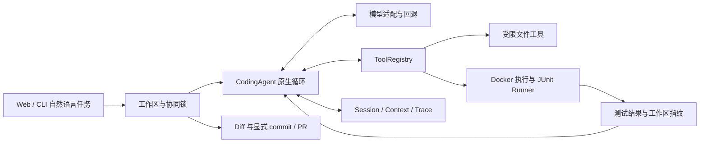

# selfForge Agent：开发规格与交付协议（SDD）

本文件是新 Agent 的**首读文档和当前任务状态的唯一维护入口**。读完即可选择下面的 Ready 任务并开始；仅在涉及具体模块时查阅链接的详细契约，不要求先遍历全部历史文档。

- 文档版本：1；更新：2026-11-12。
- 已核验产品基线：`04452154addaeff3375fcd15996585c2d5e374e3`；开工必须重新 fetch 并记录实际基线，不把这里的 SHA 当作永远最新。
- 本轮仅建立 SDD 与修正历史状态；下列未来任务**没有因写入本文件而实现**。
- 当前用户指令优先。SDD 不增加外部服务、付费模型调用、推送或合并授权，也不增加重复确认程序；沿用会话已有授权和仓库保护。

## 1. 产品目标与范围

**selfForge Agent — A Python Coding Agent with Reliable Execution and Self-Testing**。

面向 Python Git 仓库，从 Web/CLI 接收自然语言任务，在独立 worktree 中自主读、搜索、修改代码，在 Docker 中执行测试，交付可检查的 Diff、测试证据与执行轨迹；支持取消和显式恢复。PR Review、差异测试与 Repair 是专项工作流。

产品主线：**任务 → 受限工具调用 → 修改代码 → 隔离测试 → 证据验证 → 用户检查 → 显式 commit/PR**。

本阶段不增加产品 Multi-Agent、通用 MCP、额外 RAG、大型前端、跨语言 IDE 或另一套 Agent Runtime。开发者之间并行协作与产品 Multi-Agent 是两件事；是否使用子 Agent 服从当前工具/用户规则。

### 已实现与仍有边界

| 能力 | 已有实现 | 不应推断的能力 |
| --- | --- | --- |
| Runtime | 原生 tool calling、结果回填、步数/时间预算、只读/编辑失败/上下文提示 | 提示改善不等于已证明模型成功率提高 |
| 模型与界面 | OpenAI-compatible、多供应商预设/回退、模型发现、Web 工作台 | 预设不保证供应商任意账号/产品协议均兼容 |
| Harness | 持久会话/轨迹、启发式上下文压缩、取消、恢复、非空 JUnit 与工作区指纹 | 非精确 tokenizer；非断电事务；阻塞 HTTP 不保证即时取消 |
| 隔离与工作区 | Docker 默认、Host 显式信任、持久 worktree、共享协同锁、dirty guard、审计/prune | 文件指纹非原子快照；外部编辑器/Git/不同 XDG 不参与锁 |
| 环境 | 只读发现、有限锁导出、离线准备计划、wheelhouse 审计、显式镜像构建/会话绑定、声明诊断 | 不自动安装；哈希可用不等于可安装；Host markers 不等于目标容器解析 |
| 测试与交付 | Review/差异测试/Repair、worktree Diff、显式提交/PR、重试恢复、CI | 通过既有测试不代表全部需求充分验证；不自动合并 PR |
| Eval | 冻结 v2 20 题、两道独立多文件候选、无模型参考正负控、来源元数据/报告比较 | 两道新题未加入历史正式成绩；不能把旧分数当作当前 Runtime 成绩 |

已核验基线的本地完整 pytest 为 568 passed，无跳过；[基线 main CI](https://github.com/liuzhouquan/selfforge-agent/actions/runs/43135807788) 为 555 单元 + 13 Docker，无跳过。此数字仅属于上述基线，不是后续任务验收配额。历史 53/60 模型成绩及来源限制见[评测记录](./evaluation.md)。

## 2. 开工与选择任务

```sh
git status --short --branch
git worktree list
git fetch origin
git rev-parse origin/main
gh pr list --state open
```

1. 核对当前项目，不因 IDE 标签切换到其他仓库。未提交内容先确认归属；不 reset、clean 或覆盖未知文件。
2. 查开放 PR 与本表 Owner，已有工作先接手/审查，不重复实现。各 Agent 使用自己拥有的分支和 worktree。
3. 用户指定任务时执行该任务；仅说“继续开发”时，选**优先级最高、前提已满足且未被认领的一项 Ready**。完成一项后交接，不自行遍历整份路线图。
4. 领取时在本文件该任务的执行记录填 Owner、完整实际 base SHA、分支/worktree 标识、依赖与状态。不要新建一份重复规格。
5. 没有 Ready 时，先把最接近的 Waiting/Needs Design 任务补足前提/规格；不得把历史已完成项当作新任务。只有确实缺少用户决策才提问，独立工作继续推进。

创建独立工作区的例子（名称换成自己拥有且未占用的名称）：

```sh
git worktree add ../selfforge-sf-dev-01 -b feat/sf-dev-01 origin/main
```

### 状态与文档权威

当前任务状态仅在本文件维护：`Ready → In Progress → In Review → Merged`；依赖缺失为 `Waiting`，行为尚未定清为 `Needs Design`。`In Review` 不代表合并；`Merged` 必须有合并 SHA 和 PR，远端不可用时保持真实状态。

- 本文件维护产品主线、当前优先级、规格、验收及当前交接。范围变化先更新这里的原因、依赖和验收，再实施。
- [AGENTS.md](../AGENTS.md) 是自动加载的约束入口；[工程不变量](./engineering-invariants.md)是具体权限/状态/证据契约，本文件不放宽它们。发现冲突用源码/复现确认，不能自行选更宽松的一条。
- [开发指南](./development.md)保留安装与模块索引；[架构](./architecture.md)保留实现细节。只读涉及模块的部分。
- [Backlog](./backlog.md)、`docs/tasks/` 和旧审计是历史证据，不是另一个实时任务队列。历史验证保留，不能把旧结果改成新结果。
- 新任务直接增加本文件中的规格和执行记录；[旧模板](./task-template.md)只供历史记录/外部 Issue 兼容使用，不要求再复制文件。
- PR 描述引用任务 ID/验收 ID，并承载准确提交与 CI 证据；不复制整份 SDD。合并时同步本文件当前状态，避免在多个文件追加竞争的“最新状态”。

## 3. 实际架构与必须保持的约束



| 改动领域 | 先读的实现（相对 `src/selfforge_agent/`） | 关键回归入口（相对 `tests/`） |
| --- | --- | --- |
| Runtime/Context | `runtime/agent.py`、`control.py`、`context.py`、`model.py` | `test_runtime_budget.py`、`test_runtime_recovery.py`、`test_context*.py` |
| 工具/隔离/证据 | `runtime/tools.py`、`execution.py`、`fingerprint.py`；`verification/` | `test_coding_evidence.py`、`test_docker_staging.py`、`test_workspace_fingerprint.py` |
| 工作区/交付 | `runtime/workspace.py`、`workspace_diff.py`、`delivery.py` | `test_workspace_prune.py`、`test_delivery_safety.py`、`test_workspace_dirty_guard.py` |
| Web/模型 | `api/app.py`、`api/coding_jobs.py`、`providers.py` | `test_coding_web.py`、`test_web_origin.py`、`test_providers.py` |
| 环境 | `runtime/environment.py`、`images.py`、`lockfiles.py` | `test_dependency_freshness.py`、`test_wheelhouse_audit.py`、`test_session_environment.py` |
| 测试生成/Repair | `coding/test_generation.py`、`coding/agent.py`、`coding/worktree.py` | `test_test_generation.py`、`test_repair_agent.py`、`test_docker_repair.py` |
| 独立 Eval | `runtime/benchmark.py`、`benchmark_diff.py` | `test_reference_validation.py`、`test_benchmark_isolation.py`、`test_benchmark_diff.py` |

不可回退的约束：

1. 保持一个通用 `CodingAgent`、共享 ToolRegistry/JUnit Runner；Repair 的独立 proposer 是现有边界，不新增竞争 Runtime。
2. Docker 是默认执行方式；Host 必须显式信任。文件保护、路径/链接校验、网络/资源限制、输出/输入/超时上限继续生效；不默认运行仓库 hooks、setup.py 或自动安装脚本。
3. `completed` 必须有非空 JUnit 成功、测试前后及当前指纹一致、非空最终答复。bash 退出 0、旧测试布尔值、LLM 自评均不能替代证据。
4. 新任务、写入/编辑尝试、持久 Host 命令或新测试之前先持久化撤销旧证据；取消、超时、异常、恢复均不能复活失效证据。
5. 保持 assistant/tool 消息成组与 user 约束；预算提示瞬态生成，不能持久化成旧预算；token 估算明确标为启发式。
6. CLI/Web 对同一工作区使用共享锁。持久 worktree 不强制删除；dirty/ignored 用户输入保留；prune 在锁内重查；commit/PR 证据只绑定实际推送 SHA。
7. 私有会话/密钥保持受限权限；trace 仅元数据，不泄漏模型正文、推理、原始错误、工具参数或私有路径。日志、密钥、依赖缓存、课程源码不提交。
8. Eval 固定源 SHA/清单/镜像，外部 holdout 与 reference 不进 Agent；基线负控与独立 visible/holdout 正控、允许修改范围、非空 JUnit 缺一不可。冻结资产/历史成绩不得覆写。
9. 缺失输入、扫描不完整和环境不可用要显式表示，不当作通过；费用未知不能编造；堆栈关联不能写成因果证明。

## 4. 下一阶段里程碑与任务队列

当前阶段目标：**使新环境可复现开发与验证，让规格能追溯到测试，并把自主编程后的回归测试验证补成可复用流程。** 不按功能数量或测试数量宣称产品完成。

| 顺序 | 任务 ID | 状态 | Owner | 前提 | 交付结果 |
| --- | --- | --- | --- | --- | --- |
| 1 | [SF-DEV-01](#sf-dev-01) | In Review | Antigravity Agent | 无 | [PR #57](https://github.com/liuzhouquan/selfforge-agent/pull/57)：新 checkout 与 CI 复用同一个固定评测源准备入口 |
| 2 | [SF-DOC-01](#sf-doc-01) | Ready | 未认领 | 本 SDD | 有界 SDD 一致性检查，阻止失配状态与虚假验收引用 |
| 3 | [SF-TEST-01](#sf-test-01) | Ready | 未认领 | 既有 Runner/worktree/指纹 | 对 Coding 修复提供独立的旧失败/新通过回归证据 |
| 4 | [SF-EVAL-08](#sf-eval-08) | Waiting | 未认领 | SF-DEV-01；固定新策略 | 新 Runtime 的后续评测规格、冻结输入和无模型预检 |

阶段完成条件：前三项验收全部闭合且已合并；新环境完整验证可复现；通用修复验证具备独立旧失败/新通过的 Docker 证据；当前规格能追溯到测试与准确提交。SF-EVAL-08 是后续测量准备，仍不代表产品的真实任务可靠性已经达标。

上表是计划，不是已实现列表。需要并行认领时先核对开放 PR；状态/Owner 回填到同一行。多个分支基于最新 main 开发，合并前更新基线并复查公共入口，不机械拼接表尾。

### SF-DEV-01

**目标：** 新 checkout 不依赖开发者 `.local` 缓存即可按明确命令准备两道候选的固定源；CI 复用同一准备入口。只显式获取 Git 对象，不执行外部代码。

**范围/入口：** 新建 `scripts/prepare_eval_sources.py`，参数 `--root PATH`、`--timeout SECONDS`（总预算，默认 120，合法范围 1–300）、`--offline`。固定登记 jmespath/boltons 的现有 URL 与清单修订；复用 `.github/workflows/ci.yml` 的策略、`tests/conftest.py` 的 `SELFFORGE_EVAL_SOURCE_ROOT`。不开发任意 URL 下载器/新缓存平台，不安装项目依赖、不调用模型。

**行为：** 显式在线模式仅 fetch 固定 URL/SHA，并创建可被独立 clone 获取的 named ref；已有完整缓存离线可用且不变更其 HEAD。缺失缓存离线失败。拒绝 symlink 根/目标、非本任务拥有的已有非仓库目录和缺少预期来源的缓存；不删除/重置已有文件。用 argv subprocess、总 deadline 和有界输出；失败退出非零，不伪报 ready。首次创建需标记本入口拥有的目录；失败留下可诊断但不执行的状态。

| 验收 ID | Given / When / Then | 最少证明方式 | 初始证据 |
| --- | --- | --- | --- |
| SF-DEV-01-A1 | 空临时根显式在线准备后，两固定提交能从生成仓库独立 clone/checkout | `tests/test_eval_source_preparation.py`；本地 Git remote 替身测控制流，CI 实际固定 URL | E1（本地控制流与 CI 真实固定 URL 均通过） |
| SF-DEV-01-A2 | 已有合格缓存使用 `--offline`，成功且不联网、不改变用户 HEAD/文件 | 同文件 CLI 回归 + 前后状态；替身阻断 fetch | E2（本地通过） |
| SF-DEV-01-A3 | 超时、坏源、缺提交、离线缺缓存、symlink/未知目录输入均失败，保留已有内容 | 同文件错误注入；可观察退出码与磁盘内容 | E3（本地通过） |
| SF-DEV-01-A4 | 新 checkout 按文档先准备再运行全部测试；CI 不再复制 fetch 命令 | 真实 CI + Docker 两候选控制；不需要模型密钥 | E4（本地与 CI Docker 集成均通过） |

| 记录 | 验收 ID | 测试节点 / 实际入口 | 命令与环境 | 验证 SHA / 结果 / CI |
| --- | --- | --- | --- | --- |
| E1 | SF-DEV-01-A1 | `tests/test_eval_source_preparation.py::test_online_preparation_creates_cloneable_repos_and_ownership_marker`、`tests/test_eval_source_preparation.py::test_pinned_sources_match_candidate_manifests_and_policy`、`tests/test_eval_source_preparation.py::test_default_root_uses_env_var_and_cli_subprocess`、`tests/test_eval_source_preparation.py::test_online_fetch_into_existing_repo_preserves_head_and_candidate_branch`；GitHub Actions `Provision pinned multi-file candidate sources` | Host 本地 Git remote 替身 + `git clone --no-local`；GitHub `ubuntu-latest` CI 真实拉取 pinned GitHub URL；[PR #57](https://github.com/liuzhouquan/selfforge-agent/pull/57) | 源码 SHA `57117238f34c9082b5ce3b3b9e6b1931f2b0549d`；本地专项 18 passed / 非集成 573 passed, 13 deselected / Ruff passed；CI [Run #43150979908](https://github.com/liuzhouquan/selfforge-agent/actions/runs/43150979908) 真实固定 URL 准备成功（jmespath `2812594e69d43098ef60f81f4efc404c071b0418`、boltons `d31d821d56c8f7756af9c30a864077f2e5855321`） |
| E2 | SF-DEV-01-A2 | `tests/test_eval_source_preparation.py::test_offline_mode_succeeds_without_fetch_and_preserves_user_head_and_files` | Host 本地缓存 + git wrapper 阻断 mutating/fetch 命令 + 前后 HEAD 与文件比对；[PR #57](https://github.com/liuzhouquan/selfforge-agent/pull/57) | `57117238f34c9082b5ce3b3b9e6b1931f2b0549d`；本地与 CI [Run #43150979908](https://github.com/liuzhouquan/selfforge-agent/actions/runs/43150979908) passed（573 passed, 13 deselected） |
| E3 | SF-DEV-01-A3 | `tests/test_eval_source_preparation.py::test_invalid_timeout_cli_rejected`、`tests/test_eval_source_preparation.py::test_timeout_kills_slow_git_and_leaves_diagnosable_unready_state`、`tests/test_eval_source_preparation.py::test_online_bad_remote_and_missing_commit_fail_and_recover_on_retry`、`tests/test_eval_source_preparation.py::test_run_git_stdout_overflow_fails_closed`、`tests/test_eval_source_preparation.py::test_offline_rejects_missing_cache_bad_origin_and_orphan_commit`、`tests/test_eval_source_preparation.py::test_rejects_symlinks_unknown_dirs_and_nested_parent_repo_without_modification`、`tests/test_eval_source_preparation.py::test_bounded_output_and_corrupt_state_file_fail_closed` | Host CLI 子进程退出码、超时期限进程组终止、错误注入与磁盘内容保留检查；[PR #57](https://github.com/liuzhouquan/selfforge-agent/pull/57) | `57117238f34c9082b5ce3b3b9e6b1931f2b0549d`；本地与 CI [Run #43150979908](https://github.com/liuzhouquan/selfforge-agent/actions/runs/43150979908) passed（573 passed, 13 deselected） |
| E4 | SF-DEV-01-A4 | `tests/test_eval_source_preparation.py::test_ci_workflow_uses_shared_prepare_eval_sources_script`；`.github/workflows/ci.yml`（`Lint` / `Unit tests` / `Build sandbox image` / `Provision pinned multi-file candidate sources` / `Docker integration tests`） | 本地 Ruff + 非集成全量 + CI 真实 Docker 集成测试（`uv run --no-sync pytest -q -m integration`）；本机 WSL2 未安装 `docker`，Docker 集成由 CI 完成；[PR #57](https://github.com/liuzhouquan/selfforge-agent/pull/57) | `57117238f34c9082b5ce3b3b9e6b1931f2b0549d`；CI [Run #43150979908](https://github.com/liuzhouquan/selfforge-agent/actions/runs/43150979908) 全绿：Lint passed、Unit tests `573 passed, 13 deselected`、Docker integration tests `13 passed, 573 deselected`（含 jmespath 与 boltons 候选控制） |

执行记录（Owner/状态以上表为准）：Base=`e07153e092150ab2d1f86aa98545a676836b6e14`；Branch=`feat/sf-dev-01`；Worktree=`selfforge-sf-dev-01`；PR=[#57](https://github.com/liuzhouquan/selfforge-agent/pull/57)。先核对两项固定 SHA 与 `--no-local` clone 行为并先红后绿实现共享脚本；首次推送 `8d91cc5a848b50d9296c6494d1e3c10824f0d98f` 在 CI `Run #43150067989` 因冗余 shebang 触发 Ruff `EXE001` 失败，移除后在源码提交 `57117238f34c9082b5ce3b3b9e6b1931f2b0549d` 通过本地回归与 CI `Run #43150979908` 全套验证（仅保留一份共享实现与一份准备文档）。

```text
Owner / 状态：Antigravity Agent / In Review
实际 base SHA / 分支及 worktree 标识 / 当前 HEAD：e07153e092150ab2d1f86aa98545a676836b6e14 / feat/sf-dev-01 (worktree: selfforge-sf-dev-01) / 已验证源码提交 57117238f34c9082b5ce3b3b9e6b1931f2b0549d（本交接提交仅含 docs/SDD.md 文档差异）
已完成验收与证据 ID：完成 E1（控制流、独立 clone 与 CI 真实固定 URL）、E2（--offline）、E3（超时/坏源/缺提交/symlink/未知目录/有界输出）与 E4（CI Provision pinned multi-file candidate sources + Docker integration tests）；源码提交 57117238f34c9082b5ce3b3b9e6b1931f2b0549d 通过本地 Ruff / 18 项专项 / 573 项非集成单测，以及 GitHub Actions Run #43150979908 全套 CI（573 非集成 + 13 Docker 集成全通过，无跳过）
未完成 / 环境限制 / 未提交内容归属：本地 WSL2 环境未安装 docker 命令，`-m integration` 13 项测试已在 GitHub Actions ubuntu-latest 真实 Docker 环境中通过；PR #57 当前处于 In Review，未获合并授权，未合入 main。无未提交内容。
PR / 准确 head CI / merge SHA（有则填）：PR #57 (https://github.com/liuzhouquan/selfforge-agent/pull/57) / 源码提交 57117238f34c9082b5ce3b3b9e6b1931f2b0549d CI: https://github.com/liuzhouquan/selfforge-agent/actions/runs/43150979908（本 docs-only 状态提交 push 后的准确 PR head CI 见 PR #57 Checks 及描述补充）/ 未合并
仍在运行的本任务进程或 CI（无则写无）：无
下一步：待审阅并获授权后合并 PR #57，合并后回填 merge SHA 并将状态更新为 Merged，同时评估 SF-EVAL-08 是否具备转 Ready 条件。
```

### SF-DOC-01

**目标：** 将本文件的状态和验收约定变成可执行门禁，而非靠审查者记忆。

**范围/入口：** 新建标准库脚本 `scripts/check_sdd.py --root PATH`（默认仓库根），只检查本文件明确规定的表格/锚点/证据格式和本地引用；新建 `tests/test_sdd_contract.py`，在既有 CI 调用。限制文档读取总量 4 MiB；不执行文档命令、不请求 GitHub、不调用模型、不做通用 Markdown 平台。扫描仓库内路径，不跟随越界链接。

**最低规则：** 队列 ID 唯一；状态属于本节枚举；每个排队任务有同名规格节；验收 ID 唯一；In Progress/In Review 有 Owner 与实际 base；Merged 有 PR/完整 merge SHA；声明通过的验收有真实 `file.py::test_name`（参数化基名可用）、命令、验证 SHA 与结果/CI 引用。文件和测试节点存在仅表示可追溯，**不能证明测试执行或语义充分**。`待实现/未验证` 可留在 Ready/Waiting，不能当作通过证据；历史快照不按实时任务误报。

| 验收 ID | Given / When / Then | 最少证明方式 | 初始证据 |
| --- | --- | --- | --- |
| SF-DOC-01-A1 | 当前合法 SDD 通过；重复 ID、坏状态、缺规格/验收引用均非零 | `tests/test_sdd_contract.py` 临时规格夹具，逐项反例 | 未验证；节点待实现 |
| SF-DOC-01-A2 | 标为通过却引用不存在测试/缺验证 SHA，或 Merged 缺 PR/SHA，被拒绝 | 同文件错误夹具；不能为通过而弱化规则 | 未验证；节点待实现 |
| SF-DOC-01-A3 | 有界读取、越界/symlink 输入失败；不运行任何文档命令 | 同文件权限/限额/副作用回归 | 未验证；节点待实现 |
| SF-DOC-01-A4 | CI 实际运行该检查；文档明确其只检查一致性、不证明测试语义 | 实际 CI 与输出摘要 | 未验证 |

执行记录（Owner/状态以上表为准）：Base=领取时填写；Branch/PR=无。检查器尚未实现，本轮已有 CI 仍只有安装、Ruff、单元与 Docker 检查。实现时可把本文件执行记录规范成严格小表，不引入第二份状态存储或照搬整个规格框架。

### SF-TEST-01

**目标：** 为通用 Coding 修复验证一个显式提供的 pytest 回归用例，得到“原代码断言失败、修复后通过”的独立证据。它不同于现有 PR 风险流程的“Base 通过、Head 失败”，不能反转/破坏原流程。

**拟议公开契约（当前未实现）：** CLI `test-regression --repo PATH --session ID --test-file PATH --timeout SECONDS`；API `POST /api/code/workspaces/{session_id}/validate-regression`，JSON 为 `repository`、`test_file`、`timeout`（默认 60，范围 1–180，总预算）。二者共享一个服务，返回 `status`（`confirmed/inconclusive/error`）、`base_sha`、`workspace_sha256`、`test_sha256`、`base_result`、`repaired_result`、固定分类 `reason`。CLI 对应退出码 0/1/2。JSON 不回显测试源码/私有错误正文；该 API 仍仅本机可用。

**范围/入口：** 从 `CodingWorkspaceManager` 取得持久工作区及初始 base，持共享锁；显式读取一个有界、非 symlink 的 Python 候选文件（最多 8 KiB），保留 protected-path 边界。在两份独立快照运行相同测试：原 committed base 与当前修复内容。复用 `coding/test_generation.py`、`coding/worktree.py`、`runtime/fingerprint.py`、`verification/runner.py` 和既有 Docker staging；不得新建 Runner/Agent。只用当前会话绑定镜像，默认 Docker，不新增 Host 分支。

**证据：** 仅 base 非空运行且有断言失败、无收集错误，修复副本非空 JUnit 全通过，且快照/当前工作区指纹一致时 `confirmed`。空测试、全 skip、收集失败、超时、内容变化均不能确认。候选只进入临时副本，不落入用户 worktree；结果单独记录，不自动授予 Runtime `completed` 或 commit/PR 资格。保持旧证据/状态不被此只读验证错误覆盖。

| 验收 ID | Given / When / Then | 最少证明方式 | 初始证据 |
| --- | --- | --- | --- |
| SF-TEST-01-A1 | 临时真实 Git bug + 未提交修复 + 同一回归测试，旧断言失败/新非空通过，confirmed | `tests/test_coding_regression_validation.py` + Docker 集成；CLI/API 响应均断言字段 | 未验证；节点待实现 |
| SF-TEST-01-A2 | 旧也通过、新失败、空/all-skip/收集错误均不可确认；超时明确 error | 同文件独立反例，保留 Runner 真实状态 | 未验证；节点待实现 |
| SF-TEST-01-A3 | 忙碌工作区、越界/受保护/symlink/超限候选、镜像缺失或会话不匹配被拒绝 | CLI 非零/API 4xx；发生在模型/外部测试执行前 | 未验证；节点待实现 |
| SF-TEST-01-A4 | 两份测试互不污染；执行期间内容变化撤销确认；结束/失败后临时资源释放且用户文件不变 | 故障注入/指纹/磁盘对比；现有 Review/Repair 回归 | 未验证；节点待实现 |

执行记录（Owner/状态以上表为准）：Base=领取时填写；Branch/PR=无。不在本任务增加测试自动生成模型循环、覆盖率平台或新前端。UI 接入、自动候选生成另立规格；保留现有 Web Coding 主入口。

### SF-EVAL-08

**目标：** 为新 Runtime 准备下一轮可复现评测；本任务只冻结新规格、来源和无模型参考资格，不运行整套付费模型测量。

前提：SF-DEV-01 合并；明确选择历史 20 题或扩展候选集、使用的新镜像 ID、供应商/模型/回退策略、步数/时间/上下文预算、重复次数、全部失败分类。历史 v2 字节/53/60 不变；新输入/策略必须新清单与哈希。

| 验收 ID | Given / When / Then | 最少证明方式 | 初始证据 |
| --- | --- | --- | --- |
| SF-EVAL-08-A1 | 新策略有明确任务/允许路径/预算/重复/失败口径与资产哈希；与历史可区分 | 新 manifest/资产索引结构回归 + 旧资产哈希保持 | 未验证；前提未满足 |
| SF-EVAL-08-A2 | 所选任务都通过独立 Docker 参考正负控，报告来源明确且无模型构造 | 既有 `eval-validate`；记录实际镜像、源 SHA、报告哈希 | 未验证；前提未满足 |
| SF-EVAL-08-A3 | 后续真实模型运行单独列执行计划、有效供应商及调用/时间/费用上限；没有结果不填成绩 | 策略审查；本任务不得写成已完成模型评测 | 未验证；前提未满足 |

执行记录（Owner/状态以上表为准）：Base/Branch/PR=无。SF-DEV-01 合并后核对依赖并补全具体冻结策略，才能改 Ready；不要因拥有 API Key 就把付费整套测量包含进本任务。

## 5. 验收追踪与执行记录格式

每项验收使用全局 ID `任务ID-A序号`，实现后把上表“初始证据”替换为相应记录 ID（如 E1）。在**同一规格节**追加以下表，不要求再建 task 文件：

| 记录 | 验收 ID | 测试节点 / 实际入口 | 命令与环境 | 验证 SHA / 结果 / CI |
| --- | --- | --- | --- | --- |
| E1（模板，未执行） | 所属任务-A1 | `tests/实际文件.py::实际测试函数` | 完整命令；mock/Host/Docker/真实服务分清 | 完整实际 SHA；passed/failed/skipped；真实 CI 链接 |

不能将模板当作通过：

- 对缺陷先保存旧实现的实际失败证据，再记录修复后同用例成功；新功能证明关键反例能区分未实现行为。
- 直接关联具体测试节点，不能仅写“全套通过”。CLI/API 消费者、错误/边界/恢复路径都需覆盖，不能仅测内部 helper。
- 记录对应测试树/提交、环境/镜像和命令；历史数目不相加，skip 不算通过。源码再改动后原证据失效，按相关风险重跑；仅文档变化不要求重复本地 pytest。
- 自引用问题：提交时不可能预知自身 SHA。记录被验证的源码提交 S；最后的状态/证据提交可另有 SHA，写明仅文档差异；最终 PR head H 的 CI 必须另记。不要为了填 SHA 反复改同一提交或伪造值。
- Merged 后填准确 merge SHA/PR，验收完整才闭合；合并后的 main CI 结果放 PR 交付记录，并在此链接。历史旧 Handoff 改为历史标签，不能继续充当当前状态。
- 合并 SHA 只能在合并后取得：源 PR 合并前保持 In Review；合并后由 Owner 用后续 docs-only 状态提交回填源 merge SHA/PR，状态提交不另建开发任务，也不递归记录自身 SHA。若用户先在网页合并，下一位 Agent 开工先对账补齐，再领取任务。当前没有 GitHub 事件自动同步状态的能力，不能声称文档会自动保持最新。
- 本规则目前主要人工审查；自动检查属于 SF-DOC-01，检查器不能替代实际测试/审查。

已合并行为的追踪示例（现有节点，不是未来任务的证据）：

| 行为 | 具体测试节点 | 已核验版本/证据 |
| --- | --- | --- |
| 无效声明不能报告 fresh | `tests/test_incoming_environment_regressions.py::test_invalid_declarations_fail_closed` | 产品基线 SHA；[PR #51 CI](https://github.com/liuzhouquan/selfforge-agent/actions/runs/43134720223)及基线 main CI |
| 不完整存储扫描保留 unknown quota | `tests/test_incoming_storage_regressions.py::test_api_preserves_incomplete_scan_and_unknown_quota` | 产品基线 SHA；[PR #54 CI](https://github.com/liuzhouquan/selfforge-agent/actions/runs/43135327949)及基线 main CI |
| 压缩/恢复后提示描述实际历史 | `tests/test_runtime_token_guidance.py::test_first_compacted_request_and_resume_report_actual_history` | 产品基线 SHA；[PR #53 CI](https://github.com/liuzhouquan/selfforge-agent/actions/runs/43134727156)及基线 main CI |

## 6. 安装与验证门槛

Python 3.11+、Git、uv；CI 为 Python 3.12。仓库未配置类型检查器，Ruff 不能称作类型检查。

```sh
uv sync --locked --dev
uv run --no-sync ruff check .
# 修改行为时，先运行该验收具体节点，再做最终完整组合
uv run --no-sync pytest -q -m 'not integration'
```

Docker 集成还需 daemon、镜像与固定评测源。按[评测准备说明](./benchmark.md#multi-file-candidate-qualification)使用共享准备入口（默认 `.local/benchmark/repos`，或 `--root` / `SELFFORGE_EVAL_SOURCE_ROOT`；已有合格缓存可传 `--offline`）：

```sh
docker build -t selfforge-agent-sandbox:latest -f docker/Dockerfile .
uv run --no-sync python scripts/prepare_eval_sources.py
SELFFORGE_EVAL_IMAGE=selfforge-agent-sandbox:latest uv run --no-sync pytest -q
```

`SELFFORGE_EVAL_SOURCE_ROOT` 可指向已有合格缓存父目录。镜像覆盖会生成独立临时清单/哈希，不是历史冻结镜像重测；不得把本命令写成历史模型成绩。无需 API Key。离线无缓存时明确缺少固定源，不能静默改 Host 或删除集成测试。

按改动执行：源代码需相关回归 + 最终完整 pytest + Ruff；CLI/API 需实际序列化/退出码；JS 需 `node --check src/selfforge_agent/api/static/app.js`，交互需浏览器 smoke 或明确未覆盖；文档-only 检查本地链接/锚点、源码/测试引用、状态与 `git diff --check`。CI 的不重叠单元/Docker 两组可证明完整集合，不能相加不同版本的结果。构建网络只用于明确准备；被测仓库代码仍在无网络 Docker 中运行。

## 7. 审查、合并与交接

交付前逐条核对：范围/依赖、每个验收 ID 的证据、异常/取消/部分写入、权限和内容证据、消费者、敏感 diff、旧回归和历史成绩。不得删测试/弱化断言来换通过。

按当前会话授权提交/PR/合并；接手他人分支保留原提交，修复另加提交。只合并已审查、准确 head CI 通过的提交。若 main 前进，解决语义冲突，保留所有有效行为，验证组合；不使用强推/强制清理绕过。多 PR 按显式依赖排序，最后核对 main tree 和 main CI。

每次结束在**当前规格节**追加交接：

```text
Owner / 状态：
实际 base SHA / 分支及 worktree 标识 / 当前 HEAD：
已完成验收与证据 ID：
未完成 / 环境限制 / 未提交内容归属：
PR / 准确 head CI / merge SHA（有则填）：
仍在运行的本任务进程或 CI（无则写无）：
下一步：一条具体操作，不能只写“继续完善”。
```

新 Agent 先核对 Git/PR/CI 的实时状态，再信任旧交接。模板不是权限确认流程；已有授权范围内的常规设计和可逆修复自主完成。

## 8. 已合并状态快照与历史资料

以下是产品基线时的状态，供避免重复开发；完整早期已完成项保留于[历史 Backlog](./backlog.md)。不得从旧任务卡顶部/旧 Handoff 复活任务。

| 任务 ID | 状态 | PR | 合并 SHA |
| --- | --- | --- | --- |
| SF-PROV-01 | Merged | [#55](https://github.com/liuzhouquan/selfforge-agent/pull/55) | `944cfca4c1196fdb69ec29d6e23ea9b6a0e267cc` |
| SF-EVAL-06 | Merged | [#48](https://github.com/liuzhouquan/selfforge-agent/pull/48) | `9e791cdd74920f57fa9a65347af613ba17ec51f3` |
| SF-RUN-05 | Merged | [#49](https://github.com/liuzhouquan/selfforge-agent/pull/49) | `34d34681e4631a168197c6decdbe7f26b6cee292` |
| SF-WS-03 | Merged | [#50](https://github.com/liuzhouquan/selfforge-agent/pull/50) | `873ee43c92d0be4ec260b97bd24cfcf428863180` |
| SF-ENV-06 | Merged | [#51](https://github.com/liuzhouquan/selfforge-agent/pull/51) | `c9bba482e30187755017d4b505aa5bb04fb30e34` |
| SF-EVAL-07 | Merged | [#52](https://github.com/liuzhouquan/selfforge-agent/pull/52) | `4f3af88285db99b9d8f49a2185471bad6b0a0500` |
| SF-RUN-06 | Merged | [#53](https://github.com/liuzhouquan/selfforge-agent/pull/53) | `17f9d14094a707a0afe392fb86fd5aa10b2d0db1` |
| SF-WS-04 | Merged | [#54](https://github.com/liuzhouquan/selfforge-agent/pull/54) | `04452154addaeff3375fcd15996585c2d5e374e3` |

整合问题、修复与验证见 [PR #48–#54 审查](./review-pr48-54.md)。这里只引用已有证据，不把实现过程中的历史失败删除或重新计分。

## 9. 可直接复制的接手指令

```text
继续开发 selfForge Agent，以 docs/SDD.md 为统一规格和当前状态入口。
先核对 Git、origin/main、未提交改动和开放 PR；使用自己的 worktree。
执行用户指定任务；否则只领取最高优先级、未认领且前提满足的一项 Ready。
在该规格节登记 Owner/base/分支，按验收 ID 写有区分能力的回归，复用既有 Runtime/Runner。
保持 SDD 的权限、状态恢复和测试证据约束；只查涉及模块的详细契约。
用测试节点、命令、实际 SHA 与 CI 回填每条验收，未验证不能写通过。
只交付这一项任务；按本会话授权提交/PR/整合，同步 SDD 状态并留下具体下一步。
不要重复创建 task 文件，不把历史成绩或计划中的能力描述为当前已实现。
```
